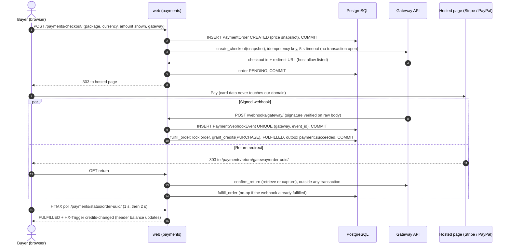

# ADR-0007: Payment gateway adapter (Stripe + PayPal)

Decides how credit packs are paid for: hosted, redirect-based checkouts from Stripe and PayPal behind one `PaymentGateway` port, with credits granted only after server-to-server verification, exactly once per gateway payment.

Status: Draft v0.1 (2026-10-21)

| | |
|---|---|
| Decision status | Proposed (confirmed by the M5 contract suite, the webhook fixture matrix and the SAQ A evidence pack) |
| Date | 2026-10-21 |
| Deciders | Tech Lead (owner); Finance and PO acknowledge the SRS deviation |
| Consulted | Security (PCI), Finance, QA, Platform |
| Supersedes / superseded by | — |
| Requirements | SRS §6.2 (packages, localised currency), §6.3 (at least two global gateways, tokenisation, webhooks), §6.4 (credits within 5 s, verified with the gateway), §6.5 (payment method in history), §9.3 (PCI DSS; no raw card data); FR-PAY-02 to FR-PAY-06, NFR-SEC-03, NFR-PERF-01.3/01.4, NFR-AVAIL-01.8 |
| Gap / open question | [GAP-09](../requirements/03-gap-analysis-and-decisions.md#gap-09), [GAP-13](../requirements/03-gap-analysis-and-decisions.md#gap-13), [GAP-14](../requirements/03-gap-analysis-and-decisions.md#gap-14), [GAP-31](../requirements/03-gap-analysis-and-decisions.md#gap-31) (known issues #9, #13, #14); OQ-03 to OQ-07, A-8 (tax) |
| Related | [Payments design](../design/07-payments-and-credit-purchase.md) (§6 port, §7 order lifecycle, §10 webhooks, §11 fulfilment, §14 reconciliation, §17 PCI) · [Security §9 PCI](../quality/01-security-and-compliance.md#9-pci-dss-scope-saq-a) · [Testing §8–9](../delivery/04-testing-strategy.md#9-contract-tests-for-adapters) · [01 §6.1, §9, §16](../architecture/01-system-architecture.md#61-app-catalogue) · [ADR-0005](0005-postgres-row-locking-credit-ledger.md) · [ADR-0006](0006-celery-redis-transactional-outbox.md) |

## Context and problem statement

Users buy integer credit packs (for example 20, 50, 120) priced per currency from an explicit price book (SRS §6.2, known issue #13). The SRS requires at least two "major, globally recognized" gateways with tokenisation and webhooks (§6.3), credits on the balance within 5 seconds of a confirmed payment, "verified via the payment gateway's webhook" (§6.4), and PCI DSS compliance with no raw card data on our servers (§9.3).

The gateways work differently:

| Aspect | Stripe Checkout | PayPal Orders v2 |
|---|---|---|
| Start | Create a Checkout Session; redirect to `checkout.stripe.com` | Create an order (`intent = CAPTURE`); redirect to the PayPal approval page |
| When money moves | On Stripe's hosted page | Only when **we** call capture after the buyer approves |
| Return verification | Retrieve the session (read-only) | Capture the approved order (idempotent) or read it if already captured |
| Webhook authentication | HMAC signature header with timestamp tolerance (`stripe.Webhook.construct_event`) | Call PayPal's verify-webhook-signature API |
| Amount format | Integer minor units | Decimal string with the currency's decimals |
| Idempotency | `Idempotency-Key` header | `PayPal-Request-Id` header |

A local gateway (Razorpay) may be needed if India becomes a launch market (OQ-07). Credits must only ever enter a wallet through `credits.services.grant_credits` ([ADR-0005](0005-postgres-row-locking-credit-ledger.md)).

**Question:** how do we integrate two or more gateways so that the purchase path keeps PCI scope minimal, grants credits only for verified payments and exactly once, meets the 5-second target, and stays testable and extensible?

## Decision drivers

1. **Minimal PCI scope:** SAQ A, no cardholder data on our pages or servers (SRS §9.3, NFR-SEC-03).
2. **Two gateways in every launch market**, with one gateway's outage leaving the other usable (SRS §6.3, NFR-AVAIL-01.8).
3. **Credits only after server-to-server verification**, exactly once per gateway payment (SRS §6.4, FR-PAY-04.2/04.3).
4. **Allocation within 5 s** at p99 (FR-PAY-04.1).
5. **Testability:** deterministic local, CI and E2E runs without sandboxes; one contract suite for every adapter.
6. **Isolation of vendor SDK churn** (rule R11) and pinned gateway API versions.
7. **Extensibility:** a local gateway (Razorpay), and a future lister-pays model ([GAP-01](../requirements/03-gap-analysis-and-decisions.md#gap-01)) buying credits through the same flow.

## Considered options

1. **Port and adapters with hosted redirect checkouts:** a `PaymentGateway` protocol and registry; `StripeGateway` (Checkout), `PayPalGateway` (Orders v2), optional `RazorpayGateway`; a `FakeGateway` for tests.
2. **Direct SDK calls** in `payments.services` with hosted checkouts, without a port.
3. **Embedded payment UI** (Stripe Payment Element, PayPal JS SDK buttons or card fields) behind an adapter.
4. **One provider for all methods:** Stripe only, offering PayPal as a Stripe payment method where Stripe supports it.
5. **Merchant of record or payment-orchestration platform** that fronts several processors.

## Decision outcome

**Chosen option 1.** Full-page redirects to PCI-validated hosted pages keep us in the simplest SAQ A posture with a strict, first-party-only CSP on our purchase pages. The port lets us treat "verified payment" as one normalised fact, so a single idempotent `fulfill_order` serves webhooks, return redirects, polling and reconciliation alike, and the same contract suite exercises every adapter and the fake.

### The port (summary)

The full illustrative code is in the [payments design §6.1](../design/07-payments-and-credit-purchase.md). Vendor SDKs (`stripe`, `paypal-server-sdk`, `razorpay`) are imported only under `apps/payments/gateways/` (import-linter `forbidden` contract, [01 §10](../architecture/01-system-architecture.md#10-modular-monolith-boundary-rules)).

| Method | Purpose | Network effect |
|---|---|---|
| `supports(currency, country)` | Market and currency availability | None |
| `assert_chargeable(amount_minor, currency)` | Gateway minimums and currency exponent checks | None |
| `create_checkout(order, return_url, cancel_url)` → `CheckoutSession` | Start the hosted flow from **our** order snapshot | Creates the session/order (idempotent key `checkout:<order uuid>`) |
| `confirm_return(order, params)` → `PaymentVerification` | Server-side verification on the return redirect | Stripe: retrieve. PayPal: capture (idempotent) |
| `verify_payment(order)` → `PaymentVerification` | Read-only status for polling and reconciliation | Retrieve |
| `cancel_checkout(order)` → `bool` | Make sure no payment can happen any more | Stripe: expire the session. PayPal: none needed (we never capture) |
| `parse_webhook(body, headers)` → `GatewayEvent` | **Verify the signature first**, then normalise the event | PayPal: verify-signature API call |
| `list_transactions(start, end)` | Daily three-way reconciliation | List/search |

`PaymentVerification` and `GatewayEvent` are normalised value objects (`status`/`kind`, `order_reference`, `gateway_payment_id`, `amount_minor`, `currency`, `method_summary` such as "Visa •••• 4242", `payer_country`, `failure_category`, refund and dispute fields). Callers never see vendor objects.

### Purchase sequence

### Invariants

| # | Invariant | Mechanism |
|---|---|---|
| P1 | Price shown = price charged | The order snapshots package, credits, `amount_minor` and currency before any gateway call; a stale posted amount raises `PriceChangedError` |
| P2 | No network I/O inside a transaction | Two short transactions around `create_checkout`; gateway calls in `confirm_return` and reconciliation run before the fulfilment transaction |
| P3 | Credits only for gateway-verified payments | Fulfilment triggers: verified webhook, server-side return verification, the status-poll verifier, reconciliation. Browser parameters alone never grant anything |
| P4 | Exactly one grant per gateway payment | Order row lock and status check; `UNIQUE (gateway, gateway_payment_id)` on `PaymentOrder`; ledger `idempotency_key = pay:<gateway>:<gateway_payment_id>` |
| P5 | Snapshot integrity | Echoed order reference, amount and currency must match the order; any mismatch → `NEEDS_REVIEW`, fraud flag, no credits (FR-PAY-04.5) |
| P6 | Money is never dropped | A success signal for a `CANCELLED`, `EXPIRED` or `FAILED` order goes to `NEEDS_REVIEW` for Finance, never silently ignored |
| P7 | Lock order | Order row, then wallet row (inside `grant_credits`), for fulfilment, refunds and disputes alike; prevents deadlocks ([ADR-0005](0005-postgres-row-locking-credit-ledger.md)) |
| P8 | Webhooks are durable before 2xx | Signature verified on the raw body, event stored with `UNIQUE (gateway, event_id)`, then processed. 2xx means "recorded"; processing failures are retried by our sweeper, not the gateway's |
| P9 | Out-of-order events are harmless | Latency-critical success events act on the signed payload; refunds, disputes and expiries re-fetch the current object first ("fetch before act") |
| P10 | Bounded external calls | Connect 2 s, read 5 s; per-gateway circuit breaker; retries only with idempotency keys; Stripe API version pinned in code |
| P11 | Redirect targets are trusted | `redirect_url` host checked against `ALLOWED_REDIRECT_HOSTS[gateway]` |
| P12 | Two gateways per launch market | Registry `PAYMENTS_GATEWAYS_BY_MARKET`; a Django system check fails startup if a launch market has fewer than two configured gateways |
| P13 | Receipts after commit | `payment.succeeded` through the outbox ([ADR-0006](0006-celery-redis-transactional-outbox.md)); gateway-sent receipts are off to avoid duplicates |

**Reconciliation:** `payments.reconcile_pending_orders` every 5 minutes re-verifies orders `PENDING` for more than 10 minutes (and `CREATED` orders older than 30 minutes); `payments.reconcile_daily` compares gateway transactions, orders and `PURCHASE`/`REVERSAL` ledger entries and pages on critical discrepancies ([payments design §14](../design/07-payments-and-credit-purchase.md)).

**PCI DSS:** SAQ A. Purchase pages load first-party scripts only (`script-src 'self'`, `frame-src 'none'`, `form-action` limited to our origin and the gateway hosts), a CI test pins their script inventory, and a daily synthetic check compares it with the release ([payments design §17](../design/07-payments-and-credit-purchase.md)).

**Fake gateway:** `FakeGateway` implements the whole port with deterministic scenarios (`paid`, `declined`, `pending`, `webhook_delayed`). It is selected by settings in local, CI and E2E runs and must pass the same contract suite as the real adapters.

### Consequences

- **Positive:**
  - SAQ A: the smallest PCI DSS scope available to a merchant that takes cards.
  - One fulfilment path for all gateways and all triggers; exactly-once is enforced by constraints, not by timing.
  - A gateway outage degrades to "use the other gateway"; adding Razorpay or another processor is an adapter plus registry entry.
  - The purchase flow does not care which ledger entry type later consumes the credits, so a post-MVP lister-pays model needs no payment changes.
- **Negative:**
  - The buyer leaves our site for the hosted page, which can cost some conversion compared with an embedded form. *Mitigation:* hosted pages are mobile-optimised and localised, Stripe Checkout offers Apple Pay and Google Pay, and our purchase funnel is at most three interactions ([payments design §5.2](../design/07-payments-and-credit-purchase.md)).
  - The port is a lowest common denominator; gateway-specific features (saved cards, subscriptions) need port extensions. *Mitigation:* none are in MVP scope; extend the port when a feature is approved.
  - PayPal webhook verification costs an API round trip (budget 1.5 s) and fails closed (503) when PayPal's API is down. *Mitigation:* the return-redirect path and reconciliation still fulfil; offline certificate verification is a later optimisation.
  - Two live integrations and their sandboxes to maintain. *Mitigation:* nightly contract tests against the sandboxes; recorded webhook fixtures in CI.
- **Neutral:** tax on credit purchases (A-8) is unresolved. If Stripe Tax or a tax adviser is chosen, it is adapter configuration and price-book data, not a change to this decision.

### Confirmation

- **Contract suite** ([testing §9](../delivery/04-testing-strategy.md#9-contract-tests-for-adapters)): `FakeGateway` on every PR; Stripe and PayPal sandboxes nightly.
- **Webhook matrix** ([testing §8](../delivery/04-testing-strategy.md#8-payment-webhook-tests-with-recorded-fixtures)): replays, bad signatures, out-of-order refunds, unknown orders, webhook-before-return and return-before-webhook all give one `PURCHASE` entry or none.
- **Latency:** `payment_fulfillment_latency_seconds` p99 ≤ 5 s on staging in M5 and in production; alert at p99 > 5 s for 10 minutes.
- **PCI:** US-514 SAQ A evidence pack signed before go-live; the purchase-page script-inventory test is CI-blocking.
- **Boundaries:** import-linter forbids gateway SDK imports outside `apps/payments/gateways/`.
- **Reconciliation** runs clean in staging for two consecutive weeks before go-live.

## Pros and cons of the options

### 1. Port and adapters, hosted redirects (chosen)

- Good, because SAQ A with no third-party JavaScript on our pages.
- Good, because one normalised verification model feeds one idempotent fulfilment service.
- Good, because a fake adapter makes every journey testable offline.
- Bad, because of the redirect UX and a small amount of interface code.

### 2. Direct SDK calls without a port

- Good, because there is slightly less code at first.
- Bad, because vendor objects leak into services, every caller branches on the gateway, offline testing needs SDK mocking, and adding a gateway touches the money path in many places.

### 3. Embedded payment UI

- Good, because the buyer never leaves the page.
- Bad, because it puts third-party scripts on our payment page, which conflicts with the strict CSP and the script-inventory control. Under PCI DSS v4.0.1 an iframe-based form can remain SAQ A-eligible only if the merchant also shows its page is protected from script-based attacks; a direct card-fields integration moves to SAQ A-EP. Either way the evidence burden and attack surface grow.

### 4. Stripe only, with PayPal as a Stripe payment method

- Good, because there is one integration, one webhook stream and one reconciliation source.
- Bad, because it is one gateway, which fails the literal SRS §6.3 requirement and leaves a single point of failure; PayPal through Stripe is also limited to certain merchant countries.

### 5. Merchant of record or orchestration platform

- Good, because a merchant of record handles VAT/GST (A-8) and orchestration can route between processors.
- Bad, because of higher fees, another vendor in the money path, fewer local methods, and possible restrictions on marketplace-style digital credits. Worth revisiting only if tax handling becomes the dominant cost.

## Deviations from the SRS

**Deviation from SRS §6.4:** "Fulfillment must be verified via the payment gateway's webhook response before the credits are applied." Webhooks can lag by seconds to minutes, which would break the same requirement's 5-second target. We fulfil on the **first** gateway-verified, server-to-server signal: a signature-verified webhook **or** a server-side API verification (retrieve or capture) triggered by the return redirect or the status poll, with reconciliation as a safety net. The integrity intent (never trust the client) is kept. Recorded as GAP-09 and FR-PAY-04.2.

**Interpretation of SRS §6.4:** the 5-second clock starts at our **receipt** of the first gateway confirmation and stops at the committed `PURCHASE` entry (FR-PAY-04.1). Time the buyer spends on the hosted page and gateway-internal delays are outside our control and are measured separately (`payment_webhook_delivery_lag_seconds`).

## Consistency items

| # | Item | Resolution |
|---|---|---|
| C1 | [01 §9](../architecture/01-system-architecture.md#9-synchronous-vs-asynchronous-paths) says pending-order reconciliation runs every 10 minutes | 5 minutes, per FR-PAY-04.6, US-512 and the payments design §14.1. Update 01 §9 at its next revision |
| C2 | [02 T15](../architecture/02-tech-stack.md#2-technology-choices-by-layer) says Stripe Elements / PayPal card fields mean SAQ A-EP | More precisely: an iframe-hosted embedded form can stay SAQ A-eligible with extra script-protection evidence, while direct card fields mean SAQ A-EP (option 3 above). The decision is unchanged |
| C3 | US-509 spells the service `fulfil_order` | Canonical name is `fulfill_order` ([01 §6.1](../architecture/01-system-architecture.md#61-app-catalogue), payments design §11.2) |

## Follow-ups

| # | Action | Owner | Milestone |
|---|---|---|---|
| 1 | Port, registry, system check, `FakeGateway`, contract suite | Backend | M5 (US-504) |
| 2 | Stripe Checkout adapter and webhooks | Backend | M5 (US-506) |
| 3 | PayPal Orders v2 adapter and webhooks; confirm that `paypal-server-sdk` covers create, capture and webhook verification (otherwise `httpx` inside the adapter) | Backend | M5 (US-507) |
| 4 | Razorpay hosted-flow adapter, only if OQ-07 makes India a launch market | Backend | M5 stretch (US-508) |
| 5 | Pending sweep and daily three-way reconciliation | Backend + Finance | M5 (US-512) |
| 6 | SAQ A evidence pack and purchase-page script inventory | Security | M5 (US-514) |
| 7 | Apply consistency items C1–C3 | Architecture | M5 |

## More information

- Revisit if: a gateway's hosted page cannot serve a launch market's required local methods; card-on-file or subscriptions become requirements (PCI scope changes; possible extraction of a payments service, [01 §16](../architecture/01-system-architecture.md#16-future-extraction-seams)); or tax handling pushes towards a merchant of record.
