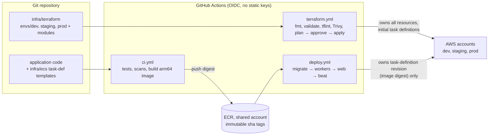

# ADR-0008: AWS ECS Fargate + Terraform

Decides where and how the platform runs: on AWS managed services, with every process type of the single container image on ECS Fargate, and all infrastructure defined in Terraform and deployed by GitHub Actions.

Status: Draft v0.1 (2026-10-21)

> **SUPERSEDED (2026-10-27) by [ADR-0014](0014-portable-hosting-paas-and-self-hosted.md) and [Hosting and deployment](../architecture/05-hosting-and-deployment.md).** The client chose portable hosting (PaaS or self-hosted VPS) instead of AWS. This document is kept as a reference in case AWS is reconsidered; do not implement it.

| | |
|---|---|
| Decision status | **Superseded by [ADR-0014](0014-portable-hosting-paas-and-self-hosted.md)** |
| Date | 2026-10-21 |
| Deciders | Tech Lead (owner); client acknowledges cloud provider and accounts (OQ INF-3) |
| Consulted | Platform, Security, Finance (cost), QA (performance) |
| Supersedes / superseded by | — |
| Requirements | SRS §1 (multinational traffic, high transaction volumes from launch), §8.1 (read replicas, CDN), §8.3 (backups, restore testing, runbooks), §9.1 (TLS 1.2+, AES-256 at rest), §9.3 (PCI DSS hygiene for the hosting environment), §10.1 (cloud-native services, horizontal scalability, IaC such as Terraform or CloudFormation); NFR-SCAL-01, NFR-AVAIL-01, NFR-SEC-01.1/01.2 |
| Gap / open question | [GAP-16](../requirements/03-gap-analysis-and-decisions.md#gap-16) (availability targets); A-1 / INF-1 (region, residency), A-5 (SLA, DR), INF-3 (multi-account), INF-4 (budget), INF-5 (blue/green), INF-6 (arm64 runners), T-2 (Terraform licence) |
| Related | [04 Infrastructure & deployment](../architecture/04-infrastructure-and-deployment.md) (the detailed design) · [01 §5, §13](../architecture/01-system-architecture.md#5-c4-level-2-containers) · [02 T22–T25](../architecture/02-tech-stack.md#2-technology-choices-by-layer) · [Security §12](../quality/01-security-and-compliance.md#12-cloud-and-platform-security-baseline) · [NFR performance](../quality/02-nfr-performance-and-scalability.md) · [ADR-0001](0001-django-modular-monolith.md) |

## Context and problem statement

The SRS requires cloud-native deployment with horizontal scalability "across global markets without major refactoring" and Infrastructure as Code, naming Terraform or CloudFormation (§10.1). It also requires read replicas and a CDN (§8.1), tested backups and runbooks (§8.3), AES-256 encryption at rest and TLS 1.2+ in transit (§9.1).

[ADR-0001](0001-django-modular-monolith.md) fixes one container image with five process types: `web` (Gunicorn), `worker` and `worker-media` (Celery), `beat` (singleton scheduler) and a one-off `migrate`. They need managed PostgreSQL 17 with PostGIS, two Redis-protocol stores (cache and broker), object storage with a CDN, an edge WAF, transactional email, secrets and key management. The team is small and has no dedicated platform engineers. The client stated no cloud preference; AWS is the team baseline (**Assumption**, confirmed through OQ INF-3).

**Question:** which cloud, compute platform and IaC tool give us managed, horizontally scalable, secure and reproducible environments with the least operational effort and acceptable cost?

## Decision drivers

1. **Managed services for every stateful component**, so the team operates application code, not databases, brokers or proxies (04 principle P5).
2. **Horizontal scaling of stateless tiers** with autoscaling on load and queue depth (SRS §10.1).
3. **Low operational burden:** no node fleets, AMIs or cluster upgrades to manage.
4. **Security by construction:** private networking, per-service IAM roles, secrets injected at runtime, KMS on every store, an auditable path to production (SRS §9, PCI hygiene).
5. **Availability and recovery:** Multi-AZ by default, point-in-time recovery, a regional DR path (proposed 99.9 %, RPO ≤ 5 min, RTO ≤ 1 h).
6. **Reproducibility:** dev, staging and prod from the same code, with reviewed plans and drift detection (SRS §10.1).
7. **Cost:** small at launch, predictable as it grows.
8. **Global reach:** edge caching and WAF worldwide; the primary region and data residency must stay a parameter (A-1).

## Considered options

**Compute**

1. **ECS on Fargate** (one cluster per environment, one service per process type)
2. **EKS** (Kubernetes) on Fargate or managed node groups
3. **ECS on EC2** (capacity providers backed by Auto Scaling groups)
4. **AWS App Runner or Elastic Beanstalk**
5. **Serverless Django on Lambda** (WSGI adapter) with SQS
6. **A PaaS or another cloud:** Heroku, Render, Fly.io; GCP Cloud Run + Cloud SQL; Azure Container Apps

**Infrastructure as Code**

- a. **Terraform**
- b. OpenTofu
- c. CloudFormation or AWS CDK
- d. Pulumi

## Decision outcome

**Chosen: option 1 (ECS on Fargate) with option a (Terraform),** because Fargate runs our five process types from one image with per-task isolation, IAM roles and ENIs and no servers to patch, while every stateful dependency the design needs is available as a managed AWS service with Multi-AZ. Terraform is the IaC tool the SRS names, has the widest module ecosystem and gives a plan-review-apply workflow with drift detection.

### Platform shape

| Layer | Service | Key decisions (details in 04) |
|---|---|---|
| Edge | CloudFront (app and cookie-less media distributions) + AWS WAF | TLS 1.2+; managed rule groups and rate rules; `/ops/*` IP allow-list; private ALB reached through a CloudFront VPC origin ([04 §4.2, §5.4](../architecture/04-infrastructure-and-deployment.md#54-edge-cloudfront-waf-tls-and-dns)) |
| Compute | ECS Fargate, `linux/arm64` (Graviton) | Services `web`, `worker`, `worker-media`, `beat`; task definitions `migrate`, `ops`; one image digest for all ([04 §6](../architecture/04-infrastructure-and-deployment.md#61-cluster-and-services)) |
| Data | RDS PostgreSQL 17 + PostGIS, Multi-AZ, one read replica; ElastiCache for Valkey ×2 (cache `allkeys-lru`, broker `noeviction`) | Isolated subnets with no internet route; KMS everywhere; PITR 14 days ([04 §7.3](../architecture/04-infrastructure-and-deployment.md#73-module-catalogue-per-environment-instances)) |
| Storage | S3 `media` (CloudFront OAC), `uploads` (`uploads/`, `masters/`), `private-docs`, `exports`; ledger anchors in the security account (Object Lock) | Block Public Access on all buckets ([ADR-0009](0009-s3-direct-upload-async-image-processing.md)) |
| Messaging | SES (via django-anymail; Mailgun remains a configuration switch, A-2) | Domain identity per environment |
| Secrets and keys | Secrets Manager (`rpl/<env>/<name>`), KMS customer-managed keys per data class | `app-field` key multi-Region in prod ([ADR-0010](0010-field-level-pii-encryption-blind-indexes.md)) |
| Observability | CloudWatch Logs and metrics, X-Ray via an ADOT sidecar, Sentry | [04 §15](../architecture/04-infrastructure-and-deployment.md#15-observability-and-operations-infrastructure) |
| Accounts | AWS Organizations: `security`/log-archive, `shared` (ECR, apex DNS), `rpl-dev`, `rpl-staging`, `rpl-prod` | `shared` is a proposed addition (04 INF-D3) |

### Compute rules

| Rule | Detail |
|---|---|
| One image, many processes | The same digest runs every service with a different command ([04 §6.3](../architecture/04-infrastructure-and-deployment.md#63-process-commands-and-sizing)) |
| Stateless tasks | No local state; sessions in Valkey/PostgreSQL, files in S3; any task may be killed at any time |
| `beat` singleton | `desiredCount 1`, `minimumHealthyPercent 0`, `maximumPercent 100`, heartbeat alarm |
| Autoscaling | `web`: target tracking on CPU 55 % and ALB requests per target, prod 3–10 tasks; workers: step scaling on queue depth and oldest-message age ([04 §11.1](../architecture/04-infrastructure-and-deployment.md#111-policies-per-service)) |
| Deployments | Rolling, 100 % / 200 %, deployment circuit breaker plus CloudWatch-alarm rollback; order `migrate → workers → web → beat`; expand/contract migrations ([04 §8.4–8.5, §9](../architecture/04-infrastructure-and-deployment.md#84-deployment-strategy)). ECS built-in blue/green is evaluated for prod `web` in M7 (INF-5) |
| Shell access | ECS Exec off in staging and prod; management commands run as audited one-off tasks (`ops-task.yml`); break-glass only ([04 §16](../architecture/04-infrastructure-and-deployment.md#16-operational-access)) |

### Terraform and delivery rules

| Rule | Detail |
|---|---|
| Environments | Explicit root modules per environment (`envs/dev`, `envs/staging`, `envs/prod`, later `envs/prod-dr`), not workspaces; each has its own state, account and variables |
| Modules | Thin first-party modules (`network`, `kms`, `edge`, `alb`, `ecs-cluster`, `ecs-service`, `rds-postgres`, `elasticache-valkey`, `s3-bucket`, `ses`, `secrets`, `observability`, `ssm-outputs`); community modules only pinned and wrapped ([04 §7.2](../architecture/04-infrastructure-and-deployment.md#72-layout)) |
| Versions | Terraform ≥ 1.10, AWS provider 6.x, `.terraform.lock.hcl` committed |
| State | One S3 bucket per account, versioned, SSE-KMS, S3 native locking (`use_lockfile = true`) |
| Secrets | Terraform creates secret containers only; values are set out of band; sensitive outputs marked `sensitive` |
| Workflow | Plan on every PR touching `infra/terraform/**`; dev applies on merge; staging and prod apply after a reviewer approves the posted plan |
| Ownership boundary | Terraform owns infrastructure and the initial task definitions; CI owns which revision runs (`lifecycle { ignore_changes = [task_definition, desired_count] }`) |
| Drift | Nightly `terraform plan -detailed-exitcode`; exit code 2 opens an issue |
| Protection | `prevent_destroy` on RDS, KMS keys, state and data buckets |
| Promotion | Build once on `main`; dev → staging → prod by image digest; prod requires a successful staging deployment of that digest ([04 §8.3](../architecture/04-infrastructure-and-deployment.md#83-build-once-promote-by-digest)) |

### Regions and resilience

- **One primary region**, parameterised (A-1/INF-1, decided before US-011). CloudFront certificates and the WAF web ACL live in us-east-1 regardless ([04 §14](../architecture/04-infrastructure-and-deployment.md#14-regions-and-multinational-considerations)).
- **Multi-AZ** across 3 AZs in prod: ALB, ECS tasks, RDS, both ElastiCache clusters, one NAT gateway per AZ.
- **Regional DR as pilot light:** cross-Region automated backup replication, replicated `masters/` and private documents, ECR replication, replicated secrets, multi-Region KMS keys and a `prod-dr` Terraform root; target RPO ≤ 1 h and RTO ≤ 8 h (proposed, A-5) ([04 §13](../architecture/04-infrastructure-and-deployment.md#13-resilience-backups-and-disaster-recovery)).
- **Growth path for distant markets:** edge-cache anonymous HTML, then regional stacks from the same modules; every user and listing carries a market from day one.

### Cost at launch

Indicative prod cost is about **USD 1,400–2,500 per month** at on-demand prices before discounts (Assumption, [04 §12.2](../architecture/04-infrastructure-and-deployment.md#122-indicative-monthly-cost)), with dev about 250–450 and staging about 650–1,000. Levers: Graviton everywhere, Savings Plans and RDS reservations after 2–3 stable months, scale-to-zero of non-prod outside working hours, Fargate Spot for `worker-media` where available, AWS Budgets with anomaly detection.

### Consequences

- **Positive:**
  - No servers, nodes or cluster control planes to patch or upgrade; AWS operates the data tier's failover and backups.
  - Strong isolation: each task has its own ENI, security group and IAM role; nothing has a public IP; the ALB is private.
  - Environments are reproducible from code, reviewed as plans and checked nightly for drift; DR is a Terraform apply plus a restore.
  - The application stays portable: a 12-factor container image and provider-agnostic adapters, with AWS-specific code confined to `apps/core/storage.py`, `apps/core/crypto/` and `apps/core/metrics.py`.
- **Negative:**
  - Fargate costs more per vCPU than well-packed EC2 at steady high utilisation. *Mitigation:* Graviton, Compute Savings Plans; an ECS-on-EC2 capacity provider can be added later without changing services if compute becomes the dominant cost.
  - New tasks take about 60–90 s to become healthy, so scaling lags spikes. *Mitigation:* minimum capacity with about 40 % headroom, scheduled scaling before known peaks, spike test in M7.
  - Infrastructure-level lock-in to AWS (ECS, IAM, KMS, CloudFront). *Mitigation:* every managed service used has an equivalent on other clouds; the Terraform modules isolate the AWS shape.
  - Terraform is BSL-licensed. *Mitigation:* using it to manage our own infrastructure is permitted; OpenTofu is a drop-in substitute if the client's policy requires (T-2).
  - No interactive shell in production. *Mitigation:* audited one-off ops tasks and runbooks; break-glass role for incidents.
  - Multi-account setup and arm64 builds add initial M0 work (OQ INF-3, INF-6).
- **Neutral:** Kubernetes skills are not needed. If the system ever splits into many independently deployed services, an EKS move gets its own ADR.

### Confirmation

- **M0:** dev provisioned from Terraform and deployed by CI end to end (US-010, US-011); `terraform plan` clean; Trivy config scan in the PR pipeline.
- **M1:** staging from the same modules, promoted by digest (US-118).
- **M5/M7:** prod applied without public traffic (US-515, proposed), then finalised (US-701); drift check green for 7 days before launch; launch checklist [04 §17](../architecture/04-infrastructure-and-deployment.md#17-launch-readiness-checklist-infrastructure).
- **Resilience evidence:** RDS failover drill each milestone from M4, quarterly restore drill from M7 (US-706), yearly regional DR game day.
- **Scaling evidence:** 1,000 debits/s and the 0 → peak spike test on the prod-size staging profile (US-702).
- **Cost:** budget alerts at 80/100/120 % per account; monthly cost review against [04 §12](../architecture/04-infrastructure-and-deployment.md#12-launch-sizing-and-cost).

## Pros and cons of the options

### 1. ECS on Fargate (chosen)

- Good, because there are no hosts to manage, per-task IAM and networking, native ALB, CloudWatch and Secrets Manager integration, and built-in deployment circuit breakers.
- Good, because it maps one-to-one onto our process types.
- Bad, because of the per-vCPU price premium and slower task start than pre-warmed hosts.

### 2. EKS

- Good, because Kubernetes is portable, has a rich ecosystem and suits many services.
- Bad, because a cluster control plane, add-ons, upgrades and manifests are a large operational cost for one image with five process types and a small team.

### 3. ECS on EC2

- Good, because it is cheaper per vCPU at high utilisation.
- Bad, because AMI patching, capacity management and bin-packing come back to us. Kept as a later cost lever.

### 4. App Runner or Elastic Beanstalk

- Good, because they are the simplest way to run a web container.
- Bad, because they model "web app plus maybe a worker" rather than five process types with a strict singleton, give less control over networking, sidecars (the ADOT collector) and deployment rollback alarms, and would still need ECS or similar for workers.

### 5. Lambda

- Good, because of scale-to-zero and per-request pricing.
- Bad, because of cold starts on a latency-critical path, connection management against PostgreSQL at 1,000 debits/s (RDS Proxy required), no natural home for celery-beat or long image work, and a runtime model unlike local development.

### 6. PaaS or another cloud

- Good, because Heroku-style PaaS is fastest to start; GCP Cloud Run and Azure Container Apps are comparable to Fargate.
- Bad (PaaS), because of weaker network isolation, limited control of data-tier encryption keys, Multi-AZ and DR, and higher cost at scale.
- Neutral (other clouds), because they are viable; AWS is chosen as the team baseline with no client preference stated.

### a. Terraform (chosen)

- Good, because it is named by the SRS, has the widest provider and module ecosystem, readable plans, and works across accounts and the us-east-1 edge resources.
- Bad, because of the BSL licence (see T-2) and state management, handled by the S3 backend with native locking.

### b. OpenTofu

- Good, because it is an open-licence (MPL) drop-in fork.
- Neutral, because it is equivalent for our use. It is the substitute if Terraform's licence is unacceptable.

### c. CloudFormation or CDK

- Good, because they are AWS-native, have no state files to manage and the SRS also names CloudFormation.
- Bad, because they are AWS-only, have slower feedback on drift and change sets, and (for CDK) put infrastructure into a general-purpose language that reviewers must read as code.

### d. Pulumi

- Good, because infrastructure is written in Python, the team's language.
- Bad, because of a smaller operations talent pool and community module base, and the same "infrastructure as general-purpose code" review cost.

## Deviations from the SRS

None. SRS §10.1 names Terraform as an example of IaC.

**Deviation from the client diagram:** the "NGINX static/media content server" box is not deployed in AWS, not even as a sidecar. CloudFront (edge cache, TLS), the ALB (routing), WhiteNoise (hashed static files) and S3 with CloudFront OAC (media) cover its roles with fewer components to patch. Nginx runs only in local docker compose (04 INF-D1, [01 §7](../architecture/01-system-architecture.md#7-mapping-the-clients-architecture-diagram-to-this-design)).

## Follow-ups

| # | Action | Owner | Milestone |
|---|---|---|---|
| 1 | Decide primary and DR regions (A-1/INF-1) and confirm the multi-account organisation (INF-3) | Tech Lead + client | Before US-011 (M0) |
| 2 | Bootstrap accounts, state buckets, OIDC roles; dev environment from modules | Platform | M0 (US-011) |
| 3 | CI/CD to dev with promotion by digest | Platform | M0 (US-010) |
| 4 | Staging from the same modules | Platform | M1 (US-118) |
| 5 | Prod provisioned dark; finalised and drilled | Platform | M5 (US-515), M7 (US-701, US-706) |
| 6 | Evaluate ECS built-in blue/green for prod `web` | Platform | M7 (INF-5) |
| 7 | Validate cost ranges in the AWS Pricing Calculator for the chosen region | Platform + Finance | M0 (INF-4) |

## More information

- Revisit if: compute becomes the dominant cost line (add an EC2 capacity provider); the system splits into many independently deployed services (EKS); data-residency rules require in-country stacks in several markets (regional stacks from the same modules); or the client mandates another cloud.
