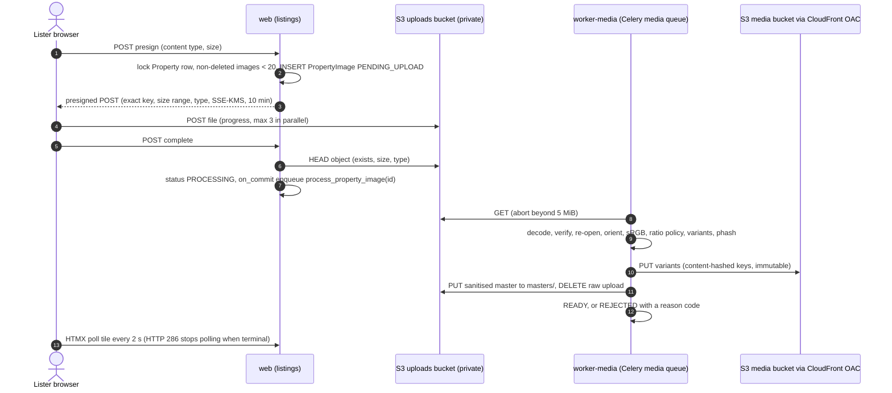

# ADR-0009: Direct-to-S3 upload with asynchronous image processing

Decides how listing photos get from a lister's phone to a renter's screen: the browser uploads straight to a private S3 prefix with a presigned POST, a dedicated Celery `media` worker verifies and re-encodes each image into fixed variants, and CloudFront serves the variants from a non-public bucket.

Status: Draft v0.1 (2026-10-21)

> **Amended (2026-10-27) by [ADR-0014](0014-portable-hosting-paas-and-self-hosted.md):** any S3-compatible object storage (Cloudflare R2, Backblaze B2, Hetzner Object Storage, DigitalOcean Spaces, AWS S3) replaces AWS S3 + CloudFront. Presigned POST and asynchronous processing are unchanged; the provider endpoint is configuration.

| | |
|---|---|
| Decision status | Proposed (confirmed by the M0 S3-emulator check and the M2 image stories US-210/US-211) |
| Date | 2026-10-21 |
| Deciders | Tech Lead (owner); PO acknowledges the image-policy interpretations |
| Consulted | Security, UX, Platform, QA |
| Supersedes / superseded by | — |
| Requirements | SRS §4.2 (images mandatory, minimum 3 and maximum 20; "handle various formats efficiently, enforce aspect ratios, respect a maximum file size (e.g., 5MB), and include automatic thumbnail generation for optimal display performance across all device types"), §8.1 (CDN), §9.1 (encryption at rest), §11.2 (mobile-first); FR-LIST-02.6, FR-LIST-02.10 to FR-LIST-02.15, NFR-SEC-01.2 |
| Gap / open question | [GAP-21](../requirements/03-gap-analysis-and-decisions.md#gap-21) (known issue #21); OQ-23 (formats and aspect-ratio policy); INF-D2 (local S3 emulator); INF-11 (Fargate Spot) |
| Related | [Listings design §8](../design/05-listings-and-media.md#8-image-pipeline-srs-42) (the detailed pipeline) · [01 §5, §9, §16](../architecture/01-system-architecture.md#9-synchronous-vs-asynchronous-paths) · [04 §3.3, §6.5, §7.3](../architecture/04-infrastructure-and-deployment.md#33-decision-local-s3-emulator) · [Security §6.7](../quality/01-security-and-compliance.md#67-file-uploads) · [ADR-0006](0006-celery-redis-transactional-outbox.md) · [ADR-0008](0008-aws-ecs-fargate-terraform.md) |

## Context and problem statement

A listing needs 3 to 20 photos of up to 5 MB each, so a lister may push up to 100 MB, usually from a phone on a mobile network. The SRS asks for efficient format handling, aspect-ratio enforcement and automatic thumbnails for every device type (§4.2).

Three forces shape the design:

- **The web tier must stay fast and stateless.** `web` runs Gunicorn `gthread` workers (2 processes × 4 threads per task) with a 30 s timeout. A 5 MB upload over a 1 Mbit/s mobile link takes about 40 s: streamed through Django it would hold a thread for the whole transfer and hit the timeout.
- **Uploaded files are hostile input.** Decompression bombs, polyglot files (an image that is also HTML or a script), malformed headers, and EXIF metadata that can contain the GPS coordinates of the lister's home.
- **Display performance.** Search cards and galleries need several sizes in modern formats with long-lived CDN caching to meet the latency and mobile-first goals.

**Question:** how do photos get uploaded, validated, transformed, stored and served so that the SRS rules hold server-side, the web tier never handles image bytes, and renters get fast, safe images?

## Decision drivers

1. **The web tier never streams image bytes** (stateless, predictable latency, no long requests).
2. **Security:** every image fully decoded and re-encoded; all metadata stripped; originals never public (FR-LIST-02.14).
3. **Server-side enforcement** of count (3–20), size (5 MiB), format and aspect ratio, whatever the client does.
4. **Mobile UX:** per-file progress, parallel uploads, early feedback, an in-browser crop path.
5. **Display performance:** responsive variants, content-addressed keys cached immutably at the edge.
6. **Recoverability:** no image stuck forever; every pending state is visible in PostgreSQL ([ADR-0006](0006-celery-redis-transactional-outbox.md) rule).
7. **Cost and simplicity:** no extra vendor, no new runtime, reuse of the existing worker model.

## Considered options

1. **Presigned POST direct to a private S3 prefix + Celery `media` worker (Pillow) producing fixed variants + CloudFront OAC**
2. Upload through Django (multipart to `web`), process synchronously in the request
3. Upload through Django, process asynchronously in Celery
4. Direct upload to S3 + AWS Lambda processing triggered by S3 events
5. Store originals and transform on the fly at the edge (for example AWS's Dynamic Image Transformation for CloudFront solution, or Lambda@Edge)
6. A third-party media service (Cloudinary, imgix, Uploadcare)

Sub-decision for option 1: **presigned POST** vs presigned PUT vs S3 multipart upload.

## Decision outcome

**Chosen option 1, with presigned POST.** The browser talks to S3 directly, so upload time and size never touch the web tier, and the presigned POST policy lets S3 itself reject oversized or mistyped uploads. Processing on our own Celery `media` queue keeps one runtime, one deployment, one observability stack and one recovery model (domain status plus sweeper). Precomputed variants with content-hashed keys are the cheapest and fastest thing a CDN can serve.

### Flow

### Storage layout

| Location | Contents | Access | Lifecycle |
|---|---|---|---|
| `rpl-<env>-uploads/uploads/{property}/{image}` | Raw browser upload | Private; written only through the presigned POST | Deleted after processing; S3 lifecycle expiry after 1 day as backstop |
| `rpl-<env>-uploads/masters/{property}/{image}` | Sanitised master (≤ 4,096 px long edge, JPEG q90, no metadata) for re-processing | Private; `worker-media` only | Kept with the listing; versioned; replicated to the DR region |
| `rpl-<env>-media/listings/{property}/{image}/{variant}-{sha256[:10]}.{ext}` | Public variants | Bucket not public; served by the cookie-less `media.<domain>` CloudFront distribution through OAC | `Cache-Control: public, max-age=31536000, immutable`; noncurrent versions expire after 30 days |
| `rpl-<env>-private-docs` | KYC and ownership proofs, tag-change evidence | Signed URLs only; GuardDuty Malware Protection for S3 | **Not part of this pipeline** (documents are scanned, not re-encoded) |

All buckets: Block Public Access, SSE-KMS with bucket keys, TLS-only bucket policies ([04 §7.3](../architecture/04-infrastructure-and-deployment.md#73-module-catalogue-per-environment-instances)).

### Rules

| Concern | Rule |
|---|---|
| Presign policy | Exact key (no `starts-with`); `content-length-range` 1 to 5,242,880 bytes; `Content-Type` equals the declared allow-listed type; `x-amz-server-side-encryption = aws:kms`; expiry 600 s. Bucket CORS allows `POST` only from the app's origins |
| Count | Checked under a row lock on the `Property` at presign time, so parallel requests cannot exceed 20; publish needs ≥ 3 `READY` images; a published listing cannot drop below 3 |
| Accepted formats | JPEG, PNG, WebP by **decoded** format (the declared type is not trusted); HEIC/HEIF optional via `pillow-heif` after licence review (OQ-23) |
| Decode safety | `Image.MAX_IMAGE_PIXELS = 50_000_000`; `DecompressionBombWarning` treated as an error; `verify()` then re-open; JPEG `draft()` decode at reduced size |
| Sanitisation | `exif_transpose`, conversion to sRGB, alpha flattened, saved with no EXIF/XMP/IPTC/ICC; re-encoding neutralises polyglots, so no antivirus scan is needed for images |
| Dimensions and ratio | Long edge ≥ 1,024 px, short edge ≥ 576 px; ratio 1.30–1.80 accepted; 1.00–1.30 centre-cropped to 4:3; 1.80–2.40 centre-cropped to 16:9; portrait and panoramas rejected (`ASPECT_RATIO`) with an in-browser crop option ([listings §8.3](../design/05-listings-and-media.md#83-aspect-ratio-policy)) |
| Variants | `thumb` 320×240, `card` 640×480, `md` 1,024 wide, `lg` 1,600 wide (WebP); `og` 1,200×630 and `email` 600×450 (JPEG, for social cards and email clients) |
| Fraud signal | Perceptual hash; near-duplicates of other owners' images open a `ModerationCase(DUPLICATE_IMAGES)` |
| Task | `listings.process_property_image(image_id)` on the `media` queue: `acks_late`, 3 retries for transient S3 errors, soft limit 60 s, idempotent no-op if already `READY` or `REJECTED` |
| Recovery | `PENDING_UPLOAD` rows older than 1 h are deleted; `PROCESSING` rows older than 15 min are re-enqueued up to 5 times, then alert (beat sweeper every 15 min). An S3 outage leaves images `PROCESSING`, never `REJECTED` |
| Worker sizing | ECS `worker-media`: 2 vCPU / 4 GB, concurrency 4, `--max-tasks-per-child 100`; step scaling on queue depth, prod 1–8 tasks; Fargate Spot with an on-demand base of 1 is a cost option (INF-11) |
| IAM | `web` may only `PutObject` under `uploads/` (to sign the POST) and `GenerateDataKey` on the S3 key; `worker-media` may read and delete `uploads/`, write `masters/` and the media bucket ([04 §6.5](../architecture/04-infrastructure-and-deployment.md#65-iam-task-roles-least-privilege)) |
| Rendering | ``; the first card and the detail hero use `fetchpriority="high"`; alt text always present (lister text or generated fallback) |
| Local development | SeaweedFS as the S3 emulator (**Proposed change** from MinIO/LocalStack, [04 §3.3](../architecture/04-infrastructure-and-deployment.md#33-decision-local-s3-emulator)); M0 verifies presigned POST conditions behave as on S3, with LocalStack (S3 only) as the fallback. SSE-KMS conditions are tested on staging |

**Why presigned POST:** a POST policy can enforce a **size range** and exact field values server-side, at S3. A presigned PUT can at most sign an exact `Content-Length` and type, and cannot express "at most 5 MiB"; multipart upload adds complexity that files of 5 MiB or less do not need.

### Consequences

- **Positive:**
  - Upload size and speed have no effect on web capacity or latency; the web tier stays stateless.
  - Every served pixel has been decoded and re-encoded by our code; originals and metadata are never public.
  - Variants are immutable and content-addressed, so CloudFront and browsers cache them for a year with no invalidation logic.
  - The pipeline uses the existing Celery and ECS model; there is no new vendor and no new runtime.
- **Negative:**
  - More moving parts than a form upload: presign, complete, polling, sweepers and CORS. *Mitigation:* one documented sequence, E2E tests on mobile emulation, and clear tile states.
  - Images are not usable instantly (target p95 ≤ 30 s per image). *Mitigation:* the wizard shows processing tiles and lets the lister continue; publishing waits only for 3 `READY` images.
  - A fixed variant set means new sizes (for example AVIF) require batch re-processing from `masters/`. *Mitigation:* a `reprocess_images` management command over masters, run as an audited ops task.
  - Pillow re-encoding costs CPU on Fargate. *Mitigation:* reduced-size JPEG decoding, autoscaling on queue depth, Spot capacity; libvips is the upgrade path if media cost grows.
  - The local emulator does not exercise SSE-KMS conditions. *Mitigation:* covered on staging.
- **Neutral:** the `process_property_image(image_id)` contract is the seam for moving processing to Lambda on S3 events if upload volume becomes spiky and expensive on Fargate ([01 §16](../architecture/01-system-architecture.md#16-future-extraction-seams)).

### Confirmation

- **M0:** the S3-emulator check (presigned POST with `content-length-range` and `Content-Type` conditions) passes, or the fallback is adopted (US-003, US-014).
- **M2 tests** (US-210, US-211): presign policy rejects > 5 MiB and wrong types at the emulator; parallel presigns never exceed 20; a malicious corpus (decompression bomb, polyglot, truncated file, SVG, image with GPS EXIF) is rejected or sanitised; served variants contain no EXIF (checked in CI); publish is blocked below 3 `READY` images.
- **Performance:** time from `complete` to `READY` p95 ≤ 30 s per image on staging (FR-LIST-02.13); `image_processing_failures_total` alerting ([01 §15](../architecture/01-system-architecture.md#15-observability-summary)).
- **E2E:** Playwright upload journey on mobile viewports, including the crop dialog and the processing-tile polling.
- **M7 (US-705):** no public access to `uploads/` or `masters/`; media bucket reachable only through CloudFront.

## Pros and cons of the options

### 1. Presigned POST + Celery media worker (chosen)

- Good, because the web tier never sees image bytes and S3 enforces size and type at upload time.
- Good, because processing reuses our worker, deployment and recovery model.
- Bad, because of eventual readiness and a multi-step client flow.

### 2. Through Django, synchronous processing

- Good, because it is the simplest code path.
- Bad, because slow uploads and CPU-heavy decoding block Gunicorn threads, break the 30 s timeout on mobile networks and make web capacity depend on photo sizes.

### 3. Through Django, asynchronous processing

- Good, because processing is off the request.
- Bad, because the transfer still ties up web threads, and the file must be stored somewhere shared before a worker can read it (which means S3 anyway).

### 4. Direct upload + Lambda processing

- Good, because it scales to zero and absorbs bursts.
- Bad, because it adds a second runtime, packaging (Pillow layers), deployment path and observability setup, plus S3-event retry semantics, for volumes our worker handles easily. Kept as an extraction seam.

### 5. On-the-fly edge transformation

- Good, because any size can be requested later without re-processing.
- Bad, because sanitisation still has to happen before an original is stored, the first request for each variant is slow, and the cost moves to per-request compute. Our variant set is small and stable.

### 6. Third-party media service

- Good, because uploads, transformations and a CDN come built in.
- Bad, because of per-image and bandwidth fees, a new vendor holding listing photos (residency, A-1), and lock-in to its URL scheme.

## Deviations from the SRS

None. The following are **interpretations** of SRS §4.2 that need PO confirmation (OQ-23):

- **"Enforce aspect ratios":** accepted range 4:3 to 16:9, near-misses auto-cropped, portrait and panorama photos rejected server-side with an in-browser crop option. The SRS gives no values; these are **Assumptions**.
- **"Maximum file size (e.g., 5MB)":** 5 MiB (5,242,880 bytes) enforced in the browser, the presigned POST policy and on `HEAD`. Larger photos that the browser can decode are downscaled client-side before upload, so the server never receives more than 5 MiB.
- **"Various formats":** JPEG, PNG and WebP; HEIC optional after licence review.

## Follow-ups

| # | Action | Owner | Milestone |
|---|---|---|---|
| 1 | Verify SeaweedFS presigned POST conditions; record the result in the seed ADRs | Platform | M0 (US-003, US-014) |
| 2 | Presign, complete, processing task, sweepers, tile UI | Backend + Frontend | M2 (US-210, US-211) |
| 3 | `reprocess_images` command over `masters/` | Backend | M2 |
| 4 | Decide Fargate Spot for `worker-media` | Platform | M5 (INF-11) |
| 5 | AVIF variants once media CPU cost is measured | Backend | Post-MVP |
| 6 | Image moderation hook (for example AWS Rekognition labels and OCR for phone numbers in photos) | Backend | Post-MVP |

## More information

- Revisit if: media processing becomes a significant cost or burst problem (Lambda or libvips); product needs arbitrary image sizes (edge transformation); or video tours are added (a separate pipeline and its own ADR).
