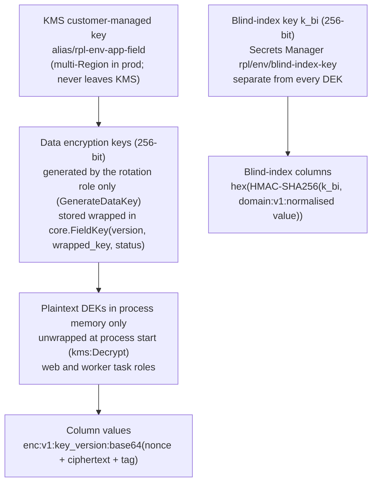

# ADR-0010: Field-level PII encryption with blind indexes

Decides how restricted personal data (above all, the listing contact details that renters pay to see) is protected beyond disk encryption: application-level AES-256-GCM with KMS-wrapped data keys, HMAC-SHA256 blind indexes for the few exact-match lookups the business needs, and a proposed exception for the login email.

Status: Draft v0.1 (2026-10-21)

> **Amended (2026-10-27) by [ADR-0014](0014-portable-hosting-paas-and-self-hosted.md#key-custody-for-field-level-encryption-amends-adr-0010):** without a managed KMS, the keyring comes from secrets (`FIELD_ENCRYPTION_KEYS`, `FIELD_ENCRYPTION_ACTIVE_KEY`, `BLIND_INDEX_KEY`), with Vault/OpenBao or a cloud KMS as an optional adapter. The format, blind indexes and rotation are unchanged.

| | |
|---|---|
| Decision status | Proposed. The login-email part needs a stakeholder decision ([OQ-29](../requirements/04-open-questions.md#oq-29), needed by M1) |
| Date | 2026-10-21 |
| Deciders | Tech Lead (owner); Security owner; PO and Legal acknowledge the login-email trade-off |
| Consulted | Platform (KMS, DR), Backend (accounts, listings), QA |
| Supersedes / superseded by | — |
| Requirements | SRS §9.1 ("all sensitive user data (passwords, payment information, contact numbers, PII) must be encrypted … at rest (AES-256 standard)"; "PII must be tokenized or pseudonymized whenever possible"), §4.2 (contact information mandatory on listings), §5.1–5.4 (contact shown only after a paid reveal), §3.2–3.3 (anti-abuse for promo credits); NFR-SEC-01.2, 01.4, 01.5, 01.7; FR-LIST-02.7, 02.8; FR-AUTH-04.4 |
| Gap / open question | [GAP-12](../requirements/03-gap-analysis-and-decisions.md#gap-12) (known issue #12), [GAP-20](../requirements/03-gap-analysis-and-decisions.md#gap-20); OQ-29 (login email); AR-4 ([01 §17](../architecture/01-system-architecture.md#17-architecture-risks)); DEV-SEC-5; OQ-DM-04; P-OPS-01 (multi-Region key) |
| Related | [Domain model §13](../design/01-domain-model.md#13-field-level-encryption-and-blind-index-register) (register) · [Security §2, §7.2–7.3](../quality/01-security-and-compliance.md#72-encryption-at-rest) · [Listings design §13](../design/05-listings-and-media.md#13-security-and-privacy-of-listing-contact-data-known-issue-20) · [03 §5](../architecture/03-codebase-structure.md#5-appscore-layout) (`apps.core.crypto`) · [04 §6.5, §13.3](../architecture/04-infrastructure-and-deployment.md#133-backups) · [ADR-0008](0008-aws-ecs-fargate-terraform.md) |

## Context and problem statement

KMS storage encryption on RDS, its snapshots and replicas, S3 and ElastiCache satisfies "AES-256 at rest" against stolen disks and media. It does nothing against the breach paths that actually occur: a logical dump or snapshot copied out of the account, SQL injection, an over-privileged replica or reporting user, staff browsing the admin, and values leaking into logs or error reports. Every one of those reads data through the database engine, which decrypts transparently.

The listing contact phone and email are the product: a renter pays 2 credits to see each one (SRS §5). Bulk exfiltration would be a privacy incident and a direct business loss. The SRS also asks for PII to be "tokenized or pseudonymized whenever possible".

Some lookups on this data are business requirements:

| Lookup | Why |
|---|---|
| Uniqueness of a **verified** user phone | Anti-farming of the 10 promo credits (known issue #6) |
| Fraud matching on listing contact phones | The same number behind many listings or accounts |
| Promo-claim dedupe across deleted accounts | One promo per verified identity, even after account deletion |
| Email suppression checks | Bounces and complaints must stop further sends |
| Login by email | django-allauth looks users and `EmailAddress` rows up with case-insensitive equality |

**Question:** which fields get application-level encryption, how do we keep the lookups we need, how are the keys managed and rotated, and what happens to the login email?

## Decision drivers

1. **Protect restricted (C3) data against database-level exposure:** dumps, snapshots, replicas, SQL injection, admin browsing (SRS §9.1, [security §2](../quality/01-security-and-compliance.md#2-data-classification)).
2. **Keep the exact-match lookups the business needs**, without decrypting whole tables.
3. **Key management in KMS:** no key material in the database, repository or image; rotation without downtime; usable in the DR region.
4. **Literal compliance:** AES-256, not AES-128.
5. **Performance:** microseconds per value, no KMS call per field, nothing on the search path.
6. **Framework compatibility:** Django ORM, django-allauth, and safe upgrades of both.
7. **Erasure** must work alongside an immutable ledger.

## Considered options

1. **Application-level AES-256-GCM envelope encryption** in a thin `apps.core.crypto` layer on the `cryptography` package, KMS-wrapped data keys, plus HMAC-SHA256 blind indexes
2. Storage encryption only (KMS on RDS, S3, ElastiCache)
3. `pgcrypto` in the database
4. Fernet-based Django packages (django-fernet-fields, django-cryptography, django-encrypted-model-fields)
5. AWS Encryption SDK or Google Tink as the crypto layer
6. An external tokenisation vault (SaaS)
7. Per-user keys (crypto-shredding)

**Sub-decision for the login email:** (A) field-level encryption with a blind index for lookups (the baseline), or (B) plaintext under storage encryption with compensating controls.

## Decision outcome

**Chosen option 1**, because it is the only option that keeps C3 values unreadable to anything that reads the database directly, while giving exact-match lookups through blind indexes, AES-256 as the SRS literally asks, and keys that never touch the database. For the login email, **option B is proposed** (see below), with option A documented as the fallback.

### What is encrypted

Register of record: [domain model §13](../design/01-domain-model.md#13-field-level-encryption-and-blind-index-register). Summary:

| Column | Protection | Blind index (domain) | Lookup |
|---|---|---|---|
| `listings_property.contact_phone` | Encrypted | `contact_phone_hmac` (`phone`) | Fraud matching |
| `listings_property.contact_email` | Encrypted | — | — |
| `accounts_user.phone_e164` | Encrypted | `phone_hmac` (`phone`) | Unique among verified users |
| `leads_contactreveal.contact_phone_snapshot`, `contact_email_snapshot` | Encrypted | — | — |
| `payments_paymentwebhookevent.payload_encrypted` | Encrypted | — | — |
| allauth MFA secrets; tag-change evidence notes; future KYC fields | Encrypted | — | — |
| `credits_signuppromoclaim.email_hmac`, `phone_hmac` | HMAC only, no ciphertext | `promo-email`, `phone` | One promo per identity |
| `notifications_notificationlog.to_hmac` | HMAC only, plus a masked copy | `addr` | Suppression |
| `accounts_user.email`, allauth `account_emailaddress.email` | **Storage encryption only** (Proposed change, option B) | — (`UNIQUE (lower(email))`) | Login, allauth |

Names, address lines (public for exact-location listings), IP addresses and session metadata are C2: protected by storage encryption, access control, log redaction and retention, not by field encryption.

### Key hierarchy

### Rules

| Concern | Rule |
|---|---|
| Algorithm | AES-256-GCM (`cryptography.hazmat.primitives.ciphers.aead.AESGCM`), 96-bit random nonce per value, 128-bit tag |
| Format | `enc:v1:<key_version>:<base64(nonce ‖ ciphertext ‖ tag)>` in a `text` column. The prefix allows mixed plaintext and ciphertext rows during a backfill and makes the key version visible for rotation |
| Associated data | `"<app_label>.<model>.<field>"`, so a ciphertext copied into another column fails to decrypt. Row binding was rejected because `from_db_value` has no access to the instance |
| Field type | `apps.core.crypto.EncryptedTextField`. Only the `isnull` lookup is registered; `filter(contact_phone=…)`, ordering and `LIKE` raise errors, so nobody can write a query that silently compares ciphertext |
| Loading | Public and search selectors `defer()` encrypted columns, and public DTOs have no contact attributes. Plaintext exists only in the reveal read path ([01 §6.1](../architecture/01-system-architecture.md#61-app-catalogue): `listings.selectors.get_contact_for_reveal`, `leads.selectors.get_revealed_contact`), the owner's edit form, and receipt rendering in the notification handler |
| Blind index | `HMAC-SHA256(k_bi, "<domain>:v1:" + normalised)` as 64 hex chars. Normalisation: phones to E.164; emails NFKC and lower-case (the promo domain also strips Gmail dots and `+tags`). The key is never rotated without a re-index migration |
| Never | Plaintext of an encrypted field in logs, traces, Sentry, analytics, shared caches, outbox payloads or Celery arguments (structlog redaction, Sentry `before_send`, IDs-only payloads per [ADR-0006](0006-celery-redis-transactional-outbox.md)) |
| Admin and reporting | Masked by default (`+44 •••• ••• 123`); unmasking needs a permission and writes `AuditLog` `pii.unmasked`; `rpl_readonly` reads masked `reporting` views only |
| IAM | `web` and `worker` roles: `kms:Decrypt` on the app-field key only; `kms:GenerateDataKey` only for the `field-key-rotation` role; no human role can decrypt in prod except break-glass ([04 §6.5](../architecture/04-infrastructure-and-deployment.md#65-iam-task-roles-least-privilege)) |
| Startup | A process that cannot unwrap the active DEKs fails `/readyz` and never serves traffic; running processes keep their keys in memory through a KMS outage |
| Failure | A value that fails to decrypt raises `FieldDecryptionError`, alerts, and is never rendered as ciphertext or partially |

### Nonce budget and key rotation

With random 96-bit nonces, NIST SP 800-38D limits a single GCM key to about 2³² encryptions. Expected MVP volume is far below that, but reveal snapshots at the 1,000/s design ceiling would approach it within weeks. Rules:

| Trigger | Action |
|---|---|
| Yearly, on suspicion of compromise, **or** 2³⁰ encryptions under the active key (a 4× safety margin) | A new `FieldKey` version becomes active for writes; `rotate_field_keys` on the `maintenance` queue re-encrypts rows in batches of 1,000 by `key_version` prefix; the old version retires when no rows use it ([security §7.3](../quality/01-security-and-compliance.md#73-key-rotation)) |
| Counting encryptions | Each process counts encryptions per key version in memory and flushes `UPDATE core_fieldkey SET encryptions = encryptions + :n` every 60 s and at shutdown. A lost flush under-counts by at most a minute of one process, well inside the margin. **Proposed schema addition:** `core.FieldKey.encryptions bigint NOT NULL DEFAULT 0` |
| Alert | `field_key_encryptions_ratio` above 50 % of 2³⁰ warns; above 90 % pages |

If rotation ever becomes frequent, a `v2` format with a per-value derived key (HKDF over the DEK with a random salt) removes the limit; the `enc:vN:` prefix makes that a lazy migration.

### Login email (sub-decision): Proposed change

The baseline (known issue #12) encrypts the login email and looks it up through a blind index. In practice allauth queries `User` and `EmailAddress` with case-insensitive equality in several places, Support needs exact-match lookups, and every email send has to decrypt it anyway. Option A means overriding allauth's adapter and `EmailAddress` behaviour with blind-index equality: it works, but it is invasive and each allauth upgrade risks breaking it.

**Proposed change (option B):** keep the login email in plaintext under storage encryption, with compensating controls: `UNIQUE (lower(email))`; no email in logs, metrics, traces or URLs; masked in the ops console and in the `rpl_readonly` reporting views; DB snapshots cannot be shared outside the account (SCP); Sentry `send_default_pii=False`. Option A remains documented as the fallback and costs about 3–5 extra days in M1, plus regression risk on allauth upgrades ([security §7.2](../quality/01-security-and-compliance.md#72-encryption-at-rest)). Decision: OQ-29 (Security, Legal), needed by M1.

### Erasure

Anonymising a user (or archiving a listing on erasure) sets encrypted columns to `NULL` and recomputes or nulls their blind indexes; ledger entries hold no PII, so they stay intact. Deleted values persist in backups until those expire: 14 days of PITR and the monthly snapshots kept 12 months ([04 §13.3](../architecture/04-infrastructure-and-deployment.md#133-backups)). Whether that window is acceptable per market is a legal question (OQ-DM-01). Per-user keys (option 7) would remove it and are the upgrade path if a market requires it.

### Consequences

- **Positive:**
  - A leaked dump, snapshot, replica or SQL-injection result exposes ciphertext and HMACs, not contact details or phone numbers.
  - AES-256 as the SRS states; keys in KMS with CloudTrail-logged unwrap at process start.
  - Exact-match fraud, uniqueness and suppression checks keep working through blind indexes.
  - DR works: the `app-field` key is multi-Region, so a database restored in the DR region can be decrypted.
- **Negative:**
  - Encrypted fields cannot be searched, sorted or partially matched; ops can only find a phone by exact blind-index match. Accepted.
  - Field encryption does not protect against a compromised application process, which holds the DEKs in memory. *Mitigation:* least-privilege task roles, no shell in prod, WAF, dependency scanning; this control targets the data layer.
  - KMS calls are logged per process start, not per value, so KMS audit does not show who read which contact. *Mitigation:* `ContactReveal` rows and `AuditLog` `pii.unmasked` provide the per-value trail.
  - Losing the CMK means losing the data. *Mitigation:* `prevent_destroy`, the 30-day KMS deletion window, multi-Region replica keys, wrapped DEKs included in every DB backup.
  - Blind indexes over low-entropy values (phone numbers) can be brute-forced by anyone who holds `k_bi`. *Mitigation:* `k_bi` lives in Secrets Manager, separate from the database and its backups, readable only by the app task roles.
  - About 150 lines of custom crypto code to own. *Mitigation:* security review, 100 % branch coverage, property-based tests; Google Tink is the fallback library if review rejects the custom layer.
  - If option B is accepted, the login email is weaker than the baseline asked. *Mitigation:* the compensating controls above.
- **Neutral:** backfills and migrations of encrypted columns go through management commands that run in batches, since SQL cannot read the values.

### Confirmation

- **Unit and property tests** (M1): round trip; tampering raises `InvalidTag`; wrong AAD and unknown key versions are rejected; nonces are unique across 10⁶ encryptions in a test run; golden vectors pinned per format version; lookups other than `isnull` raise.
- **Leak tests** (M2): rendered detail, search, card, map, JSON-LD and sitemap responses never contain a seeded contact phone or email in any common format for anonymous, zero-credit and non-revealed users (FR-LIST-02.8).
- **Log and error scrubbing tests** (M0 onward) for `contact_*`, `phone*` and email keys.
- **M7 (US-705):** a DB snapshot inspection shows ciphertext for every encrypted column in the register; a sampled-log review finds no PII.
- **DR restore drill** (M7, then yearly): sample rows decrypt in the DR region.
- **Rotation drill** on staging (M7): a new DEK version, background re-encryption, retirement of the old version, no user impact.

## Pros and cons of the options

### 1. App-level AES-256-GCM + KMS envelope + blind indexes (chosen)

- Good, because data read through the database stays opaque, keys stay in KMS, and lookups survive through HMACs.
- Bad, because it is code we own and it removes query flexibility on encrypted columns.

### 2. Storage encryption only

- Good, because it is free, transparent and already on.
- Bad, because every realistic breach path reads through the engine and sees plaintext; it does not meet the SRS's pseudonymisation intent.

### 3. pgcrypto

- Good, because encryption happens in SQL.
- Bad, because the key travels to the database in SQL text, where it can appear in logs, `pg_stat_statements` and pgAudit output; the DB administrator effectively holds the key.

### 4. Fernet-based Django packages

- Good, because they are drop-in model fields.
- Bad, because Fernet is AES-128-CBC with HMAC, not the AES-256 the SRS states, several packages are unmaintained, and none offers blind indexes or KMS envelope keys.

### 5. AWS Encryption SDK or Google Tink

- Good, because they are well-reviewed libraries with key management built in.
- Bad (Encryption SDK), because of a large per-value header and the need for a caching materials manager to avoid a KMS call per field.
- Neutral (Tink), because it is a sound alternative with managed keysets; it is the fallback if the custom layer is rejected in security review.

### 6. Tokenisation vault (SaaS)

- Good, because sensitive values leave our database entirely.
- Bad, because every reveal would call an external service on the latency-critical path, data leaves our AWS account (residency, A-1), and it adds per-call cost and a vendor dependency.

### 7. Per-user keys

- Good, because deleting a user's key erases their data everywhere, including backups.
- Bad, because of key-per-user management, a lookup per row, and no benefit for listing contacts (which belong to listings, not only to users). Upgrade path only.

## Deviations from the SRS

None from the SRS text, with one **interpretation**: SRS §9.1 asks for PII to be "tokenized or pseudonymized **whenever possible**". We pseudonymise by encrypting C3 fields with keys held outside the database, by using HMAC blind indexes as lookup tokens, by exposing only UUID public identifiers, and by logging pseudonymous IDs. C2 personal data (names, addresses, IPs and, under option B, the login email) is protected by storage encryption, access control, redaction and retention rather than field encryption.

**Deviation from the baseline (known issue #12):** the login email is proposed to stay in plaintext under storage encryption instead of being encrypted with a blind-index lookup (option B above, OQ-29).

## Consistency items

| # | Item | Resolution |
|---|---|---|
| C1 | Domain model §13 writes the ciphertext format as `v1:<key-id>:<nonce>:<ct+tag>` | Canonical format is `enc:v1:<key_version>:<base64(nonce ‖ ciphertext ‖ tag)>` (this ADR and [security §7.2](../quality/01-security-and-compliance.md#72-encryption-at-rest)) |
| C2 | Domain model §3.1 types `phone_e164` as `bytea` | `EncryptedTextField` stores base64 text; the column type is `text` |
| C3 | `core.FieldKey` has no encryption counter | Proposed schema addition `encryptions bigint NOT NULL DEFAULT 0` (nonce budget above) |

## Follow-ups

| # | Action | Owner | Milestone |
|---|---|---|---|
| 1 | Decide OQ-29 (login email) | Security + Legal + PO | M1 |
| 2 | Create `alias/rpl-<env>-app-field` (multi-Region in prod) and the blind-index secret | Platform | M0 (P-OPS-01) |
| 3 | `apps.core.crypto` (field, keyring, blind index, counter flush), `core.FieldKey`, security review | Backend + Security | M1 (user phone) |
| 4 | Listing contact fields and leak tests | Backend | M2 (US-208) |
| 5 | `rotate_field_keys` task and rotation drill | Backend + Platform | M7 |
| 6 | PII verification (US-705) and DR decrypt check | Security + Platform | M7 |
| 7 | Apply consistency items C1–C3 to the domain model | Data model owner | M1 |

## More information

- Revisit if: a launch market requires erasure from backups (per-user keys); support needs fuzzy search on contact data (a separate, access-controlled search index with its own ADR); or the custom crypto layer fails security review (Google Tink).
