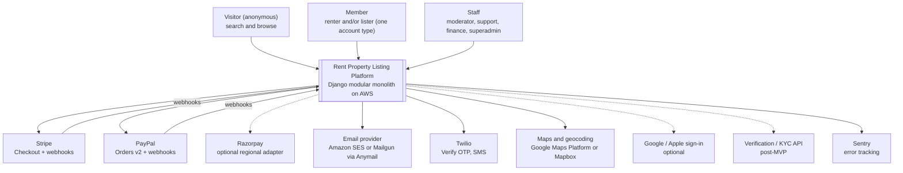
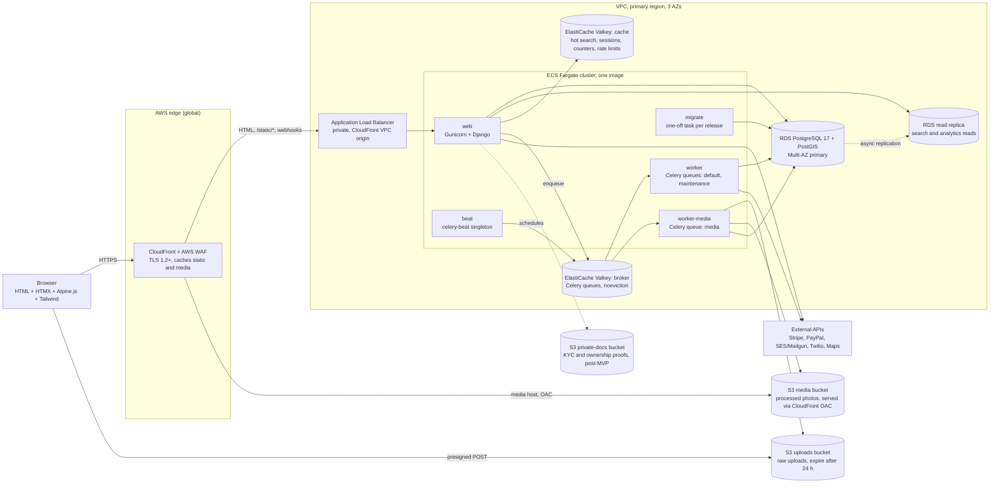
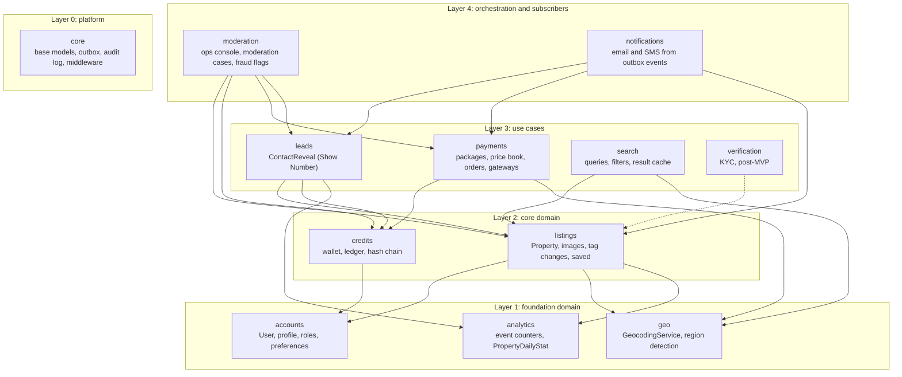
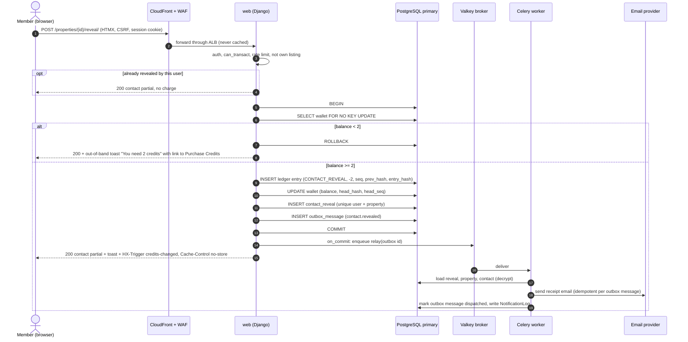

# System Architecture

Target architecture for the Rent Property Listing platform: a Django **modular monolith** on AWS. It covers the containers, the internal modules (Django apps) and the direction their dependencies may take, and how the design meets the SRS non-functional requirements.

Status: Draft v0.1 (2026-10-21)

> **Hosting change (2026-10-27):** AWS is no longer the target ([ADR-0014](../adr/0014-portable-hosting-paas-and-self-hosted.md)). AWS service names, CLI commands, sizing and alarms in this document are superseded; read them through the mapping table in ADR-0014 and [Hosting and deployment](05-hosting-and-deployment.md). The provider-neutral intent (controls, targets, procedures) still applies.

| | |
|---|---|
| Owner | Architecture |
| Audience | Engineers, QA, DevOps, Product |
| Sources | SRS "Requirements Document" v1.0 (2025-10-25), HLRD v1.0 (same date), client architecture diagram and flow chart (AI-generated PNGs in `ProjectDocuments/`) |
| Related | [02 Tech stack](02-tech-stack.md) · [03 Codebase structure](03-codebase-structure.md) · [04 Infrastructure & deployment](04-infrastructure-and-deployment.md) · [ADR index](#19-adr-index) |

> **Section numbering.** "SRS §x.y" refers to the SRS table of contents (3.x–12.x). The SRS's own internal cross-references (2.2.1, 2.3.3, 2.4.1, 2.5, …) are broken, so this document doesn't use them.

---

## 1. Architectural drivers

| # | Driver | Source | Architectural response | ADR |
|---|---|---|---|---|
| D1 | Atomic credit check + debit, no negative balance, immutable and auditable ledger | SRS §5.2, §5.3, §9.2 | One short PostgreSQL transaction with a wallet row lock; append-only, hash-chained ledger; DB constraints and triggers; nightly audit | [0005](../adr/0005-postgres-row-locking-credit-ledger.md) |
| D2 | 1,000 credit debits per second without inconsistency | SRS §8.2 | Row-level locking, not Kafka; stateless web tier scaled out horizontally; proven by a load test | [0005](../adr/0005-postgres-row-locking-credit-ledger.md) |
| D3 | p95 < 500 ms under standard load and < 1,000 ms at peak for search and credit transactions | SRS §8.1 | PostGIS, trigram and full-text indexes; read replica for search; Valkey cache; CDN for static assets and media | [0004](../adr/0004-postgresql-postgis-search-for-mvp.md) |
| D4 | Credits allocated within 5 s of payment, verified with the gateway | SRS §6.4 | Fulfilment runs synchronously in the verified webhook handler **or** on server-side verification of the return redirect. It is idempotent. | [0007](../adr/0007-payment-gateway-adapter.md) |
| D5 | PCI DSS: the app never handles raw card data | SRS §9.3 | Hosted checkout pages (Stripe Checkout, PayPal) keep us in PCI SAQ A scope | [0007](../adr/0007-payment-gateway-adapter.md) |
| D6 | PII encrypted at rest (AES-256) and pseudonymised | SRS §9.1 | KMS storage encryption, plus application field-level AES-256-GCM, plus HMAC blind indexes | [0010](../adr/0010-field-level-pii-encryption-blind-indexes.md) |
| D7 | Email sent "concurrently" with the debit, delivered reliably | SRS §5.5 | Transactional outbox, then Celery after commit. No email is ever sent for a debit that rolled back. | [0006](../adr/0006-celery-redis-transactional-outbox.md) |
| D8 | Multinational traffic; prices in the local currency | SRS §1, §6.2 | CloudFront edge, i18n-ready code, per-currency price book, region detected from geo-IP | [0008](../adr/0008-aws-ecs-fargate-terraform.md) |
| D9 | Cloud native, horizontal scaling, IaC | SRS §10.1 | Containers on ECS Fargate, managed data services, Terraform | [0008](../adr/0008-aws-ecs-fargate-terraform.md) |
| D10 | SOLID, peer review, ≥ 90 % test coverage | SRS §10.2 | Modular monolith with enforced boundaries, service layer, CI quality gates | [0001](../adr/0001-django-modular-monolith.md) |
| D11 | Mobile-first, WCAG 2.1 AA, a UI that responds instantly | SRS §11, §12 | Server-rendered semantic HTML, progressively enhanced with HTMX and Alpine.js | [0002](../adr/0002-server-rendered-htmx-alpine-tailwind.md) |
| D12 | Admin review of tag changes; moderation and fraud review ("Ops Console" in the diagram) | SRS §4.3, diagram | Ops console (hardened Django admin plus custom staff views) is in the MVP | [0001](../adr/0001-django-modular-monolith.md) |
| D13 | Logout terminates sessions on the server and invalidates tokens | SRS §7.3 | Server-side sessions instead of JWT | [0003](../adr/0003-server-side-sessions-instead-of-jwt.md) |
| D14 | 3–20 images per listing, ≤ 5 MB each, aspect-ratio rules, automatic thumbnails | SRS §4.2 | Direct upload to S3, then asynchronous processing | [0009](../adr/0009-s3-direct-upload-async-image-processing.md) |

### 1.1 Measurable quality targets

| Attribute | Target | Measured at | Status |
|---|---|---|---|
| Search latency | p95 ≤ 500 ms (standard load), ≤ 1,000 ms (peak), server-side | ALB `TargetResponseTime` + OTel span `search.search_properties` | SRS §8.1 |
| Credit transaction latency (Show Number, purchase fulfilment) | Same as search | OTel spans `leads.reveal_contact`, `payments.fulfill_order` | SRS §8.1 |
| Debit throughput | ≥ 1,000 debits/s sustained for 10 min; 0 ledger-audit mismatches afterwards | k6 load test on a prod-sized staging stack | SRS §8.2 |
| Payment to visible balance | ≤ 5 s at p99, from the gateway's success event to the committed ledger entry | Metric `payment_fulfillment_latency_seconds` | SRS §6.4 |
| Availability | 99.9 % monthly | Synthetic checks plus ALB 5xx rate | **Proposed**. The SRS gives no number. |
| RPO / RTO (single-region incident) | ≤ 5 min / ≤ 1 h | Quarterly restore drill | **Proposed** |
| Public-page JavaScript | ≤ 50 KB gzipped (HTMX + Alpine + app code) | CI bundle-size check | **Assumption** |

**Assumption:** "Standard" and "peak" load are not defined in the SRS. Until Product supplies a traffic forecast, we treat **standard load as ≤ 30 % of the 1,000 debits/s design point** and **peak load as the design point itself** (Open Question A-4).

---

## 2. Architecture at a glance

- **Style:** a modular monolith. One Django project and one container image, with internal module boundaries enforced in CI ([ADR-0001](../adr/0001-django-modular-monolith.md)).
- **Process types from the same image:** `web` (Gunicorn WSGI), `worker` (Celery), `worker-media` (Celery, image processing), `beat` (celery-beat singleton) and `migrate` (one-off task run on each release).
- **UI:** server-rendered Django templates, enhanced with HTMX 2 and Alpine.js 3 and styled with Tailwind CSS. There is no SPA. "Periodic HTTP polling" (from the client diagram) is HTMX polling ([ADR-0002](../adr/0002-server-rendered-htmx-alpine-tailwind.md)).
- **State:** PostgreSQL 17 with PostGIS and pg_trgm is the single system of record. Valkey holds the cache, sessions and Celery broker; nothing in Valkey is authoritative. S3 stores binary assets.
- **Money and credits:** an integer credit ledger in PostgreSQL protected by row locks and a hash chain ([ADR-0005](../adr/0005-postgres-row-locking-credit-ledger.md)), payment gateways behind an adapter ([ADR-0007](../adr/0007-payment-gateway-adapter.md)), and side effects through a transactional outbox ([ADR-0006](../adr/0006-celery-redis-transactional-outbox.md)).
- **Platform:** AWS (CloudFront + WAF → ALB → ECS Fargate; RDS Multi-AZ with a read replica; ElastiCache for Valkey; S3; SES; KMS; Secrets Manager), all managed with Terraform ([ADR-0008](../adr/0008-aws-ecs-fargate-terraform.md)).

---

## 3. Roles (RBAC baseline)

The SRS says "rigid RBAC for three core user types" (HLRD) but never names them. Baseline:

| Role | How it is represented | Can do |
|---|---|---|
| **Visitor** (anonymous) | No session user | Search, browse, view listing detail (without contact details) |
| **Member: Renter** | Any verified `accounts.User` | Save properties, Show Number (spends credits), buy credits, view history |
| **Member: Lister** | The same `accounts.User`. "Lister" is a capability (owns ≥ 1 listing), not a separate account type. Owner vs Agent is a **per-listing** tag. | Create and manage listings, view listing analytics, request tag changes |
| **Staff** | `is_staff=True` plus Django groups `moderator`, `support`, `finance`, `superadmin` | Ops console; permissions per group (see the security docs) |

An unverified member can browse and edit their profile but cannot list, spend credits, or buy credits (SRS §3.2). The check is `accounts.selectors.can_transact(user)` and is enforced in services, not only in views.

---

## 4. C4 level 1: System context



Dashed lines are optional or post-MVP integrations. The GeoLite2 database (MaxMind) ships as a file inside the image and is not called at runtime.

---

## 5. C4 level 2: Containers



| Container | Technology | Responsibility | Scaling | State |
|---|---|---|---|---|
| CloudFront + WAF | AWS managed | TLS termination at the edge, WAF rules and rate limits, caching of `/static/*` and media, viewer-country header | Global, managed | None |
| ALB | AWS managed | Routes to `web` tasks, health checks | Managed | None |
| `web` | Python 3.13, Django 5.2 LTS, Gunicorn (`gthread`) | All HTTP: pages, HTMX partials, webhooks, health checks | Horizontal; target tracking on CPU and request count | Stateless |
| `worker` | Celery 5 | Outbox relay, emails and SMS, geocoding retries, reconciliation, ledger audit, analytics flush | Horizontal, by queue depth | Stateless |
| `worker-media` | Celery 5 + Pillow | Image verification and variant generation | Horizontal, by queue depth | Stateless (scratch on `/tmp`) |
| `beat` | celery-beat + django-celery-beat | Periodic schedules | **Exactly 1** | Schedule state in PostgreSQL |
| `migrate` | `manage.py migrate` | Schema migrations before each deployment | One-off | None |
| PostgreSQL primary | RDS PostgreSQL 17 + PostGIS + pg_trgm, Multi-AZ | System of record | Vertical; partitioning later | **Authoritative** |
| Read replica | RDS read replica | Lag-tolerant reads (public search, aggregates) | Add replicas | Derived |
| Valkey (cache) | ElastiCache for Valkey 8, `allkeys-lru` | Cache, sessions (`cached_db`), counters, rate limits | Vertical, then cluster mode | Disposable |
| Valkey (broker) | ElastiCache for Valkey 8, `noeviction` | Celery broker | Vertical | Transient. The outbox can rebuild it. |
| S3 uploads | S3, SSE-KMS | Raw browser uploads awaiting processing | Managed | Short-lived |
| S3 media | S3, SSE-KMS, Block Public Access on, CloudFront OAC | Processed photo variants | Managed | Authoritative for binaries |
| S3 private-docs | S3, SSE-KMS, signed URLs only | KYC and ownership documents (post-MVP; bucket created in M2) | Managed | Authoritative |

**Why two Valkey clusters:** a cache wants an LRU eviction policy, but a Celery broker must never evict, or tasks are lost silently. Two small clusters cost less than debugging lost tasks. `cached_db` sessions fall back to PostgreSQL, so evicting a session from the cache does not log anyone out.

---

## 6. C4 level 3: Components of the monolith (Django apps)

Apps are arranged in layers. **An app may depend only on apps in a lower layer** (and every app may depend on `core`). Apps in the same layer are independent of each other. CI enforces this with import-linter (§10).



_Edges to `core`, and most edges to `accounts`, are left out to keep the diagram readable. Every app may depend on `core`, and any app above Layer 1 may depend on `accounts`._

### 6.1 App catalogue

| App (`apps.<name>`) | Layer | Owns (models) | Public services (writes) | Public selectors (reads) | Publishes events | Subscribes to |
|---|---|---|---|---|---|---|
| `core` | 0 | `TimeStampedModel` (abstract), `OutboxMessage`, `AuditLog` | `outbox.publish()`, `audit.record()` | `db.read_alias()` | n/a | n/a |
| `accounts` | 1 | `User` (custom), `UserProfile`, `NotificationPreference` | `update_profile`, `start_phone_verification`, `confirm_phone_verification`, `set_notification_preferences` | `can_transact`, `get_profile`, `get_notification_preferences` | signal `account_verified` | allauth signals |
| `geo` | 1 | none (cache only) | `geocode_address` | `resolve_region(request)` | none | none |
| `analytics` | 1 | `PropertyDailyStat` | `record_view`, `record_save`, `record_reveal`, `flush_counters` | `get_property_stats` (DB total + unflushed Valkey delta) | none | none |
| `listings` | 2 | `Property`, `PropertyImage`, `PropertyTagChangeRequest`, `SavedProperty` | `create_draft`, `save_draft_step`, `register_uploaded_image`, `publish_property`, `mark_rented`, `unlist_property`, `request_tag_change`, `apply_tag_change_decision`, `toggle_saved` | `published_properties`, `get_property_detail`, `list_owner_properties`, `get_contact_for_reveal` | `listing.published`, `listing.updated`, `listing.unlisted` | none |
| `credits` | 2 | `CreditWallet`, `CreditLedgerEntry` | `create_wallet`, `grant_credits`, `debit_credits`, `grant_signup_promo`, `adjust_credits`, `reverse_entry`, `audit_wallets` | `get_balance`, `list_ledger_entries` | none | `accounts.account_verified` |
| `leads` | 3 | `ContactReveal` | `reveal_contact` | `get_reveal`, `get_revealed_contact`, `list_reveals_for_user` | `contact.revealed` | none |
| `payments` | 3 | `CreditPackage`, `CreditPackagePrice`, `PaymentOrder`, `PaymentWebhookEvent` | `start_checkout`, `handle_webhook`, `confirm_return`, `fulfill_order`, `reconcile_order` | `list_packages_for_region`, `get_order_status`, `list_orders_for_user` | `payment.succeeded`, `payment.failed` | none |
| `search` | 3 | none at MVP (`SavedSearch` later) | `invalidate_search_cache` | `search_properties`, `suggest_locations` | none | `listing.*` (cache generation bump) |
| `notifications` | 4 | `NotificationLog` (delivery log, idempotency) | Outbox handlers such as `send_contact_reveal_email`, `send_payment_receipt` | none | none | `contact.revealed`, `payment.succeeded`, `listing.tag_change_decided` |
| `moderation` | 4 | `ModerationCase`, `FraudFlag` | `open_case`, `resolve_case`, `decide_tag_change`, `flag_account` | Queue selectors | none | `listing.published` (auto-screen rules) |
| `verification` | 3 (post-MVP) | `VerificationRequest`, `VerificationDocument` | `submit_documents`, `record_provider_result` | `get_verification_status` | `verification.completed` | none |

The detailed schemas live in the data-model and domain design documents. Model names here are canonical; field lists are not.

---

## 7. Mapping the client's architecture diagram to this design

The client's diagram is a good conceptual model but is not authoritative. Every box maps to a concrete component. Deviations are listed explicitly.

| Diagram box / flow step | Our component | Notes |
|---|---|---|
| Renter / Seeker Portal: "search & details" | `search` + `listings` (detail page) + `leads` (Show Number) + `listings.SavedProperty` | Server-rendered public pages, which also gives SEO for listings. |
| Renter / Seeker Portal: "lead forms" | **Not in MVP** | **Deviation from diagram:** the SRS (authoritative) monetises through a renter-paid "Show Number". A free inquiry form is post-MVP and part of Open Question #1. |
| Lister / Owner Portal: "post & manage listings, credit wallet" | `listings` (multi-step wizard, My Properties), `analytics` (metrics), `credits` (balance, history), `payments` (Purchase Credits) | Every member has a wallet; in the SRS the wallet is mainly used by renters. |
| Ops Console: "monitor & manage jobs, listing moderation, fraud review" | `moderation` (staff views under `/ops/`) + hardened Django admin + django-celery-beat admin + CloudWatch dashboards | "Jobs" means the outbox backlog and failed-message views (with retry), reconciliation runs and beat schedules. Flower is not deployed in production for the MVP because it would add attack surface. |
| HTTPS / "WSGI-Gunicorn Protocol" | CloudFront + WAF → ALB → Gunicorn (WSGI) → Django | ASGI is not needed; there are no WebSockets in scope. |
| NGINX: "static/media content server (Whitenoise conceptually)" | **AWS:** CloudFront for edge caching; WhiteNoise serves hashed static files from `web`; S3 + CloudFront OAC serve media. **Local:** optional Nginx in docker compose. | **Deviation from diagram:** no Nginx in AWS. Managed edge services remove a hop and a component to patch. |
| Django Core (views & forms) | Each app's `views.py` and `forms.py`, which stay thin. **Business logic sits in `services.py` and `selectors.py`.** | Adds a service layer the diagram doesn't show (testability, SOLID). |
| Django Model Logic (ORM): User, PropertyListing, Lead, CreditWallet, Transaction | `accounts.User`, `listings.Property`, `leads.ContactReveal` (a "lead" is a paid reveal), `credits.CreditWallet`, and **"Transaction" split into** `credits.CreditLedgerEntry` (credit movements) and `payments.PaymentOrder` (money movements) | Keeping money and credits apart is standard practice for ledgers. |
| Django Template Rendering: search, detail, owner wallet dashboard | `templates/` + per-app templates + HTMX partials | |
| "Django ORM • Session State • Periodic HTTP Polling" | ORM accessed through services and selectors; `cached_db` sessions; HTMX `every Ns` polling on My Properties metrics and the payment-return status page | The balance badge updates on `credits-changed` events rather than by constant polling (§9). |
| Operational Data (DB) | RDS PostgreSQL 17 + PostGIS (Multi-AZ) + read replica | |
| Real-time State / Cache: hot search results, session store, polled HTTP | ElastiCache Valkey (cache cluster) | The Celery broker runs on a separate Valkey cluster (§5). |
| Asset Storage: Property Photos, KYC Docs, Ownership Proofs | S3 `media` (photo variants), `uploads` (raw), `private-docs` (KYC, post-MVP) | Private documents are only ever served through short-lived signed URLs. |
| Maps & Geocoding API | `geo.GeocodingService`, an adapter for Google or Mapbox | Provider choice is Open Question A-3. |
| Verification API (owner identity, listing checks) | `verification` app, **post-MVP** | Storage, models and the `verification` seam are designed now. |
| Payment Gateway (Stripe, PayPal) | `payments.gateways` (`StripeGateway`, `PayPalGateway`, optional `RazorpayGateway`) | |
| Notification Services (lead alerts, OTP, Twilio, Mailgun) | `notifications` (email through Anymail to SES or Mailgun, SMS through Twilio); OTP through Twilio Verify in `accounts` | Lead alerts to listers are not in the SRS; they are post-MVP or an open question. |
| Flow: "Credit wallet setup" (lister) | The wallet is created automatically with the user | **Deviation from diagram:** there is no user-visible setup step. |
| Flow: "Lister wants to unlock lead? → credit debit" | **Post-MVP option.** Ledger reason codes and `ContactReveal`-style records support a lister-pays model later. | **Deviation from diagram (Open Question #1).** The MVP is renter-pays Show Number, per SRS §5. |
| Flow: "Mark listing as rented / delist" | `listings.services.mark_rented`, `unlist_property` | Matches SRS §4.4. |

---

## 8. Request lifecycle

### 8.1 Path of an HTTP request

1. **Browser → CloudFront.** TLS 1.2+ (security policy `TLSv1.2_2021`). WAF evaluates the AWS managed rule groups and the rate-based rules. `/static/*` and the media host are served from the edge cache when possible.
2. **CloudFront → ALB.** The origin is a **private ALB reached through a CloudFront VPC origin**, so the ALB is not exposed to the internet. CloudFront adds `CloudFront-Viewer-Country`.
3. **ALB → Gunicorn** (`gthread` workers) → **Django middleware** (order below) → URL resolver → **view**.
4. **View:** parses input through a **Form**, checks permissions, and calls exactly one **service** (for writes) or one or more **selectors** (for reads).
5. **Service:** opens `transaction.atomic()`, enforces domain rules, writes rows and publishes outbox messages, then commits. `transaction.on_commit` enqueues Celery work.
6. **Response:** a full page for normal requests, or a partial plus `HX-Trigger` and out-of-band toasts for HTMX requests.

| # | Middleware | Why at this position |
|---|---|---|
| 1 | `apps.core.middleware.RequestContextMiddleware` | Sets `request_id` (from `X-Amzn-Trace-Id` or a new UUID) and binds structlog context vars and the OTel span |
| 2 | `django.middleware.security.SecurityMiddleware` | HSTS, SSL redirect, referrer policy |
| 3 | `whitenoise.middleware.WhiteNoiseMiddleware` | Serves static files before session or auth work |
| 4 | `django.contrib.sessions.middleware.SessionMiddleware` | |
| 5 | `django.middleware.locale.LocaleMiddleware` | i18n-ready (English only at launch) |
| 6 | `django.middleware.common.CommonMiddleware` | |
| 7 | `django.middleware.csrf.CsrfViewMiddleware` | |
| 8 | `django.contrib.auth.middleware.AuthenticationMiddleware` | |
| 9 | `allauth.account.middleware.AccountMiddleware` | Required by allauth |
| 10 | `allauth.usersessions.middleware.UserSessionsMiddleware` | Tracks sessions so a user can log out all devices |
| 11 | `django.contrib.messages.middleware.MessageMiddleware` | |
| 12 | `django.middleware.clickjacking.XFrameOptionsMiddleware` | |
| 13 | `csp.middleware.CSPMiddleware` | Nonce-based CSP (django-csp until Django 6.x built-in CSP) |
| 14 | `django_htmx.middleware.HtmxMiddleware` | Provides `request.htmx` |
| 15 | `apps.core.middleware.HtmxAuthRedirectMiddleware` | Turns login redirects into `HX-Redirect` so a login page is never swapped into a fragment |
| 16 | `apps.geo.middleware.RegionMiddleware` | Sets `request.region` (account setting > CloudFront country header > GeoLite2) and the display currency |

### 8.2 Sequence: Show Number (sync debit, async email)



---

## 9. Synchronous vs asynchronous paths

| Operation | Path | Rationale | Budget |
|---|---|---|---|
| Search results | **Sync**: Valkey (ID list) → replica (on miss) → card fragments | Latency target D3 | p95 ≤ 500 ms |
| Listing detail | **Sync**; view counter via Valkey `INCR` (fire-and-forget) | Counting must never slow the page | p95 ≤ 300 ms (internal) |
| Show Number debit | **Sync**, single DB transaction | The user must see the contact immediately | p95 ≤ 500 ms |
| Reveal receipt email | **Async** (outbox → Celery `default`) | Must happen after commit; retries on failure | Sent ≤ 60 s p95 |
| Signup promo (10 credits) | **Sync** inside the verification or first verified login request | Balance must show 10 immediately; idempotent via a unique constraint | Small transaction |
| Start checkout | **Sync** call to the gateway API (timeout 5 s) | User is redirected to the hosted page | ≤ 1.5 s typical |
| Payment fulfilment | **Sync** in the webhook request, or in the return-URL request after server-side verification | Meets "within 5 s" without depending on queue latency | ≤ 5 s end to end |
| Payment receipt email | **Async** (outbox) | | ≤ 60 s |
| Payment reconciliation | **Async** periodic (every 5 min for pending orders, per FR-PAY-04.6; daily full run) | Catches lost webhooks | n/a |
| Image processing | **Async** (`media` queue) | CPU and memory heavy; listings cannot publish until every image is `READY` | ≤ 30 s per image p95 |
| Geocoding | **Sync** on the address step (3 s timeout, cached); on failure the draft keeps `geocode_status=PENDING` and an async retry runs | The lister gets immediate feedback; publishing requires a point | ≤ 3 s |
| Analytics counters → `PropertyDailyStat` | **Async** flush every 60 s; dashboards add the unflushed Valkey delta | Avoids hot-row writes; still "instant" for the lister | n/a |
| Search cache invalidation | **Sync** generation bump in `on_commit` | Cheap and immediate | < 1 ms |
| Ledger audit and hash-chain verification | **Async** nightly, batched | SRS §9.2 | n/a |
| Outbox relay | `on_commit` fast path + beat sweeper every 30 s | At-least-once delivery even if the broker drops a message | n/a |

**Celery invariants:** JSON serialiser only; pass IDs, never model instances; `acks_late=True` with `task_reject_on_worker_lost=True` for idempotent tasks; `worker_prefetch_multiplier=1`; per-task `time_limit`/`soft_time_limit`; results ignored (state lives in domain tables); **no `countdown`/`eta` longer than the Redis-transport `visibility_timeout`** (otherwise tasks are redelivered). Long delays go through the outbox `available_at` column instead.

---

## 10. Modular-monolith boundary rules

| # | Rule | Enforcement |
|---|---|---|
| R1 | An app depends only on apps in a lower layer (§6). No cycles. | import-linter `layers` contract (CI-blocking) |
| R2 | Another app's **public API** is its `services`, `selectors`, `exceptions`, `constants`/`enums`, `types` (DTOs) and `signals`. `models`, `forms`, `views`, `tasks`, `admin` and `handlers` are private. | Custom import-linter contract `apps.core.lint.PublicApiContract` (M0) |
| R3 | **No cross-app writes.** Only the owning app's services create, update or delete its models. Selectors may return QuerySets of their own models; callers may filter or order them but never `.save()`, `.update()` or `.delete()`. | Code review + Semgrep rule (`foreign-model-write`) |
| R4 | Cross-app foreign keys only point downward and use **string references** (`"listings.Property"`), never imports. | Review + R1 |
| R5 | Views are thin: parse input (form), check permissions, call one service or several selectors, render. No ORM writes in views, forms or templates. | Review; `views` may not import another app's `models` (R2) |
| R6 | **Services own transactions** (`transaction.atomic`). `ATOMIC_REQUESTS=False`. A service may call lower-layer services inside its own atomic block (savepoint semantics). | Review; tests |
| R7 | Side effects outside the database (email, SMS, gateway calls after commit, cache bumps) happen **after commit**, through `core.outbox.publish()` or `transaction.on_commit`. | Review; tests use `django_capture_on_commit_callbacks` |
| R8 | **No ORM signals (`post_save`, etc.) for business logic.** Signals are allowed only for dependency inversion: a lower layer defines a documented signal in `signals.py`, and a higher layer subscribes in `receivers.py` and immediately delegates to a service. | Review; ruff banned-API rule on `post_save.connect` outside `receivers.py` |
| R9 | Domain errors are typed exceptions in `exceptions.py` (for example `InsufficientCredits`, `CannotRevealOwnListing`). Views translate them to HTTP or UI responses. | Review |
| R10 | Public identifiers are UUIDs (`public_id`). Integer PKs never appear in URLs, HTML or email. | Review; URL converters accept only `uuid` |
| R11 | Third-party SDKs (Stripe, PayPal, Twilio, Google/Mapbox, boto3) are imported only inside adapter modules (`payments/gateways/`, `geo/providers/`, `accounts/integrations/`, `core/storage.py`). | import-linter `forbidden` contract |
| R12 | Settings are read through `django.conf.settings` only; no `os.environ` outside `config/settings/`. | ruff banned-API rule |

```toml
# pyproject.toml (excerpt). Layer contract; "|" marks independent siblings.
[tool.importlinter]
root_package = "apps"
include_external_packages = true   # needed so that "forbidden" contracts can name third-party SDKs

[[tool.importlinter.contracts]]
name = "Django app layers"
type = "layers"
layers = [
    "moderation | notifications",
    "leads | payments | search | verification",
    "listings | credits",
    "accounts | geo | analytics",
    "core",
]
containers = ["apps"]

[[tool.importlinter.contracts]]
name = "Vendor SDKs only inside adapters"
type = "forbidden"
source_modules = ["apps.leads", "apps.listings", "apps.credits", "apps.search", "apps.moderation"]
forbidden_modules = ["stripe", "paypalserversdk", "twilio", "boto3", "razorpay"]
```

> The exact contract syntax will be validated against the import-linter version pinned at M0.

---

## 11. Data ownership and transaction boundaries

- **One owner per table.** The owning app is the only writer (R3). Example: `credits` owns `CreditWallet` and `CreditLedgerEntry`; `leads` and `payments` change balances only through `credits.services.debit_credits` / `grant_credits`.
- **Credits are integers.** Money is stored as integer minor units plus an ISO-4217 currency code. Floats and `Decimal` are never used for amounts that are persisted.
- **Isolation level:** PostgreSQL default `READ COMMITTED`. Correctness for balances comes from row locks (`SELECT … FOR NO KEY UPDATE` on the wallet row — see design/02 §7.2), `CHECK (balance >= 0)` and unique constraints, not from `SERIALIZABLE` ([ADR-0005](../adr/0005-postgres-row-locking-credit-ledger.md)).
- **Short transactions:** no network I/O (gateway, email, geocoding, S3) inside `transaction.atomic()`. The one exception is reading an already-received webhook payload.
- **Idempotency keys** on every externally triggered write: `PaymentWebhookEvent(gateway, event_id)` unique; `PaymentOrder(gateway, gateway_payment_id)` unique; `CreditLedgerEntry.idempotency_key` unique; `ContactReveal(user, property)` unique; one `SIGNUP_PROMO` per wallet.
- **Database roles:** `rpl_migrator` owns the schema and runs migrations. `rpl_app` is used at runtime and has **no `UPDATE`/`DELETE`/`TRUNCATE` on the ledger table**. `rpl_readonly` is for analytics and support queries on the replica.
- **Erasure vs immutability:** ledger entries contain no PII, only the internal user ID and reference IDs. Erasing a user (GDPR-style request) anonymises `accounts` and `listings` contact data while keeping the ledger intact.

---

## 12. Caching strategy

| What | Store | Key / scope | TTL | Invalidation | Notes |
|---|---|---|---|---|---|
| Search results (ordered IDs + total) | Valkey `default` | `search:v{gen}:{sha256(normalised params, region, locale)}` | 120 s ± 10 % jitter | `search:gen` incremented on `listing.published/updated/unlisted` | Card data is hydrated by PK or from fragment cache. Stampede protection uses `cache.add` as a lock. |
| Property card fragment | Valkey `default` | `card:{property_id}:{updated_at_ts}:{lang}` | 1 h | Key changes when `updated_at` changes | Contains no per-user data |
| Listing detail (public part) | Valkey `default` | `detail:{property_id}:{updated_at_ts}:{lang}` | 15 min | Same as above | The **contact/reveal block is never cached** and is always rendered per user |
| Credit packages and price book | Valkey `default` | `pricebook:{region}:{currency}` | 10 min | Explicit delete on admin save | |
| Geocoding responses | Valkey `default` (+ DB on the listing) | `geocode:{provider}:{sha256(normalised address)}` | ≤ 30 days | n/a | **Check the provider's terms**: Google limits caching of lat/lng. |
| Sessions | Valkey `sessions` alias + PostgreSQL (`cached_db`) | Session key | `SESSION_COOKIE_AGE` | Logout or flush | Survives cache loss |
| Rate-limit counters | Valkey `default` | `rl:{scope}:{subject}:{window}` | Window | n/a | |
| View / save / reveal counters | Valkey `default` | `stat:{metric}:{property_id}:{yyyymmdd}` | 48 h | Flushed to `PropertyDailyStat` every 60 s | View de-duplication via `SET NX viewed:{property}:{viewer_hash}:{date}` |
| Replica health flag | Valkey `default` | `db:replica:unhealthy` | 30 s | Set by the beat lag probe | §13 |
| Static assets | CloudFront + browser | Hashed filenames (`ManifestStaticFilesStorage`) | 1 year, `immutable` | New hash on deploy | |
| Photo variants | CloudFront + browser | Content-addressed S3 keys | 1 year, `immutable` | New key on change | |
| HTML | **Not cached** at the edge in the MVP | n/a | `private, no-cache`; `no-store` on contact or payment pages | n/a | Edge caching of anonymous pages is a post-MVP option (requires splitting out the per-user header) |

**Never cached in shared stores:** wallet balance (a single PK read from the primary per request), revealed contact details, payment status, ledger entries.

**Failure mode:** cache errors degrade gracefully (django-redis `IGNORE_EXCEPTIONS=True` on the `default` alias, logged and counted). Sessions fall back to the database. The broker is separate (§5).

---

## 13. Scaling model

### 13.1 Tiers

| Tier | Strategy |
|---|---|
| `web` | **Stateless.** No local disk state; sessions live in Valkey/DB; uploads go straight to S3. Any task can serve any request. Horizontal autoscaling on CPU (55 %) and ALB requests per target. |
| `worker`, `worker-media` | Horizontal autoscaling on queue depth (a beat task publishes a custom CloudWatch metric every 30 s). |
| `beat` | Single instance (ECS `desiredCount=1`, `minimumHealthyPercent=0`, `maximumPercent=100` so that two never run). |
| PostgreSQL | Scale vertically first (`db.r7g.large` → `xlarge` → `2xlarge`). Read replicas for lag-tolerant reads. Ledger table partitioning (monthly range on `created_at`) only once it passes about 100 M rows. |
| Valkey | Scale vertically; cluster mode if memory or throughput demands it. |

### 13.2 Read-replica routing (explicit, not global)

There is no global `DATABASE_ROUTERS` replica routing, because it causes read-your-own-write bugs. Only lag-tolerant selectors opt in:

```python
# apps/core/db.py
from django.conf import settings
from django.core.cache import cache

def read_alias() -> str:
    """DB alias for lag-tolerant reads (public search, aggregates). Falls back to primary if the replica is unhealthy or lagging."""
    if "replica" in settings.DATABASES and not cache.get("db:replica:unhealthy"):
        return "replica"
    return "default"
```

- **Primary-only:** everything a user has just written (My Properties, the wizard, balance, transaction history, payment status) and every service.
- **Replica:** public search, location suggestions, analytics aggregates, ops reports.
- A beat task runs every 15 s and probes `now() - pg_last_xact_replay_timestamp()` on the replica. If lag is more than 5 s it sets `db:replica:unhealthy`.
- Tests: `DATABASES["replica"]["TEST"] = {"MIRROR": "default"}`.

### 13.3 Capacity model for the 1,000 debits/s design point (to be validated in the load test)

| Item | Estimate | Basis |
|---|---|---|
| DB work per debit | about 6 statements (lock wallet, insert ledger, update wallet, insert reveal, insert outbox, commit), ~2–5 ms including the Multi-AZ synchronous commit | Short transaction; lock held only on that user's wallet row |
| Contention | Only between requests **from the same user**. 1,000/s across distinct wallets do not contend. | Per-wallet locks; reveal rate limit of 10/min per user |
| Web CPU per reveal request | ~15–25 ms (auth, session, render partial) | Typical for Django; measured at M4 |
| Web tasks at the design point | ~20–25 tasks × 1 vCPU (`--workers 2 --threads 4`) | 1,000 × ~20 ms ≈ 20 vCPU-s/s plus headroom |
| DB connections | ~25 tasks × 8 threads ≈ 200 to the primary | `CONN_MAX_AGE=60`, `CONN_HEALTH_CHECKS=True`. Introduce RDS Proxy or PgBouncer above ~400. |
| DB instance | Start `db.r7g.large`; the load test decides whether peak needs `xlarge` | WAL and fsync bound, not CPU bound |

**Risk control:** the debit-path benchmark runs at the **end of M4**, not first in M7, so that a design flaw surfaces early.

---

## 14. Security architecture (summary)

Detailed controls are in the security documents. Architecture-level placement:

| Layer | Controls |
|---|---|
| Edge | CloudFront TLS 1.2+; AWS WAF managed rule groups (Common, KnownBadInputs, SQLi, IP reputation); rate-based rules (login, signup, OTP, reveal, search); ALB private behind a VPC origin |
| App | Nonce-based CSP (Alpine CSP build, HTMX `allowEval=false`); CSRF on every POST, including HTMX; `__Host-` Secure/HttpOnly/SameSite=Lax cookies; HSTS; allauth rate limits; object-level ownership checks in services; staff MFA mandatory |
| Data | RDS, S3 and ElastiCache encrypted with KMS keys; field-level AES-256-GCM for contact details and phone numbers ([ADR-0010](../adr/0010-field-level-pii-encryption-blind-indexes.md)); least-privilege DB roles; append-only ledger |
| Payments | Hosted checkout only (SAQ A); webhook signature verification; idempotent fulfilment |
| Secrets | AWS Secrets Manager, injected into ECS tasks; nothing in the image or repository; gitleaks in CI |
| Staff access | `/ops/` gated by Django groups, MFA, and a WAF IP allow-list (VPN or ZTNA is Open Question A-6); every staff action is written to `core.AuditLog` |
| Supply chain | uv lockfile with hashes, pip-audit, Trivy image scan, GitHub Actions pinned by commit SHA, ECR immutable tags |

---

## 15. Observability (summary)

- **Logs:** structlog JSON to stdout, collected by CloudWatch Logs. Fields: `ts, level, event, request_id, trace_id, span_id, user_public_id, path, status, duration_ms, release, env`. A redaction processor masks emails, phone numbers and tokens.
- **Traces and metrics:** OpenTelemetry auto-instrumentation (Django, psycopg, Celery, Redis, httpx, botocore) exports OTLP to an ADOT collector sidecar, which sends to X-Ray and CloudWatch. The backend vendor is Open Question A-7.
- **Errors:** Sentry (`send_default_pii=False`, scrubbing in `before_send`).
- **Business metrics:** `reveals_total`, `reveal_insufficient_credit_total`, `credit_debit_latency`, `payment_fulfillment_latency_seconds`, `webhook_signature_failures_total`, `outbox_pending_count`, `outbox_oldest_pending_age_seconds`, `ledger_audit_mismatches_total` (any value above 0 pages on-call), `image_processing_failures_total`, `search_cache_hit_ratio`.
- **Health:** `/healthz` (liveness, no dependencies; used by ALB and ECS) and `/readyz` (DB + cache checks; used by deploy smoke tests and synthetics). The ALB health check deliberately does **not** check dependencies, so a database blip does not mark every task unhealthy at once.

---

## 16. Future extraction seams

The monolith is designed so that parts can be carved out when there is evidence they need to be, not before.

| Candidate | Trigger to extract | Seam already in place |
|---|---|---|
| Search → OpenSearch | p95 misses its target despite replicas and caching; > ~5 M active listings; need for relevance tuning, facet counts at scale or map clustering | `search.selectors.search_properties()` is the only entry point; `listing.*` outbox events can feed an indexer |
| Payments service | PCI scope change (for example card-on-file), or a separate team | `PaymentGateway` interface; `payment.*` events; credits granted only through `credits.services.grant_credits` |
| Notifications service | Many channels (push, WhatsApp), or volume | Outbox handlers; `NotificationLog` |
| Media processing → Lambda | Spiky upload volume that is costly on Fargate | `process_property_image(image_id)` contract; S3 event notifications |
| Credits ledger → dedicated ledger engine | Sustained throughput far beyond PostgreSQL row locking (≫ 1,000/s per wallet set) | `credits.services` is the only writer. (Amazon QLDB reached end of support in 2025 and is not an option.) |
| Public / mobile API | Native mobile app | DRF + SimpleJWT under `/api/v1/`, calling the **same services and selectors** |
| KYC verification | Post-MVP scope | `verification` app, private-docs bucket, provider adapter |
| Lister-pays lead unlock | Product decision (Open Question #1) | Ledger entry types and reason codes; a `leads` model per unlock type |

---

## 17. Architecture risks

| # | Risk | Impact | Mitigation |
|---|---|---|---|
| AR-1 | 1,000 debits/s is not reached on the chosen DB size | NFR breach | Benchmark at the end of M4; vertical scale; RDS Proxy; measure commit latency |
| AR-2 | Webhook delays push fulfilment past 5 s | NFR breach, support tickets | Return-URL server-side verification path; reconciliation job; alerting on the latency metric |
| AR-3 | Boundary erosion ("big ball of mud") | Maintainability | import-linter in CI from M0; architecture review on PRs that touch more than one app |
| AR-4 | Field-level encryption complicates allauth (login email) | Delivery delay | Proposed change in [ADR-0010](../adr/0010-field-level-pii-encryption-blind-indexes.md): login email in plaintext under storage encryption |
| AR-5 | Free promo credits invite multi-account farming | Revenue loss | Verified unique phone or email (blind index), disposable-email blocklist, rate limits, fraud flags in the ops console |
| AR-6 | A strict CSP breaks HTMX or Alpine patterns | Rework | CSP-compatible builds and conventions from M0 ([03](03-codebase-structure.md) §8) |
| AR-7 | Data residency requirements appear late | Re-platforming | Ask now (Open Question A-1); keep the region parameterised in Terraform |

---

## 18. Open questions (architecture)

| ID | Question | Default until answered |
|---|---|---|
| A-1 | Primary launch markets and AWS region? Any data-residency obligations (for example GDPR, India DPDP)? | Single region, parameterised |
| A-2 | Email provider: Amazon SES or Mailgun (named in the diagram)? | SES through Anymail (provider-agnostic) |
| A-3 | Maps and geocoding provider: Google Maps Platform or Mapbox? | Adapter interface; decide on cost and ToS |
| A-4 | Traffic forecast (DAU, peak RPS, listing count). Is 1,000 debits/s a launch-day load or a design ceiling? | Design ceiling; launch sizing in [04](04-infrastructure-and-deployment.md) |
| A-5 | Confirm SLA 99.9 %, RPO ≤ 5 min, RTO ≤ 1 h, and regional DR (RPO ≤ 1 h, RTO ≤ 8 h)? | Proposed values |
| A-6 | How do staff reach the ops console (corporate VPN, ZTNA, IP allow-list)? | WAF IP allow-list + MFA |
| A-7 | Observability backend: CloudWatch/X-Ray only, or a vendor (Grafana Cloud, Datadog)? Sentry SaaS region? | CloudWatch + X-Ray + Sentry SaaS |
| A-8 | Do credit purchases incur VAT/GST in the launch markets, and who calculates it (for example Stripe Tax)? | Out of MVP scope until Finance answers |
| A-9 | Should listers be notified when their number is revealed ("Lister notified of new lead" in the flow chart)? There are privacy implications. | Not in MVP |

---

## 19. ADR index

| ADR | Title | Status |
|---|---|---|
| [0000](../adr/0000-template.md) | ADR template (MADR) | n/a |
| [0001](../adr/0001-django-modular-monolith.md) | Django modular monolith | Proposed |
| [0002](../adr/0002-server-rendered-htmx-alpine-tailwind.md) | Server-rendered UI with HTMX, Alpine.js and Tailwind (no SPA) | Proposed |
| [0003](../adr/0003-server-side-sessions-instead-of-jwt.md) | Server-side sessions instead of JWT | Proposed |
| [0004](../adr/0004-postgresql-postgis-search-for-mvp.md) | PostgreSQL + PostGIS + pg_trgm search for MVP (no Elasticsearch) | Proposed |
| [0005](../adr/0005-postgres-row-locking-credit-ledger.md) | PostgreSQL row-locking credit ledger (no Kafka) | Proposed |
| [0006](../adr/0006-celery-redis-transactional-outbox.md) | Celery + Valkey background jobs with a transactional outbox | Proposed |
| [0007](../adr/0007-payment-gateway-adapter.md) | Payment gateway adapter (Stripe + PayPal) | Proposed |
| [0008](../adr/0008-aws-ecs-fargate-terraform.md) | AWS ECS Fargate + Terraform | Proposed |
| [0009](../adr/0009-s3-direct-upload-async-image-processing.md) | Direct-to-S3 upload with asynchronous image processing | Proposed |
| [0010](../adr/0010-field-level-pii-encryption-blind-indexes.md) | Field-level PII encryption with blind indexes | Proposed |
