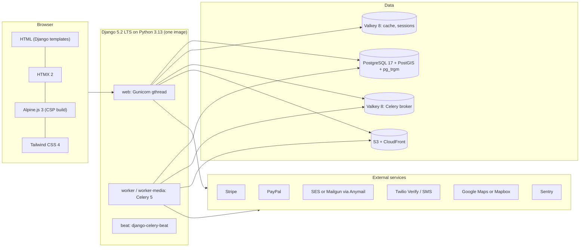

# Tech Stack

The technologies, libraries and services the platform is built on, why each was chosen, what else was considered, and how versions are pinned and upgraded.

Status: Draft v0.1 (2026-10-21)

> **Hosting change (2026-10-27):** AWS is no longer the target ([ADR-0014](../adr/0014-portable-hosting-paas-and-self-hosted.md)). AWS service names, CLI commands, sizing and alarms in this document are superseded; read them through the mapping table in ADR-0014 and [Hosting and deployment](05-hosting-and-deployment.md). The provider-neutral intent (controls, targets, procedures) still applies.

| | |
|---|---|
| Owner | Architecture |
| Audience | Engineers, DevOps, QA, security reviewers |
| Related | [01 System architecture](01-system-architecture.md) · [03 Codebase structure](03-codebase-structure.md) · [04 Infrastructure & deployment](04-infrastructure-and-deployment.md) · [ADR index](01-system-architecture.md#19-adr-index) · [Development approach](../delivery/01-development-approach.md) |

> **Version rule.** This document names **version lines** (for example "Django 5.2 LTS", "Celery 5.x"). Exact patch versions are pinned once, at project start (US-001), in `pyproject.toml` + `uv.lock`, and are then changed only through Renovate PRs (§5). Do not copy a patch number from any document; read it from the lockfile.

---

## 1. Stack at a glance

---

## 2. Technology choices by layer

| # | Layer | Choice | Purpose | Why this | Alternatives considered (and why not) | ADR |
|---|---|---|---|---|---|---|
| T1 | Language | **Python 3.13** | All server code | Supported by Django 5.2 and the full library set; free-threading not needed. EOL Oct 2029. | 3.12: older, no benefit. 3.14: adopt once every dependency publishes wheels (re-check at the Django 6.2 upgrade). | — |
| T2 | Web framework | **Django 5.2 LTS** | HTTP, ORM, forms, templates, admin, auth, i18n | LTS with security support to April 2028. Batteries included: admin powers the ops console; mature GIS (GeoDjango). | Django 6.x non-LTS: shorter support windows. FastAPI/Flask: we would rebuild admin, auth, forms and templating. Rails/Laravel: different language, no benefit. | [0001](../adr/0001-django-modular-monolith.md) |
| T3 | Architecture style | **Modular monolith** (Django apps with enforced layers) | One deployable unit with internal boundaries | Small team, one transactional database for the money path, simplest operations. Seams kept for later extraction. | Microservices: distributed transactions on the credit path, high ops cost. Unstructured monolith: erodes. | [0001](../adr/0001-django-modular-monolith.md) |
| T4 | UI rendering | **Server-rendered Django templates + HTMX 2 + Alpine.js 3 + Tailwind CSS 4** | Pages, partial updates, small client-side state, styling | SEO for public listings, small JS payload on mobile, one language, strict CSP is achievable, accessible semantic HTML by default. | React/Next.js SPA + API: second codebase, SEO needs SSR, larger JS, token handling in the browser. Hotwire/Unpoly: viable but smaller Django ecosystem than HTMX. | [0002](../adr/0002-server-rendered-htmx-alpine-tailwind.md) |
| T5 | App server | **Gunicorn** (`gthread` worker class) | WSGI process manager | Mature, simple, works behind ALB. Threads overlap DB/network waits. | Uvicorn/ASGI: no WebSockets or async views in scope. uWSGI: in maintenance mode. Granian: young. | — |
| T6 | Database | **PostgreSQL 17** (RDS Multi-AZ) + **PostGIS 3.5** + **pg_trgm** + built-in full-text search | System of record, geospatial search, fuzzy matching | One store for transactions **and** search at MVP scale. Row locks, CHECK constraints, partial unique indexes, triggers: everything the ledger needs. | MySQL: weaker GIS and full-text. Aurora PostgreSQL: faster failover, but higher and less predictable cost. Revisit if RTO or IO costs demand it. PostgreSQL 18: adopt after RDS + PostGIS support has matured (upgrade window M7+). | [0004](../adr/0004-postgresql-postgis-search-for-mvp.md), [0005](../adr/0005-postgres-row-locking-credit-ledger.md) |
| T7 | Search | **PostgreSQL** (PostGIS `ST_DWithin`, trigram, `tsvector`) on a **read replica** + Valkey result cache | Location, filter, fuzzy and keyword search | Meets p95 ≤ 500 ms for the expected catalogue size with proper indexes. No sync pipeline to operate. | OpenSearch/Elasticsearch: extra cluster, index sync, eventual consistency. Typesense/Meilisearch: weaker geo + filter combinations, another service. Algolia: per-request cost, data leaves our account. Revisit triggers in 01 §16. | [0004](../adr/0004-postgresql-postgis-search-for-mvp.md) |
| T8 | Cache, sessions | **Valkey 8** (ElastiCache) via **django-redis** | Hot search results, fragments, sessions (`cached_db`), rate limits, counters | Redis-protocol compatible, open licence (BSD), lower ElastiCache price than Redis OSS. | Redis OSS on ElastiCache: higher price, licence churn. Memcached: no data structures, no persistence. | — |
| T9 | Background jobs | **Celery 5.x** + **django-celery-beat**, broker = separate Valkey cluster (`noeviction`) + **transactional outbox** in PostgreSQL | Email/SMS, image processing, reconciliation, audits, analytics flush | Mature, retries, routing, periodic tasks, OTel/Sentry integrations. The outbox gives at-least-once delivery even if the broker loses messages. | Django 6.x Tasks framework: no production backend in core, and not available on 5.2. Re-evaluate at the 6.2 LTS upgrade. RQ/Dramatiq/Huey: smaller ecosystems. SQS as broker: durable but slower local parity and Celery transport quirks. Kafka: see ADR-0005. | [0006](../adr/0006-celery-redis-transactional-outbox.md) |
| T10 | Credit ledger | **PostgreSQL append-only ledger** with per-wallet row lock + SHA-256 hash chain | Atomic 2-credit debit, promo grants, purchases | Strong consistency in one short transaction; proven pattern; auditable. | Kafka/event sourcing: async result incompatible with "show the number now". Redis Lua counters: not durable. Amazon QLDB: end of support 2025. | [0005](../adr/0005-postgres-row-locking-credit-ledger.md) |
| T11 | Authentication | **django-allauth** (account, mfa, usersessions, socialaccount) + Django sessions | Email signup/login, mandatory verification, reset, MFA (staff now, users later), "log out all devices", optional Google/Apple | Maintained, covers every SRS auth flow, built-in rate limits. | Hand-rolled auth: risk. dj-rest-auth/JWT: wrong fit for server-rendered UI. External IdP (Cognito/Auth0): cost, UX constraints, still needs local user model. | [0003](../adr/0003-server-side-sessions-instead-of-jwt.md) |
| T12 | Password hashing | **Argon2id** (default) + **bcrypt** (fallback hasher) | Credential storage | Django-recommended and OWASP-preferred. SRS says "e.g. bcrypt", so this complies. Existing bcrypt hashes (if ever imported) still verify and are upgraded on login. | PBKDF2 (Django default): acceptable but weaker against GPU attacks. scrypt: fine, less common in Django. | [0003](../adr/0003-server-side-sessions-instead-of-jwt.md) |
| T13 | Phone OTP | **Twilio Verify** behind `accounts.integrations` adapter | Phone verification for accounts and listing contact numbers | Handles OTP generation, delivery, retries and fraud guard; no OTP storage on our side. | AWS SNS/End User Messaging + own OTP: more code, deliverability work. Vonage Verify: comparable; adapter keeps it swappable. | — |
| T14 | Email | **django-anymail** → **Amazon SES** (default) or **Mailgun** | Transactional email (verification, reveal receipt, payment receipt) | Provider-agnostic API, webhooks for bounces and complaints. SES is cheap and in-account. The client diagram names Mailgun; Anymail makes it a config switch. | Direct SMTP: no tracking webhooks. Postmark/SendGrid: also supported by Anymail if chosen. | — |
| T15 | Payments | **Stripe Checkout** + **PayPal Orders v2** behind a `PaymentGateway` adapter; **Razorpay** optional adapter | Credit-pack purchases | Hosted pages keep us in PCI DSS SAQ A. Two globally recognised gateways as the SRS requires. | Stripe Elements / PayPal card fields: larger PCI scope (SAQ A-EP). Single gateway: fails SRS §6.3. | [0007](../adr/0007-payment-gateway-adapter.md) |
| T16 | Geocoding / maps | **GeocodingService** port with **Google Maps Platform** or **Mapbox** adapter (decision OQ A-3) | Address → PostGIS `Point(SRID 4326)`, autocomplete, map tiles | Adapter isolates ToS differences (caching, storage rights). | OpenStreetMap Nominatim (public): usage policy forbids heavy use; self-hosting is an ops burden. | — |
| T17 | Region / currency detection | **CloudFront-Viewer-Country** header, fallback **MaxMind GeoLite2 Country** (file in image) | Default region and display currency | Header is free and accurate; GeoLite2 covers local/dev and non-CloudFront paths. | Paid GeoIP2 API: per-lookup cost. Live FX: rejected; explicit price book per currency instead. | — |
| T18 | Object storage / CDN | **S3** (via **django-storages** + boto3) + **CloudFront** (OAC) | Listing photos, private documents | Durable, cheap, edge-cached, signed URLs for private files. | Serving media from Django/EFS: slow, stateful. Cloudinary/imgix: vendor cost and lock-in (see ADR-0009). | [0009](../adr/0009-s3-direct-upload-async-image-processing.md) |
| T19 | Image processing | **Pillow** (+ `imagehash`; `pillow-heif` optional) in a dedicated Celery `media` queue | Verify, strip metadata, crop, WebP/JPEG variants, perceptual hash | Pure-Python ecosystem, safe re-encoding, no extra service. | libvips/pyvips: faster but native dependency; revisit if media cost grows. Lambda processing: extraction seam (01 §16). | [0009](../adr/0009-s3-direct-upload-async-image-processing.md) |
| T20 | PII protection | **Application field-level AES-256-GCM** (`cryptography`) with **KMS-wrapped data keys** + **HMAC-SHA256 blind indexes**, on top of KMS storage encryption | Contact phone/email on listings, user phone, other PII | Meets SRS §9.1 "encrypted at rest + pseudonymised" even if a DB dump or replica snapshot leaks. | Storage encryption only: does not satisfy "pseudonymised". pgcrypto: keys would travel to the DB. Tokenisation vault SaaS: cost, latency. | [0010](../adr/0010-field-level-pii-encryption-blind-indexes.md) |
| T21 | Static files | **WhiteNoise** (compressed, hashed manifest) behind **CloudFront** | CSS/JS/fonts/images shipped with the app | No extra server in AWS; immutable hashed names cached for 1 year at the edge. | Nginx sidecar in AWS: one more component to patch. S3 static bucket: extra deploy step. Nginx is used **locally only** ([04](04-infrastructure-and-deployment.md) §3). | — |
| T22 | Cloud platform | **AWS**: ECS Fargate, ALB, RDS, ElastiCache, S3, CloudFront, WAF, SES, Secrets Manager, KMS, CloudWatch, X-Ray | Run and operate everything | Managed services, multi-AZ, global edge, mature IaC support. | GCP Cloud Run + Cloud SQL / Azure Container Apps: comparable; no client preference stated, and AWS is the team baseline. EKS: Kubernetes overhead not justified. | [0008](../adr/0008-aws-ecs-fargate-terraform.md) |
| T23 | Infrastructure as Code | **Terraform** (≥ 1.10, S3 backend with native locking) + AWS provider 6.x | Reproducible environments | Widest module ecosystem, plan/review workflow, the SRS names it. | CloudFormation/CDK: AWS-only, slower drift feedback. OpenTofu: drop-in fork with an open licence. Acceptable substitute if the client prefers MPL (OQ T-2). Pulumi: smaller ops talent pool. | [0008](../adr/0008-aws-ecs-fargate-terraform.md) |
| T24 | Containers | **Docker** multi-stage image, **linux/arm64** (Graviton) | One image for web, worker, worker-media, beat, migrate | ~20 % cheaper Fargate compute on ARM; all dependencies (GDAL, libpq, Pillow) available for arm64. | x86_64: fallback if any dependency lacks arm64 support. | [0008](../adr/0008-aws-ecs-fargate-terraform.md) |
| T25 | CI/CD | **GitHub Actions** with OIDC to AWS, ECR (immutable tags), ECS deploys | Build, test, scan, deploy | Close to the code; no long-lived AWS keys. | GitLab CI, CodePipeline: no advantage for a GitHub-hosted repo. | — |
| T26 | Observability | **structlog** JSON logs → CloudWatch Logs; **OpenTelemetry** → ADOT collector → X-Ray/CloudWatch; **Sentry** for errors | Logs, traces, metrics, error tracking | Vendor-neutral instrumentation; Sentry gives fast triage with release tracking. | Datadog/New Relic/Grafana Cloud: possible OTLP back ends (OQ A-7). | — |
| T27 | Dependency management | **uv** (`pyproject.toml` + `uv.lock`) | Resolve, lock, install, run | Fast, reproducible, hash-checked lockfile, manages the Python version too. | Poetry, pip-tools: slower, two tools. | — |
| T28 | Quality tooling | ruff, mypy + django-stubs, pytest stack, Playwright, axe-core, k6, import-linter, djLint, pre-commit | Code quality gates from M0 | Fast, standard Python tooling; see §4.6. | — | — |

---

## 3. Explicit non-choices (MVP)

| Not used in MVP | Why | Revisit when |
|---|---|---|
| SPA framework (React, Vue, Svelte) | [ADR-0002](../adr/0002-server-rendered-htmx-alpine-tailwind.md) | A native-like client experience is a product requirement |
| JWT for browser sessions | [ADR-0003](../adr/0003-server-side-sessions-instead-of-jwt.md). **Deviation from SRS §3.4** ("e.g. JWT"), justified there | Public/mobile API (DRF + SimpleJWT) |
| Django REST Framework | No API consumers at MVP | Post-MVP mobile/partner API, calling the same services and selectors |
| Kafka / event streaming | [ADR-0005](../adr/0005-postgres-row-locking-credit-ledger.md) | Throughput far beyond PostgreSQL row locking, or many event consumers |
| Elasticsearch / OpenSearch | [ADR-0004](../adr/0004-postgresql-postgis-search-for-mvp.md) | Triggers in 01 §16 |
| Django Channels / WebSockets / ASGI | "Periodic HTTP polling" (client diagram) with HTMX covers near-real-time needs | Live chat or push features |
| Nginx in AWS | CloudFront + ALB + WhiteNoise cover its role (01 §7) | Never planned |
| Flower in production | Extra attack surface; ops console + CloudWatch cover job visibility | Only if staff need ad-hoc task inspection, behind SSO |
| django-axes | allauth rate limits + WAF rate rules already cover login throttling; the admin login is routed through allauth so there is one mechanism | Credential-stuffing incidents show a gap |
| django-import-export | Ops exports are a few audited CSV views; bulk import is not an MVP need | Bulk price-book or listing imports |
| django-health-check | Two small custom endpoints (`/healthz`, `/readyz`) | — |
| Kubernetes (EKS) | [ADR-0008](../adr/0008-aws-ecs-fargate-terraform.md) | Many services or platform-team ownership |

---

## 4. Library list

Columns: **Scope** = `runtime` (in the production image), `dev`, `test`, `ci` (tool only, not installed in the image). **Status** = `adopt` (baseline), `proposed` (adopt unless the M0 ADR rejects it), `optional` (only if the related decision says so).

### 4.1 Framework, data and runtime

| Package | Scope | Status | Purpose | Notes |
|---|---|---|---|---|
| `Django` (5.2 LTS) | runtime | adopt | Framework, GeoDjango (`django.contrib.gis`), admin, auth, sessions, i18n | `ENGINE = django.contrib.gis.db.backends.postgis` |
| `psycopg[c]` (3.x) | runtime | adopt | PostgreSQL driver | Built against the image's libpq. `psycopg[binary]` in dev is acceptable. The optional `pool` extra is evaluated in the M4 load test |
| `gunicorn` | runtime | adopt | WSGI server | `gthread` workers; settings in [04 §6.3](04-infrastructure-and-deployment.md#63-process-commands-and-sizing) |
| `whitenoise` | runtime | adopt | Static files with compressed, hashed manifest | `STORAGES["staticfiles"]` = `whitenoise.storage.CompressedManifestStaticFilesStorage` |
| `django-environ` | runtime | adopt | Typed env-var parsing in `config/settings/` | Production settings fail fast on missing variables. `pydantic-settings` was considered; it adds pydantic for little gain here |
| `django-redis` + `redis[hiredis]` | runtime | adopt | Cache backend for Valkey, `IGNORE_EXCEPTIONS` on the `default` alias | Valkey speaks the Redis protocol |
| `celery[redis]` (5.x) | runtime | adopt | Background tasks | JSON serializer only |
| `django-celery-beat` | runtime | adopt | DB-backed periodic schedules editable in admin | Beat runs as a singleton |
| `boto3` | runtime | adopt | S3 presign, KMS, CloudWatch custom metrics | Imported only in `apps/core/storage.py`, `apps/core/crypto/`, `apps/core/metrics.py` (rule R11) |
| `django-storages[s3]` | runtime | adopt | S3 storage backends (`storages.backends.s3.S3Storage`) | Separate storage aliases for `media` and `private` |
| `cryptography` | runtime | adopt | AES-256-GCM field encryption, HMAC blind indexes | See [ADR-0010](../adr/0010-field-level-pii-encryption-blind-indexes.md) |
| `httpx` | runtime | adopt | Outbound HTTP for adapters without an official SDK (Mapbox/Google geocoding) | Explicit timeouts on every call |
| `structlog` + `django-structlog` | runtime | adopt | JSON logs with request context | Redaction processor for PII keys |
| `sentry-sdk[django,celery]` | runtime | adopt | Error tracking, release health | `send_default_pii=False`, `before_send` scrubber |
| `opentelemetry-distro`, `opentelemetry-exporter-otlp`, `opentelemetry-instrumentation-{django,psycopg,celery,redis,botocore,httpx,logging}` | runtime | adopt | Traces and metrics | OTLP to the ADOT sidecar |
| `geoip2` | runtime | adopt | `django.contrib.gis.geoip2` fallback for region detection | GeoLite2 Country file baked into the image at build time (licence key is a CI secret) |
| `Babel` | runtime | adopt | Locale-aware currency and number formatting | Used for prices and rents |
| `phonenumbers` + `django-phonenumber-field` | runtime | adopt | E.164 parsing, validation, contact-detail detection in free text | |
| `django-countries` | runtime | proposed | Country choices and localised names | Optional convenience; ISO codes are stored either way |
| `django-filter` | runtime | adopt | Declarative search filter forms | Feeds `search.selectors.search_properties()` |
| `Pillow` | runtime | adopt | Image decode/verify/resize/encode | `MAX_IMAGE_PIXELS = 50_000_000` |
| `imagehash` | runtime | adopt | Perceptual hash for duplicate-photo fraud signals | |
| `pillow-heif` | runtime | optional | HEIC/HEIF uploads | Only after licence review (listings design §8.1) |

### 4.2 Auth, security and HTTP

| Package | Scope | Status | Purpose | Notes |
|---|---|---|---|---|
| `django-allauth[mfa,socialaccount]` | runtime | adopt | Email login, mandatory verification, reset, MFA (TOTP + recovery codes; WebAuthn optional), user sessions, Google/Apple | `allauth.usersessions` provides "log out other sessions". Built-in rate limits (`ACCOUNT_RATE_LIMITS`) |
| `argon2-cffi` | runtime | adopt | Argon2id hasher (`Argon2PasswordHasher` first in `PASSWORD_HASHERS`) | |
| `bcrypt` | runtime | adopt | `BCryptSHA256PasswordHasher` as a fallback hasher | |
| `django-csp` (4.x) | runtime | adopt | Content-Security-Policy header, nonce support | Replace with Django's built-in CSP when upgrading to 6.x |
| `django-htmx` | runtime | adopt | `request.htmx`, `HttpResponseClientRedirect`, `trigger_client_event` | |
| `django-template-partials` | runtime | adopt | `` fragments for HTMX responses | Same syntax was merged into Django 6.0 core, so the upgrade is a settings change plus the documented migration steps |
| `django-waffle` | runtime | proposed | Feature flags (delivery doc §5) | Final choice recorded in the M0 feature-flag ADR (US-014) |
| `twilio` | runtime | adopt | Verify API and SMS | Imported only in `apps/accounts/integrations/` and `apps/notifications/channels/` |
| `django-anymail[amazon-ses]` (or `[mailgun]`) | runtime | adopt | Email sending and tracking webhooks | Provider chosen by OQ A-2 |

### 4.3 Payments

| Package | Scope | Status | Purpose | Notes |
|---|---|---|---|---|
| `stripe` | runtime | adopt | Checkout Sessions, webhook signature verification, retrieval for reconciliation | Pin the Stripe API version explicitly in the client, never the account default |
| `paypal-server-sdk` | runtime | adopt | PayPal Orders v2 create/capture/get | Official server SDK. If it lacks an endpoint we need (e.g. webhook signature verification), call the REST API with `httpx` inside the adapter |
| `razorpay` | runtime | optional | Regional gateway adapter | Only if a launch market needs it (OQ in payments design) |

### 4.4 Local development only

| Package | Scope | Purpose |
|---|---|---|
| `django-debug-toolbar` | dev | SQL and template inspection (local settings only) |
| `django-extensions` | dev | `shell_plus`, `show_urls` |
| `ipython` | dev | Shell |

### 4.5 Testing

| Package / tool | Scope | Purpose |
|---|---|---|
| `pytest`, `pytest-django`, `pytest-xdist`, `pytest-randomly` | test | Test runner, Django integration, parallelism, order randomisation |
| `coverage[toml]` / `pytest-cov` | test | Coverage gates (scope and thresholds in the testing strategy) |
| `factory-boy` | test | Model factories |
| `hypothesis` | test | Property-based tests for ledger invariants |
| `time-machine` | test | Clock control (expiry, token TTLs) |
| `moto[s3,kms]` | test | AWS fakes in unit/integration tests |
| `respx` | test | `httpx` mocking for adapters |
| `pytest-playwright` (+ Playwright browsers) | test | E2E journeys, mobile viewports |
| `axe-core` (injected through Playwright, e.g. `axe-playwright-python`) | test | Automated WCAG 2.1 AA checks |
| `k6` (binary, JS scripts in `tests/load/`) | ci | Load tests (1,000 debits/s) |
| Lighthouse CI | ci | Performance/a11y budgets on key pages |

### 4.6 Static analysis, security and supply chain

| Tool | Scope | Purpose |
|---|---|---|
| `ruff` | dev/ci | Lint + format (includes isort, pyupgrade, flake8-bandit `S` rules, banned-API rules for R8/R12 in 01 §10) |
| `mypy` + `django-stubs[compatible-mypy]` + `celery-types` + `boto3-stubs[s3,kms]` | dev/ci | Static typing; strict on `services.py`/`selectors.py` |
| `import-linter` | dev/ci | Layer and forbidden-import contracts (01 §10) |
| `djLint` | dev/ci | Template lint/format |
| `pre-commit` | dev | Runs the fast checks before commit |
| `bandit` | ci | Python security lint |
| `pip-audit` | ci | Known-vulnerability scan of the lockfile |
| `semgrep` | ci | Custom rules (e.g. `foreign-model-write`, contact-field leaks) |
| `gitleaks` | ci | Secret scanning |
| `trivy` | ci | Image and IaC scanning |
| `squawk` | ci | PostgreSQL migration safety lint on `sqlmigrate` output ([04 §9](04-infrastructure-and-deployment.md#9-zero-downtime-migration-policy)) |
| OWASP ZAP baseline | ci | Passive DAST against `dev` after deploy |
| `tflint`, `terraform validate`, `terraform fmt` | ci | IaC quality |
| Renovate (preferred) or Dependabot | ci | Automated dependency PRs |

### 4.7 Front-end assets (vendored, no Node at runtime)

| Asset | Version line | Purpose | Notes |
|---|---|---|---|
| HTMX | 2.0.x | Partial page updates, polling | `htmx.config.allowEval = false`, `includeIndicatorStyles = false` (CSP) |
| Alpine.js **CSP build** (`@alpinejs/csp`) | 3.x | Dropdowns, dialogs, toasts, client-side validation helpers | Components registered with `Alpine.data()`; no inline JS expressions |
| Tailwind CSS standalone CLI | 4.x | CSS build | Pinned binary + SHA-256 check; no Node toolchain needed |
| SortableJS | 1.x | Photo re-ordering | Plus accessible button alternative (listings design §8.7) |
| Cropper.js | 1.x or 2.x (decide at M2) | In-browser crop before upload | MIT licence |

Vendored files live in `static/vendor/` with a `manifest.json` that records version, source URL and SHA-256. A CI check verifies the hashes. Renovate tracks the versions through a regex manager.

---

## 5. Version policy

### 5.1 Rules

| # | Rule |
|---|---|
| V1 | **Exact pins.** Direct runtime dependencies are pinned with `==` in `pyproject.toml` (this is an application, not a library). `uv.lock` pins every transitive dependency with hashes. CI and Docker install with `uv sync --frozen`. |
| V2 | **Pins are set at project start (US-001)** from the latest stable releases on that day, after checking each library's support for Python 3.13 and Django 5.2. No version in any document overrides the lockfile. |
| V3 | **Renovate cadence:** security fixes immediately; patch and minor updates grouped weekly (one PR per ecosystem: Python, Terraform providers, GitHub Actions, Docker base images, vendored JS); majors one PR each with a migration note. Dev-tool patch updates may auto-merge on green CI; runtime dependencies always need a human review. |
| V4 | **Security SLAs:** critical CVE in a runtime dependency (exploitable in our usage) patched in production within **72 h**; high within **7 days**; others in the next weekly batch. pip-audit and Trivy fail CI on critical/high with a fix available. |
| V5 | **Django:** stay on the current LTS. Apply Django security releases within 7 days. Upgrade to **6.2 LTS** within 6 months of its release (expected around April 2027) and in any case before 5.2 support ends (April 2028). A non-blocking CI job runs the suite with `-W error::DeprecationWarning` and against the newest Django release from 6.0 onwards to surface deprecations early. |
| V6 | **Python:** latest 3.13 patch in the base image. Move to the next minor version only together with a Django upgrade, after all wheels exist for linux/arm64. |
| V7 | **PostgreSQL:** major upgrades are planned events (blue/green RDS deployment or snapshot restore rehearsal in staging), at most once a year. PostGIS version in CI/local containers must equal the RDS version. |
| V8 | **Base images** are pinned by digest (`python:3.13-slim-<debian>@sha256:…`, `postgis/postgis:17-3.5@sha256:…`). Rebuilt weekly for OS patches, even with no code change. |
| V9 | **GitHub Actions** are pinned by full commit SHA. **Terraform** pins `required_version` and providers (`~>` minor) and commits `.terraform.lock.hcl`. |
| V10 | **External APIs** with versioned contracts (Stripe API version, PayPal Orders v2, Twilio Verify v2, Maps APIs) are pinned in adapter code and upgraded deliberately, with contract tests. |
| V11 | **Adding a dependency** requires: active maintenance (release in the last 12 months), compatible licence (no AGPL/SSPL in the runtime image), arm64 wheels or a pure-Python build, and a one-line justification in the PR. A new runtime dependency with network or crypto behaviour needs Tech Lead approval. |

### 5.2 Support horizon of the core components

| Component | Line at M0 | Vendor support ends | Planned action |
|---|---|---|---|
| Python | 3.13 | Oct 2029 | Re-evaluate 3.14 at the Django 6.2 upgrade |
| Django | 5.2 LTS | Apr 2028 | Upgrade to 6.2 LTS (H2 2027) |
| PostgreSQL | 17 | Nov 2029 | Evaluate 18 after launch |
| PostGIS | 3.5 | Follows PostgreSQL support | Upgrade with RDS minor versions |
| Valkey (ElastiCache) | 8.x | Per ElastiCache engine lifecycle | Minor upgrades in maintenance windows |
| Celery | 5.x | Community-supported | Track minor releases |
| HTMX / Alpine / Tailwind | 2.0 / 3.x / 4.x | Community-supported | Renovate-driven |
| Terraform / AWS provider | ≥ 1.10 / 6.x | HashiCorp releases | Quarterly provider bump |

**Assumption:** Django 6.2 LTS timing follows Django's published release cadence (LTS every two years in April). Confirm when the Django 6.2 roadmap is published.

---

## 6. Licensing notes

- All runtime libraries above use permissive licences (BSD, MIT, Apache-2.0, PSF, LGPL for psycopg, which is fine for dynamic linking). **Assumption:** verify each licence once at pin time with `pip-licenses` in CI. The CI fails on AGPL, SSPL or unknown licences.
- Terraform uses the Business Source Licence (BSL 1.1). Using it to provision our own infrastructure is permitted. If the client's policy forbids BSL tooling, OpenTofu is a drop-in replacement (OQ T-2).
- MaxMind GeoLite2 requires an account, licence key and acceptance of the GeoLite2 EULA, including keeping the database reasonably up to date. The weekly image rebuild (V8) covers this.
- Map tiles and geocoding results have provider-specific caching and display terms. These are handled in the geo adapter design (OQ A-3).

---

## 7. Open questions

| ID | Question | Default until answered |
|---|---|---|
| T-1 | Will the client accept Valkey (open-source Redis fork) instead of Redis OSS? | Valkey 8 on ElastiCache |
| T-2 | Does the client's tooling policy allow Terraform (BSL), or must we use OpenTofu? | Terraform |
| T-3 | Error tracking: Sentry SaaS (which data region?) or self-hosted? | Sentry SaaS, EU or US region matching the primary AWS region |
| T-4 | Feature-flag library: django-waffle or a minimal in-house flag model? | django-waffle (M0 ADR) |
| T-5 | Is a Node.js toolchain acceptable in CI for Lighthouse CI? It is not used at runtime. | Yes, CI only |
