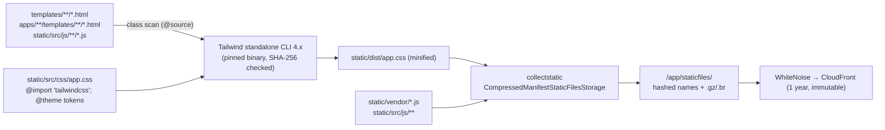
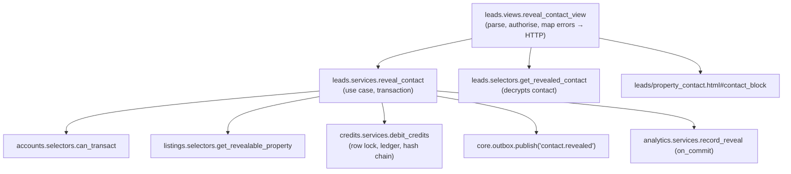

# Codebase Structure

Where every kind of code lives in the repository, how a Django app is laid out inside, and the conventions (settings, URLs, templates, HTMX, static build, naming, layering) that keep the modular monolith consistent.

Status: Draft v0.1 (2026-10-21)

| | |
|---|---|
| Owner | Architecture |
| Audience | Engineers (including AI pair-programmers), reviewers |
| Related | [01 System architecture](01-system-architecture.md) (boundary rules R1–R12 in §10) · [02 Tech stack](02-tech-stack.md) · [04 Infrastructure & deployment](04-infrastructure-and-deployment.md) · [Development approach](../delivery/01-development-approach.md) · [Listings & media design](../design/05-listings-and-media.md) |

> **Normative words.** "Must" rules are enforced by CI or review. Everything else is the default; deviate only with a reason in the PR description.

---

## 1. Principles

1. **One repository, one image, one Django project.** Every process (web, worker, worker-media, beat, migrate) runs the same code with a different command.
2. **Apps are modules with a public API.** Other apps may import only `services`, `selectors`, `exceptions`, `enums`/`constants`, `types` and `signals` (01 §10, R2).
3. **Thin views, thin models, explicit services.** Business rules live in `services.py` (writes) and `selectors.py` (reads), HackSoft style.
4. **Server-rendered first.** Every interaction works as a plain HTML form or link. HTMX and Alpine enhance it (§8).
5. **Nothing secret or environment-specific in code.** Settings come from environment variables (§6).

---

## 2. Repository tree

```text
rent-property-listing/
├── pyproject.toml              # project metadata, exact-pinned deps, tool config (ruff, mypy, pytest, coverage, importlinter)
├── uv.lock                     # full lockfile with hashes (committed)
├── manage.py                   # defaults DJANGO_SETTINGS_MODULE=config.settings.local
├── Makefile                    # developer entry points (§15)
├── compose.yaml                # local stack (04 §3)
├── .env.example                # every variable the app reads, with safe local defaults
├── README.md                   # quick start
├── CLAUDE.md                   # short pointer file for AI assistants → docs/
├── .pre-commit-config.yaml
├── .github/
│   ├── workflows/              # ci.yml, deploy.yml, nightly.yml, terraform.yml (04 §8)
│   ├── CODEOWNERS              # money-path apps require a second reviewer
│   └── pull_request_template.md
├── config/                     # Django project package (§6)
│   ├── __init__.py             # exposes the Celery app
│   ├── settings/
│   │   ├── __init__.py
│   │   ├── base.py
│   │   ├── local.py
│   │   ├── test.py
│   │   └── production.py       # used by dev, staging and prod (values differ only by env vars)
│   ├── urls.py
│   ├── wsgi.py
│   ├── asgi.py                 # present for completeness; not deployed (no ASGI features in MVP)
│   └── celery.py
├── apps/                       # all first-party Django apps (§3, §4)
│   ├── core/
│   ├── accounts/
│   ├── geo/
│   ├── analytics/
│   ├── listings/
│   ├── credits/
│   ├── leads/
│   ├── payments/
│   ├── search/
│   ├── notifications/
│   ├── moderation/
│   └── verification/           # post-MVP; created empty with models stubbed when KYC is scheduled
├── templates/                  # project-level templates (§8.1)
│   ├── base.html
│   ├── layouts/                # app.html, ops.html, minimal.html
│   ├── components/             # _button.html, _toast.html, _dialog.html, _form_field.html, _pagination.html, _badge.html
│   ├── errors/                 # 400, 403, 404, 410, 429, 500, csrf_failure
│   ├── account/  mfa/  socialaccount/  usersessions/   # django-allauth overrides
│   └── email/                  # base_email.html, base_email.txt (per-message templates live in apps/notifications)
├── static/
│   ├── src/
│   │   ├── css/app.css         # Tailwind entry point (§9)
│   │   └── js/
│   │       ├── app.js          # HTMX config + global listeners
│   │       └── components/     # Alpine components (dropdown.js, dialog.js, toasts.js, uploader.js …)
│   ├── vendor/                 # htmx, alpine (CSP build), sortable, cropper + manifest.json (versions, SHA-256)
│   ├── img/                    # logos, icons (SVG sprite)
│   └── dist/                   # build output (git-ignored)
├── locale/                     # gettext catalogues (en only at launch)
├── infra/
│   ├── terraform/              # modules/, envs/, bootstrap/, global/ (04 §7)
│   └── sql/                    # bootstrap.sql: roles, extensions, default privileges (04 §7.4)
├── docker/
│   ├── Dockerfile              # multi-stage: assets → builder → runtime (04 §6.2)
│   ├── nginx/local.conf        # local-only reverse proxy (04 §3)
│   └── seaweedfs/s3.json       # local S3 emulator identities (04 §3)
├── scripts/                    # fetch-vendor.sh, fetch-tailwind.sh, seed helpers (no business logic)
├── tests/                      # cross-app tests only (§14)
│   ├── e2e/                    # Playwright journeys + axe checks
│   ├── load/                   # k6 scripts (debit 1,000/s, search)
│   └── contracts/              # gateway/geocoder contract tests (run nightly against sandboxes)
└── docs/                       # this knowledge base (requirements/, architecture/, adr/, design/, delivery/, ux/ …)
```

**Must:** `staticfiles/` (collectstatic output), `static/dist/`, `.env`, `media/` and `.venv/` are git-ignored.

---

## 3. App inventory

Layers, owned models and public services are defined in [01 §6](01-system-architecture.md#6-c4-level-3-components-of-the-monolith-django-apps). Summary:

| Layer | Apps | May import from |
|---|---|---|
| 4 | `moderation`, `notifications` | Layers 0–3 |
| 3 | `leads`, `payments`, `search`, `verification` | Layers 0–2 |
| 2 | `listings`, `credits` | Layers 0–1 |
| 1 | `accounts`, `geo`, `analytics` | Layer 0 (and `accounts` from `geo`/`analytics` is not needed) |
| 0 | `core` | Django and third-party only |

Every app is registered as `apps.<name>` with an explicit `AppConfig` (`name = "apps.listings"`, `label = "listings"`). The **label** is what migrations, `"listings.Property"` string references and permissions use, so it must never change.

---

## 4. Per-app internal layout

### 4.1 Standard layout

```text
apps/listings/
├── __init__.py
├── apps.py                 # AppConfig; ready() imports receivers.py and registers outbox handlers
├── models.py               # thin models: fields, Meta constraints/indexes, __str__, trivial properties
├── enums.py                # TextChoices / IntegerChoices (PropertyStatus, ListerTag, PropertyType …)
├── constants.py            # non-configurable constants (configurable ones are settings, §6.3)
├── types.py                # frozen dataclasses / TypedDicts returned across app boundaries (DTOs)
├── exceptions.py           # domain errors, all subclass apps.core.exceptions.DomainError
├── services.py             # WRITE use cases; own transaction boundaries
├── selectors.py            # READ queries; return DTOs or QuerySets of this app's models
├── signals.py              # signals this app PUBLISHES (documented payloads), rarely needed
├── receivers.py            # subscriptions to LOWER-layer signals; delegate to a service immediately
├── handlers.py             # outbox topic handlers this app SUBSCRIBES to (run in Celery)
├── tasks.py                # Celery tasks: thin wrappers that call services
├── forms.py                # input parsing/validation only; no ORM writes
├── views.py                # thin; split into views/ package when it exceeds ~400 lines
├── urls.py                 # app_name = "listings"; may add urls_owner.py for a second namespace
├── admin.py                # ModelAdmin; actions call services, never model.save()
├── checks.py               # app-specific domain checks (e.g. listing automated checks registry)
├── templatetags/
│   └── listings_tags.py    # inclusion tags for components (e.g. )
├── templates/listings/
│   ├── property_detail.html
│   ├── wizard/step_basics.html …
│   └── partials/_property_card.html …
├── management/commands/    # operational commands (backfills, repairs), each calling services
├── migrations/
└── tests/
    ├── __init__.py
    ├── conftest.py
    ├── factories.py
    ├── test_models.py      # constraints, DB triggers
    ├── test_services.py
    ├── test_selectors.py
    ├── test_views.py       # HTTP + HTMX behaviour, permissions
    ├── test_forms.py
    └── test_tasks.py
```

**Package split rule.** When a module grows beyond ~400 lines, turn it into a package with the **same import path** (for example `services/__init__.py` re-exporting from `services/drafts.py` and `services/images.py`). Callers keep importing `apps.listings.services`.

### 4.2 Public vs private modules

| Module | Visibility | Who may import it |
|---|---|---|
| `services`, `selectors`, `exceptions`, `enums`, `constants`, `types`, `signals` | **Public** | Any app in a higher layer (and the same app) |
| `models` | Private | Same app only. Other apps use string FKs (`"listings.Property"`) and IDs (R4) |
| `forms`, `views`, `urls`, `admin`, `tasks`, `handlers`, `receivers`, `checks`, `templatetags` | Private | Same app only (`config/urls.py` may include `urls`) |
| `tests/factories.py` | Test-public | Tests of any app (factories for other apps' models are allowed in tests only) |

Enforced by import-linter (`layers` + the custom `PublicApiContract` in `apps/core/lint.py`). See 01 §10.

### 4.3 Adapter sub-packages (third-party SDK boundary, R11)

| App | Sub-package | Contents |
|---|---|---|
| `payments` | `gateways/` | `base.py` (`PaymentGateway` protocol, `CheckoutSession`, `GatewayEvent`), `stripe.py`, `paypal.py`, `razorpay.py`, `registry.py` |
| `geo` | `providers/` | `base.py` (`GeocodingProvider` protocol), `google.py`, `mapbox.py`, `fake.py` (local/tests) |
| `accounts` | `integrations/` | `twilio_verify.py`, `fake_verify.py` |
| `notifications` | `channels/` | `email.py` (Anymail), `sms.py` (Twilio) |
| `core` | `storage.py`, `crypto/`, `metrics.py` | S3 storages and presign helpers; field encryption (`fields.py`, `keyring.py`, `blind_index.py`); CloudWatch custom metrics |

Each adapter has a `fake` implementation selected by settings for local and tests, so no developer needs real third-party credentials to run the app.

---

## 5. `apps.core` layout

| Module | Contents |
|---|---|
| `models.py` | `TimeStampedModel` (abstract: `created_at`, `updated_at`), `PublicIdModel` (abstract: `public_id = UUIDField(default=uuid4, unique=True, editable=False)`), `OutboxMessage`, `AuditLog` |
| `outbox.py` | `publish(*, topic, payload, dedupe_key=None, available_at=None)`, handler registry `register(topic)`, dispatcher used by tasks |
| `audit.py` | `record(*, actor, action, target=None, data=None, request=None)` |
| `db.py` | `read_alias()` (01 §13.2), `set_local(name, value)` wrapper around `set_config(..., true)` |
| `exceptions.py` | `DomainError` base (carries a stable `code` used in logs and templates) |
| `middleware.py` | `RequestContextMiddleware`, `HtmxAuthRedirectMiddleware` |
| `htmx.py` | `with_toast()`, `hx_redirect()`, `is_htmx()` helpers (§8.4) |
| `ratelimit.py` | `@ratelimit(scope, rate, key)` decorator and `check_rate()` (Valkey fixed window, keys `rl:{scope}:{subject}:{window}`) |
| `storage.py` | `MediaStorage`, `PrivateStorage`, `UploadsStorage`, `presign_post()` |
| `crypto/` | `EncryptedTextField`, keyring with key IDs, `blind_index()` ([ADR-0010](../adr/0010-field-level-pii-encryption-blind-indexes.md)) |
| `health.py` | `/healthz` and `/readyz` views |
| `logging.py`, `telemetry.py` | structlog configuration and redaction processor; OpenTelemetry bootstrap |
| `metrics.py` | Business metric helpers (counters/histograms via OTel) and CloudWatch queue-depth publisher |
| `lint.py` | import-linter custom contract |
| `tasks.py` | `relay_outbox_message`, `sweep_outbox`, `publish_queue_depth`, `probe_replica_lag` |
| `templatetags/core_tags.py` | ``, ``, `` |

**Rule:** `core` holds mechanisms, not business rules. If a function mentions credits, listings or payments, it belongs in that app.

---

## 6. Settings layout

### 6.1 Modules

| Module | Used by | Contents |
|---|---|---|
| `config/settings/base.py` | everything | Installed apps, middleware (order in 01 §8.1), templates, auth, i18n, `STORAGES`, Celery, logging, security defaults, app settings with defaults (§6.3). Reads env vars through `django-environ`. |
| `config/settings/local.py` | developers (`manage.py` default) | `DEBUG=True`, debug toolbar, Mailpit SMTP, local S3 emulator endpoints, fake adapters, relaxed CSP only for the toolbar |
| `config/settings/test.py` | pytest (`DJANGO_SETTINGS_MODULE` in `pyproject.toml`) | Fast password hasher (`MD5PasswordHasher`, tests only), locmem email, fake adapters, `DATABASES["replica"]["TEST"] = {"MIRROR": "default"}`, Celery not eager (tests call tasks directly or use `django_capture_on_commit_callbacks`) |
| `config/settings/production.py` | `dev`, `staging`, `prod` | `DEBUG=False` (asserted), HSTS, secure cookies, `SECURE_PROXY_SSL_HEADER`, S3 storages, Anymail, Sentry/OTel enabled, **fail fast** if any required variable is missing |

There is deliberately **no** `dev.py` / `staging.py`. The three AWS environments differ only in environment variables (12-factor). `APP_ENV` (`dev|staging|prod`) is available for logging and Sentry tagging. Code must not branch on it for behaviour; use a setting or a feature flag instead.

### 6.2 Settings conventions

- **Must:** read environment variables only in `config/settings/` (R12). Code reads `django.conf.settings`.
- Every variable read in settings appears in `.env.example` with a comment and a safe local value.
- App-specific settings use the app name as prefix: `LISTINGS_MAX_OPEN_DRAFTS`, `CREDITS_REVEAL_COST`, `PAYMENTS_GATEWAYS_BY_MARKET`, `SEARCH_CACHE_TTL_SECONDS`.
- Secrets arrive as environment variables injected by ECS from Secrets Manager (04 §10). Settings never call AWS APIs at import time.
- `SECRET_KEY_FALLBACKS` is set from an optional variable, so `SECRET_KEY` can rotate without logging everyone out.

### 6.3 Business constants (configurable)

| Setting | Default | Source |
|---|---|---|
| `CREDITS_REVEAL_COST` | `2` | SRS §5.2–5.3 |
| `CREDITS_SIGNUP_PROMO` | `10` | SRS §3.3 |
| `LISTINGS_MIN_IMAGES` / `LISTINGS_MAX_IMAGES` | `3` / `20` | SRS §4.2 |
| `LISTINGS_MAX_IMAGE_BYTES` | `5_242_880` | SRS §4.2 |
| `LISTINGS_MAX_OPEN_DRAFTS` | `10` | Listings design §3 |
| `SEARCH_CACHE_TTL_SECONDS` | `120` | 01 §12 |

Credit packages and prices are **database records** (`payments.CreditPackage`, `CreditPackagePrice`), not settings.

### 6.4 Key `base.py` fragments (illustrative)

```python
# config/settings/base.py (excerpt)
import environ

env = environ.Env()

DATABASES = {
    "default": env.db("DATABASE_URL", engine="django.contrib.gis.db.backends.postgis"),
}
if env.str("DATABASE_REPLICA_URL", default=""):
    DATABASES["replica"] = env.db("DATABASE_REPLICA_URL", engine="django.contrib.gis.db.backends.postgis")
for alias in DATABASES.values():
    alias.update(ATOMIC_REQUESTS=False, CONN_MAX_AGE=60, CONN_HEALTH_CHECKS=True)

AUTH_USER_MODEL = "accounts.User"

CACHES = {
    "default":  {"BACKEND": "django_redis.cache.RedisCache", "LOCATION": env.str("CACHE_URL"),
                 "KEY_PREFIX": "c", "OPTIONS": {"IGNORE_EXCEPTIONS": True}},
    "sessions": {"BACKEND": "django_redis.cache.RedisCache", "LOCATION": env.str("CACHE_URL"),
                 "KEY_PREFIX": "s"},
}
SESSION_ENGINE = "django.contrib.sessions.backends.cached_db"
SESSION_CACHE_ALIAS = "sessions"

CELERY_BROKER_URL = env.str("CELERY_BROKER_URL")      # separate Valkey cluster (noeviction)
CELERY_TASK_SERIALIZER = CELERY_RESULT_SERIALIZER = "json"
CELERY_ACCEPT_CONTENT = ["json"]
CELERY_TASK_IGNORE_RESULT = True
CELERY_TASK_ACKS_LATE = True
CELERY_TASK_REJECT_ON_WORKER_LOST = True
CELERY_WORKER_PREFETCH_MULTIPLIER = 1

STORAGES = {
    "default":     {"BACKEND": "apps.core.storage.MediaStorage"},     # processed public photo variants
    "uploads":     {"BACKEND": "apps.core.storage.UploadsStorage"},   # raw uploads + sanitised masters (private)
    "private":     {"BACKEND": "apps.core.storage.PrivateStorage"},   # ownership proofs, KYC (private, signed URLs)
    "staticfiles": {"BACKEND": "whitenoise.storage.CompressedManifestStaticFilesStorage"},
}
```

> These are shapes, not final values. The exact variable names are fixed in US-004 and listed in `.env.example`.

---

## 7. URL namespace map

Route conventions:

- Paths are lowercase, kebab-case, with a trailing slash. Objects are addressed by `public_id` (UUID converter only, R10).
- User-facing pages sit inside `i18n_patterns(..., prefix_default_language=False)`, so English has no prefix and future languages get `/<lang>/…`. Webhooks, health checks and the ops console stay outside.
- URL names are `<noun>-<verb>` or `<noun>-<qualifier>` inside the app namespace: `listings:property-detail`, `leads:reveal`.
- Every HTMX endpoint is also a valid non-HTMX endpoint (§8.4).

| Namespace | Mount (in `config/urls.py`) | Owner app | Key routes (method) | Auth |
|---|---|---|---|---|
| — (core) | `/` (outside i18n) | `core` | `/healthz` (GET), `/readyz` (GET), `/robots.txt`, `/sitemap.xml` | none |
| `search` | `/` | `search` | `/` home + search form (GET), `/search/` results (GET; HTMX partial on filter change), `/search/suggest/` location suggestions (GET, HTMX) | none |
| `listings` | `/properties/` | `listings` | `/properties/<uuid>/<slug>/` detail (GET), `/properties/<uuid>/save/` (POST toggle), `/properties/<uuid>/report/` (POST) | detail: none; save/report: login |
| `my_properties` | `/my/properties/` | `listings` (`urls_owner.py`) | Dashboard, `new/`, `<uuid>/edit/<step>/`, `…/autosave/`, `…/submit/`, `…/images/…`, `…/transition/<action>/`, `…/tag-change/`, `metrics/` (routes in [listings design §12.3](../design/05-listings-and-media.md#123-routes-server-rendered-and-htmx-fragments)) | login + verified |
| `saved` | `/my/saved/` | `listings` | Saved properties list (GET) | login |
| `leads` | `/properties/` (shares the prefix) | `leads` | `/properties/<uuid>/reveal/` (POST, HTMX), `/my/reveals/` revealed contacts (GET) | login + verified |
| `credits` | `/my/credits/` | `credits` | `/my/credits/` balance + transaction history (GET, filterable), `/my/credits/badge/` header badge partial (GET, HTMX) | login |
| `payments` | `/my/credits/buy/`, `/payments/` | `payments` | `/my/credits/buy/` **Purchase Credits** (GET), `/payments/checkout/` (POST), `/payments/return/<gateway>/<uuid>/` (GET), `/payments/status/<uuid>/` (GET, HTMX polling), `/payments/cancel/<uuid>/` (GET) | login + verified |
| `payments_webhooks` | `/webhooks/` (outside i18n) | `payments` | `/webhooks/stripe/` (POST), `/webhooks/paypal/` (POST), `/webhooks/razorpay/` (POST) | gateway signature; CSRF-exempt |
| `accounts` | `/my/` | `accounts` | `/my/profile/` (GET/POST), `/my/profile/phone/` (OTP flow), `/my/notifications/` preferences, `/my/sessions/` (allauth usersessions) | login |
| allauth | `/accounts/` | allauth | login, signup, logout (POST only), confirm-email, password reset/change, email management, MFA, social | mixed |
| `notifications` | `/n/` and `/webhooks/email/` | `notifications` | `/n/unsubscribe/<token>/` (GET/POST), `/webhooks/email/<provider>/` Anymail tracking (POST) | token / provider signature |
| `ops` | `/ops/` (outside i18n) | `moderation` | Moderation queue, tag-change review, fraud flags, outbox failures, ledger audit, reconciliation runs | staff + group + MFA + WAF IP allow-list |
| `admin` | `/<ADMIN_URL_PREFIX>/` from settings (not `/admin/`) | Django admin | Hardened admin | staff + MFA |
| — | `/i18n/setlang/` | Django | Language switch (POST) | none |

**Assumption:** the UX page inventory uses these paths. If it changes a path, update this table in the same PR.

---

## 8. Templates, partials, HTMX, Alpine and CSP conventions

### 8.1 Template locations and naming

| Kind | Location | Name pattern | Example |
|---|---|---|---|
| Base and layouts | `templates/` | `base.html`, `layouts/<name>.html` | `layouts/app.html` (header + footer), `layouts/ops.html` |
| Shared components | `templates/components/` | `_<component>.html` | `components/_toast.html`, `components/_form_field.html` |
| App pages | `apps/<app>/templates/<app>/` | `<noun>_<view>.html` | `listings/property_detail.html` |
| App partials | `apps/<app>/templates/<app>/partials/` | `_<noun>.html` | `listings/partials/_property_card.html` |
| Emails | `apps/notifications/templates/notifications/email/` | `<topic>.subject.txt`, `.txt`, `.html` | `contact_revealed.html` |

Rules:

- **Must:** every page extends a layout; every layout extends `base.html`. `base.html` holds the skip link, landmarks (`header`, `nav`, `main#main`, `footer`), the toast region and script tags.
- Partials that are also part of a full page are defined **inline with ``** (django-template-partials). The full page and the HTMX response then render the same markup: the view renders `"<template>.html#<partial>"` for HTMX.
- Reusable components with logic use **inclusion tags** in `templatetags/` (``, ``). Simple components use ``; `only` is mandatory so components never depend on ambient context.
- **Must:** no business logic in templates. Templates receive DTOs or prepared context; they do not call methods that query the database (N+1 checks in tests use `django_assert_max_num_queries`).
- All user-visible strings use `` / `` (with `count` for plurals).

### 8.2 HTMX conventions

| Topic | Convention |
|---|---|
| Configuration (`static/src/js/app.js`) | `htmx.config.allowEval = false`, `htmx.config.includeIndicatorStyles = false` (indicator CSS lives in `app.css`), `htmx.config.allowScriptTags = false`, `htmx.config.historyCacheSize = 0` on pages with personal data. `responseHandling` swaps `422` (form errors) in addition to 2xx. |
| CSRF | `<body hx-headers='{"X-CSRFToken": "{{ csrf_token }}"}'>` in `base.html`; every mutating request is POST. |
| Targets | Prefer `hx-target` on an element with a stable `id` and `hx-swap="outerHTML"`. Partials render their own wrapper element with that `id`. |
| Status codes | `200` success; `422` form validation errors (re-rendered form partial); `409` version conflict; `429` rate limited (toast); `401/403` via `HtmxAuthRedirectMiddleware` → `HX-Redirect` to login; `286` stops polling. |
| Events | Server → client events through `HX-Trigger` (`django_htmx.http.trigger_client_event`). Names are kebab-case: `credits-changed`, `saved-changed`, `toast`. Listeners use `hx-trigger="credits-changed from:body"`. |
| Toasts | Out-of-band swap appended by `apps.core.htmx.with_toast()`: `<div hx-swap-oob="beforeend:#toasts">…</div>`. The `#toasts` region is `role="status" aria-live="polite"`; error toasts go to a separate `role="alert"` region. |
| Polling | `hx-trigger="load, every 30s"` plus the `data-poll` attribute. **Do not use trigger filters** such as `[document.visibilityState === 'visible']`: they need `eval`, which our CSP forbids. `app.js` cancels polling requests from `[data-poll]` elements while `document.hidden` (an `htmx:beforeRequest` listener). |
| Boost | `hx-boost` only on explicitly marked containers (wizard, My Properties). Never global, and never on links that leave the site (payment redirects). |
| Disabling | `hx-disabled-elt="find button"` on forms that spend credits or money, to stop double submits. The server is still idempotent. |
| Focus and a11y | After a swap that replaces the focused element, the partial includes `autofocus` on the new primary element or the view sets `HX-Trigger: {"focus": "#id"}`, handled in `app.js`. Live updates announce through the toast regions, never by moving focus unexpectedly. |
| History | Search filter changes use `hx-push-url="true"` so results are shareable and the Back button works. |

### 8.3 Alpine.js conventions (CSP build)

- **Must:** use the CSP build (`@alpinejs/csp`). Components are registered in `static/src/js/components/*.js` with `Alpine.data("dropdown", () => ({ … }))` and used as `x-data="dropdown"`.
- Templates contain only property and method references (`x-show="open"`, `@click="toggle"`, `:aria-expanded="open"`). No object literals, arrow functions or arbitrary expressions in attributes.
- Alpine owns **local UI state only** (open/closed, selected tab, client-side pre-validation). Server data comes from HTML, with `data-*` attributes or `{{ value|json_script:"id" }}` for structured data.
- Global stores (`Alpine.store`) are limited to `toasts`. The credit balance is **not** kept in Alpine; the header badge re-fetches its partial on `credits-changed`.

### 8.4 View patterns for HTMX + non-HTMX

```python
# Pattern: one view serves both full-page and HTMX requests.
template = "search/search_results.html"
if request.htmx:
    template += "#results"                     # django-template-partials fragment
return render(request, template, context)
```

- A POST endpoint called without HTMX (JavaScript disabled) must still work: it adds a Django `messages` entry and redirects (Post/Redirect/Get) to the page it came from.
- `apps.core.htmx.hx_redirect(request, url)` returns `HX-Redirect` for HTMX and a 302 otherwise.

### 8.5 Content Security Policy

| Directive | Value | Reason |
|---|---|---|
| `default-src` | `'self'` | |
| `script-src` | `'self'` + per-request nonce (django-csp) | All first-party and vendored JS is served from `/static/`. The nonce exists for rare, reviewed exceptions only. **Templates must not contain inline `<script>` code or `on*=` attributes.** |
| `style-src` | `'self'` | Tailwind output is a static file; HTMX indicator styles disabled |
| `img-src` | `'self' data: https://media.<domain>` + map tile hosts | |
| `connect-src` | `'self' https://<uploads-bucket-endpoint>` + Sentry ingest | Presigned POST to S3 |
| `frame-src` / `frame-ancestors` | provider-specific (maps) / `'none'` | Clickjacking protection |
| `form-action` | `'self'` + gateway hosted-checkout origins only if a gateway needs a form POST | Stripe/PayPal redirects are 303s, which `form-action` does not block in current browsers |
| `report-to` / `report-uri` | Sentry CSP endpoint | Violations are monitored |

This reconciles the two statements in the backlog and 01: the policy is **nonce-capable**, but with no inline scripts the nonce is normally unused (effectively a nonce-free strict policy).

---

## 9. Static assets build



| Step | Local | CI / Docker |
|---|---|---|
| Fetch Tailwind CLI | `make tools` (`scripts/fetch-tailwind.sh` downloads the pinned version and verifies SHA-256) | Same script in the `assets` Docker stage |
| Build CSS | `make css-watch` (or the `tailwind` compose service) | `tailwindcss -i static/src/css/app.css -o static/dist/app.css --minify` |
| Vendored JS | `make vendor-verify` checks `static/vendor/manifest.json` hashes | CI fails if a vendored file's hash differs from the manifest |
| Collect | Not needed with `DEBUG=True` (WhiteNoise `autorefresh`) | `manage.py collectstatic --noinput` in the image build |

Conventions:

- **Design tokens** (colours, spacing, radii, tag colours such as `--tag-agent-bg`) are defined once in `@theme` in `app.css`. Templates use Tailwind utilities; custom classes go in `@layer components` only for repeated multi-utility patterns (`.btn`, `.btn-primary`, `.card`).
- **No CDN-hosted scripts or styles** in templates. Everything is self-hosted, so CSP stays `'self'` and pages keep working if a third-party CDN fails.
- Script loading order in `base.html`: `htmx.min.js` (defer) → `app.js` (defer; registers `alpine:init` listeners and Alpine components) → Alpine CSP build (defer, last).
- Public-page JS budget: ≤ 50 KB gzipped (01 §1.1), checked in CI.

---

## 10. Celery tasks layout and routing

- Tasks live in each app's `tasks.py`, take **IDs and primitives only**, and call a service. They contain no business logic.
- Every task sets an explicit name (`@shared_task(name="listings.process_property_image")`) so renames don't break queued messages.
- Retry policy is declared on the task (`autoretry_for`, `retry_backoff=True`, `retry_jitter=True`, `max_retries`), with `soft_time_limit` and `time_limit`.
- Queue routing is declared once in `config/celery.py`:

| Queue | Consumed by (ECS service) | Tasks |
|---|---|---|
| `default` | `worker` | `core.relay_outbox_message` and outbox handlers (emails, SMS, cache bumps), `geo.retry_geocode` |
| `maintenance` | `worker` | `core.sweep_outbox`, `core.publish_queue_depth`, `core.probe_replica_lag`, `payments.reconcile_pending_orders`, `credits.audit_wallets`, `analytics.flush_counters`, `listings.expire_listings`, `listings.archive_stale_drafts`, `listings.sweep_pending_uploads` |
| `media` | `worker-media` | `listings.process_property_image`, `listings.delete_image_objects` |

**Note:** the backlog story US-007 lists six queue names (`default`, `critical`, `email`, `media`, `analytics`, `audit`). The architecture baseline uses the three queues above, consumed by two ECS services, because each extra queue that needs isolation means another service to size and operate. The backlog names map onto these: `critical`/`email` → `default`, `analytics`/`audit` → `maintenance`. Split a queue out only when metrics show interference (see open question CS-2).

---

## 11. Naming conventions

| Element | Convention | Example |
|---|---|---|
| Apps | Plural or domain noun, lowercase | `listings`, `credits`, `payments` |
| Models | Singular PascalCase | `Property`, `CreditLedgerEntry` |
| Enums | `TextChoices`, PascalCase class, UPPER_SNAKE values | `ListerTag.AGENT_LISTED` |
| DB constraints / indexes | `ck_<table-ish>_<rule>`, `uq_<…>`, `ix_<…>` | `ck_wallet_balance_non_negative`, `uq_reveal_user_property`, `ix_property_owner_status` |
| Services | `<verb>_<noun>`, keyword-only arguments | `debit_credits(*, user_id, amount, …)`, `reveal_contact(*, user, property_public_id)`, `publish_property(…)` |
| Selectors | `get_<noun>` (single, raises if missing), `list_<nouns>`, `search_<nouns>`, `can_<verb>` (boolean) | `get_property_detail`, `list_ledger_entries`, `can_transact` |
| Exceptions | `<Reason>Error`, subclass of `DomainError` | `InsufficientCreditsError`, `CannotRevealOwnListingError` (01 §10 R9 writes them in short form) |
| DTOs | `<Noun>` + purpose suffix where needed, frozen dataclasses | `PublicPropertyDTO`, `RevealResult` |
| Celery tasks | `<app>.<verb>_<noun>` (explicit `name=`) | `listings.process_property_image` |
| Outbox topics / events | `<aggregate>.<past_tense_verb>` (singular aggregate) | `contact.revealed`, `listing.published`, `payment.succeeded`, `listing.tag_change_decided` |
| HTMX events | kebab-case | `credits-changed` |
| URL names | `<noun>-<verb>` in the app namespace | `listings:property-detail`, `payments:checkout` |
| Templates | `snake_case.html`; partial files start with `_` | `property_detail.html`, `_property_card.html` |
| Settings | `<APP>_<NAME>` | `CREDITS_REVEAL_COST` |
| Cache keys | `<area>:<version-or-gen>:<id…>` | `search:v{gen}:{hash}`, `card:{property_id}:{ts}:{lang}` |
| Feature flags | `snake_case` | `payments_paypal_enabled` |
| Management commands | `<verb>_<noun>` | `backfill_rent_monthly`, `verify_ledger_chain` |
| Test files / functions | `test_<module>.py`; `test_<behaviour>_<condition>` | `test_reveal_is_free_when_already_revealed` |

**Consistency note:** the [listings design](../design/05-listings-and-media.md) uses entity-first service names (`property_create_draft`), `outbox_enqueue(...)` / `audit_log_record(...)`, and plural topics (`listings.published`). The conventions above (verb-first names, `core.outbox.publish`, `core.audit.record`, singular topics) match 01 and the canonical names `grant_credits` / `debit_credits`. The listings design should be aligned during review (open question CS-1).

---

## 12. Layering rules in practice: worked example (Show Number)

### 12.1 Call graph



Allowed because `leads` (Layer 3) imports only from `listings`, `credits` (Layer 2), `accounts`, `analytics` (Layer 1) and `core` (Layer 0), and only through their public modules.

### 12.2 Lower-layer service: `credits.services.debit_credits`

```python
# apps/credits/services.py (illustrative; the ledger design owns the full spec)
from django.db import transaction

from .enums import LedgerEntryType
from .exceptions import InsufficientCreditsError
from .models import CreditLedgerEntry, CreditWallet
from .types import DebitResult, LedgerReference


@transaction.atomic  # savepoint when called inside a caller's atomic block
def debit_credits(
    *,
    user_id: int,
    amount: int,
    entry_type: LedgerEntryType,
    reference: LedgerReference,
    idempotency_key: str,
) -> DebitResult:
    """Atomically check the balance and debit `amount` credits. Idempotent per `idempotency_key`."""
    if amount <= 0:
        raise ValueError("amount must be a positive integer")

    # 1. Serialise writers on THIS wallet only. Other wallets are unaffected.
    wallet = CreditWallet.objects.select_for_update().get(user_id=user_id)

    # 2. Idempotency is checked AFTER taking the lock. A concurrent duplicate waits on the lock,
    #    then (READ COMMITTED: each statement takes a fresh snapshot) sees the committed entry.
    existing = CreditLedgerEntry.objects.filter(idempotency_key=idempotency_key).first()
    if existing is not None:
        return DebitResult(entry=existing, created=False)

    # 3. Check against the locked, latest balance. CHECK (balance >= 0) is the last line of defence.
    if wallet.balance < amount:
        raise InsufficientCreditsError(balance=wallet.balance, required=amount)

    # 4. Append the hash-chained ledger entry and move the wallet head (private helper).
    entry = _append_entry(
        wallet=wallet, delta=-amount, entry_type=entry_type,
        reference=reference, idempotency_key=idempotency_key,
    )
    return DebitResult(entry=entry, created=True)
```

### 12.3 Selector: `listings.selectors.get_revealable_property`

```python
# apps/listings/selectors.py (illustrative)
from uuid import UUID

from .enums import PropertyStatus
from .exceptions import PropertyNotAvailableError
from .models import Property
from .types import RevealableProperty


def get_revealable_property(*, public_id: UUID) -> RevealableProperty:
    """Minimal, contact-free view of a PUBLISHED property for the reveal use case. Reads the primary."""
    row = (
        Property.objects.filter(public_id=public_id, status=PropertyStatus.PUBLISHED)
        .values("id", "public_id", "owner_id")
        .first()
    )
    if row is None:
        raise PropertyNotAvailableError(public_id)
    return RevealableProperty(**row)
```

The selector returns a frozen DTO, not a model instance, so the caller cannot `.save()` it (R3), and it carries **no contact fields** (listings design §13).

### 12.4 Use-case service: `leads.services.reveal_contact`

```python
# apps/leads/services.py (illustrative)
from uuid import UUID

from django.conf import settings
from django.db import transaction

from apps.accounts import selectors as accounts_selectors
from apps.analytics import services as analytics_services
from apps.core import outbox
from apps.credits import services as credits_services
from apps.credits.enums import LedgerEntryType
from apps.credits.types import LedgerReference
from apps.listings import selectors as listings_selectors

from .exceptions import AccountNotVerifiedError, CannotRevealOwnListingError
from .models import ContactReveal
from .types import RevealResult


def reveal_contact(*, user, property_public_id: UUID) -> RevealResult:
    if not accounts_selectors.can_transact(user):
        raise AccountNotVerifiedError()
    prop = listings_selectors.get_revealable_property(public_id=property_public_id)
    if prop.owner_id == user.id:
        raise CannotRevealOwnListingError()

    # Fast path: already revealed → free, no lock taken.
    existing = ContactReveal.objects.filter(user_id=user.id, property_id=prop.id).first()
    if existing is not None:
        return RevealResult(reveal=existing, charged=False)

    cost = settings.CREDITS_REVEAL_COST
    with transaction.atomic():
        debit = credits_services.debit_credits(
            user_id=user.id,
            amount=cost,
            entry_type=LedgerEntryType.CONTACT_REVEAL,
            reference=LedgerReference(model="listings.Property", id=prop.id),
            idempotency_key=f"reveal:{user.id}:{prop.id}",
        )
        reveal, created = ContactReveal.objects.get_or_create(
            user_id=user.id,
            property_id=prop.id,  # UNIQUE (user, property)
            defaults={"ledger_entry_id": debit.entry.id, "credits_spent": cost},
        )
        if created:
            outbox.publish(
                topic="contact.revealed",
                payload={"reveal_id": reveal.id},
                dedupe_key=f"contact.revealed:{reveal.id}",
            )
            transaction.on_commit(lambda: analytics_services.record_reveal(property_id=prop.id))
    return RevealResult(reveal=reveal, charged=debit.created)
```

Why this is correct under concurrency (double click, two tabs): both requests pass the fast path, then serialise on the wallet row lock inside `debit_credits`. The second one finds the first one's ledger entry by idempotency key (`created=False`, no charge), and `get_or_create` returns the existing `ContactReveal`. The receipt email is sent once, because only the creating transaction publishes the outbox message, and only after commit.

### 12.5 View: `leads.views.reveal_contact_view`

```python
# apps/leads/views.py (illustrative)
from django.conf import settings
from django.contrib import messages
from django.contrib.auth.decorators import login_required
from django.http import Http404
from django.shortcuts import redirect, render
from django.urls import reverse
from django.utils.translation import gettext as _
from django.views.decorators.http import require_POST
from django_htmx.http import trigger_client_event

from apps.core.htmx import hx_redirect, with_toast
from apps.core.ratelimit import ratelimit
from apps.credits.exceptions import InsufficientCreditsError
from apps.listings.exceptions import PropertyNotAvailableError

from . import selectors, services
from .exceptions import AccountNotVerifiedError, CannotRevealOwnListingError

TEMPLATE = "leads/property_contact.html"


@require_POST
@login_required
@ratelimit(scope="reveal", rate="10/m", key="user")
def reveal_contact_view(request, public_id):
    try:
        result = services.reveal_contact(user=request.user, property_public_id=public_id)
    except PropertyNotAvailableError:
        raise Http404
    except AccountNotVerifiedError:
        return hx_redirect(request, reverse("account_email"))
    except (InsufficientCreditsError, CannotRevealOwnListingError) as exc:
        message = _("You need %(cost)s credits to view this number.") % {"cost": settings.CREDITS_REVEAL_COST}
        if isinstance(exc, CannotRevealOwnListingError):
            message = _("This is your listing.")
        if not request.htmx:
            messages.warning(request, message)
            return redirect(request.headers.get("Referer") or "/")
        context = selectors.get_contact_block_context(user=request.user, property_public_id=public_id)
        response = render(request, f"{TEMPLATE}#contact_block", context)
        return with_toast(response, level="warning", message=message,
                          link=reverse("payments:purchase"), link_text=_("Buy credits"))

    context = selectors.get_contact_block_context(user=request.user, property_public_id=public_id)
    success = _("Contact revealed. %(cost)s credits deducted. Details emailed to you.") % {
        "cost": result.reveal.credits_spent
    }
    if not request.htmx:
        if result.charged:
            messages.success(request, success)
        return redirect(context["property_url"])
    response = render(request, f"{TEMPLATE}#contact_block", context)
    response["Cache-Control"] = "no-store"
    if result.charged:
        trigger_client_event(response, "credits-changed")
        with_toast(response, level="success", message=success)
    return response
```

What the view does **not** do: touch models, open transactions, decide prices, or format contact data. All of that belongs to services and selectors.

### 12.6 Template partial

```django
{# apps/leads/templates/leads/property_contact.html (fragment) #}


<div id="contact-block">
  
    
  
    <a class="btn btn-primary" href="?next={{ request.path|urlencode }}"></a>
  
    <p class="text-sm"></p>
  
    <a class="btn btn-primary" href=""></a>
  {# can_reveal: balance >= 1; balance 1 gets the insufficient-credit toast from the server #}
    <form method="post" action=""
          hx-post=""
          hx-target="#contact-block" hx-swap="outerHTML" hx-disabled-elt="find button">
      
      <button type="submit" class="btn btn-primary">
         ·
        {{ cost }} credit{{ cost }} credits
      </button>
    </form>
  
</div>

```

The `state` values implement the UX baseline from known issue #5. The plaintext contact appears only in the `revealed` branch, and `contact` is supplied only by `leads.selectors.get_contact_block_context`, which decrypts it only when a `ContactReveal` exists (or the viewer owns the listing).

### 12.7 Test shape

```python
# apps/leads/tests/test_services.py (illustrative)
def test_reveal_charges_once_and_publishes_one_outbox_message(
    verified_user_with_balance, published_property, django_capture_on_commit_callbacks
):
    user = verified_user_with_balance(balance=10)
    with django_capture_on_commit_callbacks(execute=True):
        first = reveal_contact(user=user, property_public_id=published_property.public_id)
        second = reveal_contact(user=user, property_public_id=published_property.public_id)

    assert first.charged is True and second.charged is False
    assert credits_selectors.get_balance(user_id=user.id) == 8
    assert OutboxMessage.objects.filter(topic="contact.revealed").count() == 1
```

Thread-based concurrency tests (`@pytest.mark.django_db(transaction=True)`, N threads on one wallet) live in `apps/credits/tests/test_concurrency.py`. Details are in the testing strategy.

---

## 13. Where does this code go?

| I need to… | Put it in | Not in |
|---|---|---|
| Validate a form field's format | `forms.py` | services (they re-validate business rules, not formats) |
| Enforce a business rule ("max 20 images", "tag immutable after publish") | `services.py` + a DB constraint/trigger where possible | views, forms, model `save()` |
| Read data for a page | `selectors.py` (returns DTO/QuerySet) | views building QuerySets inline |
| Change another app's data | Call that app's **service** | Importing its models |
| React to another app's event | `handlers.py` (outbox topic) or `receivers.py` (in-process signal from a lower layer) | `post_save` receivers |
| Call a third-party API | An adapter in the owning app's adapter sub-package (§4.3), called from a service **after commit** or from a task | Views, models, inside `transaction.atomic()` |
| Run something later or periodically | `tasks.py` (thin) + a service | A thread or `time.sleep` |
| Add a reusable UI element | `templates/components/` or an inclusion tag | Copy-pasted markup |
| Add a staff-only screen | `apps/moderation` views under `/ops/` (or admin for raw CRUD) | Public views with `is_staff` checks |
| Fix data in production | A management command calling services, reviewed like code | Ad-hoc SQL in a shell |

---

## 14. Tests layout

| Location | Contains | Runs in |
|---|---|---|
| `apps/<app>/tests/` | Unit and integration tests for that app (services, selectors, views, forms, tasks, DB constraints/triggers) | Every PR (parallel via `pytest -n auto`) |
| `tests/e2e/` | Playwright journeys (signup → verify → promo credits → reveal; list a property; purchase) with axe checks | Every PR against the compose stack (smoke subset); full suite nightly and before release |
| `tests/load/` | k6 scripts (`reveal_debit.js` at 1,000 req/s; `search.js`) | On demand / milestone exits on staging |
| `tests/contracts/` | Gateway, geocoder and email provider contract tests against sandboxes | Nightly (needs sandbox credentials) |
| `conftest.py` (root) | Shared fixtures: `verified_user`, `published_property`, fake adapters, frozen time | — |

Coverage scope and gates are defined in the testing strategy (delivery doc 04). Migrations, settings and `tests/` are excluded from coverage.

---

## 15. Developer commands (`Makefile`)

| Target | Does |
|---|---|
| `make up` / `make down` | Start/stop the compose stack |
| `make migrate`, `make seed` | Apply migrations; load demo data (users, listings with images, packages) |
| `make check` | The full local gate: `ruff check`, `ruff format --check`, `djlint --check`, `mypy`, `lint-imports`, `manage.py makemigrations --check --dry-run`, `pytest --cov` |
| `make test` / `make test-fast` | Full suite / changed-app tests only |
| `make e2e` | Playwright suite against the running stack |
| `make css`, `make css-watch` | Tailwind build / watch |
| `make tools`, `make vendor-verify` | Fetch pinned Tailwind CLI; verify vendored JS hashes |
| `make messages` | `makemessages` + `compilemessages` |
| `make shell` | `manage.py shell_plus` in the web container |

---

## 16. Open questions and consistency items

| ID | Item | Default until resolved |
|---|---|---|
| CS-1 | Service, helper and topic naming differs between this document/01 (verb-first, `core.outbox.publish`, `core.audit.record`, singular topics) and the listings design/backlog (entity-first, `outbox_enqueue`, `audit_log_record`, `listings.*` topics). | This document's conventions; align the listings design during review |
| CS-2 | Queue names: three queues (§10) vs six in US-007. | Three queues, two worker services |
| CS-3 | The listings design §10.3 polling snippet uses an HTMX trigger filter (`[document.visibilityState === 'visible']`), which needs `eval` and is blocked by our CSP (`allowEval=false`). | Use the `data-poll` + `htmx:beforeRequest` pattern (§8.2) |
| CS-4 | CSP wording: "nonce-based" (01) vs "nonce-free strict policy" (US-015). | Nonce-capable policy with no inline scripts (§8.5) |
| CS-5 | Is a `verification` app skeleton created in M2 (for private-docs storage hooks) or only when KYC is scheduled? | Only the private bucket and storage alias in M2; app created post-MVP |
