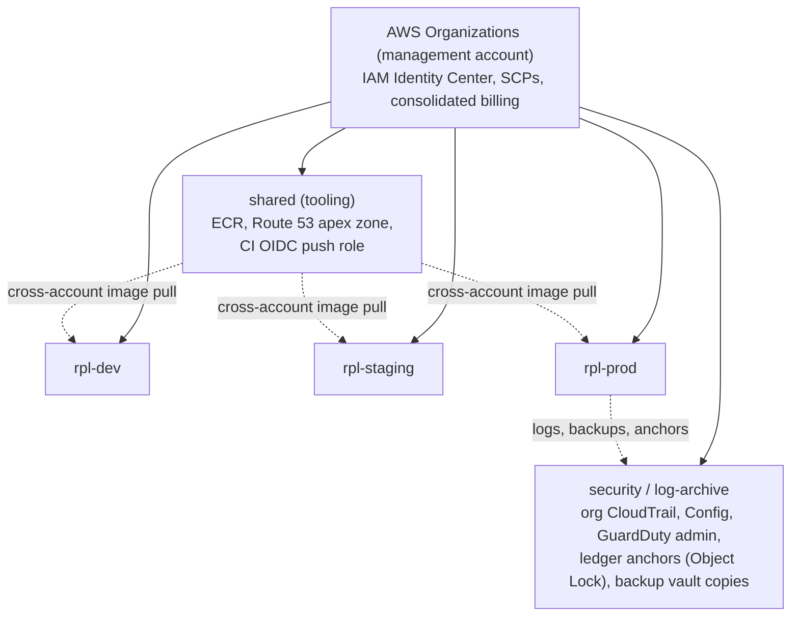
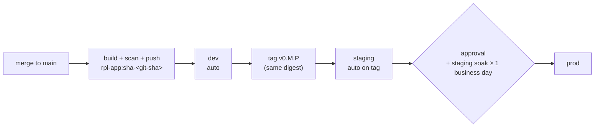
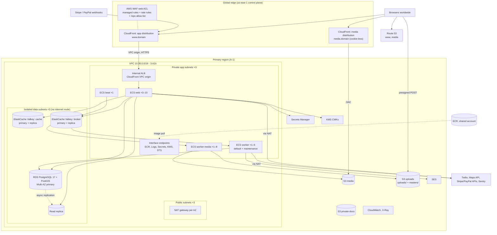
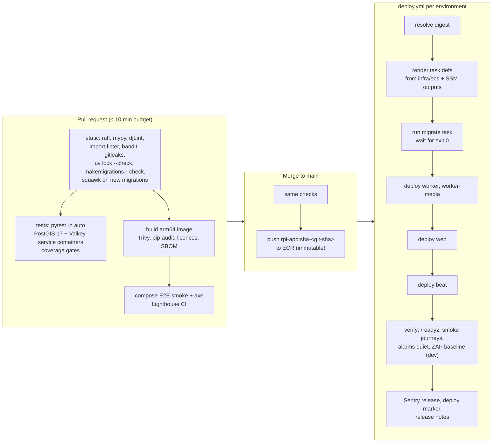

# Infrastructure and Deployment

How the platform runs: environments, the local docker compose stack, the AWS topology, networking, the container image, Terraform layout, the CI/CD pipeline, zero-downtime migrations, secrets, scaling, launch sizing and cost, disaster recovery and multinational concerns.

Status: Draft v0.1 (2026-10-21)

> **SUPERSEDED (2026-10-27) by [ADR-0014](../adr/0014-portable-hosting-paas-and-self-hosted.md) and [Hosting and deployment](05-hosting-and-deployment.md).** The client chose portable hosting (PaaS or self-hosted VPS) instead of AWS. This document is kept as a reference in case AWS is reconsidered; do not implement it.

| | |
|---|---|
| Owner | Architecture + Platform |
| Audience | DevOps/Platform, engineers, QA, security reviewers, PM (cost and timeline) |
| SRS anchors | §8.1 Latency, §8.2 Concurrency, §8.3 Availability (restore testing, runbooks), §9.1 Encryption, §9.3 PCI DSS, §10.1 Cloud native + IaC, §10.2 Code standards |
| Requirement IDs | NFR-SCAL-01, NFR-AVAIL-01, NFR-PERF-01/02, NFR-SEC-01..03, NFR-OBS-01 |
| Related | [01 System architecture](01-system-architecture.md) · [02 Tech stack](02-tech-stack.md) · [03 Codebase structure](03-codebase-structure.md) · [ADR-0008 AWS ECS Fargate + Terraform](../adr/0008-aws-ecs-fargate-terraform.md) · [Security](../quality/01-security-and-compliance.md) · [NFR performance](../quality/02-nfr-performance-and-scalability.md) · [Testing strategy](../delivery/04-testing-strategy.md) · [Milestones](../delivery/02-milestones-and-backlog.md) |

> **Scope.** This document fixes the *shape* of the platform. Exact instance classes, autoscaling limits and prices are starting points: the M0 spike (US-012), the M4 load test (US-414) and the M7 tests (US-702) replace them with measurements. Every number below that is not from the SRS is marked as an assumption or a proposal.

---

## 1. Principles

| # | Principle | Consequence |
|---|---|---|
| P1 | **One image, many processes.** | `web`, `worker`, `worker-media`, `beat` and the one-off `migrate`/`ops` tasks all run the same image digest with a different command ([01 §2](01-system-architecture.md#2-architecture-at-a-glance)). |
| P2 | **Build once, promote by digest.** | An image is built once on `main`, then deployed unchanged to dev → staging → prod. Nothing is rebuilt per environment. |
| P3 | **12-factor configuration.** | Environments differ only in environment variables and secrets. `config/settings/production.py` serves dev, staging and prod ([03 §6](03-codebase-structure.md#6-settings-layout)). |
| P4 | **Everything as code.** | AWS resources in Terraform; task definitions, env files and pipelines in the repo; no console changes except break-glass, and drift is detected nightly. |
| P5 | **Managed services first.** | RDS, ElastiCache, S3, CloudFront, WAF, SES, Secrets Manager and KMS instead of self-run equivalents. The team operates application code, not databases or proxies. |
| P6 | **Stateless compute, authoritative data in PostgreSQL.** | Any task can die at any time. Valkey and the broker are rebuildable; S3 holds binaries ([01 §5](01-system-architecture.md#5-c4-level-2-containers)). |
| P7 | **Private by default.** | No public IPs on tasks, an internal ALB reached only through CloudFront, data stores in isolated subnets, buckets behind Block Public Access. |
| P8 | **Cost is a design input.** | Graviton (arm64), small launch sizes with autoscaling, single NAT outside prod, and scheduled scale-down of non-prod environments (§12). |

---

## 2. Environments

### 2.1 Environment matrix

| | **local** | **dev** | **staging** | **prod** |
|---|---|---|---|---|
| Purpose | Developer machine | Integration of every merge; ZAP baseline | Release candidate, stakeholder demos, performance tests, restore drills | Live traffic |
| Where | docker compose (§3) | AWS account `rpl-dev` | AWS account `rpl-staging` | AWS account `rpl-prod` |
| Deploy trigger | `make up` | Automatic on merge to `main` | Automatic on release tag `v0.<M>.<P>` (same digest as dev) | Manual approval (GitHub environment reviewers) of a digest already on staging |
| Topology | Single containers | Same modules as prod, 2 AZs, single NAT, Single-AZ RDS, no replica | Prod-like: 3 AZs, Multi-AZ RDS + replica, smaller classes; prod-size "perf profile" on demand (§11.3) | 3 AZs, Multi-AZ everything (§12.1) |
| Data | Seed data (`make seed`) | Synthetic seed data, reset at will | **Synthetic only.** No production data or PII copies, ever | Real |
| Payments | Fake gateway; optional Stripe test mode through `stripe-cli` | Stripe test mode, PayPal sandbox | Stripe test mode, PayPal sandbox | Live keys |
| Email / SMS | Mailpit / fake verify (OTP `000000`) | SES (sandbox, verified team recipients) / Twilio test credentials | SES production access on a sending subdomain / Twilio with an allow-list of team numbers | SES production on the apex sending domain / Twilio live |
| Domains (**Assumption**) | `localhost:8080` | `dev.<domain>`, `media.dev.<domain>` | `staging.<domain>`, `media.staging.<domain>` | `www.<domain>`, `media.<domain>` |
| Access | Developer | Team (SSO) | Team + stakeholders (WAF IP allow-list or basic auth at the edge) | Public; staff `/ops/` restricted (§5.4) |
| CSP | Report-only | Report-only | Enforced | Enforced ([security §6.3](../quality/01-security-and-compliance.md#63-http-security-headers-and-browser-controls)) |

**Non-goal for MVP:** per-PR preview environments. They multiply RDS/ElastiCache cost and are not needed with trunk-based development and a fast dev deploy. Revisit if the team grows beyond about 6 engineers.

### 2.2 AWS accounts



- The account list follows the security baseline ([security §12](../quality/01-security-and-compliance.md#12-cloud-and-platform-security-baseline)). **Proposed addition:** a `shared` tooling account that holds the single ECR repository and the apex DNS zone. One registry is what makes "promote by digest" (P2) work across accounts without re-pushing images.
- If the client mandates a single AWS account (OQ-SEC-07), the same Terraform modules apply with per-environment resource prefixes and stricter resource-level IAM. Promotion by digest still works, because the registry would then be shared anyway.

### 2.3 Environment timeline

Follows the [delivery plan §9.3](../delivery/01-development-approach.md#93-environment-timeline).

| Environment | Created | Notes |
|---|---|---|
| local | M0 (US-003) | |
| dev | M0 (US-010, US-011) | Walking skeleton deployed end to end |
| staging | End of M1 | Prod-like sizing for performance tests from M4 |
| prod | **End of M5** (proposed in the delivery plan), no public traffic | Rehearse deploys, migrations, secrets, DNS and live-gateway webhooks before M7. Go-live remains M7 (US-711) |

### 2.4 Promotion model



- A release tag may only point at a commit whose image passed the dev deploy.
- The soak rule can be waived for a hotfix by the Tech Lead; the waiver is recorded in the release PR.

---

## 3. Local development (docker compose)

### 3.1 Services

`compose.yaml` lives at the repo root ([03 §2](03-codebase-structure.md#2-repository-tree)). `make up` starts the default profile; the `payments` profile adds `stripe-cli`.

| Service | Image | Port(s) on host | Role | Prod counterpart |
|---|---|---|---|---|
| `nginx` | `nginx` (stable, pinned by digest) | **8080** (app entry point) | Reverse proxy to `web`; serves `/_media/*` from the S3 emulator; 1 MiB body limit | CloudFront + ALB |
| `web` | `rpl-app:local` (`dev` target) | 8000 (direct, debugging only) | Gunicorn with `--reload`, same `gunicorn.conf.py` as prod | ECS `web` |
| `worker` | `rpl-app:local` | — | Celery, queues `default,maintenance,media` in one process (concurrency 2) | ECS `worker` + `worker-media` |
| `beat` | `rpl-app:local` | — | celery-beat, `DatabaseScheduler` | ECS `beat` |
| `tailwind` | `rpl-app:local` | — | `tailwindcss --watch` (pinned standalone CLI) | Docker `assets` stage |
| `db` | `postgis/postgis:17-3.5` (pinned by digest) | 5432 | PostgreSQL 17 + PostGIS; runs `infra/sql/bootstrap.sql` on first start, so local roles match RDS (§7.4) | RDS |
| `valkey-cache` | `valkey/valkey:8` (pinned) | 6379 | Cache + sessions, `allkeys-lru` | ElastiCache (cache) |
| `valkey-broker` | `valkey/valkey:8` (pinned) | 6380 | Celery broker, `noeviction` | ElastiCache (broker) |
| `s3` | `chrislusf/seaweedfs` (pinned) | 8333 (S3 API) | S3-compatible storage; buckets `rpl-local-media`, `rpl-local-uploads`, `rpl-local-private-docs` | S3 |
| `s3-init` | `amazon/aws-cli` (pinned) | — | One-shot: creates buckets and the uploads-bucket CORS rule | Terraform |
| `mailpit` | `axllent/mailpit` (pinned) | 8025 (UI), 1025 (SMTP) | Captures all email | SES / Mailgun |
| `stripe-cli` (profile `payments`) | `stripe/stripe-cli` (pinned) | — | `stripe listen --forward-to nginx:8080/webhooks/stripe/` with the developer's own test key | Stripe webhooks |

Two Valkey containers mirror the production split ([01 §5](01-system-architecture.md#5-c4-level-2-containers)): a cache must evict, a broker must not. Locally they cost about 10 MB each.

### 3.2 `compose.yaml` (excerpt, illustrative)

```yaml
name: rpl

x-app: &app
  image: rpl-app:local
  build: { context: ., dockerfile: docker/Dockerfile, target: dev }
  env_file: .env                     # copied from .env.example; dummy values only
  volumes: [".:/app"]                 # live code; static/dist is built by the tailwind service
  depends_on:
    db: { condition: service_healthy }
    valkey-cache: { condition: service_healthy }
    valkey-broker: { condition: service_healthy }
    s3-init: { condition: service_completed_successfully }

services:
  web:
    <<: *app
    command: ["gunicorn", "config.wsgi:application", "-c", "docker/gunicorn.conf.py", "--reload"]
    ports: ["8000:8000"]
  worker:
    <<: *app
    command: ["celery", "-A", "config", "worker", "-Q", "default,maintenance,media", "-c", "2", "-l", "INFO"]
  beat:
    <<: *app
    command: ["celery", "-A", "config", "beat", "--scheduler", "django_celery_beat.schedulers:DatabaseScheduler"]
  db:
    image: postgis/postgis:17-3.5@sha256:<pinned>
    environment: { POSTGRES_PASSWORD: local-only }
    volumes:
      - pgdata:/var/lib/postgresql/data
      - ./infra/sql/bootstrap.sql:/bootstrap/bootstrap.sql:ro
      - ./docker/postgres/init.sh:/docker-entrypoint-initdb.d/10-bootstrap.sh:ro
    healthcheck: { test: ["CMD", "pg_isready", "-U", "postgres"], interval: 5s, retries: 20 }
  valkey-cache:
    image: valkey/valkey:8@sha256:<pinned>
    command: ["valkey-server", "--maxmemory", "256mb", "--maxmemory-policy", "allkeys-lru"]
    healthcheck: { test: ["CMD", "valkey-cli", "ping"], interval: 5s }
  valkey-broker:
    image: valkey/valkey:8@sha256:<pinned>
    command: ["valkey-server", "--maxmemory-policy", "noeviction", "--appendonly", "yes"]
    ports: ["6380:6379"]
    healthcheck: { test: ["CMD", "valkey-cli", "ping"], interval: 5s }
  s3:
    image: chrislusf/seaweedfs:<pinned>@sha256:<pinned>
    command: ["server", "-dir=/data", "-s3", "-s3.port=8333", "-s3.config=/etc/seaweedfs/s3.json"]
    volumes: ["s3data:/data", "./docker/seaweedfs/s3.json:/etc/seaweedfs/s3.json:ro"]
    ports: ["8333:8333"]
  nginx:
    image: nginx:<pinned>@sha256:<pinned>
    volumes: ["./docker/nginx/local.conf:/etc/nginx/conf.d/default.conf:ro"]
    ports: ["8080:8080"]
    depends_on: [web, s3]
  # tailwind, s3-init, mailpit and stripe-cli (profiles: ["payments"]) omitted for brevity

volumes: { pgdata: {}, s3data: {} }
```

`.env.example` points the app at these services: `DATABASE_URL=postgis://rpl_migrator:…@db:5432/rpl` for `make migrate`, the `rpl_app` URL for the running app (so local permission errors match production), `CACHE_URL=redis://valkey-cache:6379/0`, `CELERY_BROKER_URL=redis://valkey-broker:6379/0`, `AWS_S3_ENDPOINT_URL=http://s3:8333`, a browser-facing `AWS_S3_PUBLIC_ENDPOINT_URL=http://localhost:8333` for presigned POSTs, and `EMAIL_HOST=mailpit`.

### 3.3 Decision: local S3 emulator

US-003 and US-014 ask for this choice to be recorded. The baseline brief named MinIO or LocalStack.

| Option | Assessment |
|---|---|
| **SeaweedFS** (chosen) | Apache-2.0. Small single container with an S3 gateway, including presigned URLs and browser POST uploads. Actively maintained, with official images. |
| MinIO | The long-time default, but its community edition moved to source-only distribution and lost its admin console during 2025. Pinning and patching a self-built image is a maintenance burden for a dev-only tool. AGPL-3.0. |
| LocalStack | Emulates far more than S3 and is heavier to run. Its free-tier terms have changed over time. Worth adopting only if we later need local emulation of several AWS services (SQS, SNS, KMS), which the design avoids. |

**Proposed change** (from the baseline brief): SeaweedFS replaces MinIO/LocalStack locally. M0 verifies that presigned POST with `content-length-range` and `Content-Type` conditions behaves as on S3 ([design 05 §8.2](../design/05-listings-and-media.md#82-upload-sequence-direct-to-s3-presigned-post)). If it does not, the fallback is LocalStack (S3 only). Both are hidden behind `apps.core.storage`, so switching costs only configuration. To be extracted into a seed ADR at M0 (US-014).

### 3.4 Parity gaps (known and accepted)

| Production behaviour | Local behaviour | Covered by |
|---|---|---|
| CloudFront, WAF, TLS, `CloudFront-Viewer-Country` | Nginx over HTTP; region from GeoLite2 or the `X-Debug-Country` header (local settings only) | dev/staging, ZAP |
| SSE-KMS on uploads, `x-amz-server-side-encryption` presign condition | Condition omitted (`STORAGE_SSE_KMS=False`) | staging |
| KMS-wrapped field-encryption keys | Static dev key from `.env` (`FIELD_ENCRYPTION_KEYS`), never valid elsewhere | staging, US-705 |
| Read replica and lag probe | `DATABASE_REPLICA_URL` may point at the same database to exercise routing code | staging |
| Multi-AZ failover, autoscaling | None | staging drills, PT-11 |
| Real email/SMS/geocoding providers | Mailpit, fake verify, fake geocoder | Nightly contract tests ([testing §9](../delivery/04-testing-strategy.md#9-contract-tests-for-adapters)) |
| PayPal webhooks | Not reachable locally without a tunnel | Recorded webhook fixtures; dev environment |

### 3.5 Developer workflow

`make up` → `make migrate` → `make seed` → open `http://localhost:8080`. Mailpit at `:8025`. `make check` runs the full local gate ([03 §15](03-codebase-structure.md#15-developer-commands-makefile)). Target from US-003: healthy stack in under 5 minutes on a fresh machine, and a new developer running locally in under an hour (NFR-CODE-01.4).

---

## 4. AWS deployment topology

### 4.1 Diagram (prod)



### 4.2 Edge routing

App distribution (`www.<domain>`):

| Path pattern | Origin | Cache policy | Origin request policy | Notes |
|---|---|---|---|---|
| `/static/*` | ALB (WhiteNoise) | `CachingOptimized` (1 year, hashed names) | None | Compressed (Brotli/gzip) |
| `/webhooks/*` | ALB | `CachingDisabled` | All viewer headers + body unchanged | WAF size-restriction exception (§5.4); signature headers must reach Django |
| `/ops/*` | ALB | `CachingDisabled` | All viewer headers | WAF IP allow-list |
| `/*` (default) | ALB | `CachingDisabled` (HTML not edge-cached at MVP) | `Managed-AllViewerAndCloudFrontHeaders-2022-06` (cookies, `HX-*` headers, query strings, `CloudFront-Viewer-Country`) | Viewer protocol policy `redirect-to-https` |

Media distribution (`media.<domain>`): S3 media bucket via Origin Access Control, `CachingOptimized`, response-headers policy with `X-Content-Type-Options: nosniff` and HSTS, no cookies forwarded. It is a separate hostname so that `__Host-` session cookies are never sent with media requests ([security §6.7](../quality/01-security-and-compliance.md#67-file-uploads)). Origin Shield is enabled in the primary region.

Both distributions: HTTP/2 and HTTP/3, IPv6, TLS policy `TLSv1.2_2021`, ACM certificates in **us-east-1** (a CloudFront requirement), standard logs to the log-archive account.

---

## 5. Networking and security groups

### 5.1 VPC and subnet plan

Non-overlapping ranges per environment keep future peering, VPN or Transit Gateway options open.

| Environment | VPC CIDR | AZs | Public (/24 each) | Private app (/20 each) | Isolated data (/24 each) |
|---|---|---|---|---|---|
| dev | 10.10.0.0/16 | 2 | 10.10.0.0, 10.10.1.0 | 10.10.16.0, 10.10.32.0 | 10.10.64.0, 10.10.65.0 |
| staging | 10.20.0.0/16 | 3 | 10.20.0.0–2.0 | 10.20.16.0, .32.0, .48.0 | 10.20.64.0–66.0 |
| prod | 10.30.0.0/16 | 3 | 10.30.0.0–2.0 | 10.30.16.0, .32.0, .48.0 | 10.30.64.0–66.0 |
| DR (reserved) | 10.40.0.0/16 | 3 | as prod | as prod | as prod |

- Fargate `awsvpc` networking gives each task its own ENI and IP. /20 app subnets (about 4,000 addresses per AZ) leave ample room for autoscaling and deployments at 200 % capacity.
- Isolated data subnets have a route table with **no** default route: RDS and ElastiCache cannot reach the internet, and the internet cannot reach them.
- The VPC has an internet gateway (required by NAT and by CloudFront VPC origins), but no task or data store has a public IP.

### 5.2 Routing, NAT and VPC endpoints

| Item | dev | staging | prod | Reason |
|---|---|---|---|---|
| NAT gateways | 1 | 1 | 1 per AZ (3) | Prod must survive an AZ loss without losing egress. Non-prod accepts a single point of failure for cost |
| S3 gateway endpoint | Yes | Yes | Yes | Free. Carries ECR image layers and all S3 traffic without NAT charges |
| Interface endpoints: `ecr.api`, `ecr.dkr`, `logs`, `secretsmanager`, `kms`, `sts` | No | Yes | Yes | Keeps AWS API traffic private and independent of NAT. In prod they can be placed in 2 of 3 AZs to halve their cost (§12.3) |
| Egress to third parties (Stripe, PayPal, Twilio, Maps, Sentry, SES API, Turnstile) | NAT | NAT | NAT | Outbound 443 only ([security §6.6](../quality/01-security-and-compliance.md#66-ssrf-and-egress)). A domain allow-list firewall is not deployed at MVP (OQ-SEC-05) |
| VPC flow logs | Rejects | Rejects | All, to log-archive | Forensics |

### 5.3 Security groups

| Security group | Inbound | Outbound |
|---|---|---|
| `sg-alb` | 443 from the CloudFront VPC-origin service security group only | 8000 → `sg-web` |
| `sg-web` | 8000 from `sg-alb` | 5432 → `sg-rds`; 6379 → `sg-cache`, `sg-broker`; 443 → `sg-vpce`; 443 → 0.0.0.0/0 (NAT) |
| `sg-worker` (worker, worker-media, beat) | none | Same as `sg-web` |
| `sg-migrate` (migrate, ops and db-bootstrap tasks) | none | 5432 → `sg-rds`; 443 → `sg-vpce`; 443 → 0.0.0.0/0 (Sentry) |
| `sg-rds` | 5432 from `sg-web`, `sg-worker`, `sg-migrate` | none |
| `sg-cache` | 6379 from `sg-web`, `sg-worker` | none |
| `sg-broker` | 6379 from `sg-web`, `sg-worker` | none |
| `sg-vpce` | 443 from `sg-web`, `sg-worker`, `sg-migrate` | none |

NACLs stay at the defaults. Security groups are the enforcement point, with the isolated-subnet routing as a second layer. The ALB also checks a secret `X-Origin-Verify` header set by CloudFront (listener rule; requests without it get 403) as defence in depth, even though the internal ALB is unreachable from the internet.

### 5.4 Edge: CloudFront, WAF, TLS and DNS

**WAF web ACL** (CloudFront scope, so it is created in us-east-1), evaluated in this order:

| # | Rule | Action | Notes |
|---|---|---|---|
| 1 | `/ops/*` (and the admin prefix if it is not under `/ops/`) from outside the staff IP set | Block | Staff access path is OQ A-6 (VPN, ZTNA or office IPs) |
| 2 | `AWSManagedRulesAmazonIpReputationList` | Block | |
| 3 | `AWSManagedRulesCommonRuleSet` | Block | `SizeRestrictions_BODY` set to Count for `/webhooks/*`, because gateway JSON bodies can exceed the rule's limit. Django enforces a 256 KB cap there |
| 4 | `AWSManagedRulesKnownBadInputsRuleSet`, `AWSManagedRulesSQLiRuleSet` | Block | |
| 5 | `AWSManagedRulesAnonymousIpList` | **Count** at launch | Blocking VPN users would hurt legitimate renters abroad; review with data |
| 6 | Rate-based rules per IP: login and signup POSTs, password reset, OTP send, reveal, search (≈ 120/min), webhooks (≈ 600/min) | Block / CAPTCHA | Coarse edge layer; the fine-grained limits are in the app ([security §6.5](../quality/01-security-and-compliance.md#65-rate-limiting-brute-force-and-bot-protection)) |
| 7 | Geo match | Off | Enabled only during an incident (RB-13) |

Bot Control is a paid add-on and is enabled only on demand. Shield Standard is included automatically.

**CloudFront → ALB TLS:** HTTPS with an ACM certificate on the internal ALB. **Assumption:** the exact hostname and certificate pairing for CloudFront VPC origins is verified in US-011. If HTTPS to the VPC origin turns out to be impractical, HTTP on this hop is acceptable because it never leaves the AWS network and the ALB has no public listener (same reasoning as OQ-SEC-06).

**DNS:** the apex zone lives in the `shared` account. `dev.` and `staging.` subdomains are delegated to their accounts. Records: `www` and apex (alias to the app distribution), `media` (alias to the media distribution), SES DKIM CNAMEs, a custom MAIL FROM subdomain, SPF and DMARC TXT records (US-710).

---

## 6. Compute: ECS services and the container image

### 6.1 Cluster and services

One ECS cluster per environment (`rpl-<env>`), Fargate only, `linux/arm64` (Graviton), Container Insights on. Each service has its own task role (§6.5), log group and autoscaling policy.

| ECS service | Containers in the task | Public? | Notes |
|---|---|---|---|
| `web` | `web` + `otel` (ADOT collector sidecar) | Behind the ALB | Stateless; scales on CPU and requests |
| `worker` | `celery-default` + `celery-maintenance` + `otel` | No | Two Celery processes in one task: `default` (concurrency 8) and `maintenance` (concurrency 2). Bulk work cannot starve user-facing email. Only `celery-maintenance` receives the `rpl_maintenance` DB credentials used by retention purges |
| `worker-media` | `celery-media` + `otel` | No | Image processing; CPU and memory heavy |
| `beat` | `beat` | No | **Exactly one** task ([01 §13.1](01-system-architecture.md#131-tiers)) |
| `migrate` (task definition only) | `migrate` | No | One-off `RunTask` per release, before services deploy (§8.5) |
| `ops` (task definition only) | `ops` | No | One-off management commands through an audited workflow (§16) |

**Reconciling queue designs:** the architecture baseline has three queues on two worker services (`default`, `maintenance` → `worker`; `media` → `worker-media`; [03 §10](03-codebase-structure.md#10-celery-tasks-layout-and-routing)). The NFR document proposes a fourth `critical` queue on a new `worker-critical` service ([NFR §8.1](../quality/02-nfr-performance-and-scalability.md#81-queue-model)). The Terraform `ecs-service` module makes that a configuration change: add a service block and a route in `config/celery.py`. The baseline stays at three queues until M4/M5 metrics show money-path tasks waiting behind email (open question CS-2).

### 6.2 Container image

Multi-stage `docker/Dockerfile`: `assets` → `builder` → `runtime`, plus a `dev` target used only by compose.

```dockerfile
# syntax=docker/dockerfile:1
# docker/Dockerfile (illustrative; digests and package names are pinned at M0)
ARG PYTHON_IMAGE=python:3.13-slim-trixie@sha256:<pinned>

# --- 1. assets: Tailwind standalone CLI (pinned version + SHA-256), no Node toolchain
FROM ${PYTHON_IMAGE} AS assets
WORKDIR /src
COPY scripts/fetch-tailwind.sh scripts/
RUN scripts/fetch-tailwind.sh /usr/local/bin/tailwindcss        # verifies the checksum, fails on mismatch
COPY static/src static/src
COPY templates templates
COPY apps apps
RUN tailwindcss -i static/src/css/app.css -o static/dist/app.css --minify

# --- 2. builder: resolve the locked environment with uv
FROM ${PYTHON_IMAGE} AS builder
COPY --from=ghcr.io/astral-sh/uv:<pinned>@sha256:<pinned> /uv /bin/uv
ENV UV_COMPILE_BYTECODE=1 UV_LINK_MODE=copy UV_PYTHON_DOWNLOADS=never
RUN apt-get update && apt-get install -y --no-install-recommends build-essential libpq-dev gettext \
 && rm -rf /var/lib/apt/lists/*
WORKDIR /app
RUN --mount=type=cache,target=/root/.cache/uv \
    --mount=type=bind,source=uv.lock,target=uv.lock \
    --mount=type=bind,source=pyproject.toml,target=pyproject.toml \
    uv sync --frozen --no-dev --no-install-project
COPY . .
RUN --mount=type=cache,target=/root/.cache/uv uv sync --frozen --no-dev

# --- 3. runtime: minimal, non-root, read-only root filesystem at run time
FROM ${PYTHON_IMAGE} AS runtime
RUN apt-get update && apt-get install -y --no-install-recommends libpq5 gdal-bin ca-certificates \
 && rm -rf /var/lib/apt/lists/*                                  # GDAL/GEOS/PROJ for GeoDjango
RUN groupadd --system --gid 10001 app && useradd --system --uid 10001 --gid app --no-create-home app
WORKDIR /app
COPY --from=builder /app /app
COPY --from=assets /src/static/dist /app/static/dist
COPY build/geoip/GeoLite2-Country.mmdb /app/var/geoip/           # fetched in CI with the MaxMind licence key
ARG APP_RELEASE
ENV PATH="/app/.venv/bin:$PATH" PYTHONUNBUFFERED=1 PYTHONDONTWRITEBYTECODE=1 \
    DJANGO_SETTINGS_MODULE=config.settings.production APP_RELEASE=${APP_RELEASE}
# collectstatic/compilemessages need settings; dummy values only, never real secrets
RUN SECRET_KEY=build DATABASE_URL=postgis://b:b@localhost/b CACHE_URL=redis://localhost CELERY_BROKER_URL=redis://localhost \
    ALLOWED_HOSTS=build python manage.py collectstatic --noinput \
 && SECRET_KEY=build DATABASE_URL=postgis://b:b@localhost/b CACHE_URL=redis://localhost CELERY_BROKER_URL=redis://localhost \
    ALLOWED_HOSTS=build python manage.py compilemessages
USER 10001
EXPOSE 8000
CMD ["gunicorn", "config.wsgi:application", "-c", "docker/gunicorn.conf.py"]

# --- dev target (compose only): adds the dev dependency group
FROM runtime AS dev
USER root
COPY --from=builder /bin/uv /bin/uv
RUN uv sync --frozen
USER 10001
```

| Rule | Detail |
|---|---|
| Base image | Pinned by digest, rebuilt weekly for OS patches even with no code change ([02 §5.1 V8](02-tech-stack.md#51-rules)) |
| Lockfile | `uv sync --frozen` in the image (installs exactly `uv.lock`). CI additionally runs `uv lock --check`, so a stale lockfile fails the PR (this reconciles the `--frozen` and `--locked` wording across documents) |
| Size target | ≤ 300 MB compressed ([NFR §5.4](../quality/02-nfr-performance-and-scalability.md#54-autoscaling)). GDAL is the largest contributor; measured at M0 |
| Labels | OCI labels `org.opencontainers.image.revision` (git SHA) and `version`. `APP_RELEASE` feeds Sentry, OTel `service.version`, logs and the ledger's `app_release` column |
| Runtime hardening | Non-root UID 10001; `readonlyRootFilesystem: true` in the task definition; writable `/tmp` through a task-level bind-mount volume. **Correction to the security baseline:** Fargate does not support `tmpfs` mounts, so `/tmp` is ephemeral task storage, not tmpfs |
| Scanning | Trivy (OS + Python packages + secrets) in CI; ECR enhanced scanning (Inspector) re-scans deployed images continuously; SBOM (CycloneDX) attached to each release |

### 6.3 Process commands and sizing

Initial values. The M4 benchmark recalibrates CPU, memory and concurrency ([NFR §4.3](../quality/02-nfr-performance-and-scalability.md#43-web-tier-sizing)).

| Service / container | Command | Task size (vCPU / GB) | Desired: dev · staging · prod (min–max) | `stopTimeout` |
|---|---|---|---|---|
| `web` | `gunicorn config.wsgi:application -c docker/gunicorn.conf.py` | 1 / 2 | 1 · 2 · 3–10 | 30 s |
| `worker` / `celery-default` | `celery -A config worker -Q default -c 8 -n default@%h --prefetch-multiplier 1 --without-gossip --without-mingle --max-tasks-per-child 1000` | 1 / 2 (whole task) | 1 · 1 · 1–6 | 120 s |
| `worker` / `celery-maintenance` | `celery -A config worker -Q maintenance -c 2 -n maintenance@%h --prefetch-multiplier 1 --without-gossip --without-mingle` | (shares the task) | | 120 s |
| `worker-media` | `celery -A config worker -Q media -c 4 -n media@%h --prefetch-multiplier 1 --without-gossip --without-mingle --max-tasks-per-child 100` | 2 / 4 | 1 · 1 · 1–8 | 120 s |
| `beat` | `celery -A config beat --scheduler django_celery_beat.schedulers:DatabaseScheduler` | 0.25 / 0.5 | 1 · 1 · 1 | 30 s |
| `migrate` | `python manage.py migrate --noinput` | 0.5 / 1 | per release | — |
| `ops` | `python manage.py <command> <args>` | 0.5 / 1 | on demand | — |
| `otel` sidecar | ADOT collector (OTLP in, X-Ray and CloudWatch out) | 128 CPU units / 256 MiB inside each task's budget | | |

`docker/gunicorn.conf.py` (values from [NFR §5.1](../quality/02-nfr-performance-and-scalability.md#51-gunicorn-configuration-web)):

```python
# docker/gunicorn.conf.py (illustrative). Gunicorn config is not Django code, so reading the environment
# here is the one accepted exception to rule R12 (01 §10).
import os

bind = "0.0.0.0:8000"
worker_class = "gthread"
workers = int(os.environ.get("GUNICORN_WORKERS", "2"))
threads = int(os.environ.get("GUNICORN_THREADS", "4"))
timeout = 30
graceful_timeout = 25           # < ECS stopTimeout (30 s): in-flight requests finish on deploy
keepalive = 65                  # > ALB idle timeout (60 s): avoids sporadic 502s
max_requests = 2000
max_requests_jitter = 200
worker_tmp_dir = "/dev/shm"     # verify on the Fargate platform version at M0; fall back to /tmp
accesslog = None                # one structured log line per request comes from middleware
forwarded_allow_ips = "*"       # only the ALB can reach the task (sg-alb → sg-web)
preload_app = False
```

### 6.4 Health checks, graceful shutdown and deployment settings

| Setting | `web` | `worker`, `worker-media` | `beat` |
|---|---|---|---|
| Health check | ALB target group: `GET /healthz`, interval 15 s, timeout 5 s, healthy 2, unhealthy 3. `/healthz` has no dependency checks ([01 §15](01-system-architecture.md#15-observability-summary)) | Container health check: a heartbeat file `/tmp/celery-alive`, touched every 30 s by a worker bootstep; unhealthy if older than 90 s | Heartbeat written to Valkey each tick; a missing heartbeat for more than 2 minutes alerts |
| Health-check grace period | 60 s | n/a | n/a |
| Deregistration delay | 30 s | n/a | n/a |
| Stop sequence | ALB drains (30 s), then SIGTERM; Gunicorn finishes requests within 25 s | SIGTERM triggers Celery warm shutdown; `acks_late` returns unfinished messages to the queue | SIGTERM |
| Deployment `minimumHealthyPercent` / `maximumPercent` | 100 / 200 | 100 / 200 | **0 / 100** (never two beats) |
| Circuit breaker | On, with rollback | On, with rollback | On, with rollback |
| Deployment alarms (rollback on alarm) | `web-5xx-rate`, `web-p95-latency` | `worker-heartbeat-missing` | `beat-heartbeat-missing` |
| AZ spread | ECS spreads tasks across AZs by default; prod minimum of 3 gives one task per AZ | Same | Single task; rescheduled in another AZ if its AZ fails |

### 6.5 IAM task roles (least privilege)

| Role | Grants (summary) |
|---|---|
| Execution role (per service) | Pull from the shared ECR repo; read **only** the secrets that service's task definition references; write to its log group |
| `web` | `s3:PutObject` on `uploads/*` (presigned POST is signed with this role's credentials); `kms:GenerateDataKey` on the S3 key (SSE-KMS uploads); `kms:Decrypt` on the app-field key; `s3:GetObject` on `private-docs/*` for signed URLs; `cloudwatch:PutMetricData` in the `RPL/*` namespaces |
| `worker` | `ses:SendRawEmail` from the configured identity; `kms:Decrypt` on the app-field key; `s3:PutObject` on the exports bucket and, cross-account, on the ledger-anchors bucket; `cloudwatch:PutMetricData` |
| `worker-media` | `s3:GetObject`/`DeleteObject` on `uploads/*`; `s3:PutObject` on `masters/*` and on the media bucket; `kms:GenerateDataKey`/`Decrypt` on the S3 key; optional `cloudfront:CreateInvalidation` on the media distribution (moderation removals) |
| `beat` | None beyond logs (works through the database and the broker only) |
| `migrate` | None beyond its database secret |
| `field-key-rotation` | `kms:GenerateDataKey` on the app-field key (only this role) ([security §7.2](../quality/01-security-and-compliance.md#72-encryption-at-rest)) |

ECS Exec is enabled in dev only. In staging and prod it is off, except through the break-glass role (§16).

---

## 7. Terraform

### 7.1 Principles

- Terraform ≥ 1.10 with the AWS provider 6.x, pinned (`required_version`, `~>` provider constraints, committed `.terraform.lock.hcl`) ([02 T23](02-tech-stack.md#2-technology-choices-by-layer)). OpenTofu is a drop-in alternative if the client's policy forbids BSL tooling (OQ T-2).
- **Explicit environment directories, not workspaces.** Each environment is a root module with its own backend, account and variables, so plans are readable and an apply can never target the wrong account by accident.
- Thin first-party modules. Community modules (for example `terraform-aws-modules/vpc/aws`) are allowed only pinned to an exact version and wrapped by our module, so the interface stays ours.
- **Ownership boundary with CI:** Terraform owns all infrastructure, including ECS services, IAM roles and the *initial* task definitions. CI owns which task-definition revision (which image digest) is running. ECS services therefore set `lifecycle { ignore_changes = [task_definition, desired_count] }` (desired count is owned by autoscaling).

### 7.2 Layout

```text
infra/
├── terraform/
│   ├── bootstrap/              # run once per account: state bucket (versioned, SSE-KMS), GitHub OIDC provider,
│   │                           # CI roles (plan, apply, deploy), break-glass role
│   ├── global/                 # shared + org level: ECR repository and replication, Route 53 apex zone,
│   │                           # us-east-1 ACM certs and WAF web ACLs, org CloudTrail/Config/GuardDuty, budgets
│   ├── modules/
│   │   ├── network/            # VPC, subnets, NAT, gateway + interface endpoints, flow logs
│   │   ├── kms/                # CMKs + aliases: rds, s3, s3-private, cache, logs, secrets, app-field (multi-Region in prod)
│   │   ├── edge/               # CloudFront app + media distributions, OAC, VPC origin, response-header policies, DNS records
│   │   ├── alb/                # internal ALB, HTTPS listener, origin-verify rule, target group, access logs
│   │   ├── ecs-cluster/        # cluster, Container Insights, capacity providers
│   │   ├── ecs-service/        # generic: initial task def, service, autoscaling, alarms, log group, task + execution roles
│   │   ├── rds-postgres/       # primary, replica, parameter group, subnet group, managed master secret, alarms
│   │   ├── elasticache-valkey/ # replication group (instantiated twice: cache, broker), parameter group, AUTH secret
│   │   ├── s3-bucket/          # opinionated bucket: Block Public Access, SSE-KMS + bucket key, versioning, lifecycle, TLS-only policy
│   │   ├── ses/                # domain identity, Easy DKIM, MAIL FROM, configuration set, event destination
│   │   ├── secrets/            # secret containers (values are set out of band, never in state)
│   │   ├── observability/      # dashboards, alarms, SNS topics, log retention, Synthetics canaries
│   │   └── ssm-outputs/        # publishes ARNs/IDs to SSM Parameter Store for the deploy workflow
│   └── envs/
│       ├── dev/                # main.tf, variables.tf, terraform.tfvars, backend.tf, versions.tf
│       ├── staging/
│       └── prod/
├── ecs/
│   ├── taskdefs/               # task-definition templates per service (JSON with placeholders)
│   └── env/                    # non-secret environment variables per environment (dev.env, staging.env, prod.env)
└── sql/
    └── bootstrap.sql           # roles, database, extensions, default privileges (§7.4)
```

**Repository additions to [03 §2](03-codebase-structure.md#2-repository-tree):** `infra/ecs/` (task-definition templates and per-environment env files), `docker/gunicorn.conf.py`, `docker/postgres/init.sh` (runs `bootstrap.sql` in the compose database) and `.github/workflows/ops-task.yml` (§16). They are listed here and should be added to the 03 tree at the next revision.

### 7.3 Module catalogue (per-environment instances)

| Module instance | Key settings |
|---|---|
| `network` | §5.1–5.2 |
| `rds-postgres` | PostgreSQL 17, PostGIS from the RDS-supported version, gp3 storage with autoscaling, `deletion_protection` (staging, prod), `manage_master_user_password = true` (master secret in Secrets Manager), parameter group: `rds.force_ssl=1`, `shared_preload_libraries=pg_stat_statements,auto_explain,pgaudit`, `pgaudit.log=ddl,role`, `log_min_duration_statement=500ms`, `timezone=UTC`, `random_page_cost=1.1` ([NFR §6.2](../quality/02-nfr-performance-and-scalability.md#62-settings-and-tuning)). Performance Insights, or CloudWatch Database Insights where RDS has moved that feature, plus Enhanced Monitoring at 60 s |
| `elasticache-valkey` (cache) | Valkey 8.x, `maxmemory-policy allkeys-lru`, in-transit TLS, AUTH token, at-rest KMS, Multi-AZ automatic failover (staging, prod) |
| `elasticache-valkey` (broker) | Same, with `maxmemory-policy noeviction`. Celery connects with `rediss://` and certificate verification |
| `s3-bucket` × n | `rpl-<env>-media` (CloudFront OAC only; versioning, noncurrent versions expire after 30 days); `rpl-<env>-uploads` (`uploads/` expires after 1 day, `masters/` retained; CORS `POST` from app origins only; bucket policy denies PUTs without SSE-KMS); `rpl-<env>-private-docs` (own KMS key; GuardDuty Malware Protection for S3; created in M2 for tag-change evidence); `rpl-<env>-exports` (ops CSV exports; expire after 7 days) |
| Ledger anchors | `rpl-<env>-ledger-anchors` in the **security** account: S3 Object Lock in compliance mode, PutObject-only access for the prod worker role ([security §4.3](../quality/01-security-and-compliance.md#43-ledger-anchoring-addition)) |
| `ses` | Domain identity per environment (non-prod on subdomains, to protect the prod sending reputation); bounce and complaint events → SNS → `/webhooks/email/ses/` (Anymail tracking) |
| `observability` | §15 |

### 7.4 Database bootstrap (`infra/sql/bootstrap.sql`)

Run **once per environment** by the RDS master user, through a one-off `db-bootstrap` ECS task (security group `sg-migrate`) that reads the master secret and the role passwords from Secrets Manager and passes them as psql variables. The same file runs in the compose database (§3.2). It is idempotent.

```sql
-- infra/sql/bootstrap.sql (illustrative). Passwords arrive as psql variables, never in this file.
\set ON_ERROR_STOP on

DO $$
BEGIN
  IF NOT EXISTS (SELECT FROM pg_roles WHERE rolname = 'rpl_migrator')    THEN CREATE ROLE rpl_migrator    LOGIN; END IF;
  IF NOT EXISTS (SELECT FROM pg_roles WHERE rolname = 'rpl_app')         THEN CREATE ROLE rpl_app         LOGIN; END IF;
  IF NOT EXISTS (SELECT FROM pg_roles WHERE rolname = 'rpl_readonly')    THEN CREATE ROLE rpl_readonly    LOGIN; END IF;
  IF NOT EXISTS (SELECT FROM pg_roles WHERE rolname = 'rpl_maintenance') THEN CREATE ROLE rpl_maintenance LOGIN; END IF;
END $$;
ALTER ROLE rpl_migrator    PASSWORD :'migrator_password';
ALTER ROLE rpl_app         PASSWORD :'app_password';
ALTER ROLE rpl_readonly    PASSWORD :'readonly_password';
ALTER ROLE rpl_maintenance PASSWORD :'maintenance_password';

-- The migrator owns the database, so on PostgreSQL 15+ it also owns schema public (pg_database_owner).
SELECT 'CREATE DATABASE rpl OWNER rpl_migrator'
WHERE NOT EXISTS (SELECT FROM pg_database WHERE datname = 'rpl') \gexec
\connect rpl

-- On RDS, PostGIS needs rds_superuser, so extensions are created here by the master user.
-- The first `core` migration repeats them with IF NOT EXISTS (no-op on RDS; creates them in CI).
CREATE EXTENSION IF NOT EXISTS postgis;
CREATE EXTENSION IF NOT EXISTS pg_trgm;
CREATE EXTENSION IF NOT EXISTS btree_gist;
CREATE EXTENSION IF NOT EXISTS pg_stat_statements;
CREATE EXTENSION IF NOT EXISTS pgaudit;           -- also needs shared_preload_libraries (parameter group)

REVOKE ALL ON DATABASE rpl FROM PUBLIC;
GRANT CONNECT ON DATABASE rpl TO rpl_app, rpl_readonly, rpl_maintenance;
GRANT USAGE ON SCHEMA public TO rpl_app, rpl_maintenance;

-- Everything the migrator creates is usable by the app (DML only, never DDL) ...
ALTER DEFAULT PRIVILEGES FOR ROLE rpl_migrator IN SCHEMA public
  GRANT SELECT, INSERT, UPDATE, DELETE ON TABLES TO rpl_app;
ALTER DEFAULT PRIVILEGES FOR ROLE rpl_migrator IN SCHEMA public
  GRANT USAGE, SELECT ON SEQUENCES TO rpl_app;
-- ... and append-only tables take rights back explicitly in their own migrations, e.g.
--   REVOKE UPDATE, DELETE, TRUNCATE ON credits_creditledgerentry FROM rpl_app;   (credits, M4)
--   REVOKE UPDATE, DELETE, TRUNCATE ON core_auditlog FROM rpl_app;               (core, M0)
-- rpl_readonly gets no default rights on public: it reads only the masked views in schema `reporting`,
-- created by migrations. rpl_maintenance gets per-table SELECT/DELETE grants for retention purges.

ALTER ROLE rpl_app SET statement_timeout = '5s';
ALTER ROLE rpl_app SET lock_timeout = '3s';
ALTER ROLE rpl_app SET idle_in_transaction_session_timeout = '10s';
ALTER ROLE rpl_migrator SET lock_timeout = '5s';    -- MG-8: migrations fail fast instead of queueing
```

Role purposes and timeouts follow the [domain model §16](../design/01-domain-model.md#16-database-conventions-and-raw-sql-migrations) and [01 §11](01-system-architecture.md#11-data-ownership-and-transaction-boundaries). **Consistency item:** the NFR document lists `idle_in_transaction_session_timeout = 30 s`, the domain model 10 s. This file uses the domain model value; align the NFR document (§18).

### 7.5 State, workflow and drift

| Item | Rule |
|---|---|
| State | One S3 state bucket per account (`rpl-tfstate-<account>`), versioned, SSE-KMS, S3 native locking (`use_lockfile = true`). No DynamoDB lock table |
| Secrets in state | None. Secret *containers* are created by Terraform; *values* are written out of band (`aws secretsmanager put-secret-value`, rotation lambdas, or the gateway consoles). Outputs that could be sensitive are marked `sensitive` |
| PR | `terraform fmt -check`, `validate`, `tflint`, Trivy config scan, then `plan` for every affected environment, posted as a PR comment (read-only plan role) |
| Apply | dev: automatic on merge. staging and prod: the `terraform.yml` workflow pauses on the GitHub environment until a reviewer approves the posted plan |
| Drift | Nightly `terraform plan -detailed-exitcode` per environment. Exit code 2 opens an issue and alerts the platform channel |
| Destroy protection | `prevent_destroy` on RDS, state buckets, KMS keys, media/uploads/private-docs buckets and the anchors bucket |

### 7.6 Naming and tagging

- Names: `rpl-<env>-<component>[-<qualifier>]`, for example `rpl-prod-web`, `rpl-staging-valkey-broker`, `rpl-prod-media`.
- Default tags on every resource (provider `default_tags`): `app=rpl`, `env`, `owner=platform`, `cost-center` (**Assumption:** supplied by the client), `data-class` on data stores (`C1`–`C4`, [security §2](../quality/01-security-and-compliance.md#2-data-classification)), `managed-by=terraform`. Cost allocation tags are activated for `app`, `env` and `component`.

---

## 8. CI/CD pipeline

### 8.1 Workflows

| Workflow | Trigger | Jobs |
|---|---|---|
| `ci.yml` | PR; push to `main` | Static checks, tests, coverage gates, image build, scans, compose E2E smoke ([testing §16](../delivery/04-testing-strategy.md#16-ci-pipeline-and-matrix)). On `main` only: push the image to ECR, then call `deploy.yml` for dev |
| `deploy.yml` | `workflow_call` (dev, from `ci.yml`); tag `v*` (staging); `workflow_dispatch` with a version (prod) | Resolve digest → render task definitions → run `migrate` → deploy services → verify → record the release |
| `terraform.yml` | PR touching `infra/terraform/**`; push to `main` | fmt, validate, tflint, Trivy config, plan per environment; apply (dev automatic, staging/prod with approval) |
| `nightly.yml` | Schedule | Full E2E browser matrix, adapter contract tests against sandboxes, ZAP full scan on staging, Terraform drift check, migration forward/backward test. **Weekly:** base-image rebuild of the current release, which then flows through the normal pipeline |
| `ops-task.yml` | `workflow_dispatch` | Runs an allow-listed management command as a one-off ECS task, with approval in prod (§16) |

All workflows: actions pinned by commit SHA, least-privilege `permissions:`, no long-lived AWS keys (OIDC, §8.7), `concurrency: deploy-<env>` with `cancel-in-progress: false`, so two deploys never overlap in one environment.

### 8.2 Pipeline stages



**Build platform:** images are built for `linux/arm64` on native arm64 runners where the GitHub plan provides them. Otherwise buildx with QEMU emulation, which is slower and would put the 10-minute PR budget at risk (OQ INF-6).

### 8.3 Build once, promote by digest

- Images are tagged `sha-<git-sha>` (immutable) when pushed from `main`. Release tagging adds `v0.<M>.<P>` to the **same manifest**. ECR immutable tags forbid moving a tag, not adding one.
- Task definitions reference `image@sha256:<digest>`, never a mutable tag.
- Staging deploys the digest that dev already ran. Prod deploys the digest that staging already ran. The deploy workflow refuses a digest that has no successful deployment record in the previous environment.
- **Supply chain:** SBOM attached per image; GitHub artifact attestations with verification before prod deploy are a post-MVP option ([security §8.1](../quality/01-security-and-compliance.md#81-controls)).

### 8.4 Deployment strategy

**Baseline: ECS rolling deployments with the deployment circuit breaker and alarm-based rollback.**

| Aspect | Setting |
|---|---|
| Capacity during deploy | `web` 100 % / 200 %: new tasks start and pass health checks before old ones drain, so capacity never drops |
| Automatic rollback | Circuit breaker (tasks failing to start or failing health checks) **and** CloudWatch alarms (`web-5xx-rate` above 2 % for 3 minutes; `web-p95-latency` above 1,000 ms for 5 minutes) attached to the deployment |
| Bake time | prod: the workflow watches SLO burn-rate alarms for 15 minutes after ECS reports steady state; dev/staging: 5 minutes |
| Expected duration | about 6–10 minutes per environment (migrate, then three service rollouts) |

**Blue/green option:** ECS has built-in blue/green deployments for ALB-fronted services (a test listener plus lifecycle hooks and a bake period before traffic shifts). It gives near-instant rollback at the cost of double capacity during the bake. **Proposed:** evaluate it for prod `web` in M7. It is not adopted for workers, where rolling with `acks_late` is enough. Note: blue/green does not remove the need for backward-compatible migrations (§9), because the database is shared by both colours.

### 8.5 Deploy order and compatibility rules

Order: **migrate → worker, worker-media → web → beat.**

| Rule | Why |
|---|---|
| Migrations run first, while release N-1 still serves traffic, so they must be compatible with N-1 code | §9 |
| Workers deploy before `web` | A new task name or new task argument must be registered by consumers before producers send it. Otherwise an old worker receives an unknown task |
| Task signatures are expand/contract too | Add tasks and optional keyword arguments with defaults. Remove or rename a task only in a later release, after no producer sends it and the queue has drained |
| Outbox topics and payloads are versioned the same way | Handlers accept both the old and the new payload shape for one release |
| `beat` deploys last | New schedules reference tasks that already exist on the workers |
| Message format is JSON, IDs only ([01 §9](01-system-architecture.md#9-synchronous-vs-asynchronous-paths)) | No pickled objects to break across versions |

### 8.6 Rollback

| Situation | Action | Target time |
|---|---|---|
| Deploy fails health checks or alarms fire during the rollout | Automatic: ECS rolls back to the previous task-definition revision | Minutes |
| Defect found after the deploy finished | Re-run `deploy.yml` for the environment with the previous version or digest. The migration step is a no-op because the schema is already ahead and compatible | ≤ 10 min |
| Defect caused by a migration | **Roll forward** with a fixing migration. Reverse migrations are never run automatically in staging or prod. A manual reverse needs the Tech Lead and a verified backup point (§13.3) | Case by case |
| Data corrupted by a release | Stop writers if needed (scale `worker` to 0, maintenance page via a feature flag), then targeted repair with a reviewed management command, or PITR to a new instance for a forensic comparison (restore-from-backup runbook, US-707, in [runbooks](../quality/04-runbooks.md)) | Per runbook |

### 8.7 GitHub-to-AWS trust (OIDC)

| Role (per account) | Trusted subject (`token.actions.githubusercontent.com:sub`) | Can do |
|---|---|---|
| `rpl-gha-ecr-push` (shared) | `repo:<org>/<repo>:ref:refs/heads/main` | Push images; add release tags |
| `rpl-gha-plan-<env>` | `repo:<org>/<repo>:pull_request` | Read-only `terraform plan` |
| `rpl-gha-apply-<env>` | `repo:<org>/<repo>:environment:<env>` | `terraform apply` |
| `rpl-gha-deploy-<env>` | `repo:<org>/<repo>:environment:<env>` | Register task definitions, `RunTask` (migrate, ops), `UpdateService`, read the SSM outputs, `iam:PassRole` for the service roles only |

The prod `environment` requires reviewers (Tech Lead + one other; PO for releases containing SRS deviations), and it accepts deployments only from `main` and `v*` tags.

---

## 9. Zero-downtime migration policy

Applies the migration rules MG-1 to MG-12 from the [engineering standards §10](../delivery/03-engineering-standards.md#10-migrations) to the deploy pipeline.

### 9.1 Rules

| # | Rule |
|---|---|
| ZD-1 | **Every migration is backward compatible with the code currently in production (N-1).** Migrations run before the new code is deployed, and rollback means redeploying N-1 against the new schema. |
| ZD-2 | **Expand → migrate → contract** across releases (MG-2). Contract steps (drops, NOT NULL enforcement on columns old code doesn't write) ship at least one release, and at least 7 days in prod, after the code stopped depending on the old structure. |
| ZD-3 | Every migration runs with `lock_timeout = 5s` (role setting, §7.4). A migration that cannot get its lock fails instead of queueing behind long transactions and blocking all traffic behind it. The deploy retries the `migrate` task up to 3 times with backoff, then stops the deploy. |
| ZD-4 | **squawk** lints the SQL of every new migration (`sqlmigrate` output) in CI ([02 §4.6](02-tech-stack.md#46-static-analysis-security-and-supply-chain)). A custom check also fails on `RemoveField`, `DeleteModel`, `RenameField`, `RenameModel` and type-changing `AlterField` unless the PR carries the `contract-migration` label and links the earlier expand release. |
| ZD-5 | Schema migrations are fast (target < 10 s each). Anything that touches many rows is a **backfill job**, not a migration (MG-3, §9.4). |
| ZD-6 | Migrations never call external services and never read settings that differ per environment. |
| ZD-7 | Migrations touching `credits`, `leads`, `payments`, `accounts` or `core.OutboxMessage` need the money-path review (MG-12). |
| ZD-8 | `migrate` runs as `rpl_migrator` only. The runtime role `rpl_app` cannot run DDL, so an accidental runtime migration fails safely. |

### 9.2 Safe patterns by operation

| Operation | Safe pattern | Releases |
|---|---|---|
| Add a nullable column, or one with a constant `db_default` | Direct (metadata-only on PostgreSQL 11+) | 1 |
| Add a NOT NULL column without a constant default | Add nullable → backfill job → `AddConstraintNotValid` (`CHECK col IS NOT NULL`) → `ValidateConstraint` → optionally `SET NOT NULL` (uses the validated check, no full scan) | 2–3 |
| Add an index on an existing table | `AddIndexConcurrently` in a migration with `atomic = False` (MG-5) | 1 |
| Add a foreign key or check constraint on a large table | `AddConstraintNotValid`, then `ValidateConstraint` in a separate migration | 1–2 |
| Rename a column or table | Never in place (MG-6): add new → dual-write → backfill → switch reads → stop writing old → drop old | 3+ |
| Drop a column | Release N: remove from the model with `SeparateDatabaseAndState` (state only). Release N+1 or later: drop the column (MG-7) | 2 |
| Change a column type | Treat as add new column + backfill + switch + drop | 3+ |
| Add an enum value (`TextChoices` + `CHECK`) | Release N: widen the `CHECK` and accept the value in code; release N+1: start writing it | 2 |
| Narrow an enum or tighten a constraint | Stop writing the value → backfill existing rows → tighten with `NOT VALID` + `VALIDATE` | 2–3 |
| Create a new table | Direct | 1 |
| Drop a table | Remove all code use and model state first; drop in a later release | 2 |
| Triggers and functions (ledger guard, tag guard) | `RunSQL` with `reverse_sql` (MG-9). `CREATE OR REPLACE FUNCTION` for changes; the trigger definition is replaced in the same transaction | 1 |

### 9.3 How migrations run in a deploy

```mermaid
sequenceDiagram
    autonumber
    participant GH as deploy.yml
    participant ECS as ECS (RunTask)
    participant M as migrate task (release N)
    participant DB as RDS primary
    participant S as Services (N-1 serving)
    GH->>ECS: RunTask migrate (image N, rpl_migrator secret)
    ECS->>M: start
    M->>DB: manage.py migrate --noinput (lock_timeout 5s)
    Note over S,DB: N-1 keeps serving; schema is now N (compatible with N-1)
    M-->>ECS: exit 0
    ECS-->>GH: task stopped, exit code 0
    alt exit code ≠ 0
        GH->>GH: retry up to 3×, then fail the deploy (services stay on N-1)
    end
    GH->>ECS: UpdateService worker, worker-media, then web, then beat (image N)
```

- `manage.py migrate --check` runs in the verify step: the deploy fails if unapplied migrations remain.
- Non-atomic migrations (`AddIndexConcurrently`) that fail halfway leave an `INVALID` index. The runbook drops it and re-runs. A nightly check alerts on invalid indexes.
- Long concurrent index builds on big tables (for example the search indexes at Tier G) can exceed the deploy window. They ship as their own release with no code change, run by the `ops` workflow in a low-traffic window, or with a raised `statement_timeout` set inside the migration.

### 9.4 Backfills and data fixes

- Implemented as management commands or Celery `maintenance` tasks that call services, never as SQL in a shell ([03 §13](03-codebase-structure.md#13-where-does-this-code-go)).
- Batched (≤ 1,000 rows per transaction), keyset-paginated, **idempotent and resumable** (progress stored in a row), with a pause between batches to keep replica lag under 5 s.
- Run through `ops-task.yml` (one-off ECS task), approved in prod and logged to `core.AuditLog` with the command and arguments.

### 9.5 Special cases

| Case | Policy |
|---|---|
| Credit ledger (`credits_creditledgerentry`) | No column rewrites, ever. New columns are nullable or have a constant default and are excluded from `hash_version = 1`. Monthly partitioning (beyond about 100 M rows) is a planned, rehearsed operation with its own ADR ([domain model §16](../design/01-domain-model.md#16-database-conventions-and-raw-sql-migrations)) |
| PostGIS or other extension upgrades | `ALTER EXTENSION … UPDATE` by the master user in a maintenance window, rehearsed on staging, never inside an application migration |
| PostgreSQL major upgrade | RDS Blue/Green Deployment (or snapshot-restore rehearsal), at most yearly, rehearsed on staging first ([02 §5.1 V7](02-tech-stack.md#51-rules)) |
| Squashing | Only at milestone boundaries (MG-10), and only for migrations already applied in every environment |
| allauth, django-celery-beat and other third-party migrations | Reviewed on each dependency upgrade like our own (squawk runs on them too) |

---

## 10. Secrets and configuration

### 10.1 Configuration sources

| Source | Holds | Changed by |
|---|---|---|
| `config/settings/base.py` defaults | Safe defaults and business constants ([03 §6.3](03-codebase-structure.md#63-business-constants-configurable)) | Code PR |
| `infra/ecs/env/<env>.env` | Non-secret, per-environment values, rendered into the task definition's `environment` | PR → deploy |
| SSM Parameter Store `/rpl/<env>/infra/*` | ARNs and IDs that Terraform publishes for the deploy workflow (roles, secret ARNs, subnets, security groups, log groups) | Terraform |
| AWS Secrets Manager `rpl/<env>/<name>` | Secrets, injected through the task definition's `secrets` (`valueFrom`) | Out of band / rotation |
| Database (django-waffle flags, django-celery-beat schedules, price books) | Runtime-adjustable behaviour | Staff through the ops console, audited |

Code reads only `django.conf.settings` (R12). Every variable appears in `.env.example` ([03 §6.2](03-codebase-structure.md#62-settings-conventions)). `production.py` fails fast on any missing required variable (US-004).

### 10.2 Secret inventory

| Secret (`rpl/<env>/…`) | Consumers | Rotation ([security §7.3](../quality/01-security-and-compliance.md#73-key-rotation)) |
|---|---|---|
| `django/secret-key`, `django/secret-key-fallbacks` | web, worker | Yearly, with a 14-day fallback window |
| `db/app` (`rpl_app`) | web, worker, worker-media, beat | 90 days, Secrets Manager rotation (alternating users) |
| `db/migrator` | migrate | 90 days |
| `db/maintenance` | `celery-maintenance` container only | 90 days |
| `db/readonly` | Reporting and support access on the replica | 90 days |
| RDS master (managed by RDS) | db-bootstrap task, break-glass | Managed |
| `cache/auth-token`, `broker/auth-token` | web, workers, beat | Yearly (ElastiCache AUTH rotation) |
| `crypto/blind-index-key` | web, worker | Only on compromise (requires re-index) |
| `stripe/secret-key`, `stripe/webhook-secret` | web, worker | Yearly / on suspicion |
| `paypal/client-id`, `paypal/client-secret`, `paypal/webhook-id` | web, worker | Yearly |
| `twilio/account-sid`, `twilio/auth-token`, `twilio/verify-service-sid` | web, worker | Yearly |
| `maps/server-api-key` | web, worker | Yearly |
| `turnstile/secret-key` | web | Yearly |
| `mailgun/api-key` (only if Mailgun is chosen, OQ A-2) | worker | Yearly |
| `sentry/dsn` | all | n/a (low sensitivity; kept with secrets for uniformity) |
| `razorpay/*` (optional adapter) | web, worker | Yearly |

Not in Secrets Manager: **SES** uses the worker task role (no credentials). **Field-encryption data keys** are stored wrapped by KMS in the database and unwrapped at process start ([ADR-0010](../adr/0010-field-level-pii-encryption-blind-indexes.md)); only the KMS key ARN is configuration. **CI-only secrets** (GitHub environment secrets): MaxMind licence key, sandbox credentials for contract tests, Sentry auth token for release upload.

### 10.3 Non-secret configuration (examples)

`APP_ENV`, `DJANGO_SETTINGS_MODULE=config.settings.production`, `ALLOWED_HOSTS`, `CSRF_TRUSTED_ORIGINS`, `MEDIA_HOST`, `AWS_REGION`, bucket names, `FIELD_ENCRYPTION_KMS_KEY_ARN`, `ADMIN_URL_PREFIX`, `PAYMENTS_GATEWAYS_BY_MARKET`, `GEOCODING_PROVIDER`, `EMAIL_PROVIDER`, `GUNICORN_WORKERS`, `GUNICORN_THREADS`, `OTEL_SERVICE_NAME`, `OTEL_EXPORTER_OTLP_ENDPOINT=http://localhost:4317`, `SENTRY_ENVIRONMENT`, `SENTRY_TRACES_SAMPLE_RATE`.

### 10.4 Changing configuration

- A configuration change is a PR to `infra/ecs/env/<env>.env` (or Terraform), reviewed like code, and it takes effect through a normal deploy (new task-definition revision, rolling). There is no "edit the environment variable in the console".
- A secret value change takes effect on the next task start. The `deploy.yml` workflow has a "restart only" mode (same digest, `--force-new-deployment`) for this.
- Feature flags are the only switches that change behaviour without a deploy. Each flag has an owner and a removal date ([delivery §5](../delivery/01-development-approach.md#5-chunk-sizing)).

---

## 11. Scaling and autoscaling

### 11.1 Policies per service

From the [NFR capacity model §5.4](../quality/02-nfr-performance-and-scalability.md#54-autoscaling). Min/max values are for prod at Tier L (launch); Tier G values in brackets.

| Service | Policy | Prod min–max | Notes |
|---|---|---|---|
| `web` | Target tracking on CPU **55 %** and on `ALBRequestCountPerTarget` (initial target 30 req/s per task, recalibrated after M4). Scale-out cooldown 60 s, scale-in 300 s | 3–10 (Tier G: up to 40) | New tasks take 60–90 s to become healthy, so the minimum keeps about 40 % headroom. Scheduled scaling before known daily peaks once real traffic curves exist |
| `worker` | Step scaling on `RPL/Celery` metrics `queue_depth` and `oldest_message_age_seconds` for `default` (scale out when the oldest message is older than 30 s) | 1–6 | Metrics published every 30 s by `core.publish_queue_depth` ([03 §10](03-codebase-structure.md#10-celery-tasks-layout-and-routing)) |
| `worker-media` | Step scaling on `media` depth > 20 per task | 1–8 | Fargate Spot with an on-demand base of 1 is a cost option if Spot capacity exists for arm64 in the chosen region (§12.3) |
| `beat` | None | 1–1 | |

Celery scale-in is safe because tasks are idempotent with `acks_late` (an interrupted task is redelivered). ECS task scale-in protection is available for workers if long tasks are ever added; none are planned (batches commit every ≤ 1,000 rows).

### 11.2 Data tier scaling

| Component | Mechanism | Trigger ([NFR §13](../quality/02-nfr-performance-and-scalability.md#13-scaling-triggers-when-to-act)) |
|---|---|---|
| RDS primary | Vertical (one class up), in a low-traffic window; a Multi-AZ resize causes a 60–120 s failover blip | CPU > 60 % at peak, or commit latency p95 > 10 ms |
| Read replicas | Add a replica, or a bigger class | Replica lag > 5 s more than 5 times a day |
| Connections | `CONN_MAX_AGE=60` → psycopg pool → RDS Proxy or PgBouncer (ADR after the M4 load test) | > ~400 connections on the primary ([NFR §6.3](../quality/02-nfr-performance-and-scalability.md#63-connection-management-ladder)) |
| Storage | gp3 storage autoscaling up to a ceiling (1 TiB at launch) | Automatic |
| Valkey | Vertical (online where supported); cluster mode only if needed (the Celery Redis transport does not use cluster mode, so the broker stays non-clustered) | Memory > 70 % or evictions on the cache |

### 11.3 Performance-test profile (staging)

A Terraform variable `perf_profile = true` raises staging to prod-size classes for a test window (RDS class decided by PT-03, web max 50 tasks, worker-media max 8) and is turned off afterwards. Budget approval per window is OQ-PERF-05. The load generator (k6) runs inside the staging VPC or from a dedicated runner, so internet egress costs and WAF rate rules don't distort the result. The WAF has a rule allowing the load generator's IPs during the window only.

---

## 12. Launch sizing and cost

### 12.1 Sizing per environment (initial)

| Component | dev | staging (default) | prod (Tier L launch) |
|---|---|---|---|
| RDS primary | `db.t4g.medium`, Single-AZ, 20 GiB gp3 | `db.t4g.large`, Multi-AZ, 50 GiB | `db.r7g.large`, **Multi-AZ**, 100 GiB gp3 (autoscaling to 1 TiB) |
| RDS read replica | none (`read_alias()` falls back to the primary) | 1 × `db.t4g.medium` | 1 × `db.r7g.large` |
| PITR retention | 3 days | 7 days | **14 days** (US-701 assumption) |
| Valkey cache | `cache.t4g.micro`, 1 node | `cache.t4g.small` + replica | `cache.t4g.medium` + replica, Multi-AZ |
| Valkey broker | `cache.t4g.micro`, 1 node | `cache.t4g.small` + replica | `cache.t4g.small` + replica, Multi-AZ |
| ECS web | 1 × (1 vCPU / 2 GB) | 2 | 3–10 |
| ECS worker / worker-media / beat | 1 / 1 / 1 | 1 / 1 / 1 | 1–6 / 1–8 / 1 |
| NAT gateways | 1 | 1 | 3 |
| Interface endpoints | none | 6 (2 AZs) | 6 (2–3 AZs) |
| Non-working-hours schedule | ECS scaled to 0 from 20:00 to 07:00 and at weekends (**Assumption**; adjust to team time zones) | Same, except during demo and test weeks | Never |

Tier G (growth) sizes are in the [NFR document §4.4](../quality/02-nfr-performance-and-scalability.md#44-data-tier-sizing).

### 12.2 Indicative monthly cost

**Assumption:** order-of-magnitude figures in USD at 2026 on-demand list prices for a US or EU region, before tax, discounts and Savings Plans, and excluding the AWS Support plan, Sentry and other SaaS (Twilio, maps, email volume beyond the free tier). Region choice (OQ A-1) can shift them by ±20 %. They must be re-validated in the AWS Pricing Calculator at M0 (OQ INF-4).

| Cost line | dev | staging | prod (launch) | Main driver |
|---|---|---|---|---|
| ECS Fargate (arm64) | 40–80 | 80–150 | 200–450 | Task count × hours; web autoscaling |
| RDS (instances, storage, backups) | 60–90 | 250–350 | 550–700 | Multi-AZ doubles the instance cost; replica |
| ElastiCache Valkey (two clusters) | 20–30 | 60–90 | 100–150 | Node classes × replicas |
| NAT gateways + data processing | 35–50 | 35–60 | 110–180 | Hourly charge per NAT + GB processed |
| Interface VPC endpoints | 0 | 90 | 90–135 | Endpoints × AZs × hours |
| ALB | 20–25 | 20–30 | 30–60 | Hours + LCUs |
| CloudFront + WAF | 10–20 | 15–30 | 120–350 | Data transfer out; WAF requests and rules |
| CloudWatch (logs, metrics, alarms, Synthetics) | 20–40 | 40–80 | 80–250 | Log ingestion volume |
| Security services (GuardDuty, Config, Security Hub, CloudTrail) | 15–30 | 20–40 | 50–150 | Event volume |
| S3, KMS, Secrets Manager, SES, Route 53, ECR | 10–20 | 15–30 | 30–80 | |
| **Total (approx.)** | **~250–450** | **~650–1,000** | **~1,400–2,500** | |

Performance-test windows on staging at prod size add roughly USD 50–150 per day. These figures are for budgeting and for the cost conversation with the client, not commitments.

### 12.3 Cost levers and guardrails

| Lever | Saving | Trade-off |
|---|---|---|
| Graviton (arm64) for Fargate, RDS and ElastiCache | About 20 % compute versus x86 | Native arm64 builds (§8.2) |
| Compute Savings Plan (covers Fargate) and RDS Reserved Instances after 2–3 months of stable usage | Significant on the steady baseline | Commitment of 1–3 years |
| Single NAT and no interface endpoints in dev | ~USD 100+/month per environment | Non-prod egress depends on one AZ |
| Interface endpoints in 2 AZs in prod | ~USD 45/month | Endpoint traffic from the third AZ crosses AZs (small charge) |
| Scheduled scale-to-zero of dev/staging ECS | ~50–60 % of non-prod compute | Cold start each morning (about 2 minutes) |
| Fargate Spot for `worker-media` (base 1 on-demand), if available for arm64 in the region | Up to ~70 % on that service | 2-minute interruption notice; idempotent tasks make it safe |
| Log hygiene: one line per request, DEBUG off, sampled traces, 30-day hot retention then S3 | Often the largest surprise line | Less detail for old incidents |
| AWS Budgets per account (alerts at 80 %, 100 % and 120 % of the monthly budget) and Cost Anomaly Detection | Early warning | — |

---

## 13. Resilience, backups and disaster recovery

### 13.1 Targets

| Scope | Target | Status |
|---|---|---|
| Availability | 99.9 % monthly (about 43 minutes of downtime) | **Proposed** (SRS §8.3 has no number; OQ A-5) |
| Single-region incident (AZ loss, instance failure, bad deploy, data error) | RPO ≤ 5 min, RTO ≤ 1 h | **Proposed** |
| Regional disaster | RPO ≤ 1 h, RTO ≤ 8 h | **Proposed** |

### 13.2 Multi-AZ design (prod)

| Layer | Behaviour when one AZ fails |
|---|---|
| CloudFront, WAF, Route 53 | Global services; unaffected |
| ALB | Spans 3 AZs; stops routing to the failed AZ |
| ECS | Tasks are spread across 3 AZs; the service replaces lost tasks in the healthy AZs; autoscaling covers the lost capacity |
| NAT | One per AZ; each AZ's route table uses its own NAT |
| RDS | Multi-AZ instance with a synchronous standby; automatic failover typically completes in 60–120 s. The DNS endpoint is unchanged; Django reconnects (`CONN_HEALTH_CHECKS=True`) |
| Read replica | If the replica's AZ fails, the lag probe marks it unhealthy and `read_alias()` falls back to the primary ([01 §13.2](01-system-architecture.md#132-read-replica-routing-explicit-not-global)) |
| ElastiCache (both clusters) | Automatic failover to the replica. The cache can lose recent keys (harmless). The broker can lose in-flight messages; the outbox sweeper re-dispatches anything not yet `DISPATCHED` ([ADR-0006](../adr/0006-celery-redis-transactional-outbox.md)) |
| beat | Single task; ECS restarts it in another AZ within a few minutes. Periodic jobs tolerate a missed tick |

### 13.3 Backups

| Data | Mechanism | Retention | Copies |
|---|---|---|---|
| PostgreSQL | RDS automated backups + PITR | 14 days (prod) | **Cross-Region automated backup replication** to the DR region (snapshots + transaction logs, enabling PITR there); daily snapshot copy to a backup vault in the security account (AWS Backup, vault lock) |
| PostgreSQL long-term | Monthly snapshot | 12 months | Security account |
| Ledger tamper evidence | Daily anchor manifests | Ledger retention (8 years, assumption) | S3 Object Lock, compliance mode, security account |
| S3 uploads `masters/` and private-docs | Versioning + Cross-Region Replication | Versions 30 days | DR region |
| S3 media variants | Versioning (30 days); no replication | — | Regenerable from masters |
| Valkey cache and broker | None | — | Disposable or rebuildable (sessions fall back to PostgreSQL; the outbox re-sends) |
| Secrets | Secrets Manager multi-Region replication for prod secrets | — | DR region |
| KMS | **Multi-Region keys** for `app-field` and the RDS/S3 keys used by DR copies | — | DR region |
| Container images | ECR registry replication | Lifecycle: keep the last 50 `sha-*` images plus all release tags | DR region |
| Configuration and infrastructure | Git (Terraform, `infra/ecs`, `infra/sql`) | — | GitHub |

**Why multi-Region KMS keys matter:** contact phone numbers and emails are field-encrypted with data keys wrapped by the `app-field` KMS key ([ADR-0010](../adr/0010-field-level-pii-encryption-blind-indexes.md)). A database restored in another region is useless if that key exists only in the primary region. A multi-Region replica key in the DR region keeps the wrapped keys decryptable.

### 13.4 Failure modes

| Failure | Detection | Automatic response | Manual follow-up | Data loss |
|---|---|---|---|---|
| Web task crash | ALB health check | ECS replaces the task | None | None |
| Bad deploy | Circuit breaker, deployment alarms | Rollback to the previous revision | Fix forward | None |
| AZ outage | AWS Health, alarms | §13.2 | Watch capacity | None (cache keys at most) |
| RDS primary failure | RDS event | Multi-AZ failover (60–120 s) | Check for failed requests in the window | None (synchronous standby) |
| Broker failure | Celery connection errors, queue metrics | ElastiCache failover; workers reconnect | Outbox sweeper re-dispatches; check `outbox_oldest_pending_age_seconds` | None for outbox-backed work; ad-hoc enqueues may need a re-run |
| Accidental data change or bad migration | Audit job, user reports, alarms | None | PITR to a **new** instance at a point before the event, compare, then repair through a management command; full cut-over only as a last resort | ≤ 5 min (RPO) if a full restore is chosen |
| Region outage | AWS Health, synthetic checks from outside the region | None | DR procedure §13.5 | ≤ 1 h |
| Ledger tampering | Nightly audit, anchor mismatch | Page on-call (SEV1) | [RB-03](../quality/04-runbooks.md) | None (evidence preserved) |

### 13.5 Regional DR (pilot light)

Kept ready in the DR region at low cost: cross-Region automated backups, replicated `masters/` and private-docs, replicated ECR images, replicated secrets, multi-Region KMS keys, an SES domain identity already verified, ACM certificates, and Terraform `envs/prod-dr` (same modules, `region` variable).

Recovery sequence (target ≤ 8 h, runbook RB-DR):

1. Declare the disaster (Incident Commander, with the client).
2. `terraform apply` `envs/prod-dr`: network, ECS, ElastiCache and an RDS instance restored by point-in-time recovery from the replicated automated backups.
3. Deploy the last prod digest from the replicated ECR. Run `migrate --check`.
4. Run the ledger audit and chain verification against the restored database before opening writes.
5. Point the CloudFront origins at the DR ALB (CloudFront is global, so DNS doesn't change and gateway webhooks keep their URLs).
6. Smoke tests, then reopen. Reconcile payments from the gap window against the gateways (reconciliation job) before trusting balances.

Option for later: a warm standby (a cross-region read replica plus scaled-down ECS) shortens RTO to under 1 hour at roughly 40–60 % extra infrastructure cost. Decide with the client once the real availability needs are known (OQ A-5).

### 13.6 Drills

| Drill | Frequency | Evidence |
|---|---|---|
| PITR restore to a new instance, app smoke tests and ledger audit on the restored copy | **Quarterly** from M7 (US-706, SRS §8.3) | Drill report with measured RPO and RTO |
| RDS failover (`reboot --force-failover`) on staging | Each milestone from M4 | Error count and duration during failover |
| Broker failover on staging | M4, then yearly | Outbox drained, no lost notifications |
| Regional DR game day | Yearly, first one before or soon after go-live | Measured RTO against the 8 h target |
| Secret rotation drill | M7 (US-703), then yearly | Time taken; no user impact |

---

## 14. Regions and multinational considerations

### 14.1 Choosing the primary region (OQ A-1)

| Criterion | Question |
|---|---|
| Latency | Where are the launch markets? HTML is not edge-cached at MVP, so every page costs a round trip to the primary region ([NFR §12](../quality/02-nfr-performance-and-scalability.md#12-multinational-scaling)) |
| Data residency | Do launch-market laws or client contracts require personal data to stay in-country or in-region? |
| Service availability | Fargate arm64, RDS PostgreSQL 17 on Graviton with the needed PostGIS version, ElastiCache for Valkey, SES (with production access), CloudFront VPC origins and GuardDuty Malware Protection for S3 must all be available in the region. Verify at M0 |
| DR pairing | Is there a second region in the same jurisdiction for DR? |
| Cost | Prices differ between regions by up to about 20 % |

**Examples only (Assumption, not a decision):** an India-first launch would point to Mumbai (`ap-south-1`) with Hyderabad (`ap-south-2`) for DR, which keeps data in-country. An EU-first launch would point to Ireland or Frankfurt with another EU region for DR. A US-first launch would point to `us-east-1` or `us-west-2`.

### 14.2 Fixed us-east-1 pieces

CloudFront certificates (ACM) and the CloudFront-scoped WAF web ACL are created in us-east-1 whatever the primary region. They are managed in `global/` with an aliased provider. They hold no personal data.

### 14.3 Multinational checklist

| Concern | MVP approach |
|---|---|
| Edge latency | CloudFront for static assets and media; CloudFront price class covering the launch markets |
| HTML latency for distant users | Accepted at MVP. Growth path: edge-cache anonymous HTML, then read-only regional stacks or regional pods ([NFR §12](../quality/02-nfr-performance-and-scalability.md#12-multinational-scaling)) |
| Data residency | One region, parameterised in Terraform; every user and listing carries a `country`/market from day one, so markets can later be split into regional pods |
| Where personal data lives | RDS, S3, CloudWatch Logs (same region); backups and DR copies (DR region; must be in an acceptable jurisdiction); Sentry (choose the EU or US data region to match, OQ T-3); email and SMS providers (their processing regions, in the DPAs) |
| Email deliverability | SES region equals the primary region; SPF, DKIM and DMARC per sending domain; production access and quota increases requested early (long-lead item, OQ-PERF-04) |
| SMS | Sender registration per country (for example India DLT, US A2P 10DLC) through Twilio; a country allow-list on OTP sends |
| Time | Everything in UTC (RDS parameter group, beat, logs); display in the user's time zone |

---

## 15. Observability and operations infrastructure

Standards for logs, metrics, SLOs and alerts belong to the observability document ([quality/03](../quality/03-observability-and-operations.md)). The infrastructure provides:

| Item | Setting |
|---|---|
| Log groups | `/rpl/<env>/<service>`, KMS-encrypted; retention 30 days (prod), 14 (staging), 7 (dev); subscription to S3 in the log-archive account for 1 year |
| Traces and metrics | ADOT sidecar → X-Ray + CloudWatch (OTLP); custom business metrics in the `RPL/App` and `RPL/Celery` namespaces |
| Alarms → SNS → on-call | ALB 5xx rate; p95 latency per route class; RDS CPU, free storage, replica lag, connections; ElastiCache memory and evictions (cache), any rejected writes on the broker; Celery oldest message age per queue; `outbox_oldest_pending_age_seconds`; `ledger_audit_mismatches_total > 0` (pages immediately); beat heartbeat missing; webhook signature failures; `payment_fulfillment_latency_seconds` p99 > 5 s; NAT port allocation errors; budget alerts |
| Synthetics | CloudWatch Synthetics canaries from outside the VPC: home, search, login, and a reveal on a canary account in prod (US-708) |
| Dashboards | One per environment: edge, web, workers, database, cache/broker, business KPIs |
| Error tracking | Sentry with release = image version + SHA |

The on-call tool (PagerDuty, Opsgenie or similar) is an open question (OQ INF-7).

---

## 16. Operational access

| Need | How | Prod control |
|---|---|---|
| Console / CLI for humans | IAM Identity Center (SSO + MFA), read-only by default | Elevated permission sets are time-bound and logged |
| Run a management command (backfill, repair, `verify_ledger_chain`) | `ops-task.yml`: allow-listed command + arguments → one-off ECS task from the current prod digest | Approval by a second engineer; command and approver recorded in `core.AuditLog` and the workflow log |
| Read data for support or analytics | `rpl_readonly` on the replica, masked `reporting` views only | Through a short-lived, ECS Exec-enabled tunnel task and SSM port forwarding, opened via the break-glass role |
| Interactive shell in a running task | ECS Exec | **Off** in staging and prod; break-glass only (incident ticket, pages the Tech Lead, reviewed afterwards; [security §6.9](../quality/01-security-and-compliance.md#69-ops-console-and-admin-hardening)) |
| Database DDL outside migrations | Never | `rpl_migrator` used only by the migrate task; pgAudit logs DDL and role changes |

There are no SSH keys, bastion hosts or long-lived IAM users.

---

## 17. Launch readiness checklist (infrastructure)

| # | Item | Story |
|---|---|---|
| L1 | Prod provisioned from the same modules; `terraform plan` clean; drift check green for 7 days | US-701 |
| L2 | Multi-AZ RDS + replica, PITR 14 days, cross-Region backup replication verified | US-701, US-706 |
| L3 | Restore drill passed with measured RPO/RTO | US-706 |
| L4 | WAF rules tuned on staging traffic; `/ops/` allow-list in place | US-701 |
| L5 | Autoscaling verified by the spike test (0 → peak in 60 s) | US-702 |
| L6 | 1,000 debits/s test passed on the prod-size profile; capacity plan written | US-702 |
| L7 | Secrets rotated from their build-phase values; rotation drill done | US-703 |
| L8 | SES production access, DKIM/SPF/DMARC passing; sending quota sized | US-710 |
| L9 | Live gateway keys and webhook endpoints verified with a real low-value transaction (then refunded) | US-710 |
| L10 | Alarms routed to on-call; synthetics green; dashboards reviewed | US-708 |
| L11 | Runbooks for deploy rollback, restore from backup, broker outage and DB degradation tested in a game day | US-707 |
| L12 | Budgets and cost anomaly alerts active | US-701 |
| L13 | DNS cutover plan and rollback rehearsed | US-711 |

---

## 18. Deviations, proposed changes and consistency items

| # | Item | Type | Summary |
|---|---|---|---|
| INF-D1 | Client diagram: "NGINX static/media content server" | **Deviation from diagram** | No Nginx in AWS, not even as a sidecar: CloudFront + ALB + WhiteNoise + S3/OAC cover its roles ([01 §7](01-system-architecture.md#7-mapping-the-clients-architecture-diagram-to-this-design)). Nginx runs locally only (§3) |
| INF-D2 | Baseline brief: MinIO or LocalStack for local S3 | **Proposed change** | SeaweedFS (§3.3) |
| INF-D3 | Security baseline account list | **Proposed addition** | `shared` tooling account for ECR and the apex zone (§2.2) |
| INF-D4 | Security baseline: "read-only root filesystem with a `/tmp` tmpfs" | Correction | Fargate has no tmpfs; `/tmp` is a bind-mount on ephemeral task storage (§6.2) |
| INF-D5 | NFR proposal P-04: `critical` queue + `worker-critical` service | Not adopted at baseline | Three queues; `worker` task runs separate `default` and `maintenance` processes; the module supports adding `worker-critical` (§6.1, CS-2) |
| INF-D6 | Baseline "blue/green or rolling" | Decision | Rolling with circuit breaker + alarm rollback; ECS built-in blue/green evaluated for prod `web` in M7 (§8.4) |
| INF-C1 | `idle_in_transaction_session_timeout`: 10 s (domain model) vs 30 s (NFR §6.2) | Consistency | 10 s used in `bootstrap.sql`; align the NFR document |
| INF-C2 | Repository tree additions (`infra/ecs/`, `docker/gunicorn.conf.py`, `docker/postgres/init.sh`, `ops-task.yml`) | Consistency | Add to [03 §2](03-codebase-structure.md#2-repository-tree) at its next revision |
| INF-C3 | Extensions "created by the migrator in the first `core` migration" (domain model, search design) | Consistency | On RDS they are created by `bootstrap.sql` (PostGIS needs `rds_superuser`); the migration keeps `IF NOT EXISTS` and is a no-op there |

---

## 19. Open questions

| ID | Question | Default until answered | Needed by |
|---|---|---|---|
| INF-1 | Primary AWS region and DR region (= A-1, OQ-PERF-03) | Parameterised; decide before US-011 | M0 |
| INF-2 | Production domain names and who controls DNS and the email sending domain | Placeholders `<domain>` | M0 (dev), M5 (prod) |
| INF-3 | Multi-account AWS organisation acceptable, including the `shared` account (= OQ-SEC-07)? | Yes | M0 |
| INF-4 | Monthly infrastructure budget ceiling per environment (§12.2) | The indicative ranges | M0 |
| INF-5 | Adopt ECS built-in blue/green for prod `web`? | Rolling | M7 |
| INF-6 | Does the GitHub plan provide native arm64 runners? If not, accept emulated builds or a self-hosted arm64 runner? | Emulated builds, revisited if the PR budget is breached | M0 |
| INF-7 | On-call tooling and escalation (PagerDuty, Opsgenie, other)? Who is on call before and after launch? | SNS email + chat until decided | M6 |
| INF-8 | AWS Support plan for prod (Business recommended in the security doc) | Business from go-live | M7 |
| INF-9 | Staging access for stakeholders: IP allow-list or edge basic auth? | IP allow-list | M1 |
| INF-10 | Warm-standby DR (RTO < 1 h) instead of pilot light, if the client needs it (A-5) | Pilot light | M7 |
| INF-11 | Fargate Spot for `worker-media` and non-prod workers, depending on arm64 Spot availability in the region | On-demand | M5 |
