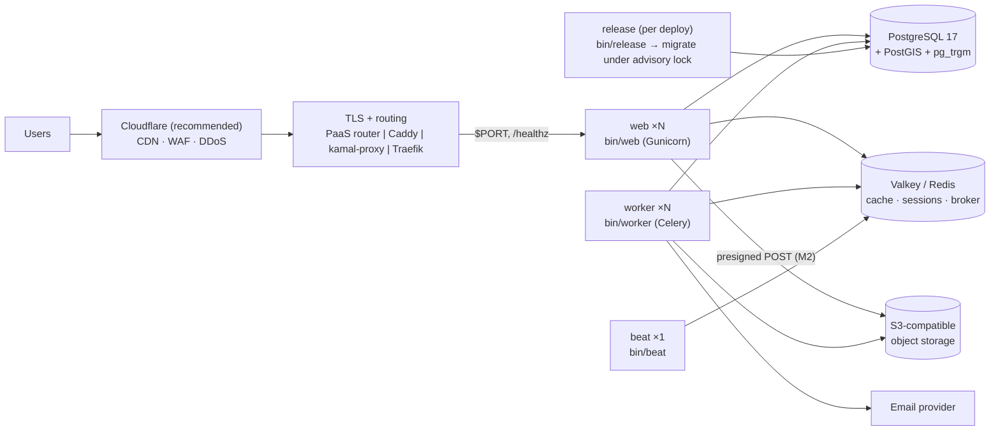

# Hosting and Deployment (PaaS or self-hosted)

How the application is deployed to a PaaS (Render, Railway, Heroku, Fly.io) or to self-hosted servers (Docker Compose, Kamal, Coolify). The decision and its rationale are in [ADR-0014](../adr/0014-portable-hosting-paas-and-self-hosted.md). This document **replaces** the AWS-specific [04-infrastructure-and-deployment](04-infrastructure-and-deployment.md) as the current deployment design.

Status: Draft v0.1 (2026-10-27): deployment itself is deferred; manifests are in [`deploy/`](../../deploy/README.md) and the repo root.

---

## 1. One image, four process types



| Process | Command | Instances | Notes |
|---|---|---|---|
| `web` | `bin/web` | ≥ 2 in production | Gunicorn on `$PORT` (default 8000). `RELEASE_ON_START=true` runs the release step first, for targets without a release phase |
| `worker` | `bin/worker` | ≥ 1 (2 for HA) | Queues `default,maintenance,media` (`CELERY_QUEUES`); `WORKER_CONCURRENCY` (default 2), because PaaS containers report the host's CPU count |
| `beat` | `bin/beat` | **exactly 1** | Two beats schedule every job twice. Never autoscale it |
| `release` | `bin/release` | once per deploy | `manage.py release`: migrations under a PostgreSQL advisory lock, so concurrent starts are safe |

Static files are built into the image (Tailwind → collectstatic with hashed, gzip/brotli files) and served by WhiteNoise. **No Nginx is needed on any target.** Uploaded media never touches the container disk: from M2 it goes to object storage, because PaaS disks are ephemeral and multiple hosts share nothing.

## 2. Choosing a target

| | Render | Railway | Heroku | Fly.io | Compose on a VPS | Kamal | Coolify |
|---|---|---|---|---|---|---|---|
| Manifest in repo | `render.yaml` | dashboard + Dockerfile (§4.2) | `heroku.yml` + `Procfile` | `fly.toml` | `deploy/compose/` | `deploy/kamal/` | `deploy/compose/` |
| Release phase | `preDeployCommand` | pre-deploy command | `release:` | `release_command` | `release` one-shot | `RELEASE_ON_START` | `RELEASE_ON_START` or compose `release` |
| Managed Postgres + PostGIS | Yes (verify plan) | PostGIS template | Yes (verify plan) | Managed Postgres (verify extensions) or external | You run it, or external managed | Accessory or external | Service or external |
| Managed Redis/Valkey | Key Value | Redis | Key-Value Store | Upstash | Container | Accessory | Service |
| Zero-downtime deploys | Yes | Yes | Preboot | Rolling | Brief restart (single host) | Yes (kamal-proxy) | Yes (rolling) |
| Ops burden | Low | Low | Low | Low–medium | **High** | Medium | Medium |
| Cost at MVP scale | Medium | Low–medium | High | Low–medium | **Lowest** | Low | Low |

**Recommendation:**

- **Pilot / first launch:** a PaaS (Render is the closest fit: a Blueprint, a managed Postgres with PostGIS, Key Value and pre-deploy commands).
- **Cost-optimised or data-residency-driven production:** Kamal on two or more VPS hosts, behind Cloudflare, with a managed Postgres (DigitalOcean, Aiven, Crunchy Bridge, Neon or Supabase all offer PostGIS; verify at selection).

Either way, decide before M7 (OQ-50).

**Hard requirements when choosing a database:** PostgreSQL ≥ 16 with **PostGIS** and **pg_trgm**, TLS, point-in-time recovery (RPO ≤ 5 min target), and a region that matches the launch market's data-residency rules (OQ-33).

## 3. Environment variables

`.env.example` lists every variable with local defaults. These are the production-relevant ones:

| Variable | Required | Purpose |
|---|---|---|
| `DJANGO_SETTINGS_MODULE` | yes | `config.settings.production` |
| `DJANGO_SECRET_KEY` | yes | ≥ 50 random characters. `DJANGO_SECRET_KEY_FALLBACKS` for rotation |
| `DJANGO_ALLOWED_HOSTS`, `DJANGO_CSRF_TRUSTED_ORIGINS` | yes | Public host(s) and `https://` origins |
| `DATABASE_URL` | yes | `postgis://…` (or `postgres://…`; the engine is forced to PostGIS). `DATABASE_SSLMODE=require` across networks |
| `REDIS_URL` | yes* | Single instance for cache + broker. *Or `CACHE_URL` + `CELERY_BROKER_URL`. For `rediss://` with a self-signed certificate (Heroku) append `?ssl_cert_reqs=none` |
| `EMAIL_URL`, `DEFAULT_FROM_EMAIL` | yes | SMTP URL (`smtp+tls://…`); an Anymail provider is configured in M1 |
| `TRUSTED_PROXY_COUNT` / `CLIENT_IP_HEADER` | yes | Real client IP (§5) |
| `FORWARDED_ALLOW_IPS` | yes | `*` (the container is only reachable through the router/proxy on every target) |
| `PORT` | platform | Injected by PaaS; 8000 otherwise |
| `WEB_CONCURRENCY`, `WORKER_CONCURRENCY`, `CELERY_QUEUES` | no | Process sizing (§6) |
| `RELEASE_ON_START` | Kamal/Coolify | `true` to run migrations at web start |
| `APP_ENV`, `APP_RELEASE` | no | Tags for logs and Sentry. The release falls back to `RENDER_GIT_COMMIT`, `HEROKU_SLUG_COMMIT`, `RAILWAY_GIT_COMMIT_SHA`, `FLY_IMAGE_REF`, `KAMAL_VERSION`, `SOURCE_COMMIT` |
| `SENTRY_DSN`, `OTEL_ENABLED`, `OTEL_EXPORTER_OTLP_*` | no | Observability (§8) |
| `FIELD_ENCRYPTION_KEYS`, `FIELD_ENCRYPTION_ACTIVE_KEY`, `BLIND_INDEX_KEY` | from M1 | Field-level encryption keyring (ADR-0014 "Key custody") |
| `STORAGE_*` (endpoint, bucket, region, access key, secret) | from M2 | S3-compatible object storage |

## 4. Per-target notes

### 4.1 Render

`render.yaml` defines `rpl-web` (pre-deploy `bin/release`, health check `/healthz`), `rpl-worker`, `rpl-beat` (one instance), a Key Value instance with `noeviction`, and Postgres 17. Create the PostGIS and pg_trgm extensions by running the first release; if the plan forbids `CREATE EXTENSION`, enable them in the dashboard. Set `TRUSTED_PROXY_COUNT=1` (or 2 behind Cloudflare, or `CLIENT_IP_HEADER=CF-Connecting-IP`).

### 4.2 Railway

Create one project with three services from this repository, all using the Dockerfile (`docker/Dockerfile`): **web** (start command `bin/web`, pre-deploy command `bin/release`, health check path `/healthz`), **worker** (`bin/worker`) and **beat** (`bin/beat`, 1 replica). Add a PostgreSQL service that has PostGIS (Railway's PostGIS template) and a Redis service, then reference their URLs as `DATABASE_URL` and `REDIS_URL`. Railway's config-as-code (`railway.json`) can be added per service once the target is chosen.

### 4.3 Heroku

`heroku stack:set container`. `heroku.yml` builds the image and runs `bin/release` in the release phase. Process types: `web`, `worker`, `beat` (scale `beat=1`). Add-ons: Heroku Postgres (check that PostGIS is available on the plan) and Key-Value Store (`REDIS_URL`; add `?ssl_cert_reqs=none` for `rediss://`). Enable `heroku labs:enable runtime-dyno-metadata` so `HEROKU_SLUG_COMMIT` is available. `TRUSTED_PROXY_COUNT=1`.

### 4.4 Fly.io

`fly.toml` defines processes `web`, `worker` and `beat`, `release_command = "bin/release"`, the HTTP service with a `/healthz` check, and `CLIENT_IP_HEADER=Fly-Client-IP`. Use Fly Managed Postgres (confirm PostGIS) or an external managed Postgres, and Upstash Redis. Set secrets with `fly secrets set`. Keep `fly scale count beat=1`.

### 4.5 Docker Compose on a VPS

`deploy/compose/compose.prod.yaml` runs `release`, `web`, `worker`, `beat`, `db` (PostGIS), `db-backup` (nightly `pg_dump`, 14-day retention), `valkey` (noeviction + AOF) and, under the `proxy` profile, Caddy with automatic Let's Encrypt HTTPS.

```bash
cp deploy/compose/.env.prod.example deploy/compose/.env.prod   # fill in; chmod 600
docker compose --env-file deploy/compose/.env.prod -f deploy/compose/compose.prod.yaml \
  --profile proxy up -d --build
```

Verified locally on 2026-10-27 (ADR-0014 "Confirmation").

### 4.6 Kamal 2

`deploy/kamal/deploy.yml` runs roles `web` (behind kamal-proxy with Let's Encrypt and a `/healthz` check), `worker` and `beat`, plus accessories `db` (PostGIS) and `valkey`. Copy `deploy/kamal/secrets.example` to `.kamal/secrets`. Migrations run through `RELEASE_ON_START=true` (safe under the advisory lock). For HA, list two or more web hosts and use a managed Postgres instead of the accessory.

```bash
kamal setup -c deploy/kamal/deploy.yml    # first time
kamal deploy -c deploy/kamal/deploy.yml
```

### 4.7 Coolify

Create a Docker Compose resource from `deploy/compose/compose.prod.yaml` **without** the `proxy` profile; Coolify's Traefik routes the domain to `web:8000` and handles TLS. Put the variables from `.env.prod.example` in Coolify's environment settings. Keep `TRUSTED_PROXY_COUNT=1`.

## 5. Proxies, TLS and client IPs

- TLS terminates at the router or proxy. The app trusts `X-Forwarded-Proto` (Gunicorn `FORWARDED_ALLOW_IPS=*`; Django `SECURE_PROXY_SSL_HEADER`), redirects HTTP to HTTPS, and sends HSTS.
- `/healthz` and `/readyz` are answered by `HealthCheckMiddleware` **before** host validation and the HTTPS redirect, because platform checkers use internal hostnames over HTTP.
- The client IP for rate limits and audit comes from `apps.core.clientip`:
  - Router or proxy in front (Heroku, Render, Railway, Caddy, kamal-proxy, Traefik): `TRUSTED_PROXY_COUNT=1`.
  - Cloudflare also in front: `CLIENT_IP_HEADER=CF-Connecting-IP`. Then lock the origin to Cloudflare IPs (firewall or Cloudflare Tunnel), or a client could forge the header.
  - Fly.io: `CLIENT_IP_HEADER=Fly-Client-IP`.

## 6. Scaling and availability

| Target | Scale web/worker | HA database | Meets 99.9 %? |
|---|---|---|---|
| PaaS | Instance count / autoscaling | HA plan of the managed Postgres | Yes, with ≥ 2 web instances + an HA DB plan |
| Kamal multi-host | Add hosts to roles | External managed Postgres (recommended) or a replicated self-run cluster | Yes, with ≥ 2 hosts behind Cloudflare/LB + an HA DB |
| Single VPS (compose/Coolify) | Vertical only | None (restore from backup) | **No.** Suitable for pilot/staging |

Sizing starting point (re-measure with the M7 load test):

- web: 2 × (1 vCPU, 1 GB), `WEB_CONCURRENCY=3`
- worker: 1–2 × (1 vCPU, 1 GB), `WORKER_CONCURRENCY=2`
- beat: smallest size
- Postgres: 2 vCPU / 4 GB with connection pooling (PgBouncer where the provider offers it; keep `CONN_MAX_AGE` ≤ 60 s)
- Valkey: 256–512 MB

The credit-debit path was measured at about 2,000 debits/s on a laptop ([ADR-0013](../adr/0013-debit-concurrency-spike-results.md)), so DB CPU, not architecture, is the limit.

## 7. Backups and disaster recovery

| | PaaS / managed DB | Self-hosted |
|---|---|---|
| Point-in-time recovery | Provider PITR (check retention on the plan) | WAL-G or pgBackRest archiving WAL to object storage (**required before production**; the bundled `db-backup` is nightly only) |
| Logical backups | Provider + optional nightly `pg_dump` to object storage | `db-backup` service, **copied off-host** (restic/rclone to object storage) |
| Encryption at rest | Provider storage encryption | **LUKS full-disk encryption** on DB and backup volumes; encrypted off-host copies |
| Object storage | Versioning + lifecycle rules at the provider | Same (prefer external object storage over local SeaweedFS/MinIO) |
| Restore drill (SRS §8.3) | Quarterly: restore into a scratch DB, run `manage.py check` + ledger audit | Same |

## 8. Observability

- **Logs:** JSON to stdout. On PaaS, use log drains (Render, Heroku, Fly) to the chosen backend. Self-hosted: Docker json-file with rotation, shipped by Vector/Promtail to Loki or a hosted backend.
- **Errors:** Sentry SaaS (or self-hosted GlitchTip, which is API-compatible) through `SENTRY_DSN`.
- **Traces and metrics:** OpenTelemetry OTLP (`OTEL_ENABLED=true`, `OTEL_EXPORTER_OTLP_ENDPOINT`) to Grafana Cloud, Honeycomb, SigNoz or another backend.
- **Uptime:** an external monitor (Better Stack, UptimeRobot …) on `/readyz` every minute.
- Queue depth and outbox age: exported as OTel metrics (replaces the CloudWatch publisher planned in the AWS design).

## 9. Self-hosted hardening checklist

- [ ] OS: unattended security upgrades, SSH keys only, no root login, fail2ban, firewall allowing only 22 (restricted), 80 and 443.
- [ ] Docker: daemon log rotation; only Caddy/kamal-proxy publish ports; DB and Valkey bound to the private network or `127.0.0.1`.
- [ ] Secrets files `chmod 600`, owned by the deploy user; never committed (`.env.prod` and `.kamal/secrets` are git-ignored).
- [ ] Full-disk encryption for DB and backup volumes; off-host encrypted backups; quarterly restore drill.
- [ ] Cloudflare in front with the origin locked to Cloudflare IPs; WAF managed rules on.
- [ ] Monitoring: host metrics (CPU, memory, disk) plus app `/readyz`; disk-space alerts on the DB and backup volumes.

## 10. Deferred work (when a target is chosen)

1. ADR naming the launch target(s) (OQ-50).
2. CI deploy job for that target (build → push image → release → deploy → smoke test `/readyz` → ZAP baseline).
3. Rewrite the runbooks and alerts for that target's tools (register H-08).
4. Re-run the concurrency spike against that target's managed Postgres (ADR-0013 "Confirmation").
