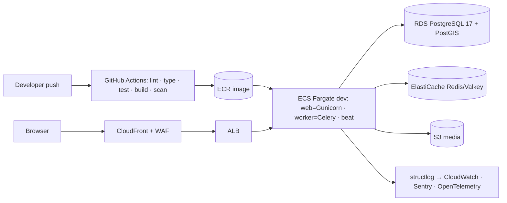
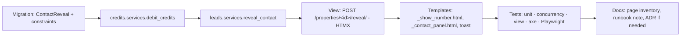
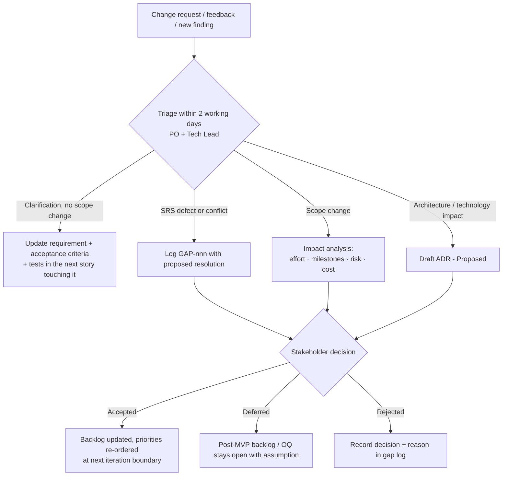
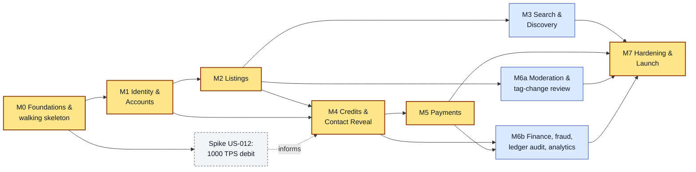

# Development Approach

How we build the Rent Property Listing platform: one release at the end, or in chunks. Also covers how chunks are sized and sequenced, how requirement changes are handled, team assumptions and the top delivery risks.

Status: Draft v0.1 (2026-10-21)

Related: [02 Milestones & Backlog](02-milestones-and-backlog.md) · [03 Engineering Standards](03-engineering-standards.md) · [04 Testing Strategy](04-testing-strategy.md) · [05 Definition of Done & Workflow](05-definition-of-done-and-workflow.md) · [UX & Page Inventory](../ux/01-ux-and-page-inventory.md)

---

## 1. Decision summary

| Question | Answer |
|---|---|
| Build the whole application in one go ("big-bang") or in chunks? | **In chunks.** We use incremental **vertical slices** and start with a **walking skeleton**. |
| Unit of planning | 8 milestones (M0–M7) plus a Post-MVP backlog. Each milestone is 1–3 two-week iterations. Each story is ≤ 5 days. |
| Unit of delivery | One story = one short-lived branch = one PR = one deployable increment on `main`, deployed automatically to `dev`. |
| When stakeholders see working software | At the end of every iteration (on `staging`), with a scripted demo at every milestone exit. |
| When it goes live | At the end of M7 (production go-live), after a hardening milestone. Production infrastructure is rehearsed earlier (see §9.3). |
| How changes to the (not frozen) requirements are absorbed | A gap log, an open-questions register with "needed-by" milestones, ADRs for architectural decisions, and backlog re-prioritisation at each iteration boundary (§7). |

---

## 2. Options considered

| Criterion | A. Big-bang (build everything, release once) | B. Horizontal layers (all models → all services → all UI) | **C. Vertical slices + walking skeleton (chosen)** |
|---|---|---|---|
| Delivery risk | Very high. Integration problems surface at the end. | High. Nothing works end-to-end until the last layer. | Low. Every slice runs end-to-end on real infrastructure. |
| Feedback on unfrozen requirements | One late feedback point. Rework is expensive. | Late. Stakeholders can't judge database tables. | Every 2 weeks, on working pages. |
| CRITICAL credit path (SRS §3.3, §5.1–5.3, §6.4) validated | Only at the end | Only at the end | A spike in M0 and a full slice in M4, well before launch |
| 1,000 TPS concurrency (SRS §8.2) proven | At launch, when it's too late to redesign | Late | A spike in M0, a load test in M4, re-verified in M7 |
| 90 % coverage (SRS §10.2) | Usually back-filled. Tests end up low-value. | Possible, but tests miss integration | Natural. Tests ship with each slice and a coverage ratchet stops it falling. |
| Requirement changes (monetisation model, KYC, lead forms) | Hard to absorb | Hard to absorb | Absorbed at iteration boundaries. Generic designs (ledger reason codes, gateway adapters) keep later options open. |
| External lead times (merchant accounts, SMS registration, SES production access) | Discovered late | Discovered late | Started in M0 and tracked as long-lead items (§8.4) |
| Progress visibility | "90 % done" for months | Misleading | Demonstrable features per milestone |
| Overhead | Lowest on paper | Low | Moderate: CI/CD, IaC and a design system up front in M0. This pays back from M1 onwards. |

**Rejected:** Option A. The requirements are explicitly not frozen and we already know of 22 issues (copy-paste errors, a monetisation conflict between the SRS and the flow chart, undefined RBAC, contradictory UX rules). A big-bang build would lock those mistakes in. Option B delays every integration risk and gives stakeholders nothing to react to.

---

## 3. Why chunked vertical slices fit this project specifically

1. **The money path is the product.** Signup promo credits, the 2-credit "Show Number" debit, the immutable ledger and instant purchase allocation are all marked CRITICAL. A defect there costs money and trust. Slicing lets us build, test, load-test and audit that path (M4–M5) while the rest of the system is still small.
2. **The highest technical risk can be tested in week 1–2.** We spike "1,000 concurrent debit transactions/sec without inconsistency" in M0 (US-012). That tells us whether PostgreSQL with conditional atomic updates is enough, or whether the design must change, before any feature depends on it. We expect it to be enough (baseline decision: no Kafka).
3. **The requirements will move.** Open Question #1 (renter-pays "Show Number" vs lister-pays "lead unlock") changes who pays. Our ledger uses generic entry types and reason codes, and the reveal/unlock logic sits in one service (`leads.services`). A later switch then needs one new slice, not a rewrite.
4. **Testability.** Each slice has its own unit, integration, E2E and accessibility tests, so the 90 % coverage gate is met continuously.
5. **External integrations take time to set up.** Stripe and PayPal merchant onboarding, Twilio sender registration, SES production access and the MaxMind licence key all have lead times outside engineering. Chunking lets us start them in M0 and consume them in M1/M5.
6. **Progress can be shown.** Each milestone ends with a demo script that a non-technical stakeholder can run on `staging`.

---

## 4. The walking skeleton (M0)

The walking skeleton is the thinnest possible end-to-end system on production-shaped infrastructure. It has no business features, but every later story only adds behaviour to it.

**The skeleton is "walking" when** a commit merged to `main` is linted, type-checked, tested, built, scanned and deployed to `dev` without manual steps. On `dev`, a page rendered from `base.html` (header shell, design tokens, toast region) must be served over HTTPS. `/readyz` must check the DB, cache and broker. A sample Celery task must run, and its logs must carry the same `request_id` and trace in CloudWatch, Sentry and OTel. The M0 exit criteria are in [02 §M0](02-milestones-and-backlog.md#m0--foundations--walking-skeleton).

---

## 5. Chunk sizing

| Level | Size | Rule |
|---|---|---|
| **Milestone** (M0–M7) | 1–3 iterations, relative size S/M/L | Ends in a demoable, deployable increment with exit criteria and a stakeholder demo. |
| **Iteration** | 2 weeks (1 week allowed during M7 hardening and hypercare) | Fixed length. Scope flexes, the date does not. Work is deployed to `staging` at least once per iteration. |
| **Epic** | 3–10 stories | Groups stories by capability (e.g. EP-4.3 Show Number reveal). |
| **Story** (a vertical slice) | S ≤ 1 day · M 2–3 days · L 4–5 days | Contains everything needed to be usable: model + migration + service + selector + view + template + tests + docs. If it is bigger than L, split it before it enters an iteration. |
| **Task** | ≤ 1 day | Optional breakdown inside a story. Not tracked by stakeholders. |

**Vertical slice anatomy (example: US-405 "Show Number reveal")**

**Incomplete features** are merged behind feature flags, so `main` is always releasable.
**Proposed addition:** use `django-waffle` for flags; the alternative is a minimal settings/DB flag in `apps.core`. Record the choice in an ADR in M0. Remove each flag within 2 iterations of the feature being enabled in production.

**Configurable business constants.** Values the business may change are stored as validated settings or DB-backed config, not hard-coded literals. This covers the reveal cost (2 credits), the promo amount (10 credits), and the packages and prices (DB). A pricing decision then needs no code change.

---

## 6. Iteration cadence

| Ceremony | When | Output |
|---|---|---|
| Backlog refinement | Weekly, 45 min | Stories meet the Definition of Ready ([05 §2](05-definition-of-done-and-workflow.md#2-definition-of-ready-dor)) |
| Iteration planning | Day 1, ≤ 1 h | Iteration goal plus committed stories |
| Daily sync | 15 min (async in solo mode) | Blockers surfaced |
| Mid-iteration check | Day 5 | Re-plan if the goal is at risk |
| Iteration review / demo | Last day, on `staging` | Stakeholder feedback, recorded in the gap log or backlog |
| Retrospective | Last day | 1–3 improvement actions |
| Milestone acceptance | At milestone exit | Signed acceptance record ([05 §9](05-definition-of-done-and-workflow.md#9-demo-and-stakeholder-acceptance)) |

---

## 7. Absorbing requirement changes (requirements are not frozen)

### 7.1 Artefacts

| Artefact | Location (owned by the requirements/architecture docs) | Purpose |
|---|---|---|
| Requirements catalog | `docs/requirements/` | FR/NFR IDs. Every story links to them. |
| Gap log (`GAP-nnn`) | `docs/requirements/` | SRS defects, conflicts and missing items, each with its resolution. Seeded with the 22 known issues. |
| Open questions (`OQ-nn`) | `docs/requirements/` | Unknowns that need a stakeholder decision. Each has an owner and a **needed-by milestone**. |
| ADRs (`ADR-nnnn`) | `docs/adr/` | Architectural and technology decisions, and deviations from the SRS ([03 §20](03-engineering-standards.md#20-documentation-and-adr-process)) |
| Backlog | Issue tracker (one issue per US-ID) | Execution |

### 7.2 Change triage flow

### 7.3 Rules

1. **Iterations in progress are not disrupted.** An accepted change enters at the next iteration boundary. The exception is a security or production S1 fix.
2. **Last responsible moment.** Every OQ has a needed-by milestone. Until it is answered we build on the documented baseline assumption and mark it `**Assumption:**` in the docs. Once a needed-by milestone starts, an unanswered OQ is escalated as a delivery risk.
3. **Design for the likely change.** The ledger uses generic entry types and reason codes; payments, geocoding, email and SMS sit behind adapters; business constants are configurable; feature flags exist. These reduce the cost of the changes we already expect.
4. **Every deviation from the SRS is visible.** It is marked `**Deviation from SRS:**` in the docs and backed by an ADR or gap-log entry.

### 7.4 Decision deadlines for known open questions (delivery view)

| Needed by | Decision required (owner: client stakeholders) | Default if not answered |
|---|---|---|
| M0 start | Launch markets/countries and languages (affects currency, SMS, privacy law, geocoding provider) | Single launch market, English only, i18n-ready code |
| M1 start | Verification method: email only, phone only, or either; Social SSO in MVP? | Email or phone OTP (either activates the account). SSO goes Post-MVP. |
| M2 start | Listing attributes beyond the SRS minimum (bedrooms, bathrooms, area, furnishing, availability); accepted image formats and aspect-ratio range | Optional attributes included. JPEG/PNG/WebP. Aspect ratio 4:3 to 16:9 with auto-crop of near-misses ([Listings design §8.3](../design/05-listings-and-media.md)). |
| M2 start | Pre-publication moderation or post-publication moderation? | Post-publication, plus automated checks (§10, R8) |
| **M4 start** | **OQ #1: monetisation model.** Renter pays to "Show Number" (SRS) or lister pays to unlock leads (flow chart)? Free inquiry form? | SRS model (renter pays 2 credits). Lister-pays and inquiry forms go Post-MVP. |
| M5 start | Package sizes and prices per currency; supported currencies; tax (VAT/GST) treatment; refund policy; which two gateways per market | 20/50/120 packages. Prices tax-inclusive. Stripe and PayPal. No self-service refunds. |
| M6 start | Moderation policies, reason codes, staff roles and headcount | Moderator, Support, Finance and Superadmin groups |
| M7 start | SLA/RPO/RTO confirmation; pen-test budget; legal pages (Terms, Privacy, Refunds) | 99.9 % / RPO ≤ 5 min / RTO ≤ 1 h; external pen test |

---

## 8. Milestone dependency graph and critical path

### 8.1 Graph

M6 is split into **M6a** (needs only M2) and **M6b** (needs M4/M5) to show what can start early. They remain one milestone for acceptance.

### 8.2 Critical path

**M0 → M1 → M2 → M4 → M5 → M7.**

- M4 needs authenticated, verified users (M1) and a published listing with a detail page and encrypted contact data (M2). It does not need search (M3).
- M5 needs the wallet, ledger and `grant_credits` service (M4).
- M7 verifies everything, so it waits for all milestones.
- Any slip on the critical path moves go-live. Slips in M3 or M6 move go-live only if they exceed the parallel slack.

### 8.3 Parallelisation (multi-person team)

| Stream | Focus | Runs in parallel with |
|---|---|---|
| **A — Money path** (credits, leads, payments, auth hardening) | M1 auth → M4 → M5 → M6b | Stream B from M3 onwards |
| **B — Marketplace & UX** (listings, search, design system, a11y) | M2 → M3 → M6a → lister analytics UI | Stream A |
| **C — Platform** (IaC, CI/CD, observability, performance, security tooling) | M0 → staging (M2) → prod rehearsal (M5) → M7 | Everything. About 0.5 FTE after M0. |
| **QA** | Test harness (M0), E2E journeys per milestone, exploratory testing, UAT support | Everything |

Work that can safely run in parallel:

- M3 search with M4 credits. They share only the `Property` model.
- M6a moderation with M4/M5.
- Price books and package admin (M5, EP-5.1) with M4 reveal. This needs no gateway.
- Transactional email templates and the notifications app (M1+) with any milestone.
- Design-system components (property card, toasts, dialogs) one iteration ahead of the features that use them.

Shared hot spots that need coordination: the `Property` model and its migrations (M2/M3/M6), `base.html` and the header (M1/M4), and `apps.core` outbox/audit (M0/M4/M5). Owners are set in CODEOWNERS ([03 §15](03-engineering-standards.md#15-git-workflow)).

### 8.4 Long-lead external items (start in M0; owner: client/PO unless stated)

| Item | Needed by | Typical lead-time risk |
|---|---|---|
| Domain, DNS, TLS certificates (ACM), email domain authentication (SPF/DKIM/DMARC) | M1 (dev/staging), M7 (prod) | Low |
| Amazon SES production access (leave the sandbox), or a Mailgun account | M1 (staging), M7 (prod) | Medium: requires a support request and justification |
| Twilio account, Verify service, sender/regulatory registration for target countries (e.g. A2P 10DLC in the US, DLT in India) | M1 | **High**: registration can take weeks |
| Google Maps Platform or Mapbox billing account and keys | M2 | Low |
| MaxMind GeoLite2 account and licence key | M5 | Low |
| Stripe account (business verification), PayPal Business account (REST app), Razorpay if needed | M5 (sandbox earlier) | **High**: business KYC on the client's company |
| Apple Developer Program (only if Apple SSO is in scope) | Post-MVP / M1 stretch | Medium |
| External penetration-test vendor booking | M7 | **High**: book ≥ 6 weeks ahead |
| Legal content: Terms, Privacy Policy, Refund policy, cookie policy | M7 | Medium |

---

## 9. Team assumptions and timeline

**Assumption:** No team size or deadline is given in the source documents. The figures below are indicative planning inputs, not commitments. We re-baseline after M1 using measured velocity.

### 9.1 Reference team (multi-person)

| Role | FTE | Notes |
|---|---|---|
| Product Owner / BA (client side or delegated) | 0.5 | Owns backlog, OQ resolution and acceptance |
| Tech Lead / Architect (hands-on) | 1 | Owns ADRs and money-path reviews |
| Full-stack Django engineers (Django + HTMX + Tailwind) | 3 | One leans to the money path, one to marketplace/UX |
| QA automation engineer | 1 | pytest, Playwright, k6, a11y |
| DevOps / platform engineer | 0.5 (1.0 in M0 and M7) | Terraform, CI/CD, observability |
| UX/UI designer (accessibility-literate) | 0.5 | Design tokens, components, page states |

**Indicative effort and calendar (reference team, 2-week iterations):**

| Milestone | Relative size | Effort (engineer-weeks, indicative) | Iterations |
|---|---|---|---|
| M0 Foundations | M | 5 | 1 |
| M1 Identity & Accounts | M | 6 | 1 |
| M2 Listings | L | 10 | 2 |
| M3 Search & Discovery | M | 6 | 1 (parallel with M4) |
| M4 Credits & Contact Reveal | L | 8 | 1.5 |
| M5 Payments | L | 9 | 1.5–2 |
| M6 Ops Console & Moderation | M | 7 | 1.5 (partly parallel) |
| M7 Hardening & Launch | L | 8 | 1.5–2 + 2-week hypercare |
| **Total** | | **≈ 59** | **≈ 10–11 iterations ≈ 20–22 weeks to go-live** |

| Weeks | Stream A (money path) | Stream B (marketplace/UX) | Stream C (platform) |
|---|---|---|---|
| 1–2 | M0 · spike US-012 | M0 design system | M0 IaC, CI/CD |
| 3–4 | M1 auth, verification, sessions | M1 profile, header/dropdown | staging env |
| 5–8 | M2 contact encryption, tag-change model | M2 listing form, images, detail page | image pipeline infra, CDN |
| 9–10 | M4 wallet, ledger, reveal | M3 search, saved properties | search performance dataset, read replica |
| 11–12 | M4 history, audit, 1000 TPS test · M5 start | M6a moderation, tag-change review | load-test infra |
| 13–16 | M5 Stripe, PayPal, reconciliation | M6b lister analytics, ops views | prod environment rehearsal |
| 17–20 | M6b finance/fraud · M7 fixes | M7 a11y audit fixes | M7 DR drill, pen test, go-live |
| 21–22 | Hypercare | Hypercare | Hypercare |

### 9.2 Solo developer with an AI pair (sequential mode)

The plan also works if one developer builds it with an AI coding assistant, chunk by chunk.

| Aspect | How it works |
|---|---|
| Order | Strictly sequential: M0 → M1 → M2 → M3 → M4 → M5 → M6 → M7. **Option:** M3 and M4 are independent, so a solo developer may swap them to reach the CRITICAL credit path earlier. The M0 spike already de-risks concurrency, so we keep the baseline order unless M0 results are worrying. |
| WIP limit | One story at a time. One story equals one PR. Nothing new starts until the previous PR is merged and deployed to `dev`. |
| Session loop | (1) Read the story and its linked docs. (2) Write or extend the tests first, starting with the money-path invariants. (3) Implement service → selector → view → template. (4) Run the full local gate (`make check`: ruff, mypy, pytest with coverage, migrations check). (5) Self-review against the PR checklist. (6) Run an AI review pass. (7) Merge and deploy to `dev`. (8) Smoke-test. |
| AI context | This `docs/` knowledge base is the shared memory. Each PR updates the affected docs and ADRs. A short repo-root `CLAUDE.md` (created in M0) points to the standards. |
| Guarding against AI errors | Pin and verify library versions against official docs. Do not accept APIs you have not seen documented. Write the tests before the code on money-path stories. The developer must understand every line of security-sensitive code before merging. |
| Peer review | **Deviation from SRS (§10.2 "mandatory peer code reviews"):** in solo mode the AI review replaces a second human on ordinary PRs. A **human reviewer is still required** for money-path PRs (credits, leads, payments, auth/session, and migrations on these) and at each milestone exit. Arrange this with an external or part-time reviewer and record it in an ADR. |
| QA, DevOps, UX | Handled by the same developer, using the same automated gates. The external pen test and the manual screen-reader audit in M7 remain mandatory. |
| Indicative calendar | ≈ 59 engineer-weeks ÷ an effective 1.3–1.5× AI multiplier, plus the extra QA/DevOps/UX load. That gives **≈ 9–12 months** to go-live. Re-baseline after M1. |

### 9.3 Environment timeline

| Environment | Available from | Notes |
|---|---|---|
| local (docker compose) | M0 | Postgres+PostGIS, Redis/Valkey, Nginx, Mailpit, S3-compatible local storage |
| dev | M0 | Auto-deploy on merge to `main` |
| staging | End of M1 (needed for stakeholder demos from M2) | Same Terraform modules, prod-like sizing for performance tests from M4 |
| prod | M7 (baseline) | **Proposed change:** provision prod with the same modules at the end of M5 with no public traffic. Use it to rehearse deploys, migrations, secrets, DNS and live-gateway webhooks, so M7 verifies prod rather than creating it. Go-live stays at M7. |

---

## 10. Risk register (top 10)

Likelihood (L) and Impact (I) are scored H/M/L. The register is reviewed at every iteration retrospective.

| ID | Risk | L | I | Mitigation | Early warning | Owner |
|---|---|---|---|---|---|---|
| R1 | **Monetisation model changes** (OQ #1: renter-pays vs lister-pays lead unlock, or a free inquiry form) after M4 is built | M | H | Generic ledger (entry types plus reason codes, `reference_type/reference_id`). Reveal/unlock logic isolated in `leads.services`. Reveal cost is configurable. Feature flags. OQ #1 deadline set at M4 start. | No answer by the end of M2 | PO |
| R2 | **Credit integrity defect** (double charge, negative balance, lost purchase credits, mismatch between ledger and balance) | M | H | Conditional atomic `UPDATE … WHERE balance >= cost`, `CHECK (balance >= 0)`, unique idempotency constraints, append-only ledger with hash chain, thread concurrency tests, Hypothesis invariant tests, nightly audit job with alerts, 2 reviewers on money-path PRs. | Any audit mismatch in dev/staging; flaky concurrency test | Tech Lead |
| R3 | **1,000 TPS debit target not met** within 500/1000 ms p95 | M | H | M0 spike (US-012). Short transactions with no network I/O inside them. Right-sized RDS. Connection pooling evaluated (RDS Proxy or PgBouncer, in an ADR). Load test in M4 and again in M7. Capacity plan. | Spike p95 > 300 ms at 1000 TPS | Platform |
| R4 | **Payment onboarding and webhook delays**: merchant KYC lead time, webhook lag breaking the "≤ 5 s" allocation | H | H | Start onboarding in M0. Use sandboxes until then. Fulfil on a verified webhook **or** on server-side verification at redirect (idempotent on gateway payment id). Reconciliation job. Synthetic monitoring of allocation latency. | Accounts not approved by M4 start | PO / Tech Lead |
| R5 | **Privacy and regulatory exposure in unknown launch markets** (GDPR, DPDP, CCPA; SMS regulation; tax on digital goods) | M | H | Settle launch markets at M0 (OQ). Field-level encryption, data map, retention policy, log PII scrubbing. Privacy review before M7. Tax OQ before M5. | Markets still undecided at M1 | PO |
| R6 | **Search latency** (geospatial + fuzzy + full-text + filters) exceeds 500 ms p95 at scale | M | M | PostGIS GiST, pg_trgm GIN and tsvector GIN indexes. EXPLAIN checks on a 500k-listing synthetic dataset. Redis cache for hot queries. Read replica. Capped pagination depth. OpenSearch kept as a Post-MVP fallback. | p95 > 350 ms in the M3 perf test | Stream B |
| R7 | **Abuse and fraud**: promo-credit farming through many accounts, contact-data scraping, fake listings | H | M | Promo granted only on verification. Unique verified phone/email. Disposable-email blocklist. Rate limits on reveal and signup. WAF bot rules. Contact data never in the DOM before reveal. Fraud flags and a moderation queue (M6). | Spike in signups per IP/device; reveal velocity outliers | PO / Tech Lead |
| R8 | **Scope creep** from diagram-only features (KYC/Verification API, lead forms, lister notifications) or new requests | H | M | MVP scope baseline in [02](02-milestones-and-backlog.md). Change triage (§7). Post-MVP backlog. KYC storage and hooks designed but not built. | Unplanned stories > 15 % of an iteration | PO |
| R9 | **Third-party outage or limits** (email, SMS, geocoding, gateway) | M | M | Provider-agnostic adapters. Transactional outbox with Celery retries and backoff. Timeouts on every outbound call. Graceful degradation (e.g. listing saved as a draft if geocoding fails; second gateway offered if one is down). Runbooks. | Rising outbox backlog or task retry rates | Platform |
| R10 | **Quality gates slow delivery or encourage low-value tests** (90 % coverage, a11y, security scans) | M | M | Gates in place from M0 (shift-left) so there is no back-fill. Coverage scoped to `apps/` excluding migrations and settings, plus a diff-coverage gate. Mutation testing on credits only. Flaky-test policy ([04 §15](04-testing-strategy.md#15-flaky-test-policy)). | CI time > 15 min; quarantined tests > 5 | Tech Lead / QA |

**Watch list (outside the top 10):** knowledge concentrated in one person (worst in solo mode; mitigated by ADRs, runbooks and docs-as-code); cost of the image-processing pipeline; Tailwind v4 browser-support floor in target markets ([03 §12](03-engineering-standards.md#12-templates-htmx-alpine-and-tailwind-conventions)); accessibility regressions from third-party map or payment widgets.

---

## 11. Summary of commitments this approach makes

1. Every merged PR is deployable. `main` is always green and deployed to `dev`.
2. Every milestone ends with a stakeholder demo on `staging` and a signed acceptance record.
3. The money path is de-risked first (M0 spike), built in isolation (M4/M5), and verified under load twice (M4, M7).
4. Security, testing, accessibility, i18n and observability start in M0. M7 verifies them; it is not the first time they are done.
5. Every requirement change, SRS defect and deviation is traceable through GAP, OQ and ADR entries.
