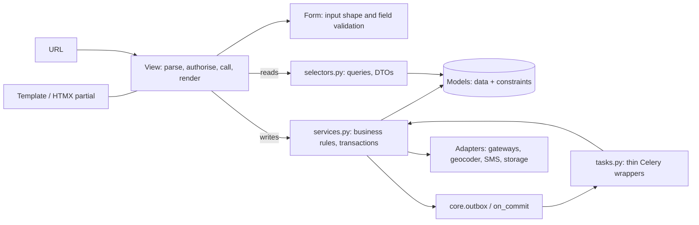
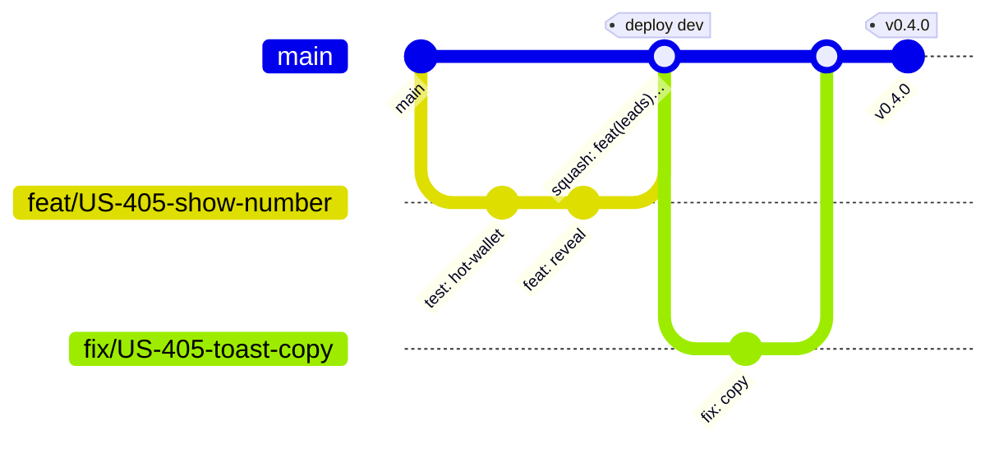
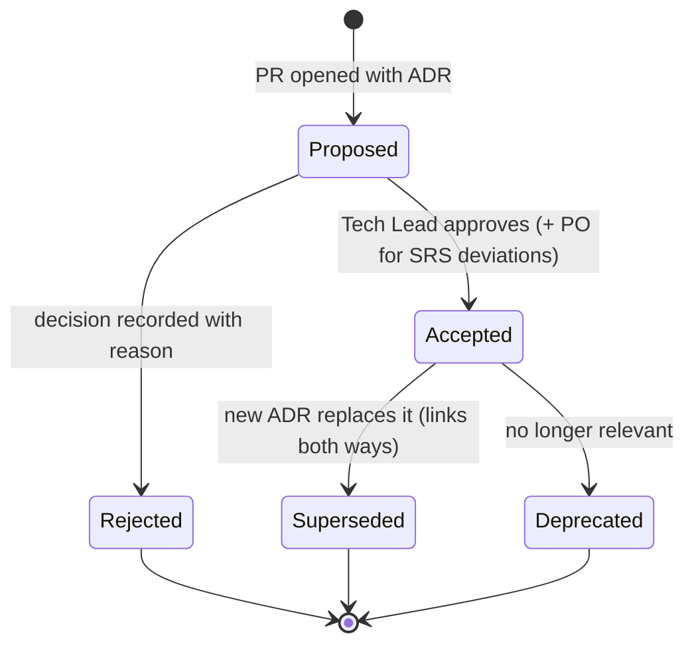

# Engineering Standards

The coding, review and documentation rules every change to the Rent Property Listing codebase must follow. CI enforces these rules where it can. Reviewers check the rest using the PR checklist in [05 §5](05-definition-of-done-and-workflow.md#5-pull-request-checklist).

Status: Draft v0.1 (2026-10-21)

Related: [01 Development Approach](01-development-approach.md) · [02 Milestones & Backlog](02-milestones-and-backlog.md) · [04 Testing Strategy](04-testing-strategy.md) · [05 DoD & Workflow](05-definition-of-done-and-workflow.md) · [System Architecture](../architecture/01-system-architecture.md) · [UX & Page Inventory](../ux/01-ux-and-page-inventory.md)

> **Precedence.** The architecture documents define *what* the module boundaries, data ownership and runtime topology are ([System Architecture §6, §10, §11](../architecture/01-system-architecture.md#10-modular-monolith-boundary-rules)). This document defines *how* code is written inside those boundaries. If the two disagree, the architecture document wins and this file is corrected in the same PR.

---

## 1. Scope and principles

These rules apply to everything in the repository: `apps/`, `config/`, `templates/`, `static/src/`, `infra/terraform/`, `docker/`, `tests/` and `docs/`.

| # | Principle | What it means in practice |
|---|---|---|
| P1 | **Correctness of money first** | Any code that moves credits or money (credits, leads, payments) is written test-first, reviewed by two people, and must never trade correctness for speed. |
| P2 | **Boring, explicit code** | Plain functions, explicit arguments and explicit transactions. No metaprogramming, no ORM signals for business logic, no "clever" one-liners. |
| P3 | **Thin edges, rich core** | Views, forms, templates, tasks and admin are thin. Business rules live in `services.py` (writes) and `selectors.py` (reads). |
| P4 | **Automate the rule or delete it** | If a rule can be checked by a tool (ruff, mypy, import-linter, djLint, migration linter, tests), it is checked in CI. Rules only a human can check are in the PR checklist. |
| P5 | **Secure and accessible by default** | Escaping, CSRF, authorization checks, field encryption and WCAG 2.1 AA patterns are the default path. Opting out needs a review comment explaining why. |
| P6 | **SOLID, applied pragmatically** | Single responsibility per service function; open/closed via adapters and registries (gateways, geocoders, listing checks); dependency inversion via ports for every external provider (SRS §10.2). |

---

## 2. Toolchain at a glance

| Concern | Tool (pinned in `pyproject.toml` / `uv.lock`) | Where it runs |
|---|---|---|
| Python | CPython 3.13 | Docker image, CI, local |
| Dependencies | uv (`uv lock`, `uv sync --frozen`), lockfile with hashes | Local, CI, Docker build |
| Lint + format | ruff (`ruff check`, `ruff format`) | pre-commit, CI |
| Types | mypy + django-stubs (+ `celery-types` where available) | pre-commit (changed files), CI (full) |
| Architecture rules | import-linter ([Architecture §10](../architecture/01-system-architecture.md#10-modular-monolith-boundary-rules)) | CI |
| Templates | djLint (lint + format, Django profile) | pre-commit, CI |
| Security (code) | ruff `S` rules + bandit, gitleaks | pre-commit, CI |
| Security (deps, images, IaC) | pip-audit, Trivy (image + Terraform config), Dependabot | CI, scheduled |
| Migrations | `makemigrations --check --dry-run`, django-migration-linter | CI |
| i18n | `makemessages` / `compilemessages` check | CI |
| Tests | pytest, pytest-django, factory_boy, Hypothesis, pytest-xdist, coverage, diff-cover, Playwright, k6 ([04](04-testing-strategy.md)) | Local, CI |
| Docs | markdownlint, lychee (link check), Mermaid render check | CI |
| Commits / PR titles | Conventional Commits check on PR title | CI |

### 2.1 Make targets (the only commands a contributor needs)

| Target | Does |
|---|---|
| `make setup` | `uv sync`, install pre-commit hooks, download the Tailwind standalone CLI at the pinned version |
| `make up` / `make down` | Start or stop the docker compose stack |
| `make fmt` | `ruff format`, `ruff check --fix`, `djlint --reformat` |
| `make lint` | ruff, djLint, import-linter, bandit, markdownlint |
| `make typecheck` | mypy (full) |
| `make test` | pytest (unit + integration) with coverage, in parallel |
| `make check` | `lint` + `typecheck` + `test` + migrations check + i18n check. **Must pass before every push.** |
| `make e2e` | Playwright journeys against the local stack |
| `make messages` | `makemessages -a --no-obsolete` + `compilemessages` |
| `make seed` | `seed_demo` data for local development |

---

## 3. Python style, formatting and linting (ruff)

- **Formatter:** `ruff format` (Black-compatible). Formatting is never discussed in review.
- **Line length:** 100. Long strings are allowed when splitting them would hurt readability (E501 is off; the formatter wraps code).
- **Imports:** absolute imports only (`from apps.credits.services import debit_credits`). Sorted by ruff (`I`). No wildcard imports, except `from .base import *` inside `config/settings/`.
- **Python features:** use 3.13 syntax (`X | None`, `match` where it is clearer than `if/elif`, PEP 695 generics where useful). `from __future__ import annotations` is not needed.
- **No `print`**, no commented-out code, no `TODO` without an issue reference (`# TODO(US-512): ...`).

```toml
# pyproject.toml (excerpt). Verify rule codes against the ruff version pinned at M0.
[tool.ruff]
target-version = "py313"
line-length = 100
extend-exclude = ["**/migrations/*", "static/vendor/*"]

[tool.ruff.lint]
select = [
  "E", "W", "F",      # pycodestyle, pyflakes
  "I",                # isort
  "B",                # bugbear
  "UP",               # pyupgrade
  "DJ",               # flake8-django
  "S",                # flake8-bandit
  "SIM", "C4", "PIE", "RET", "PERF",
  "PT",               # pytest style
  "DTZ",              # naive datetimes are bugs
  "T20",              # no print
  "ERA",              # no commented-out code
  "N",                # naming (exceptions end in Error)
  "A",                # no shadowing builtins
  "PTH",              # pathlib
  "BLE",              # no blind except
  "TRY",              # exception hygiene
  "G",                # logging format
  "INP",              # no implicit namespace packages
  "TID",              # banned APIs (below)
  "ARG",              # unused arguments
  "PL",               # pylint subset
  "D",                # docstrings (scoped below)
  "RUF",
]
ignore = [
  "E501",             # formatter handles wrapping
  "ISC001",           # conflicts with formatter
  "PLR0913",          # keyword-only service signatures are often long; that is fine
  "TRY003",           # domain errors carry messages
  "D100", "D104", "D105", "D106", "D107", "D203", "D213",
]

[tool.ruff.lint.pydocstyle]
convention = "google"

[tool.ruff.lint.per-file-ignores]
# Docstrings are required only on public domain modules and adapters.
"!apps/**/{services,selectors,tasks}.py" = ["D"]
"apps/**/tests/**" = ["S101", "PLR2004", "ARG", "D"]
"tests/**" = ["S101", "PLR2004", "ARG", "D", "INP"]
"config/settings/**" = ["F403", "F405", "TID251"]

[tool.ruff.lint.flake8-tidy-imports.banned-api]
"os.environ".msg = "Read configuration via django.conf.settings (config/settings/ only)."
"os.getenv".msg = "Read configuration via django.conf.settings (config/settings/ only)."
"pickle".msg = "Never deserialize untrusted data with pickle. Use JSON."
"django.db.models.signals.post_save".msg = "No ORM signals for business logic (Architecture R8). Use services."
"django.utils.safestring.mark_safe".msg = "Use format_html / escaping. mark_safe needs a reviewed exception."
"random".msg = "Use the secrets module for tokens; random is not cryptographically secure."
```

> **Assumption:** negated per-file-ignore patterns (`!…`) and brace expansion are supported by the ruff version pinned at M0. If not, the same effect is achieved with an explicit list of paths.

---

## 4. Typing (mypy)

Typing is **strict on `apps/`** and relaxed for tests, settings and migrations.

```toml
[tool.mypy]
python_version = "3.13"
plugins = ["mypy_django_plugin.main"]
strict = true
warn_unreachable = true
enable_error_code = ["ignore-without-code", "redundant-expr", "truthy-bool", "possibly-undefined"]
exclude = ["/migrations/", "^static/", "^infra/"]

[[tool.mypy.overrides]]
module = ["apps.*.tests.*", "tests.*", "conftest"]
disallow_untyped_defs = false
disallow_incomplete_defs = false
disallow_untyped_decorators = false

[[tool.mypy.overrides]]
module = ["config.settings.*"]
disallow_untyped_defs = false

[[tool.mypy.overrides]]
# Third-party packages without type information. Keep this list short and reviewed.
module = ["django_celery_beat.*", "waffle.*", "imagehash.*"]
ignore_missing_imports = true

[tool.django-stubs]
django_settings_module = "config.settings.test"
```

Rules:

1. Every function in `apps/` has full annotations. Services and selectors use **keyword-only arguments** (`def debit_credits(*, wallet_id: int, amount: int, ...) -> CreditLedgerEntry:`).
2. `Any` is allowed only at true boundaries (JSON payloads from gateways), and is narrowed immediately with a `TypedDict` or a dataclass.
3. `# type: ignore[code]` must name the error code and carry a one-line reason. Bare ignores fail CI.
4. Data transfer objects (DTOs) are `@dataclass(frozen=True, slots=True)`. For example, `PublicPropertyDTO` deliberately has **no contact fields**, so a template cannot leak them ([Listings design §13](../design/05-listings-and-media.md#13-security-and-privacy-of-listing-contact-data-known-issue-20)).
5. Enumerations are `models.TextChoices` / `IntegerChoices`, never bare strings in logic.
6. Money is never `float`. Persisted amounts are `int` minor units plus a 3-letter currency. `decimal.Decimal` is used only to parse user input and to format output.

---

## 5. Naming, docstrings and comments

| Thing | Convention | Example |
|---|---|---|
| Service function | `verb_object`, matching the canonical names | `grant_credits`, `debit_credits`, `reveal_contact`, `publish_property`, `fulfill_order` |
| Selector function | `get_…` (one object or raises), `list_…` (QuerySet or list), `can_…`/`is_…` (bool) | `get_reveal`, `list_owner_properties`, `can_transact` |
| Domain exception | `<Problem>Error`, subclass of `apps.core.exceptions.DomainError` | `InsufficientCreditsError`, `ListerTagImmutableError` |
| Celery task | `<verb>_<object>` in `tasks.py`, thin wrapper around a service | `process_property_image`, `dispatch_outbox_message` |
| Template | `snake_case.html`. Partials start with `_`. | `listings/detail.html`, `leads/_show_number.html` |
| URL name | `<app>:<object>-<action>` | `leads:property-reveal`, `listings:wizard-step` |
| Constants and settings | `UPPER_SNAKE`, prefixed with the app for settings | `CREDITS_REVEAL_COST`, `LISTINGS_MAX_OPEN_DRAFTS` |
| DB constraint/index name | `ck_<table>_<rule>`, `uq_<table>_<cols>`, `ix_<table>_<cols>` | `ck_wallet_balance_non_negative` |
| Ledger idempotency key | `<domain>:<purpose>:<id>` | `promo:signup:<user_public_id>`, `pay:stripe:<gateway_payment_id>` |

> **Proposed change (consistency):** the [Listings design §12.1](../design/05-listings-and-media.md#121-services-and-selectors-hacksoft-style) names services entity-first (`property_create_draft`, `tag_change_request_approve`), while the canonical baseline and the [architecture app catalogue](../architecture/01-system-architecture.md#61-app-catalogue) use verb-first (`grant_credits`, `publish_property`). This standard adopts **verb-first** for the whole codebase so there is one convention. The listings names are mapped one-to-one at implementation (for example `property_create_draft` → `create_draft`).

**Docstrings** (Google style) are required on every public function in `services.py`, `selectors.py`, `tasks.py` and on every adapter class. A service docstring states:

1. what it does, in one sentence;
2. its **transaction behaviour** (opens its own atomic block / must be called inside one / acquires which row locks);
3. its **idempotency** (key, or "not idempotent");
4. the domain errors it raises.

```python
def debit_credits(
    *, wallet_id: int, amount: int, entry_type: LedgerEntryType,
    idempotency_key: str, reference: LedgerReference, request_id: str | None = None,
) -> CreditLedgerEntry:
    """Debit `amount` credits from a wallet and append a hash-chained ledger entry.

    Transaction: opens `transaction.atomic()`; locks the wallet row (conditional UPDATE).
    Idempotency: a repeated `idempotency_key` returns the original entry without a second debit.

    Raises:
        InsufficientCreditsError: balance < amount. Nothing is written.
        WalletFrozenError: the wallet is frozen by Finance/Fraud review.
    """
```

**Comments** explain *why*, never *what*. Link the source of a non-obvious rule: `# SRS §5.3: ledger must record server process id`, `# ADR-0005`, `# GAP-01`.

---

## 6. Application layering: models, services, selectors, views, forms

The layering follows the HackSoft Django style guide, adapted to the module boundaries in [Architecture §10](../architecture/01-system-architecture.md#10-modular-monolith-boundary-rules).



| Layer | Allowed | Not allowed |
|---|---|---|
| **Model** | Fields, `Meta.constraints`/`indexes`, `__str__`, simple computed properties with no queries, `clean()` for single-row invariants | Queries on other models, side effects, overriding `save()` with business logic, signals for business logic |
| **Service** (`services.py`) | Business rules, `transaction.atomic`, row locks, calling lower-layer services, writing outbox messages, raising domain errors, audit records | Reading `request`, rendering, returning `HttpResponse`, network I/O inside a transaction |
| **Selector** (`selectors.py`) | Read queries, `select_related`/`prefetch_related`, permission scoping (`owner=user`), returning QuerySets or DTOs, choosing `read_alias()` for lag-tolerant reads | Any write, including `get_or_create` |
| **View** | Parse input with a form, check authentication and permission, call **one** service or several selectors, map domain errors to responses, render | ORM writes, business rules, calling adapters directly |
| **Form** | Field types, formats and lengths, cross-field shape rules, `autocomplete`/`inputmode` attributes | Business rules that need the database (those are service rules and come back as domain errors) |
| **Task** (`tasks.py`) | Load by ID, call a service, retry policy | Business logic, passing model instances |
| **Admin** | Read-only views for financial models; actions that call services | Direct edits of ledger, orders, wallet balance, lister tag |
| **Adapter** | The only place a vendor SDK is imported (Architecture R11); timeouts, retries, mapping vendor errors to domain errors | Business rules |

### 6.1 Services

- One public function per use case. Signature: keyword-only, typed, returns a model instance or DTO.
- The service is the **only** place that decides authorization for a business action (for example `can_transact(user)` and "not your own listing" in `reveal_contact`). Views may pre-check for UX, but the service re-checks.
- Validate with `obj.full_clean()` before saving when the model has `clean()` rules.
- Use `Model.objects.filter(pk=...).update(...)` with `F()` expressions for counters and conditional updates. Never read-modify-write a balance in Python.
- Services never import another app's models (Architecture R2). They call that app's services or selectors.

### 6.2 Selectors

- Selectors return **QuerySets** to callers in the same app and **DTOs or lists** across app boundaries.
- Every list selector is **bounded**: it paginates or takes a `limit`. Unbounded `.all()` in a request path fails review.
- Every selector used by a page has a query-count test ([04 §5](04-testing-strategy.md#5-what-to-test-per-layer)).

### 6.3 Views

- Function-based views or small class-based views. Generic CBVs are fine for simple CRUD in the ops console.
- Access decorators are explicit and stacked in this order: `@require_http_methods`, `@login_required`, `@verified_required`, `@permission_required(...)`.
- HTMX-aware views branch on `request.htmx` (django-htmx) and return a partial for HTMX requests and a full page or redirect otherwise ([§12](#12-templates-htmx-alpine-and-tailwind-conventions)).
- A view never catches `Exception`. It catches specific `DomainError` subclasses and maps them through `apps.core.http.domain_error_response()` ([§7](#7-error-handling)).

### 6.4 Business constants and feature flags

- Business values that can change (reveal cost `CREDITS_REVEAL_COST = 2`, signup promo `CREDITS_SIGNUP_PROMO = 10`, rate limits, draft caps) are **settings validated at start-up** or DB-backed configuration. They are never literals in code or templates. Copy that shows them uses the value: `…`.
- Incomplete features merge behind a feature flag ([01 §5](01-development-approach.md#5-chunk-sizing)). A flag check sits in the view or service entry point, never deep inside logic. Every flag has an owner and a removal issue.

---

## 7. Error handling

1. **Domain errors** are typed exceptions in each app's `exceptions.py`, all subclassing `apps.core.exceptions.DomainError`:

   ```python
   class DomainError(Exception):
       code: ClassVar[str] = "domain_error"          # stable, for logs/metrics/tests
       user_message: ClassVar[str] = _("Something went wrong. Please try again.")
       http_status: ClassVar[int] = 400

   class InsufficientCreditsError(DomainError):
       code = "credits.insufficient"
       user_message = _("You need %(required)s credits to view this number. Your balance is %(balance)s.")
       http_status = 200   # rendered as an in-page state + toast, not an HTTP error (UX §7)
   ```

2. **One mapping point per app** (`<app>/views/errors.py` or `apps.core.http.domain_error_response`) turns a domain error into a form error, an HTMX partial with a toast, or an HTTP status (409 conflict, 422 validation, 429 rate limit). User-facing text is always the translatable `user_message`. Exception text, stack traces and vendor messages are **never** shown to users.
3. **Infrastructure errors** (DB down, gateway timeout) are not caught in views. They reach the 500 handler, which renders a page with the `request_id` and reports to Sentry. Adapters translate vendor exceptions to `GatewayUnavailableError`, `GeocodingUnavailableError`, etc. so services can degrade gracefully (for example keep the draft and retry geocoding later).
4. **No blind `except Exception`** (ruff `BLE`). The only exceptions are top-level task wrappers that log, report and re-raise, and the outbox dispatcher loop.
5. **Log once.** An error is logged at the boundary that handles it, not at every layer it passes through.
6. **Money-path failures fail closed.** If anything in `reveal_contact` or `fulfill_order` is uncertain, the transaction rolls back and the user sees "You have not been charged".

---

## 8. Transactions, concurrency and side effects

### 8.1 Transaction rules

| # | Rule |
|---|---|
| TX-1 | `ATOMIC_REQUESTS = False`. **Services own transactions** with `transaction.atomic()` (Architecture R6). A service called from another service joins the outer transaction (savepoint). |
| TX-2 | **No network I/O inside a transaction**: no gateway, email, SMS, geocoding or S3 calls. Fetch first, then open the transaction, or write an outbox message and act after commit. |
| TX-3 | **Side effects after commit only**: through `core.outbox.publish()` (durable, retried) for anything that must happen, or `transaction.on_commit(..., robust=True)` for best-effort work such as cache generation bumps. Never call `task.delay()` directly inside an atomic block. |
| TX-4 | Isolation level is PostgreSQL's default **READ COMMITTED**. Balance correctness comes from row locks, `CHECK` constraints and unique constraints, not from `SERIALIZABLE` ([ADR-0005](../adr/0005-postgres-row-locking-credit-ledger.md)). |
| TX-5 | **Lock order** is fixed to avoid deadlocks: `accounts.User` → `credits.CreditWallet` → `listings.Property` → `leads.ContactReveal` → `payments.PaymentOrder` → `core.OutboxMessage`. A service that needs two locks takes them in this order. |
| TX-6 | Keep transactions short: target < 50 ms, hard `statement_timeout` 5 s and `lock_timeout` 2 s for the web role (set per connection in `DATABASES["default"]["OPTIONS"]`). Longer jobs use batches with `FOR UPDATE SKIP LOCKED`. |
| TX-7 | Every externally triggered write is idempotent: unique constraints back every idempotency key ([Architecture §11](../architecture/01-system-architecture.md#11-data-ownership-and-transaction-boundaries)). |

### 8.2 Why READ COMMITTED is enough for the debit

The debit is a single conditional update:

```sql
UPDATE credits_creditwallet
   SET balance = balance - %(amount)s, head_seq = head_seq + 1, ...
 WHERE id = %(wallet_id)s AND balance >= %(amount)s AND frozen_at IS NULL
RETURNING balance, head_seq, head_hash;
```

When two transactions update the same row, PostgreSQL makes the second one wait for the first to commit. It then **re-evaluates the `WHERE` clause against the newly committed row version** before applying its update. So the second debit sees the reduced balance and either succeeds or matches 0 rows (`InsufficientCreditsError`). `CHECK (balance >= 0)` is the last line of defence. SERIALIZABLE would add serialization failures and retry loops with no extra safety for this single-row pattern. The equivalent `SELECT … FOR UPDATE` then `UPDATE` form shown in the [architecture sequence](../architecture/01-system-architecture.md#82-sequence-show-number-sync-debit-async-email) is also acceptable; the choice is fixed in ADR-0005 and both are covered by the concurrency tests in [04 §7](04-testing-strategy.md#7-concurrency-tests-for-credit-debit).

### 8.3 Celery task conventions

- Tasks receive **IDs** (JSON serializer only), load fresh state, and call a service.
- Every task is **idempotent**. Use `acks_late=True` and `reject_on_worker_lost=True` only for idempotent tasks.
- Every task declares its queue explicitly (queue names per the architecture/codebase docs), a `soft_time_limit` and a `time_limit`.
- Retries: `autoretry_for=(<transient errors>,)`, `retry_backoff=True`, `retry_jitter=True`, a bounded `max_retries`. Non-transient errors fail fast and are reported.
- No `countdown`/`eta` longer than the broker visibility timeout. Long delays use the outbox `available_at` column (Architecture §9).
- Results are ignored (`ignore_result=True`). State lives in domain tables.

---

## 9. Models, database and performance conventions

### 9.1 Model rules

- Every model extends `core.TimeStampedModel` (`created_at`, `updated_at`). Internal PK is `BigAutoField`. Anything exposed (URL, HTML, email, logs shown to users) uses `public_id = UUIDField(default=uuid4, unique=True, editable=False)`. Integer PKs never appear in URLs (Architecture R10).
- Invariants that the database can enforce **are** enforced there: `CheckConstraint`, `UniqueConstraint` (including partial unique indexes), `NOT NULL`, foreign keys. Application checks are added on top for friendly errors, not instead.
- Money: `BigIntegerField` minor units + `CharField(max_length=3)` currency. Credits: `IntegerField`/`BigIntegerField`. Never `FloatField` or `DecimalField` for persisted amounts.
- Financial references use `on_delete=PROTECT`. Rows referenced by the ledger are never hard-deleted.
- Text fields use `blank=True, default=""`, not `null=True`. No nullable booleans; use a `TextChoices` state instead.
- Geography: `PointField(geography=True, srid=4326)`.
- Timestamps are timezone-aware UTC (`USE_TZ=True`). Use `django.utils.timezone.now()` only (ruff `DTZ`).
- Important columns carry `db_comment` (for example `server_process_id`, `prev_hash`), so the schema documents itself for auditors.
- Encrypted PII uses the project's `EncryptedTextField` plus an HMAC blind-index column where lookups are needed ([ADR-0010](../adr/0010-field-level-pii-encryption-blind-indexes.md)).

### 9.2 Performance rules

| Rule | Check |
|---|---|
| No N+1 queries. Use `select_related`/`prefetch_related` in selectors. | `django_assert_max_num_queries` tests per page ([04 §12](04-testing-strategy.md#12-performance-tests)) |
| Every filter/sort column used by a list page has an index. Large-table indexes are created concurrently. | Migration review; nightly EXPLAIN check |
| No unbounded querysets in request paths. | Review |
| Batch jobs use `.iterator(chunk_size=…)` and keyset pagination, not `OFFSET`. | Review |
| Hot counters go to Valkey and are flushed in batches (views, saves, clicks). | Architecture §9 |
| Never cache per-user secrets (balance, revealed contact, payment status) in shared caches. | Architecture §12 |

---

## 10. Migrations

Deploys are rolling (old and new tasks run side by side), and the `migrate` task runs **before** new web tasks start. So every migration must be safe for the *previous* release's code.

| # | Rule |
|---|---|
| MG-1 | **Reversible.** `RunPython` always has `reverse_code`; `RunSQL` always has `reverse_sql`. A truly irreversible migration needs a Tech Lead approval and a note in the PR. |
| MG-2 | **Zero-downtime (expand → migrate → contract).** Breaking changes span at least two releases: (1) add new structure, deploy code that writes both or tolerates both; (2) backfill; (3) switch reads; (4) remove old structure in a later release. |
| MG-3 | **Never mix data and schema changes in one migration file.** Schema migrations are fast and transactional. Data migrations are separate files. Backfills on large tables run as batched management commands or Celery jobs, not migrations. |
| MG-4 | **Adding a NOT NULL column:** add it with `db_default` (metadata-only on PostgreSQL 11+) or nullable, backfill, then enforce `NOT NULL` via `AddConstraintNotValid` + `ValidateConstraint`. |
| MG-5 | **Indexes on existing tables:** `AddIndexConcurrently` in a migration with `atomic = False`. Constraints on large tables: `AddConstraintNotValid`, then `ValidateConstraint` in a separate migration. |
| MG-6 | **No renames** of tables or columns in one step. Add, dual-write, backfill, switch, drop. |
| MG-7 | **Dropping a field:** first remove its use from code and from the model state (`SeparateDatabaseAndState`) in release N, drop the column in release N+1. |
| MG-8 | Every migration sets a short `lock_timeout` (5 s) so it fails fast instead of queuing behind long transactions. The deploy retries it. |
| MG-9 | Database triggers and functions (ledger append-only guard, lister-tag guard) live in migrations as `RunSQL` with a reverse, and are covered by integration tests. **Tests always run migrations** (never `--nomigrations`), because these triggers are part of what we test. |
| MG-10 | Never edit a migration that has run on `dev` or later. Squash only at milestone boundaries, with a Tech Lead review. |
| MG-11 | Names are descriptive (`makemigrations --name add_contact_reveal_unique`). |
| MG-12 | Migrations touching `credits`, `leads`, `payments`, `accounts` or `core.OutboxMessage` need the money-path review rule ([§16](#16-pull-requests-code-review-and-codeowners)). |

CI runs `makemigrations --check --dry-run` (no missing migrations), django-migration-linter (flags backward-incompatible operations), and a nightly job that migrates a copy of the `seed_perf` database forward and back one release to prove reversibility.

---

## 11. Settings and configuration (12-factor)

- Settings package: `config/settings/base.py` (shared), `local.py`, `test.py`, `production.py`. `dev`, `staging` and `prod` all use `production.py` with different environment variables. There is **one image for all environments**.
- All configuration comes from environment variables, read through a typed reader in `config/settings/` only (ruff bans `os.environ` elsewhere). Secrets come from AWS Secrets Manager, injected by ECS. Nothing secret is in the repository, the image or `docker-compose.yml` (local secrets are dummy values in `.env.example`).
- `production.py` **fails fast** at import if a required variable is missing, and asserts `DEBUG is False` (a test checks this).
- Security-relevant settings in production: `SECURE_PROXY_SSL_HEADER` (behind CloudFront/ALB), `SECURE_HSTS_SECONDS` (≥ 1 year, after rollout), `SESSION_COOKIE_NAME = "__Host-sessionid"`, `CSRF_COOKIE_NAME = "__Host-csrftoken"`, `SESSION_COOKIE_SECURE = CSRF_COOKIE_SECURE = True`, `SESSION_COOKIE_HTTPONLY = True`, `SESSION_COOKIE_SAMESITE = "Lax"`, `SESSION_ENGINE = "django.contrib.sessions.backends.cached_db"`, Argon2 first in `PASSWORD_HASHERS` with bcrypt kept as a fallback hasher.
- Custom Django system checks (`apps.core.checks`) verify cross-setting invariants at start-up: field-encryption keys present, `CREDITS_REVEAL_COST > 0`, gateway webhook secrets present for every enabled gateway, `beat` not configured on web tasks.
- Environment differences are expressed as configuration (feature flags, provider choice, sandbox vs live keys), never as `if ENV == "prod"` branches in code.

---

## 12. Templates, HTMX, Alpine and Tailwind conventions

The UI is server-rendered Django templates, progressively enhanced with HTMX 2 and Alpine.js 3, styled with Tailwind CSS ([ADR-0002](../adr/0002-server-rendered-htmx-alpine-tailwind.md)). Page-level behaviour is specified in the [UX & Page Inventory](../ux/01-ux-and-page-inventory.md).

### 12.1 Template structure

| Path | Contents |
|---|---|
| `templates/base.html` | `<html lang dir>`, skip link, header, `<main id="main">`, footer, toast regions, `htmx-config` meta, vendored scripts |
| `templates/components/` | Reusable partials: `_button.html`, `_tag_badge.html`, `_property_card.html`, `_toast.html`, `_dialog.html`, `_pagination.html`, `_empty_state.html`, `_error_summary.html`, `_field.html` |
| `templates/<app>/` | Full pages (`detail.html`) and app partials (`_show_number.html`) |
| `templates/emails/` | Email templates (HTML + text), one folder per message type |

Rules:

1. **Partials are included with `only`**: ``. This prevents accidental context leaks (for example a revealed contact in the parent context reaching a card).
2. Use template partials (``, via django-template-partials on Django 5.2; built into Django 6.0+) to render a page and its HTMX fragment from **one** template.
3. Autoescaping is always on. `|safe` and `mark_safe` are banned. HTML built in Python uses `format_html`. Rich text is not supported anywhere (listing descriptions are plain text with line breaks).
4. No business logic in templates. Views and selectors pass ready-to-render values (formatted money, state enums such as `RevealState`).
5. Icons: one inline SVG sprite via ``, which outputs `aria-hidden="true" focusable="false"`. Meaning is always also given as text.
6. Accessibility is part of the template contract: landmarks, one `<h1>` per page, heading order, `<label>` for every control, `autocomplete` attributes (WCAG 1.3.5), errors linked with `aria-describedby`, buttons for actions and links for navigation.
7. djLint (Django profile) formats and lints templates in pre-commit and CI.

### 12.2 HTMX rules

HTMX is configured once in `base.html` so that it works under our strict, nonce-based CSP ([Architecture §14](../architecture/01-system-architecture.md#14-security-architecture-summary)):

```html
<meta name="htmx-config" content='{
  "allowEval": false,
  "allowScriptTags": false,
  "includeIndicatorStyles": false,
  "selfRequestsOnly": true,
  "historyCacheSize": 0,
  "responseHandling": [
    {"code": "204", "swap": false},
    {"code": "[23]..", "swap": true},
    {"code": "409|422|429", "swap": true, "error": false},
    {"code": "[45]..", "swap": false, "error": true}
  ]
}'>
<body hx-headers='{"X-CSRFToken": "{{ csrf_token }}"}'>
```

> Verify the exact `responseHandling` pattern syntax against the pinned htmx 2.x version at M0.

| # | Rule | Why |
|---|---|---|
| HX-1 | **Banned:** `hx-on:*`, `hx-vars`, `js:` values in `hx-vals`, and event filters (`hx-trigger="… [expr]"`). | They need `eval`, which our CSP forbids (`allowEval: false`). |
| HX-2 | Behaviour that needs JS goes in static ES modules under `static/src/js/`, communicating through custom DOM events (`credits-changed`, `visible-tick`, `toast`). | CSP-safe and testable. |
| HX-3 | **Polling only while the tab is visible**, through the `visible-poll` helper: elements declare `hx-trigger="load, visible-tick"` and `data-poll-seconds="30"`; the helper dispatches `visible-tick` only while `document.visibilityState === "visible"`. Servers stop polling by answering **HTTP 286**. | Replaces trigger filters (HX-1). See the proposed change note below. |
| HX-4 | `historyCacheSize: 0` and `hx-history="false"` on pages that show contact details, payment status or account data. | htmx history snapshots would otherwise store revealed contacts in `localStorage`. |
| HX-5 | Every HTMX endpoint also works without HTMX: GET endpoints return a full page when `request.htmx` is false; POST endpoints redirect (POST/redirect/GET). Responses that differ by `HX-Request` send `Vary: HX-Request`. | Progressive enhancement; correct caching. |
| HX-6 | Validation errors return **422** with the re-rendered form fragment; optimistic-lock conflicts **409**; rate limits **429**. Other 4xx/5xx trigger the global error toast (static JS listening to `htmx:responseError` and `htmx:sendError`). | One consistent error experience. |
| HX-7 | Server-to-client events use the `HX-Trigger` response header (for example `credits-changed`). Toasts and the header balance are updated with **out-of-band swaps** (`hx-swap-oob`) into elements that exist in `base.html`. | Live regions must exist before content is inserted ([UX §10](../ux/01-ux-and-page-inventory.md#10-toasts-and-in-page-notifications)). |
| HX-8 | Mutating requests use `hx-disabled-elt="this"` (or the form's submit button) and an `hx-indicator`. | Prevents double submits (US-407) and shows progress. |
| HX-9 | Auth redirects for HTMX requests become `HX-Redirect` (`HtmxAuthRedirectMiddleware`), never a login page swapped into a fragment. | Architecture §8.1 |
| HX-10 | Use `hx-boost` only where full-page navigation benefits from it (listing wizard steps). After a boosted swap, focus moves to the new page's `<h1>` (static JS on `htmx:afterSettle`) and `document.title` is updated. | Screen-reader and keyboard users must know the page changed. |

> **Proposed change (consistency):** the [Listings design §10.3](../design/05-listings-and-media.md#103-real-time-refresh) shows `hx-trigger="load, every 30s [document.visibilityState === 'visible']"`. That filter needs `eval` and will not run with `allowEval: false`. Use the `visible-poll` helper (HX-3) instead. Behaviour is unchanged.

### 12.3 Alpine.js rules

- Use the **Alpine CSP build** (`@alpinejs/csp`), vendored at an exact version. Every component is registered with `Alpine.data("name", …)` in a static module. Attribute expressions are limited to property names and method calls (`x-data="dropdown"`, `@click="toggle"`, `x-show="open"`).
- Alpine owns **local UI state only** (dropdown open, character counters, client-side validation hints, crop dialog state). It never fetches data (that is HTMX) and never holds sensitive values (contacts, tokens).
- `[x-cloak] { display: none !important; }` is in the base CSS. Content that must be visible without JS is never `x-cloak`ed.

### 12.4 Tailwind CSS rules

- Tailwind **v4**, built with the **standalone CLI** at a pinned version (no Node.js in the production image). Configuration is CSS-first: design tokens are declared in `static/src/css/tokens.css` with `@theme` ([UX §9](../ux/01-ux-and-page-inventory.md#9-design-tokens)).
- Use semantic tokens (`bg-surface`, `text-muted`, `bg-primary`) rather than raw palette classes (`bg-teal-700`) in templates, so a future dark mode or rebrand changes one file.
- **Mobile-first:** unprefixed classes are the mobile layout; `sm:`/`md:`/`lg:`/`xl:` add larger-screen behaviour.
- **Logical properties** for RTL readiness: `ms-*`/`me-*`, `ps-*`/`pe-*`, `start-*`/`end-*`, `text-start`. Physical `ml-*`/`left-*` need a review comment.
- Arbitrary values (`w-[37px]`) are not allowed except for one-off media dimensions; add a token instead.
- `@apply` only in `components.css` for base element styles (form controls, focus ring). Repeated class lists become a component template, not an `@apply` class.
- **Browser-support floor:** Tailwind v4 targets Safari 16.4+, Chrome 111+ and Firefox 128+. If the launch markets need older browsers (for example older Android WebViews), M0 records an ADR to use Tailwind v3.4 instead (watch list in [01 §10](01-development-approach.md#10-risk-register-top-10)).

### 12.5 Front-end budgets

| Asset | Budget (gzip) | Check |
|---|---|---|
| JavaScript per page (htmx + Alpine + app modules) | ≤ 50 KB | CI bundle-size check |
| CSS per page | ≤ 35 KB | CI bundle-size check |
| Web fonts | 0 KB (system font stack) | Review |
| Third-party scripts on public pages | None, except the map provider on pages with a map (lazy-loaded) | CSP |

---

## 13. Internationalisation and localisation

Launch is English-only, but every string is translatable from day one (US-009), because the platform targets multinational traffic (SRS §1).

| # | Rule |
|---|---|
| I18N-1 | Every user-facing string is wrapped: `` / `` in templates, `gettext` in views, `gettext_lazy` in models, forms and module-level constants, and translatable `user_message` on domain errors. Emails and SMS bodies too. |
| I18N-2 | **No string concatenation** to build sentences. Use named placeholders: `blocktranslate with balance=balance`. |
| I18N-3 | **Plurals** use `ngettext` / `` ("1 credit" / "2 credits"). |
| I18N-4 | Ambiguous short strings use `pgettext` with a context ("Save" a property vs "Save" a draft). Add `# Translators:` comments where meaning is not obvious. |
| I18N-5 | Money is formatted with Babel `format_currency(amount, currency, locale=…)`; numbers and dates with the active locale; dates and times are shown in the user's time zone (stored on the profile, activated by middleware). |
| I18N-6 | URLs use `i18n_patterns(prefix_default_language=False)`. Webhooks, health checks and the admin are outside `i18n_patterns`. |
| I18N-7 | Templates set `<html lang="{{ LANGUAGE_CODE }}" dir="rtlltr">` and use logical CSS properties ([§12.4](#124-tailwind-css-rules)). |
| I18N-8 | No text inside images. Layouts tolerate 40 % text expansion. |
| I18N-9 | Emails render in the recipient's preferred language, not the language of the request that triggered them. |
| I18N-10 | CI runs `makemessages -a --no-obsolete` and `compilemessages` and fails if committed catalogues are out of date. A non-production pseudo-locale build (expanded, accented strings, plus an RTL check) is used for visual testing ([04 §11](04-testing-strategy.md#11-accessibility-tests)). |

---

## 14. Logging, metrics and tracing conventions

| Topic | Convention |
|---|---|
| Logger | `structlog.get_logger(__name__)`. JSON to stdout. Never the stdlib root logger directly. |
| Event names | Dotted, past tense or state: `credits.debit.succeeded`, `credits.debit.insufficient`, `payments.webhook.signature_invalid`, `listings.image.rejected` |
| Context | Bound automatically: `request_id`, `trace_id`, `span_id`, `user_public_id`, `release`, `env`. Add domain IDs explicitly: `wallet_public_id`, `property_public_id`, `order_public_id`, `ledger_entry_id`. |
| Levels | `debug` (local only), `info` (business events, one per use case outcome), `warning` (handled anomalies: retries, insufficient credits spikes), `error` (unhandled or failed side effects; also reported to Sentry), `critical` (ledger audit mismatch, data integrity; pages on-call). |
| **PII and secrets** | **Never logged**: emails, phone numbers, names, addresses, contact details, tokens, OTP codes, passwords, card data, webhook secrets, full gateway payloads. Log `public_id`s instead. A structlog redaction processor and the Sentry `before_send` scrubber are the safety net, not the primary control. A test asserts no seeded PII appears in captured logs ([04 §13](04-testing-strategy.md#13-security-tests)). |
| Audit vs logs | Security- and business-relevant actions (login, role change, tag change, credit adjustment, admin edits, PII reveal by staff) are written to `core.AuditLog` (append-only, in the database) **as well as** logged. Logs are operational and expire; the audit log is evidence. |
| Metrics | Named `<domain>_<thing>_<unit>` (`payment_fulfillment_latency_seconds`, `reveals_total`). Labels are low-cardinality (gateway, outcome); never user IDs. The canonical list is in [Architecture §15](../architecture/01-system-architecture.md#15-observability-summary). |
| Traces | One span per service call on the money path, named `<app>.<service>` (`leads.reveal_contact`, `payments.fulfill_order`). Span attributes follow the same PII rule. |

---

## 15. Git workflow

We use **trunk-based development** with short-lived branches. `main` is always releasable and is deployed to `dev` on every merge ([01 §1](01-development-approach.md#1-decision-summary)).



| Rule | Detail |
|---|---|
| Branches | `<type>/<US-id>-<short-slug>`, for example `feat/US-405-show-number`, `fix/US-512-reconcile-timeout`, `chore/deps-weekly`. Created from `main`. |
| Lifetime | Typically ≤ 2 days, **maximum 5 working days**. Larger work is split into stories or hidden behind a feature flag. |
| Sync | Rebase on `main` before review and before merge. No merge commits from `main` into branches. |
| Merge | **Squash merge only.** The squash commit message is the PR title (a Conventional Commit) plus the PR body summary. Linear history on `main`. |
| Protection | No direct pushes to `main`. Required: all status checks green, required approvals ([§16](#16-pull-requests-code-review-and-codeowners)), branch up to date, conversations resolved. Force-push to `main` is disabled for everyone. |
| Commits on branches | Small and meaningful. Messages follow Conventional Commits too, but only the PR title is enforced. |
| Hotfix | Fix forward on `main` (normal PR, expedited review) and deploy. If `main` contains unreleased changes that must not ship, branch `hotfix/vX.Y.Z` from the release tag, cherry-pick the fix, release from there, and merge the fix to `main` too. |
| Reverts | `git revert` via a PR titled `revert: <original title>`. Preferred over hurried fix-forward for production incidents. |

### 15.1 Conventional Commits

Format: `<type>(<scope>)!: <summary>`, imperative mood, ≤ 72 characters, with a `Refs: US-nnn` footer.

| Type | Use for | Changelog section |
|---|---|---|
| `feat` | User-visible feature | Features |
| `fix` | Bug fix | Bug fixes |
| `perf` | Performance improvement | Performance |
| `refactor` | No behaviour change | Hidden |
| `test` | Tests only | Hidden |
| `docs` | Documentation only (including ADRs) | Hidden |
| `build` / `ci` | Build system, Dockerfile, CI workflows | Hidden |
| `chore` | Maintenance, dependency bumps | Hidden (deps listed) |
| `revert` | Revert a previous commit | Reverts |

Scopes are app names (`credits`, `leads`, `payments`, `listings`, `search`, `accounts`, `core`, `moderation`, `notifications`, `analytics`, `geo`) plus `ui`, `infra`, `ci`, `deps`, `docs`, `adr`. A `!` or a `BREAKING CHANGE:` footer marks an incompatible change (rare in a monolith; used for URL or data-contract changes).

Example: `feat(leads): reveal contact with atomic 2-credit debit` · `Refs: US-405`.

---

## 16. Pull requests, code review and CODEOWNERS

### 16.1 Pull requests

- One story (or one task of a story) per PR. **Guideline: ≤ 400 changed lines** excluding migrations, lockfiles, test fixtures and generated files. Larger PRs need a reason in the description.
- The PR template is in [05 §5](05-definition-of-done-and-workflow.md#5-pull-request-checklist). It covers the story ID, linked requirement IDs, screenshots or recordings for UI changes (mobile and desktop), test evidence, migration notes, security/privacy notes, rollout and flag notes.
- Draft PRs are encouraged early for design feedback. CI runs on drafts.

### 16.2 Mandatory review (SRS §10.2)

| Change touches | Required approvals | Who |
|---|---|---|
| Anything | 1 | Any engineer other than the author |
| **Money path:** `apps/credits/`, `apps/leads/`, `apps/payments/`, `apps/core/outbox*`, `apps/accounts/` auth/session code, and migrations on these | **2** | At least one code owner from `@rpl-money-path` |
| `config/settings/`, `infra/terraform/` (staging/prod), `.github/workflows/`, security headers/CSP | 1 | A code owner from `@rpl-platform` or the Tech Lead |
| ADRs and SRS deviations | 1 + PO acknowledgement | Tech Lead approves; PO acknowledges in the PR |

GitHub's required-approval count is repository-wide, so the **two-approval rule for the money path is enforced by a required status check** (`money-path-approvals`, a small workflow that counts approvals when protected paths change). Stale approvals are dismissed when new commits are pushed. **Solo-developer mode** follows [01 §9.2](01-development-approach.md#92-solo-developer-with-an-ai-pair-sequential-mode): an AI review pass replaces the second human on ordinary PRs, but a human reviewer is still required on money-path PRs.

### 16.3 Review expectations

- First response within **1 working day**. Authors keep PRs small so this is realistic.
- Reviewers check, in order: correctness and tests (do the tests prove the acceptance criteria?), security and privacy, transaction and idempotency behaviour, accessibility of UI changes, readability, then style (mostly automated).
- Comments are labelled: **blocking**, **suggestion**, **question**, **nit**. Only blocking comments stop a merge.
- AI-assisted review is welcome as an extra pass. It never replaces the required human approvals listed above.

### 16.4 CODEOWNERS (initial)

```text
# .github/CODEOWNERS (indicative team names)
*                               @org/rpl-engineers

# Money path: requires a money-path owner, plus the 2-approval status check
/apps/credits/                  @org/rpl-money-path
/apps/leads/                    @org/rpl-money-path
/apps/payments/                 @org/rpl-money-path
/apps/core/outbox*              @org/rpl-money-path
/apps/accounts/                 @org/rpl-money-path @org/rpl-tech-lead

# Platform and configuration
/config/settings/               @org/rpl-tech-lead
/infra/terraform/               @org/rpl-platform
/docker/                        @org/rpl-platform
/.github/                       @org/rpl-platform

# UX system and shared templates
/templates/base.html            @org/rpl-ux
/templates/components/          @org/rpl-ux
/static/src/                    @org/rpl-ux

# Decisions and delivery docs
/docs/adr/                      @org/rpl-tech-lead
/docs/requirements/             @org/rpl-product
```

---

## 17. Security coding rules

These complement the security design documents and map to OWASP ASVS Level 2, the reference standard for the M7 verification (US-703).

| # | Rule |
|---|---|
| SEC-1 | **Authorization in services.** Every write service checks `can_transact(user)` and object ownership itself. Owner-scoped selectors filter by `owner=user`; a non-owner gets **404**, not 403 (IDOR protection). |
| SEC-2 | **CSRF everywhere.** `csrf_exempt` is allowed only on payment webhook endpoints, which must verify the gateway signature, enforce a body-size limit and be rate-limited. |
| SEC-3 | **No string-built SQL.** Use the ORM or parameterised `RawSQL`/`cursor.execute(sql, params)`. `extra()` is banned. Raw SQL needs a reviewer comment. |
| SEC-4 | **No unsafe HTML.** No `|safe`, no `mark_safe`; use `format_html`. Plain text only for user content. |
| SEC-5 | **Contact data** (listing phone/email) is decrypted only in `leads.selectors` after a `ContactReveal` or ownership check. It never appears in search caches, card fragments, JSON-LD, Open Graph, sitemaps, analytics events, logs or Sentry. Pages that show it send `Cache-Control: no-store` and use `hx-history="false"`. |
| SEC-6 | **Never trust the client** for prices, credit amounts, package IDs' prices, payment status, balance, `next` URLs or role. Prices come from the server price book; payment status comes from the gateway (webhook signature or server-side API verification). |
| SEC-7 | **Redirects** use `url_has_allowed_host_and_scheme` for any user-supplied target. |
| SEC-8 | **Uploads** go only through the presigned-POST flow with exact keys, size limits and server-side re-encoding ([Listings design §8](../design/05-listings-and-media.md#8-image-pipeline-srs-42)). Never serve user originals. |
| SEC-9 | **Outbound HTTP** happens only in adapters, to allow-listed hosts, with explicit timeouts (connect ≤ 3 s, read ≤ 10 s) and bounded retries. |
| SEC-10 | **Cryptography:** use `secrets` for tokens, `hmac.compare_digest` for comparisons, the project's field-encryption helpers for PII, and SHA-256 for the ledger chain. No home-made crypto. |
| SEC-11 | **Rate limits** on signup, login, OTP send/verify, email-uniqueness checks, reveal, report listing, checkout start and webhooks (limits per the security design). A 429 shows a friendly, translatable message. |
| SEC-12 | **Errors don't leak:** no stack traces, SQL, vendor messages or account-existence hints to users (password reset and signup responses are uniform). |
| SEC-13 | **Sessions:** server-side only; rotate the key on login and privilege change; delete on logout; `Clear-Site-Data` on logout; `Cache-Control: no-store` on authenticated pages. |
| SEC-14 | **Admin and staff:** staff MFA, `/ops/admin/` path, read-only financial models, every staff action written to `AuditLog`. No impersonation feature. |
| SEC-15 | **Threat note for risky stories.** Money-path, auth, upload and webhook stories include a short STRIDE-style note in the PR description (what could go wrong, which control prevents it, which test proves it). |

---

## 18. Versioning, releases and changelog

| Item | Convention |
|---|---|
| Application version | SemVer tags on `main`. During the build, **`v0.<milestone>.<patch>`** (for example `v0.4.2` is the third release in M4). Go-live is **`v1.0.0`**. After launch: MINOR for features, PATCH for fixes, MAJOR only for breaking external contracts (for example the post-MVP public API). |
| Changelog | `CHANGELOG.md` generated by release-please from Conventional Commits on `main`. The release PR is reviewed by the PO for wording of user-visible changes. |
| Artefacts | Docker images are tagged with the git SHA (immutable) and the version tag. Environments are promoted **by image digest**, never by rebuilding ([05 §6](05-definition-of-done-and-workflow.md#6-environments-and-promotion)). |
| Release identity | The version + SHA is the Sentry `release`, the OTel `service.version`, a log field, and is shown in the footer of non-production environments and on `/readyz`. |
| Schema version | Django migrations are the schema version; the release notes list migrations and whether they are expand or contract steps. |

---

## 19. Dependency management and updates

| Rule | Detail |
|---|---|
| Pinning | Exact versions in `uv.lock` with hashes; `uv sync --frozen` in CI and Docker. Vendored front-end libraries (htmx, Alpine, axe-core for tests) at exact versions with a `VERSIONS.md` note. Tailwind standalone CLI version pinned in the Makefile. GitHub Actions pinned by commit SHA. Docker base images pinned by digest. Terraform providers pinned with a lockfile. |
| Automation | Dependabot, weekly, for `uv`, `github-actions`, `docker` and `terraform`. Minor and patch updates are grouped into one PR per ecosystem; majors are separate PRs. |
| Security SLAs | Fix or mitigate known vulnerabilities in **runtime** dependencies: Critical ≤ 48 h, High ≤ 7 days, Medium ≤ 30 days. **Django security releases** are applied within 48 h. pip-audit and Trivy fail CI on unresolved Critical/High findings (time-boxed exceptions need a Tech Lead-approved issue). |
| Framework lifecycle | Django 5.2 LTS (supported until April 2028). Plan the upgrade to **Django 6.2 LTS** after its first patch release (expected around April–May 2027). A weekly, non-blocking CI job runs the test suite against the newest Django release and Python 3.14 with deprecation warnings as errors, so upgrade work is visible early. Python 3.13 is supported upstream until October 2029. |
| Adding a dependency | The PR states why it is needed, its licence, its maintenance health (recent releases, open security issues) and its alternatives. Allowed licences: MIT, BSD, Apache-2.0, ISC, PSF, MPL-2.0. **AGPL/GPL** dependencies are not allowed in the runtime image. A CI licence check enforces the allow-list. New runtime dependencies are recorded in the tech-stack document. |
| Removal | Unused dependencies are removed in the weekly dependency PR (`deptry` or equivalent check). |

---

## 20. Documentation and ADR process

### 20.1 Docs as code

- All engineering documentation lives in `docs/` as Markdown, reviewed in PRs like code. Diagrams use Mermaid so they can be diffed.
- **Every PR updates the docs it makes stale**: page inventory for new pages or states, requirement links, runbooks for new failure modes, ADRs for decisions. "Docs updated" is a DoD item ([05 §3](05-definition-of-done-and-workflow.md#3-definition-of-done-story)).
- Each document starts with a title, a 1–2 line purpose and a `Status:` line. Deviations from the SRS are marked `**Deviation from SRS:**`; assumptions `**Assumption:**`.
- CI runs markdownlint, a link checker (lychee) and a Mermaid syntax check on `docs/`.
- Runbooks live in `docs/runbooks/` with the template: detection → impact → immediate actions → diagnosis → recovery → verification → follow-up.
- A short repo-root `CLAUDE.md` (created in M0) points AI assistants at these standards, the architecture rules and the testing strategy.

### 20.2 When an ADR is required

Write an ADR (in `docs/adr/`, MADR format, template `0000-template.md`) when a change:

1. chooses or replaces a technology, library with runtime impact, cloud service or external provider;
2. changes module boundaries, data ownership, transaction or consistency strategy;
3. **deviates from the SRS** or from the baseline decisions;
4. changes a security control, a data-retention rule or the PCI/PII scope;
5. is expensive to reverse.

### 20.3 ADR lifecycle



| Rule | Detail |
|---|---|
| Numbering | Four digits, sequential, never reused (`0011-…`). The ADR index in the [architecture document](../architecture/01-system-architecture.md#19-adr-index) is updated in the same PR. |
| Content | Context, decision drivers (with SRS § references), options considered, decision, consequences (positive and negative), follow-up actions, and links to the gap log (`GAP-nnn`) or open question (`OQ-nn`) it resolves. |
| Immutability | An accepted ADR is not rewritten. A change of mind is a new ADR that supersedes it. |
| SRS deviations | Also recorded in the gap log ([01 §7](01-development-approach.md#7-absorbing-requirement-changes-requirements-are-not-frozen)) and shown to stakeholders at the next iteration review. |
| Spikes | A spike (for example US-012) ends with an ADR or an ADR update containing the evidence (numbers, graphs, links to reports). |
