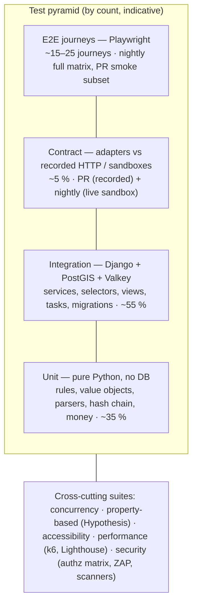
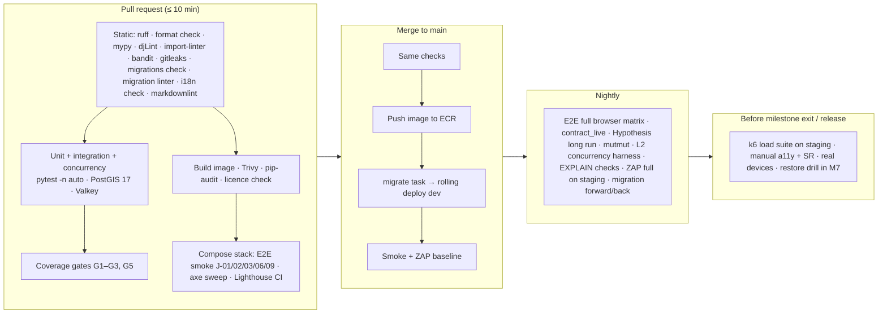

# Testing Strategy

How we prove the Rent Property Listing platform works, and keeps working, from the first commit to launch. It covers the test pyramid, tooling, what to test in each layer, the money-path concurrency and payment tests, end-to-end journeys, accessibility, performance, security, coverage gates, CI and test data.

Status: Draft v0.1 (2026-10-21)

Related: [01 Development Approach](01-development-approach.md) · [02 Milestones & Backlog](02-milestones-and-backlog.md) · [03 Engineering Standards](03-engineering-standards.md) · [05 DoD & Workflow](05-definition-of-done-and-workflow.md) · [System Architecture](../architecture/01-system-architecture.md) · [UX & Page Inventory](../ux/01-ux-and-page-inventory.md)

---

## 1. Goals and principles

| # | Principle |
|---|---|
| T1 | **The money path is proven, not assumed.** Credit grants, the 2-credit debit, the ledger hash chain, payment fulfilment and refunds have unit, integration, concurrency, property-based, contract, E2E and load tests. A defect there is S1 by default ([05 §8](05-definition-of-done-and-workflow.md#8-defect-severity-and-triage)). |
| T2 | **Shift left.** Every story ships with its tests (DoD). M7 re-verifies; it is never the first time something is tested ([01 §11](01-development-approach.md#11-summary-of-commitments-this-approach-makes)). |
| T3 | **Test against the real database.** PostgreSQL 17 + PostGIS + pg_trgm in every environment, including CI. Never SQLite. Constraints, triggers, row locks and GIS queries are part of the behaviour under test. |
| T4 | **Tests describe requirements.** Acceptance criteria become Given/When/Then tests linked to requirement IDs ([§18](#18-traceability-and-reporting)). |
| T5 | **Fast feedback.** The PR pipeline finishes in ≤ 10 minutes; slow suites run nightly or before release. |
| T6 | **Deterministic.** Fixed seeds, frozen time, no sleeps, no shared state between tests. Flaky tests are treated as defects ([§15](#15-flaky-test-policy)). |
| T7 | **Fakes are honest.** Every fake adapter passes the same contract suite as the real adapter ([§9](#9-contract-tests-for-adapters)). |

---

## 2. Test pyramid



In a Django monolith most valuable tests touch the database, so the "integration" layer is the widest. They are still fast: per-test transactions roll back, and pytest-xdist runs them in parallel with one database per worker.

| Layer | Runs against | Speed target | Who writes |
|---|---|---|---|
| Unit | Python only | < 5 ms each | Developer, test-first on the money path |
| Integration | Test DB (PostGIS), Valkey (or locmem), fake adapters | < 100 ms each (typical) | Developer |
| Concurrency | Test DB with real commits (`transaction=True`) | Seconds each; marked `concurrency` | Developer + QA |
| Contract | Recorded HTTP cassettes; live sandboxes nightly | < 1 s each recorded | Developer |
| E2E | Full stack (docker compose in CI; staging nightly) | < 2 min per journey | QA + developer |
| Accessibility | Playwright + axe-core; manual audits | Part of E2E | QA + UX |
| Performance | k6 on staging (prod-like from M4), Lighthouse CI | Minutes to hours | QA + platform |
| Security | Scanners, authz matrix, ZAP, pen test | Mixed | Developer + platform + external |

---

## 3. Tooling

| Purpose | Tool | Notes |
|---|---|---|
| Runner | pytest, pytest-django | `DJANGO_SETTINGS_MODULE = config.settings.test` |
| Parallelism | pytest-xdist (`-n auto`) | One test DB per worker |
| Factories | factory_boy (+ Faker, fixed seed) | Per app in `apps/<app>/tests/factories.py` |
| Property-based / stateful | Hypothesis | Ledger invariants, money parsing, aspect-ratio boundaries |
| Time | time-machine | Expiry, OTP windows, reconciliation ages |
| HTTP recording | pytest-recording (VCR.py) | Gateway, geocoding and SMS adapters; secrets scrubbed from cassettes |
| AWS mocks | moto (`mock_aws`) | S3 presign/HEAD/PUT; KMS for field encryption key wrapping |
| Email | anymail test backend | Asserts recipients, template, tags and that no email is sent on rollback |
| Coverage | coverage.py (branch), pytest-cov, diff-cover | Gates in [§14](#14-coverage-gates) |
| Mutation testing | mutmut | Money-path services only, nightly |
| E2E | Playwright for Python (pytest-playwright) | Chromium, Firefox, WebKit, mobile emulation |
| Accessibility | axe-core (vendored, exact version) injected via Playwright; Lighthouse CI; manual screen readers | [§11](#11-accessibility-tests) |
| Load | k6 | Scripts in `tests/load/`. Chosen over Locust for scripted thresholds and CI output. |
| Front-end performance | Lighthouse CI (budgets file), bundle-size check | [§12](#12-performance-tests) |
| Security | bandit, ruff `S`, pip-audit, gitleaks, Trivy (image + Terraform), OWASP ZAP (baseline + full), django-migration-linter | [§13](#13-security-tests) |
| Email/SMS sinks | Mailpit (local/CI), allow-listed inboxes (staging) | E2E reads verification emails through the Mailpit API |

### 3.1 Test layout and markers

```text
apps/<app>/tests/
    factories.py          # factory_boy factories and builders for this app
    test_models.py        # constraints, triggers, model rules
    test_services.py      # business rules, transactions, domain errors
    test_selectors.py     # queries, scoping, query counts
    test_views.py         # HTTP, permissions, HTMX vs full responses
    test_tasks.py         # idempotency, retries
    contract/             # adapter contract suites (payments, geo, accounts SMS)
tests/                    # cross-app suites only
    e2e/                  # Playwright journeys (J-01 …)
    a11y/                 # axe page sweep + helpers
    security/             # URL access matrix, contact-leak scan, headers, PII-in-logs
    concurrency/          # multi-process debit storm harness (nightly)
    load/                 # k6 scripts and thresholds
    fixtures/payments/    # recorded, scrubbed webhook payloads (stripe/, paypal/)
conftest.py               # shared fixtures (funded_user, verified_user, clock, ...)
```

```toml
[tool.pytest.ini_options]
DJANGO_SETTINGS_MODULE = "config.settings.test"
addopts = "--strict-markers --strict-config -ra"
markers = [
  "unit: pure Python, no database",
  "concurrency: real commits across threads; slower",
  "contract_live: hits real provider sandboxes (nightly only)",
  "e2e: Playwright journeys",
  "slow: > 1 s; excluded from the PR fast lane",
  "req(id): links a test to a requirement ID, e.g. FR-CRED-03",
  "quarantine: known-flaky, tracked by an issue (see §15)",
]
filterwarnings = [
  "error",                                   # deprecations and naive datetimes fail tests
  "ignore::DeprecationWarning:some_third_party_pkg.*",   # explicit, reviewed exceptions only
]
```

---

## 4. Test settings and environments

`config/settings/test.py` (indicative):

```python
from .base import *  # noqa: F403

DATABASES["default"]["ENGINE"] = "django.contrib.gis.db.backends.postgis"
DATABASES["replica"] = {**DATABASES["default"], "TEST": {"MIRROR": "default"}}   # Architecture §13.2

PASSWORD_HASHERS = ["django.contrib.auth.hashers.MD5PasswordHasher"]   # speed only; see note
EMAIL_BACKEND = "anymail.backends.test.EmailBackend"
STORAGES = {
    "default": {"BACKEND": "django.core.files.storage.InMemoryStorage"},
    "staticfiles": {"BACKEND": "django.contrib.staticfiles.storage.StaticFilesStorage"},
}
CACHES = {
    "default": {"BACKEND": "django.core.cache.backends.locmem.LocMemCache"},
    "sessions": {"BACKEND": "django.core.cache.backends.locmem.LocMemCache"},
}
CELERY_TASK_ALWAYS_EAGER = False        # tests call tasks/services explicitly
GEOCODING_PROVIDER = "fake"
PAYMENT_GATEWAYS = ["fake"]             # real adapters are exercised by contract tests
SMS_VERIFICATION_PROVIDER = "fake"      # fixed OTP "000000" in tests only
FIELD_ENCRYPTION_KEYS = ["test-only-key-…"]   # deterministic, never a real KMS key
```

| Rule | Detail |
|---|---|
| Real PostgreSQL | CI uses a `postgis/postgis:17-*` service container (exact tag pinned) with `pg_trgm` enabled by migrations. Local uses the compose database. |
| Migrations always run | No `--nomigrations`: the ledger append-only trigger, the lister-tag trigger, check constraints and generated columns live in migrations (03 MG-9). CI uses `--create-db`; local runs may use `--reuse-db`. |
| Production hasher still tested | A dedicated test loads `config.settings.production` settings and asserts Argon2 is first and bcrypt is present as a fallback hasher; another asserts `DEBUG` is `False`. |
| `on_commit` callbacks | pytest-django wraps tests in a transaction that never commits, so `on_commit` callbacks do not fire. Use the `django_capture_on_commit_callbacks(execute=True)` fixture to assert and run them. Concurrency tests use `transaction=True` and real commits. |
| Valkey-dependent behaviour | Rate limiting, counters and session fallback are tested against a real Valkey service container in a marked subset; everything else uses locmem. |
| Network | Outbound network is blocked in tests (pytest-recording `--block-network` in CI). Only `contract_live` tests may reach sandboxes. |
| Time zone | Tests run with `TZ=UTC`, and a subset re-runs date logic with a user time zone of `Asia/Kolkata` and `America/Los_Angeles` to catch day-boundary bugs (analytics daily stats, history filters). |

---

## 5. What to test per layer

| Layer / artefact | Must test | Typical tools |
|---|---|---|
| **Models** | DB constraints fire (`CHECK`, unique, partial unique), triggers (ledger no-UPDATE/DELETE, lister tag immutable), `clean()` rules, `__str__` has no PII | `pytest.raises(IntegrityError)`, raw SQL in tests |
| **Services** | Every acceptance criterion; every domain error path; idempotency (same key twice → one effect); transaction boundaries (failure halfway → nothing persisted, no outbox row); authorization inside the service; audit records written; outbox messages written with the right topic and payload | Factories, `django_capture_on_commit_callbacks`, anymail test backend |
| **Selectors** | Filters and sorting; owner scoping (other user's object → not found); no contact fields in public DTOs; **query count budgets**; replica alias used only where allowed | `django_assert_max_num_queries` |
| **Views** | Status codes per role (see the access matrix, [§13](#13-security-tests)); HTMX request returns the partial, normal request returns full page or redirect; 422/409/429 handling; CSRF enforced (`Client(enforce_csrf_checks=True)`); `Cache-Control`/`Vary` headers; correct template and key context; error mapping of domain errors | Django test client, `HTTP_HX_REQUEST` header |
| **Forms** | Field validation messages, `autocomplete`/`inputmode` attributes present, money parsing per currency exponent | Unit tests |
| **Templates** | Each state renders (e.g. every `RevealState`, every listing status); no contact data for non-revealed users; accessible markup basics (labels, `aria-describedby` on errors, `aria-current` in the wizard) | Render + HTML parsing (`selectolax`/`lxml`) |
| **Tasks** | Idempotent re-run is a no-op; retries on transient errors; non-transient errors fail fast; tasks call services only | Direct call of the task function |
| **Adapters** | Contract suite ([§9](#9-contract-tests-for-adapters)) | pytest-recording |
| **Migrations** | `makemigrations --check`; linter for backward-incompatible operations; nightly forward/back on a seeded DB; data migrations tested with before/after fixtures | django-migration-linter, custom job |
| **Admin / ops console** | Financial models are read-only; actions call services; non-staff and wrong-group staff get 403/404; every staff action writes `AuditLog` | Test client |
| **Management commands** | `seed_demo` / `seed_perf` idempotent; promo backfill idempotent | `call_command` |
| **Settings / system checks** | Required production settings fail fast; custom system checks fire on misconfiguration | Unit tests |

### 5.1 Money-path test checklist (credits, leads, payments)

Every story in EP-4.x and EP-5.x must have tests for:

1. Happy path with exact balances, `balance_before`/`balance_after`, ledger fields (transaction ID, property ID, server process ID, request ID) — SRS §5.3.
2. Insufficient balance (0, 1) → no debit, no ledger row, no outbox row, correct UI state.
3. Idempotent repeat (same request twice, double click, retried webhook) → exactly one effect.
4. Concurrency scenario(s) from [§7](#7-concurrency-tests-for-credit-debit).
5. Rollback mid-way (inject a failure after the debit) → balance unchanged, no email ([US-410](02-milestones-and-backlog.md#m4--credits--contact-reveal)).
6. Hash chain still verifies and the audit job reports 0 mismatches after the test.
7. Authorization: unverified user, own listing, frozen wallet, unavailable listing.
8. No PII in logs or Sentry events for the flow.

### 5.2 Property-based tests (Hypothesis)

A stateful test drives a wallet through random sequences of `grant_credits`, `debit_credits`, `reverse_entry` and repeated idempotency keys, checking the invariants after every step:

```python
class WalletMachine(RuleBasedStateMachine):
    @rule(amount=st.integers(1, 200), key=st.sampled_from(KEYS))
    def grant(self, amount, key): ...
    @rule(amount=st.integers(1, 10), key=st.sampled_from(KEYS))
    def debit(self, amount, key): ...           # InsufficientCreditsError is an allowed outcome
    @invariant()
    def ledger_matches_balance(self):
        w = CreditWallet.objects.get(pk=self.wallet_id)
        assert w.balance >= 0
        assert w.balance == ledger_sum(w)                      # SUM(amount)
        assert last_entry(w).balance_after == w.balance
        assert verify_chain(w).ok                              # SHA-256 chain intact
```

The PR profile uses `derandomize=True` and a small `max_examples`; the nightly profile uses more examples and a persisted example database. Hypothesis is also used for money parsing (all ISO-4217 exponents), the weekly-to-monthly rent conversion and the image aspect-ratio policy boundaries ([Listings design §14.1](../design/05-listings-and-media.md#141-test-focus)).

---

## 6. Factories and test data builders

| Rule | Detail |
|---|---|
| One factory per model | `apps/<app>/tests/factories.py`. Factories create **valid** objects by default; traits express variations (`UserFactory(verified=True)`, `PropertyFactory(published=True, owner_listed=True)`). |
| Use services where invariants matter | **Never create a wallet balance by setting `balance=`**: that breaks `balance == SUM(ledger)`. Use the `funded_user(credits=n)` builder, which calls `grant_credits` (entry type `ADMIN_ADJUSTMENT` in tests, or `SIGNUP_PROMO` when that is the subject). Likewise `published_property()` runs `publish_property` so `first_published_at`, `listed_at` and outbox rows are consistent. |
| No hard-coded IDs | Use `public_id` from the created object. Never assume PK values. |
| Deterministic data | Faker seeded per session (`factory.random.reseed_random(…)`); Hypothesis seeds controlled by profile. |
| Images | A `make_image(width, height, fmt, exif_gps=True, …)` helper builds small in-memory images with Pillow for pipeline tests; the hostile corpus (polyglot, decompression bomb, truncated, CMYK) lives in `apps/listings/tests/fixtures/images/` ([Listings design §14.1](../design/05-listings-and-media.md#141-test-focus)). |
| PII in factories | Synthetic only. Phone numbers come from reserved/fictional ranges where available; emails use `example.com`/`example.org`. |
| Shared fixtures | `conftest.py` provides `verified_user`, `unverified_user`, `funded_user`, `lister_with_listing`, `staff_user(group=…)`, `htmx_client`, `frozen_clock`. |

---

## 7. Concurrency tests for credit debit

SRS §5.2, §5.3 and §8.2 require an atomic check-and-debit that holds at 1,000 transactions per second with no inconsistency. Unit tests cannot prove this, so we test real concurrent transactions at three levels.

| Level | Where | What | When |
|---|---|---|---|
| L1 Threads in pytest | `apps/credits/tests/test_concurrency.py`, `apps/leads/tests/test_concurrency.py` | Many threads, each with its own DB connection, hitting the same wallet through the real service | Every PR (marked `concurrency`, ~30 s total) |
| L2 Processes over HTTP | `tests/concurrency/` harness against the compose stack (Gunicorn with several workers) | Many processes POSTing `/properties/<id>/reveal/` with real sessions | Nightly |
| L3 Load | k6 on staging ([§12](#12-performance-tests)) | 1,000 TPS across distinct wallets plus a hot-wallet scenario | M0 spike (US-012), M4 (US-414), M7 (US-702) |

### 7.1 Scenarios

| ID | Scenario | Expected result |
|---|---|---|
| C-01 | **Hot wallet:** N = 50 concurrent debits of 2 on one wallet with balance B = 20 | Exactly ⌊B/2⌋ = 10 succeed, 40 raise `InsufficientCreditsError`; final balance 0; 10 ledger rows |
| C-02 | **Same idempotency key** from 20 threads | 1 ledger row; every caller receives the same entry; balance debited once |
| C-03 | **Double-click storm:** 20 concurrent reveals by the same user on the same property | 1 debit, 1 `ContactReveal`, 1 outbox message; the other 19 return the existing reveal with no charge |
| C-04 | **Purchase fulfilment race:** verified webhook and success-redirect verification for the same payment at the same time | 1 `PURCHASE` entry; order `FULFILLED` once |
| C-05 | **Grant/debit interleaving** on one wallet (purchases, reveals, reversals mixed) | Final balance = initial + grants − debits − reversals; `seq` contiguous; no chain fork (unique `(wallet, seq)`) |
| C-06 | **Promo race:** two "first verified login" requests in parallel | 1 `SIGNUP_PROMO` (partial unique constraint) |
| C-07 | **Deadlock probe:** reveal + admin adjustment + refund reversal on the same wallet, 200 iterations | 0 deadlocks (fixed lock order, 03 TX-5); any `DeadlockDetected` fails the test |
| C-08 | **Refund vs debit** when the balance is low | Balance never negative; shortfall recorded and wallet flagged ([US-513](02-milestones-and-backlog.md#m5--payments)) |
| C-09 | **Ledger tamper:** `UPDATE`/`DELETE` on the ledger as the runtime DB role | Fails (no privilege, plus trigger) |
| C-10 | **Distinct wallets throughput (L2):** 64 processes × 200 reveals each on different wallets | 0 errors; audit clean; p95 recorded as a trend |

### 7.2 Thread harness (L1)

```python
import threading
from concurrent.futures import ThreadPoolExecutor

import pytest
from django.db import connection

from apps.credits.exceptions import InsufficientCreditsError
from apps.leads.services import reveal_contact


@pytest.mark.concurrency
@pytest.mark.req("FR-CRED-02", "FR-CRED-03", "NFR-PERF-02")
@pytest.mark.django_db(transaction=True)          # real commits; each thread has its own connection
def test_hot_wallet_exact_successes(funded_user, published_property_factory):
    renter = funded_user(credits=20)               # via grant_credits, so ledger == balance
    properties = published_property_factory.create_batch(50)   # distinct properties: no reveal dedupe
    barrier = threading.Barrier(len(properties))

    def attempt(prop) -> str:
        try:
            barrier.wait(timeout=10)               # release all threads at once
            reveal_contact(user=renter, property_public_id=prop.public_id)
            return "ok"
        except InsufficientCreditsError:
            return "insufficient"
        finally:
            connection.close()                     # threads must close their own connections

    with ThreadPoolExecutor(max_workers=len(properties)) as pool:
        results = list(pool.map(attempt, properties))

    assert results.count("ok") == 10
    assert results.count("insufficient") == 40
    assert_wallet_invariants(renter)               # balance == 0 == SUM(ledger); chain verifies; seq contiguous
```

Notes:

- `transaction=True` is required: the default per-test transaction would hide other threads' commits. These tests truncate tables afterwards, so they are slower and run as a group.
- The CI PostgreSQL service is started with `max_connections` ≥ 200 so 50 threads per xdist worker never starve.
- psycopg releases the GIL during I/O, so threads produce truly concurrent database transactions; row-lock behaviour is the same as with separate processes. L2 confirms this with processes.
- `assert_wallet_invariants` is the same function the nightly audit job uses, so the test also proves the audit logic.

---

## 8. Payment webhook tests with recorded fixtures

Gateway payloads are recorded once from the sandboxes, scrubbed and committed as fixtures. Tests then **sign them locally** with a test secret, so signature verification runs for real without network access.

| Item | Detail |
|---|---|
| Recording | Stripe: Stripe CLI (`stripe trigger …`, `stripe listen`) against the test account. PayPal: sandbox purchases and the webhook simulator. Razorpay (if enabled): test mode. |
| Storage | `tests/fixtures/payments/<gateway>/<event>.json` plus a `.meta.yaml` (API version, date recorded, scenario). Scrubbed: emails, names, addresses, card fingerprints, real IDs replaced by deterministic fakes. |
| Stripe signing | Tests build `Stripe-Signature: t=<ts>,v1=<HMAC-SHA256(secret, f"{ts}.{body}")>` and call the real webhook view; verification uses the Stripe SDK's `Webhook.construct_event` with a tolerance. |
| PayPal verification | The adapter's verification call (`/v1/notifications/verify-webhook-signature`) is replayed from a cassette with `SUCCESS` and `FAILURE` variants. |
| Refresh | When a gateway API version is upgraded, fixtures are re-recorded and the `.meta.yaml` updated in the same PR. A nightly `contract_live` run catches drift early. |

### 8.1 Webhook test matrix

| ID | Case | Expected |
|---|---|---|
| W-01 | Valid `checkout.session.completed` for a PENDING order | Order PAID → FULFILLED; one `PURCHASE` entry with key `pay:stripe:<id>`; receipt outbox message; `PaymentWebhookEvent` stored |
| W-02 | Same event delivered twice | Second delivery returns 200; no second grant (unique event ID and ledger key) |
| W-03 | Invalid signature | 400; event stored with `signature_valid=false`; no state change; metric `webhook_signature_failures_total` incremented |
| W-04 | Timestamp outside tolerance (replay) | Rejected as W-03 |
| W-05 | Amount or currency differs from the order snapshot | No fulfilment; order flagged for Finance; alert |
| W-06 | Event for an unknown order | 200 (so the gateway stops retrying); stored; alert |
| W-07 | Out-of-order delivery (refund arrives before completed) | Final state consistent after both: credits granted then reversed, or reversal queued until the grant exists |
| W-08 | Async payment (`async_payment_succeeded`/`failed`) | Fulfil only on success; failed → FAILED with user-safe reason |
| W-09 | Refund and dispute events | `REVERSAL` up to the current balance; shortfall recorded; wallet flagged |
| W-10 | Webhook and redirect verification arrive together | Exactly one grant (C-04) |
| W-11 | Unknown event type | 200, stored, ignored |
| W-12 | Oversized body (> limit) | 413; nothing stored |
| W-13 | PayPal `PAYMENT.CAPTURE.COMPLETED` / `DENIED` / `REFUNDED` | Same outcomes as the Stripe equivalents |
| W-14 | Gateway API timeout during redirect verification | User sees "Confirming payment…"; reconciliation job fulfils later; no double grant |
| W-15 | Allocation latency | From webhook receipt to committed ledger entry ≤ 5 s (asserted as a measured duration in integration; as p95/p99 in load tests) — SRS §6.4 |

---

## 9. Contract tests for adapters

Every external dependency sits behind a port (interface). A shared **contract suite** defines the behaviour every implementation must have. The real adapters run it against recorded HTTP; the fakes used everywhere else run the same suite, which keeps them honest.

```python
class PaymentGatewayContract:
    """Behaviour every PaymentGateway must satisfy. Subclasses provide `gateway` and scenario fixtures."""

    def test_create_checkout_returns_https_redirect(self, gateway, pending_order): ...
    def test_create_checkout_is_idempotent_per_order(self, gateway, pending_order): ...
    def test_verify_payment_reports_paid_with_amount_and_currency(self, gateway, paid_order): ...
    def test_parse_webhook_rejects_bad_signature(self, gateway, tampered_request): ...
    def test_parse_webhook_maps_success_to_paid_event(self, gateway, success_request): ...
    def test_refund_event_maps_to_reversal(self, gateway, refund_request): ...
    def test_timeout_raises_gateway_unavailable(self, gateway, slow_transport): ...
    def test_never_returns_raw_card_data(self, gateway, paid_order): ...


class TestStripeGateway(PaymentGatewayContract): ...    # recorded cassettes + locally signed fixtures
class TestPayPalGateway(PaymentGatewayContract): ...    # recorded cassettes
class TestFakeGateway(PaymentGatewayContract): ...      # used by integration and CI E2E tests
```

| Port | Implementations under contract | Key contract cases |
|---|---|---|
| `PaymentGateway` | Stripe, PayPal, Razorpay (optional), Fake | Above |
| `GeocodingService` | Google Maps Platform, Mapbox, Fake | Structured address → point + precision; ambiguous → candidates; not found → `NotFound`; timeout → `GeocodingUnavailableError`; result normalisation; no caching beyond what provider terms allow (assert cache TTL setting) |
| `PhoneVerificationService` | Twilio Verify, Fake | Start → pending; correct code → approved; wrong code → rejected with attempts left; expired → rejected; rate-limited → `TooManyAttemptsError`; E.164 normalisation |
| Email (anymail) | SES and Mailgun configurations | Template renders in the recipient's language; required headers (`List-Unsubscribe` on promotional mail only); tags/metadata for delivery tracking; provider errors retried by the outbox |
| `Storage` (S3) | S3 via moto, local S3-compatible service | Presigned POST policy (exact key, size range, content type, SSE-KMS); HEAD verification; public vs private bucket separation |
| GeoIP region resolution | MaxMind GeoLite2 test database | Known test IPs → country; unknown → default market; account region override wins |

The nightly `contract_live` job runs the same suites against the real sandboxes (Stripe test mode, PayPal sandbox, Twilio test credentials where supported, geocoding with a low quota key). Failures alert the team but do not block PRs.

---

## 10. End-to-end tests (Playwright)

### 10.1 Rules

- Playwright for Python (pytest-playwright), in `tests/e2e/`.
- Locators use roles and accessible names (`page.get_by_role("button", name="Show Number · 2 credits")`). This doubles as an accessibility check: if a control cannot be found by role and name, it is probably inaccessible.
- No fixed sleeps. Use Playwright's auto-waiting and `expect(...)` assertions.
- Each journey seeds its own data through management commands (`manage.py e2e_seed <scenario>`) run in the app container. There are **no test-only HTTP endpoints** in any deployed environment.
- Emails are read from Mailpit's API (local/CI) or an allow-listed test inbox (staging). Phone OTP uses the fake verifier in CI; on staging it uses a dedicated test number or is skipped (open question in [§19](#19-open-questions)).
- Payments: in CI the **Fake gateway** serves a minimal hosted-checkout page; on staging nightly the real **Stripe test mode** (cards `4242 4242 4242 4242` success, `4000 0025 0000 3155` 3-D Secure, `4000 0000 0000 0002` decline) and the **PayPal sandbox** are used.
- On failure, the run keeps the Playwright trace, screenshots and video as CI artefacts.

### 10.2 Critical journeys

| ID | Journey | Key assertions | Milestone | PR smoke? |
|---|---|---|---|---|
| J-01 | **Signup → verify → promo → search → reveal** | Real-time validation; verification email link; header shows **10**; search finds a seeded listing; "Show Number · 2 credits"; after click the contact appears, focus moves to it, the toast text is exactly "Contact revealed. 2 credits deducted. Details emailed to you.", the badge shows **8**; the reveal email arrives; reload shows the contact with no second charge; history shows "Signup bonus +10" and "Contact reveal −2" | M4 (M1 part earlier) | Yes |
| J-02 | Insufficient credits | Balance 1: inline alert and persistent toast with "Buy credits" link, no debit. Balance 0: "Get credits to view number" CTA instead of the button | M4 | Yes |
| J-03 | **Purchase credits (card)** | Package page in the resolved currency; ≤ 3 interactions to the hosted page; return page "Confirming payment…" then success; balance updated ≤ 5 s; receipt email; history shows the payment method | M5 | Yes (Fake gateway) |
| J-04 | Purchase with PayPal | Sandbox approval; capture; credits granted; history shows "PayPal" | M5 | Nightly |
| J-05 | Payment cancelled / declined | Cancel returns to the package page with the package preselected; decline offers retry and the other gateway | M5 | Nightly |
| J-06 | **List a property** (mobile viewport) | 6-step wizard; save draft and resume; address and pin; upload 3+ photos with processing to READY; oversize photo rejected inline; contact verification; review and publish; listing visible in search; contact **not** in page source | M2 | Yes |
| J-07 | Manage listing | Edit price; mark rented → anonymous visitor gets the "No longer available" page; a renter who revealed earlier still sees the contact | M2/M4 | Nightly |
| J-08 | Search and save | Fuzzy locality; tag and type multi-select; sort; shareable URL; result count announced; save while logged out → login → saved | M3 | Nightly |
| J-09 | Auth lifecycle | Login; profile dropdown by mouse, keyboard and touch; change email (reauth + verify); logout; back button shows no private data; password reset link expiry | M1 | Yes (login/logout only) |
| J-10 | Tag change | Tag read-only after publish; request change; moderator approves in the ops console; badge updates | M2/M6 | Nightly |
| J-11 | Report and moderate | Report listing; moderator suspends; listing gone from search; Show Number hidden | M6 | Nightly |
| J-12 | Finance four-eyes adjustment | Finance A requests, cannot approve; Finance B approves; ledger and email | M6 | Nightly |
| J-13 | Lister analytics | New view and reveal appear on My Properties within the polling interval | M6 | Nightly |

### 10.3 Browser and device matrix

| Run | Browsers / devices |
|---|---|
| PR (smoke) | Chromium desktop 1280×800 + Chromium "Pixel 7" emulation |
| Nightly (full) | Chromium, Firefox, WebKit × desktop + mobile emulation ("iPhone 14", "Pixel 7"); 200 % zoom variant for J-01 and J-06 |
| Before each milestone demo and before go-live | Manual pass on real devices: one recent iPhone (Safari), one mid-range Android (Chrome), one desktop each of Chrome, Firefox, Safari, Edge |

---

## 11. Accessibility tests

Target: **WCAG 2.1 Level AA** (SRS §12), for the public site, account pages and the ops console.

### 11.1 Automated

| Check | How | Gate |
|---|---|---|
| axe-core page sweep | `tests/a11y/` visits every page in the [page inventory](../ux/01-ux-and-page-inventory.md#4-page-inventory) and runs axe with tags `wcag2a`, `wcag2aa`, `wcag21a`, `wcag21aa` | **0 serious/critical** violations fails CI; moderate/minor are reported and triaged |
| axe in states | Same sweep with the profile dropdown open, a dialog open, a form with errors, an empty state, a toast visible, each Show Number state, each wizard step | Same gate |
| Lighthouse accessibility | Lighthouse CI on key pages (home, search, detail, purchase, wizard step) | Score ≥ 95 |
| Template lint | djLint rules (e.g. `img` without `alt`), plus unit tests for labels and `aria-describedby` on error states | CI |
| Token contrast | A unit test reads the design tokens file and asserts every declared foreground/background pair meets its required ratio (4.5:1 text, 3:1 large text and UI components) — see [UX §9](../ux/01-ux-and-page-inventory.md#9-design-tokens) | CI |
| Role-based locators | E2E journeys find controls by role and accessible name ([§10.1](#101-rules)) | CI |

Automated tools catch only part of WCAG. The manual checks below are mandatory.

### 11.2 Manual checklist (per story touching UI, and full audit per milestone and in M7)

| Area | Check | WCAG 2.1 |
|---|---|---|
| Keyboard | Every action reachable and operable by keyboard only; logical focus order; no keyboard trap; dropdown and dialogs close with Esc and return focus to their trigger | 2.1.1, 2.1.2, 2.4.3 |
| Focus visible | Focus ring always visible with ≥ 3:1 contrast against adjacent colours | 2.4.7, 1.4.11 |
| Skip link and landmarks | "Skip to main content" works; header/nav/main/footer landmarks; one `<h1>`; heading levels in order | 2.4.1, 1.3.1, 2.4.6 |
| Forms | Visible labels; instructions; errors identified in text and linked to fields; error summary receives focus; `autocomplete` on personal fields | 3.3.1, 3.3.2, 3.3.3, 1.3.5 |
| Status messages | Toasts, result counts, autosave status and payment confirmation are announced without moving focus | 4.1.3 |
| Contrast and colour | Text 4.5:1 (3:1 large); UI component boundaries 3:1; Agent/Owner tag and low-balance state never rely on colour alone | 1.4.3, 1.4.11, 1.4.1 |
| Reflow and zoom | Usable at 320 CSS px width and at 200 % and 400 % zoom without horizontal scrolling (except the image gallery and data tables) | 1.4.10, 1.4.4 |
| Text spacing | No loss of content with increased line, paragraph, letter and word spacing | 1.4.12 |
| Hover/focus content | Tooltips and the dropdown are dismissible, hoverable and persistent | 1.4.13 |
| Timing | Toasts with actions don't auto-dismiss; session-expiry warnings give time to extend | 2.2.1 |
| Motion | Respect `prefers-reduced-motion`; no auto-playing carousels | 2.3.3 (AAA, adopted as good practice) |
| Images | Listing photos have meaningful alt text (lister-provided or generated); decorative icons are hidden | 1.1.1 |
| Names | Visible label text is part of the accessible name ("Show Number · 2 credits") | 2.5.3 |
| Orientation and targets | Works in portrait and landscape; touch targets ≥ 44 × 44 px (our standard; exceeds the 2.1 AA requirement) | 1.3.4 |
| Charts | Every chart in lister analytics has an equivalent data table | 1.1.1, 1.3.1 |
| Language | `lang` set on `<html>`; pseudo-locale and RTL build render without truncation or mirrored-icon bugs | 3.1.1 |

### 11.3 Screen-reader matrix

| Screen reader | Browser / platform | When |
|---|---|---|
| NVDA (latest) | Firefox and Chrome, Windows | Per milestone + M7 |
| VoiceOver | Safari, macOS | Per milestone + M7 |
| VoiceOver | Safari, iOS | Per milestone + M7 |
| TalkBack | Chrome, Android | M7 (and M4/M5 for the reveal and purchase flows) |
| JAWS | Chrome, Windows | M7 only, if budget allows (client audience dependent) |

Scripted screen-reader checks per milestone include: the profile dropdown announces the name, email and **credit balance**; the Show Number button announces its cost; the reveal success toast is announced; the insufficient-credit message and its link are reachable; the wizard announces "Step n of 6"; search result counts are announced politely after filtering.

---

## 12. Performance tests

### 12.1 Back-end load (k6)

"Standard" and "peak" load are not defined in the SRS. Until Product supplies a forecast we use the documented assumptions: search standard = 50 req/s with peak = 5× standard ([US-312](02-milestones-and-backlog.md#m3--search--discovery)); credit debits standard ≤ 30 % of the 1,000/s design point and peak = the design point ([Architecture §1.1](../architecture/01-system-architecture.md#11-measurable-quality-targets)).

| ID | Scenario | Load | Thresholds (server-side) | First run |
|---|---|---|---|---|
| PERF-01 | Search, standard | 50 req/s, 10 min, realistic mix of filters (from `seed_perf`, 500k listings) | p95 < 500 ms, errors < 0.1 % | M3 |
| PERF-02 | Search, peak | 250 req/s, 10 min | p95 < 1,000 ms, errors < 0.1 % | M3 |
| PERF-03 | Reveal, distinct wallets | 1,000 req/s, 10 min (15 min in M7) | p95 < 500 ms, errors < 0.1 %, audit 0 mismatches | M0 spike, M4, M7 |
| PERF-04 | Reveal, hot wallet | 200 concurrent requests on one wallet with 20 credits | exactly 10 successes, balance ≥ 0 | M4 |
| PERF-05 | Webhook burst | 100 webhooks/s for 2 min | p95 fulfilment ≤ 5 s, no duplicate grants | M5, M7 |
| PERF-06 | Soak | 50 % of peak for 4 h | No memory growth > 10 %, no error-rate drift | M7 |
| PERF-07 | Spike | 0 → peak in 60 s | Autoscaling recovers p95 within 5 min, no 5xx storm | M7 |
| PERF-08 | Listing detail + header | 200 req/s | p95 < 300 ms (internal budget) | M4 |

```javascript
// tests/load/reveal.js (excerpt)
export const options = {
  scenarios: {
    reveal: { executor: "constant-arrival-rate", rate: 1000, timeUnit: "1s",
              duration: "10m", preAllocatedVUs: 600, maxVUs: 1500 },
  },
  thresholds: {
    "http_req_duration{scenario:reveal}": ["p(95)<500"],
    "http_req_failed{scenario:reveal}": ["rate<0.001"],
  },
};
```

After every credit-path load test, the ledger audit job runs and **must** report 0 mismatches with a valid hash chain. Reports (k6 summary, Grafana/CloudWatch screenshots, DB metrics) are attached to the milestone evidence pack.

### 12.2 In-suite performance guards

| Guard | Detail |
|---|---|
| Query-count budgets | `django_assert_max_num_queries` on key views. Initial budgets: listing detail ≤ 12, search results page ≤ 8 (cache miss), My Properties ≤ 15, transaction history ≤ 8, reveal POST ≤ 10. Raising a budget needs a reviewer comment. |
| EXPLAIN plan checks | Nightly on the `seed_perf` database: the canonical search queries and the reveal transaction are run with `EXPLAIN (FORMAT JSON)` and fail on sequential scans of large tables or a missing index ([US-312](02-milestones-and-backlog.md#m3--search--discovery)). |
| Service timing | The reveal service in integration tests completes in < 50 ms on CI hardware (trend metric, not a hard gate). |

### 12.3 Front-end performance

| Check | Target | Where |
|---|---|---|
| Lighthouse CI (mobile profile) | Performance ≥ 90 on home, search, detail, purchase | PR (against the compose stack) |
| Lab Core Web Vitals | LCP ≤ 2.5 s, CLS ≤ 0.1, TBT ≤ 200 ms | Lighthouse CI |
| Field Core Web Vitals | LCP ≤ 2.5 s, INP ≤ 200 ms, CLS ≤ 0.1 at p75 on mobile | RUM after launch (US-712) |
| Bundle size | JS ≤ 50 KB gzip, CSS ≤ 35 KB gzip per page | CI ([03 §12.5](03-engineering-standards.md#125-front-end-budgets)) |

---

## 13. Security tests

| Type | What | Tool | When |
|---|---|---|---|
| **URL access matrix** | A test enumerates every URL pattern from the resolver and fails if any URL lacks an entry in the access-policy table. For each entry it checks the expected status for each role: anonymous, unverified, renter, listing owner, other lister, Moderator, Support, Finance, Superadmin | pytest | PR |
| IDOR | Every owner-scoped URL returns **404** for a non-owner (listings, drafts, images, orders, receipts, reveals) | pytest | PR |
| **Contact leak scan** | Render detail, search, card, map JSON, sitemap, OG tags, emails to non-revealers and cached fragments for a seeded listing; assert the plaintext phone and email (and spaced/dashed variants) never appear for anonymous, unverified, zero-credit and non-revealed users ([Listings design §13](../design/05-listings-and-media.md#13-security-and-privacy-of-listing-contact-data-known-issue-20)) | pytest | PR |
| PII in logs | Run J-01-like flows in integration with log capture and a Sentry transport stub; assert no seeded email, phone, name, contact or OTP appears | pytest + structlog capture | PR |
| CSRF | All POST endpoints reject requests without a token (`enforce_csrf_checks=True`); webhooks are the only exemptions and require signatures | pytest | PR |
| Sessions | Login rotates the session key; logout deletes the server session and sends `Clear-Site-Data`; password change/reset invalidates other sessions; authenticated pages send `Cache-Control: no-store` | pytest + E2E J-09 | PR |
| Rate limits | Signup, login, OTP, uniqueness check, reveal, report, checkout start return 429 with a friendly message after the limit | pytest (Valkey subset) | PR |
| Security headers | CSP (nonce-based, no `unsafe-eval`, no `unsafe-inline` scripts), HSTS, `X-Content-Type-Options`, `Referrer-Policy`, `Permissions-Policy`, frame protection on all page types | pytest | PR |
| Upload abuse | Polyglot, decompression bomb, wrong content type, > 5 MiB, EXIF GPS stripping, presign key tampering, 21st presign | pytest + moto | PR |
| Webhook security | W-03, W-04, W-12 ([§8.1](#81-webhook-test-matrix)) | pytest | PR |
| Ledger immutability | C-09 ([§7.1](#71-scenarios)) | pytest | PR |
| Static analysis | ruff `S`, bandit | CI | PR |
| Dependencies | pip-audit; Dependabot alerts | CI | PR + daily |
| Secrets | gitleaks (pre-commit + CI) | CI | PR |
| Container and IaC | Trivy image scan; Trivy config scan of Terraform | CI | PR + nightly |
| DAST | OWASP ZAP baseline against `dev` after each deploy; ZAP full scan (authenticated) against `staging` nightly | GitHub Actions | Continuous |
| Pen test | External, scope: web, auth, credits, payments, ops console | Vendor | M7 (US-703) |

---

## 14. Coverage gates

The SRS (§10.2) requires "at least 90 % unit test and integration test coverage". We apply it as follows.

**Deviation from SRS (scope clarification):** coverage is measured on **application code in `apps/`** with branch coverage, excluding migrations and test code. Settings, WSGI/ASGI entry points and Celery bootstrapping in `config/` are reported but gated at a lower level, because they are exercised by deployment smoke tests rather than unit tests and would otherwise push teams toward low-value tests. E2E tests do not count toward the number, matching the SRS wording ("unit and integration").

| Gate | Scope | Threshold | Enforced |
|---|---|---|---|
| G1 | `apps/**` (line + branch combined), excluding `migrations/`, `tests/` | **≥ 90 %** | PR, blocking |
| G2 | Money path: `apps/credits/`, `apps/leads/`, `apps/payments/`, `apps/core/outbox*` | **≥ 95 % branch** | PR, blocking (per-path check script on `coverage json`) |
| G3 | Diff coverage on changed lines in the PR | **≥ 90 %** | PR, blocking (`diff-cover --fail-under=90`) |
| G4 | Whole repository including `config/` | ≥ 85 % | Reported; blocking from M7 |
| G5 | Ratchet: G1 may not drop more than 0.2 points below `main` | — | PR, blocking |
| G6 | Mutation score (mutmut) on `credits`, `leads`, `payments` services | ≥ 80 % | Nightly report; blocking from M5 exit |

```toml
[tool.coverage.run]
branch = true
source = ["apps"]
omit = ["*/migrations/*", "*/tests/*"]
parallel = true

[tool.coverage.report]
fail_under = 90
show_missing = true
skip_covered = true
exclude_also = [
  "if TYPE_CHECKING:",
  "raise NotImplementedError",
  "@overload",
  "\\.\\.\\.$",
]
```

Rules: `# pragma: no cover` needs a reviewer-approved reason in the same line. Coverage is necessary, not sufficient; reviewers check that tests assert outcomes (balances, ledger rows, emails, headers), not just execute lines.

---

## 15. Flaky test policy

A flaky test is one that passes and fails on the same code. Flakiness on the money path usually means a real race, so it is treated as a defect, not noise.

| # | Rule |
|---|---|
| F-1 | **No automatic retries in the PR pipeline.** Retries hide races. Nightly runs use `--reruns 2` only to *detect* flakiness and report it. |
| F-2 | A test that fails then passes on rerun is reported automatically and an issue is opened with the CI run link. |
| F-3 | Quarantine: mark with `@pytest.mark.quarantine(issue="…")`. Quarantined tests still run nightly but don't block PRs. Each has an owner and a **5-working-day** fix deadline. |
| F-4 | **Maximum 5 quarantined tests** at any time. Above that, the team stops feature work in the next iteration until the number is back under the limit. |
| F-5 | **Money-path, auth and security tests can never be quarantined.** If one is flaky, the related feature flag is turned off on `staging`/`prod` (or the merge is blocked) until the cause is found. |
| F-6 | Common causes to check first: real time (use time-machine), ordering assumptions (sort explicitly), shared cache state (clear per test), missing `on_commit` handling, Playwright actions without web-first assertions, test data collisions across xdist workers (unique factories). |
| F-7 | Flaky-rate metric (failures fixed by rerun / total runs) is reviewed at each retrospective; target < 1 %. |

---

## 16. CI pipeline and matrix



| Dimension | Values | Blocking? |
|---|---|---|
| Python | 3.13 | Yes |
| Python (forward) | 3.14 | Weekly, non-blocking |
| Django | 5.2 LTS (pinned) | Yes |
| Django (forward) | Latest release (6.x) with deprecation warnings as errors | Weekly, non-blocking ([03 §19](03-engineering-standards.md#19-dependency-management-and-updates)) |
| PostgreSQL | 17 + PostGIS (prod version) | Yes |
| PostgreSQL (forward) | Next major | Monthly, non-blocking |
| Browsers | See [§10.3](#103-browser-and-device-matrix) | PR smoke blocking; nightly matrix reports |

Pipeline budget: the PR lane must stay ≤ 10 minutes. If it grows past 12 minutes for a week, the slowest tests are moved to a parallel shard or the nightly lane in the next iteration (risk R10 in [01 §10](01-development-approach.md#10-risk-register-top-10)).

---

## 17. Test data management

| Environment | Data | Rules |
|---|---|---|
| Unit / integration | Factories (synthetic) | Created per test, rolled back or truncated |
| Local | `seed_demo` (≈ 200 listings with images, demo users per role) | Idempotent; `make seed` |
| CI E2E | `e2e_seed <scenario>` management command per journey | Fresh compose stack per run; no shared state between journeys |
| `dev` | `seed_demo`, reset on demand | Synthetic only |
| `staging` | `seed_demo` + `seed_perf` (500k listings, 200k users, synthetic cities) | **Synthetic only — production data is never copied to lower environments.** Email/SMS restricted to allow-listed recipients; gateways in sandbox/test mode. Reset at milestone boundaries before demos. |
| `prod` | Real data | Canary/synthetic-monitoring accounts are flagged (`is_synthetic=True`), excluded from analytics, billed only in the M7 smoke test with an immediate refund |

- Recorded gateway fixtures and cassettes are scrubbed and reviewed before commit (gitleaks also runs on them).
- Performance datasets are generated, not sampled: realistic distributions of cities, prices, types and tags, with enough density to make geospatial and trigram queries representative.
- If a production incident needs reproduction, it is reproduced with synthetic data shaped like the incident, never with exported production records.

---

## 18. Traceability and reporting

- Tests carry `@pytest.mark.req("FR-CRED-03")` (several IDs allowed). A CI step builds a **requirement → tests** matrix (JSON + Markdown artefact) and fails if any CRITICAL requirement (FR-AUTH-04, FR-LIST-03, FR-CRED-01..03, FR-PAY-04, FR-PROF-01/02) has no linked passing test.
- E2E journeys list their requirement IDs in their docstrings, which feed the same matrix.
- Each milestone's evidence pack ([05 §4](05-definition-of-done-and-workflow.md#4-definition-of-done-milestone)) contains: CI run links, coverage report, the traceability matrix, axe report, Lighthouse report, k6 reports (where applicable), ZAP report and the manual accessibility checklist.

---

## 19. Open questions

| ID | Question | Default until answered |
|---|---|---|
| TQ-1 | How will staging E2E receive emails (SES inbound to S3, a mail-testing service, or a shared allow-listed mailbox)? | Allow-listed mailbox read via IMAP in nightly runs |
| TQ-2 | Can a dedicated test phone number be used for Twilio Verify on staging, given sender registration in the launch market? | Phone OTP E2E only in CI with the fake verifier |
| TQ-3 | Traffic forecast to replace the standard/peak load assumptions (Architecture A-4) | Assumptions in [§12.1](#121-back-end-load-k6) |
| TQ-4 | Is a JAWS audit required by the client's audience or contracts? | Optional in M7 |
| TQ-5 | Budget for real-device cloud testing (e.g. BrowserStack) vs a small device lab | Small device lab (2 phones) |
