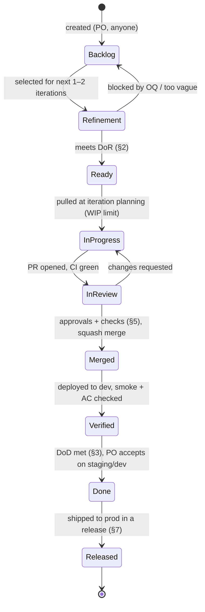

# Definition of Done and Workflow

How a piece of work moves from idea to production, and the exact bar it must clear at each gate: Definition of Ready, Definition of Done (story and milestone), PR checklist, environment promotion, release checklist, defect triage and stakeholder acceptance.

Status: Draft v0.1 (2026-10-21)

Related: [01 Development Approach](01-development-approach.md) · [02 Milestones & Backlog](02-milestones-and-backlog.md) · [03 Engineering Standards](03-engineering-standards.md) · [04 Testing Strategy](04-testing-strategy.md) · [UX & Page Inventory](../ux/01-ux-and-page-inventory.md) · [Requirements Catalog](../requirements/02-requirements-catalog.md) · [Security & Compliance](../quality/01-security-and-compliance.md)

> **Precedence.** This document defines *gates* (what must be true before work moves on). The *rules* behind those gates are in [03](03-engineering-standards.md) (how code is written) and [04](04-testing-strategy.md) (how it is proven). If a gate here contradicts a rule there, the rule wins and this file is corrected in the same PR.

---

## 1. Workflow overview

### 1.1 Work item lifecycle

Every backlog item is one issue in the tracker, keyed by its ID (`US-405`, `BUG-0123`, `SPIKE-012`). **Assumption:** the tracker is GitHub Issues + Projects, which sits next to the code and the CI checks. Any tracker that supports the states below works.



| State | Entry rule | Owner | WIP limit |
|---|---|---|---|
| Backlog | Has an ID, a title and a one-line value statement | PO | — |
| Refinement | Scheduled for refinement within the next 2 iterations | PO + Tech Lead | — |
| **Ready** | Passes the DoR checklist ([§2](#2-definition-of-ready-dor)) | PO | ≤ 2 iterations of work (avoid stale refinement) |
| In progress | Pulled at iteration planning, or mid-iteration if the goal is safe | Developer | **1 story per developer** (solo mode: 1 in total) |
| In review | PR open, CI green, PR template complete ([§5](#5-pull-request-checklist)) | Author + reviewers | ≤ number of developers; reviews before new work |
| Merged | Squash-merged to `main` ([03 §15](03-engineering-standards.md#15-git-workflow)) | Author | — |
| Verified | Auto-deployed to `dev`, post-deploy smoke green, author checked each AC on `dev` | Author | — |
| **Done** | Story DoD met ([§3](#3-definition-of-done-story)); PO accepted | PO | — |
| Released | Included in a production release ([§7](#7-release-checklist)); only from M7 (or the M5 rehearsal) | Tech Lead | — |

"Done" means **done on `main` and accepted**, not "released to production". Production releases happen from M7 onwards ([01 §1](01-development-approach.md#1-decision-summary)). Until then, Done work is releasable but not yet released.

### 1.2 Item types

| Type | ID | Template differences |
|---|---|---|
| Story (vertical slice) | `US-nnn` | Full DoR and DoD |
| Spike (timeboxed investigation) | `SPIKE-nnn`, or a story flagged as spike (e.g. US-012) | DoR: the question, timebox and exit evidence. DoD: an ADR or ADR update with the evidence ([03 §20.3](03-engineering-standards.md#203-adr-lifecycle)); no coverage gate on throwaway code |
| Bug | `BUG-nnnn` | Severity ([§8](#8-defect-severity-and-triage)); DoD adds a regression test that fails before the fix |
| Chore / tech debt | `CH-nnn` | DoD without PO acceptance; Tech Lead accepts |
| Change request | `CR-nnn` | Goes through change triage ([01 §7.2](01-development-approach.md#72-change-triage-flow)) before it becomes stories |

### 1.3 Labels

| Label | Values | Used for |
|---|---|---|
| `type:` | `story`, `spike`, `bug`, `chore`, `cr` | Board filters |
| `ms:` | `M0` … `M7`, `post-mvp` | Milestone tracking ([02](02-milestones-and-backlog.md)) |
| `area:` | App names (`credits`, `leads`, `payments`, `listings`, `search`, `accounts`, `core`, `moderation`, `notifications`, `analytics`, `geo`), `ui`, `infra` | Routing to code owners |
| `money-path` | — | Triggers the two-approval rule and the money-path DoD rows ([03 §16.2](03-engineering-standards.md#162-mandatory-review-srs-102)) |
| `security`, `privacy`, `a11y` | — | Extra review and checklist rows |
| `sev:` | `S1` … `S4` | Bugs only ([§8](#8-defect-severity-and-triage)) |
| `blocked` | — | Waiting on an OQ, external lead time or another item. The blocker is linked in the issue |

### 1.4 Roles in the workflow

| Role | Gates they own |
|---|---|
| Product Owner (PO) | DoR sign-off, story acceptance, milestone acceptance record, release go/no-go vote, defect priority |
| Tech Lead | DoR technical sign-off, money-path reviews, ADR approval, staging promotion, prod deploy approval, severity confirmation |
| Developer | DoD self-check, PR template, verification on `dev`, demo of own stories |
| QA | Test approach in DoR, E2E and exploratory testing, evidence pack, defect severity proposal |
| UX | Page-inventory entry and states in DoR, accessibility review of UI PRs, manual screen-reader pass per milestone |
| Platform | Environment health, promotion pipeline, release execution, rollback |

---

## 2. Definition of Ready (DoR)

A story may be pulled into an iteration only when **every applicable row** is true. The PO and Tech Lead confirm DoR during refinement; the result is a `ready` label plus a checked list in the issue.

### 2.1 All stories

| # | Item | Evidence in the issue |
|---|---|---|
| R-1 | ID, title and user story in the form "As a … I want … so that …" | Issue body |
| R-2 | Linked **requirement IDs**: atomic catalog IDs where they exist (`FR-CRED-03.2`), otherwise group IDs ([catalog §0.1](../requirements/02-requirements-catalog.md#01-id-scheme)). Derived requirements and deviations are marked | "Requirements" section |
| R-3 | **Acceptance criteria as Given/When/Then**, each testable and numbered (AC-1, AC-2, …). The summary in [02](02-milestones-and-backlog.md) is expanded here | "Acceptance criteria" section |
| R-4 | Out-of-scope list (what this story deliberately does not do) | Issue body |
| R-5 | **Open questions resolved**, or the baseline assumption is written down and marked `**Assumption:**` with the OQ/GAP reference ([01 §7.3](01-development-approach.md#73-rules)) | Issue body |
| R-6 | Dependencies identified and either done or scheduled earlier in the same iteration (stories, external accounts, sandbox keys, design-system components) | Linked issues |
| R-7 | **Size ≤ L** (≤ 5 days). Larger items are split first ([01 §5](01-development-approach.md#5-chunk-sizing)) | Size field |
| R-8 | **Test approach** named: which layers ([04 §5](04-testing-strategy.md#5-what-to-test-per-layer)), which E2E journey changes ([04 §10.2](04-testing-strategy.md#102-critical-journeys)), new fixtures or cassettes | "Test approach" section |
| R-9 | **Data impact** noted: new or changed models, constraints and migrations, and whether each migration is an *expand* or *contract* step ([03 §10](03-engineering-standards.md#10-migrations)) | "Data" section |
| R-10 | **Feature-flag decision**: flag name and default per environment, or "no flag needed" with the reason | "Rollout" section |
| R-11 | **NFR budgets** that apply: latency (p95), query-count budget ([04 §12.2](04-testing-strategy.md#122-in-suite-performance-guards)), page weight | "NFR" section |
| R-12 | **Observability**: log events, metrics and `AuditLog` actions the story must emit, named per [03 §14](03-engineering-standards.md#14-logging-metrics-and-tracing-conventions) | "Observability" section |
| R-13 | Demo-able: one sentence describing how the PO will see it working | "Demo" line |

### 2.2 Additional rows by story kind

| Kind | # | Item |
|---|---|---|
| **UI story** | R-UI-1 | Page or component has an entry in the [page inventory](../ux/01-ux-and-page-inventory.md#4-page-inventory) (URL, template, auth, components, HTMX interactions). New pages are added in refinement, not during coding |
| | R-UI-2 | Mobile layout (360 px) sketched or described first; desktop second (SRS §11.2 mobile-first) |
| | R-UI-3 | All states listed: default, loading, empty, error, success, disabled, and role variants (anonymous, unverified, owner, staff) ([UX §12](../ux/01-ux-and-page-inventory.md#12-empty-loading-and-error-states)) |
| | R-UI-4 | Final copy for every message, toast and error, including exact SRS copy where it is mandated (for example the reveal toast) |
| | R-UI-5 | Accessibility notes: focus management after swaps, live-region use, keyboard behaviour ([UX §11](../ux/01-ux-and-page-inventory.md#11-keyboard-and-focus-management)) |
| **Money-path story** (`credits`, `leads`, `payments`, auth/session) | R-MP-1 | **Invariants listed** (for example `balance == SUM(ledger)`, "charged at most once per (user, property)") |
| | R-MP-2 | **Idempotency key** format and the unique constraint that backs it ([03 §5](03-engineering-standards.md#5-naming-docstrings-and-comments)) |
| | R-MP-3 | **Transaction boundary and lock order** stated ([03 TX-1…TX-7](03-engineering-standards.md#81-transaction-rules)) |
| | R-MP-4 | **Concurrency scenarios** selected from [04 §7.1](04-testing-strategy.md#71-scenarios) (C-01…C-10) and failure-injection points chosen |
| | R-MP-5 | Second reviewer from `@rpl-money-path` named |
| **External integration** | R-EXT-1 | Sandbox or test credentials available in `dev` Secrets Manager. Long-lead items tracked ([01 §8.4](01-development-approach.md#84-long-lead-external-items-start-in-m0-owner-clientpo-unless-stated)) |
| | R-EXT-2 | Adapter port and contract cases agreed ([04 §9](04-testing-strategy.md#9-contract-tests-for-adapters)) |
| | R-EXT-3 | Timeouts, retry policy and degraded behaviour defined ([03 SEC-9](03-engineering-standards.md#17-security-coding-rules)) |
| **Security-sensitive** (auth, uploads, webhooks, PII, staff tools) | R-SEC-1 | A short STRIDE note: threats, controls and the test that proves each control ([03 SEC-15](03-engineering-standards.md#17-security-coding-rules)) |
| | R-SEC-2 | Data classification of every new field ([Security §2](../quality/01-security-and-compliance.md#2-data-classification)); encrypted or blind-indexed where required |
| **Spike** | R-SP-1 | The question to answer, the timebox (≤ 3 days unless the Tech Lead agrees otherwise), and the evidence that will end it |

### 2.3 DoR anti-patterns (reject in refinement)

- "Build the X page" with no acceptance criteria or states.
- A story that only adds models or only adds a template. Slices are vertical ([01 §5](01-development-approach.md#5-chunk-sizing)).
- A story that depends on an unanswered OQ with no documented assumption.
- A money-path story without invariants and idempotency defined.

---

## 3. Definition of Done (story)

A story is **Done** when every applicable row below is true. "Enforced by" shows whether CI blocks the merge, a reviewer checks it, or the PO confirms it. Rows enforced by CI cannot be waived. Other rows can be waived only by the Tech Lead (engineering rows) or the PO (product rows), and the waiver is written in the PR.

### 3.1 Code and review

| # | Check | Enforced by |
|---|---|---|
| D-1 | Code follows [03](03-engineering-standards.md): layering (thin views, services own writes, selectors own reads), typed, docstrings on public services/selectors/tasks/adapters, no banned APIs | CI (ruff, mypy, import-linter, djLint) + reviewer |
| D-2 | Squash-merged to `main` from a branch ≤ 5 working days old, PR title a Conventional Commit with `Refs: US-nnn` | CI (title check) + branch protection |
| D-3 | Required approvals obtained: 1 for ordinary changes; **2 including a money-path code owner** for `credits`, `leads`, `payments`, outbox, auth/session code and their migrations ([03 §16.2](03-engineering-standards.md#162-mandatory-review-srs-102)) | Branch protection + `money-path-approvals` status check |
| D-4 | All review conversations resolved; no open **blocking** comments | Branch protection |
| D-5 | No new `TODO` without an issue reference; no commented-out code; no `# type: ignore` without code and reason | CI (ruff `ERA`, mypy) |

### 3.2 Tests and quality gates

| # | Check | Enforced by |
|---|---|---|
| D-6 | **Every acceptance criterion has at least one automated test**, tagged `@pytest.mark.req("<ID>")` ([04 §18](04-testing-strategy.md#18-traceability-and-reporting)) | Reviewer + traceability CI step for CRITICAL IDs |
| D-7 | Unit and integration tests pass on PostgreSQL 17 + PostGIS (never SQLite) | CI |
| D-8 | Coverage gates pass: G1 `apps/` ≥ 90 %, G2 money path ≥ 95 % branch, G3 diff coverage ≥ 90 %, G5 ratchet ([04 §14](04-testing-strategy.md#14-coverage-gates)) | CI |
| D-9 | **Money-path stories:** the money-path checklist in [04 §5.1](04-testing-strategy.md#51-money-path-test-checklist-credits-leads-payments) is complete, including the chosen concurrency scenarios and a rollback-means-no-email test | CI + money-path reviewer |
| D-10 | E2E journeys affected by the story are updated and green; PR smoke journeys (J-01, J-02, J-03, J-06, J-09) still green | CI |
| D-11 | Query-count budgets respected for touched pages; no new N+1 | CI (`django_assert_max_num_queries`) |
| D-12 | No new flaky test. Money-path, auth and security tests are never quarantined ([04 §15](04-testing-strategy.md#15-flaky-test-policy)) | CI + reviewer |
| D-13 | Migrations: `makemigrations --check` clean, migration linter clean, reversible, no data + schema in one file, `lock_timeout` set ([03 §10](03-engineering-standards.md#10-migrations)) | CI + reviewer |

### 3.3 Security and privacy

| # | Check | Enforced by |
|---|---|---|
| D-14 | Static and dependency scans clean of new High/Critical: ruff `S`, bandit, pip-audit, gitleaks, Trivy | CI |
| D-15 | Authorization enforced in the **service**; owner-scoped URLs return 404 to non-owners; the URL access matrix has a row for every new URL ([04 §13](04-testing-strategy.md#13-security-tests)) | CI (access-matrix test fails on a missing row) |
| D-16 | **No PII or secrets in logs, traces, Sentry or analytics**; contact data never in DOM, caches or JSON until revealed ([03 SEC-5](03-engineering-standards.md#17-security-coding-rules)) | CI (PII-in-logs and contact-leak tests) + reviewer |
| D-17 | Rate limits applied where the security design lists the action ([Security §6.5](../quality/01-security-and-compliance.md#65-rate-limiting-brute-force-and-bot-protection)) | Reviewer + tests |
| D-18 | Security-sensitive stories: STRIDE note in the PR, each control linked to a test | Reviewer |

### 3.4 Accessibility, UX and i18n (UI stories)

| # | Check | Enforced by |
|---|---|---|
| D-19 | axe-core: **0 serious/critical** violations on every new or changed page **and state** (dropdown open, dialog open, error, empty, toast) ([04 §11.1](04-testing-strategy.md#111-automated)) | CI |
| D-20 | **Manual keyboard pass** (Tab order, Esc, focus return, visible focus) and a **screen-reader spot check** with one of NVDA or VoiceOver on the changed flow ([04 §11.2](04-testing-strategy.md#112-manual-checklist-per-story-touching-ui-and-full-audit-per-milestone-and-in-m7)) | Author, recorded in PR; UX reviewer |
| D-21 | Works at **360 px** (design width) and reflows at **320 px** and 400 % zoom with no horizontal scroll; touch targets ≥ 44 × 44 px | Author screenshots + Playwright mobile project |
| D-22 | Matches the page inventory entry and UX spec (states, copy, components); deviations recorded in the inventory in the same PR | UX reviewer |
| D-23 | All user-facing strings translatable; plurals via `ngettext`/`blocktranslate count`; logical CSS properties; `makemessages` check clean ([03 §13](03-engineering-standards.md#13-internationalisation-and-localisation)) | CI + reviewer |
| D-24 | Front-end budgets respected (JS ≤ 50 KB, CSS ≤ 35 KB gzip) and Lighthouse CI budgets pass on touched key pages | CI |
| D-25 | Works without JavaScript where the UX spec says it must (GET forms, POST/redirect/GET fallbacks) ([03 HX-5](03-engineering-standards.md#122-htmx-rules)) | Integration tests (non-HTMX request) |

### 3.5 Observability and operations

| # | Check | Enforced by |
|---|---|---|
| D-26 | Log events, metrics and `AuditLog` entries named in the DoR are emitted and asserted in tests | Tests + reviewer |
| D-27 | New failure modes have a runbook entry or an update to an existing runbook (`docs/runbooks/`) | Reviewer |
| D-28 | New alarms or dashboards (if any) defined in Terraform, not click-ops | Reviewer (platform) |

### 3.6 Documentation, rollout and acceptance

| # | Check | Enforced by |
|---|---|---|
| D-29 | Docs updated in the same PR: page inventory, requirement status, ADR (Proposed → Accepted) for decisions, gap log for SRS deviations ([03 §20](03-engineering-standards.md#20-documentation-and-adr-process)) | Reviewer; CI link check |
| D-30 | Feature flag: incomplete or risky features are behind a flag that is **off in prod**; a removal issue exists ([03 §6.4](03-engineering-standards.md#64-business-constants-and-feature-flags)) | Reviewer |
| D-31 | Deployed to `dev` by the pipeline; post-deploy smoke and ZAP baseline green | CI/CD |
| D-32 | Author verified each AC on `dev` with seeded data and ticked them in the issue | Author |
| D-33 | **PO accepted** the story (on `staging` at the iteration review, or on `dev` for small stories), against the written ACs | PO |
| D-34 | No open S1/S2 defect linked to the story | Tracker |

### 3.7 DoD for other item types

| Type | Differences from the story DoD |
|---|---|
| Bug | D-6 becomes "a regression test reproduces the bug and fails before the fix". The PR links `BUG-nnnn`. S1/S2 bugs also need a post-incident review if they reached prod ([§8.5](#85-after-the-fix)) |
| Spike | Coverage gates do not apply to throwaway prototype code kept outside `apps/`. DoD = question answered with evidence in an ADR, recommendation stated, follow-up stories created |
| Chore / dependency update | DoD = CI green, changelog entry if user-visible, Tech Lead accepts. Django security releases follow the 48 h SLA in [03 §19](03-engineering-standards.md#19-dependency-management-and-updates) |
| Docs-only | markdownlint, link check and Mermaid check green; one approval |

---

## 4. Definition of Done (milestone)

A milestone (M0–M7) is Done when the following are true. The evidence is gathered into the milestone **evidence pack** at `docs/delivery/evidence/M<n>/` (links to CI runs and reports, not copies of large files).

### 4.1 Common criteria (every milestone)

| # | Criterion | Evidence |
|---|---|---|
| MD-1 | Every committed story is Done (§3), or was **descoped by the PO** with a written reason and moved to a later milestone | Board export; descoping notes |
| MD-2 | **Exit criteria and demo script** from [02](02-milestones-and-backlog.md) executed on `staging` with seeded data, all steps passed | Demo recording or step log |
| MD-3 | Staging runs the milestone release image, promoted by digest and tagged `v0.<m>.<patch>` ([03 §18](03-engineering-standards.md#18-versioning-releases-and-changelog)) | Release notes, deploy log |
| MD-4 | **No open S1/S2 defects.** S3 defects triaged, each with a target milestone | Tracker query |
| MD-5 | Full nightly suite green for 3 consecutive nights: E2E browser matrix, `contract_live`, Hypothesis long run, L2 concurrency harness, migration forward/back ([04 §16](04-testing-strategy.md#16-ci-pipeline-and-matrix)) | CI links |
| MD-6 | Coverage report and requirement → test **traceability matrix**; every CRITICAL requirement in scope has a passing test | CI artefacts |
| MD-7 | Accessibility: axe sweep of every page in scope; **manual audit** of new pages with the screen-reader matrix in [04 §11.3](04-testing-strategy.md#113-screen-reader-matrix); no open A/AA failures on critical journeys | Checklist and report |
| MD-8 | Security: ZAP full (authenticated) scan on `staging` with no High; dependency and image scans with no unresolved Critical/High | Reports |
| MD-9 | Lighthouse CI report for key pages in scope (performance ≥ 90, accessibility ≥ 95) | CI artefact |
| MD-10 | Docs current: page inventory, ADRs (all Accepted or explicitly Proposed), gap log, OQ register (answered or re-dated), runbooks, CHANGELOG | Docs PR links |
| MD-11 | Risk register reviewed; new risks added ([01 §10](01-development-approach.md#10-risk-register-top-10)) | Retro notes |
| MD-12 | Retrospective held; 1–3 actions recorded with owners | Retro notes |
| MD-13 | **Stakeholder acceptance record signed** ([§9](#9-demo-and-stakeholder-acceptance)) | `docs/delivery/acceptance/M<n>.md` |

### 4.2 Milestone-specific evidence (in addition to §4.1)

| Milestone | Specific evidence required |
|---|---|
| M0 | Walking-skeleton criteria in [01 §4](01-development-approach.md#4-the-walking-skeleton-m0); PR pipeline ≤ 10 min; spike US-012 ADR with 1,000 TPS numbers and zero-inconsistency proof; seed ADRs accepted |
| M1 | Auth E2E (J-09) green; URL access matrix covers every role; staff MFA enforced; `staging` environment live |
| M2 | J-06 "list a property" green on mobile emulation; contact-leak scan green; image security tests (EXIF GPS stripped, polyglot and decompression bomb rejected); IDOR tests green |
| M3 | k6 PERF-01/PERF-02 report (p95 < 500 ms standard, < 1,000 ms peak on the 500k dataset); EXPLAIN plans with no sequential scans on large tables |
| M4 | **J-01 and J-02 green**; concurrency scenarios C-01…C-10 green; **k6 PERF-03/PERF-04** report (1,000 reveals/s, hot-wallet exact successes); post-run ledger audit: 0 mismatches, chain valid; ledger UPDATE/DELETE blocked for the app role |
| M5 | J-03, J-04, J-05 green; webhook matrix W-01…W-15 green; allocation latency p95 ≤ 5 s measured; PCI SAQ-A evidence checklist; mutation score gate G6 ≥ 80 % active |
| M6 | Role × view authorisation matrix for every `/ops/` view; J-10…J-13 green; four-eyes adjustment proven; staff actions present in `AuditLog` |
| M7 | Go/No-Go pack ([§7.4](#74-go-live-decision-gate)): pen test closed (Critical/High), WCAG 2.1 AA audit pass, PERF-01…PERF-07, restore drill within RPO/RTO, runbooks rehearsed, SLO dashboards and alerts live |

---

## 5. Pull request checklist

### 5.1 PR template

Stored as `.github/pull_request_template.md`. Authors delete sections that do not apply and say why ("No UI change").

```markdown
## Summary
<!-- What changes and why, in 2–5 lines. Link the story. -->
Refs: US-___            <!-- or BUG-____ / SPIKE-___ / CH-___ -->
Requirements: FR-___-__.__ , NFR-___-__.__   <!-- catalog IDs this PR satisfies -->

## Type
- [ ] feat  - [ ] fix  - [ ] perf  - [ ] refactor  - [ ] test  - [ ] docs  - [ ] build/ci  - [ ] chore

## Acceptance criteria covered
| AC | Test(s) |
|----|---------|
| AC-1 | `apps/leads/tests/test_services.py::test_...` |

## Screenshots / recordings (UI changes)
<!-- Mobile 360 px AND desktop 1280 px. Include error/empty states and the dropdown/dialog open if touched. -->

## How I tested
- [ ] `make check` passes locally
- [ ] Verified on local stack / dev with seeded data: <steps>
- [ ] Keyboard-only pass done (Tab order, Esc, focus return)        <!-- UI -->
- [ ] Screen reader spot check: NVDA / VoiceOver (circle one)       <!-- UI -->

## Data & migrations
- [ ] No migrations
- [ ] Migrations are reversible, schema-only or data-only (not both), expand/contract step: ______
- [ ] Large-table indexes use AddIndexConcurrently; constraints use NOT VALID + VALIDATE
- [ ] Safe for the previous release's code during a rolling deploy

## Security & privacy
- [ ] Authorization is enforced in the service; non-owners get 404
- [ ] New URLs added to the access-policy matrix
- [ ] No PII/secrets in logs, traces, Sentry, analytics, cache keys
- [ ] Contact data never rendered before reveal (if listings/leads touched)
- [ ] STRIDE note below (auth, uploads, webhooks, money path, staff tools)

## Money path (credits / leads / payments / outbox / auth-session)
- [ ] Invariants: ______  (proved by: ______)
- [ ] Idempotency key: ______  backed by unique constraint: ______
- [ ] Transaction boundary + lock order follow 03 TX-1…TX-7; no network I/O inside atomic
- [ ] Side effects via outbox / on_commit only; rollback sends nothing (test: ______)
- [ ] Concurrency scenarios run: C-__ , C-__
- [ ] Second reviewer from @rpl-money-path requested

## Accessibility & UX
- [ ] Matches page inventory entry (updated in this PR if changed)
- [ ] All states implemented: loading / empty / error / success / role variants
- [ ] Live regions / focus management per UX §10–§11
- [ ] No colour-only meaning; contrast uses design tokens
- [ ] Strings translatable; plurals handled; logical CSS properties

## Observability
- [ ] Log events / metrics / AuditLog actions: ______

## Rollout
- [ ] No flag needed because: ______
- [ ] Behind flag `______` (default: dev on, staging on, prod off). Removal issue: #____
- [ ] Runbook added/updated: ______

## Docs
- [ ] Docs updated (page inventory / ADR / gap log / runbook / requirement status) or N/A

## STRIDE note (if applicable)
| Threat | Control | Test |
|---|---|---|
```

### 5.2 Required status checks (branch protection on `main`)

| Check | Source |
|---|---|
| `lint` (ruff, ruff format check, djLint, import-linter, markdownlint) | [03 §2](03-engineering-standards.md#2-toolchain-at-a-glance) |
| `typecheck` (mypy) | [03 §4](03-engineering-standards.md#4-typing-mypy) |
| `test` (pytest + PostGIS + Valkey, incl. `concurrency` marker) | [04 §16](04-testing-strategy.md#16-ci-pipeline-and-matrix) |
| `coverage` (G1, G2, G3, G5) | [04 §14](04-testing-strategy.md#14-coverage-gates) |
| `migrations` (makemigrations check, migration linter) | [03 §10](03-engineering-standards.md#10-migrations) |
| `i18n` (makemessages/compilemessages check) | [03 §13](03-engineering-standards.md#13-internationalisation-and-localisation) |
| `security` (bandit, gitleaks, pip-audit, Trivy, licence check) | [03 §19](03-engineering-standards.md#19-dependency-management-and-updates) |
| `e2e-smoke` (J-01, J-02, J-03, J-06, J-09), `a11y` (axe sweep), `lighthouse` | [04 §10](04-testing-strategy.md#10-end-to-end-tests-playwright), [§11](04-testing-strategy.md#11-accessibility-tests) |
| `pr-title` (Conventional Commits) | [03 §15.1](03-engineering-standards.md#151-conventional-commits) |
| `money-path-approvals` (2 approvals when protected paths change) | [03 §16.2](03-engineering-standards.md#162-mandatory-review-srs-102) |

### 5.3 Reviewer checklist

Reviewers work through this in order ([03 §16.3](03-engineering-standards.md#163-review-expectations)). Comments are labelled **blocking**, **suggestion**, **question** or **nit**.

1. **Do the tests prove the acceptance criteria?** Read the tests before the code. Do they assert outcomes (balances, ledger rows, emails, headers, status codes), not only execute lines?
2. **Security and privacy.** Authorization in the service, IDOR, CSRF, input trust (prices, amounts, `next` URLs), PII in logs, contact-data exposure.
3. **Transactions and idempotency.** Atomic boundaries, lock order, no network I/O in transactions, on-commit side effects, unique constraints behind every idempotency key.
4. **Migrations.** Safe for rolling deploys; expand/contract respected; reversible.
5. **Accessibility and UX.** States, focus, live regions, labels, contrast tokens, mobile layout (check the screenshots).
6. **Readability and design.** Layering, naming, docstrings that state transaction and idempotency behaviour.
7. **Style.** Mostly automated; nits only.

### 5.4 PR hygiene

| Rule | Detail |
|---|---|
| Size | ≤ 400 changed lines excluding migrations, lockfiles, fixtures and generated files; larger needs a reason ([03 §16.1](03-engineering-standards.md#161-pull-requests)) |
| Review latency | First response within 1 working day; author responds within 1 working day |
| Draft PRs | Encouraged for early design feedback; CI runs on drafts |
| Stale approvals | Dismissed on new commits |
| Merge | Author merges after approvals (squash). The reviewer never merges someone else's money-path PR without the author present |

---

## 6. Environments and promotion

### 6.1 Environments

| | local | dev | staging | prod |
|---|---|---|---|---|
| **Purpose** | Development, debugging | Integration of every merge; fast feedback | Stakeholder demos, UAT, performance and security testing | Real users |
| **Available from** | M0 | M0 | End of M1 | M5 rehearsal (proposed US-515), public at M7 ([01 §9.3](01-development-approach.md#93-environment-timeline)) |
| **Deploy trigger** | `make up` | **Automatic** on merge to `main` | **Manual promotion** of a `dev`-verified image digest, approved by the Tech Lead; at least once per iteration and before every demo | **Release tag** + GitHub Environment approval by **Tech Lead and PO** |
| **Infrastructure** | docker compose: web, worker, beat, PostgreSQL 17 + PostGIS, Valkey, Nginx, Mailpit, S3-compatible storage | Terraform, small sizes | Same Terraform modules; prod-like sizing for performance tests from M4 | Same modules; Multi-AZ, replica, autoscaling (US-701) |
| **Data** | `seed_demo` | `seed_demo`, reset on demand | `seed_demo` + `seed_perf`, **synthetic only**, reset at milestone boundaries | Real. Synthetic-monitoring accounts flagged `is_synthetic` ([04 §17](04-testing-strategy.md#17-test-data-management)) |
| **Payments** | Fake gateway | Stripe test mode, PayPal sandbox | Stripe test mode, PayPal sandbox | Live keys |
| **Email / SMS** | Mailpit / fake verifier | SES sandbox (verified addresses), Twilio test credentials | Allow-listed recipients only | Live, SPF/DKIM/DMARC passing |
| **Access** | Developer | Team (WAF allow-list or SSO) | Team + stakeholders (WAF allow-list or SSO) | Public; `/ops/*` restricted ([Security §6.9](../quality/01-security-and-compliance.md#69-ops-console-and-admin-hardening)) |
| **Feature flags** | Any | New features on | Features under demo on | Off until released; toggled by PO decision |
| **Post-deploy checks** | — | Smoke + ZAP baseline | Smoke + nightly full E2E + ZAP full | Smoke + synthetic checks (US-708) |

Production data is **never** copied to lower environments ([04 §17](04-testing-strategy.md#17-test-data-management)).

### 6.2 Promotion flow

```mermaid
flowchart LR
    PR[PR: CI green + approvals] -->|squash merge| MAIN[main]
    MAIN --> BUILD[Build image once<br/>tag = git SHA, push to ECR]
    BUILD --> DEV[dev: migrate task → rolling deploy<br/>smoke + ZAP baseline]
    DEV -->|digest verified on dev<br/>Tech Lead approves| STG[staging: same digest<br/>migrate → rolling deploy → smoke]
    STG -->|release tag vX.Y.Z<br/>release checklist §7<br/>Tech Lead + PO approve| PROD[prod: same digest<br/>migrate → rolling deploy → smoke + synthetics]
    PROD -. failure .-> RB[Roll back: redeploy previous digest<br/>or flag off]
```



| Rule | Detail |
|---|---|
| Build once | One immutable image per commit, promoted **by digest**. Never rebuilt per environment ([03 §18](03-engineering-standards.md#18-versioning-releases-and-changelog)) |
| Config, not code | Environments differ only by environment variables and secrets ([03 §11](03-engineering-standards.md#11-settings-and-configuration-12-factor)) |
| Migrations first | A one-off `migrate` task runs before new web tasks start. Migrations are backward compatible with the running release (expand → migrate → contract) |
| Rolling deploy | ECS rolling update with ALB health checks and the deployment circuit breaker; automatic rollback on failed health checks |
| No skipping | An image reaches prod only after it ran on `dev` and `staging` |
| Hotfix path | Same pipeline, expedited: fix PR → `main` → `dev` → `staging` (smoke only) → prod with Tech Lead + PO approval. A `hotfix/vX.Y.Z` branch from the release tag is used only when `main` holds unreleasable changes ([03 §15](03-engineering-standards.md#15-git-workflow)) |

### 6.3 Rollback strategy

| Problem | First response | Why it is safe |
|---|---|---|
| New feature misbehaves | Turn its **feature flag off** | No deploy needed |
| Release broken (errors, latency) | **Redeploy the previous image digest** (target ≤ 10 min) | Expand/contract migrations mean the previous code runs on the new schema; no down-migration needed |
| Bad data written | Stop the writer (flag off or rollback), then fix with a reviewed management command that calls services ([Architecture: codebase §13](../architecture/03-codebase-structure.md#13-where-does-this-code-go)) | Ledger corrections are `REVERSAL`/`ADMIN_ADJUSTMENT` entries only, never edits |
| Schema change must be undone | Forward-fix migration in a new release | Down-migrations in prod only with Tech Lead approval |

### 6.4 Deployment windows

**Assumption** (confirm with the PO once launch markets and support hours are known, OQ in [§12](#12-open-questions)):

- Production deploys Monday–Thursday, within the launch market's business hours, with the deploying engineer and the on-call engineer both available for 1 hour afterwards.
- No production deploys on Friday afternoons, on launch-market public holidays, or during a declared incident, except S1 fixes.
- A **change freeze** for 48 hours before go-live and during the first week of hypercare: S1/S2 fixes only, with Tech Lead + PO approval.

---

## 7. Release checklist

### 7.1 Release types

| Type | When | Scope of this checklist |
|---|---|---|
| Milestone release to staging | End of each milestone | §7.2 (rows marked "staging") |
| Routine production release | After go-live, typically weekly | §7.2 + §7.3 |
| **Go-live** (first public production release, `v1.0.0`) | End of M7 (US-711) | §7.2 + §7.3 + §7.4 |
| Hotfix | S1/S2 in production | §7.5 |

### 7.2 Before the release

| # | Item | Owner | Applies to |
|---|---|---|---|
| RL-1 | Release PR (release-please) reviewed; CHANGELOG wording of user-visible changes approved by the PO | PO | staging, prod |
| RL-2 | The release image digest has run on `dev` and `staging` with smoke green; nightly suite green on that digest | Tech Lead | staging, prod |
| RL-3 | Migrations listed in the release notes with their expand/contract step; any contract step's preceding expand release is already in prod | Tech Lead | staging, prod |
| RL-4 | Feature-flag plan: which flags change state in this release and who flips them, when | PO + Tech Lead | prod |
| RL-5 | No open S1/S2 defects against the release; known S3 issues listed in the release notes | QA | staging, prod |
| RL-6 | Security: no unresolved Critical/High in dependency or image scans; ZAP full scan on staging without High | Platform | staging, prod |
| RL-7 | Rollback plan stated: previous digest ID, flags to turn off, data considerations | Platform | prod |
| RL-8 | Support briefed on user-visible changes (copy, new pages, known issues) | PO | prod |
| RL-9 | Deployment window respected (§6.4); on-call engineer named | Tech Lead | prod |

### 7.3 During and after the deploy

| # | Item | Owner |
|---|---|---|
| RL-10 | Approve the GitHub Environment deployment (Tech Lead + PO) | Tech Lead, PO |
| RL-11 | Watch the `migrate` task to completion; watch ECS rollout and ALB 5xx / latency during the rollout | Platform |
| RL-12 | Post-deploy **smoke**: home, search, listing detail, login, profile dropdown, balance badge, Show Number on the canary listing with a synthetic account, Purchase Credits page renders packages | QA / Platform |
| RL-13 | Synthetic checks green for 30 minutes; error rate and p95 within SLO; outbox and Celery queues draining; no new Sentry issue spikes | Platform |
| RL-14 | Flags flipped per RL-4, each followed by a quick check of the feature | PO |
| RL-15 | Release announced (internal channel; external release notes if user-visible) | PO |
| RL-16 | **Rollback triggers** (any one ⇒ roll back first, investigate second): 5xx rate > 1 % for 5 min; p95 of search or reveal > 1,000 ms for 10 min; any ledger audit mismatch; any payment fulfilment failure spike; any contact-data or PII exposure | On-call |

### 7.4 Go-live decision gate

The Go/No-Go meeting (US-711) reviews the M7 evidence pack and records a decision. **All rows must be "Go".** One "No-Go" row means No-Go, with a new date.

| Area | Go criterion | Evidence |
|---|---|---|
| Scope | All MVP milestones M0–M7 accepted (signed records) | `docs/delivery/acceptance/` |
| Defects | Zero open S1/S2; S3 list accepted by the PO | Tracker |
| Security | External pen test: Critical/High closed and re-tested; ASVS L2 checklist complete; secrets rotation drill done (US-703) | Reports |
| Accessibility | WCAG 2.1 AA manual audit pass; accessibility statement published (US-704) | Audit report |
| Performance | PERF-01…PERF-07 thresholds met on prod-like infrastructure (US-702) | k6 reports |
| Credit integrity | Ledger audit clean after load tests; ledger immutability verified in prod | Audit run |
| Payments | Live keys installed; webhooks registered and signature-verified; one real low-value purchase per gateway completed and refunded (US-710); PCI SAQ-A completed | Finance sign-off |
| Data protection | PII encryption verified on a prod snapshot; logs/Sentry sampled without PII (US-705); legal pages live (US-709) | Report |
| Recoverability | Restore drill within RPO ≤ 5 min / RTO ≤ 1 h (proposed targets) (US-706) | Drill report |
| Operations | Runbooks reviewed and rehearsed in a game day (US-707); SLO dashboards and alerts routed to on-call (US-708); on-call rota published for hypercare | Links |
| Email & SMS | SES production access granted (or Mailgun live); SPF/DKIM/DMARC passing; Twilio sender registration approved for launch countries | Provider consoles |
| Launch data | Packages and price books entered and verified by Finance; staff accounts with MFA; groups verified | Finance + Superadmin sign-off |
| DNS & TLS | Domain, ACM certificates, CloudFront distribution and DNS cutover plan rehearsed (TTL lowered 24 h before) | Plan |
| Business | PO and client stakeholder sign-off recorded | Meeting minutes |

**Go-live day sequence:** final deploy of the release digest (already running in prod without public traffic) → flags set → smoke on prod (internal access) → DNS cutover → smoke via public DNS → live purchase test with a staff account, then refund → announce → hypercare starts (2 weeks, daily triage, [§8.3](#83-triage-cadence)).

### 7.5 Hotfix checklist

1. Incident declared and severity set ([§8](#8-defect-severity-and-triage); [Security §11](../quality/01-security-and-compliance.md#11-incident-response) for security incidents).
2. Mitigate first: flag off or roll back (§6.3).
3. Fix PR with a regression test; expedited review (money-path fixes still need two approvals).
4. Pipeline: `main` → `dev` → `staging` smoke → prod (Tech Lead + PO approval; outside the normal window if S1).
5. Verify the fix in prod; close the incident; schedule the post-incident review ([§8.5](#85-after-the-fix)).

---

## 8. Defect severity and triage

### 8.1 Severity levels

Severity describes **impact**. Priority (order of work) is set by the PO and is usually, but not always, the same.

| Severity | Definition | Examples in this product |
|---|---|---|
| **S1 Critical** | Money, credit integrity, security or privacy is compromised, or a core journey is down for most users, with no workaround | **Any money-path defect by default** ([04 T1](04-testing-strategy.md#1-goals-and-principles)): double charge, negative balance, credits debited without a reveal, purchase paid but credits not granted (beyond the reconciliation window), credits granted without verified payment, ledger audit mismatch or broken hash chain. Listing contact data visible without a reveal. Authentication or authorisation bypass, IDOR exposing another user's data. PII exposed publicly. Site or login down |
| **S2 Major** | A critical journey (J-01…J-06, J-09) is broken or seriously degraded for some users, or a CRITICAL requirement is not met, and a workaround exists | Reveal works but the receipt email never arrives; balance badge wrong until reload; search p95 above 1,000 ms at normal load; WCAG A/AA failure that blocks a critical journey for keyboard or screen-reader users; PII written to logs (internal exposure); tag-change review impossible |
| **S3 Minor** | A non-critical feature is wrong or a critical feature is wrong in a cosmetic or edge-case way | Filter count off by one; wrong plural in a message; WCAG failure outside critical journeys; layout glitch at one breakpoint; a misleading but harmless message |
| **S4 Trivial** | Cosmetic, no functional impact | Spacing, typo in a help page, icon misalignment |

Rules:

- **When unsure between two levels, choose the higher one.** QA proposes, the Tech Lead confirms, the PO may raise but not lower an S1 on the money path.
- Security vulnerabilities also follow the dependency/vulnerability SLAs in [03 §19](03-engineering-standards.md#19-dependency-management-and-updates).
- Accessibility defects are severity-rated like any other defect. They are not "nice to have".

### 8.2 Response and fix targets

**Assumption:** these targets assume business-hours support plus an on-call rota for S1 during hypercare. Final targets depend on the support model and SLA confirmation (OQ in [§12](#12-open-questions)).

| Severity | Acknowledge (prod) | Mitigate (prod) | Fix (prod) | Pre-production rule |
|---|---|---|---|---|
| S1 | 15 min (on-call) | ≤ 4 h (flag off, rollback, or hotfix) | ≤ 1 working day | **Stop the line:** feature work in the affected stream pauses until fixed; blocks milestone exit |
| S2 | 4 business hours | ≤ 1 working day | ≤ 3 working days or next release | Blocks milestone exit |
| S3 | 2 working days | — | Within 2 iterations | Triaged with a target milestone |
| S4 | Next triage | — | Backlog | Backlog |

### 8.3 Triage cadence

| Period | Cadence | Attendees |
|---|---|---|
| M0–M6 | Twice weekly, 30 min | PO, Tech Lead, QA |
| M7 and hypercare (2 weeks after go-live) | **Daily**, 15–30 min | PO, Tech Lead, QA, Platform, Support |
| Any S1 | Immediately, through the incident process | On-call + Tech Lead (+ PO for user communication) |

Triage outcome for every new defect: severity confirmed, priority set, owner assigned, target milestone or release set, duplicate or "not a defect" closed with a reason.

### 8.4 Bug report template

```markdown
**Title:** <component>: <what goes wrong> (e.g. "Reveal: second tab charges again")
**Environment:** dev / staging / prod · release vX.Y.Z (SHA) · browser + device · viewport
**Account / role:** anonymous / unverified / renter / lister / staff:<group>  (public_id, never email)
**Steps to reproduce:** 1. … 2. … 3. …
**Expected:** …   **Actual:** …
**Frequency:** always / intermittent (n of m)
**Evidence:** screenshot, request_id, Sentry link, trace id (no PII, no contact data)
**Requirement / story:** FR-…, US-…
**Proposed severity:** S1–S4 and why
```

Reports never contain personal data or revealed contact details. Use `public_id`s and `request_id`s.

### 8.5 After the fix

- Every fixed defect has a **regression test that failed before the fix** (D-6 variant, §3.7).
- **Post-incident review** (blameless) within 5 working days for every S1, every money-path S2 and every production rollback: timeline, root cause, why tests did not catch it, actions with owners. Stored in `docs/incidents/`.
- Escaped-defect trend (bugs found in staging or prod that tests should have caught) is reviewed at each retrospective.

---

## 9. Demo and stakeholder acceptance

### 9.1 Iteration review (every 2 weeks)

| Item | Detail |
|---|---|
| Where | `staging`, with `seed_demo` data reset before the session |
| Duration | 45–60 min |
| Attendees | PO (accepts), client stakeholders (feedback), Tech Lead, developers (demo their own stories), QA, UX |
| Agenda | (1) Iteration goal and outcome · (2) Live demo of Done stories against their ACs · (3) Quality snapshot: coverage, flaky rate, open defects by severity, performance trend · (4) **Decisions needed**: open questions whose needed-by milestone is approaching ([01 §7.4](01-development-approach.md#74-decision-deadlines-for-known-open-questions-delivery-view)) · (5) Deviations from the SRS introduced this iteration (GAP/ADR) · (6) Preview of next iteration |
| Output | Stories accepted or rejected (with reasons); feedback logged as backlog items, change requests or gap-log entries ([01 §7.2](01-development-approach.md#72-change-triage-flow)); OQ decisions recorded |

Feedback that changes scope is not handled in the meeting. It goes through change triage, so the iteration in progress is not disrupted ([01 §7.3](01-development-approach.md#73-rules)).

### 9.2 Milestone demo and acceptance

1. **Preparation (QA + Tech Lead):** evidence pack complete (§4), staging on the milestone release, demo accounts seeded per role, demo script from [02](02-milestones-and-backlog.md) rehearsed once.
2. **Demo (60–90 min):** a team member runs the exit-criteria demo script step by step; the PO (or a client stakeholder) drives at least the critical steps themselves, on a phone for mobile-first flows.
3. **Evidence walk-through:** test, coverage, accessibility, performance and security results relevant to the milestone (§4.2).
4. **Decision:** the PO records one of:

| Outcome | Meaning | Next step |
|---|---|---|
| **Accepted** | Exit criteria met | Record signed; milestone closed |
| **Accepted with conditions** | Minor gaps (S3 or below, or agreed follow-ups) that do not block the next milestone | Conditions become stories with a target milestone; record signed |
| **Not accepted** | An exit criterion is not met, or an S1/S2 is open | Gaps fixed; demo repeated (only the failed parts) |

**Rules:**

- Acceptance is judged against the **written** exit criteria and acceptance criteria. New wishes raised during the demo are welcome, and go to change triage.
- Acceptance needs an **explicit** decision. **Assumption:** the PO decides within 5 working days of the demo. If there is no decision by then, the PO escalates to the client sponsor; the team continues with the next milestone (chunks are independent) and records the missing acceptance as a delivery risk. **No production release happens until all MVP milestones are accepted.**
- User Acceptance Testing (UAT) by client testers runs in M7 on `staging`, scripted from journeys J-01…J-13, for 1 week (**Assumption**: client testers are available; OQ in [§12](#12-open-questions)).

### 9.3 Acceptance record template

Stored at `docs/delivery/acceptance/M<n>.md`, one per milestone.

```markdown
# M<n> Acceptance Record — <milestone name>

Date: YYYY-MM-DD · Environment: staging · Release: v0.<n>.<patch> (SHA ______)
Attendees: <names and roles>

## Outcome
- [ ] Accepted   - [ ] Accepted with conditions   - [ ] Not accepted

## Exit criteria (from 02)
| # | Criterion | Result (pass/fail) | Notes |
|---|---|---|---|

## Stories
| ID | Title | Accepted? | Notes |
|---|---|---|---|

## Deviations from the SRS acknowledged
| GAP / ADR | Summary | Acknowledged by |
|---|---|---|

## Open questions decided in this session
| OQ | Decision | Decided by |
|---|---|---|

## Known issues accepted (S3/S4 only)
| BUG | Severity | Target |
|---|---|---|

## Conditions (if "accepted with conditions")
| Condition | Owner | Target milestone |
|---|---|---|

## Evidence pack
Link: docs/delivery/evidence/M<n>/

Signed: ____________________ (Product Owner)    ____________________ (Tech Lead)
```

---

## 10. Solo-developer mode adjustments

When one developer builds the product with an AI pair ([01 §9.2](01-development-approach.md#92-solo-developer-with-an-ai-pair-sequential-mode)), the gates stay the same; only who performs them changes.

| Gate | Team mode | Solo mode |
|---|---|---|
| DoR sign-off | PO + Tech Lead in refinement | Developer drafts; PO confirms asynchronously before the story starts |
| Ordinary PR review (D-3) | 1 human approval | AI review pass recorded in the PR, plus the developer's own checklist pass after a break of at least one hour. **Deviation from SRS §10.2** (recorded in an ADR, [01 §9.2](01-development-approach.md#92-solo-developer-with-an-ai-pair-sequential-mode)) |
| **Money-path PR review** | 2 approvals incl. a money-path owner | **A human reviewer is still required** (external or part-time). No exceptions |
| Milestone acceptance | Live demo | Live demo preferred; a recorded walkthrough plus a 30-min Q&A call is acceptable |
| Manual accessibility audit (MD-7) | UX/QA | Developer per milestone; **external audit in M7 remains mandatory** |
| Pen test | External | External (unchanged) |
| WIP | 1 story per developer | 1 story in total; nothing new starts until the previous PR is merged and verified on `dev` |

---

## 11. Delivery metrics

Reviewed at every retrospective. These are measures of the system, never targets for individuals.

| Metric | Definition | Target (indicative) |
|---|---|---|
| Lead time for changes | First commit on a branch → deployed to `dev` | Median ≤ 3 working days |
| Deployment frequency | Merges deployed to `dev` per week; prod releases per week after go-live | Daily to `dev`; ≥ weekly to prod |
| Change failure rate | Prod deploys needing rollback, hotfix or flag-off | ≤ 15 % |
| Time to restore | S1 detection → mitigation in prod | ≤ 4 h (§8.2) |
| Escaped defects | Bugs found in staging/prod per iteration that a test should have caught | Downward trend |
| Flaky rate | Failures fixed by rerun / total runs ([04 §15](04-testing-strategy.md#15-flaky-test-policy)) | < 1 % |
| PR cycle time | PR opened → merged | Median ≤ 1 working day |
| Iteration predictability | Committed stories Done / committed | 80–100 % |

---

## 12. Open questions

| ID | Question | Default until answered | Needed by |
|---|---|---|---|
| DQ-1 | Which issue tracker does the client want (GitHub Projects, Jira, other)? | GitHub Issues + Projects | M0 |
| DQ-2 | Who is the Product Owner with authority to accept stories and milestones, and who is the client sponsor for escalation? | Named at kick-off; acceptance blocked without one | M0 |
| DQ-3 | Support model after launch: business hours only, or 24/7 on-call? This sets the S1/S2 targets in §8.2 | Business hours + on-call for S1 during hypercare | M6 |
| DQ-4 | Launch-market deployment windows and public holidays | §6.4 defaults | M7 |
| DQ-5 | Will client testers be available for a 1-week UAT in M7? | Yes, 2 testers | M6 |
| DQ-6 | Is a 5-working-day acceptance decision window acceptable to the client? | Yes (§9.2) | M0 |
| DQ-7 | Solo mode: who is the external human reviewer for money-path PRs? | Must be named before M4 starts | M3 |
