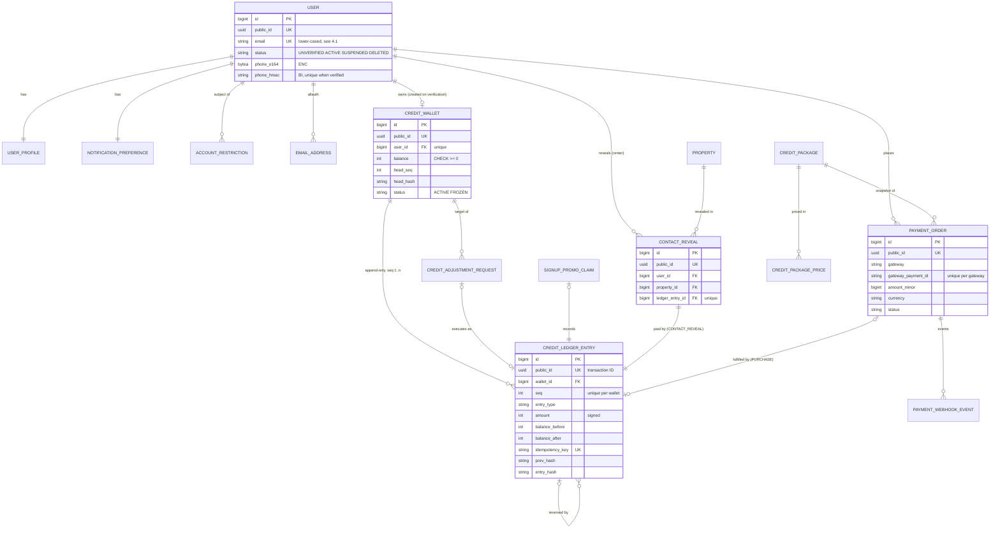
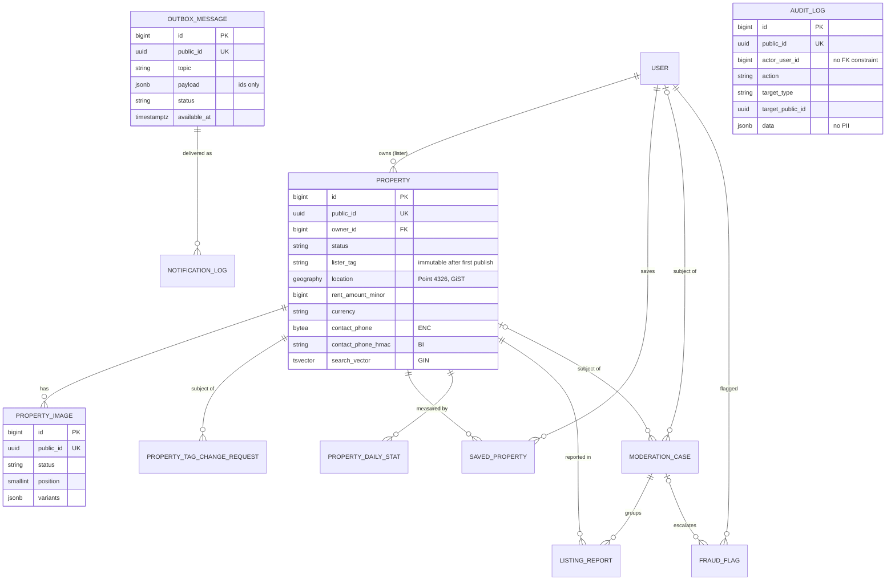
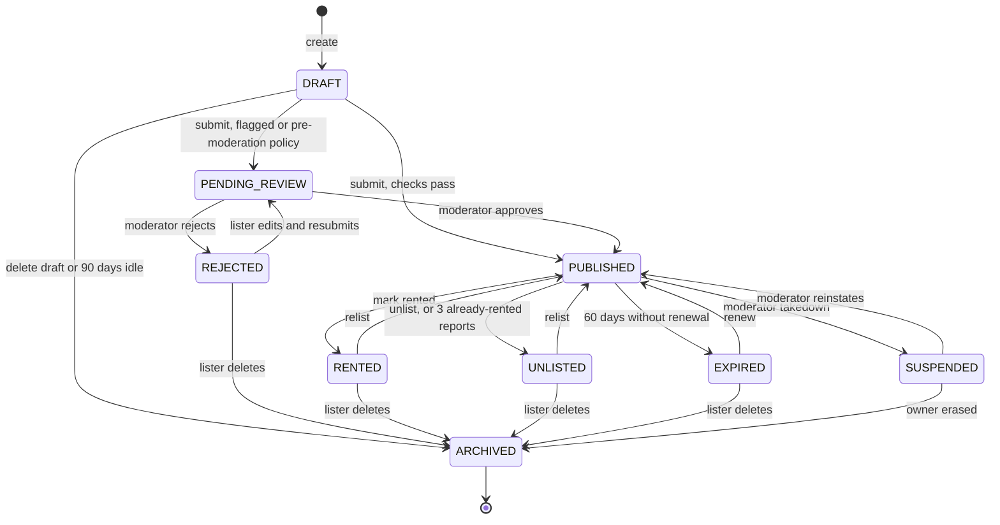
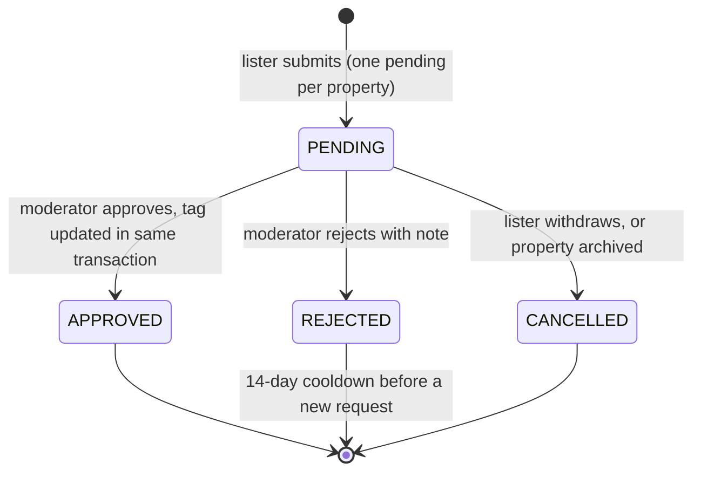
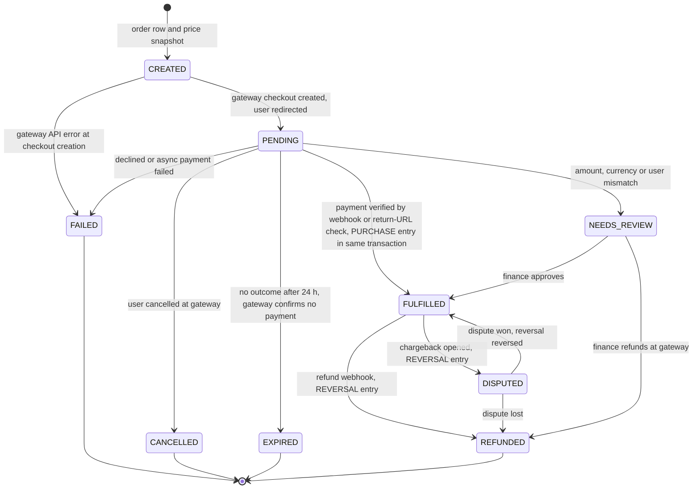
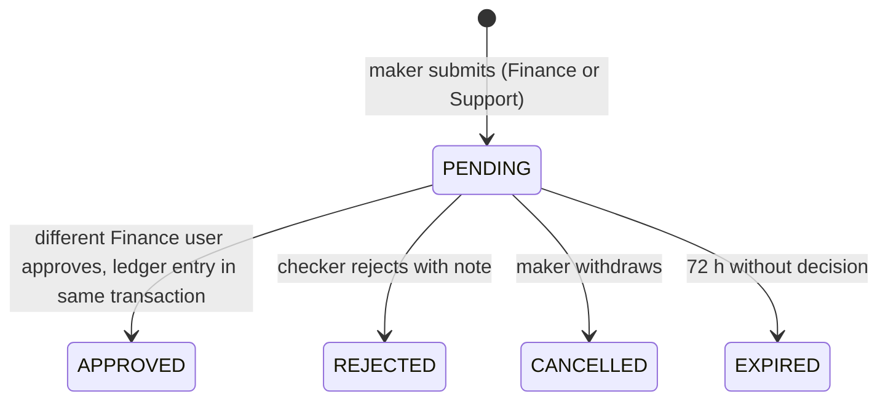
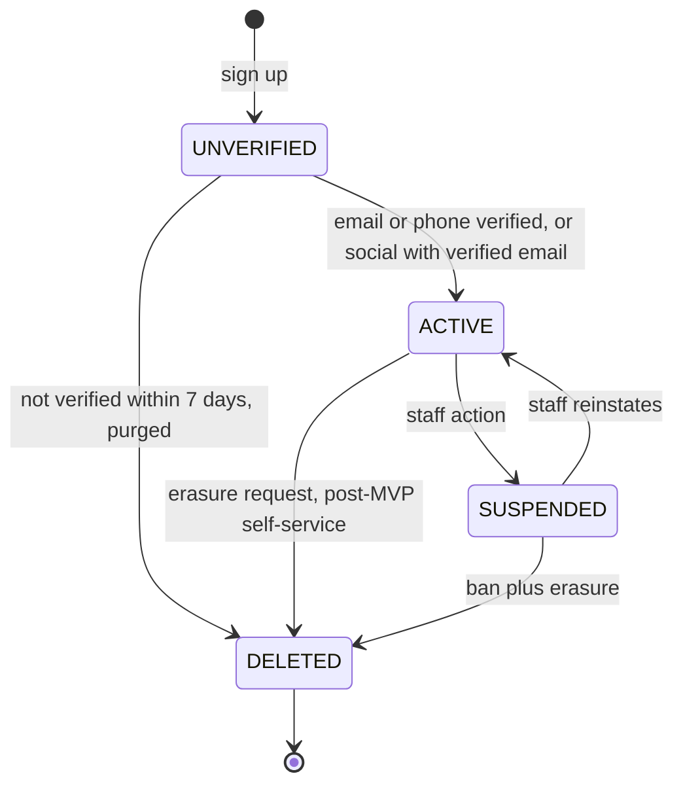
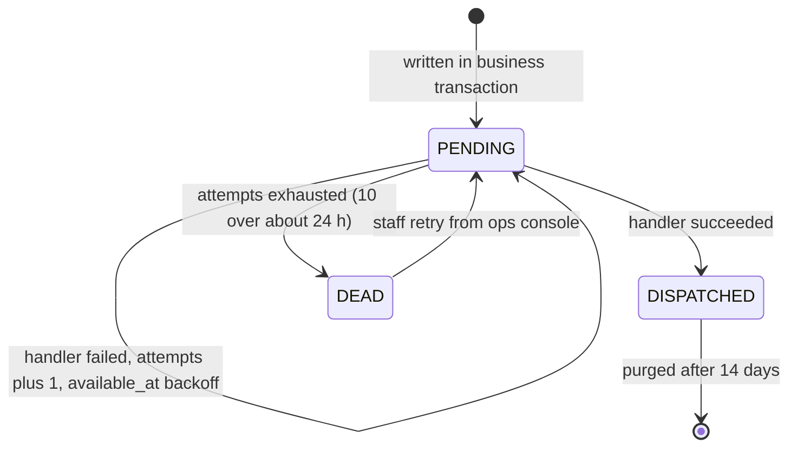

# Domain Model (MVP)

The complete MVP data model: every model in every Django app, with field types, nullability, defaults, constraints, indexes, foreign keys and `on_delete`, state machines, field-level encryption, deletion policy and retention. Behaviour lives in the per-domain design docs. This document is the schema of record.

Status: Draft v0.1 (2026-10-21)

| Item | Value |
|---|---|
| Audience | Backend engineers, DBAs, QA, security reviewers |
| Sources | SRS v1.0 (TOC §3–§12), HLRD v1.0, client architecture diagram and flow chart |
| Related | [02 Credit wallet & ledger](02-credit-wallet-and-ledger.md) · [03 Contact reveal flow](03-contact-reveal-flow.md) · [04 Identity & access](04-identity-and-access.md) · [05 Listings & media](05-listings-and-media.md) · [System architecture](../architecture/01-system-architecture.md) · [Milestones & backlog](../delivery/02-milestones-and-backlog.md) |
| Precedence | For **schema** (fields, constraints, indexes), this document wins over the backlog (which marks its field lists "indicative"). For **listing behaviour**, [05](05-listings-and-media.md) wins. Fields here are copied from 05 so that the two documents agree. |

---

## 0. Conventions

### 0.1 Base classes (`apps.core.models`)

| Class | Fields | Notes |
|---|---|---|
| `TimeStampedModel` (abstract) | `created_at timestamptz NOT NULL default now()`, `updated_at timestamptz NOT NULL` | `created_at` uses `default=timezone.now` (**not** `auto_now_add`), so services can set it explicitly. The ledger relies on this (see [02 §5](02-credit-wallet-and-ledger.md#5-hash-chain-specification)). `updated_at` uses `auto_now=True`. |
| `PublicIdModel` (abstract) | `public_id uuid NOT NULL UNIQUE default uuid4` | The only identifier allowed in URLs, HTML, emails, logs and outbox payloads (architecture rule R10). The internal PK is `bigint` (`BigAutoField`, a PostgreSQL identity column). |
| `ImmutableModel` (abstract) | none | `save()` raises if `pk` is set, and `delete()` always raises. Used by `CreditLedgerEntry` and `AuditLog`. Defence in depth only: the database triggers are authoritative. |

**Assumption:** UUIDv4 is used, as in [05](05-listings-and-media.md). UUIDv7 would give better index locality, but Python 3.13 has no stdlib `uuid7`. Revisit this when moving to Python 3.14.

### 0.2 Type and naming rules

| Rule | Detail |
|---|---|
| Credits | `integer`. Never fractional. |
| Money | `bigint` minor units plus `char(3)` ISO 4217 currency. No `float`/`numeric` for persisted amounts. |
| Enums | Django `TextChoices` stored as `varchar(N)` with a `CHECK (col IN (...))` constraint generated by the migration. Codes are UPPER_SNAKE and stable. Labels are translatable. |
| Timestamps | `timestamptz`, UTC (`USE_TZ=True`). Names end in `_at`. Dates end in `_on` or are named `date`. |
| Booleans | `NOT NULL` with an explicit default. No nullable booleans. |
| Table names | Django default `<app>_<model>` (for example `credits_creditledgerentry`). |
| Constraint names | `ck_<table-short>_<rule>`, `uq_<table-short>_<cols>`, `ix_<table-short>_<cols>`. Declared in `Meta.constraints` / `Meta.indexes` wherever Django supports them, otherwise in raw SQL migrations (§16). |
| Cross-app FKs | String references only (`"listings.Property"`) and only **downward** in the layer graph (architecture §6, rule R4). Same-layer apps never reference each other (for example `credits` ↔ `listings`). Those links use `reference_type` / `reference_id` instead. |
| `on_delete` | `PROTECT` for anything financial or evidential. `CASCADE` only for children owned by a parent (images → property). `SET_NULL` for optional actor/reviewer links on **mutable** tables. Append-only tables never use `SET_NULL`/`CASCADE` because their triggers block updates. |
| Encryption notation | **[ENC]** means application field-level AES-256-GCM (`apps.core.crypto.EncryptedTextField`, envelope keys under KMS, ADR-0010). **[BI]** means an HMAC-SHA256 blind index (`char(64)` hex) with a per-purpose domain-separation prefix. Register in §13. |

### 0.3 Model inventory

| App (layer) | Model | Purpose | Milestone |
|---|---|---|---|
| `core` (0) | `OutboxMessage` | Transactional outbox for after-commit side effects | M0 |
| `core` (0) | `AuditLog` | Append-only security and business audit trail | M0 |
| `accounts` (1) | `User` | Custom user, email login | M0 (stub), M1 |
| `accounts` (1) | `UserProfile` | Region, locale, timezone, terms acceptance | M1 |
| `accounts` (1) | `NotificationPreference` | Communication preferences (SRS §7.2) | M1 |
| `accounts` (1) | `AccountRestriction` | Staff-imposed capability blocks (listing, purchase) | M1 (model), M6 (UI) |
| `accounts` (1) | `BlockedEmailDomain` | Disposable or abusive email domains | M1 |
| `geo` (1) | none | Cache only. GeoLite2 is a bundled file. | — |
| `analytics` (1) | `PropertyDailyStat` | Daily counters per listing | M2/M4 |
| `listings` (2) | `Property`, `PropertyImage`, `PropertyTagChangeRequest`, `SavedProperty` | Listings domain ([05](05-listings-and-media.md)) | M2/M3 |
| `credits` (2) | `CreditWallet`, `CreditLedgerEntry` | Balance and append-only ledger ([02](02-credit-wallet-and-ledger.md)) | M4 |
| `credits` (2) | `SignupPromoClaim` | One promo per verified identity (anti-farming) | M4 |
| `credits` (2) | `CreditAdjustmentRequest` | Maker-checker manual adjustments | M4 (service), M6 (UI) |
| `credits` (2) | `LedgerAuditRun`, `LedgerAuditDiscrepancy`, `LedgerChainCheckpoint`, `LedgerAnchor` | Nightly integrity audit and external anchoring | M4/M6 |
| `search` (3) | none (`SavedSearch` is post-MVP) | — | — |
| `leads` (3) | `ContactReveal` | A paid "Show Number" reveal (the diagram's "Lead") | M4 |
| `payments` (3) | `CreditPackage`, `CreditPackagePrice`, `PaymentOrder`, `PaymentWebhookEvent` | Purchases ([milestones](../delivery/02-milestones-and-backlog.md) EP-5.x) | M5 |
| `notifications` (4) | `NotificationLog`, `EmailSuppression` | Delivery log, idempotency, bounce suppression | M1/M4 |
| `moderation` (4) | `ModerationCase`, `ListingReport`, `FraudFlag` | Ops console queues | M2 (hooks), M6 |
| `verification` (3) | `VerificationRequest`, `VerificationDocument` | **Post-MVP** KYC. Schema sketched in §11. | Post-MVP |

Third-party tables used as-is: `account_emailaddress`, `account_emailconfirmation` (allauth), `mfa_authenticator` (allauth MFA), `socialaccount_*` (allauth, only if SSO ships), `usersessions_usersession` (allauth), `django_session`, `auth_group`, `auth_permission`, `django_celery_beat_*`, `django_content_type`, `django_migrations`.

---

## 1. Entity-relationship diagrams

### 1.1 Identity, credits, leads, payments



### 1.2 Listings, analytics, moderation, platform



---

## 2. `core`

### 2.1 `core.OutboxMessage`

Written **inside** the business transaction and relayed after commit (ADR-0006). Payloads carry IDs only, never PII and never contact details.

| Field | Type | Null | Default | Constraints / notes |
|---|---|---|---|---|
| `id` | bigint identity | no | | PK |
| `public_id` | uuid | no | uuid4 | UNIQUE. Used as the consumer idempotency key. |
| `topic` | varchar(100) | no | | for example `contact.revealed`, `payment.succeeded`, `listings.published` |
| `payload` | jsonb | no | `{}` | `CHECK (jsonb_typeof(payload) = 'object')` |
| `dedupe_key` | varchar(200) | yes | | UNIQUE when not null. A publisher-supplied natural key (for example `contact.revealed:<reveal uuid>`). |
| `status` | varchar(12) | no | `PENDING` | `PENDING`, `DISPATCHED`, `DEAD` |
| `attempts` | smallint | no | 0 | `CHECK (attempts >= 0)` |
| `available_at` | timestamptz | no | now() | Delayed delivery and retry backoff |
| `last_error` | text | yes | | Truncated to 2,000 chars and scrubbed of PII |
| `created_at` | timestamptz | no | now() | |
| `dispatched_at` | timestamptz | yes | | |

Indexes: `ix_outbox_pending (available_at) WHERE status = 'PENDING'` (relay uses `FOR UPDATE SKIP LOCKED`), `ix_outbox_dead (created_at) WHERE status = 'DEAD'`.

The state machine is in §12.8. The publisher API is `core.outbox.publish(topic, payload, dedupe_key=None)`. [05](05-listings-and-media.md) calls it `outbox_enqueue`, which is the same function under its earlier name.

### 2.2 `core.AuditLog`

Append-only (UPDATE is blocked by a trigger, DELETE is allowed only for the retention-purge role; see §16). Uses no FK constraints, so that purging an unverified user never conflicts with audit history.

| Field | Type | Null | Notes |
|---|---|---|---|
| `id` | bigint identity | no | PK |
| `public_id` | uuid | no | UNIQUE |
| `occurred_at` | timestamptz | no | default now(). BRIN index. |
| `actor_type` | varchar(10) | no | `USER`, `STAFF`, `SYSTEM` |
| `actor_user_id` | bigint | yes | `db_constraint=False`, `on_delete=DO_NOTHING`. Index. |
| `actor_public_id` | uuid | yes | Denormalised so the row stays readable after a purge |
| `action` | varchar(100) | no | Dotted code, for example `auth.login_failed`, `listing.lister_tag_changed`, `credits.adjustment_approved`, `pii.unmasked`. Index `(action, occurred_at DESC)`. |
| `target_type` | varchar(50) | yes | `app_label.model` |
| `target_public_id` | uuid | yes | Index `(target_type, target_public_id)` |
| `request_id` | varchar(64) | yes | From `RequestContextMiddleware` |
| `ip` | inet | yes | Truncated to /24 (IPv4) or /48 (IPv6) after 180 days (§15) |
| `user_agent` | varchar(255) | yes | |
| `data` | jsonb | no | default `{}`. **No PII values**: IDs, codes, before/after of non-PII fields only. A `PII_KEYS` deny-list is enforced by `core.audit.record()`. |

---

## 3. `accounts`

### 3.1 `accounts.User` (`AUTH_USER_MODEL`, the first migration)

Extends `AbstractBaseUser` + `PermissionsMixin` + `PublicIdModel` + `TimeStampedModel`. `USERNAME_FIELD = "email"`. There is no `username` column.

| Field | Type | Null | Default | Constraints / notes |
|---|---|---|---|---|
| `id` | bigint identity | no | | PK |
| `public_id` | uuid | no | uuid4 | UNIQUE |
| `email` | varchar(254) | no | | Stored lower-cased (adapter `clean_email`). `UNIQUE (lower(email))` as `uq_user_email_ci`. Plaintext under storage encryption: **Proposed change** from baseline known issue #12, see [04 §4.3](04-identity-and-access.md#43-login-email-encryption-trade-off) and ADR-0010. |
| `full_name` | varchar(150) | no | `''` | Shown in the profile dropdown (SRS §7.1). Required at signup. Redacted from logs. |
| `password` | varchar(128) | no | | Django hasher string. Argon2id primary, bcrypt-SHA256 fallback ([04 §7.2](04-identity-and-access.md#72-password-hashing)) |
| `last_login` | timestamptz | yes | | Django built-in. Satisfies SRS §6.1 `last_login_date`. |
| `is_active` | bool | no | true | `false` for `SUSPENDED` and `DELETED`. CHECK below. |
| `is_staff` | bool | no | false | Staff accounts are separate identities ([04 §13.5](04-identity-and-access.md#135-separation-of-duties-and-staff-accounts)) |
| `is_superuser` | bool | no | false | Break-glass Superadmins only (at most 2) |
| `status` | varchar(12) | no | `UNVERIFIED` | `UNVERIFIED`, `ACTIVE`, `SUSPENDED`, `DELETED` (§12.6) |
| `verified_at` | timestamptz | yes | | Set once, on first verification. Never cleared. |
| `verification_method` | varchar(10) | yes | | `EMAIL`, `PHONE`, `SOCIAL` |
| `phone_e164` | bytea **[ENC]** | yes | | E.164 normalised before encryption |
| `phone_hmac` | char(64) **[BI]** | yes | | `HMAC(k_bi, "phone:v1:" + e164)` |
| `phone_verified_at` | timestamptz | yes | | |
| `status_reason` | varchar(40) | yes | | For example `FRAUD`, `CHARGEBACK_ABUSE`, `USER_REQUEST`, `UNVERIFIED_EXPIRED` |
| `suspended_at`, `deleted_at` | timestamptz | yes | | Lifecycle stamps |
| `created_at`, `updated_at` | timestamptz | no | | `created_at` is the registration time (replaces `date_joined`) |

Constraints:

```sql
ALTER TABLE accounts_user
  ADD CONSTRAINT ck_user_active_matches_status
      CHECK (is_active = (status IN ('UNVERIFIED', 'ACTIVE'))),
  ADD CONSTRAINT ck_user_verified_stamp
      CHECK (status = 'UNVERIFIED' OR status = 'DELETED' OR verified_at IS NOT NULL),
  ADD CONSTRAINT ck_user_phone_pair
      CHECK ((phone_e164 IS NULL) = (phone_hmac IS NULL)),
  ADD CONSTRAINT ck_user_phone_verified_has_phone
      CHECK (phone_verified_at IS NULL OR phone_hmac IS NOT NULL);
CREATE UNIQUE INDEX uq_user_email_ci ON accounts_user (lower(email));
CREATE UNIQUE INDEX uq_user_verified_phone ON accounts_user (phone_hmac)
  WHERE phone_verified_at IS NOT NULL AND status <> 'DELETED';
CREATE INDEX ix_user_unverified_created ON accounts_user (created_at) WHERE status = 'UNVERIFIED';
```

- `mfa_enabled` (SRS §6.1) is a **derived property** (`Authenticator.objects.filter(user=u, type="totp").exists()`), not a column. **Deviation from SRS:** a stored flag could drift from allauth's `mfa_authenticator` table, which is the source of truth.
- `can_transact`, `is_verified` and similar checks are selectors in `accounts.selectors` ([04 §3.3](04-identity-and-access.md#33-capability-checks)).

### 3.2 `accounts.UserProfile`

| Field | Type | Null | Default | Notes |
|---|---|---|---|---|
| `user` | OneToOne `User` | no | | PK. `on_delete=CASCADE` |
| `country` | char(2) | yes | | Account region (ISO 3166-1 alpha-2). Overrides GeoIP for currency (SRS §6.2, known issue #13). |
| `preferred_currency` | char(3) | yes | | Must exist in the price book. NULL means derive from `country`, then GeoIP. |
| `locale` | varchar(10) | no | `en` | BCP 47 |
| `timezone` | varchar(64) | no | `UTC` | IANA name. Captured from the browser at signup. Used for history timestamps. |
| `terms_version` | varchar(20) | no | | Accepted at signup |
| `terms_accepted_at` | timestamptz | no | | |
| `updated_at` | timestamptz | no | | |

**Assumption:** there are no uploaded avatars in the MVP. The header uses an initials avatar or a silhouette (SRS §7 allows "a simple silhouette"), which removes an image-moderation surface.

### 3.3 `accounts.NotificationPreference`

| Field | Type | Null | Default | Notes |
|---|---|---|---|---|
| `user` | OneToOne `User` | no | | PK. CASCADE |
| `promotional_email` | bool | no | **false** | Opt-in (SRS §7.2 "promotional alerts"). GDPR-safe default (**Assumption**, US-112). |
| `product_updates_email` | bool | no | false | |
| `listing_reminders_email` | bool | no | true | Expiry and draft reminders ([05 §9.4](05-listings-and-media.md#94-expiry-and-renewal-assumption--addition-oq-lst-01)) |
| `updated_at` | timestamptz | no | | |

Transactional messages (verification, reveal receipt, payment receipt, security notices) are not configurable and are always sent. Unsubscribe links use signed tokens (`django.core.signing`), so no token column is needed.

### 3.4 `accounts.AccountRestriction`

Capability blocks imposed by staff (moderation, layer 4) but **stored in `accounts`** (layer 1), so that `listings` and `payments` can check them without importing `moderation` (architecture rule R1). Account suspension uses `User.status`. Wallet freezes use `CreditWallet.status`.

| Field | Type | Null | Notes |
|---|---|---|---|
| `id`, `public_id` | | no | |
| `user` | FK `User` | no | PROTECT. Index. |
| `restriction_type` | varchar(20) | no | `LISTING_BLOCKED` (cannot create or publish), `PURCHASE_BLOCKED` (cannot start checkout) |
| `reason_code` | varchar(40) | no | |
| `note` | text | no | Staff-only, 20–2,000 chars |
| `moderation_case_public_id` | uuid | yes | Soft link (a lower layer cannot FK to a higher layer) |
| `created_by` | FK `User` | yes | SET_NULL |
| `expires_at` | timestamptz | yes | NULL means until lifted |
| `lifted_at`, `lifted_by` | timestamptz / FK `User` | yes | SET_NULL |
| `created_at`, `updated_at` | | no | |

`UNIQUE (user_id, restriction_type) WHERE lifted_at IS NULL`.

### 3.5 `accounts.BlockedEmailDomain`

`domain varchar(253) UNIQUE` (lower-case, IDNA-encoded), `source varchar(10)` (`BUNDLED` = imported from the maintained disposable-domain list, `STAFF`), `created_by` FK User SET_NULL, `created_at`. It is cached in Valkey for 10 minutes and checked at signup, at email change and for listing `contact_email` (V-14 in [05](05-listings-and-media.md)).

---

## 4. `listings`

The fields below are copied from [05 §2](05-listings-and-media.md#2-domain-model). **Behaviour, validation and UX are in 05.** Schema-only additions made here are marked ➕.

### 4.1 `listings.Property`

| Field | Type | Null | Default | Constraints / notes |
|---|---|---|---|---|
| `id`, `public_id` | bigint / uuid | no | | PK / UNIQUE |
| `owner` | FK `accounts.User` | no | | `PROTECT`. Indexed via `ix_property_owner_status` |
| `status` | varchar(20) | no | `DRAFT` | `DRAFT`, `PENDING_REVIEW`, `PUBLISHED`, `REJECTED`, `RENTED`, `UNLISTED`, `EXPIRED`, `SUSPENDED`, `ARCHIVED` (§12.1) |
| `lister_tag` | varchar(16) | yes (drafts) | | `AGENT_LISTED`, `OWNER_LISTED`. Immutable after first publish (trigger in [05 §7.1](05-listings-and-media.md#71-rules)) |
| `property_type` | varchar(32) | yes (drafts) | | [05 §6.1](05-listings-and-media.md#61-property-types) |
| `title` | varchar(100) | yes (drafts) | | 10–100 chars at submit |
| `agency_name` | varchar(120) | yes | | Only when `AGENT_LISTED` (CHECK) |
| `country` | char(2) | yes (drafts) | | Immutable after first publish |
| `address_line1` | varchar(200) | yes (drafts) | | Not public when `APPROXIMATE` |
| `address_line2` | varchar(200) | yes | | Never public |
| `locality`, `city`, `region` | varchar(120) | city: yes (drafts); others yes | | |
| `postal_code` | varchar(20) | yes | | |
| `title_normalized`, `city_normalized`, `locality_normalized` | varchar(120) | yes | | Derived in Python ([05 §5.3](05-listings-and-media.md#53-normalisation)) |
| `location` | geography(Point,4326) | yes (drafts) | | True point. GiST index. |
| `display_location` | geography(Point,4326) | yes | | Public pin (fuzzed when `APPROXIMATE`) |
| `address_display` | varchar(12) | no | `APPROXIMATE` | `EXACT`, `APPROXIMATE` |
| `geocode_status` | varchar(10) | no | `PENDING` | `PENDING`, `OK`, `FAILED`, `MANUAL` |
| `geocode_precision` | varchar(12) | yes | | `ROOFTOP`, `STREET`, `LOCALITY`, `MANUAL_PIN` |
| `geocode_provider`, `geocode_place_id` | varchar(20) / varchar(255) | yes | | |
| `geocoded_at` | timestamptz | yes | | |
| `rent_amount_minor` | bigint | yes (drafts) | | `> 0` |
| `currency` | char(3) | yes (drafts) | | Derived from `country` |
| `rent_period` | varchar(10) | no | `MONTHLY` | `MONTHLY`, `WEEKLY` |
| `rent_monthly_minor` | bigint | yes | | Derived. Used for filter and sort. |
| `deposit_amount_minor` | bigint | yes | | `>= 0` |
| `bedrooms`, `bathrooms` | smallint | yes (drafts) | | `0..20` |
| `area_value` / `area_unit` | int / varchar(4) | yes | | Both or neither |
| `furnishing` | varchar(16) | yes | | `UNFURNISHED`, `SEMI_FURNISHED`, `FURNISHED` |
| `available_from` | date | yes | | |
| `description` | text | yes (drafts) | | 80–5,000 chars at submit. Plain text. |
| `contact_name` | varchar(120) | yes (drafts) | | Default: owner `full_name` |
| `contact_phone` | bytea **[ENC]** | yes (drafts, anonymised) | | E.164. Required to submit (CHECK). |
| `contact_phone_hmac` | char(64) **[BI]** | yes | | Same `"phone:v1:"` domain as `User.phone_hmac`, so user phones and listing phones can be matched (fraud rule `SHARED_CONTACT_PHONE`) |
| `contact_phone_verified_at` | timestamptz | yes | | Required to submit |
| `contact_email` | bytea **[ENC]** | yes | | Optional |
| `search_vector` | tsvector, `GeneratedField(db_persist=True)` | yes | | GIN. Definition owned by Search & Discovery design (06). |
| `wizard_last_step` | smallint | no | 1 | |
| `version` | integer | no | 1 | Optimistic concurrency ([05 §4.4](05-listings-and-media.md#44-draft-autosave-and-resume)) |
| ➕ `terms_version_accepted` | varchar(20) | yes | | Versioned declarations at submit ([05 §4.1](05-listings-and-media.md#41-steps-and-fields), step 6) |
| ➕ `declarations_accepted_at` | timestamptz | yes | | |
| `first_published_at` | timestamptz | yes | | Set once |
| `listed_at`, `expires_at` | timestamptz | yes | | |
| `rented_at`, `unlisted_at`, `archived_at` | timestamptz | yes | | |
| ➕ `suspended_at` | timestamptz | yes | | |
| ➕ `rented_via_platform` | varchar(12) | yes | | `YES`, `NO`, `UNDISCLOSED` ([05 §9.3](05-listings-and-media.md#93-mark-rented-unlist-relist)) |
| ➕ `anonymized_at` | timestamptz | yes | | Set when the owner is erased (§14) |
| `created_at`, `updated_at` | timestamptz | no | | |

Constraints (the first four come from 05; the rest are added here):

```sql
ALTER TABLE listings_property
  ADD CONSTRAINT ck_property_rent_positive     CHECK (rent_amount_minor > 0),
  ADD CONSTRAINT ck_property_tag_required      CHECK (status = 'DRAFT' OR status = 'ARCHIVED' OR lister_tag IS NOT NULL),
  ADD CONSTRAINT ck_property_published_located CHECK (status <> 'PUBLISHED' OR (location IS NOT NULL AND listed_at IS NOT NULL)),
  ADD CONSTRAINT ck_property_area_pair         CHECK ((area_value IS NULL) = (area_unit IS NULL)),
  ADD CONSTRAINT ck_property_submitted_complete CHECK (
        status IN ('DRAFT', 'ARCHIVED')
     OR (property_type IS NOT NULL AND title IS NOT NULL AND country IS NOT NULL
         AND address_line1 IS NOT NULL AND city IS NOT NULL AND location IS NOT NULL
         AND rent_amount_minor IS NOT NULL AND currency IS NOT NULL AND description IS NOT NULL
         AND bedrooms IS NOT NULL AND bathrooms IS NOT NULL
         AND contact_name IS NOT NULL AND contact_phone IS NOT NULL
         AND contact_phone_verified_at IS NOT NULL)),
  ADD CONSTRAINT ck_property_agency_only_agent CHECK (agency_name IS NULL OR lister_tag = 'AGENT_LISTED'),
  ADD CONSTRAINT ck_property_rooms_range CHECK (bedrooms BETWEEN 0 AND 20 AND bathrooms BETWEEN 0 AND 20),
  ADD CONSTRAINT ck_property_deposit_nonneg CHECK (deposit_amount_minor IS NULL OR deposit_amount_minor >= 0),
  ADD CONSTRAINT ck_property_contact_pair CHECK ((contact_phone IS NULL) = (contact_phone_hmac IS NULL));
```

> `ck_property_tag_required` here also exempts `ARCHIVED`, because an archived **draft** may never have had a tag. 05 lists the narrower form. This is the schema-of-record version.

Indexes. The search set below is indicative; 06 owns the final search indexes and may refine them.

```sql
CREATE INDEX ix_property_owner_status      ON listings_property (owner_id, status, updated_at DESC);
CREATE INDEX ix_property_contact_phone_hmac ON listings_property (contact_phone_hmac);
CREATE INDEX ix_property_expires           ON listings_property (expires_at) WHERE status = 'PUBLISHED';
-- search (06)
CREATE INDEX ix_property_location_gist     ON listings_property USING gist (location) WHERE status = 'PUBLISHED';
CREATE INDEX ix_property_search_vector     ON listings_property USING gin (search_vector) WHERE status = 'PUBLISHED';
CREATE INDEX ix_property_city_trgm         ON listings_property USING gin (city_normalized gin_trgm_ops) WHERE status = 'PUBLISHED';
CREATE INDEX ix_property_locality_trgm     ON listings_property USING gin (locality_normalized gin_trgm_ops) WHERE status = 'PUBLISHED';
CREATE INDEX ix_property_title_trgm        ON listings_property USING gin (title_normalized gin_trgm_ops) WHERE status = 'PUBLISHED';
CREATE INDEX ix_property_pub_newest        ON listings_property (country, listed_at DESC) WHERE status = 'PUBLISHED';
CREATE INDEX ix_property_pub_price         ON listings_property (country, currency, rent_monthly_minor) WHERE status = 'PUBLISHED';
CREATE INDEX ix_property_pub_type_tag      ON listings_property (property_type, lister_tag) WHERE status = 'PUBLISHED';
```

### 4.2 `listings.PropertyImage`

| Field | Type | Null | Notes |
|---|---|---|---|
| `id`, `public_id` | | no | `public_id` is part of the S3 keys |
| `property` | FK `Property` | no | **CASCADE** (rows only; S3 cleanup is asynchronous) |
| `uploaded_by` | FK `User` | no | PROTECT |
| `status` | varchar(16) | no | `PENDING_UPLOAD`, `PROCESSING`, `READY`, `REJECTED`, `DELETED` (default `PENDING_UPLOAD`) |
| `position` | smallint | no | `UNIQUE (property_id, position) WHERE status <> 'DELETED'`, `DEFERRABLE INITIALLY DEFERRED` (raw SQL: a deferrable constraint needs `ALTER TABLE ... ADD CONSTRAINT ... EXCLUDE` or a unique **constraint**, not a partial index. Implemented as `EXCLUDE USING btree (property_id WITH =, position WITH =) WHERE (status <> 'DELETED') DEFERRABLE INITIALLY DEFERRED`) |
| `alt_text` | varchar(150) | yes | |
| `original_filename` | varchar(255) | no | Sanitised |
| `original_content_type` | varchar(50) | no | |
| `original_size_bytes` | int | no | `CHECK (original_size_bytes BETWEEN 1 AND 5242880)` |
| `upload_sha256` | char(64) | yes | `UNIQUE (property_id, upload_sha256) WHERE status <> 'DELETED'` |
| `width`, `height` | int | yes | |
| `crop_applied` | varchar(16) | no | `NONE` default; `CENTER_TO_4_3`, `CENTER_TO_16_9` |
| `variants` | jsonb | no | `{}` |
| `phash` | char(16) | yes | Index (for the duplicate-image fraud check) |
| `rejection_code` | varchar(40) | yes | |
| `processed_at` | timestamptz | yes | |
| `created_at`, `updated_at` | | no | |

Index `(property_id, status, position)`. Not every partial unique index can be deferred. That is why the exclusion constraint form is used (needs no extra extension, since btree supports `=`).

### 4.3 `listings.PropertyTagChangeRequest`

| Field | Type | Null | Notes |
|---|---|---|---|
| `id`, `public_id` | | no | |
| `property` | FK `Property` | no | PROTECT |
| `requested_by` | FK `User` | no | PROTECT. Must be the owner, or staff under T-08 in 05 |
| `from_tag`, `to_tag` | varchar(16) | no | `CHECK (from_tag <> to_tag)` |
| `reason` | text | no | 20–1,000 chars |
| `evidence_keys` | jsonb | no | `[]`. Private-bucket object keys, at most 3 |
| `status` | varchar(10) | no | `PENDING` default; `APPROVED`, `REJECTED`, `CANCELLED` (§12.3) |
| `reviewed_by` | FK `User` | yes | SET_NULL |
| `reviewed_at` | timestamptz | yes | |
| `decision_note` | text | yes | Required on reject |
| `created_at`, `updated_at` | | no | |

`UNIQUE (property_id) WHERE status = 'PENDING'`. `CHECK (status = 'PENDING' OR status = 'CANCELLED' OR (reviewed_by_id IS NOT NULL AND reviewed_at IS NOT NULL))`. Index `(status, created_at)` for the review queue. The 14-day cooldown after a rejection is checked in the service.

### 4.4 `listings.SavedProperty`

`id`, `user` FK User CASCADE, `property` FK Property CASCADE, `created_at`. `UNIQUE (user_id, property_id)`. Index `(user_id, created_at DESC)`. Unsaving is a hard delete, and the "saves added" daily counter is unaffected (§5). Only verified users can save (US-104).

---

## 5. `analytics.PropertyDailyStat`

| Field | Type | Null | Default | Notes |
|---|---|---|---|---|
| `id` | bigint | no | | PK |
| `property` | FK `listings.Property` | no | | CASCADE (only never-published drafts are ever deleted) |
| `date` | date | no | | UTC day |
| `views` | int | no | 0 | `CHECK >= 0`. Deduplicated views ([05 §10.2](05-listings-and-media.md#102-metric-definitions)) |
| `saves_added` | int | no | 0 | |
| `show_number_clicks` | int | no | 0 | All Show Number POSTs by logged-in non-owners, including insufficient-credit ones |
| `reveals` | int | no | 0 | Successful paid reveals (the exact total comes from `ContactReveal`) |
| `updated_at` | timestamptz | no | | |

`UNIQUE (property_id, date)`. The Valkey flush job upserts with `INSERT … ON CONFLICT (property_id, date) DO UPDATE SET views = analytics_propertydailystat.views + EXCLUDED.views, …`. Index `(property_id, date DESC)`.

---

## 6. `credits`

Design rationale, algorithms and the hash-chain specification are in [02](02-credit-wallet-and-ledger.md). This section is the schema.

### 6.1 `credits.CreditWallet`

| Field | Type | Null | Default | Constraints / notes |
|---|---|---|---|---|
| `id`, `public_id` | | no | | |
| `user` | OneToOne `accounts.User` | no | | `PROTECT`. UNIQUE. Created **when the account becomes verified** (in the same transaction as the promo grant). Unverified users have no wallet, and `get_balance()` returns 0 for them. |
| `balance` | integer | no | 0 | `CHECK (balance >= 0)`, `CHECK (balance <= 10000000)` (sanity bound) |
| `head_seq` | integer | no | 0 | `seq` of the latest ledger entry. 0 means no entries. |
| `head_hash` | char(64) | no | | Genesis hash on creation ([02 §5.3](02-credit-wallet-and-ledger.md#53-genesis)) |
| `status` | varchar(8) | no | `ACTIVE` | `ACTIVE`, `FROZEN`. Frozen: user-initiated debits are blocked, while grants, reversals and admin adjustments are allowed. |
| `frozen_reason` | varchar(40) | yes | | `FRAUD_REVIEW`, `AUDIT_MISMATCH`, `CHARGEBACK`, `STAFF` |
| `frozen_at` | timestamptz | yes | | |
| `frozen_by` | FK `User` | yes | | PROTECT (the wallet row is mutable, but staff users are never deleted) |
| `created_at`, `updated_at` | | no | | |

`CHECK ((status = 'FROZEN') = (frozen_at IS NOT NULL))`. Table storage parameter `fillfactor = 80` (raw SQL), so that balance updates are HOT updates (no indexed column changes). A deferred constraint trigger keeps the wallet head consistent with the ledger ([02 §6.3](02-credit-wallet-and-ledger.md#63-deferred-consistency-trigger-wallet--ledger)).

### 6.2 `credits.CreditLedgerEntry` (append-only)

Extends `PublicIdModel` + `ImmutableModel`. It has **no `updated_at`**.

| Field | Type | Null | Default | Constraints / notes |
|---|---|---|---|---|
| `id` | bigint identity | no | | PK |
| `public_id` | uuid | no | uuid4 | UNIQUE. **The transaction ID** shown to users and in emails (SRS §5.3) |
| `wallet` | FK `CreditWallet` | no | | PROTECT |
| `seq` | integer | no | | `UNIQUE (wallet_id, seq)`, `CHECK (seq >= 1)`. Contiguous per wallet (enforced by an insert trigger) |
| `entry_type` | varchar(20) | no | | `SIGNUP_PROMO`, `PURCHASE`, `CONTACT_REVEAL`, `ADMIN_ADJUSTMENT`, `REVERSAL`. Post-MVP: `LEAD_UNLOCK`, `REFERRAL_BONUS` |
| `reason_code` | varchar(40) | yes | | Sub-reason, for example `SIGNUP_10`, `REFUND`, `CHARGEBACK`, `INVALID_CONTACT`, `GOODWILL`, `CORRECTION` |
| `amount` | integer | no | | Signed. `CHECK (amount <> 0 AND amount BETWEEN -1000000 AND 1000000)` |
| `balance_before` | integer | no | | `CHECK (balance_before >= 0)` |
| `balance_after` | integer | no | | `CHECK (balance_after >= 0 AND balance_after = balance_before + amount)` |
| `reference_type` | varchar(50) | no | | `listings.property`, `payments.paymentorder`, `accounts.user`, `credits.creditadjustmentrequest`, `credits.creditledgerentry` |
| `reference_id` | varchar(64) | no | | Public UUID of the referenced object. For `CONTACT_REVEAL` it is the **property ID** (SRS §5.3). |
| `reverses_entry` | FK self | yes | | PROTECT. `CHECK ((entry_type = 'REVERSAL') = (reverses_entry_id IS NOT NULL))` |
| `idempotency_key` | varchar(200) | no | | UNIQUE. Formats in [02 §4.3](02-credit-wallet-and-ledger.md#43-idempotency-keys) |
| `actor` | FK `accounts.User` | yes | | PROTECT. The initiating user (renter for reveals; approving staff for adjustments); NULL for system (webhook, beat) |
| `server_process_id` | varchar(120) | no | | `"<service>:<task-id>:<pid>"`, for example `web:3f9c2a1b:4127` (SRS §5.3 "server process ID") |
| `request_id` | varchar(64) | no | | HTTP request ID, Celery task ID or `cli:<uuid>` |
| `app_release` | varchar(40) | no | | Git SHA of the deployed image |
| `metadata` | jsonb | no | `{}` | Object only. Scalars only (str, int, bool, null), no floats, **no PII**. `CHECK (pg_column_size(metadata) <= 2048)` |
| `hash_version` | smallint | no | 1 | |
| `prev_hash` | char(64) | no | | Equals the wallet's `head_hash` before insert (trigger) |
| `entry_hash` | char(64) | no | | SHA-256 of the canonical serialisation. [02 §5](02-credit-wallet-and-ledger.md#5-hash-chain-specification) |
| `created_at` | timestamptz | no | | Set by the service before hashing |

Sign rule per type (CHECK `ck_ledger_sign_by_type`):

```sql
CHECK (
  (entry_type IN ('SIGNUP_PROMO', 'PURCHASE') AND amount > 0) OR
  (entry_type = 'CONTACT_REVEAL' AND amount < 0) OR
  (entry_type IN ('ADMIN_ADJUSTMENT', 'REVERSAL'))
)
```

Indexes: PK, `UNIQUE (public_id)`, `UNIQUE (idempotency_key)`, `UNIQUE (wallet_id, seq)` (also serves history ordering), `UNIQUE (wallet_id) WHERE entry_type = 'SIGNUP_PROMO'` (one promo per wallet, known issue #6), `ix_ledger_reference (reference_type, reference_id)`, `ix_ledger_reverses (reverses_entry_id) WHERE reverses_entry_id IS NOT NULL`, `ix_ledger_actor (actor_id)`, `BRIN (created_at)`.

Triggers (append-only, contiguous append, wallet consistency) and grants are in [02 §6](02-credit-wallet-and-ledger.md#6-database-level-immutability-and-invariants).

### 6.3 `credits.SignupPromoClaim`

One promo per verified **identity**, which survives account deletion (anti-farming, known issue #6). Contains HMACs only and no PII.

| Field | Type | Null | Notes |
|---|---|---|---|
| `id` | bigint | no | |
| `email_hmac` | char(64) | no | UNIQUE. `HMAC(k_bi, "promo-email:v1:" + canonical_email)`. Gmail dots and `+tags` are stripped for this purpose only ([04 §6.3](04-identity-and-access.md#63-eligibility-and-anti-abuse)) |
| `phone_hmac` | char(64) | yes | UNIQUE when not null. Same domain as `User.phone_hmac` |
| `user` | FK `User` | yes | SET_NULL (claims outlive erased users) |
| `ledger_entry` | OneToOne `CreditLedgerEntry` | no | PROTECT |
| `claimed_at` | timestamptz | no | |

### 6.4 `credits.CreditAdjustmentRequest` (maker-checker)

| Field | Type | Null | Notes |
|---|---|---|---|
| `id`, `public_id` | | no | |
| `wallet` | FK `CreditWallet` | no | PROTECT |
| `amount` | integer | no | `CHECK (amount <> 0 AND abs(amount) <= 10000)` |
| `reason_code` | varchar(40) | no | `GOODWILL`, `CORRECTION`, `INVALID_CONTACT_REFUND`, `FRAUD_CLAWBACK`, `LOADTEST` (non-prod only), `OTHER` |
| `justification` | text | no | 20–2,000 chars |
| `ticket_ref` | varchar(64) | yes | Support ticket ID |
| `status` | varchar(10) | no | `PENDING` default; `APPROVED`, `REJECTED`, `CANCELLED`, `EXPIRED` (§12.5) |
| `requested_by` | FK `User` | no | PROTECT |
| `decided_by` | FK `User` | yes | PROTECT. `CHECK (decided_by_id IS NULL OR decided_by_id <> requested_by_id)` |
| `decided_at` | timestamptz | yes | |
| `decision_note` | text | yes | |
| `ledger_entry` | OneToOne `CreditLedgerEntry` | yes | PROTECT. `CHECK ((status = 'APPROVED') = (ledger_entry_id IS NOT NULL))` |
| `expires_at` | timestamptz | no | `created_at + 72 h` |
| `created_at`, `updated_at` | | no | |

Index `(status, created_at)`.

### 6.5 Audit tables

| Model | Fields | Notes |
|---|---|---|
| `LedgerAuditRun` | `id`, `public_id`, `mode` (`INCREMENTAL`, `FULL`, `ON_DEMAND`), `scope_wallet` FK null, `started_at`, `finished_at` null, `status` (`RUNNING`, `PASSED`, `FAILED`, `ERROR`), `wallets_checked` int, `entries_checked` bigint, `discrepancies` int, `max_entry_id_checked` bigint, `triggered_by` FK User null SET_NULL, `summary` jsonb | The backlog calls this "AuditRun" (US-404). Index `(started_at DESC)`. |
| `LedgerAuditDiscrepancy` | `id`, `run` FK CASCADE, `wallet` FK PROTECT, `check_code` varchar(24) (`BALANCE_SUM`, `HEAD_SEQ`, `SEQ_GAP`, `ARITHMETIC`, `PREV_HASH`, `ENTRY_HASH`, `HEAD_HASH`, `ANCHOR_MISMATCH`, `ORPHAN_REFERENCE`), `details` jsonb, `detected_at`, `resolved_at` null, `resolved_by` FK null SET_NULL, `resolution_note` text null | Index `(resolved_at) WHERE resolved_at IS NULL` |
| `LedgerChainCheckpoint` | `wallet` OneToOne PK, `verified_seq` int, `verified_hash` char(64), `verified_at`, `run` FK SET_NULL | Lets the incremental audit start from the last verified point |
| `LedgerAnchor` | `id`, `public_id`, `anchored_at`, `last_entry_id` bigint, `wallet_count` int, `root_hash` char(64), `prev_root_hash` char(64), `s3_bucket`, `s3_key`, `s3_version_id`, `retain_until` | External WORM anchoring ([02 §11.4](02-credit-wallet-and-ledger.md#114-external-anchoring-tamper-evidence-against-privileged-users)). `UNIQUE (last_entry_id)` |

---

## 7. `leads.ContactReveal`

The diagram's "Lead". In the MVP, a lead is a paid Show Number reveal (known issue #1, GAP-01). Behaviour is in [03](03-contact-reveal-flow.md).

| Field | Type | Null | Default | Constraints / notes |
|---|---|---|---|---|
| `id`, `public_id` | | no | | |
| `user` | FK `accounts.User` | no | | PROTECT. The renter |
| `property` | FK `listings.Property` | no | | PROTECT |
| `ledger_entry` | OneToOne `credits.CreditLedgerEntry` | no | | PROTECT. UNIQUE. The `CONTACT_REVEAL` debit |
| `credits_spent` | smallint | no | | `CHECK (credits_spent > 0)`. Snapshot of the price at reveal time (2 in the MVP) |
| `contact_name_snapshot` | varchar(120) | yes | | |
| `contact_phone_snapshot` | bytea **[ENC]** | yes | | What was paid for. Used by the receipt email and disputes. Purged after retention (§15). |
| `contact_email_snapshot` | bytea **[ENC]** | yes | | |
| `refunded_at` | timestamptz | yes | | Set when a `REVERSAL` refunds this reveal. The contact stays visible. |
| `refund_entry_public_id` | uuid | yes | | Soft link to the reversal entry |
| `request_id` | varchar(64) | no | | |
| `created_at`, `updated_at` | | no | | |

`UNIQUE (user_id, property_id)` as `uq_reveal_user_property`, which makes re-viewing free and blocks a second charge (known issue #5). Indexes: `(user_id, created_at DESC)` (renter history), `(property_id, created_at DESC)` (lister metrics).

---

## 8. `payments`

Behaviour is owned by the Payments design (07). Schema of record:

### 8.1 `payments.CreditPackage`

`id`, `public_id`, `code varchar(30) UNIQUE` (for example `PACK_20`), `credits int CHECK > 0`, `is_active bool default true`, `sort_order smallint default 0`, `best_value bool default false`, `created_at`, `updated_at`. `UNIQUE (best_value) WHERE best_value AND is_active` (at most one "Best value" badge).

### 8.2 `payments.CreditPackagePrice` (per-currency price book, known issue #13)

| Field | Type | Null | Notes |
|---|---|---|---|
| `id` | bigint | no | |
| `package` | FK `CreditPackage` | no | PROTECT |
| `currency` | char(3) | no | ISO 4217 |
| `amount_minor` | bigint | no | `CHECK > 0`. Tax-inclusive in the MVP (OQ A-8) |
| `valid_from` | timestamptz | no | |
| `valid_to` | timestamptz | yes | NULL means open-ended. `CHECK (valid_to IS NULL OR valid_to > valid_from)` |
| `created_by` | FK User | yes | SET_NULL |
| `created_at`, `updated_at` | | no | |

No overlapping validity per package and currency (needs the `btree_gist` extension):

```sql
ALTER TABLE payments_creditpackageprice ADD CONSTRAINT ex_price_no_overlap
  EXCLUDE USING gist (package_id WITH =, currency WITH =,
                      tstzrange(valid_from, valid_to, '[)') WITH &&);
```

### 8.3 `payments.PaymentOrder`

| Field | Type | Null | Notes |
|---|---|---|---|
| `id`, `public_id` | | no | `public_id` is sent to the gateway as metadata / `custom_id` |
| `user` | FK User | no | PROTECT |
| `package` | FK `CreditPackage` | no | PROTECT |
| `price` | FK `CreditPackagePrice` | no | PROTECT. Price snapshot source |
| `credits` | int | no | Snapshot. `CHECK > 0` |
| `amount_minor` | bigint | no | Snapshot. `CHECK > 0` |
| `currency` | char(3) | no | Snapshot |
| `pricing_country` | char(2) | yes | Resolved region at checkout (audit of localisation) |
| `gateway` | varchar(10) | no | `STRIPE`, `PAYPAL`, `RAZORPAY` |
| `gateway_checkout_id` | varchar(255) | yes | Stripe Checkout Session ID / PayPal Order ID. `UNIQUE (gateway, gateway_checkout_id)` when not null |
| `gateway_payment_id` | varchar(255) | yes | Stripe PaymentIntent ID / PayPal Capture ID. `UNIQUE (gateway, gateway_payment_id)` when not null (known issue #9) |
| `status` | varchar(14) | no | §12.4. Default `CREATED` |
| `payment_method_summary` | varchar(60) | yes | For example `Visa •••• 4242` or `PayPal`. Brand and last 4 only, which is permitted outside PCI scope. |
| `failure_category` | varchar(30) | yes | `DECLINED`, `AUTH_FAILED`, `EXPIRED`, `GATEWAY_ERROR`, `CANCELLED_BY_USER`, `AMOUNT_MISMATCH` |
| `refunded_amount_minor` | bigint | no | default 0. `CHECK (refunded_amount_minor BETWEEN 0 AND amount_minor)` |
| `ledger_entry` | OneToOne `credits.CreditLedgerEntry` | yes | PROTECT. The PURCHASE entry |
| `expires_at` | timestamptz | no | `created_at + 24 h` (abandoned checkouts become `EXPIRED`) |
| `paid_at`, `fulfilled_at`, `refunded_at` | timestamptz | yes | |
| `created_at`, `updated_at` | | no | |

`CHECK (status NOT IN ('FULFILLED', 'REFUNDED', 'DISPUTED') OR ledger_entry_id IS NOT NULL)`. Indexes: `(user_id, created_at DESC)`, `(status, created_at) WHERE status IN ('CREATED', 'PENDING')` (reconciliation sweep).

### 8.4 `payments.PaymentWebhookEvent`

| Field | Type | Null | Notes |
|---|---|---|---|
| `id` | bigint | no | |
| `gateway` | varchar(10) | no | |
| `event_id` | varchar(255) | no | `UNIQUE (gateway, event_id)`. Replay-safe |
| `event_type` | varchar(100) | no | |
| `signature_valid` | bool | no | Events with invalid signatures are stored (for forensics) but never processed |
| `payload_encrypted` | bytea **[ENC]** | no | Raw body. Contains payer PII (email, name) |
| `payload_summary` | jsonb | no | Redacted: IDs, amounts, currency, status |
| `order` | FK `PaymentOrder` | yes | PROTECT |
| `processing_status` | varchar(10) | no | `RECEIVED`, `PROCESSED`, `IGNORED`, `FAILED` |
| `attempts` | smallint | no | 0 |
| `error` | text | yes | |
| `received_at`, `processed_at` | timestamptz | no / yes | |

Index `(processing_status, received_at) WHERE processing_status IN ('RECEIVED', 'FAILED')`.

---

## 9. `notifications`

### 9.1 `notifications.NotificationLog`

| Field | Type | Null | Notes |
|---|---|---|---|
| `id`, `public_id` | | no | |
| `outbox_message_public_id` | uuid | yes | `UNIQUE (outbox_message_public_id, channel)`, the delivery idempotency key. A soft link, because outbox rows are purged after 14 days |
| `channel` | varchar(6) | no | `EMAIL`, `SMS` |
| `template_key` | varchar(60) | no | For example `leads.contact_revealed` |
| `user` | FK User | yes | SET_NULL |
| `to_hmac` | char(64) | no | `HMAC(k_bi, "addr:v1:" + address)` |
| `to_masked` | varchar(80) | no | For example `j•••@gmail.com` or `+44 •••• ••• 123` |
| `provider` | varchar(10) | no | `SES`, `MAILGUN`, `TWILIO` |
| `provider_message_id` | varchar(255) | yes | Index |
| `status` | varchar(12) | no | `QUEUED`, `SENT`, `DELIVERED`, `BOUNCED`, `COMPLAINED`, `FAILED`, `SUPPRESSED` |
| `attempts` | smallint | no | 0 |
| `last_error` | text | yes | |
| `sent_at`, `delivered_at` | timestamptz | yes | |
| `created_at`, `updated_at` | | no | |

### 9.2 `notifications.EmailSuppression`

`address_hmac char(64) UNIQUE`, `reason varchar(12)` (`HARD_BOUNCE`, `COMPLAINT`, `MANUAL`), `source varchar(20)`, `created_at`. Transactional receipts to a suppressed address are logged as `SUPPRESSED` and an in-app banner asks the user to update their email.

---

## 10. `moderation`

### 10.1 `moderation.ModerationCase`

| Field | Type | Null | Notes |
|---|---|---|---|
| `id`, `public_id` | | no | |
| `subject_type` | varchar(16) | no | `PROPERTY`, `USER`, `WALLET`, `PAYMENT_ORDER` |
| `property` | FK `listings.Property` | yes | PROTECT |
| `subject_user` | FK User | yes | PROTECT |
| `subject_ref` | varchar(64) | yes | Public ID for `WALLET` / `PAYMENT_ORDER` subjects |
| `reason_code` | varchar(40) | no | Listing checks from [05 §11.1](05-listings-and-media.md#111-automated-checks-submit-edit-relist) (`CONTACT_IN_TEXT_FUZZY`, `PROFANITY`, `DUPLICATE_IMAGES`, `SHARED_CONTACT_PHONE`, `TAG_MISMATCH_SIGNAL`, `LOW_GEOCODE_PRECISION`, `VELOCITY`, `PRICE_OUTLIER`, `LOCATION_CHANGED`, `PREMODERATION`), plus `USER_REPORT`, `AUDIT_MISMATCH`, `CLAWBACK_SHORTFALL`, `FRAUD_ESCALATION` |
| `source` | varchar(12) | no | `AUTOMATED`, `USER_REPORT`, `STAFF`, `SYSTEM` |
| `severity` | varchar(8) | no | `LOW`, `MEDIUM`, `HIGH`, `CRITICAL` |
| `status` | varchar(10) | no | `OPEN` default; `IN_REVIEW`, `RESOLVED`, `DISMISSED` (§12.7) |
| `assigned_to` | FK User | yes | SET_NULL |
| `evidence` | jsonb | no | `{}`. IDs and scores, no PII |
| `dedupe_key` | varchar(200) | yes | `UNIQUE (dedupe_key) WHERE status IN ('OPEN', 'IN_REVIEW')`. Repeated automated signals attach to the open case |
| `resolution_code` | varchar(40) | yes | `APPROVED`, `REJECTED`, `SUSPENDED`, `NO_ACTION`, … |
| `resolution_note` | text | yes | |
| `resolved_by`, `resolved_at` | FK User SET_NULL / timestamptz | yes | |
| `created_at`, `updated_at` | | no | |

`CHECK` that exactly the subject column matching `subject_type` is set. Index `(status, severity, created_at)`.

### 10.2 `moderation.ListingReport`

`id`, `public_id`, `property` FK PROTECT, `reporter` FK User PROTECT, `reason varchar(16)` (`ALREADY_RENTED`, `FAKE_OR_SCAM`, `WRONG_TAG`, `WRONG_DETAILS`, `OFFENSIVE`, `OTHER`), `details text NULL` (≤ 1,000), `case` FK ModerationCase PROTECT, `created_at`. `UNIQUE (reporter_id, property_id)`. Index `(property_id, reason, created_at)` (supports the 05 rule "3 distinct `ALREADY_RENTED` reports in 7 days → `UNLISTED`").

### 10.3 `moderation.FraudFlag`

| Field | Type | Null | Notes |
|---|---|---|---|
| `id`, `public_id` | | no | |
| `user` | FK User | no | PROTECT |
| `rule_code` | varchar(30) | no | `REVEAL_VELOCITY`, `SHARED_DEVICE_OR_IP`, `PROMO_FARMING`, `PROMO_IDENTITY_REUSE`, `CHARGEBACK`, `DUPLICATE_CONTACT`, `CLAWBACK_SHORTFALL`, `AUDIT_MISMATCH` |
| `severity` | varchar(8) | no | |
| `evidence` | jsonb | no | |
| `status` | varchar(10) | no | `OPEN`, `DISMISSED`, `ACTIONED` |
| `case` | FK ModerationCase | yes | PROTECT |
| `reviewed_by`, `reviewed_at` | | yes | |
| `created_at`, `updated_at` | | no | |

`UNIQUE (user_id, rule_code) WHERE status = 'OPEN'`.

---

## 11. `verification` (post-MVP sketch)

Designed now so that the storage and hooks are stable (known issue #18). Not migrated in the MVP.

| Model | Key fields |
|---|---|
| `VerificationRequest` | `public_id`, `user` FK PROTECT, `property` FK null, `kind` (`OWNER_IDENTITY`, `OWNERSHIP_PROOF`, `AGENT_LICENCE`), `status` (`SUBMITTED`, `IN_REVIEW`, `VERIFIED`, `REJECTED`, `EXPIRED`), `provider`, `provider_ref`, `result_summary` jsonb (no document data), `decided_at`, `expires_at` |
| `VerificationDocument` | `public_id`, `request` FK CASCADE, `s3_key` (private-docs bucket), `content_type`, `size_bytes`, `sha256`, `av_scan_status` (`PENDING`, `CLEAN`, `INFECTED`), `uploaded_at`, `purge_after` |

---

## 12. State machines

Transitions are enforced in services against explicit allowed-transition tables. Every transition writes an `AuditLog` row. Invalid transitions raise `InvalidStateTransition`.

### 12.1 `Property.status`: moderation is post-publish by default, with risk-based pre-moderation



**Decision: post-publish moderation with risk-based pre-moderation** (setting `LISTINGS_PREMODERATION_MODE`, default `flagged_only`; [05 §4.7](05-listings-and-media.md#47-publish-submit-sequence)).

| Option | Pros | Cons |
|---|---|---|
| Pre-moderate everything | Lowest fraud exposure | Needs staffed review 7 days a week; time-to-live of hours; listers abandon; the SRS says nothing about review delay |
| Post-moderate everything | Instant publishing | Renters may pay 2 credits on a scam listing before anyone looks |
| **Hybrid (chosen)** | Clean listings publish instantly. Automated checks (05 §11.1) send risky ones to `PENDING_REVIEW`. Policy can tighten to `first_listing` or `all` without a deploy. | Needs good automated checks. A refund path for bad reveals is required (REVERSAL, [02 §9](02-credit-wallet-and-ledger.md#9-reversals)) |

`SUSPENDED → ARCHIVED` is added here (it is not in 05) for owner erasure (§14). It is a system-only transition.

### 12.2 `PropertyImage.status`

`PENDING_UPLOAD → PROCESSING → READY | REJECTED`. `READY → DELETED`. `PENDING_UPLOAD` is hard-deleted by the sweeper after 1 h ([05 §8.6](05-listings-and-media.md#86-cleanup)).

### 12.3 `PropertyTagChangeRequest.status`



### 12.4 `PaymentOrder.status`



**Deviation from backlog US-505 (indicative):** there is no `PAID` state. Gateway verification and the credit grant commit in **one transaction**, so "paid but not fulfilled" never persists. If the process crashes between the gateway call and the commit, the order stays `PENDING` and reconciliation fulfils it. `NEEDS_REVIEW` is added so that anomalies are never auto-fulfilled. Partial refunds keep the status `FULFILLED`, with `refunded_amount_minor > 0` and a proportional REVERSAL.

### 12.5 `CreditAdjustmentRequest.status`



### 12.6 `User.status`



Details are in [04 §3](04-identity-and-access.md#3-account-states-and-capability-checks).

### 12.7 `ModerationCase.status`

`OPEN → IN_REVIEW → RESOLVED | DISMISSED`. `OPEN → RESOLVED | DISMISSED` directly is also allowed. A resolved case is immutable, and new signals open a new case (`dedupe_key` is only unique among open cases).

### 12.8 `OutboxMessage.status`



---

## 13. Field-level encryption and blind-index register

Storage encryption (RDS, S3 and ElastiCache under KMS, AES-256) covers **everything**. The register below lists the **additional** application-level protection (SRS §9.1, known issue #12).

| Table.column | Protection | Blind index (domain prefix) | Lookup need |
|---|---|---|---|
| `accounts_user.phone_e164` | [ENC] | `phone_hmac` (`phone:v1:`) | Uniqueness among verified users; anti-farming |
| `accounts_user.email` | **Storage encryption only** (Proposed change, [04 §4.3](04-identity-and-access.md#43-login-email-encryption-trade-off)) | none (`lower(email)` unique index) | Login, allauth lookups, support search |
| `account_emailaddress.email` (allauth) | Storage encryption only | none | allauth internals query plaintext with `iexact` |
| `listings_property.contact_phone` | [ENC] | `contact_phone_hmac` (`phone:v1:`) | Fraud matching |
| `listings_property.contact_email` | [ENC] | none | |
| `leads_contactreveal.contact_phone_snapshot`, `contact_email_snapshot` | [ENC] | none | |
| `payments_paymentwebhookevent.payload_encrypted` | [ENC] | none | |
| `credits_signuppromoclaim.email_hmac`, `phone_hmac` | HMAC only (no ciphertext stored) | `promo-email:v1:`, `phone:v1:` | Anti-farming across deleted accounts |
| `notifications_notificationlog.to_hmac` | HMAC only, plus a masked copy | `addr:v1:` | Suppression checks |
| `core_auditlog.ip`, `usersessions_usersession.ip` | Storage encryption, truncated or purged by retention | none | Incident response |

Rules:

- **Keys.** The AES-256-GCM data key is wrapped by KMS (envelope encryption). The ciphertext format `v1:<key-id>:<nonce>:<ct+tag>` allows key rotation with lazy re-encryption. The blind-index HMAC key (`k_bi`) is separate, comes from Secrets Manager, and is **never rotated without a re-index migration** (rotation means recomputing every HMAC column).
- **Normalisation before HMAC.** Phones use E.164. Emails use NFKC and lower-case.
- **Never** log, cache in shared stores, put in outbox payloads, or send to Sentry or analytics any [ENC] value in plaintext (architecture §15, [05 §13](05-listings-and-media.md#13-security-and-privacy-of-listing-contact-data-known-issue-20)).

---

## 14. Deletion, soft-delete and anonymisation policy

**There is no generic soft-delete** (no `is_deleted` flag and no default manager that filters it). Soft-delete managers leak data through `_base_manager` paths and related lookups, and complicate unique constraints. Instead:

| Entity | Policy |
|---|---|
| `User` (never verified) | **Hard-deleted** by a daily job after 7 days unverified (**Assumption**, configurable). Safe because unverified users have no wallet, listings, reveals or orders. `AuditLog` has no FK. Cascades: profile, preferences, allauth email and session rows. |
| `User` (verified) | Never hard-deleted. Erasure means `status = DELETED` plus **anonymisation**: `email = 'deleted-<public_id>@deleted.invalid'`, `full_name = ''`, phone columns NULL, unusable password, allauth email/social/MFA/session rows deleted, `AccountRestriction` kept. Owned listings move to `ARCHIVED` with contact fields NULLed and `anonymized_at` set. The ledger, reveals and orders are retained (financial records contain no PII). |
| `Property` | Never hard-deleted once `first_published_at` is set (05 §9.1). Never-published drafts are archived after 90 days idle and **hard-deleted 30 days after archival** (**Assumption**). |
| `PropertyImage` | Status `DELETED` plus asynchronous S3 deletion. Rows are hard-deleted with their never-published parent. |
| `SavedProperty` | Hard delete on unsave. |
| `CreditLedgerEntry`, `AuditLog` | Append-only. Never deleted by the application (ledger: never; audit log: retention purge only, §15). |
| `CreditWallet`, `ContactReveal`, `PaymentOrder`, `PaymentWebhookEvent` | Never deleted. PII fields are purged or redacted per §15. |
| `OutboxMessage` | `DISPATCHED` rows are hard-deleted after 14 days. |

---

## 15. Data retention schedule

All periods are **Assumptions** pending legal input per launch market (OQ-DM-01).

| Data | Retention | Mechanism |
|---|---|---|
| Credit ledger, wallets, anchors | Life of the platform (minimum 7 years) | Never purged. Partitioning when > ~100 M rows (architecture §13.1) |
| `PaymentOrder` | 7 years | Retained |
| `PaymentWebhookEvent.payload_encrypted` | 18 months, then NULLed (summary kept) | Monthly job |
| `ContactReveal` rows | 7 years (financial evidence) | Retained |
| `ContactReveal` contact snapshots | 24 months after reveal, then NULLed | Monthly job. The user's history then shows the live listing contact if it still exists |
| `AuditLog` | Security events 2 years, financial/staff actions 7 years. IPs truncated after 180 days | Daily purge job (`rpl_maintenance` role) |
| Sessions (`django_session`, Valkey, `usersessions`) | Expiry plus daily `clearsessions` | Beat job |
| Unverified users | 7 days | Daily job |
| Never-published drafts | 90 days idle → archived; +30 days → deleted | Beat jobs |
| `PropertyDailyStat` | 25 months | Monthly job |
| `NotificationLog` | 13 months | Monthly job |
| `OutboxMessage` (dispatched) | 14 days | Daily job |
| `LedgerAuditRun` and discrepancies | 7 years | Retained |
| S3 raw uploads | 1 day | S3 lifecycle ([05 §8.6](05-listings-and-media.md#86-cleanup)) |

---

## 16. Database conventions and raw-SQL migrations

| Item | Detail |
|---|---|
| Extensions | `postgis`, `pg_trgm`, `btree_gist` (price exclusion constraint). Created by the migrator role in the first migration of `core`. |
| Roles | `rpl_migrator` (owns the schema, runs migrations), `rpl_app` (runtime web and workers), `rpl_readonly` (replica analytics and support), `rpl_maintenance` (retention purges; no ledger rights). Defined in architecture §11. |
| Runtime settings for `rpl_app` | `statement_timeout = 5s`, `idle_in_transaction_session_timeout = 10s`, `lock_timeout = 3s` (credit services tighten to 2 s with `SET LOCAL`). Long jobs override with `SET LOCAL` in their own transactions. |
| Isolation | `READ COMMITTED` (default). Correctness relies on row locks and constraints ([02 §7](02-credit-wallet-and-ledger.md#7-concurrency-design)). |
| `ATOMIC_REQUESTS` | `False`. Services own transactions (architecture rule R6). |
| Raw SQL migrations (`RunSQL` with reverse SQL) | Ledger triggers and grants ([02 §6](02-credit-wallet-and-ledger.md#6-database-level-immutability-and-invariants)); the wallet `fillfactor`; `AuditLog` append-only trigger; lister-tag guard trigger ([05 §7.1](05-listings-and-media.md#71-rules)); the deferrable image-position exclusion constraint; the price-overlap exclusion constraint; partial GIN/GiST indexes not expressible in `Meta.indexes`; role grants. |
| Migration safety | `makemigrations --check` in CI. Index creation on large tables uses `AddIndexConcurrently` (non-atomic migration). No column rewrites on the ledger. New ledger columns must be nullable or have a constant default, and are excluded from `hash_version = 1`. |
| `pgaudit` (RDS parameter group) | `pgaudit.log = 'ddl,role'` so that `ALTER TABLE … DISABLE TRIGGER`, `GRANT` and `SET ROLE` changes are logged to CloudWatch and alarmed |

`AuditLog` append-only trigger (purge allowed only for the maintenance role):

```sql
CREATE FUNCTION core_auditlog_guard() RETURNS trigger LANGUAGE plpgsql AS $$
BEGIN
  IF TG_OP = 'DELETE' AND current_user = 'rpl_maintenance' THEN
    RETURN OLD;
  END IF;
  RAISE EXCEPTION 'core_auditlog is append-only (% blocked)', TG_OP USING ERRCODE = 'insufficient_privilege';
END $$;
CREATE TRIGGER trg_auditlog_guard BEFORE UPDATE OR DELETE ON core_auditlog
  FOR EACH ROW EXECUTE FUNCTION core_auditlog_guard();
```

---

## 17. Open questions (data model)

| ID | Question | Baseline until answered |
|---|---|---|
| OQ-DM-01 | Legal retention periods per launch market (financial records, audit logs, PII)? | §15 values |
| OQ-DM-02 | Do credits expire (for example promo credits after 90 days)? This would need an `EXPIRY` entry type. | Credits never expire |
| OQ-DM-03 | How long may unverified accounts live before purge? | 7 days |
| OQ-DM-04 | Accept login email in plaintext under storage encryption (ADR-0010 / AR-4) instead of field-level encryption? | Proposed change adopted in the schema; baseline fallback described in [04 §4.3](04-identity-and-access.md#43-login-email-encryption-trade-off) |
| OQ-DM-05 | Is the receipt-snapshot copy of the lister's contact (encrypted, 24-month retention) acceptable to the DPO? | Yes |
| OQ-DM-06 | Hard-delete never-published archived drafts after 30 days? | Yes |
