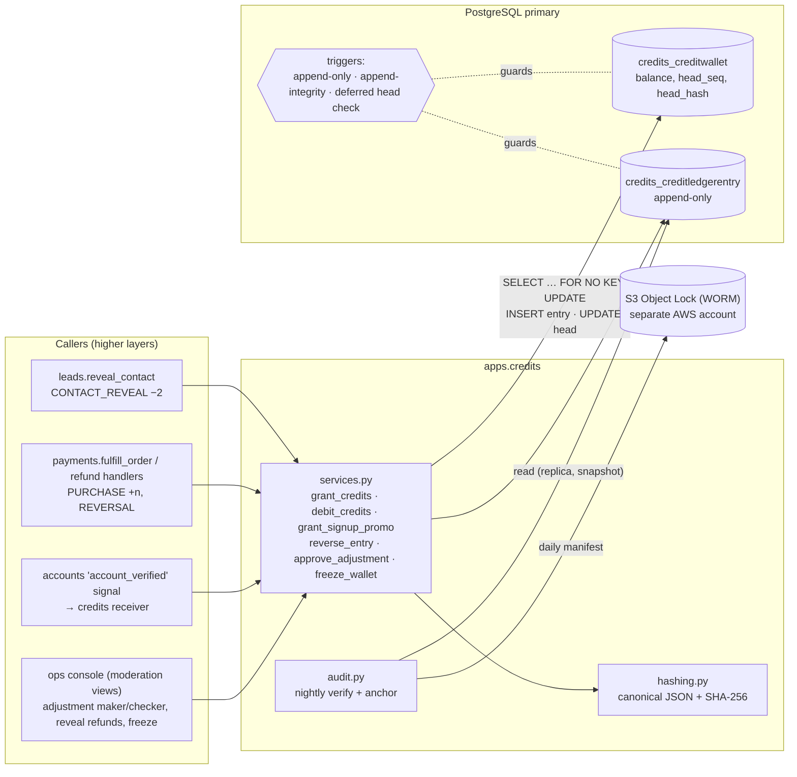
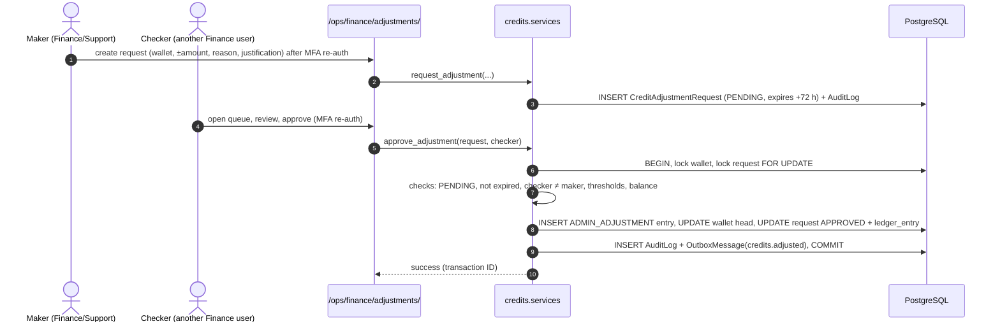
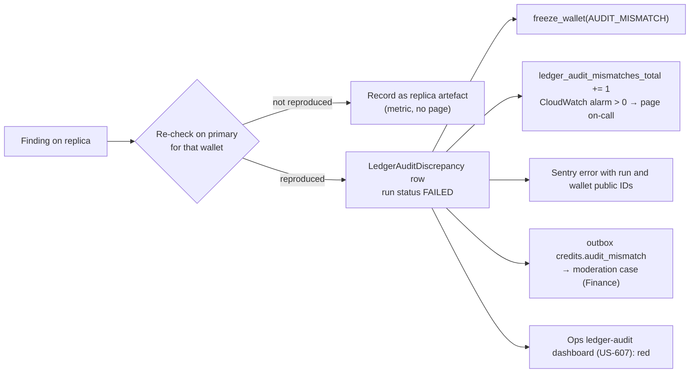

# Credit Wallet and Ledger

How credits are stored, moved, protected and audited: the wallet and append-only ledger, the hash chain, database-level immutability, the exact transactional algorithms for grants, debits, reversals and four-eyes adjustments, the nightly audit, and how the design reaches 1,000 debits per second.

Status: Draft v0.1 (2026-10-21)

| Item | Value |
|---|---|
| Audience | Backend engineers, DBAs, QA, security reviewers, Finance |
| Requirements | FR-CRED-02, FR-CRED-03, FR-CRED-07, FR-AUTH-04, FR-PAY-04.3, FR-PAY-06, FR-OPS-06, NFR-PERF-02, NFR-SEC-02 ([catalog](../requirements/02-requirements-catalog.md)) |
| Schema of record | [01 Domain model §6](01-domain-model.md#6-credits) (fields, constraints, indexes). This document owns **behaviour**: algorithms, triggers, hashing, audit. |
| Related | [03 Contact reveal flow](03-contact-reveal-flow.md) · [04 Identity & access](04-identity-and-access.md) · [Architecture §11, §13](../architecture/01-system-architecture.md#11-data-ownership-and-transaction-boundaries) · [Codebase §12](../architecture/03-codebase-structure.md#12-layering-rules-in-practice-worked-example-show-number) · [Security §4](../quality/01-security-and-compliance.md#4-threat-model-stride) · [NFR performance §6, §9](../quality/02-nfr-performance-and-scalability.md#6-database-scaling) · [Testing strategy §7](../delivery/04-testing-strategy.md#7-concurrency-tests-for-credit-debit) |
| Milestones | M4 (wallet, ledger, chain, promo, debit, audit), M5 (purchase grants, payment reversals), M6 (adjustment and audit UIs), M7 (1,000 TPS verification) |
| ADRs | ADR-0005 (row-locking ledger, no Kafka), ADR-0006 (outbox) |

---

## 1. Scope and requirement trace

| SRS clause (TOC numbering) | What it demands | Where it is met |
|---|---|---|
| §3.3 Initial credit allocation | 10 credits once, "strictly logged internally with metadata (date, source 'promo', quantity, user ID)" | §8.5, §4.1. Trigger and eligibility: [04 §6](04-identity-and-access.md#6-signup-promo-grant) |
| §5.2 Credit check | Check `balance >= 2` atomically with the deduction | §7, §8.3 |
| §5.3 Credit deduction | Immutable ledger with transaction ID, balance before/after, timestamp, property ID, server process ID | §4.2, §5, §6 |
| §6.4 Instant allocation | Purchased credits applied after gateway confirmation | §8.4 (grant primitive). Gateway flow: Payments design (07) |
| §8.2 Concurrency | 1,000 debit transactions/s without inconsistency | §7, §12 |
| §9.2 Credit integrity | Ledger service or cryptographically linked audit trail; regular audits of balance vs ledger; automated alerts | §5, §6, §11 |

Out of scope here: the Show Number UX and email ([03](03-contact-reveal-flow.md)), identity-side promo rules ([04 §6](04-identity-and-access.md#6-signup-promo-grant)), gateway integration and order states (Payments design 07; schema in [01 §8](01-domain-model.md#8-payments)).

---

## 2. Design overview

### 2.1 Principles

| # | Principle | Consequence |
|---|---|---|
| P1 | **The ledger is the source of truth.** `CreditWallet.balance` is a projection of the ledger, updated in the same transaction and checked by the database at commit (§6.3). | A balance can never change without a ledger entry. |
| P2 | **One writer.** Only `apps.credits.services` writes `CreditWallet` and `CreditLedgerEntry` (architecture R3). | Callers (`leads`, `payments`, `moderation`) use the public services. import-linter and a Semgrep rule block direct writes. |
| P3 | **Append-only.** Entries are never updated or deleted. Corrections are new `REVERSAL` or `ADMIN_ADJUSTMENT` entries. | Enforced by trigger and privileges (§6). |
| P4 | **Integer credits, never negative.** | `CHECK (balance >= 0)`. Clawbacks that would go negative are capped and the shortfall is recorded (§9.3). |
| P5 | **Every write is idempotent.** | Unique `idempotency_key` derived from business identity (§4.3). |
| P6 | **One short, synchronous PostgreSQL transaction per operation.** No Kafka, no queue in the debit path (known issue #8, ADR-0005). | The user sees the result in the same request (SRS §5.4). |
| P7 | **Defence in depth.** | Service checks → constraints and triggers → role privileges → hash chain → nightly audit → external WORM anchors. |
| P8 | **Generic consumption.** | A lister-pays `LEAD_UNLOCK` (Open Question #1) is a new entry type and caller, with no schema redesign (FR-CRED-07.4). |

### 2.2 Component view



### 2.3 Defence-in-depth layers

| Layer | Prevents or detects | Section |
|---|---|---|
| Service rules (balance check, idempotency, frozen wallet, four-eyes) | Business-rule violations, double charges | §7, §8, §10 |
| `CHECK` constraints (`balance >= 0`, arithmetic, sign per type) | Negative balances, inconsistent rows even from buggy code | [01 §6](01-domain-model.md#6-credits) |
| Unique constraints (`idempotency_key`, `(wallet_id, seq)`, one promo per wallet) | Duplicates, chain forks | [01 §6.2](01-domain-model.md#62-creditscreditledgerentry-append-only) |
| Triggers (append-only, append-integrity, deferred head check) | Updates or deletes of history; out-of-order appends; balance edits without an entry | §6 |
| Role privileges (`rpl_app` has no `UPDATE`/`DELETE` on the ledger) | Tampering through the application role, including SQL injection | §6.4 |
| Hash chain | Undetected edits by anyone who bypasses the above without recomputing hashes | §5 |
| Nightly audit + cross-reference checks | Drift, forged appends that lack a business record | §11 |
| External WORM anchors | A privileged DB user rewriting a wallet's history and recomputing every hash | §11.4 |

---

## 3. Data model summary

Full definitions are in [01 §6](01-domain-model.md#6-credits). The points that drive behaviour:

| Item | Rule |
|---|---|
| Wallet per user | Exactly one, `UNIQUE (user_id)`. **Created when the account becomes verified**, inside the promo-grant transaction (§8.5). Unverified users have no wallet and `get_balance()` returns 0. |
| Wallet head | `head_seq` and `head_hash` identify the latest entry; `head_seq = 0` and `head_hash = genesis` (§5.3) for a wallet with no entries. |
| Wallet status | `ACTIVE` or `FROZEN` (table below). |
| Ledger entry | Signed integer `amount`, `balance_before`, `balance_after`, contiguous `seq` per wallet, `prev_hash`, `entry_hash`, provenance fields (§4.2). |
| Related tables | `SignupPromoClaim` (anti-farming), `CreditAdjustmentRequest` (maker-checker), `LedgerAuditRun`, `LedgerAuditDiscrepancy`, `LedgerChainCheckpoint`, `LedgerAnchor`. |

**Consistency note:** FR-CRED-07.1 and backlog US-401 say the wallet is "created with the user". [01 §6.1](01-domain-model.md#61-creditscreditwallet) (schema of record) creates it at verification instead, because unverified accounts may not hold transactional value (SRS §3.2). The requirement's intent, no user-visible "wallet setup" step (GAP-53), is fully met. The catalog wording should be aligned in its next revision.

Wallet status semantics:

| Operation | `ACTIVE` | `FROZEN` |
|---|---|---|
| User-initiated debits (`CONTACT_REVEAL`, post-MVP `LEAD_UNLOCK`) | Allowed | **Rejected** with `WalletFrozenError` (no charge) |
| `PURCHASE` grants | Allowed | Allowed (a paid purchase must be honoured; checkout itself can be blocked by `AccountRestriction PURCHASE_BLOCKED`) |
| `REVERSAL`, `ADMIN_ADJUSTMENT` | Allowed | Allowed (corrections and clawbacks must still work) |
| Reading balance and history | Allowed | Allowed, with a banner "Your credits are on hold" |

Freeze reasons (`frozen_reason`): `FRAUD_REVIEW`, `AUDIT_MISMATCH`, `CHARGEBACK`, `STAFF`. Freezing and unfreezing are audited services (§8.6).

---

## 4. Ledger entries: types, provenance and idempotency

### 4.1 Entry types and sign rules

| `entry_type` | Sign | Written by | `reference_type` / `reference_id` | `actor` | Typical `reason_code` | First milestone |
|---|---|---|---|---|---|---|
| `SIGNUP_PROMO` | + (10) | `grant_signup_promo` | `accounts.user` / user public ID | NULL (system) | `SIGNUP_10` (`SIGNUP_<amount>`) | M4 |
| `PURCHASE` | + | `grant_credits`, called by `payments.fulfill_order` | `payments.paymentorder` / order public ID | NULL (system); `metadata.path` = `webhook`, `return` or `reconcile` | none | M5 |
| `CONTACT_REVEAL` | − (2) | `debit_credits`, called by `leads.reveal_contact` | `listings.property` / **property public ID** (SRS §5.3) | the renter | none | M4 |
| `ADMIN_ADJUSTMENT` | ± | `approve_adjustment` (maker-checker, §10) | `credits.creditadjustmentrequest` / request public ID | the approving staff user (checker) | `GOODWILL`, `CORRECTION`, `INVALID_CONTACT_REFUND`, `FRAUD_CLAWBACK`, `LOADTEST` (non-prod only) | M4 (service), M6 (UI) |
| `REVERSAL` | opposite of the original | `reverse_entry` (§9) | `credits.creditledgerentry` / original entry public ID; `reverses_entry` FK set | staff user, or NULL for gateway-driven reversals | `REFUND`, `CHARGEBACK`, `DISPUTE_WON`, `INVALID_CONTACT`, `LISTING_REMOVED`, `PROMO_FRAUD` | M4 (reveal refunds), M5 (payments) |
| *Post-MVP* `LEAD_UNLOCK` | − | `debit_credits`, called by a future `leads.unlock_lead` | `leads.lead` / lead public ID | the lister | none | Post-MVP (OQ #1) |

The sign rule is enforced by `ck_ledger_sign_by_type` ([01 §6.2](01-domain-model.md#62-creditscreditledgerentry-append-only)). Adding a type is a `TextChoices` change, a migration that replaces the `CHECK`, and a new caller. No structural change is needed (FR-CRED-07.4).

### 4.2 Provenance fields

SRS §5.3 asks for "a unique transaction ID, user balance before/after, timestamp, the specific property ID, and the server process ID for financial auditing, non-repudiation, and regulatory traceability".

| SRS item | Column(s) | Notes |
|---|---|---|
| Unique transaction ID | `public_id` (UUID) | Shown to users as "Transaction ID" in history, toasts and emails. The bigint `id` never leaves the database (architecture R10). |
| Balance before / after | `balance_before`, `balance_after` | `CHECK (balance_after = balance_before + amount)` and both `>= 0`. |
| Timestamp | `created_at` (UTC, microseconds) | Set by the service before hashing (§5.4). An insert trigger rejects values more than 5 minutes from database time (§6.2). |
| Property ID | `reference_type = 'listings.property'`, `reference_id = <property public_id>` | Not a foreign key: `credits` and `listings` are same-layer apps and may not reference each other (architecture R1/R4). Referential integrity comes from `ContactReveal` (FKs to both the property and the ledger entry, `PROTECT`) and the `ORPHAN_REFERENCE` audit check (§11.2). |
| Server process ID | `server_process_id` = `"<role>:<ecs-task-id>:<pid>"` | For example `web:9f1c2b3a4d5e6f708192a3b4c5d6e7f8:4127`. The SRS's "process ID" alone is not unique across a fleet; role + task + PID is. |
| (added) Request correlation | `request_id` | HTTP `request_id` from `RequestContextMiddleware`, `celery:<task-id>` for workers, `cli:<uuid>` for management commands. Joins the entry to logs, traces and `AuditLog`. |
| (added) Code version | `app_release` | Git SHA of the image. Answers "which code wrote this row". |
| User ID | `wallet_id` → `user_id`; `actor_id` | `actor` is who initiated the entry (renter, checker, or NULL for system). |

IP address and user agent are **not** stored in the ledger (they are personal data and the ledger is retained for at least 7 years). They live in `AuditLog` and session records under shorter retention ([01 §15](01-domain-model.md#15-data-retention-schedule)).

Process identity is computed once per process:

```python
# apps/core/runtime.py (illustrative)
import functools
import os
import socket

import httpx
from django.conf import settings


@functools.cache
def _task_id() -> str:
    """ECS task ID from the task metadata endpoint v4 (link-local, read once per process). Fallback: hostname."""
    uri = settings.ECS_CONTAINER_METADATA_URI_V4          # read from the environment in settings (rule R12)
    if uri:
        try:
            arn = httpx.get(f"{uri}/task", timeout=0.2).json()["TaskARN"]
            return arn.rsplit("/", 1)[-1]                   # 32 hex characters
        except (httpx.HTTPError, KeyError, ValueError):
            pass
    return socket.gethostname()


def process_identity() -> str:
    # The PID is read on every call, so values stay correct after Gunicorn or Celery forks.
    return f"{settings.PROCESS_ROLE}:{_task_id()}:{os.getpid()}"   # PROCESS_ROLE: web | worker | worker-critical | beat | cli
```

### 4.3 Idempotency keys

| Entry type | Key format | Backstop beyond `UNIQUE (idempotency_key)` |
|---|---|---|
| `SIGNUP_PROMO` | `promo:signup:<user_public_id>` (FR-AUTH-04.2) | Partial unique: one `SIGNUP_PROMO` per wallet; `SignupPromoClaim` unique email and phone HMACs |
| `PURCHASE` | `pay:<gateway>:<gateway_payment_id>` (FR-PAY-04.3), gateway lower-case (`stripe`, `paypal`, `razorpay`) | `PaymentOrder` unique `(gateway, gateway_payment_id)`; `PaymentOrder.ledger_entry` one-to-one |
| `CONTACT_REVEAL` | `reveal:<user_public_id>:<property_public_id>` | `ContactReveal` unique `(user, property)` |
| `ADMIN_ADJUSTMENT` | `adj:<adjustment_request_public_id>` | `CreditAdjustmentRequest.ledger_entry` one-to-one |
| `REVERSAL` | `rev:<original_entry_public_id>:<cause>`, where `<cause>` is one of `refund:<gateway_refund_id>`, `dispute:<gateway_dispute_id>`, `dispute-won:<gateway_dispute_id>`, `reveal-refund`, `promo-fraud`, `listing-removed:<case_public_id>` | Over-reversal check under the wallet lock (§9.2) |
| *Post-MVP* `LEAD_UNLOCK` | `lead:<lister_public_id>:<lead_public_id>` | Unique per lead model |

Rules:

1. **Keys come from business identity, never from a random per-request value.** A random key would let a double click charge twice.
2. ASCII only, at most 200 characters. Public UUIDs, not internal PKs, so keys are stable across environments and readable in support tools. (The illustrative `reveal:{user.id}:{prop.id}` in [codebase §12.4](../architecture/03-codebase-structure.md#124-use-case-service-leadsservicesreveal_contact) is superseded by this format.)
3. The key is checked **after** the wallet lock is taken (§7.2), so the check is race-free. The unique constraint is the last line of defence.
4. A duplicate with the **same** wallet, type and amount returns the original entry with `created=False`. That is not an error; it is the normal outcome of a retry or double click.
5. A duplicate with **different** parameters raises `IdempotencyConflictError`. This always indicates a bug; it is logged at error level and sent to Sentry.

### 4.4 Metadata rules

`metadata` is a flat JSON object that is part of the hash (§5.2), so its shape is restricted to keep serialisation deterministic:

| Rule | Value |
|---|---|
| Keys | `^[a-z][a-z0-9_]{0,39}$` |
| Values | ASCII string ≤ 200 chars, integer with absolute value ≤ 2^53 − 1, boolean, or null. **No floats, no nested objects or arrays** in `hash_version = 1`. |
| Content | IDs, codes and counts only. **No PII** (no emails, phones, names, IPs). |
| Size | `CHECK (pg_column_size(metadata) <= 2048)` ([01 §6.2](01-domain-model.md#62-creditscreditledgerentry-append-only)) |
| Validation | `credits.metadata.validate()` runs in `_append_entry` before hashing |

Examples: `SIGNUP_PROMO` → `{"source": "promo", "quantity": 10}`; `PURCHASE` → `{"path": "webhook", "package": "PACK_50"}`; `REVERSAL` → `{"requested": 50, "shortfall": 12}`; `ADMIN_ADJUSTMENT` → `{"maker": "<staff public_id>", "ticket": "SUP-1234"}`.

---

## 5. Hash-chain specification

### 5.1 Goals and threat model

| The chain detects | The chain alone does not detect | Covered by |
|---|---|---|
| Any change to any hashed field of any entry | A privileged attacker who rewrites a wallet's whole suffix **and** recomputes every hash and the wallet head | External anchors (§11.4) |
| Deletion of an entry; insertion in the middle; reordering | A compromised application that **appends** a well-formed but illegitimate entry (for example a fake `PURCHASE`) | Cross-reference checks (`ORPHAN_REFERENCE`, §11.2) and payment reconciliation (security T-05) |
| Splicing an entry from one wallet into another | | Wallet public ID inside every envelope and the per-wallet genesis (§5.3) |
| A balance edit without an entry | | Deferred head check (§6.3) and `BALANCE_SUM` audit |

Design choices:

| Choice | Decision | Why |
|---|---|---|
| Chain scope | **Per wallet**, not global | A global chain needs a global lock (one hot row), which would cap throughput far below 1,000/s. Per-wallet chains verify in parallel. Global tamper evidence comes from anchoring. |
| Primitive | **SHA-256**, unkeyed | No secret to manage or rotate. Any auditor with read access can verify. Tamper evidence against insiders comes from WORM anchors, not from a secret. An HMAC chain was rejected: the key must live where the app can use it, so it does not stop a compromised app or a DBA with access to secrets, and it adds rotation complexity. |
| Encoding | Canonical JSON (RFC 8785-compatible subset) | Language-neutral, so external auditors can re-implement verification. |

### 5.2 Canonical serialisation

Every entry is hashed from this envelope. **All keys are always present**; empty values are `null`.

| JSON key | Source column | Encoding |
|---|---|---|
| `v` | `hash_version` | integer (`1`) |
| `wallet` | wallet `public_id` | lower-case hyphenated UUID string |
| `seq` | `seq` | integer |
| `txn` | `public_id` | UUID string |
| `type` | `entry_type` | string |
| `reason` | `reason_code` | string or null |
| `amount`, `before`, `after` | `amount`, `balance_before`, `balance_after` | integers |
| `ref_type`, `ref_id` | `reference_type`, `reference_id` | strings |
| `reverses` | `public_id` of `reverses_entry` | UUID string or null |
| `idem` | `idempotency_key` | string |
| `actor` | `public_id` of `actor` | UUID string or null |
| `proc`, `req`, `rel` | `server_process_id`, `request_id`, `app_release` | strings |
| `ts` | `created_at` | UTC, `YYYY-MM-DDTHH:MM:SS.ffffffZ` (always 6 fractional digits) |
| `meta` | `metadata` | flat object (§4.4) |
| `prev` | `prev_hash` | 64 lower-case hex characters |

Not hashed: `id` (assigned by the database) and `entry_hash` (the output).

Serialisation and hash:

```python
# apps/credits/hashing.py
import hashlib
import json
from datetime import UTC, datetime

ENTRY_PREFIX = b"rpl-ledger-entry:v1\n"
GENESIS_PREFIX = "rpl-ledger-genesis:v1\n"


def canonical_bytes(envelope: dict) -> bytes:
    # sort_keys + compact separators + ASCII escaping = byte-stable output.
    # For our value domain (ASCII keys, integers within ±2^53, no floats) this equals RFC 8785 JCS.
    return json.dumps(envelope, sort_keys=True, separators=(",", ":"),
                      ensure_ascii=True, allow_nan=False).encode("ascii")


def format_ts(value: datetime) -> str:
    if value.tzinfo is None:
        raise ValueError("created_at must be timezone-aware")
    return value.astimezone(UTC).strftime("%Y-%m-%dT%H:%M:%S.%fZ")


def entry_hash(envelope: dict) -> str:
    return hashlib.sha256(ENTRY_PREFIX + canonical_bytes(envelope)).hexdigest()


def genesis_hash(wallet_public_id: str) -> str:
    return hashlib.sha256((GENESIS_PREFIX + wallet_public_id).encode("utf-8")).hexdigest()
```

`prev` is inside the JSON object rather than concatenated in front of it, so there is exactly one unambiguous encoding. NFR-SEC-02.2 writes the rule as `SHA256(prev_hash ‖ canonical(entry))`; this specification implements that intent and is authoritative.

### 5.3 Genesis

```text
genesis(wallet) = SHA-256( "rpl-ledger-genesis:v1\n" || wallet.public_id )   -- hex, lower case
```

- Written to `CreditWallet.head_hash` when the wallet is created. It is the `prev_hash` of the wallet's entry with `seq = 1`.
- It is per wallet, so an entry copied from another wallet can never link.
- SQL equivalent, used by the deferred trigger (§6.3): `encode(sha256(convert_to('rpl-ledger-genesis:v1' || chr(10) || public_id::text, 'UTF8')), 'hex')`. PostgreSQL `uuid::text` and Python `str(UUID)` both produce lower-case hyphenated form.

### 5.4 Computing the hash on write

Inside the locked transaction (§8.2):

1. Set `created_at = timezone.now()` (microsecond precision, UTC).
2. Build the envelope from exactly the values about to be inserted, including `prev = wallet.head_hash` and `seq = wallet.head_seq + 1`.
3. Compute `entry_hash`.
4. `INSERT` the entry with `force_insert=True` (no database defaults may alter hashed values).
5. Update the wallet head to `(balance_after, seq, entry_hash)`.

PostgreSQL `timestamptz` and Python `datetime` both have microsecond precision, so the stored value re-hashes identically. A unit test reloads every written entry and recomputes its hash, which catches any serialisation drift (for example a column default added later).

### 5.5 Verification algorithm

```python
# apps/credits/audit.py (illustrative)
from dataclasses import dataclass, field


@dataclass(frozen=True)
class Finding:
    check_code: str            # values from LedgerAuditDiscrepancy.check_code (01 §6.5)
    seq: int | None
    details: dict = field(default_factory=dict)


def verify_wallet_chain(wallet, entries, start=None) -> list[Finding]:
    """`entries` is streamed ORDER BY seq (pages of 5,000), each row carrying actor/reverses public IDs.
    `start` is the LedgerChainCheckpoint for incremental runs, or None for a full run from genesis."""
    out: list[Finding] = []
    exp_seq = (start.verified_seq if start else 0) + 1
    exp_prev = start.verified_hash if start else genesis_hash(str(wallet.public_id))
    exp_before = start.balance_after if start else 0

    for e in entries:
        if e.seq != exp_seq:
            out.append(Finding("SEQ_GAP", e.seq, {"expected": exp_seq}))
        if e.prev_hash != exp_prev:
            out.append(Finding("PREV_HASH", e.seq))
        if (e.balance_before != exp_before or e.balance_after != e.balance_before + e.amount
                or e.balance_after < 0):
            out.append(Finding("ARITHMETIC", e.seq, {"expected_before": exp_before}))
        if entry_hash(envelope_from_row(e, wallet_public_id=str(wallet.public_id))) != e.entry_hash:
            out.append(Finding("ENTRY_HASH", e.seq))
        exp_seq, exp_prev, exp_before = e.seq + 1, e.entry_hash, e.balance_after  # resynchronise

    if wallet.head_seq != exp_seq - 1:
        out.append(Finding("HEAD_SEQ", None, {"wallet": wallet.head_seq, "ledger": exp_seq - 1}))
    if wallet.head_hash != exp_prev:
        out.append(Finding("HEAD_HASH", None))
    if wallet.balance != exp_before or wallet.balance != wallet.ledger_sum:   # ledger_sum = SELECT sum(amount)
        out.append(Finding("BALANCE_SUM", None, {"balance": wallet.balance, "sum": wallet.ledger_sum}))
    return out
```

- **Full mode** starts from genesis and also compares `SUM(amount)` computed independently in SQL (the SRS's "compare the user's live balance against the historical ledger").
- **Incremental mode** starts from `LedgerChainCheckpoint (verified_seq, verified_hash)` and only reads newer entries. The checkpoint is advanced only when a wallet has no findings.
- The audit reads with a `REPEATABLE READ READ ONLY` snapshot per batch of wallets, so wallet heads and entries are mutually consistent even while writes continue.

### 5.6 Versioning and golden vectors

- `hash_version` is stored per entry. Adding a hashed field means a new envelope version (`v = 2`) for **new** entries only. Old entries keep verifying under v1, and the verifier dispatches on `v`.
- The v1 code path is frozen. Any change to `hashing.py` must keep the golden-vector test green.
- New ledger columns must be nullable or have a constant default, and are excluded from v1 envelopes ([01 §16](01-domain-model.md#16-database-conventions-and-raw-sql-migrations)).

Golden vectors (computed with the code above; the CI test asserts them byte for byte):

| Vector | Input | Expected SHA-256 |
|---|---|---|
| G1 genesis | wallet `0b8f6c1e-5d2a-4c3b-9e7f-1a2b3c4d5e6f` | `1cc46917ee1b014d888c57fec5946bc0f2910f9b2a0e8e636f9cc6f3e9e76e2b` |
| G2 entry seq 1 | envelope below (`SIGNUP_PROMO`, +10, `prev` = G1) | `4c6ad3b69bb8edb6db7f630ec2ea56ea5cf48929e47c16d90398b79b1575f522` |
| G3 entry seq 2 | `CONTACT_REVEAL`, −2, before 10, after 8, `prev` = G2, `txn` `a7b8c9d0-e1f2-4a3b-8c4d-5e6f7a8b9c0d`, `ref_id` `c1d2e3f4-a5b6-4c7d-8e9f-0a1b2c3d4e5f`, `actor` = user, `proc` `web:9f1c…e7f8:4131`, `req` `req-01J9ZK7B2N5R8W1Y`, `ts` `2026-10-21T09:17:44.000918Z`, `meta` `{}` | `7f1328f7a898ba0c349dbcc41b16af2b2e99a31acadd3fa3f204d33ae5a2a75c` |
| G4 tamper | G2 with `amount` changed to 100 | `c8283a2a4c5d5129b3b1f0ccaf364d2d9a386c6081a0caeffb36be932adaf5e2` (must differ from G2) |

Canonical bytes of G2 (one line; the hash input is `rpl-ledger-entry:v1\n` followed by these bytes):

```json
{"actor":null,"after":10,"amount":10,"before":0,"idem":"promo:signup:7d3e2f10-8a4b-4c6d-a1e2-f3a4b5c6d7e8","meta":{"source":"promo"},"prev":"1cc46917ee1b014d888c57fec5946bc0f2910f9b2a0e8e636f9cc6f3e9e76e2b","proc":"web:9f1c2b3a4d5e6f708192a3b4c5d6e7f8:4127","reason":"SIGNUP_10","ref_id":"7d3e2f10-8a4b-4c6d-a1e2-f3a4b5c6d7e8","ref_type":"accounts.user","rel":"3c9e1f2","req":"req-01J9ZK4Q8T6M2V3X","reverses":null,"seq":1,"ts":"2026-10-21T09:15:02.123456Z","txn":"5f0c9a2e-3b1d-4e8f-9a6b-2c7d1e0f3a4b","type":"SIGNUP_PROMO","v":1,"wallet":"0b8f6c1e-5d2a-4c3b-9e7f-1a2b3c4d5e6f"}
```

(The full G3 envelope is kept in `apps/credits/tests/vectors.json`, which is the single source for both the Python test and any external auditor's verifier.)

---

## 6. Database-level immutability and invariants

All SQL below ships in `RunSQL` migrations with reverse SQL ([01 §16](01-domain-model.md#16-database-conventions-and-raw-sql-migrations)). It is owned by `rpl_migrator`.

### 6.1 Append-only trigger

```sql
CREATE FUNCTION credits_ledger_block_mutation() RETURNS trigger
LANGUAGE plpgsql AS $$
BEGIN
  RAISE EXCEPTION 'credits_creditledgerentry is append-only (% blocked)', TG_OP
    USING ERRCODE = 'insufficient_privilege';
END $$;

CREATE TRIGGER trg_ledger_no_update_delete
  BEFORE UPDATE OR DELETE ON credits_creditledgerentry
  FOR EACH ROW EXECUTE FUNCTION credits_ledger_block_mutation();

CREATE TRIGGER trg_ledger_no_truncate
  BEFORE TRUNCATE ON credits_creditledgerentry
  FOR EACH STATEMENT EXECUTE FUNCTION credits_ledger_block_mutation();

-- Fire even when a session sets session_replication_role = replica.
ALTER TABLE credits_creditledgerentry ENABLE ALWAYS TRIGGER trg_ledger_no_update_delete;
ALTER TABLE credits_creditledgerentry ENABLE ALWAYS TRIGGER trg_ledger_no_truncate;
```

The trigger applies to **every** role, including the owner. Disabling or dropping it is DDL, which `pgaudit` logs and CloudWatch alarms on ([01 §16](01-domain-model.md#16-database-conventions-and-raw-sql-migrations)).

### 6.2 Append-integrity trigger

Even if application code forgets the lock or computes a wrong head, the database refuses an entry that does not extend the chain exactly.

```sql
CREATE FUNCTION credits_ledger_before_insert() RETURNS trigger
LANGUAGE plpgsql AS $$
DECLARE
  w RECORD;
BEGIN
  -- Same lock mode as the service; a no-op if this transaction already holds it.
  SELECT balance, head_seq, head_hash INTO w
    FROM credits_creditwallet WHERE id = NEW.wallet_id
    FOR NO KEY UPDATE;
  IF NOT FOUND THEN
    RAISE EXCEPTION 'ledger insert: wallet % not found', NEW.wallet_id USING ERRCODE = 'foreign_key_violation';
  END IF;
  IF NEW.seq <> w.head_seq + 1 THEN
    RAISE EXCEPTION 'ledger insert: seq % does not extend head %', NEW.seq, w.head_seq USING ERRCODE = 'check_violation';
  END IF;
  IF NEW.prev_hash <> w.head_hash THEN
    RAISE EXCEPTION 'ledger insert: prev_hash does not match wallet head' USING ERRCODE = 'check_violation';
  END IF;
  IF NEW.balance_before <> w.balance THEN
    RAISE EXCEPTION 'ledger insert: balance_before % <> wallet balance %', NEW.balance_before, w.balance USING ERRCODE = 'check_violation';
  END IF;
  IF abs(extract(epoch FROM (NEW.created_at - clock_timestamp()))) > 300 THEN
    RAISE EXCEPTION 'ledger insert: created_at outside ±5 min of DB time' USING ERRCODE = 'check_violation';
  END IF;
  RETURN NEW;
END $$;

CREATE TRIGGER trg_ledger_before_insert
  BEFORE INSERT ON credits_creditledgerentry
  FOR EACH ROW EXECUTE FUNCTION credits_ledger_before_insert();
```

The trigger does not recompute `entry_hash`: that would mean re-implementing canonical JSON in SQL, which is fragile. The nightly audit verifies hashes (§11).

### 6.3 Deferred consistency trigger (wallet ↔ ledger)

At commit, every wallet touched by the transaction must point at its newest ledger entry, and its balance must equal that entry's `balance_after`. This makes `UPDATE credits_creditwallet SET balance = 1000` impossible without a matching entry, and makes an entry without a wallet-head update impossible.

```sql
CREATE FUNCTION credits_assert_wallet_head(p_wallet_id bigint) RETURNS void
LANGUAGE plpgsql AS $$
DECLARE
  w RECORD;
  e RECORD;
BEGIN
  SELECT id, public_id, balance, head_seq, head_hash INTO w
    FROM credits_creditwallet WHERE id = p_wallet_id;           -- final state at commit
  IF w.head_seq = 0 THEN
    IF w.balance <> 0
       OR w.head_hash <> encode(sha256(convert_to('rpl-ledger-genesis:v1' || chr(10) || w.public_id::text, 'UTF8')), 'hex')
       OR EXISTS (SELECT 1 FROM credits_creditledgerentry WHERE wallet_id = w.id) THEN
      RAISE EXCEPTION 'wallet % genesis state invalid', w.public_id USING ERRCODE = 'check_violation';
    END IF;
    RETURN;
  END IF;
  SELECT balance_after, entry_hash INTO e
    FROM credits_creditledgerentry WHERE wallet_id = w.id AND seq = w.head_seq;
  IF NOT FOUND OR e.balance_after <> w.balance OR e.entry_hash <> w.head_hash
     OR EXISTS (SELECT 1 FROM credits_creditledgerentry WHERE wallet_id = w.id AND seq > w.head_seq) THEN
    RAISE EXCEPTION 'wallet % head inconsistent with ledger', w.public_id USING ERRCODE = 'check_violation';
  END IF;
END $$;

CREATE FUNCTION credits_trg_wallet_head_from_wallet() RETURNS trigger LANGUAGE plpgsql AS $$
BEGIN PERFORM credits_assert_wallet_head(NEW.id); RETURN NULL; END $$;

CREATE FUNCTION credits_trg_wallet_head_from_entry() RETURNS trigger LANGUAGE plpgsql AS $$
BEGIN PERFORM credits_assert_wallet_head(NEW.wallet_id); RETURN NULL; END $$;

CREATE CONSTRAINT TRIGGER trg_wallet_head_consistent
  AFTER INSERT OR UPDATE ON credits_creditwallet
  DEFERRABLE INITIALLY DEFERRED
  FOR EACH ROW EXECUTE FUNCTION credits_trg_wallet_head_from_wallet();

CREATE CONSTRAINT TRIGGER trg_entry_advances_wallet_head
  AFTER INSERT ON credits_creditledgerentry
  DEFERRABLE INITIALLY DEFERRED
  FOR EACH ROW EXECUTE FUNCTION credits_trg_wallet_head_from_entry();
```

A wallet guard trigger (`BEFORE UPDATE ON credits_creditwallet`) additionally rejects changes to `id`, `public_id`, `user_id` and `created_at`, and any decrease of `head_seq`.

Cost: two index lookups on `(wallet_id, seq)` per touched wallet at commit, negligible next to the commit itself.

### 6.4 Privileges

```sql
REVOKE ALL ON credits_creditledgerentry FROM PUBLIC;
GRANT SELECT, INSERT ON credits_creditledgerentry TO rpl_app;                 -- no UPDATE, DELETE, TRUNCATE
GRANT SELECT ON credits_creditledgerentry TO rpl_readonly;                    -- replica: audit, support reports
GRANT USAGE ON SEQUENCE credits_creditledgerentry_id_seq TO rpl_app;          -- identity column

REVOKE ALL ON credits_creditwallet FROM PUBLIC;
GRANT SELECT, INSERT ON credits_creditwallet TO rpl_app;
GRANT UPDATE (balance, head_seq, head_hash, status, frozen_reason, frozen_at, frozen_by_id, updated_at)
  ON credits_creditwallet TO rpl_app;                                         -- column-level; no DELETE
GRANT SELECT ON credits_creditwallet TO rpl_readonly;
-- rpl_maintenance (retention purges) gets nothing on credits tables.
```

Column-level `UPDATE` means services must use `QuerySet.update()` or `save(update_fields=[...])`; a plain `save()` would try to write `user_id` and fail. That is intentional.

### 6.5 Invariant catalogue

| ID | Invariant | Prevented by | Detected by |
|---|---|---|---|
| I-01 | `wallet.balance >= 0` | `CHECK` | Audit `ARITHMETIC` |
| I-02 | `balance_after = balance_before + amount`, both `>= 0`, `amount <> 0` | `CHECK` | Audit `ARITHMETIC` |
| I-03 | Sign matches type | `ck_ledger_sign_by_type` | — |
| I-04 | `seq` contiguous from 1 per wallet | Unique `(wallet_id, seq)` + §6.2 | `SEQ_GAP` |
| I-05 | `prev_hash` of `seq = n` equals `entry_hash` of `seq = n − 1` (genesis for `n = 1`) | §6.2 | `PREV_HASH` |
| I-06 | `entry_hash` = SHA-256 of the canonical envelope | Service | `ENTRY_HASH` |
| I-07 | Wallet head = newest entry; `balance` = its `balance_after` | §6.3 | `HEAD_SEQ`, `HEAD_HASH`, `BALANCE_SUM` |
| I-08 | `balance = SUM(amount)` | I-02 + I-04 + I-07 | `BALANCE_SUM` |
| I-09 | Entries are never updated or deleted | §6.1 + §6.4 | pgaudit DDL alarm; anchors |
| I-10 | At most one `SIGNUP_PROMO` per wallet; one promo per verified identity | Partial unique; `SignupPromoClaim` unique HMACs | — |
| I-11 | Every `CONTACT_REVEAL` entry has exactly one `ContactReveal`; every `PURCHASE` has one fulfilled `PaymentOrder`; every `ADMIN_ADJUSTMENT` has one approved `CreditAdjustmentRequest` | Same-transaction writes + one-to-one FKs | `ORPHAN_REFERENCE` |
| I-12 | Net reversed amount of an entry never exceeds its absolute amount | Service under wallet lock (§9.2) | `ORPHAN_REFERENCE` (over-reversal variant) |
| I-13 | Anchored `(wallet, seq, hash)` still present | — | `ANCHOR_MISMATCH` |
| I-14 | `LOADTEST` entries never exist in production | Settings guard in the seeding command | `ORPHAN_REFERENCE` (SEV1 in prod) |

---

## 7. Concurrency design

### 7.1 Options considered

| Option | Correct under concurrency? | Behaviour on a hot wallet | Fits the hash chain? | Verdict |
|---|---|---|---|---|
| **A. `SELECT … FOR NO KEY UPDATE` on the wallet, then insert entry and update head** | Yes: one row lock serialises writers of that wallet | Waiters queue; `lock_timeout` bounds the wait | Yes: `balance`, `head_seq`, `head_hash` are read under the same lock | **Chosen** |
| B. Conditional `UPDATE … SET balance = balance − 2 WHERE id = :id AND balance >= 2 RETURNING …` | Yes (same row lock, taken by the `UPDATE`) | Same as A | Partly: the new `head_hash` depends on the old head, so a **second** `UPDATE` of the same row is needed after hashing; "0 rows" is ambiguous (insufficient vs frozen vs missing) without an extra read | Rejected as primary; equivalent safety, more writes, worse errors |
| C. Optimistic locking (`version` column, retry on conflict) | Yes | Many retries under contention (double clicks); wasted work | Yes | Rejected: retries are more code and more latency for no gain |
| D. `SERIALIZABLE` isolation | Yes | Serialization failures (`40001`) must be retried; SSI predicate-lock overhead on every transaction | Yes | Rejected: protects against anomalies that cannot occur in a single-row read-modify-write under a row lock |
| E. Advisory locks per wallet | Yes if always used | Same as A | Yes | Rejected: invisible to the schema, easy to forget, and session-level advisory locks break under transaction pooling |
| F. Queue (Kafka) with a single consumer per wallet partition | Yes | Asynchronous: the user cannot see the number in the same request (SRS §5.4) | Yes | Rejected: a second system of record and new failure modes for a throughput PostgreSQL already handles (known issue #8) |

### 7.2 Decision: pessimistic wallet row lock

**Primary mechanism: `select_for_update(no_key=True)` on the wallet row (`SELECT … FOR NO KEY UPDATE`), inside one short `READ COMMITTED` transaction.**

Why this is the right primary choice:

1. **The hash chain needs a consistent read of three columns.** `balance`, `head_seq` and `head_hash` must all be read under the lock that is held until the entry and the new head commit. Option A does that in one statement. Option B would update the row twice.
2. **Clear domain errors.** The service sees the actual balance and status, so it can raise `InsufficientCreditsError(balance=1, required=2)` or `WalletFrozenError` instead of interpreting "0 rows updated".
3. **Same lock duration as B.** In both A and B the row lock is held from the first statement until commit, so contention and throughput are identical.
4. **`NO KEY UPDATE`, not `UPDATE`.** The wallet update never changes a key column. `FOR NO KEY UPDATE` does not conflict with the `FOR KEY SHARE` locks that foreign-key checks take when other tables (for example `CreditAdjustmentRequest`) insert rows referencing the wallet, so unrelated inserts never wait on a busy wallet. It is also exactly the lock level the subsequent `UPDATE` takes, so there is no lock upgrade.

```python
# apps/credits/services.py (excerpt)
def _lock_wallet(*, user_id: int | None = None, wallet_id: int | None = None) -> CreditWallet:
    qs = CreditWallet.objects.select_for_update(no_key=True)
    try:
        return qs.get(user_id=user_id) if user_id is not None else qs.get(pk=wallet_id)
    except CreditWallet.DoesNotExist:
        raise WalletNotFoundError() from None
```

**Consistency note:** backlog US-402 describes the conditional `UPDATE` (option B) and FR-CRED-02.2 allows either. This document fixes option A as the implementation; both meet the requirement. US-402's wording should be aligned.

### 7.3 Why READ COMMITTED is sufficient

- In PostgreSQL, when a `SELECT … FOR NO KEY UPDATE` waits for another transaction holding the row lock, it re-reads the **latest committed version** of the row once the lock is released, and re-checks its `WHERE` clause against that version. The second debit therefore sees the balance after the first debit. "Check then debit" is atomic for that wallet.
- Every later statement in a `READ COMMITTED` transaction takes a fresh snapshot, so the idempotency lookup made **after** the lock sees an entry committed by the transaction that held the lock before. That is what makes double-click handling race-free (§8.3).
- The only shared mutable state in a debit is one wallet row. There are no predicates over multiple rows whose combined result must stay stable, which is the class of anomaly (write skew) that `SERIALIZABLE` exists to prevent.
- Reads outside the lock are deliberately lag-tolerant: the property's `PUBLISHED` status and the contact snapshot are read before the transaction. If the lister unlists the property a few milliseconds later, the reveal still happened while it was published, which is acceptable.
- Constraints remain the backstop: even a code path that skipped the lock cannot commit a negative balance (I-01), a broken chain (§6.2) or a double charge (unique keys).

### 7.4 Lock order and deadlock avoidance

Fixed global order, extending engineering standard TX-5 with the credits tables:

```text
accounts.User → credits.CreditWallet → credits.CreditAdjustmentRequest → listings.Property
  → leads.ContactReveal → payments.PaymentOrder → core.OutboxMessage
```

| Rule | Detail |
|---|---|
| L1 | **At most one wallet per transaction.** There are no credit transfers between users. If one is ever added, lock both wallets in ascending `id` order. |
| L2 | The wallet is locked **before** any later row in the order. A caller that must lock a domain row of its own (for example `PaymentOrder` to serialise webhook vs return-URL fulfilment) first calls `credits.services.lock_wallet(user_id=…)`, then locks its row, then calls `grant_credits` (which re-acquires the already-held lock instantly). |
| L3 | `accounts.User` is locked (no-key) only by `grant_signup_promo`, to serialise concurrent first verified logins of one user (§8.5). |
| L4 | No network I/O and no `sleep` inside the transaction (TX-2). Transaction target < 50 ms. |
| L5 | Foreign-key checks take `FOR KEY SHARE`, which does not conflict with `FOR NO KEY UPDATE` (§7.2), so FK checks cannot join a deadlock cycle with wallet locks. |

Verification: testing-strategy scenario C-07 (reveal + adjustment + refund reversal on one wallet, 200 iterations, zero deadlocks) and the production metric `db_deadlocks_total` (any value pages the on-call).

### 7.5 Timeouts and retry policy

| Setting | Value | Where |
|---|---|---|
| `lock_timeout` | **2 s** | `core.db.set_local("lock_timeout", "2s")` inside every credits transaction. It uses `set_config(…, true)`, which is transaction-scoped and safe behind a transaction-mode pooler (§12.4). |
| `statement_timeout` | 5 s | Role default ([01 §16](01-domain-model.md#16-database-conventions-and-raw-sql-migrations)) |
| `idle_in_transaction_session_timeout` | 10 s | Role default |

Retries happen **only at the outermost use-case boundary** (`leads.reveal_contact`, `payments.fulfill_order`, `credits.approve_adjustment`, the promo receiver), never inside an atomic block. Because every operation is idempotent (§4.3), re-running the whole transaction is always safe, including when a connection drops during `COMMIT` and the outcome is unknown.

| SQLSTATE / error | Meaning | Retry? |
|---|---|---|
| `40P01` deadlock_detected | Should not happen (§7.4) | Yes, up to 3 attempts; each occurrence is also counted and alerted |
| `40001` serialization_failure | Not expected at `READ COMMITTED`; defensive | Yes, up to 3 attempts |
| `55P03` lock_not_available (`lock_timeout`) | Hot wallet: the same user has another request in flight for 2 s | **No.** Return "Please try again. You have not been charged." |
| `08xxx` connection failure / `InterfaceError` | Failover or network blip; commit outcome may be unknown | Yes, once, after reconnect; idempotency resolves the unknown outcome |
| `23505` on `uq_promo_claim_*` | Two accounts claimed the same promo identity concurrently | Yes, once (the retry sees the claim and returns "ineligible") |
| Trigger `23514` check_violation from §6.2/§6.3 | A bug: the service wrote an inconsistent head | **No.** HTTP 500, Sentry, rolled back |

```python
# apps/core/db.py (illustrative)
import random
import time
from functools import wraps

from django.db import DatabaseError, connection

RETRYABLE = {"40P01": 3, "40001": 3}


def retry_on_transient_db_errors(fn):
    @wraps(fn)
    def wrapper(*args, **kwargs):
        if connection.in_atomic_block:
            raise RuntimeError(f"{fn.__name__} must be called outside a transaction")
        attempt = 0
        while True:
            attempt += 1
            try:
                return fn(*args, **kwargs)
            except DatabaseError as exc:
                code = getattr(getattr(exc, "__cause__", None), "sqlstate", None)
                limit = RETRYABLE.get(code, 2 if _is_connection_error(exc) else 1)
                if attempt >= limit:
                    raise
                metrics.credit_txn_retries_total.add(1, {"sqlstate": code or "connection"})
                time.sleep(random.uniform(0, 0.025 * 2 ** attempt))   # full jitter: ≤ 50 ms, ≤ 100 ms
    return wrapper
```

Use-case services also open their transaction with `transaction.atomic(durable=True)`, which raises if someone accidentally nests them inside another transaction (Django's `TestCase` handles durable blocks correctly).

---

## 8. Service algorithms

### 8.1 Service API

| Function (`apps.credits.services`) | Purpose | Notes |
|---|---|---|
| `create_wallet(*, user_id) -> WalletDTO` | Idempotent wallet creation with genesis head | Called by `grant_signup_promo`; never by views |
| `lock_wallet(*, user_id) -> None` | Take the wallet lock early (rule L2) | Must be inside the caller's transaction |
| `grant_credits(*, user_id, amount, entry_type, reference, idempotency_key, reason_code=None, metadata=None, actor_id=None, ctx) -> LedgerResult` | Positive entries: `PURCHASE`, `ADMIN_ADJUSTMENT` (+), post-MVP bonus types | `amount > 0` |
| `debit_credits(*, user_id, amount, entry_type, reference, idempotency_key, reason_code=None, metadata=None, actor_id=None, ctx) -> LedgerResult` | Negative entries: `CONTACT_REVEAL`, `ADMIN_ADJUSTMENT` (−), post-MVP `LEAD_UNLOCK` | `amount > 0` is the number of credits to remove |
| `grant_signup_promo(*, user_id, ctx) -> PromoResult` | Exactly-once 10-credit grant | §8.5 |
| `reverse_entry(*, original_public_id, cause, reason_code, amount=None, allow_shortfall=False, actor_id=None, ctx) -> ReversalResult` | Reversals | §9 |
| `request_adjustment(...)`, `approve_adjustment(...)`, `reject_adjustment(...)`, `cancel_adjustment(...)`, `expire_adjustments()` | Maker-checker | §10 |
| `freeze_wallet(...)`, `unfreeze_wallet(...)` | Status changes | §8.6 |
| `audit_wallets(*, mode, wallet_ids=None)`, `anchor_ledger()` | Integrity jobs | §11 |

| Selector (`apps.credits.selectors`) | Purpose |
|---|---|
| `get_balance(*, user_id) -> int` | One primary-key read on the **primary**; 0 when no wallet. Never cached in shared stores. |
| `list_ledger_entries(*, user_id, types=None, date_from=None, date_to=None, cursor=None, limit=25)` | Keyset pagination on `(wallet_id, seq DESC)`; read from the primary (read-your-writes) |
| `get_wallet_summary(*, user_id)` | Balance, status, totals per type (ops console) |

DTOs (`apps.credits.types`): `LedgerRef(type: str, id: str)`, `OpContext(request_id: str, actor_id: int | None)`, `LedgerResult(entry_public_id, entry_id, seq, amount, balance_after, created: bool)`.

Exceptions (`apps.credits.exceptions`, all `DomainError`): `InsufficientCreditsError(balance, required)`, `WalletFrozenError(reason)`, `WalletNotFoundError`, `IdempotencyConflictError`, `NotReversibleError`, `OverReversalError`, `FourEyesViolationError`, `AdjustmentNotPendingError`, `AdjustmentLimitError`.

**Transaction rule for these primitives:** `grant_credits`, `debit_credits` and `reverse_entry` use `transaction.atomic(savepoint=False)`. Called from a use case, they join its transaction with no savepoint round trips. Called alone, they open their own. Because there is no savepoint, **a caller must never catch a credits exception and continue in the same transaction**: the exception aborts the whole use case, which is the intended behaviour.

### 8.2 Shared append helper

```python
# apps/credits/services.py (excerpt; the only code that inserts ledger rows)
def _append_entry(*, wallet: CreditWallet, amount: int, entry_type: str, reference: LedgerRef,
                  idempotency_key: str, reason_code: str | None, metadata: dict | None,
                  actor_id: int | None, reverses: CreditLedgerEntry | None, ctx: OpContext) -> CreditLedgerEntry:
    meta = validate_metadata(metadata or {})
    now = timezone.now()
    seq = wallet.head_seq + 1
    before = wallet.balance
    after = before + amount
    if after < 0:
        raise InsufficientCreditsError(balance=before, required=-amount)      # CHECK is the backstop
    entry = CreditLedgerEntry(
        public_id=uuid4(), wallet=wallet, seq=seq, entry_type=entry_type, reason_code=reason_code,
        amount=amount, balance_before=before, balance_after=after,
        reference_type=reference.type, reference_id=reference.id, reverses_entry=reverses,
        idempotency_key=idempotency_key, actor_id=actor_id,
        server_process_id=process_identity(), request_id=ctx.request_id,
        app_release=settings.APP_RELEASE, metadata=meta, hash_version=1,
        prev_hash=wallet.head_hash, created_at=now,
    )
    entry.entry_hash = entry_hash(build_envelope(entry, wallet_public_id=str(wallet.public_id)))
    entry.save(force_insert=True)                                              # §6.2 trigger validates
    CreditWallet.objects.filter(pk=wallet.pk).update(                          # HOT update (no indexed column)
        balance=after, head_seq=seq, head_hash=entry.entry_hash, updated_at=now)
    wallet.balance, wallet.head_seq, wallet.head_hash = after, seq, entry.entry_hash
    return entry                                                               # §6.3 checks the head at COMMIT
```

`build_envelope` needs the actor's and reversed entry's public IDs. The service passes them in from objects it already holds, so no extra query is made.

### 8.3 `debit_credits`

```python
@transaction.atomic(savepoint=False)
def debit_credits(*, user_id: int, amount: int, entry_type: str, reference: LedgerRef,
                  idempotency_key: str, reason_code: str | None = None, metadata: dict | None = None,
                  actor_id: int | None = None, ctx: OpContext) -> LedgerResult:
    if amount <= 0 or entry_type not in DEBIT_TYPES:
        raise ValueError("invalid debit")
    set_local("lock_timeout", "2s")

    wallet = _lock_wallet(user_id=user_id)                                  # 1. serialise this wallet only

    existing = CreditLedgerEntry.objects.filter(idempotency_key=idempotency_key).first()
    if existing is not None:                                                # 2. after the lock: race-free
        _assert_same_request(existing, wallet=wallet, amount=-amount, entry_type=entry_type)
        return LedgerResult.from_entry(existing, created=False, balance_after=wallet.balance)

    if wallet.status == WalletStatus.FROZEN and entry_type in USER_INITIATED_DEBITS:
        raise WalletFrozenError(reason=wallet.frozen_reason)                # 3. no charge
    if wallet.balance < amount:
        raise InsufficientCreditsError(balance=wallet.balance, required=amount)   # 4. SRS §5.2

    entry = _append_entry(wallet=wallet, amount=-amount, entry_type=entry_type, reference=reference,
                          idempotency_key=idempotency_key, reason_code=reason_code, metadata=metadata,
                          actor_id=actor_id, reverses=None, ctx=ctx)
    return LedgerResult.from_entry(entry, created=True, balance_after=wallet.balance)
```

Order matters: the idempotency check comes **before** the balance check. A second click whose first click already spent the last 2 credits must return "already revealed, no charge", not "insufficient credits".

Statements for one reveal (inside the use case in [03 §6.2](03-contact-reveal-flow.md#62-service-leadsservicesreveal_contact)):

```sql
SELECT set_config('lock_timeout', '2s', true);
SELECT … FROM credits_creditwallet WHERE user_id = $1 FOR NO KEY UPDATE;
SELECT … FROM credits_creditledgerentry WHERE idempotency_key = $1 LIMIT 1;
INSERT INTO credits_creditledgerentry (…) VALUES (…);          -- + BEFORE INSERT trigger (one PK lookup)
UPDATE credits_creditwallet SET balance = …, head_seq = …, head_hash = …, updated_at = … WHERE id = $1;
INSERT INTO leads_contactreveal (…) VALUES (…);
INSERT INTO core_outboxmessage (…) VALUES (…);
COMMIT;                                                         -- + deferred head checks
```

### 8.4 `grant_credits`

Identical structure to `debit_credits` without the balance and frozen checks, plus an upper bound: `wallet.balance + amount <= 10,000,000` (the wallet's sanity `CHECK`). `PURCHASE` grants are called by `payments.fulfill_order` under rule L2:

```python
# apps/payments/services.py (excerpt, owned by the Payments design; shown for the locking contract)
@retry_on_transient_db_errors
def fulfill_order(*, order_public_id, verified: GatewayPayment, path: str, ctx) -> None:
    user_id = PaymentOrder.objects.values_list("user_id", flat=True).get(public_id=order_public_id)
    with transaction.atomic(durable=True):
        credits_services.lock_wallet(user_id=user_id)                       # wallet first (L2)
        order = PaymentOrder.objects.select_for_update().get(public_id=order_public_id)
        if order.status == OrderStatus.FULFILLED:
            return                                                          # webhook vs redirect race: done
        _assert_matches(order, verified)                                    # amount, currency, reference
        result = credits_services.grant_credits(
            user_id=user_id, amount=order.credits, entry_type=LedgerEntryType.PURCHASE,
            reference=LedgerRef("payments.paymentorder", str(order.public_id)),
            idempotency_key=f"pay:{order.gateway.lower()}:{verified.payment_id}",
            metadata={"path": path, "package": order.package_code}, ctx=ctx)
        PaymentOrder.objects.filter(pk=order.pk).update(
            status=OrderStatus.FULFILLED, ledger_entry_id=result.entry_id, gateway_payment_id=verified.payment_id,
            paid_at=verified.paid_at, fulfilled_at=timezone.now())
        outbox.publish(topic="payment.succeeded", payload={"order_public_id": str(order.public_id)},
                       dedupe_key=f"payment.succeeded:{order.public_id}")
```

### 8.5 `grant_signup_promo` (exactly once)

Trigger points and eligibility rules are owned by [04 §6](04-identity-and-access.md#6-signup-promo-grant). The ledger side:

```python
@retry_on_transient_db_errors
def grant_signup_promo(*, user_id: int, ctx: OpContext) -> PromoResult:
    with transaction.atomic(durable=True):
        user = accounts_services.lock_user(user_id=user_id)       # L3: serialises concurrent first logins
        if not user.is_verified or user.is_staff:
            return PromoResult.not_eligible("STATE")
        wallet_id = _get_or_create_wallet_id(user_id=user_id, user_public_id=user.public_id)
        wallet = _lock_wallet(wallet_id=wallet_id)
        key = f"promo:signup:{user.public_id}"
        if (existing := CreditLedgerEntry.objects.filter(idempotency_key=key).first()) is not None:
            return PromoResult.already_granted(existing)

        identity = promo_identity(user)                            # HMACs of canonical email / verified phone (04 §6.3)
        if SignupPromoClaim.objects.filter(Q(email_hmac=identity.email_hmac) |
                                           Q(phone_hmac__isnull=False, phone_hmac=identity.phone_hmac)).exists():
            audit.record(actor=None, action="credits.promo_ineligible", target=user, data={"rule": "IDENTITY_REUSED"})
            outbox.publish(topic="credits.promo_ineligible",
                           payload={"user_public_id": str(user.public_id), "rule": "IDENTITY_REUSED"},
                           dedupe_key=f"credits.promo_ineligible:{user.public_id}")
            return PromoResult.not_eligible("IDENTITY_REUSED")

        amount = settings.CREDITS_SIGNUP_PROMO                     # 10
        entry = _append_entry(
            wallet=wallet, amount=amount, entry_type=LedgerEntryType.SIGNUP_PROMO, reason_code=f"SIGNUP_{amount}",
            reference=LedgerRef("accounts.user", str(user.public_id)), idempotency_key=key,
            metadata={"source": "promo", "quantity": amount}, actor_id=None, reverses=None, ctx=ctx)
        SignupPromoClaim.objects.create(email_hmac=identity.email_hmac, phone_hmac=identity.phone_hmac,
                                        user_id=user_id, ledger_entry=entry, claimed_at=entry.created_at)
        audit.record(actor=None, action="credits.promo_granted", target=user,
                     data={"entry": str(entry.public_id), "quantity": amount})
        return PromoResult.granted(entry)
```

SRS §3.3 asks for the grant to be "strictly logged internally with metadata (date, source 'promo', quantity, user ID)". The ledger entry carries all four (`created_at`, `metadata.source`, `amount` and `metadata.quantity`, `reference_id` = user public ID), and `AuditLog` records the event too.

Exactly-once is guaranteed by four independent mechanisms: the `User` row lock (same user, concurrent requests), the idempotency key, the one-promo-per-wallet partial unique index, and the unique HMACs on `SignupPromoClaim` (different accounts, same identity). Testing scenario PT-07 / C-06 proves it.

### 8.6 Wallet creation, freeze and unfreeze

- `_get_or_create_wallet_id` inserts `CreditWallet(public_id=uuid4(), user_id=…, balance=0, head_seq=0, head_hash=genesis_hash(public_id))`. The deferred trigger (§6.3) verifies the genesis state at commit. It is race-free because it runs under the `User` lock.
- `freeze_wallet(user_id, reason, actor, ctx)` locks the wallet, sets `status = FROZEN`, `frozen_reason`, `frozen_at`, `frozen_by`, writes `AuditLog credits.wallet_frozen`, and publishes `credits.wallet_frozen` (the notifications app sends a neutral "your credits are on hold" email). System freezes (audit mismatch, chargeback shortfall) pass `actor=None`.
- `unfreeze_wallet` requires `credits.unfreeze_wallet` (Finance, Superadmin; [04 §13.3](04-identity-and-access.md#133-permission-matrix)) and a resolution note.

---

## 9. Reversals

A reversal is a new entry that undoes all or part of an earlier entry. It is how refunds, chargebacks, reveal refunds and promo-fraud clawbacks are expressed without touching history.

### 9.1 Rules

| Original type | Reversal sign | Triggered by | Cause key | Who may trigger |
|---|---|---|---|---|
| `PURCHASE` | − | Gateway refund or dispute webhook (Payments design) | `refund:<id>`, `dispute:<id>` | System (signed webhook); Finance initiates refunds **in the gateway dashboard** only (FR-PAY-06.2) |
| `REVERSAL` of a `PURCHASE` | + | Dispute won | `dispute-won:<id>` | System |
| `CONTACT_REVEAL` | + | Reveal refund (§9.4) | `reveal-refund` | Support or Finance within policy; Moderator bulk option on fraud takedown |
| `SIGNUP_PROMO` | − | Promo fraud confirmed | `promo-fraud` | Moderator or Finance via a fraud case |
| `ADMIN_ADJUSTMENT` | — | Not reversible; a correcting adjustment goes through four-eyes again | — | — |

- **Net reversed amount** of an entry E = Σ |direct reversals of E| − Σ |reversals of those reversals|. It must never exceed |E.amount| (invariant I-12).
- A reversal of a reversal is allowed once and only in full (dispute won).
- Reversing never pushes a balance below 0 (§9.3).
- Every reversal writes `AuditLog credits.reversal_created` with the cause.

### 9.2 Algorithm

```python
@transaction.atomic(savepoint=False)
def reverse_entry(*, original_public_id: UUID, cause: str, reason_code: str, amount: int | None = None,
                  allow_shortfall: bool = False, actor_id: int | None = None, ctx: OpContext) -> ReversalResult:
    set_local("lock_timeout", "2s")
    wallet_id = CreditLedgerEntry.objects.values_list("wallet_id", flat=True).get(public_id=original_public_id)
    wallet = _lock_wallet(wallet_id=wallet_id)                                    # lock BEFORE reading history
    key = f"rev:{original_public_id}:{cause}"
    if (existing := CreditLedgerEntry.objects.filter(idempotency_key=key).first()) is not None:
        return ReversalResult.existing(existing)

    original = CreditLedgerEntry.objects.select_related("reverses_entry").get(public_id=original_public_id)
    if not is_reversible(original):
        raise NotReversibleError(original.entry_type)
    remaining = abs(original.amount) - net_reversed(original)                     # under the wallet lock
    requested = remaining if amount is None else amount
    if requested <= 0 or requested > remaining:
        raise OverReversalError(requested=requested, remaining=remaining)

    delta = requested if original.amount < 0 else -requested                     # opposite sign
    shortfall = 0
    if delta < 0 and wallet.balance < -delta:                                     # clawback larger than balance
        if not allow_shortfall:
            raise InsufficientCreditsError(balance=wallet.balance, required=-delta)
        shortfall = -delta - wallet.balance
        delta = -wallet.balance                                                   # take what is there

    entry = None
    if delta != 0:
        entry = _append_entry(wallet=wallet, amount=delta, entry_type=LedgerEntryType.REVERSAL,
                              reason_code=reason_code, reference=LedgerRef("credits.creditledgerentry", str(original.public_id)),
                              idempotency_key=key, metadata={"requested": requested, "shortfall": shortfall},
                              actor_id=actor_id, reverses=original, ctx=ctx)
    if shortfall:
        _freeze(wallet, reason=FreezeReason.CHARGEBACK, actor_id=None)
        outbox.publish(topic="credits.clawback_shortfall",
                       payload={"wallet_public_id": str(wallet.public_id), "original": str(original.public_id),
                                "shortfall": shortfall},
                       dedupe_key=f"credits.clawback_shortfall:{key}")
    return ReversalResult(entry=entry, shortfall=shortfall)
```

### 9.3 Clawback shortfall

A user buys 50 credits, spends 40, then disputes the card payment. Only 10 credits remain.

1. `REVERSAL −10` with `metadata = {"requested": 50, "shortfall": 40}`. The balance becomes 0, never negative (I-01).
2. The wallet is `FROZEN` (reason `CHARGEBACK`), so no further reveals are possible.
3. `credits.clawback_shortfall` → `moderation` opens `FraudFlag CLAWBACK_SHORTFALL` and a case for Finance (FR-PAY-06.1, security T-21).
4. Finance decides: write off, recover, or ban. If the dispute is later won, `dispute-won` reverses the −10 (+10) and Finance unfreezes.
5. If the balance is already 0, no entry can be written (`amount <> 0`). Freeze, outbox event and flag still happen. Idempotency of the webhook itself is guaranteed by `PaymentWebhookEvent (gateway, event_id)` and the order status.

Partial refunds are proportional and never over-reverse: credits to reverse so far = `floor(order.credits × refunded_amount_minor / amount_minor)` minus what has already been reversed for that order (computation owned by the Payments design).

### 9.4 Reveal refunds

A renter paid 2 credits and the number turned out to be wrong, unreachable or a scam. Policy (**Assumption**, OQ-CR-02):

| Path | Conditions | Approval | Result |
|---|---|---|---|
| Support refund | Reveal ≤ 30 days old; reason `INVALID_CONTACT` or `LISTING_REMOVED`; ≤ 3 refunds per renter per rolling 30 days; not already refunded | Single actor (`credits.refund_reveal`). The amount is fixed and bounded, and the action is audited. | `REVERSAL +2` (`cause = reveal-refund`) |
| Fraud takedown bulk option | Moderator suspends a listing as `FAKE_OR_SCAM` and ticks "Refund renters who revealed in the last 14 days" | Moderator (`listings.suspend_property`), audited per refund | One `REVERSAL +2` per reveal (`reason LISTING_REMOVED`) |
| Out of policy | Anything else | Four-eyes `CreditAdjustmentRequest` with `reason_code = INVALID_CONTACT_REFUND`; the maker cites the transaction ID in the justification (§10) | `ADMIN_ADJUSTMENT +2` (`ContactReveal.refunded_at` is not set) |

The orchestrator lives in `leads` because it must also update `ContactReveal` (lock order: wallet → reveal):

```python
# apps/leads/services.py (excerpt)
@retry_on_transient_db_errors
def refund_reveal(*, reveal_public_id, reason_code, actor, ctx) -> None:
    reveal0 = ContactReveal.objects.values("user_id", "ledger_entry__public_id").get(public_id=reveal_public_id)
    with transaction.atomic(durable=True):
        credits_services.lock_wallet(user_id=reveal0["user_id"])
        reveal = ContactReveal.objects.select_for_update().get(public_id=reveal_public_id)
        if reveal.refunded_at is not None:
            return
        enforce_refund_policy(reveal, actor=actor, reason_code=reason_code)        # window, caps, permission
        result = credits_services.reverse_entry(original_public_id=reveal0["ledger_entry__public_id"],
                                                cause="reveal-refund", reason_code=reason_code,
                                                actor_id=actor.id if actor else None, ctx=ctx)
        ContactReveal.objects.filter(pk=reveal.pk).update(
            refunded_at=timezone.now(), refund_entry_public_id=result.entry.public_id)
        outbox.publish(topic="contact.reveal_refunded", payload={"reveal_public_id": str(reveal.public_id)},
                       dedupe_key=f"contact.reveal_refunded:{reveal.public_id}")
```

After a refund the contact **stays visible** to the renter ([01 §7](01-domain-model.md#7-leadscontactreveal)), and `UNIQUE (user, property)` means the property can never be charged again for that renter.

---

## 10. Admin adjustments (four-eyes)

### 10.1 Roles and limits

| Rule | Value |
|---|---|
| Maker | Finance (`credits.request_adjustment`). Support may also be a maker for `GOODWILL` and `INVALID_CONTACT_REFUND` up to 50 credits (**Assumption**) |
| Checker | A **different** Finance user (`credits.approve_adjustment`). Enforced in the service and by `CHECK (decided_by_id <> requested_by_id)` ([01 §6.4](01-domain-model.md#64-creditscreditadjustmentrequest-maker-checker)) |
| Superadmin as checker | Required when `abs(amount) > 1,000`, or when the target wallet belongs to an account on the staff-linked list (security T-06) |
| Amount bounds | `0 < abs(amount) <= 10,000` (`CHECK`). A negative adjustment may not drive the balance below 0; use a `FRAUD_CLAWBACK` reversal path instead |
| Maker rate | ≤ 20 requests per maker per day (**Assumption**) |
| Expiry | 72 h (`EXPIRED` by an hourly beat job) |
| Re-authentication | Maker and checker re-authenticate with MFA within 10 minutes of the action ([04 §11](04-identity-and-access.md#11-multi-factor-authentication)) |
| Reason | `reason_code` + justification (20–2,000 chars) + optional ticket reference |
| `LOADTEST` | Rejected unless `settings.APP_ENV != "prod"`; any such entry in prod is a SEV1 audit finding (I-14) |
| User notification | `credits.adjusted` outbox event → email "Your credit balance was adjusted by +N" (configurable per reason) |

Business rules are enforced in the service, independent of permissions, so `is_superuser` does **not** bypass four-eyes ([04 §13.5](04-identity-and-access.md#135-separation-of-duties-and-staff-accounts)).

### 10.2 Flow



### 10.3 Approval algorithm

```python
@retry_on_transient_db_errors
def approve_adjustment(*, request_public_id: UUID, checker, ctx: OpContext) -> LedgerResult:
    wallet_id = CreditAdjustmentRequest.objects.values_list("wallet_id", flat=True).get(public_id=request_public_id)
    with transaction.atomic(durable=True):
        wallet = _lock_wallet(wallet_id=wallet_id)                                   # wallet first (L2)
        req = CreditAdjustmentRequest.objects.select_for_update().get(public_id=request_public_id)
        if req.status != AdjustmentStatus.PENDING or req.expires_at <= timezone.now():
            raise AdjustmentNotPendingError(req.status)
        if checker.id == req.requested_by_id:
            raise FourEyesViolationError()
        _enforce_checker_threshold(req, checker, wallet)                              # Superadmin rules
        key = f"adj:{req.public_id}"
        common = dict(reference=LedgerRef("credits.creditadjustmentrequest", str(req.public_id)),
                      idempotency_key=key, reason_code=req.reason_code, actor_id=checker.id, ctx=ctx,
                      metadata={"maker": str(req.requested_by.public_id), "ticket": req.ticket_ref})
        if req.amount > 0:
            result = grant_credits(user_id=wallet.user_id, amount=req.amount,
                                   entry_type=LedgerEntryType.ADMIN_ADJUSTMENT, **common)
        else:
            result = debit_credits(user_id=wallet.user_id, amount=-req.amount,
                                   entry_type=LedgerEntryType.ADMIN_ADJUSTMENT, **common)   # allowed when FROZEN
        CreditAdjustmentRequest.objects.filter(pk=req.pk).update(
            status=AdjustmentStatus.APPROVED, decided_by=checker, decided_at=timezone.now(),
            ledger_entry_id=result.entry_id)
        audit.record(actor=checker, action="credits.adjustment_approved", target=req,
                     data={"amount": req.amount, "entry": str(result.entry_public_id)})
        outbox.publish(topic="credits.adjusted", payload={"entry_public_id": str(result.entry_public_id)},
                       dedupe_key=f"credits.adjusted:{result.entry_public_id}")
        return result
```

There is **no** direct balance edit anywhere: wallet and ledger admin pages are read-only (`has_change_permission` and `has_delete_permission` return `False`), and the DB role cannot do it anyway (§6.4).

---

## 11. Integrity audit, alerting and anchoring

### 11.1 Jobs and schedule

All jobs run on the `maintenance` queue, are resumable (keyset cursor stored on `LedgerAuditRun.summary`) and publish a heartbeat metric.

| Job | Schedule (UTC) | Mode | Reads from | Target runtime |
|---|---|---|---|---|
| `credits.audit_wallets` incremental | Nightly 02:00 | Wallets with entries newer than their `LedgerChainCheckpoint` | Replica, `rpl_readonly`, `REPEATABLE READ READ ONLY` per batch of 1,000 wallets | ≤ 30 min at 1 M wallets (US-404) |
| `credits.audit_wallets` full | Weekly, Sunday 01:00 | All wallets from genesis, plus all anchors | Replica | ≤ 3 h at 40 M entries, parallelised by wallet-id range over 4 tasks |
| `credits.anchor_ledger` | Daily 03:30 (after the audit) | Delta manifest; full manifest on Sundays | Replica snapshot | ≤ 10 min |
| `credits.cross_reference_checks` | Nightly 02:30 | `ORPHAN_REFERENCE` checks registered by `leads`, `payments` and `credits` | Replica | ≤ 15 min |
| `credits.expire_adjustments` | Hourly | `PENDING` past `expires_at` → `EXPIRED` | Primary | seconds |
| On demand | Ops console "Re-run for wallet" (US-607) or `manage.py audit_wallets --wallet <public_id>` | Single wallet, full | Primary | seconds |

Cross-reference checks need data owned by higher layers (`leads`, `payments`). `credits` defines a registry (`credits.audit.register_reference_check(reference_type, fn)`), and those apps register their checks in `AppConfig.ready()`. This is dependency inversion: `credits` never imports them (architecture R1, R8).

### 11.2 Checks

| `check_code` | Definition | Severity |
|---|---|---|
| `BALANCE_SUM` | `wallet.balance ≠ SUM(amount)` or `≠` last `balance_after` | SEV1 |
| `HEAD_SEQ` / `HEAD_HASH` | Wallet head does not match the newest entry | SEV1 |
| `SEQ_GAP` | Missing or duplicated `seq` | SEV1 |
| `ARITHMETIC` | `balance_before`/`balance_after` chain broken | SEV1 |
| `PREV_HASH` / `ENTRY_HASH` | Chain link or entry hash invalid (tampering) | SEV1 |
| `ANCHOR_MISMATCH` | An anchored `(wallet, seq, head_hash)` no longer matches, or an anchor object's root does not match its recomputation | SEV1 |
| `ORPHAN_REFERENCE` | `CONTACT_REVEAL` without `ContactReveal`; `PURCHASE` without a `FULFILLED`/`REFUNDED`/`DISPUTED` order whose amount and user match; `ADMIN_ADJUSTMENT` without an `APPROVED` request; `SIGNUP_PROMO` without a claim; over-reversal; `LOADTEST` in prod | SEV1 for `PURCHASE`, `ADMIN_ADJUSTMENT`, `LOADTEST`; SEV2 otherwise |

### 11.3 Alerting and discrepancy handling



- **Paging:** any SEV1 finding pages within 15 minutes of detection (NFR-SEC-02.5). SEV2 creates a ticket.
- **Dead-man's switch:** if the nightly run's success heartbeat is missing by 06:00 UTC, an alarm fires (a broken audit is itself an incident).
- **Never "fix" history.** Resolution is a `REVERSAL` or a four-eyes `ADMIN_ADJUSTMENT`, plus root-cause analysis following runbook RB-03 ([security §4.3](../quality/01-security-and-compliance.md#43-ledger-anchoring-addition)). The discrepancy is closed with `resolved_by` and a note.
- **Post-restore check:** the full audit runs on every restored database in the backup-restore drill (NFR-AVAIL-01.2).

### 11.4 External anchoring (tamper evidence against privileged users)

The hash chain cannot stop someone with full control of the database from rewriting a wallet's history and recomputing every hash. Anchoring publishes chain heads to storage that nobody in the production account can alter. This implements [security §4.3](../quality/01-security-and-compliance.md#43-ledger-anchoring-addition).

| Aspect | Design |
|---|---|
| Snapshot | One `REPEATABLE READ READ ONLY` transaction on the replica. `last_entry_id = max(id)` visible in the snapshot. |
| Delta manifest (daily) | Wallets with any entry whose `created_at >= previous_anchor.anchored_at − 10 min` (the overlap catches transactions that were in flight at the previous snapshot; duplicates are harmless). Uses the `BRIN (created_at)` index. |
| Full manifest (weekly) | Every wallet with `head_seq > 0`. About 100 bytes per wallet: ~100 MB uncompressed at 1 M wallets, much less gzipped. |
| Format | gzip JSON Lines. Header line: `{"anchor_version":1,"env":"prod","mode":"DELTA","anchored_at":"…","last_entry_id":…,"wallet_count":…,"prev_root_hash":"…"}`. Then one line per wallet, sorted by wallet public ID: `{"w":"<wallet public_id>","s":<head_seq>,"h":"<head_hash>"}` |
| Root hash | `root_hash = SHA-256("rpl-ledger-anchor:v1\n" ‖ prev_root_hash ‖ "\n" ‖ SHA-256(uncompressed body bytes))`. Anchors form their own chain, so deleting or replacing one breaks the next. |
| Destination | `s3://rpl-<env>-ledger-anchors/<yyyy>/<mm>/<dd>/anchor-<last_entry_id>.jsonl.gz` in a **separate AWS account**. S3 Object Lock in **compliance mode**, retention 8 years (security §4.3; ≥ ledger retention). The production account's role can only `PutObject`. A separate audit role in that account can `GetObject`. |
| Record | `LedgerAnchor` row ([01 §6.5](01-domain-model.md#65-audit-tables)) with `root_hash`, `prev_root_hash`, `s3_key`, `s3_version_id`, `retain_until`. The S3 object, not the row, is authoritative. |
| Verification | Daily: the last 7 anchors. Weekly (full audit): all anchors. For each manifest line, the entry `(wallet, seq = s)` must have `entry_hash = h`. Each object's root is recomputed and compared with the next anchor's `prev_root_hash` and with the `LedgerAnchor` row. Any mismatch is `ANCHOR_MISMATCH` (SEV1). |
| Failure | Upload failure retries with backoff. Two consecutive failed days raise an alarm. Ledger writes never depend on anchoring. |

An attacker who rewrites history after an anchor must also alter WORM objects in another account, which compliance-mode Object Lock prevents even for that account's root user.

---

## 12. Throughput: reaching 1,000 debits/s

The NFR document defines the targets and the test scenarios ([NFR §2](../quality/02-nfr-performance-and-scalability.md#2-nfr-targets), [§9](../quality/02-nfr-performance-and-scalability.md#9-performance-testing-plan)). This section gives the ledger-specific reasoning. All numbers are **estimates to be replaced by PT-00 (M0 spike) and PT-03 (M4) measurements**.

### 12.1 Why the design scales

- **No global hot row.** Each debit locks only its own wallet. 1,000 debits/s spread over thousands of active renters do not contend. There is no global sequence of business meaning, no global chain and no counter table.
- **Hot wallets are bounded.** One wallet serialises at roughly 200–400 debits/s (one ~3–5 ms transaction at a time, [NFR §6.4](../quality/02-nfr-performance-and-scalability.md#64-hot-wallet-behaviour)), far above any legitimate single user. The reveal rate limit (10/min per user) and `hx-disabled-elt` keep real traffic far below that.
- **HOT updates.** The wallet table has `fillfactor = 80` and no index on any updated column, so `balance`/`head_*` updates write no index entries.
- **Small, constant work per debit.** Eight statements, three inserts, no scans, no external calls.

### 12.2 Cost model per reveal

| Phase | Work | Estimate |
|---|---|---|
| Pre-transaction reads | Property by public ID (status, owner), existing-reveal check, contact read for the snapshot (could be one query) | 2–3 index lookups |
| Transaction | `set_config`, wallet lock, idempotency lookup, ledger insert (7 indexes + trigger lookup), wallet HOT update, reveal insert (4 indexes), outbox insert (3–4 indexes) | 7 statements, ~15 index insertions |
| Commit | Deferred head checks (2 index lookups); WAL flush with Multi-AZ synchronous replication | Commit dominates wall time |
| Totals | ~11 round trips at ~0.2–0.4 ms in-VPC, plus commit | **~5–8 ms wall time; ~0.5–1 ms DB CPU** |
| WAL | Rows + index entries + commit record, inflated by full-page writes after checkpoints | ~4–8 KB per reveal → **~4–8 MB/s** at 1,000/s |

### 12.3 Capacity estimate and DB sizing

- **Active DB transactions** (Little's law): 1,000/s × ~6 ms ≈ **6–10 concurrently**, ~30 at p99 bursts. The database is not concurrency-bound; it is commit- and WAL-bound.
- **Statement rate:** ~12–14 k simple statements/s (including session/user lookups). A 4-vCPU Graviton instance is expected to handle this at moderate CPU.
- **Instance:** run PT-03 on `db.r7g.xlarge` (4 vCPU, 32 GiB) Multi-AZ, as the NFR document expects. **Pass criteria for the instance:** DB CPU < 60 %, commit latency p99 < 20 ms, no `Lock:transactionid` waits outside hot-wallet scenarios. If CPU exceeds 60 %, re-run on `2xlarge` before changing the design.
- **Storage:** gp3 ≥ 400 GiB (higher baseline IOPS and throughput on RDS), WAL throughput headroom ≥ 5× the measured rate.
- **Web tier:** ~25 ms CPU per reveal request → ~25 vCPU-s/s → 36 tasks at 55 % CPU or 25–30 at 70–80 % during the test ([NFR §4.3](../quality/02-nfr-performance-and-scalability.md#43-web-tier-sizing)).

### 12.4 Connection pooling

At the stress profile, 30–50 web tasks × 2 workers × 4 threads hold **240–400 client connections**, while only ~10–30 transactions are active at once. Idle server connections cost memory (~5–10 MB each) and backend-management overhead. Plan, aligned with the [NFR connection ladder §6.3](../quality/02-nfr-performance-and-scalability.md#63-connection-management-ladder):

| Option | Pros | Cons | Use |
|---|---|---|---|
| `CONN_MAX_AGE=60` (no pooler) | Simplest | One server connection per thread | Launch (Tier L) |
| Django 5.1+ psycopg pool per process | No new component | Does not reduce the total across processes | Smooths churn only |
| **RDS Proxy** (transaction multiplexing) | Managed; IAM auth; holds client connections through Multi-AZ failover, shortening the failover blip | Adds per-query latency (measure it); pins sessions on session-level state (watch `DatabaseConnectionsCurrentlySessionPinned`); cost per vCPU | **Default candidate for the 1,000/s profile** |
| PgBouncer, transaction mode, as a small central ECS service | Lowest overhead; prepared statements supported since 1.21 | One more service to run, patch and make highly available | Fallback if RDS Proxy latency or pinning is unacceptable |

Code is pooler-ready from M0, whichever is chosen:

- Transaction-scoped settings only: `set_config(name, value, true)` (`core.db.set_local`), never session-level `SET`.
- No session advisory locks, `LISTEN/NOTIFY`, temporary tables or `WITH HOLD` cursors on the `default` alias.
- `DISABLE_SERVER_SIDE_CURSORS = True` on the pooled alias (Django requires it under transaction pooling; `.iterator()` then fetches in client-side chunks). Batch jobs read from the replica alias, which can bypass the pooler.
- psycopg automatic prepared statements disabled (`prepare_threshold=None`) on the pooled alias unless PgBouncer ≥ 1.21 with `max_prepared_statements` is used.

Decision: ADR after PT-03 (risk R3 / AR-1), with measured p95 latency for both modes.

### 12.5 Load-test plan (ledger-specific)

Uses the NFR scenarios and adds ledger checks:

| Scenario | Ledger-specific pass criteria |
|---|---|
| PT-00 spike (M0) | Prototype of §8.3 on dev-sized RDS: 0 negative balances, `balance = SUM(amount)` |
| PT-03 reveal throughput, 1,000/s for 10 min (M4) and 15 min (M7), ≥ 100 k funded wallets | p95 < 500 ms, p99 < 1,000 ms, errors < 0.1 %; **post-run** `audit_wallets --since t0` and full chain verification of touched wallets report 0 findings; `ContactReveal` count = `CONTACT_REVEAL` entry count = k6 `reveals_charged`; all outbox messages dispatched to the sink |
| PT-04 hot wallet (20 credits, 200 concurrent reveals on different properties) | Exactly 10 entries; balance 0; chain valid; the rest "insufficient" or "try again" with no charge |
| PT-05 same user, same property × 50 | Exactly 1 entry, 1 reveal, 1 outbox message |
| PT-06 Zipf contention | Lock-wait p99 < 200 ms for non-heavy users |
| PT-07 promo race | Exactly one `SIGNUP_PROMO` per wallet |
| PT-12 failover under load | **0 integrity findings** after an RDS Multi-AZ failover mid-test; retried requests resolve through idempotency |
| Trigger overhead A/B (M4, one-off) | Run PT-03 with and without the §6.2/§6.3 triggers on a throwaway stack; record the p95 delta in the ADR. Expected < 1 ms |

Seeding: `seed_perf_wallets` (non-prod only) funds wallets through `grant_credits(entry_type=ADMIN_ADJUSTMENT, reason_code="LOADTEST")`, so every chain stays valid. (The NFR document calls this reason `perf_seed`; `LOADTEST` is the canonical code from [01 §6.4](01-domain-model.md#64-creditscreditadjustmentrequest-maker-checker).) The `ORPHAN_REFERENCE` check skips `LOADTEST` outside prod.

### 12.6 Scale-up path and a partitioning caveat

1. Vertical scale of the primary (`xlarge` → `2xlarge` → `4xlarge`).
2. Pooler (§12.4).
3. Partition the ledger past ~100 M rows. **Caveat:** PostgreSQL requires every unique constraint on a partitioned table to include the partition key. Monthly **range partitioning on `created_at`** (architecture §13.1, NFR §6.2) would break the global uniqueness of `idempotency_key` and `public_id`. **Proposed change:** hash-partition by `wallet_id` instead. Every idempotency key is already wallet-scoped (it embeds the user public ID), so `UNIQUE (wallet_id, idempotency_key)` keeps the guarantee. `(wallet_id, seq)` is already wallet-scoped. Global `public_id` lookups move to a small non-partitioned `(public_id → wallet_id, seq)` map, or include `wallet_id` in URLs. Decide by ADR when the table reaches ~50 M rows.
4. UUIDv4 `public_id` values cause random B-tree inserts and extra WAL from full-page writes. PostgreSQL 18 adds native `uuidv7()`; revisit at the PostgreSQL 18 upgrade ([01 §0.1](01-domain-model.md#01-base-classes-appscoremodels)).
5. Only if sustained load far exceeds 1,000/s per active wallet set: extract a dedicated ledger service ([architecture §16](../architecture/01-system-architecture.md#16-future-extraction-seams)).

---

## 13. Failure modes

| # | Failure | What happens | User-visible result | Detection |
|---|---|---|---|---|
| FM-01 | Two debits on one wallet at the same instant | Serialised by the row lock; the second sees the new balance | Both succeed if funds allow; otherwise the second gets "insufficient" | — |
| FM-02 | Double click / retry / two tabs, same property | Second request finds the idempotency key after the lock | Contact shown, no second charge | `reveal_duplicate_total` metric |
| FM-03 | Lock wait > 2 s (hot wallet) | `55P03`, transaction rolled back, not retried | "Please try again. You have not been charged." | Metric `credit_lock_timeouts_total` |
| FM-04 | Deadlock | Retried up to 3 times | Usually invisible | `db_deadlocks_total` > 0 pages (should never happen) |
| FM-05 | Connection lost during `COMMIT` (outcome unknown) | Retried once; idempotency returns the committed entry or performs it once | Normal success, slightly slower | Retry metric |
| FM-06 | RDS Multi-AZ failover mid-transaction | Transaction aborted, nothing persisted; requests fail for ≤ 120 s, then retry | Error toast "not charged"; retry succeeds | PT-12; RDS events |
| FM-07 | Bug writes an inconsistent head or seq | Trigger raises `23514`; rolled back | 500 page "not charged" | Sentry; alarm on any `ledger_trigger_violation` |
| FM-08 | Balance check bypassed by a bug | `CHECK (balance >= 0)` fails; rolled back | 500 "not charged" | Sentry |
| FM-09 | Hashing code changed incompatibly | New entries' hashes don't verify | None immediately | Golden-vector CI test blocks merge; nightly `ENTRY_HASH` findings |
| FM-10 | App and DB clocks skewed > 5 min | Insert trigger rejects entries | Debits fail | Alarm on trigger violation; NTP (Fargate uses Amazon Time Sync) |
| FM-11 | Celery or broker down | Ledger unaffected; outbox rows wait; sweeper re-enqueues on recovery | Email delayed; toast still shown | `outbox_oldest_pending_age_seconds` alarm |
| FM-12 | Valkey (cache) down | Ledger unaffected. Reveal rate limiting fails **closed** (security §6.5) | "Try again shortly" on reveal | Cache error metric |
| FM-13 | Replica lagging or corrupt during audit | Findings are re-checked on the primary before recording | None | `N` replica-artefact metric |
| FM-14 | Audit job does not run | No verification that night | None | Dead-man's-switch alarm at 06:00 UTC |
| FM-15 | Anchor upload fails | Retried; ledger unaffected | None | Alarm after 2 consecutive failures |
| FM-16 | Wallet frozen | User-initiated debits rejected | "Your credits are on hold. Contact support." | — |
| FM-17 | Refund or chargeback larger than the balance | Partial reversal to 0, shortfall recorded, wallet frozen, fraud flag | Banner on account | FraudFlag `CLAWBACK_SHORTFALL` |
| FM-18 | Verified user without a wallet (backfill gap) | `get_balance()` returns 0; debit raises `InsufficientCreditsError(balance=0)`; the promo safety net creates the wallet at next login ([04 §6.1](04-identity-and-access.md#61-trigger-points)) | "Get credits" CTA | Daily metric `verified_users_without_wallet` |
| FM-19 | Someone runs `UPDATE` on the ledger as an admin role | Trigger rejects it for every role | — | pgaudit; trigger error logged |
| FM-20 | A DBA disables triggers and rewrites a chain consistently | Chain verifies internally | — | `ANCHOR_MISMATCH` against WORM anchors; pgaudit DDL alarm |

---

## 14. Testing

Detailed harnesses are in the [testing strategy §7](../delivery/04-testing-strategy.md#7-concurrency-tests-for-credit-debit). Ledger-specific requirements:

| Level | Tests |
|---|---|
| Unit | Canonical serialisation and golden vectors G1–G4; `format_ts` rejects naive datetimes; metadata validator; sign rules; idempotency conflict detection; over-reversal arithmetic incl. reversal-of-reversal |
| Property-based (Hypothesis stateful) | Random sequences of grant, debit, reversal and adjustment on a few wallets → after each step: I-01, I-02, I-04, I-05, I-07, I-08 hold and `verify_wallet_chain` returns no findings |
| DB integration | As `rpl_app` (`SET ROLE` in the test): `UPDATE`/`DELETE`/`TRUNCATE` on the ledger fail (C-09); direct `UPDATE wallet SET balance` fails at commit; insert with wrong `seq`, `prev_hash` or `balance_before` fails; genesis state check; column-level grants reject `save()` without `update_fields` |
| Concurrency | C-01 to C-10 (hot wallet, same key, double-click storm, purchase race, interleaving, promo race, deadlock probe, refund vs debit, tamper, throughput) |
| Tamper drill | Fixture flips one `amount` with triggers disabled (superuser test DB) → audit reports `ENTRY_HASH`, `ARITHMETIC`, `BALANCE_SUM`; anchor verification reports `ANCHOR_MISMATCH` |
| Load | §12.5 |

Coverage gate for `apps/credits`: ≥ 95 % line + branch (domain code; above the 90 % repository gate in NFR-CODE-01.3).

---

## 15. Consistency notes and open questions

### 15.1 Consistency notes (other documents to align)

| # | Item | Resolution in this document |
|---|---|---|
| CN-1 | US-402 specifies the conditional `UPDATE`; architecture §8.2 and codebase §12.2 use `SELECT … FOR UPDATE` | `SELECT … FOR NO KEY UPDATE` is the implementation (§7.2) |
| CN-2 | FR-CRED-07.1 and US-401: wallet "created with the user" | Created at verification, per 01 (§3) |
| CN-3 | Codebase §12.4 idempotency key uses internal IDs | Public-ID formats in §4.3 |
| CN-4 | FR-CRED-03.2 names a `process_info` field and a property FK | `server_process_id` + `request_id` + `app_release`, and `reference_type/reference_id` (§4.2), per 01 |
| CN-5 | NFR doc seeds wallets with reason `perf_seed` | Canonical reason `LOADTEST` |
| CN-6 | Architecture §13.1 and NFR §6.2 plan monthly range partitioning on `created_at` | Proposed change to hash partitioning by `wallet_id` (§12.6) |

### 15.2 Open questions

| ID | Question | Default until answered |
|---|---|---|
| OQ-CR-01 | Do credits expire (e.g. promo credits after 90 days)? Needs an `EXPIRY` entry type (= OQ-DM-02). | Credits never expire |
| OQ-CR-02 | Reveal refund policy: window, per-renter cap, who approves, which reasons qualify? | §9.4 defaults (30 days, 3 per 30 days, Support single approval) |
| OQ-CR-03 | Should reveals be refunded automatically when a listing is removed as a scam, and for how far back? | Moderator opt-in, 14 days |
| OQ-CR-04 | Adjustment thresholds: Support maker limit, Superadmin checker threshold, daily caps? | 50 / 1,000 / 20 per day |
| OQ-CR-05 | Confirm the separate AWS account and 8-year Object Lock retention for anchors (cost, legal retention per market) | As in §11.4 |
| OQ-CR-06 | Is writing off a chargeback shortfall acceptable (balances are never negative)? Alternative: a debt record blocking future purchases. | Never negative; shortfall recorded, wallet frozen, Finance decides |
| OQ-CR-07 | RDS Proxy vs PgBouncer for the 1,000/s profile | Decide by ADR after PT-03 (§12.4) |
| OQ-CR-08 | Is 1,000 debits/s a launch load or a design ceiling? (= A-4, OQ-PERF-01) | Design ceiling, proved in isolation |
