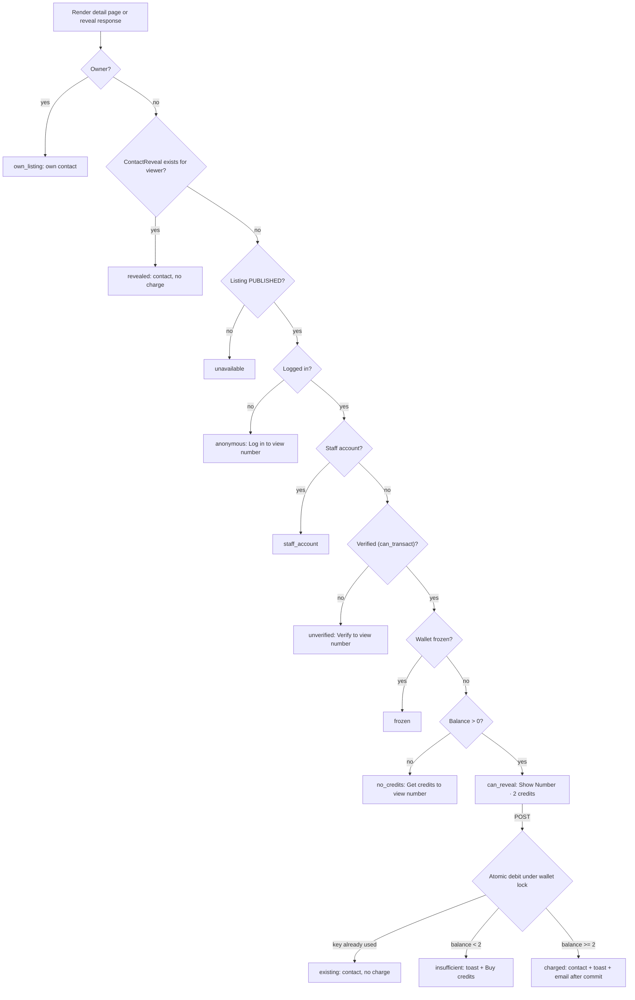
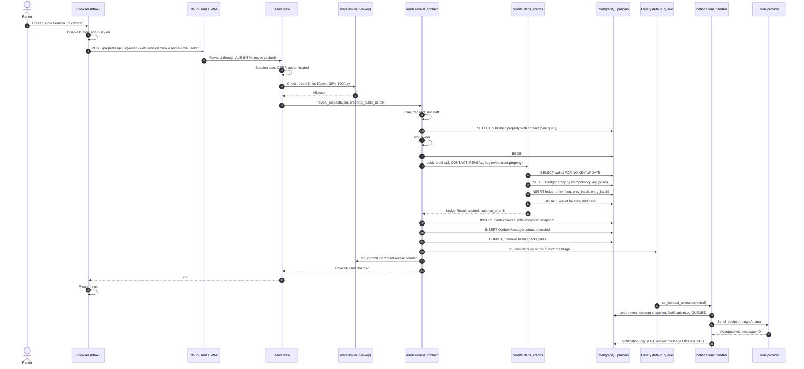
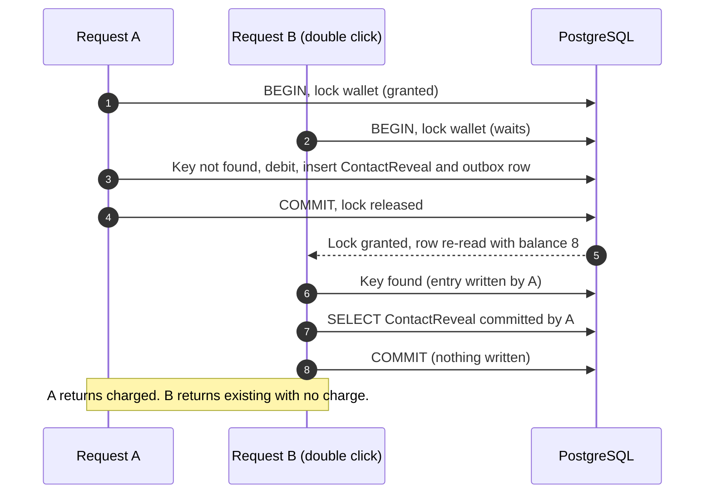

# Contact Reveal Flow (Show Number)

How a renter pays 2 credits to see a lister's contact details. Covers every viewer state of the Show Number control, the request path from the HTMX click to the committed debit, the after-commit receipt email, free re-viewing from history, abuse controls, analytics, error handling and the acceptance tests.

Status: Draft v0.1 (2026-10-21)

| Item | Value |
|---|---|
| Audience | Backend and front-end engineers, QA, PM, security reviewers |
| Requirements | FR-CRED-01 … FR-CRED-06, FR-CRED-08, FR-PAY-05.4, FR-LIST-04 (metrics), NFR-UX-01, NFR-UX-02, NFR-PERF-01.3/01.4, NFR-PERF-02 ([catalog](../requirements/02-requirements-catalog.md#4-credit-consumption--lead-generation-fr-cred)) |
| Gap decisions | GAP-01 (renter pays), GAP-05 (state matrix), GAP-10 (email after commit), GAP-34 (snapshot), GAP-35 (detail page only), GAP-36 (contact in email), GAP-37 (copy variants), GAP-38 (published only), GAP-66 (scraping), GAP-68/69 (toasts, no modal) ([gap analysis](../requirements/03-gap-analysis-and-decisions.md)) |
| Schema of record | [01 §7 `leads.ContactReveal`](01-domain-model.md#7-leadscontactreveal), [01 §6 credits](01-domain-model.md#6-credits) |
| Ledger behaviour | [02 Credit wallet & ledger](02-credit-wallet-and-ledger.md): `debit_credits` (§8.3), concurrency (§7), reveal refunds (§9.4) |
| Related | [UX §7 Show Number states](../ux/01-ux-and-page-inventory.md#7-show-number-button-states) · [Notifications §3.1 NTF-10](08-notifications.md#31-content-of-the-critical-messages) · [Listings §13 contact privacy](05-listings-and-media.md#13-security-and-privacy-of-listing-contact-data-known-issue-20) · [Codebase §12 worked example](../architecture/03-codebase-structure.md#12-layering-rules-in-practice-worked-example-show-number) · [Security §6.5 rate limits](../quality/01-security-and-compliance.md#65-rate-limiting-brute-force-and-bot-protection) · [04 Identity & access](04-identity-and-access.md) |
| Milestone | M4 (all of it); M6 (frozen-wallet state UI, fraud rules, step-up challenge) |
| Precedence | This document owns reveal **behaviour** (service, view, outcomes, email trigger). UX §7 owns visual design and copy; where this document adds a state or outcome it says so in §14. |

---

## 1. Scope and requirement trace

**Monetisation model (Open Question #1, OQ-01):** the MVP follows the SRS. The **renter** pays `CREDITS_REVEAL_COST` (2) credits to see the lister's contact. The client flow chart's lister-pays "unlock lead" model is post-MVP (FR-LEAD-01). The ledger is generic, so that model is a new entry type (`LEAD_UNLOCK`) and a new caller, not a redesign ([02 §4.1](02-credit-wallet-and-ledger.md#41-entry-types-and-sign-rules)). In this document a "lead" is a `ContactReveal`.

| SRS clause (TOC numbering) | What it demands | Requirement IDs | Section |
|---|---|---|---|
| §5.1 Contact button visibility | Label "Show Number"; visible only to logged-in users with balance > 0; 2-credit cost adjacent | FR-CRED-01.1 … 01.7 | §3 |
| §5.2 Credit check | Balance ≥ 2 verified atomically with the deduction | FR-CRED-02.1 … 02.4 | §6.2, [02 §8.3](02-credit-wallet-and-ledger.md#83-debit_credits) |
| §5.3 Credit deduction | Deduct 2 immediately; immutable ledger with transaction ID, balance before/after, timestamp, property ID, server process ID | FR-CRED-03.1 … 03.5 | §6.2, §6.4, [02 §4.2](02-credit-wallet-and-ledger.md#42-provenance-fields) |
| §5.4 Contact display | Show phone/email immediately in a modal or designated area; accessible later from history at no cost | FR-CRED-04.1 … 04.5 | §6.5, §8 |
| §5.5 Automated email | Receipt email with link, lister name, title, full description, transaction confirmation; reliable, monitored service | FR-CRED-05.1 … 05.5 | §7 |
| §5.6 Insufficient credit | Non-disruptive toast or alert bar stating the required amount, high-contrast link to Purchase Credits | FR-CRED-06.1 … 06.4 | §3.2, §6.5 |
| §6.5 Transaction history | Consumption rows reference the property ID | FR-PAY-05.4 | §8 |
| §11.1 Credit visibility, transaction confirmation | Balance in header; toast "Contact revealed. 2 credits deducted. Details emailed to you." | NFR-UX-01, NFR-UX-02 | §6.5 |
| §8.1, §8.2 Latency, concurrency | ≤ 500 ms standard, ≤ 1,000 ms peak; 1,000 debits/s | NFR-PERF-01.3/01.4, NFR-PERF-02 | §6.4, [02 §12](02-credit-wallet-and-ledger.md#12-throughput-reaching-1000-debitss) |
| §4.4 Listing management | Lister metrics include clicks on Show Number | FR-LIST-04 | §10 |
| Derived | Reveal abuse protection | FR-CRED-08.1 … 08.3 | §9 |

**Deviations from the SRS** (all already recorded in the gap register; repeated here so the reader does not need to cross-check):

| # | SRS says | This design | Gap |
|---|---|---|---|
| 1 | Email "concurrently with the credit deduction" (§5.5) | **Deviation from SRS:** the email is enqueued in the same transaction (outbox) and **sent after commit**. A receipt is never sent for a debit that rolled back. | GAP-10 |
| 2 | Button "on all property listings" (§5.1) | Interpretation: the button is on every listing's **detail page**. Cards link to the detail page; there is no reveal from a search card. | GAP-35 |
| 3 | (no status rule) | Only `PUBLISHED` listings can be revealed; earlier revealers keep free access. | GAP-38 |
| 4 | Fixed confirmation copy (§11.1) | Exact copy for a paid reveal; accurate variants for a free re-view and a held email. | GAP-37 |
| 5 | "Confirmation modal or designated area" (§5.4) | Designated inline area plus a non-modal toast; no modal. | GAP-69 |
| 6 | Email lists property details and transaction (§5.5) | The email **also contains the revealed contact**, so it is a usable record of the lead. | GAP-36 |

---

## 2. Rules and invariants

| ID | Rule | Enforced by |
|---|---|---|
| RV-01 | A renter is charged **at most once per property, ever**. | `UNIQUE (user_id, property_id)` on `ContactReveal` ([01 §7](01-domain-model.md#7-leadscontactreveal)); ledger idempotency key `reveal:<user_public_id>:<property_public_id>` checked under the wallet lock ([02 §4.3](02-credit-wallet-and-ledger.md#43-idempotency-keys)) |
| RV-02 | The price is read on the server from `CREDITS_REVEAL_COST` and snapshotted on `ContactReveal.credits_spent`. The client never sends a cost, a wallet or a user ID. | Endpoint accepts only the property `public_id` in the URL; wallet resolved from `request.user` (security T-02) |
| RV-03 | Only a verified, non-staff account (`accounts.selectors.can_transact`) with an `ACTIVE` wallet can be charged. | Service checks; `debit_credits` rejects a `FROZEN` wallet ([02 §3](02-credit-wallet-and-ledger.md#3-data-model-summary)) |
| RV-04 | Only a `PUBLISHED` listing can be revealed, and never by its owner. | `listings.selectors.get_property_for_reveal`; owner check in the service |
| RV-05 | Ledger debit, `ContactReveal` row and outbox message commit together or not at all. | One `transaction.atomic(durable=True)` block (§6.2) |
| RV-06 | Contact plaintext reaches a client only if the viewer owns the listing or has a `ContactReveal` for it, and only in `no-store` responses. | §4 |
| RV-07 | The receipt email is sent only after commit, at least once, at most once per reveal under normal operation. | Outbox `contact.revealed` with `dedupe_key`; `NotificationLog` idempotency ([08 §5.1](08-notifications.md#51-handler-steps)) |
| RV-08 | A revealed contact stays free to view: after a refund, after the listing leaves `PUBLISHED`, and while the wallet is frozen. The 24-month snapshot retention is the only limit. | §8; [01 §15](01-domain-model.md#15-data-retention-schedule) |
| RV-09 | Every failure before commit leaves the balance unchanged, and the user is told "You have not been charged". A failure whose outcome is unknown says so honestly. | §11 |
| RV-10 | Debiting happens only on `POST` with a valid CSRF token from an authenticated session. `GET` never debits. | `require_POST`, `CsrfViewMiddleware` |
| RV-11 | Reveal rate limits **fail closed** if Valkey is unavailable. | §9.3 |

---

## 3. Viewer states (Show Number matrix)

### 3.1 Evaluation order and rendering

The server evaluates the state for every render of the listing detail page and every reveal response. **The first matching row wins.** State codes extend [UX §7.1](../ux/01-ux-and-page-inventory.md#71-states); `staff_account` is an addition (§14, CN-R4).

| # | Viewer situation | State | What renders in `#contact-block` | Contact in DOM? | Action target |
|---|---|---|---|---|---|
| 1 | Logged-in viewer owns the listing | `own_listing` | Own contact panel + "This is your listing. Renters see these details after spending 2 credits." No button (FR-CRED-01.5) | Yes (owner) | — |
| 2 | Viewer already revealed this property | `revealed` | Contact panel (snapshot, plus current contact if it changed, §8.3) + "Revealed on {date}. No additional charge." No button (FR-CRED-01.6) | Yes | — |
| 3 | Listing is not `PUBLISHED` (`RENTED`, `UNLISTED`, `EXPIRED`) | `unavailable` | "This home is no longer available." No button (FR-CRED-01.7) | No | — |
| 4 | Anonymous visitor | `anonymous` | Link styled as a button **Log in to view number** + helper "Viewing a number costs 2 credits. New accounts get 10 free credits." | No | `/accounts/login/?next=<detail URL>` |
| 5 | Staff account | `staff_account` | "Staff accounts can't reveal contacts." No button | No | — |
| 6 | Logged in, not verified | `unverified` | **Verify to view number** + helper "Verify your account to get 10 free credits." | No | Verification-required page (UX A-08) with `next` |
| 7 | Wallet frozen | `frozen` | "Your credits are on hold while we review recent activity." + **Contact support** | No | Help page |
| 8 | Verified, balance **0** (or no wallet yet) | `no_credits` | **Get credits to view number** + helper "Viewing a number costs 2 credits. Your balance is 0." **The Show Number button is not in the DOM** (literal SRS §5.1) | No | `/my/credits/buy/?next=<detail URL>` |
| 9 | Verified, balance **1** | `can_reveal` | `<button>` **Show Number · 2 credits** + helper "Your balance: 1 credit." | No | `POST /properties/<uuid>/reveal/` → insufficient outcome |
| 10 | Verified, balance **≥ 2** | `can_reveal` | `<button>` **Show Number · 2 credits** + helper "Your balance: {n} credits." | No | `POST /properties/<uuid>/reveal/` → charged |

Notes:

- **Balance 1 shows the button.** This is the literal SRS rule ("Credit Count > 0") combined with the §5.6 insufficient-credit toast (known issue #5). OQ-44 asks the PO to confirm.
- **`SUSPENDED` and `ARCHIVED` listings** return HTTP 410 for everyone, and the detail view does not render the contact block at all. Earlier revealers reach the contact through Revealed contacts (§8), with a warning for suspended listings ([05 §9.2](05-listings-and-media.md#92-visibility-matrix)). For `RENTED`, `UNLISTED` and `EXPIRED`, the 410 page includes the contact block, so row 2 shows the contact to earlier revealers.
- Reveal is offered on the **detail page only** (GAP-35). Search cards carry no contact block.
- The cost in every string comes from `CREDITS_REVEAL_COST`, and the promo amount from `CREDITS_SIGNUP_PROMO` (GAP-64).

### 3.2 Outcomes of a reveal request

The `POST` response always re-renders `#contact-block` (`hx-swap="outerHTML"`) unless the row says otherwise. "Click counted" refers to the lister metric in §10.1.

| Outcome | When | HTTP | Block re-rendered as | Toast (level: copy) | Ledger / reveal / outbox | Click counted |
|---|---|---|---|---|---|---|
| `charged` | First reveal, balance ≥ 2 | 200 | `revealed` | success: **Contact revealed. 2 credits deducted. Details emailed to you.** (exact SRS §11.1 copy) | 1 / 1 / 1 | Yes |
| `charged_email_held` | As above; user's email is unverified (phone-only verification) | 200 | `revealed` | success: Contact revealed. 2 credits deducted. Verify your email to receive the details. | 1 / 1 / 1 (email `HELD`) | Yes |
| `existing` | Same key already committed (double click, second tab, retry) | 200 | `revealed` | info: Contact shown. No credits used. | 0 / 0 / 0 | No |
| `insufficient` | Balance < 2 at debit time (balance 1, or it fell after page load) | 200 | `can_reveal` (balance 1) or `no_credits` (balance 0), plus inline alert | warning, not auto-dismissed: You need 2 credits to view this number. Your balance is {n}. **Buy credits** | 0 / 0 / 0 | Yes |
| `frozen` | Wallet `FROZEN` | 200 | `frozen` | warning: Your credits are on hold while we review recent activity. | 0 / 0 / 0 | Yes |
| `unavailable` | Listing left `PUBLISHED` after page load | 200 | `unavailable` (or `revealed` if a reveal exists) | info: This home is no longer available. You have not been charged. | 0 / 0 / 0 | No |
| `own_listing` | Owner POSTs to own listing | 200 | `own_listing` | info: This is your listing. | 0 / 0 / 0 | No |
| `staff` | Staff account POSTs | 200 | `staff_account` | info: Staff accounts can't reveal contacts. | 0 / 0 / 0 | No |
| `anonymous` | Session expired or logged out | 200 + `HX-Redirect` | — | — | 0 | No |
| `unverified` | Account not verified | 200 + `HX-Redirect` | — | — | 0 | No |
| `rate_limited` | Per-user limit hit (§9.3) | **429** (swapped, see §6.5) | Unchanged state | warning, not auto-dismissed: You've viewed a lot of numbers in a short time. Please try again in a few minutes. | 0 | No |
| `challenge` | Step-up required (§9.4) and no valid Turnstile token | 200 | `can_reveal` with the Turnstile widget inside the form | info: Please confirm you're not a robot to continue. | 0 | No |
| `busy` | Wallet lock not obtained within 2 s (`55P03`, [02 FM-03](02-credit-wallet-and-ledger.md#13-failure-modes)) | 200 | Unchanged | warning: Please try again. You have not been charged. | 0 | Yes |
| `error` | Service raised; transaction rolled back | 500 (swapped) | Unchanged | error: Something went wrong. You have not been charged. Please try again. | 0 | Yes |
| `uncertain` | Connection lost during commit after retry, **or** any 5xx/network failure without a server toast | 503 or none | Unchanged (client-side) | error: We couldn't confirm the result. Reload the page to check. You're never charged twice for the same property. | Unknown, but idempotent | — |
| (not found) | No property with that `public_id` | 404 | — | Generic client error toast | 0 | No |

### 3.3 Decision flow



### 3.4 State evaluation (selector)

```python
# apps/leads/selectors.py (illustrative)
from enum import StrEnum

from apps.accounts import selectors as accounts_selectors
from apps.credits import selectors as credits_selectors
from apps.listings import selectors as listings_selectors
from apps.listings.enums import PropertyStatus

from .models import ContactReveal
from .types import ContactBlockContext


class RevealState(StrEnum):
    OWN_LISTING = "own_listing"
    REVEALED = "revealed"
    UNAVAILABLE = "unavailable"
    ANONYMOUS = "anonymous"
    STAFF_ACCOUNT = "staff_account"
    UNVERIFIED = "unverified"
    FROZEN = "frozen"
    NO_CREDITS = "no_credits"
    CAN_REVEAL = "can_reveal"


def get_contact_block_context(*, user, prop) -> ContactBlockContext:
    """`prop` is the PublicPropertyDTO the detail view already loaded (no contact fields)."""
    if user.is_authenticated and prop.owner_id == user.id:
        contact = listings_selectors.get_owner_contact(property_id=prop.id, owner_id=user.id)
        return ContactBlockContext.of(RevealState.OWN_LISTING, prop, contact=contact)
    if user.is_authenticated:
        reveal = ContactReveal.objects.filter(user_id=user.id, property_id=prop.id).first()
        if reveal is not None:
            return ContactBlockContext.of(RevealState.REVEALED, prop, reveal=reveal,
                                          contact=revealed_contact(reveal=reveal, prop=prop))
    if prop.status != PropertyStatus.PUBLISHED:
        return ContactBlockContext.of(RevealState.UNAVAILABLE, prop)
    if not user.is_authenticated:
        return ContactBlockContext.of(RevealState.ANONYMOUS, prop)
    if user.is_staff:
        return ContactBlockContext.of(RevealState.STAFF_ACCOUNT, prop)
    if not accounts_selectors.can_transact(user):
        return ContactBlockContext.of(RevealState.UNVERIFIED, prop)
    wallet = credits_selectors.get_wallet_state(user_id=user.id)   # primary DB, memoised per request
    if wallet.frozen:
        return ContactBlockContext.of(RevealState.FROZEN, prop)
    if wallet.balance <= 0:
        return ContactBlockContext.of(RevealState.NO_CREDITS, prop, balance=0)
    return ContactBlockContext.of(RevealState.CAN_REVEAL, prop, balance=wallet.balance)
```

- The page render costs at most 3 queries for this block (reveal lookup, wallet state, owner contact or current-contact check). The wallet read is shared with the header badge through a per-request memo, so the balance is read once per request.
- `credits.selectors.get_wallet_state` returns `WalletState(balance, frozen)`. It is a small addition to the selector list in [02 §8.1](02-credit-wallet-and-ledger.md#81-service-api) (CN-R6).
- `get_wallet_state` returns `balance = 0, frozen = False` when no wallet exists (verified user before the promo safety net ran, [02 FM-18](02-credit-wallet-and-ledger.md#13-failure-modes)).

---

## 4. Keeping the contact out of the client until revealed

The contact is the monetised asset and personal data (security SO-2, asset A2). Before a reveal it must not reach the browser in **any** form: not hidden, not masked, not partially (no "last 3 digits").

| Channel | Rule | Mechanism |
|---|---|---|
| Detail page HTML | Contact rendered only in states `own_listing` and `revealed` | `PublicPropertyDTO` has no contact attributes. Only `leads.selectors` decrypts, and only after a `ContactReveal` (or ownership) check ([05 §13](05-listings-and-media.md#13-security-and-privacy-of-listing-contact-data-known-issue-20)) |
| Hidden DOM, `data-*`, comments, `<noscript>`, Alpine state | Never | Template rule; contact-leak scan (§13) |
| JSON-LD, Open Graph, meta tags, sitemap, RSS | Never | Builders take `PublicPropertyDTO` only |
| Search results, cards, map JSON, search cache | Never | Search reads public columns only ([06](06-search-and-discovery.md)) |
| Fragment caches | The public part of the detail page may be cached (`detail:{id}:{ts}:{lang}`); the contact block is **never** cached | Architecture §12 |
| HTTP caches | Reveal `POST` responses, detail pages for logged-in viewers, `/my/reveals/`: `Cache-Control: no-store`. Anonymous detail pages: `private, no-cache` (they contain no contact). CloudFront never caches HTML | View decorators; CloudFront behaviour |
| htmx history (`localStorage`) | The detail page and `/my/reveals/` set `hx-history="false"`; `historyCacheSize = 0` on pages with personal data | [Codebase §8.2](../architecture/03-codebase-structure.md#82-htmx-conventions) |
| Logs, traces, Sentry, metrics | Never | structlog redaction of `contact_*` keys; Sentry `before_send` scrubber; `ContactSnapshot.__repr__` returns a masked value; OTel attribute allow-list |
| Outbox payloads | Reveal `public_id` only | [01 §2.1](01-domain-model.md#21-coreoutboxmessage) |
| Analytics events | Property ID and outcome only | §10 |
| Email | Only NTF-10, only to the renter who paid | §7 |
| Ops console and admin | Masked; unmasking needs `listings.view_contact` (or `accounts.unmask_pii`), a reason and re-authentication, and is audited | [04 §13.3](04-identity-and-access.md#133-permission-matrix) |
| Robots | Reveal responses and `/my/reveals/` send `X-Robots-Tag: noindex` | View |

The **contact-leak scan** (testing strategy §13) renders every public surface for a seeded listing and asserts that the plaintext phone, email and their common formats (spaced, dashed, national format) do not appear for anonymous, unverified, zero-credit and non-revealing users.

---

## 5. End-to-end sequences

### 5.1 Successful reveal



If the broker drops the relay task, the outbox sweeper (every 30 s) re-enqueues the message ([architecture §9](../architecture/01-system-architecture.md#9-synchronous-vs-asynchronous-paths)). The user's response never waits for the email.

### 5.2 Double click and concurrent tabs



Under `READ COMMITTED`, B's statements after the lock see A's committed rows ([02 §7.3](02-credit-wallet-and-ledger.md#73-why-read-committed-is-sufficient)). `hx-disabled-elt="find button"` prevents most double submits; the server never relies on it.

### 5.3 Insufficient credit

1. The wallet lock is taken; the idempotency key is not found; `wallet.balance (1) < 2` → `InsufficientCreditsError(balance=1, required=2)`.
2. The transaction rolls back (nothing was written; the lock is released).
3. The view re-renders `#contact-block` as `can_reveal` (balance 1) with an inline alert linked by `aria-describedby`, and an out-of-band warning toast with **Buy credits** → `/my/credits/buy/?next=<detail URL>`. Focus stays on the button.
4. The Show Number click counter is incremented (§10.1).

---

## 6. Server design

### 6.1 Endpoint, view and error mapping

| Item | Value |
|---|---|
| Route | `POST /properties/<uuid:public_id>/reveal/`, URL name `leads:reveal` ([codebase §7](../architecture/03-codebase-structure.md#7-url-namespace-map)) |
| Request body | CSRF token only, plus `cf-turnstile-response` when a challenge is shown. **No other parameter is read.** |
| Auth | Session. Anonymous → `HX-Redirect` to `/accounts/login/?next=<detail URL>`. The `next` is the **detail** URL, never the reveal URL (a GET on the reveal URL would be a 405 after login). |
| Order of checks | `require_POST` → CSRF (middleware) → authenticated → rate limit (§9.3) → step-up challenge (§9.4) → service |
| Non-HTMX | Post/Redirect/Get: a Django `messages` entry and a 303 to the detail URL, which then renders the `revealed` (or other) state |

```python
# apps/leads/views.py (illustrative; supersedes codebase §12.5 where they differ)
@require_POST
def reveal_contact_view(request, public_id: UUID):
    user = request.user
    if not user.is_authenticated:                                             # Http404 if the ID is unknown
        return hx_redirect(request, login_url(next=listings_selectors.get_public_url(public_id=public_id)))
    if not check_rate(scope="reveal", subject=str(user.public_id),
                      rates=settings.LEADS_REVEAL_RATE_LIMITS, fail_closed=True):
        return respond(request, public_id, Outcome.RATE_LIMITED, status=429)
    if accounts_selectors.requires_step_up(user=user, scope="reveal") and not turnstile.verify(
            token=request.POST.get("cf-turnstile-response"), remote_ip=client_ip(request)):
        return respond(request, public_id, Outcome.CHALLENGE)

    ctx = OpContext(request_id=request.request_id, actor_id=user.id)
    try:
        result = services.reveal_contact(user=user, property_public_id=public_id, ctx=ctx)
    except AccountNotVerifiedError:
        return hx_redirect(request, verification_url(
            next=listings_selectors.get_public_url(public_id=public_id)))
    except tuple(ERROR_OUTCOMES) as exc:
        return respond(request, public_id, ERROR_OUTCOMES[type(exc)], error=exc)
    except OperationalError as exc:
        if is_lock_timeout(exc):                                              # SQLSTATE 55P03
            return respond(request, public_id, Outcome.BUSY)
        if is_connection_error(exc):                                          # retried once already
            return respond(request, public_id, Outcome.UNCERTAIN, status=503)
        raise
    except Exception:
        logger.exception("reveal.failed", property_public_id=str(public_id))  # rolled back: not charged
        return respond(request, public_id, Outcome.ERROR, status=500)
    return respond(request, public_id, result.outcome, result=result)


ERROR_OUTCOMES = {
    PropertyNotAvailableError: Outcome.UNAVAILABLE,
    CannotRevealOwnListingError: Outcome.OWN_LISTING,
    StaffAccountError: Outcome.STAFF,
    InsufficientCreditsError: Outcome.INSUFFICIENT,
    WalletNotFoundError: Outcome.INSUFFICIENT,        # treated as balance 0 (02 FM-18)
    WalletFrozenError: Outcome.FROZEN,
}
```

- The `except Exception` branch is only around the service call. The service is all-or-nothing, so "not charged" is true there. Failures **after** the service returned (for example a template error) fall through to the generic 500 handler, and the client shows the `uncertain` copy, never "not charged".
- `respond()` builds the context from the result (no extra queries for `charged` and `existing`) or from `get_contact_block_context` for other outcomes, and adds toasts, triggers and headers (§6.5).
- `check_rate` with several windows and an explicit fail mode is an extension of `apps.core.ratelimit` (codebase §5); `LEADS_REVEAL_RATE_LIMITS = ("10/m", "30/h", "100/d")`.

### 6.2 Service `leads.services.reveal_contact`

This is the authoritative implementation of the use case. It replaces the illustrative version in [codebase §12.4](../architecture/03-codebase-structure.md#124-use-case-service-leadsservicesreveal_contact): public-ID idempotency key, durable transaction, retry wrapper, contact snapshot, and no pre-transaction "already revealed" fast path.

```python
# apps/leads/services.py
from uuid import UUID

from django.conf import settings
from django.db import transaction

from apps.accounts import selectors as accounts_selectors
from apps.analytics import services as analytics_services
from apps.core import outbox
from apps.core.db import retry_on_transient_db_errors
from apps.credits import services as credits_services
from apps.credits.enums import LedgerEntryType
from apps.credits.types import LedgerRef, OpContext
from apps.listings import selectors as listings_selectors

from .exceptions import (AccountNotVerifiedError, CannotRevealOwnListingError,
                         RevealInvariantError, StaffAccountError)
from .models import ContactReveal
from .types import RevealResult


@retry_on_transient_db_errors      # re-runs the whole use case on 40P01 / 40001 / lost connection (02 §7.5)
def reveal_contact(*, user, property_public_id: UUID, ctx: OpContext) -> RevealResult:
    # 1. Eligibility: no locks, no writes.
    if user.is_staff:
        raise StaffAccountError()
    if not accounts_selectors.can_transact(user):
        raise AccountNotVerifiedError()
    prop, contact = listings_selectors.get_property_for_reveal(public_id=property_public_id)
    # PUBLISHED only (else PropertyNotAvailableError). `contact` is decrypted in memory, never logged.
    if prop.owner_id == user.id:
        raise CannotRevealOwnListingError()

    cost = settings.CREDITS_REVEAL_COST
    key = f"reveal:{user.public_id}:{prop.public_id}"

    # 2. One short transaction: debit, reveal and outbox commit together (FR-CRED-03.5).
    with transaction.atomic(durable=True):
        debit = credits_services.debit_credits(
            user_id=user.id, amount=cost, entry_type=LedgerEntryType.CONTACT_REVEAL,
            reference=LedgerRef(type="listings.property", id=str(prop.public_id)),
            idempotency_key=key, actor_id=user.id, ctx=ctx,
        )   # takes the wallet lock; raises InsufficientCreditsError, WalletFrozenError, WalletNotFoundError

        if not debit.created:
            # The same key was committed earlier: double click, second tab, or a retry after
            # an unknown commit outcome. Return the existing reveal; nothing is written.
            reveal = ContactReveal.objects.filter(user_id=user.id, property_id=prop.id).first()
            if reveal is None:
                raise RevealInvariantError(key)          # invariant I-11 broken: 500 + Sentry
            return RevealResult.existing(reveal=reveal, prop=prop)

        reveal = ContactReveal.objects.create(
            user_id=user.id, property_id=prop.id, ledger_entry_id=debit.entry_id,
            credits_spent=cost,
            contact_name_snapshot=contact.name,
            contact_phone_snapshot=contact.phone_e164,    # EncryptedTextField: AES-256-GCM on save
            contact_email_snapshot=contact.email,
            request_id=ctx.request_id,
        )                                                 # UNIQUE (user, property) is the backstop
        outbox.publish(
            topic="contact.revealed",
            payload={"reveal": str(reveal.public_id)},
            dedupe_key=f"contact.revealed:{reveal.public_id}",
        )
        transaction.on_commit(lambda: analytics_services.record_reveal(property_id=prop.id),
                              robust=True)                # counters are best-effort

    return RevealResult.charged(
        reveal=reveal, prop=prop, contact=contact,
        balance_after=debit.balance_after,
        ledger_entry_public_id=debit.entry_public_id,
        email_held=not accounts_selectors.has_verified_email(user),
    )
```

Why this is correct:

| Concern | How it is handled |
|---|---|
| Check-then-debit atomicity (SRS §5.2) | `debit_credits` checks the balance on the **locked** wallet row and writes the entry in the same transaction ([02 §7.2](02-credit-wallet-and-ledger.md#72-decision-pessimistic-wallet-row-lock)). `CHECK (balance >= 0)` is the backstop. |
| Double charge | The idempotency key is looked up **after** the lock and **before** the balance and frozen checks ([02 §8.3](02-credit-wallet-and-ledger.md#83-debit_credits)). So a second click returns `existing` even if the first click spent the last credits, and a frozen wallet never blocks a re-view. `UNIQUE (user, property)` on `ContactReveal` is a second, independent guard. |
| No pre-transaction fast path | An earlier draft checked for an existing reveal before locking. It saved nothing in the common case (the button is not shown once revealed) and cost one query on every real reveal. The idempotency lookup under the lock covers every duplicate case. |
| All-or-nothing | Any exception inside the `atomic` block rolls back the entry, the wallet head, the reveal and the outbox row. `durable=True` makes accidental nesting inside another transaction an error. |
| Unknown commit outcome | `retry_on_transient_db_errors` re-runs the whole use case once after a lost connection. The idempotency key turns the retry into either the original entry (`existing`) or a single new debit. |
| Lock order | Wallet → `ContactReveal` → `OutboxMessage`, which matches the global order in [02 §7.4](02-credit-wallet-and-ledger.md#74-lock-order-and-deadlock-avoidance). |
| Stale reads | Listing status and contact are read before the lock. If the lister unlists or edits the contact milliseconds later, the reveal happened while the listing was published, with the contact as published at that moment. This is accepted ([02 §7.3](02-credit-wallet-and-ledger.md#73-why-read-committed-is-sufficient)). |
| Price change | The cost is read once per request and stored on `credits_spent`; existing reveals keep their price (GAP-64). |

**Snapshot encryption.** The listing's ciphertext cannot be copied as-is into `ContactReveal`: the AAD binds a ciphertext to its column (`"<app>.<model>.<field>"`, security §7.2). The plaintext therefore passes through process memory once and is re-encrypted by `EncryptedTextField` on insert. It is never logged or placed in any other structure.

**No `AuditLog` row per reveal.** The ledger entry and the `ContactReveal` row are the audit trail, and both are immutable (a reveal's only mutable fields are the refund stamps). Writing a third row at 1,000 reveals/s adds WAL with no extra evidence. Refunds, staff contact views and fraud actions are audited ([02 §9](02-credit-wallet-and-ledger.md#9-reversals)).

### 6.3 Selectors and DTOs

| Function | App | Purpose | Notes |
|---|---|---|---|
| `get_property_for_reveal(*, public_id) -> tuple[RevealableProperty, ContactSnapshot]` | `listings` | One query: a `PUBLISHED` property's ID, owner and title, plus the decrypted contact | **Restricted caller:** only `apps.leads.services`. A Semgrep rule (`restricted-contact-selector`) fails CI on any other import. |
| `get_owner_contact(*, property_id, owner_id) -> ContactSnapshot` | `listings` | Owner's own contact for `own_listing` | Owner-scoped query |
| `get_public_url(*, public_id) -> str` | `listings` | Canonical detail URL for redirects | 404 if unknown |
| `get_contact_block_context(*, user, prop)` | `leads` | State evaluation for page renders (§3.4) | ≤ 3 queries |
| `revealed_contact(*, reveal, prop) -> RevealedContact` | `leads` | Snapshot plus "current contact" when it changed and the listing is `PUBLISHED` (§8.3) | Compares blind indexes, so the current contact is decrypted only if it differs |
| `get_revealed_contact(*, reveal_public_id) -> RevealedContact` | `leads` | For the NTF-10 worker | Decrypts the snapshot in the worker only |
| `list_reveals_for_user(*, user, cursor, limit=25)` | `leads` | Revealed contacts page (§8.2) | Scoped by `user_id`; keyset pagination on `(user_id, created_at DESC)` |
| `get_wallet_state(*, user_id) -> WalletState` | `credits` | Balance and frozen flag for state evaluation | Addition to [02 §8.1](02-credit-wallet-and-ledger.md#81-service-api); primary DB |
| `can_transact(user)`, `has_verified_email(user)`, `requires_step_up(user, scope)` | `accounts` | Eligibility, held-email decision, risk step-up | [04 §3.3](04-identity-and-access.md#33-capability-checks) |

DTOs (frozen dataclasses in `apps/leads/types.py` and `apps/listings/types.py`):

- `RevealableProperty(id, public_id, owner_id, title, status, public_url)`: no contact fields.
- `ContactSnapshot(name, phone_e164, email)`: `__repr__` and `__str__` return masked values (`+44 •••• ••• 958`), so an accidental log line or exception message cannot leak the contact.
- `RevealResult(outcome: Literal["charged", "existing"], reveal_public_id, revealed_at, credits_spent, ledger_entry_public_id, balance_after: int | None, email_held: bool, contact: RevealedContact)`.

[Listings §13](05-listings-and-media.md#13-security-and-privacy-of-listing-contact-data-known-issue-20) names a single selector `leads.selectors.revealed_contact_for(user, property)`. It corresponds to `get_contact_block_context` (page) and `get_revealed_contact` (worker) here (CN-R3).

### 6.4 Transaction contents and budgets

| Phase | Statements | Notes |
|---|---|---|
| Before the transaction | User (session auth), property with contact | 2 queries. The rate-limit and step-up checks use Valkey, not SQL. |
| Transaction | `set_config('lock_timeout','2s',true)`, wallet `FOR NO KEY UPDATE`, idempotency lookup, ledger `INSERT` (+ trigger), wallet `UPDATE`, `ContactReveal` `INSERT`, `OutboxMessage` `INSERT`, `COMMIT` (+ deferred head checks) | 7 statements ([02 §8.3](02-credit-wallet-and-ledger.md#83-debit_credits)). Wallet lock held for about 3–5 ms. |
| After commit | `has_verified_email` (allauth `EmailAddress`) | 1 query |
| **Total** | **10 queries** | Matches the testing-strategy budget "reveal POST ≤ 10" (`django_assert_max_num_queries`). The detail URL comes from the property DTO, so the success path needs no extra lookup. **Assumption:** session activity tracking does not write on every request ([04 §8.1](04-identity-and-access.md#81-configuration)). |

| Budget | Target | Source |
|---|---|---|
| Server-side latency | p95 ≤ 500 ms standard, ≤ 1,000 ms peak | NFR-PERF-01.3/01.4 |
| Service time on CI hardware | < 50 ms (trend) | Testing strategy §12.2 |
| Throughput | 1,000 reveals/s across distinct wallets | NFR-PERF-02.1, PT-03 ([02 §12.5](02-credit-wallet-and-ledger.md#125-load-test-plan-ledger-specific)) |
| Receipt email | Commit → provider accepted p95 ≤ 60 s | FR-CRED-05.3 |

### 6.5 Response composition

**HTMX request, `charged`:**

| Part | Content |
|---|---|
| Body | `leads/property_contact.html#contact_block` in state `revealed`; contact as `tel:` (E.164 `href`, locale display) and `mailto:` links; "Revealed on {date}. No additional charge."; "A copy was sent to p•••@example.com." (or the verify-email note when held); link "View in Transaction History" |
| Out-of-band swaps | `#credit-badge` and `#account-balance` (dropdown) with `balance_after`; toast appended to `#toasts`; low-balance line "1 credit left · Buy credits" when `balance_after < CREDITS_REVEAL_COST` (NTF-11) |
| Headers | `HX-Trigger: {"credits-changed": {"balance": 8}, "focus": "#contact-heading"}`, `Cache-Control: no-store`, `X-Robots-Tag: noindex`, `Vary: Cookie` |

- **Balance update without a second request.** The badge and dropdown balance are updated out of band from `balance_after`. Re-fetching `/my/credits/badge/` on `credits-changed` (UX §5.2) remains the fallback for other listeners. At 1,000 reveals/s a follow-up badge GET would double the request rate, so the OOB swap is the primary mechanism.
- **Header polling.** The baseline (US-411) also polls the badge every 30 s while the tab is visible. The performance document proposes removing global polling (P-02, consistency item CI-04). The reveal flow works either way, because it pushes the new balance in its own response.
- **HTMX status handling.** `htmx.config.responseHandling` swaps `2xx`, `422` (codebase §8.2) and also **`429` and `500`** for this component, so the rate-limit and "not charged" toasts are delivered with the re-rendered block (CN-R5). Other 4xx and 5xx responses are not swapped; `app.js` shows the `uncertain` copy for them on reveal forms.
- **Non-HTMX request:** `messages.success(...)` with the same copy, then a 303 to the detail URL.

---

## 7. Receipt email (NTF-10)

The notifications app sends it; this section fixes the content contract. Template key `leads.contact_revealed`, topic `contact.revealed`, category `TRANSACTIONAL` (always sent; not affected by preferences) ([08 §3](08-notifications.md#3-notification-catalogue)).

| Block | Content | Source at send time |
|---|---|---|
| Subject | "Contact details for {listing title}" | Public DTO |
| Greeting | "Hi {first name}," (or "Hi," when no name) | `User.full_name` |
| Listing | Title; link to the canonical listing URL; `email` image variant (alt text = title); locality and city; price per period; **full description** as escaped plain text with line breaks kept (SRS §5.5) | `PublicPropertyDTO` |
| Lister | Contact name and the tag text ("Owner" or "Agent") | Snapshot + listing |
| Contact | Phone (`tel:` link) and email if the lister shows it (`mailto:`) (GAP-36, OQ-34) | **Encrypted snapshot** on `ContactReveal`, decrypted in the worker only |
| Transaction confirmation | Transaction ID (ledger entry `public_id`); credits deducted (`credits_spent`); balance after (the entry's `balance_after`, not today's balance); date and time in the renter's timezone with the zone name | Ledger entry via `credits.selectors` |
| Free re-view | "View this contact again at any time, free, in Revealed contacts" → `/my/reveals/#r-<reveal uuid>` (SRS §5.4) | — |
| Safety | "Never pay a deposit or fee before you have viewed the property and checked the lister." + **Report this listing** link | Static copy |
| Footer | "You received this email because you revealed a contact on {brand}." "Didn't do this? Change your password and contact support." Support address, merchant details | Static |

Rules:

| Rule | Detail |
|---|---|
| Timing | Sent after commit; p95 ≤ 60 s from commit to provider acceptance (FR-CRED-05.3). Retries follow the outbox backoff (10 attempts over about 24 h); a `DEAD` `contact.revealed` message pages on-call ([08 §5.2](08-notifications.md#52-errors-retries-and-dead-letter)). |
| Exactly one per reveal | `dedupe_key = contact.revealed:<reveal uuid>`; `NotificationLog` unique on `(outbox_message_public_id, channel)`. A sub-second duplicate window remains if a worker dies after the provider accepted the message ([08 §5.4](08-notifications.md#54-delivery-semantics-and-known-duplicate-window)). |
| Unverified email | Phone-only verified renters: the email is **held** (`NotificationLog.status = HELD`) and released when the address is verified. The toast says so (§3.2). |
| Listing gone | If the listing left `PUBLISHED` before sending, the email still goes out (the renter paid), with "This listing is no longer available, but you can still contact the lister." |
| Renter account deleted or anonymised before sending | Skipped. |
| Format | Plain-text and HTML parts; accessible HTML (`lang`, presentation tables, alt text, ≥ 14 px, contrast ≥ 4.5:1); **no tracking pixels and no click tracking** (links point to our domain directly); rendered in the renter's locale and timezone. |
| Headers | `Reply-To: support@…`; no `List-Unsubscribe` (transactional); provider configuration set `transactional`. |
| Content stored | `NotificationLog` stores template key, masked recipient and status, never the body. |

Indicative plain-text part (copy is translatable and owned by UX):

```text
Subject: Contact details for 2-bed flat near Victoria Park

Hi Priya,

Here are the contact details you revealed.

2-bed flat near Victoria Park
Hackney, London · £1,850 per month
https://<domain>/properties/3f2a9c1e-…/2-bed-flat-near-victoria-park/

Lister: Anil Mehta (Owner)
Phone:  +44 20 7946 0958
Email:  anil@example.com

About this home
<full description>

Transaction
  Transaction ID:   a7b8c9d0-e1f2-4a3b-8c4d-5e6f7a8b9c0d
  Credits deducted: 2
  Balance after:    8 credits
  Date:             21 Oct 2026, 10:17 (Europe/London)

View this contact again, free, at any time:
https://<domain>/my/reveals/#r-<reveal id>

Stay safe: never pay a deposit or fee before you have viewed the property.
Didn't do this? Change your password and contact support@<domain>.
```

---

## 8. Re-viewing revealed contacts (transaction history)

SRS §5.4: the contact "must remain accessible within the user's transaction history view for future reference without further cost".

### 8.1 Transaction History (`/my/credits/`, owned by `credits`)

| Element | Rule |
|---|---|
| Row for a `CONTACT_REVEAL` entry | Date and time (user timezone); label "Contact revealed: {listing title}"; amount "−2 credits"; balance after; property ID (public UUID, short form with copy) linked to the listing; **View contact** → `/my/reveals/#r-<reveal uuid>` |
| Row for a reveal refund (`REVERSAL`) | "Reversal: contact refund for {listing title}", "+2 credits", link to the same reveal |
| Filters | Type "Contact reveals" and date range (FR-PAY-05.5) |
| Cost | Viewing history never writes to the ledger (GET only) |

**Layering.** `credits` (layer 2) cannot import `leads` (layer 3) or `listings` (same layer) to build the label and links. `credits` therefore exposes a presenter registry, the same dependency-inversion pattern as the audit reference checks ([02 §11.1](02-credit-wallet-and-ledger.md#111-jobs-and-schedule)):

```python
# apps/credits/history.py (illustrative)
_presenters: dict[str, ReferencePresenter] = {}

def register_reference_presenter(reference_type: str, presenter: ReferencePresenter) -> None:
    _presenters[reference_type] = presenter            # called from a higher app's AppConfig.ready()

def present(*, user_id: int, rows: list[LedgerRow]) -> dict[tuple[str, str], RefView]:
    by_type: dict[str, list[str]] = defaultdict(list)
    for r in rows:
        by_type[r.reference_type].append(r.reference_id)
    out: dict[tuple[str, str], RefView] = {}
    for ref_type, ids in by_type.items():
        if presenter := _presenters.get(ref_type):
            out |= {(ref_type, k): v for k, v in presenter(user_id=user_id, reference_ids=ids).items()}
    return out                                          # one query per reference type per page

# apps/leads/apps.py
def ready(self):
    credits_history.register_reference_presenter("listings.property", selectors.present_reveal_refs)
```

`present_reveal_refs` joins the user's `ContactReveal` rows with their properties in one query and returns title, listing URL (or "No longer available"), and the reveal anchor. It never returns contact data; the contact is shown only on `/my/reveals/`.

### 8.2 Revealed contacts (`/my/reveals/`, owned by `leads`)

| Element | Rule |
|---|---|
| Access | Logged in and verified (UX C-02). Rows scoped by `user_id`; any other user's reveal ID is simply not found (404 for direct links, security T-10). |
| Row | Listing title (link, or "No longer available" text); revealed date; contact snapshot as `tel:`/`mailto:` links with **Copy** buttons; credits spent; transaction ID |
| Changed contact | If the listing is still `PUBLISHED` and its current contact differs from the snapshot, also show "Updated contact: …" (FR-CRED-04.4, OQ-13). Comparison uses the phone blind index first; decrypt only when it differs. |
| Listing status | `RENTED`, `UNLISTED`, `EXPIRED`, `ARCHIVED`: snapshot shown with the status text. `SUSPENDED`: snapshot shown with a warning "Our team removed this listing. Be careful before sharing personal details or paying anything." |
| Refunded reveal | "Refunded on {date}"; the contact stays visible ([02 §9.4](02-credit-wallet-and-ledger.md#94-reveal-refunds)) |
| Snapshot purged (after 24 months, [01 §15](01-domain-model.md#15-data-retention-schedule)) | Current contact if the listing is still `PUBLISHED`; otherwise "Contact details older than 24 months are deleted for privacy." |
| Pagination | 25 per page, newest first; keyset on `(user_id, created_at DESC)` |
| Headers | `Cache-Control: no-store`; `hx-history="false"`; `X-Robots-Tag: noindex` |
| Frozen wallet | Page works normally (RV-08) |

### 8.3 Erasure

- **Renter erasure:** reveals are retained as financial evidence; the renter's PII lives in `accounts` and is anonymised there ([01 §14](01-domain-model.md#14-deletion-soft-delete-and-anonymisation-policy)). The snapshot is the **lister's** data and stays until its 24-month purge.
- **Lister erasure:** **Assumption** (OQ-REV-03): the erasure job also NULLs the contact snapshots on all `ContactReveal` rows of the erased lister's properties. Renters then see "The lister has closed their account." The lister's right to erasure outweighs the renter's convenience copy; the ledger and reveal rows themselves remain.

---

## 9. Abuse prevention and rate limiting

### 9.1 Threats

| Threat | Example | Primary controls |
|---|---|---|
| Contact scraping | A script with purchased or farmed credits reveals thousands of contacts and resells them (GAP-66, security T-09) | Per-user limits, velocity flags, step-up challenge, WAF bot rules, wallet freeze |
| Promo farming | Many accounts each spend their 10 free credits (security T-07) | Promo identity rules ([04 §6.3](04-identity-and-access.md#63-eligibility-and-anti-abuse)) + `PROMO_FARMING` flag |
| Pre-reveal leakage | Contact found in HTML, caches or logs (T-08) | §4 |
| Double charge / manipulated cost | Replays, crafted POSTs (T-01, T-02) | RV-01, RV-02 |
| CSRF / clickjacking | Forced reveal from another site | CSRF on POST, `SameSite=Lax`, `frame-ancestors 'none'` (T-16) |
| IDOR on reveals | Reading another renter's contact (T-10) | User-scoped selectors; 404 |
| Lister bypass | Phone number written in the description or photo (GAP-65) | Listing text checks and moderation ([05 §11.1](05-listings-and-media.md#111-automated-checks-submit-edit-relist)) |
| Bad numbers | Renter pays for a wrong or scam number | OTP-verified listing phone (GAP-63); reveal refund policy ([02 §9.4](02-credit-wallet-and-ledger.md#94-reveal-refunds)); Report listing |

### 9.2 Controls

| Layer | Control |
|---|---|
| Edge | AWS WAF managed rules and rate-based rule on `POST /properties/*/reveal/` per IP (coarse; for example 300 per 5 min per IP); bot rules enabled on demand (security RB-13) |
| Application | Per-user limits (§9.3); risk-based Turnstile step-up (§9.4); `can_transact` (verified, non-staff) |
| Domain | Wallet freeze blocks reveals during fraud review; at most one charge per property |
| Data | Contact never in public payloads; UUID `public_id`s are not enumerable; no bulk or export endpoint for contacts |
| Detection | Velocity and pattern rules feed fraud flags in the ops console (§9.5); metrics and alerts (§10.2) |

### 9.3 Rate limits

| Window | Limit (default) | Key | On exceed | If Valkey is down |
|---|---|---|---|---|
| 1 minute | 10 reveal POSTs | `rl:reveal:{user_public_id}:{minute}` | 429, toast, no debit; `reveal_rate_limited_total` | **Fail closed**: 429 with "Please try again shortly" |
| 1 hour | 30 | `rl:reveal:{user_public_id}:{hour}` | Same, and a velocity event | Same |
| 1 day (UTC) | 100 | `rl:reveal:{user_public_id}:{day}` | Same, and a velocity event | Same |

- Values from security §6.5 and OQ-35; the setting is `LEADS_REVEAL_RATE_LIMITS`. US-409 lists only the hourly and daily values; the per-minute limit is the security document's addition.
- Every POST that reaches the limiter counts, whatever the outcome. Re-viewing a revealed contact is a GET and is not limited by these windows.
- Legitimate renters reveal a handful of contacts per search session. 30 per hour is far above observed marketplace norms and well below scraping rates. Tune with production data.

### 9.4 Risk-based step-up challenge (M6)

| Item | Rule |
|---|---|
| Trigger | A fraud rule sets `stepup:reveal:{user_public_id}` in Valkey (TTL 24 h) through `accounts.services.require_step_up(user, scope="reveal")`. Defaults: a `REVEAL_VELOCITY` hit, or an account verified < 24 h ago with > 5 reveals. |
| Layering | The flag API lives in `accounts` (layer 1), so `leads` (layer 3) can read it and `moderation` (layer 4) can set it, without importing upwards. |
| UX | The reveal response re-renders `can_reveal` with the Cloudflare Turnstile widget inside the form; the user completes it and presses Show Number again. No charge until the token is verified. |
| Verification | Server-side `siteverify` with a 3 s timeout through `apps.core.turnstile`. **Fail closed** on timeout ("Please try again shortly"). |
| Accessibility | Turnstile's non-interactive mode serves most users; the widget is keyboard-operable. A user who cannot complete it can contact support, which can clear the flag. |

### 9.5 Fraud signals (rules owned by the moderation design; defaults are **Assumptions**)

| Rule (`FraudFlag.rule_code`) | Default trigger | Action |
|---|---|---|
| `REVEAL_VELOCITY` | > 20 reveals in 1 h, or > 60 in 24 h (below the hard limits, so humans review before limits bite) | Flag + step-up; Moderator may freeze the wallet |
| `PROMO_FARMING` | Account verified < 24 h, no purchase, ≥ 4 reveals within 1 h of verification, **and** shares a device ID or IP /24 with ≥ 2 similar accounts in 7 days | Flag; Moderator decides; promo-fraud reversal possible ([02 §9.1](02-credit-wallet-and-ledger.md#91-rules)) |
| `SHARED_DEVICE_OR_IP` | ≥ 3 verified accounts revealing from the same device ID or IP /24 within 24 h | Flag |
| `DUPLICATE_CONTACT` | (listing side) same contact phone across many owners | Listing moderation |

Velocity data: `moderation` registers a second outbox handler for `contact.revealed` that increments per-user sliding counters in Valkey and evaluates the rules. Reveal requests never wait for fraud evaluation. There are **no automatic bans** in the MVP (OQ-40).

---

## 10. Analytics, metrics and audit

### 10.1 Lister-facing counters (FR-LIST-04, SRS §4.4)

| Counter | Definition | Counted outcomes | Mechanism | Latency |
|---|---|---|---|---|
| `show_number_clicks` | Show Number POSTs by logged-in, verified non-owners on a `PUBLISHED` listing that passed the rate limiter | `charged`, `charged_email_held`, `insufficient`, `frozen`, `busy`, `error` | View increments `stat:clicks:{property_id}:{yyyymmdd}` in Valkey (`HINCRBY`), flushed every 60 s into `PropertyDailyStat.show_number_clicks` | ≤ 60 s |
| `reveals` | Successful paid reveals (first per renter per property) | `charged`, `charged_email_held` | Exact count from `ContactReveal`; Valkey counter incremented on commit for the dashboard's near-real-time view, flushed to `PropertyDailyStat.reveals` | Immediate (exact) / ≤ 60 s (daily series) |

- Not counted: `existing` (a duplicate of a counted click), `rate_limited`, `challenge`, `unavailable`, `own_listing`, `staff`, anonymous and unverified requests. This keeps the metric a measure of renter demand, not of retries or abuse.
- [05 §10.2](05-listings-and-media.md#102-metric-definitions) defines clicks as "including insufficient-credit outcomes"; this table refines that definition per outcome (CN-R7).
- Counters never sit on the debit path: Valkey errors are logged and ignored (`robust=True` on commit hooks).

### 10.2 Operational metrics and alerts

| Metric (OTel) | Type | Labels | Alert |
|---|---|---|---|
| `reveal_requests_total` | Counter | `outcome` | `error` + `uncertain` > 1 % of requests over 5 min → page |
| `reveal_duration_seconds` | Histogram | `outcome` | p95 > 500 ms for 10 min → warn; > 1 s → page (NFR-PERF-01.3/01.4) |
| `reveal_duplicate_total` | Counter | — | Trend only (double clicks) |
| `credit_lock_timeouts_total` | Counter | — | > 10/min → warn ([02 FM-03](02-credit-wallet-and-ledger.md#13-failure-modes)) |
| `reveal_rate_limited_total`, `reveal_stepup_total` | Counter | `window` / `result` | Spike → fraud review |
| `notification_dispatch_latency_seconds{template="leads.contact_revealed"}` | Histogram | — | p95 > 60 s for 15 min → warn |
| `outbox_dead_total{topic="contact.revealed"}` | Counter | — | Any → page |

Labels never include user or property IDs (security T-35).

### 10.3 Logs and audit

- One structlog event per request, `reveal.completed`, with `outcome`, `property_public_id`, `reveal_public_id`, `ledger_entry_public_id`, `duration_ms`, `request_id`, `user_public_id` (pseudonymous). **No contact values**; the redaction processor drops `contact_*` keys as a second line of defence.
- No `AuditLog` row per reveal (§6.2). Audited reveal-related events: `credits.reversal_created` (refunds), `pii.unmasked` (staff views of a contact), `credits.wallet_frozen`, `fraud.flag_actioned`.

---

## 11. Error handling and failure modes

| # | Failure | Behaviour | User sees | Charged? | Detection |
|---|---|---|---|---|---|
| FR-01 | Balance dropped below 2 after the page loaded (other tab, refund clawback) | `insufficient` | Inline alert + toast with **Buy credits** | No | Metric |
| FR-02 | Listing unpublished between page load and click | `PropertyNotAvailableError` before the transaction | "This home is no longer available. You have not been charged." | No | — |
| FR-03 | Double click, second tab, browser retry | Idempotency under the wallet lock | Contact; "Contact shown. No credits used." | Once | `reveal_duplicate_total` |
| FR-04 | Wallet lock wait > 2 s | `55P03`, rolled back, not retried | "Please try again. You have not been charged." | No | `credit_lock_timeouts_total` |
| FR-05 | Deadlock or serialization failure | Retried up to 3 times ([02 §7.5](02-credit-wallet-and-ledger.md#75-timeouts-and-retry-policy)) | Usually nothing | Once | `db_deadlocks_total` pages |
| FR-06 | Connection lost during `COMMIT` | Retried once; idempotency resolves the outcome | Normal result, or `uncertain` if the retry also fails | At most once | Retry metric |
| FR-07 | RDS Multi-AZ failover mid-request | Transaction aborted; requests fail for ≤ 120 s | `error` or `uncertain` toast; retry succeeds | No / at most once | RDS events, PT-12 |
| FR-08 | Valkey unavailable | Rate limiter fails closed; counters skipped; sessions fall back to PostgreSQL | "Please try again shortly." | No | Cache error metric |
| FR-09 | Celery or broker down | Commit unaffected; outbox rows wait; sweeper re-enqueues on recovery | Toast still says "Details emailed to you"; history shows "Email pending" (UX §12.4) | Yes (correctly) | `outbox_oldest_pending_age_seconds` |
| FR-10 | Email provider outage | Outbox retries with backoff for about 24 h, then `DEAD` and page | Email delayed; contact available in the app | Yes | Provider error rate alarm |
| FR-11 | Renter's address bounces or is suppressed | `NotificationLog SUPPRESSED`; in-app banner asks to update the email | Contact still available in the app | Yes | Bounce metrics |
| FR-12 | Field-key unavailable (KMS failure at task start) | Tasks fail readiness and do not receive traffic; in-process DEKs are loaded at startup | No reveals possible while all tasks are unhealthy | No | `/readyz`, KMS alarms |
| FR-13 | Template or render error after commit | Generic 500; client shows the `uncertain` copy | "We couldn't confirm the result. Reload the page to check." Reload shows the contact | Yes (contact reachable on reload) | Sentry |
| FR-14 | CSRF token expired (long-open tab) | 403 | "Your session has expired. Reload the page." | No | — |
| FR-15 | Session revoked (logout elsewhere, suspension) | `HX-Redirect` to login with `next=<detail URL>` | Login page | No | — |
| FR-16 | Verified user without a wallet | Treated as balance 0; promo safety net creates the wallet at next login ([04 §6.1](04-identity-and-access.md#61-trigger-points)) | "Get credits to view number" | No | `verified_users_without_wallet` |
| FR-17 | `RevealInvariantError` (entry exists without its `ContactReveal`) | Rolled back; Sentry error; `ORPHAN_REFERENCE` also caught by the nightly audit | Error toast | No new charge | Sentry, audit |
| FR-18 | JavaScript disabled | Plain form POST → 303 to the detail page with a flash message | Contact on the detail page | Yes, once | — |

---

## 12. Accessibility and progressive enhancement

Full rules are in [UX §7.7](../ux/01-ux-and-page-inventory.md#77-accessibility-rules) and [UX §10](../ux/01-ux-and-page-inventory.md#10-toasts-and-in-page-notifications). The behaviour-relevant points:

- Show Number is a real `<button type="submit">` in a `<form method="post">`; the flow works without JavaScript (FR-18).
- Accessible name "Show Number, 2 credits" (the middle dot is `aria-hidden`).
- After `charged` or `existing`, focus moves to `#contact-heading`; toasts never take focus (`role="status"`, polite).
- The insufficient-credit and rate-limit toasts contain actions and are not auto-dismissed (FR-CRED-06.4, GAP-68); the same **Buy credits** link is also inline under the button.
- While pending: `hx-disabled-elt="find button"` and `aria-busy="true"` on `#contact-block`; the label does not change.

---

## 13. Acceptance tests

Levels: **U** unit, **I** integration (DB), **C** concurrency (testing strategy §7), **E** Playwright E2E, **A** accessibility, **S** security, **L** load.

| ID | Scenario | Expected result | Level | Trace |
|---|---|---|---|---|
| AC-REV-01 | Verified renter, balance 10, published listing | Exactly one button; accessible name "Show Number, 2 credits"; helper shows the balance | I, E | FR-CRED-01.1, 01.3 |
| AC-REV-02 | Anonymous visitor | No button; "Log in to view number" with `next=<detail URL>`; no contact digits anywhere in the response | I, S | FR-CRED-01.2, 01.4 |
| AC-REV-03 | Unverified user views, then POSTs directly | "Verify to view number"; POST returns `HX-Redirect` to verification; no ledger entry | I | FR-AUTH-03.4, FR-CRED-01.4 |
| AC-REV-04 | Balance 0 | Show Number **not in the DOM**; "Get credits to view number" → `/my/credits/buy/?next=…` | I, E | FR-CRED-01.2 |
| AC-REV-05 | Balance 1, click | 200; no entry, reveal or outbox row; inline alert and toast with exact copy; **Buy credits** link contrast ≥ 4.5:1; toast not auto-dismissed | I, E, A | FR-CRED-06.1 … 06.4 |
| AC-REV-06 | Balance 2, click | Balance 0; one `CONTACT_REVEAL` entry `amount −2`, `balance_before 2`, `balance_after 0`; one `ContactReveal`; one outbox row; toast text exactly "Contact revealed. 2 credits deducted. Details emailed to you." | I, E | FR-CRED-02.1, 03.1, NFR-UX-02.1 |
| AC-REV-07 | Ledger provenance of AC-REV-06 | `public_id` set; `reference_type = listings.property`, `reference_id` = property public ID; `server_process_id` matches `^(web\|worker\|cli):[^:]+:\d+$`; `request_id` equals the response's request ID; `app_release` set; chain verifies | I | FR-CRED-03.2 |
| AC-REV-08 | Owner views and POSTs on own listing | Own contact shown with note; POST → `own_listing`, no charge | I | FR-CRED-01.5 |
| AC-REV-09 | Revisit a revealed listing | Contact + "Revealed on {date}"; no button; balance unchanged after 3 reloads | I, E | FR-CRED-01.6, 04.3 |
| AC-REV-10 | 20 concurrent POSTs, same user and property (C-03) | 1 debit, 1 `ContactReveal`, 1 outbox row; 19 `existing` responses | C | FR-CRED-03.4 |
| AC-REV-11 | Tab A reveals; stale tab B (still `can_reveal`) clicks | B returns `existing` with "Contact shown. No credits used."; no second debit | I, E | FR-CRED-03.4, NFR-UX-02.2 |
| AC-REV-12 | Listing unpublished after page load, then click | `unavailable` block + toast "…You have not been charged."; no entry | I | FR-CRED-01.7 |
| AC-REV-13 | Frozen wallet with one earlier reveal | Detail page of the earlier reveal shows the contact; another listing shows `frozen`; POST → no charge | I | RV-08, 02 §3 |
| AC-REV-14 | Staff account views and POSTs | `staff_account`; POST rejected; no wallet touched | I | RV-03, [04 §13.5](04-identity-and-access.md#135-separation-of-duties-and-staff-accounts) |
| AC-REV-15 | Hot wallet: 50 concurrent reveals on 50 listings, balance 20 (C-01 / PT-04) | Exactly 10 succeed; balance 0; 10 entries; chain valid; the rest `insufficient` or `busy` | C, L | NFR-PERF-02.2 |
| AC-REV-16 | Fault injection: `ContactReveal` insert raises | Balance, ledger, reveal and outbox unchanged; no email ever sent | I | FR-CRED-03.5, AC-NTF-02 |
| AC-REV-17 | Receipt content (template snapshot) | Contains link, lister name, title, full description, phone/email, transaction ID, credits deducted, balance after, local date/time; text and HTML parts; no tracking pixel | U | FR-CRED-05.2 |
| AC-REV-18 | Relay the same outbox message twice | One email sent; one `NotificationLog` | I | FR-CRED-05.5 |
| AC-REV-19 | Staging: receipt latency | p95 ≤ 60 s from commit to provider acceptance | L | FR-CRED-05.3 |
| AC-REV-20 | Phone-only verified renter reveals, later verifies email | Toast variant "…Verify your email to receive the details."; email `HELD`, then sent after verification | I, E | FR-CRED-05.1, NFR-UX-02.2 |
| AC-REV-21 | Contact-leak scan (anonymous, unverified, 0-credit, non-revealer) | Phone, email and their formats absent from detail HTML, partials, JSON-LD, OG tags, sitemap, search results, cards, map JSON, cached fragments and error pages | S | SO-2, FR-CRED-01.2 |
| AC-REV-22 | Response headers | Reveal POST and `/my/reveals/`: `Cache-Control: no-store`, `X-Robots-Tag: noindex`; `hx-history="false"` present | I | FR-CRED-04.5 |
| AC-REV-23 | Transaction History after a reveal | Row "Contact revealed: {title}", "−2 credits", balance after, property ID linked; **View contact** shows the contact; ledger entry count unchanged | I, E | FR-CRED-04.2, FR-PAY-05.4 |
| AC-REV-24 | Listing becomes `RENTED`, `UNLISTED`, `EXPIRED`, `SUSPENDED`, `ARCHIVED` | Contact still reachable free from `/my/reveals/`; suspended rows carry the warning | I | FR-CRED-04.2, RV-08 |
| AC-REV-25 | Lister changes the contact after a reveal | `/my/reveals/` shows the snapshot and "Updated contact" while published; only the snapshot after unpublishing | I | FR-CRED-04.4 |
| AC-REV-26 | Another user opens `/my/reveals/#r-<foreign uuid>` or a foreign history row | Foreign reveal never rendered; direct object URLs return 404 | S | Security T-10 |
| AC-REV-27 | 11th POST within a minute; then Valkey stopped | 429 + toast, no debit; with Valkey down, 429 (fail closed) | I | FR-CRED-08.1, RV-11 |
| AC-REV-28 | Step-up flag set; POST without and then with a valid Turnstile token | First: `challenge`, no debit; second: `charged` | I | §9.4 |
| AC-REV-29 | POST without CSRF token; GET on the reveal URL | 403 and 405; no debit | S | FR-CRED-02.4, RV-10 |
| AC-REV-30 | POST with extra `cost=0`, `user=…`, `wallet=…` fields | Ignored; standard cost charged to the session user | S | Security T-02 |
| AC-REV-31 | `CREDITS_REVEAL_COST = 3` (test settings) | Button, helper, toast and debit all use 3; earlier reveals keep `credits_spent = 2` | I | GAP-64 |
| AC-REV-32 | Simulated lock timeout | `busy` toast; no entry; `credit_lock_timeouts_total` incremented | I | FR-04 |
| AC-REV-33 | Connection dropped during `COMMIT` (fault injection) | Retried; exactly one entry and one reveal | C | FR-06 |
| AC-REV-34 | Header balance after a reveal | Badge and dropdown show the new balance from OOB swaps in the same response | E | NFR-UX-01.2 |
| AC-REV-35 | Counters | `charged` and `insufficient` increment clicks; `existing` and `rate_limited` do not; `reveals` equals the `ContactReveal` count after a flush | I | FR-LIST-04 |
| AC-REV-36 | Query budget and latency | Reveal POST ≤ 10 queries; PT-03 at 1,000/s: p95 < 500 ms, errors < 0.1 %, audit clean | I, L | NFR-PERF-01.3, 02.1 |
| AC-REV-37 | JavaScript disabled | POST → 303 to the detail page; flash message; contact shown | E | UX-P4 |
| AC-REV-38 | Keyboard and screen reader | Focus on `#contact-heading`; toast announced once; insufficient alert read via `aria-describedby`; axe: 0 serious/critical | A | NFR-A11Y-01 |
| AC-REV-39 | Reveal refunded | Contact still visible; a new POST returns `existing` and never charges again | I | [02 §9.4](02-credit-wallet-and-ledger.md#94-reveal-refunds) |
| AC-REV-40 | Forced exception during a reveal | Sentry event and logs contain no phone or email values | S | FR-CRED-08.3 |
| AC-REV-41 | Anonymous POST (expired session) | `HX-Redirect` to login with `next` = detail URL; after login the detail page shows the right state | E | §6.1 |

---

## 14. Consistency notes and open questions

### 14.1 Consistency notes (other documents to align)

| # | Item | Resolution here |
|---|---|---|
| CN-R1 | Codebase §12.4 uses internal IDs in the idempotency key and outbox payload, a non-durable `atomic()` and a pre-transaction fast path | Public-ID key `reveal:<user_public_id>:<property_public_id>` ([02 §4.3](02-credit-wallet-and-ledger.md#43-idempotency-keys)), payload `{"reveal": "<public uuid>"}` (08 §4.2), `atomic(durable=True)` with the retry wrapper, no fast path (§6.2) |
| CN-R2 | Architecture §8.2 sequence shows `SELECT wallet FOR UPDATE` | `FOR NO KEY UPDATE` ([02 §7.2](02-credit-wallet-and-ledger.md#72-decision-pessimistic-wallet-row-lock)) |
| CN-R3 | Listings §13 names `revealed_contact_for(user, property)` | Split into `get_contact_block_context` and `get_revealed_contact` (§6.3) |
| CN-R4 | UX §7.1 has 8 states | Adds `staff_account` (staff accounts cannot transact, [04 §13.5](04-identity-and-access.md#135-separation-of-duties-and-staff-accounts)), and the outcomes `charged_email_held`, `unavailable`, `own_listing`, `staff`, `challenge` and `busy` |
| CN-R5 | UX §4.8 lists "404 unavailable" for the reveal endpoint; codebase §8.2 swaps only 2xx and 422 | A listing that exists but is not published returns **200** with the `unavailable` block (a 404 would not be swapped and the user would see nothing); 404 only for an unknown ID. Add `429` and `500` to `responseHandling` for this component |
| CN-R6 | 02 §8.1 selector list | Add `credits.selectors.get_wallet_state(user_id) -> WalletState(balance, frozen)` |
| CN-R7 | Listings §10.2 click definition | Refined per outcome in §10.1 |
| CN-R8 | US-408 links to `/credits/buy/` | `/my/credits/buy/?next=<detail URL>` (codebase URL map, CI-09) |
| CN-R9 | US-409 limits 30/h and 100/day | Plus 10/min from security §6.5 (OQ-35) |
| CN-R10 | Codebase §12.5 view maps "own listing" to the insufficient-credit toast | Separate outcomes and copy (§3.2) |
| CN-R11 | UX §5.2 uses a follow-up badge GET after reveals | OOB swap of badge and dropdown balance in the reveal response is the primary mechanism; the event remains for other listeners (§6.5) |
| CN-R12 | Verification link target for the `unverified` CTA | Proposed route `accounts:verification-required` (`/my/verify/`) serving UX A-08 as a page; add to codebase §7 |

### 14.2 Open questions

| ID | Question | Default until answered | Links |
|---|---|---|---|
| OQ-01 | Renter pays, lister pays, or both? | Renter pays 2 credits; generic ledger | GAP-01 |
| OQ-13 | Snapshot vs current contact after a lister edit; 24-month snapshot retention | Both, free; 24 months | GAP-34 |
| OQ-17 | Notify listers when their number is revealed? | No; dashboard counts only | GAP-59 |
| OQ-34 | May the receipt email contain the revealed phone and email? | Yes; held until the renter's email is verified | GAP-36 |
| OQ-35 | Reveal rate limits | 10/min, 30/h, 100/day; Turnstile step-up on risk | GAP-66 |
| OQ-44 | Keep Show Number hidden at balance 0 and offer it on the detail page only? | Yes to both | GAP-05, GAP-35 |
| OQ-REV-01 | May staff accounts reveal contacts (for example to investigate a scam)? | No. Staff view contacts masked in the ops console, with reason-gated unmasking | §3.1 row 5 |
| OQ-REV-02 | Should a reveal on a listing later suspended as a scam be refunded automatically? | Moderator opt-in at takedown, 14 days back (= OQ-CR-03) | [02 §9.4](02-credit-wallet-and-ledger.md#94-reveal-refunds) |
| OQ-REV-03 | On lister erasure, are contact snapshots in renters' reveals deleted? | Yes, NULLed by the erasure job (§8.3); legal to confirm | OQ-16, OQ-DM-05 |
| OQ-REV-04 | Is the Turnstile step-up on reveals acceptable UX for flagged accounts? | Yes, risk-triggered only | §9.4 |
