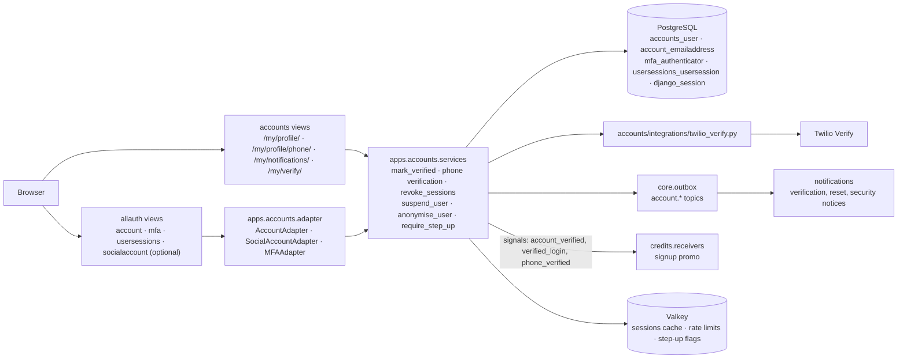
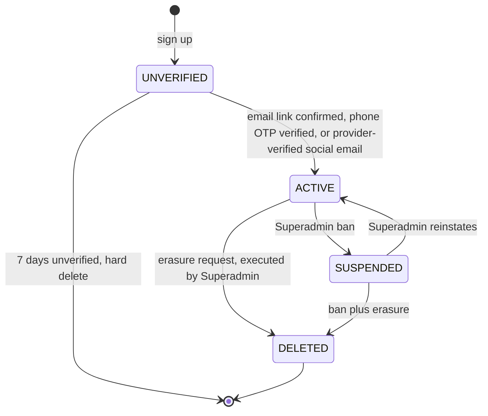
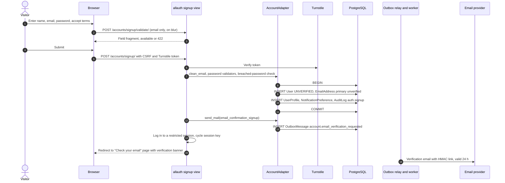
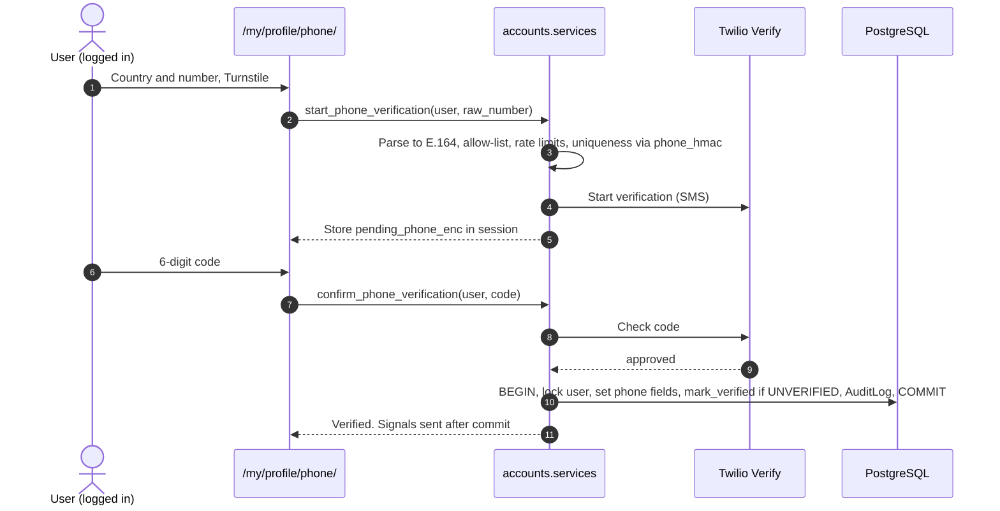
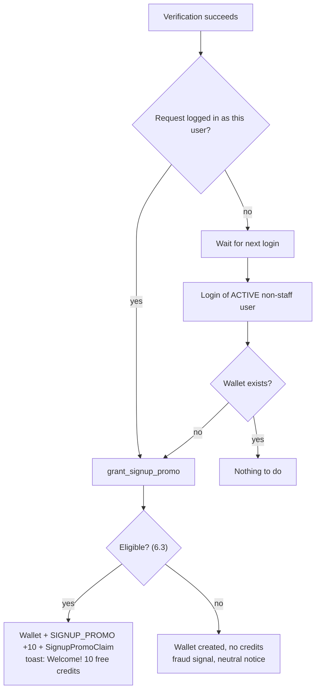
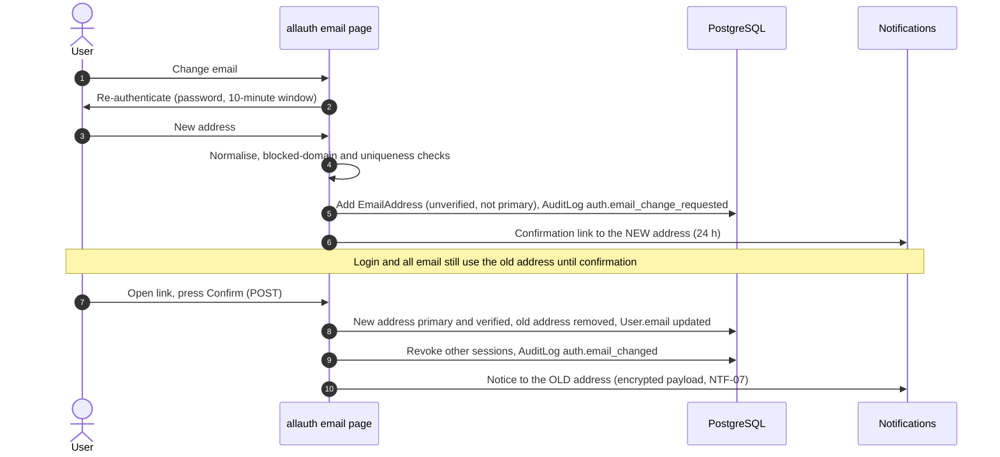

# Identity and Access

How people get an account, prove who they are, stay logged in, change sensitive details and get exactly the rights their role allows. Covers the custom user model, django-allauth configuration, account states, verification (email link and phone OTP), the exactly-once signup promo trigger, sessions and logout, password reset, MFA, social sign-on and the RBAC permission matrix.

Status: Draft v0.1 (2026-10-21)

| Item | Value |
|---|---|
| Audience | Backend engineers, QA, security reviewers, PM, ops leads |
| Requirements | FR-AUTH-01 … FR-AUTH-06, FR-PROF-02, FR-PROF-03, FR-PAY-01.5, FR-OPS-01.1, NFR-SEC-01, NFR-SEC-04.3, NFR-SEC-05.1 ([catalog](../requirements/02-requirements-catalog.md#2-authentication--accounts-fr-auth)) |
| Gap decisions | GAP-04 (roles), GAP-06 (promo trigger), GAP-07 (sessions, not JWT), GAP-12 (PII), GAP-23/24 (social), GAP-26 (email or phone), GAP-27 (passwords), GAP-28 (enumeration), GAP-29/30 (unverified users), GAP-48 (two-step changes), GAP-49 (logout), GAP-50 (password not viewable), GAP-60 (closure), GAP-62 (staff MFA) |
| Schema of record | [01 §3 `accounts`](01-domain-model.md#3-accounts), [01 §6.3 `SignupPromoClaim`](01-domain-model.md#63-creditssignuppromoclaim), [01 §12.6 `User.status`](01-domain-model.md#126-userstatus) |
| ADRs | [ADR-0003 server-side sessions](../adr/0003-server-side-sessions-instead-of-jwt.md); ADR-0010 field-level PII encryption (referenced by architecture and security; login-email decision in §4.3) |
| Related | [02 Credit wallet & ledger §8.5](02-credit-wallet-and-ledger.md#85-grant_signup_promo-exactly-once) · [03 Contact reveal flow](03-contact-reveal-flow.md) · [Security §6.2, §6.5, §6.8, §6.9](../quality/01-security-and-compliance.md#62-authentication-and-sessions) · [Notifications §6](08-notifications.md#6-authentication-emails-through-the-outbox) · [UX §4.2, §4.3, §5](../ux/01-ux-and-page-inventory.md#42-authentication-django-allauth) · [Architecture §3](../architecture/01-system-architecture.md#3-roles-rbac-baseline) |
| Milestones | M0 (custom user model stub, settings), **M1** (everything except the promo), M4 (promo grant, step-up flag), M6 (ops console RBAC screens, WebAuthn for staff if supported), M1 stretch or post-MVP (Google/Apple), post-MVP (user MFA) |

> allauth setting names, signals and templates below are written against the django-allauth 65.x line. **Validate every name against the version pinned at M0** (US-004); the behaviour, not the spelling, is the requirement.

---

## 1. Scope and requirement trace

| SRS clause (TOC numbering) | What it demands | Requirement IDs | Section |
|---|---|---|---|
| §3.0 + HLRD | "Rigid" RBAC for three core user types (undefined) | FR-AUTH-06 | §13 |
| §3.1 Sign-up | Email/password with real-time validation of format, strength (complexity) and uniqueness; optional Google/Apple | FR-AUTH-01, FR-AUTH-02 | §4, §5.1, §7.3, §12 |
| §3.2 Verification | Email confirmation **or** phone OTP; unverified accounts restricted from transactional activities | FR-AUTH-03 | §3, §5 |
| §3.3 Initial credit allocation | 10 credits once, on the first successful login after registration, logged with metadata | FR-AUTH-04 | §6 |
| §3.4 Login | Secure login; industry-standard hashing ("e.g. bcrypt") and "encryption protocols (e.g. JWT for session management)"; time-limited reset link | FR-AUTH-05 | §7, §8, §9 |
| §6.1 (stray text) | `last_login_date`, `mfa_enabled` on the users table | FR-PAY-01.5 | §2.3, §11.6 |
| §7.1, §7.2 Profile | View and edit name, email, phone, password; secure two-step changes for email and password; preferences | FR-PROF-02.2 … 02.7 | §10 |
| §7.3 Logout | Terminate the server session, invalidate all active session tokens, clear local artefacts | FR-PROF-03 | §8.4 … §8.6 |
| §9.1 Data encryption | Passwords, contact numbers and PII protected; PII tokenised or pseudonymised | NFR-SEC-01 | §4.3, §5.3, §7.2 |
| Diagram "Ops Console" | Staff moderation, fraud review, monitoring | FR-OPS-01.1, FR-AUTH-06.4 | §11, §13 |

Deviations and interpretations:

| # | SRS or baseline says | This design | Recorded in |
|---|---|---|---|
| 1 | JWT for session management (§3.4) | **Deviation from SRS:** server-side Django sessions; JWT only for a future mobile API | GAP-07, ADR-0003, DEV-SEC-1 |
| 2 | Promo on "first successful login after registration" (§3.3) | **Deviation from SRS:** on the first **verified** login (or at verification if already logged in) | GAP-06, D-02 |
| 3 | "e.g. bcrypt" (§3.4) | Argon2id primary, bcrypt-SHA256 kept as a fallback hasher. **Compliant**, not a deviation | DEV-SEC-2 |
| 4 | Baseline: "mandatory email verification" via allauth | Verification is mandatory **for transacting**. allauth runs with `ACCOUNT_EMAIL_VERIFICATION = "optional"`, because allauth's `"mandatory"` mode blocks login, which would break the phone-OTP alternative and the restricted-login decision. **Proposed change** (implementation mapping, §5.2) | GAP-26, GAP-30 |
| 5 | Baseline: login email under field-level encryption with a blind index | **Proposed change:** login email in plaintext under storage encryption, with compensating controls; baseline kept as a documented fallback | §4.3, ADR-0010, OQ-29 |
| 6 | Task brief: "lockout" | Throttling per IP and per account plus a challenge, **no hard lockout** (a hard lockout lets anyone lock a victim out) | §7.4, security §6.5 |
| 7 | Password listed as a viewable detail (§7.2) | Change-only ("Change password", or "Set password" for social-only accounts) | GAP-50 |

---

## 2. Overview

### 2.1 Decision summary

| ID | Decision |
|---|---|
| ID-01 | Custom `accounts.User` from the **first migration** (M0), email as the username, no `username` column |
| ID-02 | django-allauth for signup, login, email verification, password reset and change, re-authentication, MFA and user sessions; social providers only if US-119 ships |
| ID-03 | Account states `UNVERIFIED` → `ACTIVE` → `SUSPENDED` / `DELETED`. Unverified users can log in to a restricted session and are purged after 7 days |
| ID-04 | Either a verified email (HMAC link) or a verified phone (Twilio Verify OTP) activates the account |
| ID-05 | All marketplace transactions are gated by `accounts.selectors.can_transact(user)` inside services, not only in views |
| ID-06 | The 10-credit promo is granted exactly once per verified identity, on the first verified login, in the same transaction that creates the wallet |
| ID-07 | Server-side sessions (`cached_db`: Valkey + PostgreSQL), `__Host-` cookies, rotation on login and privilege change, real server-side logout and "log out of all devices" |
| ID-08 | Argon2id with parameters tuned by benchmark; length-based password policy with a breached-password check |
| ID-09 | Throttling plus Turnstile instead of hard lockout |
| ID-10 | Sensitive changes (email, password, phone) need re-authentication within 10 minutes and confirm through the new channel; the old channel is notified |
| ID-11 | MFA (TOTP + recovery codes) mandatory for every staff account before any ops access; optional for users post-MVP |
| ID-12 | RBAC: Renter and Lister are capabilities of any verified member; Staff sub-roles are Django groups with permissions defined in code |
| ID-13 | Staff accounts are dedicated identities that cannot transact; four-eyes rules are enforced in services and are not bypassed by `is_superuser` |
| ID-14 | Object-level access through owner-scoped selectors; non-owners get 404 |
| ID-15 | Login email stored in plaintext under storage encryption (Proposed change, §4.3); phone numbers field-encrypted with a blind index |

### 2.2 Components



Layering: `accounts` is layer 1. It defines documented signals (`apps/accounts/signals.py`); `credits` (layer 2) and `notifications` (layer 4) subscribe in their `receivers.py` and delegate to services (architecture rule R8). `accounts` never imports `credits`, `leads` or `moderation`.

### 2.3 Custom user model

The schema of record is [01 §3.1](01-domain-model.md#31-accountsuser-auth_user_model-the-first-migration). Swapping `AUTH_USER_MODEL` after the first migration is a painful data migration, so the model ships in M0 even though most fields are used from M1.

```python
# apps/accounts/models.py (illustrative)
class UserManager(BaseUserManager["User"]):
    use_in_migrations = True

    def create_user(self, email: str, password: str | None = None, **extra) -> "User":
        extra.setdefault("is_staff", False)
        extra.setdefault("is_superuser", False)
        return self._create(email, password, **extra)

    def create_superuser(self, email: str, password: str, **extra) -> "User":
        # Break-glass only (§13.5). Created by a reviewed management command, never in migrations.
        extra |= {"is_staff": True, "is_superuser": True,
                  "status": UserStatus.ACTIVE, "verified_at": timezone.now()}
        return self._create(email, password, **extra)

    def _create(self, email, password, **extra):
        if not email:
            raise ValueError("email is required")
        user = self.model(email=normalise_email(email), **extra)
        if password:
            user.set_password(password)
        else:
            user.set_unusable_password()          # social-only accounts
        user.save(using=self._db)
        return user


class User(PublicIdModel, TimeStampedModel, AbstractBaseUser, PermissionsMixin):
    email = models.EmailField(max_length=254)
    full_name = models.CharField(max_length=150, blank=True, default="")
    status = models.CharField(max_length=12, choices=UserStatus.choices, default=UserStatus.UNVERIFIED)
    is_active = models.BooleanField(default=True)
    is_staff = models.BooleanField(default=False)
    verified_at = models.DateTimeField(null=True, blank=True)
    verification_method = models.CharField(max_length=10, choices=VerificationMethod.choices, null=True)
    phone_e164 = EncryptedTextField(null=True)            # [ENC]
    phone_hmac = models.CharField(max_length=64, null=True)   # [BI] "phone:v1:"
    phone_verified_at = models.DateTimeField(null=True)
    status_reason = models.CharField(max_length=40, null=True)
    suspended_at = models.DateTimeField(null=True)
    deleted_at = models.DateTimeField(null=True)

    USERNAME_FIELD = "email"
    EMAIL_FIELD = "email"
    REQUIRED_FIELDS = ["full_name"]
    objects = UserManager()

    class Meta:
        constraints = [
            models.UniqueConstraint(Lower("email"), name="uq_user_email_ci"),
            # CHECK constraints and partial indexes: 01 §3.1
        ]

    @property
    def mfa_enabled(self) -> bool:                        # SRS §6.1, derived (01 §3.1)
        return mfa_selectors.has_totp(self)
```

- `last_login` (from `AbstractBaseUser`) satisfies the SRS's `last_login_date`; `created_at` replaces `date_joined`.
- `is_active` mirrors `status` through `ck_user_active_matches_status`. Services change both in one `UPDATE`.

### 2.4 allauth and authentication settings

```python
# config/settings/base.py (excerpt, illustrative)
INSTALLED_APPS += [
    "allauth", "allauth.account", "allauth.mfa", "allauth.usersessions",
    # "allauth.socialaccount", "allauth.socialaccount.providers.google",
    # "allauth.socialaccount.providers.apple",          # only if US-119 ships (§12)
]
AUTH_USER_MODEL = "accounts.User"
AUTHENTICATION_BACKENDS = [
    "django.contrib.auth.backends.ModelBackend",            # admin, tests
    "allauth.account.auth_backends.AuthenticationBackend",
]
ACCOUNT_ADAPTER = "apps.accounts.adapter.AccountAdapter"
SOCIALACCOUNT_ADAPTER = "apps.accounts.adapter.SocialAccountAdapter"
MFA_ADAPTER = "apps.accounts.adapter.MFAAdapter"

# Identity
ACCOUNT_USER_MODEL_USERNAME_FIELD = None
ACCOUNT_LOGIN_METHODS = {"email"}
ACCOUNT_SIGNUP_FIELDS = ["email*", "password1*"]            # name, terms, timezone: custom form below
ACCOUNT_SIGNUP_FORM_CLASS = "apps.accounts.forms.SignupExtraFieldsForm"
ACCOUNT_UNIQUE_EMAIL = True
ACCOUNT_MAX_EMAIL_ADDRESSES = 2                             # current + one pending change
ACCOUNT_CHANGE_EMAIL = True                                 # old address kept until the new one is confirmed

# Verification (§5.2): mandatory for transacting, not for logging in
ACCOUNT_EMAIL_VERIFICATION = "optional"
ACCOUNT_EMAIL_CONFIRMATION_HMAC = True                      # links, regenerable by the worker (08 §6.1)
ACCOUNT_EMAIL_VERIFICATION_BY_CODE_ENABLED = False
ACCOUNT_EMAIL_CONFIRMATION_EXPIRE_DAYS = 1                  # 24 h (FR-AUTH-03.2)
ACCOUNT_CONFIRM_EMAIL_ON_GET = False                        # link shows a Confirm button (POST)
ACCOUNT_LOGIN_ON_EMAIL_CONFIRMATION = True

# Login, reset, logout
ACCOUNT_SESSION_REMEMBER = None                             # "Keep me signed in" checkbox
ACCOUNT_PREVENT_ENUMERATION = True                          # uniform password-reset response
ACCOUNT_EMAIL_UNKNOWN_ACCOUNTS = False                      # never email non-users
ACCOUNT_PASSWORD_RESET_BY_CODE_ENABLED = False
ACCOUNT_LOGIN_ON_PASSWORD_RESET = False
ACCOUNT_LOGOUT_ON_GET = False                               # logout is POST only
ACCOUNT_LOGOUT_ON_PASSWORD_CHANGE = False                   # keep this session; others revoked (§8.3)
ACCOUNT_EMAIL_NOTIFICATIONS = True                          # security notices, routed through the outbox
ACCOUNT_REAUTHENTICATION_REQUIRED = True
ACCOUNT_REAUTHENTICATION_TIMEOUT = 600                      # 10 min (GAP-48)
ACCOUNT_RATE_LIMITS = {                                     # values from security §6.5
    "login": "30/m/ip",
    "login_failed": "10/m/ip,5/5m/key",
    "signup": "20/h/ip",
    "confirm_email": "1/1m/key",
    "reset_password": "5/h/ip,3/h/key",
    "reset_password_from_key": "20/m/ip",
    "change_password": "5/m/user",
    "manage_email": "10/m/user",
    "reauthenticate": "10/m/user",
}

# MFA (§11)
MFA_SUPPORTED_TYPES = ["totp", "recovery_codes"]            # "webauthn" for staff in M6 if supported
MFA_TOTP_ISSUER = "<brand>"
MFA_RECOVERY_CODE_COUNT = 10

# User sessions (§8)
USERSESSIONS_TRACK_ACTIVITY = True                          # see the write-frequency note in §8.1
```

### 2.5 Adapter responsibilities

| Hook | Behaviour |
|---|---|
| `AccountAdapter.clean_email` | `normalise_email()` (§4.1); reject blocked or disposable domains (§4.4) |
| `AccountAdapter.save_user` | One transaction: `User` (`UNVERIFIED`), `UserProfile` (terms version and time, timezone, locale), `NotificationPreference` (promotional **off**), `AuditLog auth.signup` |
| `AccountAdapter.send_mail` | Publishes an `account.*` outbox message instead of sending; the worker regenerates any secret at send time, so no token is ever stored in an outbox payload ([08 §6](08-notifications.md#6-authentication-emails-through-the-outbox)) |
| `AccountAdapter.is_open_for_signup` | Feature flag `accounts_signup_open` (pause signups during an abuse incident) |
| `AccountAdapter.pre_login` | Default allauth inactive-account handling for `SUSPENDED` and `DELETED` |
| `AccountAdapter.get_login_redirect_url` | Validated `next` (same-site only) or `/` |
| `SocialAccountAdapter.pre_social_login` | Linking and verification rules (§12.2); refuses staff accounts |
| `SocialAccountAdapter.is_auto_signup_allowed` | `False`: the social signup form collects name confirmation and terms |
| `MFAAdapter.encrypt` / `decrypt` | TOTP secrets and recovery-code seeds through `apps.core.crypto` (AES-256-GCM, security §6.2) |

---

## 3. Account states and capability checks

### 3.1 States

| `status` | Meaning | `is_active` | Can log in | `can_transact` | Wallet | Lifetime |
|---|---|---|---|---|---|---|
| `UNVERIFIED` | Registered; no verified email or phone yet | `true` | Yes, restricted session | No | None | Hard-deleted after 7 days (OQ-16, OQ-DM-03) |
| `ACTIVE` | Email, phone or provider-asserted email verified | `true` | Yes | Yes (unless staff, §13.5) | Created at the first verified login (§6) | — |
| `SUSPENDED` | Banned or under serious fraud review | `false` | No ("This account is not available. Contact support.", shown only after a correct password) | No | Kept; usually `FROZEN` | Until reinstated or erased |
| `DELETED` | Erased **verified** account, anonymised | `false` | No | No | Kept, no PII | Permanent |

Never-verified accounts are hard-deleted rather than moved to `DELETED`: they hold no wallet, listings, reveals or orders ([01 §14](01-domain-model.md#14-deletion-soft-delete-and-anonymisation-policy)).

### 3.2 Transitions



| Transition | Trigger | Service | Side effects |
|---|---|---|---|
| new → `UNVERIFIED` | Signup form or social signup without a provider-verified email | `AccountAdapter.save_user` | Profile, preferences, unverified `EmailAddress`, `AuditLog auth.signup`, verification email through the outbox |
| `UNVERIFIED` → `ACTIVE` | Primary email confirmed; phone OTP verified; social signup with a provider-verified email | `accounts.services.mark_verified` (§5.4) | `verified_at`, `verification_method`; session key cycled; `AuditLog auth.verified`; outbox `account.verified`; signal `account_verified` (promo trigger T1) |
| `UNVERIFIED` → deleted | Daily beat `accounts.purge_unverified_users` (7 days after `created_at`) | `accounts.services.purge_unverified` | Hard delete with cascades (profile, preferences, allauth rows, sessions). `AuditLog account.purged_unverified` (no FK). Reminder at day 5 (NTF-26, Could) |
| `ACTIVE` → `SUSPENDED` | Superadmin ban from a moderation case | `accounts.services.suspend_user`, orchestrated by `moderation.services.ban_user` | `is_active = false`, `suspended_at`, `status_reason`; **all sessions revoked**; `AuditLog account.suspended`; outbox `account.suspended`. The orchestrator also suspends the user's published listings and may freeze the wallet ([02 §8.6](02-credit-wallet-and-ledger.md#86-wallet-creation-freeze-and-unfreeze)) |
| `SUSPENDED` → `ACTIVE` | Superadmin reinstates with a note | `accounts.services.reinstate_user` | `is_active = true`; listings stay `SUSPENDED` until a Moderator restores them; unfreezing the wallet is a separate Finance action |
| → `DELETED` | Erasure request handled by Support, executed by Superadmin (OQ-16) | `accounts.services.anonymise_user`, orchestrated by `moderation.services.erase_user` | Per [01 §14](01-domain-model.md#14-deletion-soft-delete-and-anonymisation-policy): email replaced, name and phone cleared, unusable password, allauth email, social, MFA and session rows deleted; listings archived with contact cleared; contact snapshots of the user's listings cleared ([03 §8.3](03-contact-reveal-flow.md#83-erasure)); ledger, reveals and orders kept |

### 3.3 Capability checks

```python
# apps/accounts/selectors.py (illustrative)
def is_verified(user) -> bool:
    return bool(user.is_authenticated and user.verified_at is not None
                and user.status in (UserStatus.ACTIVE, UserStatus.SUSPENDED))


def can_transact(user) -> bool:
    """Marketplace actions: list, save, report, request a tag change, reveal, buy credits."""
    return bool(user.is_authenticated and user.status == UserStatus.ACTIVE and not user.is_staff)


def can_create_listing(user) -> bool:
    return can_transact(user) and not has_active_restriction(user, RestrictionType.LISTING_BLOCKED)


def can_purchase(user) -> bool:
    return can_transact(user) and not has_active_restriction(user, RestrictionType.PURCHASE_BLOCKED)


def has_verified_email(user) -> bool:
    return EmailAddress.objects.filter(user_id=user.pk, primary=True, verified=True).exists()


def requires_step_up(*, user, scope: str) -> bool:                    # set by moderation rules (03 §9.4)
    return cache.get(f"stepup:{scope}:{user.public_id}") is not None
```

`has_active_restriction` reads `AccountRestriction` once per request (memoised on the request).

| Action | Check | Where enforced | Unmet: page request | Unmet: HTMX request |
|---|---|---|---|---|
| Browse, search, view listing (no contact) | none | — | — | — |
| Edit profile, preferences, sessions; verify; log out | logged in | `login_required` | Redirect to login with `next` | `HX-Redirect` to login |
| Save or unsave a property (FR-SAVE-01.1, OQ-42) | `can_transact` | Service + `verified_required` | 403 "Verify your account" page (UX A-08) | `HX-Redirect` to `/my/verify/` |
| Report a listing | `can_transact` | Service | Same | Same |
| Show Number | `can_transact` + wallet `ACTIVE` | `leads.services.reveal_contact` ([03 §6.2](03-contact-reveal-flow.md#62-service-leadsservicesreveal_contact)) | State `unverified` / `staff_account` | Same |
| Start a credit purchase | `can_purchase` | `payments` service | 403 page | `HX-Redirect` |
| Create, edit, submit, relist a listing | `can_create_listing` + ownership | `listings` services | 403 page; 404 for non-owners | Same |
| Request a tag change | `can_transact` + ownership | `listings` service | 403 / 404 | Same |
| Manage existing listing status (unlist, mark rented) | ownership; allowed under `LISTING_BLOCKED` | `listings` service | 404 for non-owners | Same |
| Transaction history | logged in | `login_required` | — | — |
| Revealed contacts | `can_transact` (UX C-02 `VER`) | View + selector scoping | 403 page | — |
| Ops console | staff + MFA + group permission (§11, §13) | Middleware + `permission_required` | 404 for non-staff; 403 for staff without permission | Same |

- Services re-check capabilities even when the view already did (FR-AUTH-03.4: "enforced in services, not only views").
- `verified_required` (decorator) and `VerifiedRequiredMixin` render UX A-08 with **Resend verification email** and **Verify by phone**.
- The protected-URL matrix test (US-104, §13.6) covers every row.

### 3.4 Suspension, reinstatement and restrictions

| Measure | Owner | Effect | Who may apply |
|---|---|---|---|
| `AccountRestriction LISTING_BLOCKED` | `accounts` (stored), `moderation` (UI) | Cannot create or publish listings; existing listings unaffected | Moderator, Superadmin |
| `AccountRestriction PURCHASE_BLOCKED` | Same | Cannot start a checkout; in-flight payments are still honoured | Finance, Superadmin |
| Wallet `FROZEN` | `credits` | No user-initiated debits | Moderator, Finance, Superadmin, system ([02 §3](02-credit-wallet-and-ledger.md#3-data-model-summary)) |
| `SUSPENDED` | `accounts` | No login; all sessions revoked | Superadmin (US-604) |

Restrictions have optional `expires_at`, a reason code, a note of 20–2,000 characters, and are audited ([01 §3.4](01-domain-model.md#34-accountsaccountrestriction)).

### 3.5 Closure, erasure and purge

- **MVP:** account closure is a Support-handled request (OQ-16). Support records the request; a Superadmin executes `erase_user` after checks (open disputes, pending payouts: none in MVP). Unused credits are forfeited unless legal advice for a launch market says otherwise.
- **Never-verified accounts** are purged automatically after 7 days.
- **Post-MVP:** self-service closure with a 14-day grace period.

---

## 4. Email identity

### 4.1 Normalisation

| Rule | Detail |
|---|---|
| Function | `apps.accounts.identity.normalise_email(value) -> str`, used by the adapter, the user manager, the availability check, login and Support search |
| Steps | Trim → Unicode NFKC → lower-case the **whole** address → validate with Django `EmailValidator` (max 254) |
| Domain | Kept as entered (lower-cased) for display; IDNA A-label form used for blocklist checks |
| Why lower-case the local part | RFC 5321 allows case-sensitive local parts, but no mainstream provider uses them, and case-insensitive uniqueness (FR-AUTH-01.4) needs one canonical form |
| Promo canonical form | A **separate** canonicalisation strips Gmail dots and `+tags` for the promo claim only (§6.3). Login and uniqueness never strip them |

**Index note (CN-ID-6):** Django's PostgreSQL backend implements `iexact` as `UPPER(col) = UPPER(%s)`, which the `lower(email)` unique index cannot serve. allauth looks emails up with `iexact`. Add functional indexes on `upper(email)` for `accounts_user` and `account_emailaddress` (unless allauth's own migration already provides one on the pinned version), and include the login lookup in the nightly `EXPLAIN` plan check (testing strategy §12.2).

### 4.2 Uniqueness and the real-time availability check

| Aspect | Rule |
|---|---|
| Final guard | `uq_user_email_ci` (unique `lower(email)`) plus `ACCOUNT_UNIQUE_EMAIL` |
| Real-time check (SRS §3.1) | `POST /accounts/signup/validate/` (proposed route, UX A-01), email only, never the password. Debounced 400 ms on blur. Returns the field fragment: 200 when available, 422 with "An account with this email already exists. Log in or reset your password." |
| Abuse controls | 10/min per IP; Turnstile challenge after 5 checks per session; WAF rate rule; `signup_availability_checks_total` with an alert on spikes |
| Enumeration trade-off | The check tells an attacker whether an email is registered (GAP-28, security T-15). Kept because the SRS requires it; mitigated as above. The enumeration-safe alternative (allauth's "strict" mode, which emails the existing owner instead) stays available as a setting change (OQ-15(b), OQ-SEC-02) |
| Elsewhere | Login and password reset give uniform responses (`ACCOUNT_PREVENT_ENUMERATION = True`) |

### 4.3 Login email encryption trade-off

SRS §9.1 asks for PII to be encrypted at rest (AES-256) and "tokenised or pseudonymised whenever possible". The team baseline (known issue #12) is application field-level encryption for PII, with HMAC blind indexes where lookups are needed, "for example the login email".

| Option | Description | Pros | Cons |
|---|---|---|---|
| **A. Plaintext login email under storage encryption** (chosen, **Proposed change**) | `accounts_user.email` and `account_emailaddress.email` stored as plaintext inside a KMS-encrypted RDS volume, snapshots and replicas (AES-256) | Works with allauth unchanged (`iexact` lookups, `EmailAddress` model, unique checks); Support exact-match search (US-610); no fork risk on allauth upgrades | A database-level reader (a compromised `rpl_app` credential, a leaked logical dump) sees emails |
| B. Field-level encryption + blind index (baseline) | `email` stored as AES-256-GCM ciphertext plus `email_hmac`; lookups through the HMAC | A logical dump without the field key shows no emails | `account_emailaddress` is an allauth model and is **not swappable**: it also stores the address in plaintext, so B needs a fork or patch of allauth's email handling; every `iexact` lookup in allauth must be redirected to HMAC equality; sending email still needs decryption, so the field key sits in every web and worker process anyway |

**Why A.** The protection B adds is against an attacker who can read tables but not the field key. In this system the field key is in the same processes that hold the database credentials, so that attacker is rare. Meanwhile B carries a permanent cost: a patched authentication library on the most security-critical path. Security §7.2 estimates the B overhead at 3–5 days in M1. That estimate does not include the non-swappable `EmailAddress` table, so the real cost is likely higher.

**Compensating controls for A:**

| Control | Detail |
|---|---|
| Storage encryption | RDS, snapshots, replicas and backups under a customer-managed KMS key; snapshot sharing outside the account blocked by SCP |
| Least privilege | `rpl_readonly` (replica, analytics, Support reports) reads users through a **masked view** (`j•••@gmail.com`), not the base table |
| No secondary copies | Email never in logs, metrics labels, traces, Sentry, analytics or outbox payloads (the one encrypted exception: the old-address notice, [08 §6.3](08-notifications.md#63-the-one-pii-exception-old-address-notice)) |
| Pseudonymous references elsewhere | `NotificationLog.to_hmac`, `SignupPromoClaim.email_hmac` and `AuditLog` use HMACs or public IDs |
| Ops console | Masked by default; unmasking needs a reason and re-authentication and is audited (US-610, security T-26) |
| Field-level encryption where it is cheap | Phone numbers (user and listing), contact snapshots, webhook payloads, MFA secrets (01 §13) |

**Fallback (if stakeholders keep the baseline, OQ-29):** add `email_hmac char(64) UNIQUE` and make `email` an `EncryptedTextField`; override `AccountAdapter` lookups and the login form to resolve users by HMAC; replace allauth's `EmailAddress` usage with a project model through a maintained patch set, pinned and covered by contract tests on every allauth upgrade; Support search by exact email through the HMAC. Re-estimate before M1 starts.

Decision owner: Security and Legal through OQ-29 (P1, needed by M1). The schema of record ([01 §3.1](01-domain-model.md#31-accountsuser-auth_user_model-the-first-migration), [01 §13](01-domain-model.md#13-field-level-encryption-and-blind-index-register)) already follows option A.

### 4.4 Disposable and blocked domains

- `accounts.BlockedEmailDomain` ([01 §3.5](01-domain-model.md#35-accountsblockedemaildomain)): `BUNDLED` rows imported from a maintained open-source disposable-domain list by `manage.py sync_disposable_domains` (monthly, reviewed diff), plus `STAFF` rows added in the ops console.
- Checked at signup, at email change and for listing contact emails; cached in Valkey for 10 minutes.
- Message: "Please use a permanent email address." No MX lookup in the MVP (**Assumption**: it adds latency and fails for new domains).

---

## 5. Sign-up and verification

### 5.1 Sign-up

| Field | Rule | Real-time feedback | Server check |
|---|---|---|---|
| Full name | 1–150 characters after trim; no `@`, no URLs | On blur (client) | Form `clean` |
| Email | §4.1, §4.2, §4.4 | On blur, `/accounts/signup/validate/` | Adapter `clean_email` + unique index |
| Password | §7.3 | Live rule checklist and strength meter as the user types (client only; the password is never sent before submit) | Django validators + breached-password check |
| Show password | Toggle instead of a confirmation field (NIST SP 800-63B guidance; UX A-01) | — | — |
| Terms and Privacy | Required checkbox; current version stored | — | `UserProfile.terms_version`, `terms_accepted_at` (NFR-SEC-05.1) |
| Turnstile | Always on signup | — | Server-side verify, 3 s timeout; fail open with a log event (security §6.5) |
| Timezone | Hidden field from the browser (`Intl` API), validated against `zoneinfo.available_timezones()`; default `UTC` | — | `UserProfile.timezone` |



- A double submit creates one account: the unique index rejects the second insert, and the form shows "An account with this email already exists" (FR-AUTH-01.1).
- The phone number is **optional** at signup (OQ-10). Users who prefer phone verification choose **Verify by phone instead** on the "Check your email" page.

### 5.2 Email verification

| Aspect | Rule |
|---|---|
| Method | **HMAC link** only (`ACCOUNT_EMAIL_CONFIRMATION_HMAC = True`). The worker regenerates the key from IDs at send time, so no secret is stored ([08 §6.1](08-notifications.md#61-no-secrets-in-payloads)). Codes are not used (CN-ID-2) |
| Expiry | 24 h |
| Scanner safety | `ACCOUNT_CONFIRM_EMAIL_ON_GET = False`: the link opens a page with a **Confirm email** button (POST). Mail security scanners that prefetch links cannot verify an address on the user's behalf |
| Resend | 60 s cooldown (`confirm_email` rate limit), visible countdown; at most 5 per hour per user |
| On success | allauth `email_confirmed` → `accounts.receivers.on_email_confirmed`: if the address is primary and the user is `UNVERIFIED`, `mark_verified(method=EMAIL)`. The notifications receiver releases held receipts ([08 §5.3](08-notifications.md#53-verified-address-rule-and-held-emails)) |
| Same browser | allauth logs the user in on confirmation (`ACCOUNT_LOGIN_ON_EMAIL_CONFIRMATION`) only in the session that signed up. That login fires promo trigger T2 |
| Different device | The address is verified, no login happens, and the promo waits for the next login (T2) |
| Why `"optional"` in allauth | allauth's `"mandatory"` refuses login until the email is verified. That contradicts GAP-30 (unverified users log in to a restricted state so they can verify by phone or resend) and would lock out phone-verified users whose email is still unverified. Verification remains mandatory for every transactional capability through `can_transact`. |

### 5.3 Phone verification (Twilio Verify)

| Aspect | Rule |
|---|---|
| Adapter | `apps/accounts/integrations/twilio_verify.py`: `start(phone_e164, locale) -> None`, `check(phone_e164, code) -> bool`. The only module that imports the Twilio SDK (architecture R11) |
| Input | Country selector + national number → parsed with `phonenumbers`, must be a valid mobile (or fixed-line-or-mobile) number → E.164 |
| Country allow-list | `ACCOUNTS_SMS_ALLOWED_COUNTRIES` (launch markets), mirrored in the Twilio Verify Geo Permissions; Fraud Guard enabled (SMS pumping, RB-07) |
| Uniqueness | A phone can be verified on one non-deleted account only (`uq_user_verified_phone` on `phone_hmac`, [01 §3.1](01-domain-model.md#31-accountsuser-auth_user_model-the-first-migration)). Checked before sending ("This number can't be used for verification. Use another number or contact support.") and enforced by the index at save |
| Send limits | 3 per 10 min per phone, 10 per hour per IP, Turnstile; **fail closed** if Valkey is down |
| Code | 6 digits, 10-minute expiry, 5 attempts (Twilio Verify service configuration) |
| Pending number | Held in the session as ciphertext (`pending_phone_enc`, encrypted with `apps.core.crypto`, 15-minute TTL), never as plaintext; the account's current number stays active until the new one is verified (FR-PROF-02.6) |
| Success | One transaction: lock the user row; set `phone_e164` [ENC], `phone_hmac`, `phone_verified_at`; if `UNVERIFIED`, `mark_verified(method=PHONE)` in the same transaction; `AuditLog auth.phone_verified`; outbox `account.phone_changed` when a number was replaced. After commit: signal `phone_verified` (promo-claim update, §6.3) |
| Provider down | Circuit breaker; message "SMS verification is temporarily unavailable. Verify by email instead." |
| Cost control | Metric `sms_verifications_total{country}` and a monthly spend alarm |



### 5.4 Becoming verified: `mark_verified`

```python
# apps/accounts/services.py (illustrative)
def mark_verified(*, user_id: int, method: VerificationMethod, ctx: OpContext) -> bool:
    """Idempotent. Joins the caller's transaction if there is one (phone flow)."""
    with transaction.atomic():
        user = User.objects.select_for_update(no_key=True).get(pk=user_id)
        if user.status != UserStatus.UNVERIFIED:
            return False                                   # already verified, suspended or deleted
        now = timezone.now()
        User.objects.filter(pk=user.pk).update(
            status=UserStatus.ACTIVE, verified_at=now, verification_method=method, updated_at=now)
        audit.record(actor=user, action="auth.verified", target=user, data={"method": method})
        outbox.publish(topic="account.verified", payload={"user": str(user.public_id)},
                       dedupe_key=f"verified:{user.public_id}")
    return True
```

The request-aware caller (email-confirmation receiver, phone view, social adapter) then, **after commit**:

1. cycles the session key if the request is authenticated as this user (privilege change, ADR-0003);
2. sends `accounts.signals.account_verified(user_id, logged_in=<request user is this user>, ctx)`;
3. turns any `UserNotice` returned by receivers into a Django `messages` toast (for example "Welcome! 10 free credits were added to your account.").

Signals are never sent inside a transaction, so `credits.grant_signup_promo` (a durable transaction, [02 §8.5](02-credit-wallet-and-ledger.md#85-grant_signup_promo-exactly-once)) can always run.

### 5.5 The unverified experience

- A persistent verification banner on every page: "Verify your email to start revealing numbers and get 10 free credits." with **Resend** and **Verify by phone** (UX §2.3).
- Transactional controls stay visible but lead to verification (UX A-08), so the product's value is visible before verification.
- The balance badge shows 0 until the promo is granted.
- Day 5: reminder email (NTF-26, Could). Day 7: purge.

---

## 6. Signup promo grant

SRS §3.3: "Upon the first successful login after registration, the system MUST automatically allocate 10 complimentary credits … strictly logged internally with metadata (date, source 'promo', quantity, user ID)." **Deviation from SRS** (GAP-06): the trigger is the first **verified** login, because unverified accounts may not receive promotional credits (SRS §3.2). The ledger side (wallet creation, idempotency, hash chain, `SignupPromoClaim`) is specified in [02 §8.5](02-credit-wallet-and-ledger.md#85-grant_signup_promo-exactly-once); this section owns **when** it runs and **who** is eligible.

### 6.1 Trigger points

| # | Trigger | Hook | Condition | Action |
|---|---|---|---|---|
| T1 | Verification completes in a request authenticated as the same user (phone OTP while logged in; social signup) | `accounts.signals.account_verified`, sent after commit by the verifying caller (§5.4) → `credits.receivers.on_account_verified` | `logged_in is True` | `grant_signup_promo` |
| T2 | Any login of an `ACTIVE` user who has **no wallet yet**: the first login after verifying on another device, the login allauth performs on email confirmation, and the safety net for any earlier failure | allauth `user_logged_in` → `accounts.receivers.on_user_logged_in` → `accounts.signals.verified_login` → `credits.receivers.on_verified_login` | `status == ACTIVE`, not staff, `credits.selectors.wallet_exists(user_id)` is false | `grant_signup_promo` |
| — | Verification by link opened on another device, without a session | (none) | — | Nothing yet: the grant waits for the next login (T2), which matches "first verified login" |

```python
# apps/credits/receivers.py (illustrative; connected in CreditsConfig.ready())
@receiver(accounts_signals.account_verified)
def on_account_verified(sender, *, user_id: int, logged_in: bool, ctx, **kwargs):
    if logged_in:
        return _grant(user_id=user_id, ctx=ctx, trigger="verified")


@receiver(accounts_signals.verified_login)
def on_verified_login(sender, *, user_id: int, ctx, **kwargs):
    if not selectors.wallet_exists(user_id=user_id):       # wallet exists => promo path already ran
        return _grant(user_id=user_id, ctx=ctx, trigger="login")


def _grant(*, user_id, ctx, trigger) -> UserNotice | None:
    try:
        result = services.grant_signup_promo(user_id=user_id, ctx=ctx)   # 02 §8.5: exactly once
    except Exception:                                      # never break login or verification
        logger.exception("promo.grant_failed", trigger=trigger)
        metrics.promo_grants_total.add(1, {"result": "error", "trigger": trigger})
        return None                                        # T2 retries at the next login
    metrics.promo_grants_total.add(1, {"result": result.code, "trigger": trigger})
    return result.user_notice()                            # "welcome_credits" or "promo_unavailable"
```

Properties:

- **Exactly once.** Four independent guards: the `User` row lock, the idempotency key `promo:signup:<user_public_id>`, the one-`SIGNUP_PROMO`-per-wallet partial unique index, and the unique HMACs on `SignupPromoClaim` ([02 §8.5](02-credit-wallet-and-ledger.md#85-grant_signup_promo-exactly-once)). Concurrent first logins from two devices produce one entry (C-06, PT-07).
- **Cheap on every later login.** The `wallet_exists` check is one primary-key-indexed query. The wallet is created inside the promo transaction even when the user is ineligible, so "wallet exists" means "promo decided".
- **Immediate balance** (FR-AUTH-04.5). The grant runs synchronously in the login or verification request, before the redirect, so the first page shows 10 credits.
- **Failure isolation.** A failed grant is logged and counted; login still succeeds. The next login retries. The daily metric `verified_users_without_wallet` ([02 FM-18](02-credit-wallet-and-ledger.md#13-failure-modes)) alerts if users accumulate without a wallet.
- **Users verified before M4** (wallets ship in M4) receive the promo at their next login through T2. No batch grant is needed (CN-ID-4). In production this case does not arise, because public launch is after M7.

### 6.2 Flow



### 6.3 Eligibility and anti-abuse

Free credits invite multi-account farming. Each farmed account is five free reveals, which is contact scraping (GAP-06, GAP-66, security T-07).

**Eligibility rules** (all must hold):

| # | Rule | Check |
|---|---|---|
| E-1 | Account `ACTIVE` (verified) and not staff | `grant_signup_promo` under the user lock |
| E-2 | No `SIGNUP_PROMO` in this wallet | Idempotency key + partial unique index |
| E-3 | The **promo-canonical email** has never claimed a promo, on any account, including deleted ones | `SignupPromoClaim.email_hmac` unique |
| E-4 | The **verified phone**, if any, has never claimed a promo | `SignupPromoClaim.phone_hmac` unique |
| E-5 | Optional, off by default: a verified phone is required (flag `promo_requires_verified_phone`) | OQ-11 |

**Promo-canonical email** (used only for E-3, never for login or uniqueness):

```python
# apps/accounts/identity.py (illustrative)
PLUS_ADDRESSING_DOMAINS = frozenset(settings.ACCOUNTS_PLUS_ADDRESSING_DOMAINS)   # gmail.com, outlook.com, icloud.com, …
DOMAIN_ALIASES = {"googlemail.com": "gmail.com"}


def promo_canonical_email(email: str) -> str:
    local, _, domain = normalise_email(email).rpartition("@")
    domain = DOMAIN_ALIASES.get(domain, domain)
    if domain in PLUS_ADDRESSING_DOMAINS:
        local = local.split("+", 1)[0]
    if domain == "gmail.com":
        local = local.replace(".", "")
    return f"{local}@{domain}"


def promo_identity(user) -> PromoIdentity:
    return PromoIdentity(
        email_hmac=blind_index("promo-email:v1:", promo_canonical_email(user.email)),
        phone_hmac=user.phone_hmac if user.phone_verified_at else None,      # "phone:v1:" domain
    )
```

**Layered controls:**

| Stage | Control | Detail |
|---|---|---|
| Signup | Disposable-domain block | §4.4 |
| Signup | Turnstile always; 20 signups/h per IP | Security §6.5 |
| Signup | Device signal | A first-party, random, HttpOnly cookie `__Host-did` (2 years) whose HMAC is recorded with `auth.signup` and `auth.verified` audit events. **Assumption:** treated as a fraud-prevention (strictly necessary) cookie; confirm under OQ-28 |
| Verification | Phone uniqueness among verified accounts; OTP rate limits; SMS country allow-list | §5.3 |
| Grant | Identity claims E-3 and E-4 | Ineligible: wallet created with 0 credits, `AuditLog credits.promo_ineligible`, outbox `credits.promo_ineligible` → fraud signal |
| Later phone verification | When a user who already claimed verifies a phone, the claim's `phone_hmac` is filled in (`credits.services.attach_phone_to_promo_claim`, via signal `phone_verified`). If that phone is already on **another** claim, raise `PROMO_IDENTITY_REUSE` (no automatic clawback) | Closes the "verify email first, phone later" gap |
| After grant | Fraud rules `PROMO_FARMING`, `SHARED_DEVICE_OR_IP` ([03 §9.5](03-contact-reveal-flow.md#95-fraud-signals-rules-owned-by-the-moderation-design-defaults-are-assumptions)); a Moderator may reverse the promo (`REVERSAL`, reason `PROMO_FRAUD`, [02 §9.1](02-credit-wallet-and-ledger.md#91-rules)) and freeze the wallet | No automatic bans in MVP |
| Monitoring | `promo_grants_total{result}`; ratio of ineligible to granted; promo-only accounts that reveal within 1 h of verification | Dashboard + weekly review |

Known residual risks: Apple "Hide My Email" relay addresses are unique per Apple ID, and new Gmail accounts are cheap. Both are bounded by phone uniqueness only when E-5 is on, so E-5 is the lever if farming appears (OQ-11, OQ-ID-03).

### 6.4 What the user sees

| Situation | UX |
|---|---|
| Granted | Toast "Welcome! 10 free credits were added to your account." on the first page after the grant; badge shows 10; welcome email (NTF-09) |
| Ineligible | Neutral notice on the first page: "Your account is verified. Welcome credits are limited to one per person, so none were added to this account." No welcome-credits email |
| Not yet logged in after verifying on another device | Confirmation page: "Email confirmed. Log in to get your 10 free credits." |

**Welcome email trigger (CN-ID-3).** [08 §4.2](08-notifications.md#42-topic-registry) maps NTF-09 ("10 credits added") to `account.verified`. But verification and the grant are separate transactions, the grant may come later (T2), and an ineligible user must not be told credits were added. **Proposed change:** `grant_signup_promo` publishes `credits.promo_granted` in its own transaction (a one-line addition to [02 §8.5](02-credit-wallet-and-ledger.md#85-grant_signup_promo-exactly-once)), and NTF-09 subscribes to that topic instead.

---

## 7. Login, passwords and lockout policy

### 7.1 Login

| Aspect | Rule |
|---|---|
| Form | Email, password, **Keep me signed in**; Turnstile after repeated failures (§7.4) |
| Errors | One generic message: "Email or password is incorrect." Django's `ModelBackend` runs the hasher for unknown users too, so response time does not reveal whether the account exists |
| Unverified | May log in to a restricted session (GAP-30) |
| Suspended or deleted | `is_active = false` → allauth inactive-account page, reached only after a correct password: "This account is not available. Contact support." |
| Staff | Password, then TOTP (allauth MFA stage); social login refused (§12.2) |
| `next` | Same-site paths only (`url_has_allowed_host_and_scheme`) |
| On success | Session key cycled (Django `login`); `last_login` updated; `AuditLog auth.login_succeeded`; signal `verified_login` for `ACTIVE` users (promo T2) |
| Latency | p95 ≤ 800 ms at 50 logins/s (PERF-T09); Argon2 dominates |

### 7.2 Password hashing

```python
# apps/accounts/hashers.py
from django.contrib.auth.hashers import Argon2PasswordHasher


class TunedArgon2PasswordHasher(Argon2PasswordHasher):
    """Argon2id with parameters sized for 1 vCPU / 2 GB Fargate tasks.
    The algorithm name stays "argon2", so the stored format is standard and Django re-hashes
    automatically when these parameters change (must_update)."""
    time_cost = 1
    memory_cost = 47_104      # KiB = 46 MiB (OWASP minimum option m=46 MiB, t=1, p=1)
    parallelism = 1


# config/settings/base.py
PASSWORD_HASHERS = [
    "apps.accounts.hashers.TunedArgon2PasswordHasher",          # default for new and upgraded hashes
    "django.contrib.auth.hashers.BCryptSHA256PasswordHasher",   # fallback (SRS "e.g. bcrypt")
    "django.contrib.auth.hashers.PBKDF2PasswordHasher",         # verification of any legacy hashes
]
```

| Item | Decision |
|---|---|
| Algorithm | Argon2id, the variant Django's `Argon2PasswordHasher` uses; OWASP's first choice. Requires `argon2-cffi`; bcrypt requires `bcrypt` |
| Parameters | Chosen by benchmark on the production task size: target 100–250 ms per hash and < 64 MiB memory (OQ-SEC-01, NFR §5.3). The values above are the starting point. Django's defaults (about 100 MiB, parallelism 8) are too heavy for 8 concurrent logins on one small task |
| Upgrade | A stored hash with older parameters or another algorithm is re-hashed on the next successful login |
| Pepper | Not used. A pepper adds key management to every login and is not needed with Argon2id and storage encryption (**Assumption**) |
| Tests | `config/settings/test.py` uses `MD5PasswordHasher` for speed; a settings test asserts the production hasher order (ADR-0003 confirmation) |

### 7.3 Password policy and validators

```python
# config/settings/base.py (excerpt)
AUTH_PASSWORD_VALIDATORS = [
    {"NAME": "django.contrib.auth.password_validation.UserAttributeSimilarityValidator",
     "OPTIONS": {"user_attributes": ("email", "full_name")}},
    {"NAME": "django.contrib.auth.password_validation.MinimumLengthValidator",
     "OPTIONS": {"min_length": 12}},
    {"NAME": "apps.accounts.validators.MaximumLengthValidator", "OPTIONS": {"max_length": 128}},
    {"NAME": "django.contrib.auth.password_validation.CommonPasswordValidator"},
    {"NAME": "django.contrib.auth.password_validation.NumericPasswordValidator"},
    {"NAME": "apps.accounts.validators.PwnedPasswordValidator", "OPTIONS": {"timeout": 1.0}},
]
```

| Rule | Value | Why |
|---|---|---|
| Minimum length | 12 | GAP-27 **Assumption**; NIST SP 800-63B favours length |
| Maximum length | 128 | Bounds hashing cost; above NIST's "at least 64" |
| Composition rules | None (no "must contain a symbol") | They push users to predictable patterns (GAP-27); a validator change if stakeholders require them (OQ-15(a)) |
| Common passwords, similarity to name or email, all-numeric | Rejected | Django validators |
| Breached passwords | Rejected at signup, reset and change | Pwned Passwords k-anonymity range API: only the first 5 hex characters of the SHA-1 digest leave the process (`hashlib.sha1(…, usedforsecurity=False)`, `Add-Padding: true`). 1 s timeout, **fail open** with a log event |
| Real-time feedback | Client-side checklist (length, not only digits, not containing the email's local part or the name) and a simple strength meter | No password is sent to the server before submit; no heavy JS library (public-page budget ≤ 50 KB) |
| Logging | Passwords never logged, including rejected ones | structlog redaction; Sentry scrubbing (FR-AUTH-01.3) |

### 7.4 Brute-force protection and lockout policy

| Layer | Control |
|---|---|
| Edge | WAF rate-based rule on `POST /accounts/login/` per IP; AWS WAF Bot Control on demand during an attack (RB-13) |
| allauth | `login_failed`: 10/min per IP and 5 per 5 min per account key; `login`: 30/min per IP |
| Challenge | After 3 failed attempts for an account key or an IP within 15 minutes, Turnstile is required on the next attempt |
| Detection | `auth_login_failures_total`, distinct-account failure rate per IP; alert on credential-stuffing patterns (many accounts, few attempts each) |
| User signal (Could) | Email "Someone tried to sign in to your account" after 20 failed attempts in 1 hour (OQ-ID-02) |

**No hard lockout.** Locking an account after N failures lets anyone lock out any user whose email they know (denial of service). Throttling per account key plus a challenge gives the same protection against guessing (5 attempts per 5 minutes means about 1,440 guesses per day per account, against a 12-character minimum and a breached-password check) without that risk (security §6.5).

---

## 8. Session management

### 8.1 Configuration

```python
# config/settings/base.py (excerpt)
SESSION_ENGINE = "django.contrib.sessions.backends.cached_db"     # Valkey "sessions" alias + PostgreSQL
SESSION_CACHE_ALIAS = "sessions"
SESSION_SERIALIZER = "django.contrib.sessions.serializers.JSONSerializer"
SESSION_COOKIE_NAME = "__Host-sessionid"
SESSION_COOKIE_SECURE = True
SESSION_COOKIE_HTTPONLY = True
SESSION_COOKIE_SAMESITE = "Lax"
SESSION_COOKIE_AGE = 14 * 24 * 3600          # server-side maximum; used as is with "Keep me signed in"
SESSION_SAVE_EVERY_REQUEST = False           # fixed expiry, no sliding window for members
CSRF_COOKIE_NAME = "__Host-csrftoken"
CSRF_COOKIE_SECURE = True
CSRF_COOKIE_HTTPONLY = True                  # token reaches htmx through hx-headers in the template
CSRF_COOKIE_SAMESITE = "Lax"

# config/settings/local.py: __Host- cookies require HTTPS, so local HTTP development uses
# SESSION_COOKIE_NAME = "sessionid", CSRF_COOKIE_NAME = "csrftoken", *_SECURE = False.
```

- Losing the Valkey cache never logs anyone out: `cached_db` falls back to PostgreSQL.
- **Session-tracking write frequency (CN-ID-7).** `allauth.usersessions` with `USERSESSIONS_TRACK_ACTIVITY` records last-seen time and IP. Verify on the pinned version that it does not write on every request. If it does, wrap it so it writes at most once per 5 minutes per session; otherwise every authenticated request (including 1,000 reveals/s) would gain an `UPDATE`.
- `apps.core.middleware.PrivateCacheControlMiddleware` adds `Cache-Control: no-store` to every response for an authenticated user, so the Back button after logout shows nothing private (FR-PROF-03.4).

### 8.2 Lifetimes and timeouts

| Session | Lifetime | Mechanism |
|---|---|---|
| Member, default | Browser session (cookie without `Expires`), server-side maximum 14 days | allauth `set_expiry(0)` when "Keep me signed in" is unchecked |
| Member, "Keep me signed in" | 14 days from login, fixed (not sliding) | `SESSION_COOKIE_AGE` |
| Staff | **30 minutes idle, 12 hours absolute**; "Keep me signed in" ignored | `StaffSessionPolicyMiddleware` (below) |
| Re-authentication window | 10 minutes for sensitive actions | allauth authentication records (§10.2) |

```python
# apps/accounts/middleware.py (illustrative; placed after AuthenticationMiddleware and allauth middleware)
class StaffSessionPolicyMiddleware:
    IDLE, ABSOLUTE, TOUCH = 30 * 60, 12 * 3600, 60

    def __init__(self, get_response):
        self.get_response = get_response

    def __call__(self, request):
        user = request.user
        if user.is_authenticated and user.is_staff:
            now, s = int(time.time()), request.session
            started = s.setdefault("staff_auth_at", now)
            seen = s.get("staff_seen_at", now)
            if now - seen > self.IDLE or now - started > self.ABSOLUTE:
                accounts_services.end_current_session(request, reason="STAFF_TIMEOUT")
                return redirect_to_login(request.get_full_path())
            if now - seen >= self.TOUCH:
                s["staff_seen_at"] = now                       # at most one session write per minute
        return self.get_response(request)
```

### 8.3 Rotation and revocation

| Event | Session key rotated | Sessions revoked | Mechanism |
|---|---|---|---|
| Login | Yes | — | Django `login()` cycles the key (fixation protection) |
| Account becomes verified | Yes | — | `cycle_key()` after `mark_verified` (§5.4) |
| Password change | Current session kept (`update_session_auth_hash`) | **All others** | Django's session auth hash already invalidates other sessions; `revoke_sessions` also deletes them |
| Password reset from link | — | **All** | `revoke_sessions(user)`; no auto-login |
| Email change confirmed | — | All others | `revoke_sessions(user, keep=current)` |
| Staff MFA added or removed, recovery codes regenerated | — | All others | Receiver on allauth MFA signals |
| Group or role change (by Superadmin) | — | **All of the target user** (forces re-login with the new rights) | `revoke_sessions(target)` |
| Suspension, erasure | — | All | `suspend_user`, `anonymise_user` |
| "Sign out other devices" | — | All others | allauth usersessions (§8.5) |
| "Log out of all devices" | — | All, including this one | §8.5 |
| `SECRET_KEY` routine rotation | — | None (`SECRET_KEY_FALLBACKS`) | Security §7.3. On a leak: no fallback, everyone is logged out (RB-08) |

```python
# apps/accounts/services.py (illustrative)
def revoke_sessions(*, user, keep_session_key: str | None = None, reason: str, actor=None) -> int:
    sessions = UserSession.objects.filter(user=user)
    if keep_session_key:
        sessions = sessions.exclude(session_key=keep_session_key)
    count = 0
    for us in sessions:
        us.end()                         # deletes the Django session (cache and database) and the record
        count += 1
    audit.record(actor=actor or user, action="auth.sessions_revoked", target=user,
                 data={"count": count, "reason": reason, "kept_current": bool(keep_session_key)})
    return count
```

An integration test asserts that every authenticated session has a `UserSession` record. A session without one could not be revoked by this function.

### 8.4 Logout

| Requirement (SRS §7.3, GAP-49) | Implementation |
|---|---|
| Clear, distinct option at the bottom of the dropdown | **Log out** button, the last item, separated (UX §5.3) |
| POST only | `<form method="post" action="/accounts/logout/">` with CSRF; `GET /accounts/logout/` shows a confirmation page and logs nothing out (FR-PROF-03.5) |
| Terminate the server session | allauth `LogoutView` → Django `logout()` → `session.flush()`: the cache entry, the database row and the `UserSession` record are deleted; a replayed cookie is anonymous |
| Invalidate all active session tokens | The browser session holds the only token. For other devices: "Sign out other devices" and the logout page's **Log out of all devices** option |
| Clear local authentication artefacts | Response header `Clear-Site-Data: "cache", "cookies", "storage"`; cookies expired; no tokens are ever kept in `localStorage`; htmx history caching is off on personal pages |
| After | Redirect to `/` with "You've been logged out."; `AuditLog auth.logout` |

### 8.5 Log out of other devices

- `/my/sessions/` (UX M-06, allauth usersessions): device and browser, approximate country, last active, "This device" marker, **Sign out other devices**.
- The logout confirmation page offers **Log out of all devices**: `revoke_sessions(user)` followed by a normal logout.
- Support can revoke a user's sessions from the ops console (`accounts.revoke_user_sessions`, US-610).

### 8.6 Session contents

| Key | Content | Notes |
|---|---|---|
| `_auth_user_id`, `_auth_user_backend`, `_auth_user_hash` | Django authentication | The hash binds the session to the current password hash |
| allauth authentication records | Methods and times (`password`, `mfa`, `socialaccount`) | Used for re-authentication windows (§10.2, §11.3) |
| `staff_auth_at`, `staff_seen_at` | Integers (epoch seconds) | Staff only |
| `pending_phone_enc` | Ciphertext | 15-minute TTL (§5.3) |
| `django.contrib.messages` | Pending toasts | Short-lived |

Sessions hold **no** email address, balance, contact data or PII in plaintext. JSON serialiser only (no pickle).

---

## 9. Password reset

| Step | Rule |
|---|---|
| Request | `POST /accounts/password/reset/` with email and Turnstile. Always the same response: "If an account exists for this email, we've sent a link." (`ACCOUNT_PREVENT_ENUMERATION = True`). Nothing is sent to unknown addresses (`ACCOUNT_EMAIL_UNKNOWN_ACCOUNTS = False`). Rate limits 5/h per IP and 3/h per email key |
| Token | Django `PasswordResetTokenGenerator` (HMAC-SHA256 with `SECRET_KEY`, bound to user ID, password hash, last login, email and timestamp). It stops working once the password changes or the user logs in. `PASSWORD_RESET_TIMEOUT = 3600` (1 h, FR-AUTH-05.5) |
| Delivery | Outbox `account.password_reset_requested` → NTF-04; the worker regenerates the token at send time ([08 §6.1](08-notifications.md#61-no-secrets-in-payloads)) |
| Link handling | allauth moves the key from the URL into the session and redirects to a key-less URL, so the token does not leak through `Referer` or browser history; `Referrer-Policy: strict-origin-when-cross-origin` |
| Step-up for phone-only accounts | If the account is `ACTIVE` and its primary email is **unverified** (verified by phone only), an SMS code to the verified phone is required before the new password is accepted. A mistyped, never-verified address must not be able to take over an account that holds credits (GAP-26). **Assumption**, OQ-ID-01 |
| Unverified accounts | Reset by email is allowed (nothing of value is at stake). Completing it proves control of the address, so the email is marked verified and `mark_verified(EMAIL)` runs |
| New password | Same validators as signup (§7.3) |
| After | **All sessions revoked**; no automatic login (`ACCOUNT_LOGIN_ON_PASSWORD_RESET = False`); "Your password was changed" notice (NTF-05) with "If this wasn't you" guidance; `AuditLog auth.password_reset` |
| Staff | Reset never bypasses MFA: the next login still asks for TOTP |
| Social-only accounts | Can use reset to set a first password |

---

## 10. Profile and sensitive-field changes

### 10.1 Editable profile data

| Field | Change flow | Re-auth | Audit |
|---|---|---|---|
| Full name | Inline edit on `/my/profile/` (HTMX, 422 on error) | No | `auth.profile_updated` (field names only) |
| Timezone, locale | Profile form | No | Same |
| Region and display currency (M5) | Profile form | No | Same |
| Email | Two-step (§10.3) | Yes | `auth.email_change_requested`, `auth.email_changed` |
| Password | Two-step (§10.4) | Yes (current password) | `auth.password_changed` |
| Phone | OTP to the new number (§10.5) | Yes | `auth.phone_verified`, `auth.phone_removed` |
| Notification preferences | `/my/notifications/` (§10.6) | No | `auth.preferences_updated` |

The profile shows the phone masked except the last 2 digits, and the email with its verification status. Passwords are never shown (GAP-50).

### 10.2 Re-authentication

- allauth re-authentication with a 10-minute window (`ACCOUNT_REAUTHENTICATION_TIMEOUT = 600`). The `reauthentication_required` decorator protects the project's own sensitive views (phone change, closure request).
- Members re-authenticate with their password, or with their social provider if they have no password. Staff re-authenticate with TOTP for staff actions (§11.3).
- The page states the reason: "Confirm your password to change your email address." (UX A-05)

### 10.3 Email change



- `ACCOUNT_CHANGE_EMAIL = True` keeps at most one pending address and removes the old one only after confirmation (FR-PROF-02.4).
- The old address receives "Your email was changed to n•••@example.com. If this wasn't you, reset your password and contact support."
- Promo claims are unaffected: the claim stays bound to the original identity (§6.3).
- A phone-only verified user who changes and confirms their email gets a verified email, which also releases held receipts.

### 10.4 Password change and set password

- `/accounts/password/change/`: current password, new password, with a note that other devices will be signed out. Validators as §7.3.
- On success: `update_session_auth_hash` keeps the current session; `revoke_sessions(keep=current)`; NTF-05 notice; `AuditLog auth.password_changed` (FR-PROF-02.5, FR-AUTH-05.6).
- Social-only accounts see **Set password** (allauth) after re-authenticating with their provider.

### 10.5 Phone change and removal

- Re-authentication, then the §5.3 flow for the new number. The old number stays active until the new one is verified (FR-PROF-02.6).
- On success: phone fields replaced in one transaction; NTF-08 notice to the account email; signal `phone_verified` (promo-claim update and identity-reuse check, §6.3).
- **Removal** is allowed only if the account keeps a verified email; otherwise "Add and verify an email before removing your phone."

### 10.6 Communication preferences

- `NotificationPreference` ([01 §3.3](01-domain-model.md#33-accountsnotificationpreference)): promotional alerts (default **off**, opt-in), product updates, listing reminders.
- Transactional and security messages (verification, receipts, reveal confirmations, security notices) are always sent and shown as "Always sent" (FR-PROF-02.7).
- One-click unsubscribe in promotional email through signed tokens (`/n/unsubscribe/<token>/`, `List-Unsubscribe-Post`) ([08 §10](08-notifications.md#10-preferences-consent-and-unsubscribe-srs-72-fr-prof-027)).

---

## 11. Multi-factor authentication

### 11.1 Staff MFA (mandatory)

| Aspect | Rule |
|---|---|
| Scope | Every account with `is_staff = True`, on every internet-facing environment (US-114, FR-AUTH-06.4, GAP-62) |
| Methods | TOTP (RFC 6238: 30 s period, 6 digits, ±1 step tolerance) plus 10 single-use recovery codes. **WebAuthn/passkeys** for Superadmin and Finance in M6 if the pinned allauth supports them (OQ-SEC-03) |
| Enrolment | At first staff login: forced to `/accounts/2fa/totp/activate/` (QR code plus manual key as text); recovery codes shown once with download and print |
| Login | Password then TOTP (allauth MFA stage). Social login is refused for staff (§12.2) |
| Notices | NTF-08 email on MFA enabled, disabled or recovery codes regenerated; other sessions revoked (§8.3) |

### 11.2 Enforcement

```python
# apps/accounts/middleware.py (illustrative)
class StaffMfaRequiredMiddleware:
    PROTECTED_PREFIXES = ("/ops/",)          # includes the admin at /ops/admin/

    def __init__(self, get_response):
        self.get_response = get_response

    def __call__(self, request):
        if request.path.startswith(self.PROTECTED_PREFIXES):
            user = request.user
            if not (user.is_authenticated and user.is_staff):
                raise Http404                                    # non-staff never learn the console exists
            if not mfa_selectors.has_totp(user):
                return redirect("mfa_activate_totp")             # enrol before any ops access
            if not session_used_mfa(request):                    # allauth authentication records
                return redirect_to_mfa_reauthentication(request)
        return self.get_response(request)
```

The WAF IP allow-list rule on `/ops/*` sits in front of this (security §6.9, OQ-41). Middleware order: after `AuthenticationMiddleware`, allauth middleware and `StaffSessionPolicyMiddleware`.

### 11.3 Re-authentication for sensitive staff actions

Actions that require a TOTP re-authentication within the last 10 minutes (decorator `staff_mfa_recent(max_age=600)`):

- Credit adjustment request and approval ([02 §10.1](02-credit-wallet-and-ledger.md#101-roles-and-limits)), reveal refunds, wallet unfreeze
- Unmasking PII or a listing contact
- CSV exports (ledger, payments)
- Group membership changes, staff MFA reset, user suspension or erasure

### 11.4 Recovery and reset

| Situation | Procedure |
|---|---|
| Lost device, has recovery codes | Log in with a recovery code, then re-enrol TOTP |
| Lost device and codes | A Superadmin resets MFA (`accounts.reset_staff_mfa`) after an out-of-band identity check (video call with the staff member's manager). The reset is audited, revokes all sessions and forces re-enrolment at the next login |
| A Superadmin's own MFA | Reset only by the **other** Superadmin (at most 2 exist, §13.5) |
| Leaver | Account deactivated within 24 h: `is_active = false`, sessions revoked, MFA removed, groups cleared |

### 11.5 User MFA (optional, post-MVP)

- allauth MFA is installed from M1 (staff), so enabling it for members later is a feature flag (`accounts_user_mfa`) plus UX, with no schema change.
- When enabled: opt-in TOTP and recovery codes from `/my/security/`; login asks for TOTP; promo and transactions are unaffected.
- Recommended trigger: listers with many listings or high-balance renters (post-MVP backlog).

### 11.6 `mfa_enabled` and secret storage

- `User.mfa_enabled` (SRS §6.1) is a derived property: whether a TOTP authenticator exists. It is not stored, so it cannot drift from allauth's `mfa_authenticator` table (**Deviation from SRS**, naming and storage only; [01 §3.1](01-domain-model.md#31-accountsuser-auth_user_model-the-first-migration)).
- TOTP secrets and recovery-code seeds are encrypted through `MFAAdapter.encrypt`/`decrypt` with `apps.core.crypto` (AES-256-GCM, KMS-wrapped keys).

---

## 12. Social sign-on (Google, Apple)

### 12.1 Scope

**Could** priority: an M1 stretch goal, otherwise post-MVP (US-119 / US-901, GAP-23, OQ-14). allauth's social tables are migrated only when a provider ships. Apple requires an Apple Developer Program membership, a long-lead item.

### 12.2 Linking and verification rules

| Rule | Detail |
|---|---|
| Verified email only | A social login counts as verified, and may link to an existing account, **only** if the provider asserts a verified email (Google `email_verified = true`; Apple `email_verified`) (GAP-24) |
| Linking to an existing account | `SOCIALACCOUNT_EMAIL_AUTHENTICATION = True` and `…_AUTO_CONNECT = True`, applied only when the matching local address is verified |
| Pre-hijacking defence | If the matching local account is `UNVERIFIED` (possibly created by someone else with the victim's email), the adapter sets its password unusable, revokes its sessions and then links. Unverified accounts hold nothing, so nothing is lost |
| Provider email not verified | Treated as a normal signup: `UNVERIFIED`, our verification email sent |
| New account | `SOCIALACCOUNT_AUTO_SIGNUP = False`: the social signup form shows the name (pre-filled, editable) and the terms checkbox. Then `mark_verified(method=SOCIAL)` and promo trigger T1 |
| Tokens | `SOCIALACCOUNT_STORE_TOKENS = False` (no provider tokens at rest) |
| GET login | `SOCIALACCOUNT_LOGIN_ON_GET = False` (login starts with a POST, CSRF-protected) |
| Staff | `pre_social_login` refuses any account with `is_staff = True` |
| Disconnect | Allowed only if the account keeps a usable password or another provider (allauth enforces) |
| Promo | The same eligibility rules (§6.3) apply unchanged |

### 12.3 Provider notes

| Provider | Notes |
|---|---|
| Google | OpenID Connect scopes `openid email profile`; OAuth consent screen verification before production |
| Apple | Name is returned only on the first authorisation, so it is captured then. "Hide My Email" relay addresses (`@privaterelay.appleid.com`) are unique per Apple ID per app: accepted, and email delivery needs our sending domain registered with Apple's relay service. The client secret is a JWT signed with the Apple private key (generated by allauth from the configured key) |

---

## 13. Role-based access control

### 13.1 Roles

The SRS (via the HLRD) requires "rigid RBAC for three core user types" without naming them. Baseline (GAP-04, OQ-02):

| Role | Representation | Notes |
|---|---|---|
| Anonymous visitor | No session user | Browse and search only |
| Member, unverified | `status = UNVERIFIED` | Restricted (§3.3) |
| **Renter** | Any `ACTIVE`, non-staff `User` | Capability, not a stored role |
| **Lister** | The same user, once they own a listing. Owner vs Agent is a **per-listing** tag | Capability; no role choice at signup (the flow chart's "User Role Choice" is two entry points on the home page) |
| **Staff** | `is_staff = True` plus exactly one or more groups: `moderator`, `support`, `finance`, `superadmin` | Dedicated accounts (§13.5) |

### 13.2 Groups and permissions as code

Groups and their permissions are defined in code (`apps/accounts/roles.py`) and synchronised by an idempotent data migration and `manage.py sync_roles`. Group permissions are **read-only in the admin**; a test asserts the database equals `ROLE_PERMISSIONS`. Changing a role is a reviewed pull request, which is what makes the RBAC "rigid".

Custom permissions are declared in `Meta.permissions` of the model they relate to:

| Permission | Declared on | Moderator | Support | Finance | Superadmin |
|---|---|---|---|---|---|
| `listings.review_property` (approve or reject `PENDING_REVIEW`) | `Property` | ✓ | — | — | ✓ |
| `listings.suspend_property` (takedown, restore; bulk reveal refund option) | `Property` | ✓ | — | — | ✓ |
| `listings.decide_tag_change` | `PropertyTagChangeRequest` | ✓ | — | — | ✓ |
| `listings.view_contact` (unmask a listing contact, with reason) | `Property` | ✓ | ✓ | — | ✓ |
| `moderation.work_queue` (view and resolve cases) | `ModerationCase` | ✓ | — | — | ✓ |
| `moderation.review_fraud_flag` | `FraudFlag` | ✓ | ✓ | ✓ | ✓ |
| `accounts.lookup_user` (masked) | `User` | ✓ | ✓ | ✓ | ✓ |
| `accounts.unmask_pii` (reason + re-auth) | `User` | — | ✓ | — | ✓ |
| `accounts.resend_verification`, `accounts.revoke_user_sessions` | `User` | — | ✓ | — | ✓ |
| `accounts.restrict_user` (`LISTING_BLOCKED`) | `AccountRestriction` | ✓ | — | — | ✓ |
| `accounts.restrict_purchases` (`PURCHASE_BLOCKED`) | `AccountRestriction` | — | — | ✓ | ✓ |
| `accounts.suspend_user`, `accounts.erase_user` | `User` | — | — | — | ✓ |
| `accounts.manage_staff`, `accounts.reset_staff_mfa` | `User` | — | — | — | ✓ |
| `credits.view_wallet_summary` | `CreditWallet` | ✓ | ✓ | ✓ | ✓ |
| `credits.freeze_wallet` | `CreditWallet` | ✓ | — | ✓ | ✓ |
| `credits.unfreeze_wallet` | `CreditWallet` | — | — | ✓ | ✓ |
| `credits.refund_reveal` (within policy) | `ContactReveal` | — | ✓ | ✓ | — |
| `credits.request_adjustment` (maker) | `CreditAdjustmentRequest` | — | ✓ (≤ 50, `GOODWILL` / `INVALID_CONTACT_REFUND`) | ✓ | — |
| `credits.approve_adjustment` (checker) | `CreditAdjustmentRequest` | — | — | ✓ | ✓ (only when Superadmin approval is required) |
| `credits.view_ledger_audit`, `credits.rerun_audit` | `LedgerAuditRun` | — | — | ✓ | ✓ (view) |
| `credits.export_ledger` | `CreditLedgerEntry` | — | — | ✓ | — |
| `payments.manage_pricebook` | `CreditPackagePrice` | — | — | ✓ | — |
| `payments.view_payment_ops`, `payments.reverify_order` | `PaymentOrder` | — | ✓ | ✓ | ✓ |
| `payments.resolve_payment_review` (`NEEDS_REVIEW`) | `PaymentOrder` | — | — | ✓ | — |
| `core.view_jobs`, `core.retry_outbox` | `OutboxMessage` | — | — | — | ✓ |

Amount thresholds, the maker ≠ checker rule and the Support limits are enforced **in services**, not by permissions alone ([02 §10.1](02-credit-wallet-and-ledger.md#101-roles-and-limits)).

### 13.3 Permission matrix

Legend: ✓ allowed · **own** only for objects the user owns · — not allowed · (n) note.

| Feature | Anonymous | Unverified | Verified member (renter / lister) | Moderator | Support | Finance | Superadmin |
|---|---|---|---|---|---|---|---|
| Search, browse, listing detail without contact | ✓ | ✓ | ✓ | ✓ | ✓ | ✓ | ✓ |
| Sign up, log in, reset password | ✓ | — | — | — | — | — | — |
| Edit profile, preferences, sessions; verify | — | ✓ | ✓ | ✓ (1) | ✓ (1) | ✓ (1) | ✓ (1) |
| Save properties; report a listing | — | — | ✓ | — | — | — | — |
| Show Number (spend credits) | — | — | ✓ (2) | — | — | — | — |
| Transaction history | — | ✓ (empty) | ✓ | — | — | — | — |
| Revealed contacts | — | — | **own** | — | — | — | — |
| Purchase credits | — | — | ✓ (3) | — | — | — | — |
| Create, edit, publish listings | — | — | **own** (4) | — | — | — | — |
| Mark rented, unlist, relist, archive | — | — | **own** | — | — | — | — |
| Request a tag change | — | — | **own** | — | — | — | — |
| Listing analytics (My Properties) | — | — | **own** | — | — | — | — |
| Ops console home (`/ops/`), tiles per group | — | — | — | ✓ | ✓ | ✓ | ✓ |
| Moderation queue: dismiss, request changes, suspend, restore listing | — | — | — | ✓ | — | — | ✓ |
| Pre-moderation approve or reject | — | — | — | ✓ | — | — | ✓ |
| Tag-change decisions | — | — | — | ✓ | — | — | ✓ |
| Fraud flags: view, dismiss, action | — | — | — | ✓ | ✓ | ✓ | ✓ |
| User lookup (masked) | — | — | — | ✓ | ✓ | ✓ | ✓ |
| Unmask user PII (reason, re-auth, audited) | — | — | — | — | ✓ | — | ✓ |
| Unmask a listing contact | — | — | — | ✓ | ✓ | — | ✓ |
| Resend verification; revoke a user's sessions | — | — | — | — | ✓ | — | ✓ |
| Restrict listing; restrict purchases | — | — | — | listing | — | purchases | ✓ |
| Suspend or reinstate a user; erase a user | — | — | — | — | — | — | ✓ |
| Wallet summary (read-only) | — | — | — | ✓ | ✓ | ✓ | ✓ |
| Freeze wallet / unfreeze wallet | — | — | — | freeze | — | ✓ | ✓ |
| Reveal refund within policy | — | — | — | (5) | ✓ | ✓ | — |
| Credit adjustment: request (maker) | — | — | — | — | ✓ (6) | ✓ | — |
| Credit adjustment: approve (checker, a different person) | — | — | — | — | — | ✓ | ✓ (7) |
| Ledger audit dashboard; re-run audit | — | — | — | — | — | ✓ | view |
| Ledger CSV export | — | — | — | — | — | ✓ | — |
| Price book management | — | — | — | — | — | ✓ | — |
| Payment order lookup and gateway re-verification | — | — | — | — | ✓ | ✓ | ✓ |
| Resolve `NEEDS_REVIEW` payments | — | — | — | — | — | ✓ | — |
| Jobs monitor; retry dead outbox messages | — | — | — | — | — | — | ✓ |
| Staff and group management; reset staff MFA | — | — | — | — | — | — | ✓ (8) |
| Django admin (`/ops/admin/`) | — | — | — | per model perms | per model perms | per model perms | per model perms (9) |

Notes:

1. Staff manage their own profile, password, MFA and sessions only.
2. Requires an `ACTIVE` wallet; behaviour per [03 §3](03-contact-reveal-flow.md#3-viewer-states-show-number-matrix).
3. Blocked by `PURCHASE_BLOCKED`.
4. Blocked by `LISTING_BLOCKED`; publish rate limits apply ([05 §3](05-listings-and-media.md#3-access-rules-and-preconditions)).
5. Moderators refund reveals only through the bulk option of a fraud takedown (`listings.suspend_property`, [02 §9.4](02-credit-wallet-and-ledger.md#94-reveal-refunds)).
6. Support: `GOODWILL` and `INVALID_CONTACT_REFUND` up to 50 credits ([02 §10.1](02-credit-wallet-and-ledger.md#101-roles-and-limits)).
7. Superadmin approves only when required: `abs(amount) > 1,000` or a staff-linked wallet.
8. Changes to `superadmin` membership itself go through §13.5.
9. Financial models (ledger, wallets, orders, webhook events) are read-only for everyone, including superusers; no delete permission anywhere.

### 13.4 Object-level permissions

| Pattern | Rule |
|---|---|
| Owner-scoped selectors | Lister views load objects with `owner=request.user` (`Property.objects.get(public_id=…, owner=request.user)`); reveals with `user=request.user`; orders and receipts with `user=request.user` |
| Not found, not forbidden | Non-owners get **404**, never 403, so IDs cannot be probed (FR-AUTH-06.3) |
| Staff | Staff never use owner views; they act through `/ops/` with model permissions |
| Contact data | Decrypted only for the owner or a renter with a `ContactReveal` ([03 §4](03-contact-reveal-flow.md#4-keeping-the-contact-out-of-the-client-until-revealed)) |
| Libraries | No django-guardian or django-rules: ownership rules are simple and live in selectors |
| Tests | An IDOR suite requests every owner-scoped URL as a second user and as staff, and expects 404 (US-202, security T-10) |

```python
# apps/listings/selectors.py (illustrative)
def get_owned_property(*, user, public_id: UUID) -> Property:
    try:
        return Property.objects.get(public_id=public_id, owner=user)
    except Property.DoesNotExist:
        raise Http404 from None
```

### 13.5 Separation of duties and staff accounts

| Rule | Detail |
|---|---|
| Dedicated staff identities | Staff use company-domain accounts (`ACCOUNTS_STAFF_EMAIL_DOMAINS`), checked when `is_staff` is granted. A staff member who also rents or lists privately uses a **separate** personal account |
| Staff cannot transact | `can_transact` is false for `is_staff`: no wallet, no promo, no listings, no reveals (GAP-04 **Assumption**, OQ-02). This keeps the audit trail unambiguous and blocks self-dealing |
| Staff-linked personal accounts | A Superadmin-maintained list links staff to their personal marketplace accounts. Adjustments to those wallets need Superadmin approval ([02 §10.1](02-credit-wallet-and-ledger.md#101-roles-and-limits), security T-06). **Proposed addition** to the schema: `accounts.StaffLinkedAccount(staff_user, linked_user, created_by, created_at)` (CN-ID-8) |
| Four-eyes on money | Maker ≠ checker for credit adjustments, enforced in the service and by `CHECK (decided_by_id <> requested_by_id)` ([01 §6.4](01-domain-model.md#64-creditscreditadjustmentrequest-maker-checker)) |
| `is_superuser` | Not used for day-to-day work. Superadmin group members are `is_staff = True, is_superuser = False` and get explicit permissions. At most 2 sealed break-glass accounts carry `is_superuser = True` ([01 §3.1](01-domain-model.md#31-accountsuser-auth_user_model-the-first-migration)). **Service rules (four-eyes, thresholds, read-only financial models) never check `is_superuser`, so it bypasses none of them** |
| Superadmin membership | At most 2 members. Membership changes run through `manage.py set_superadmins`, executed by the deploy pipeline after a reviewed pull request (the reviewer is the second person) |
| Other group changes | By a Superadmin in `/ops/staff/`, with a reason; `AuditLog auth.role_changed` (old and new groups); the target's sessions revoked (FR-AUTH-06.5) |
| Break-glass | Sealed credential; use requires an incident ticket, pages the Tech Lead and is reviewed afterwards (security §6.9) |
| Access review | Quarterly review of staff accounts and group membership, signed off by the PO and recorded in `docs/` |
| Joiner, mover, leaver | Joiner: account created by a Superadmin, MFA enrolment forced. Mover: groups changed, sessions revoked. Leaver: deactivated within 24 h (§11.4) |

### 13.6 Enforcement and tests

| Layer | Mechanism |
|---|---|
| Views (members) | `login_required`, `verified_required`, owner-scoped selectors |
| Views (staff) | `StaffMfaRequiredMiddleware` + `permission_required("<app>.<codename>", raise_exception=True)` on every `/ops/` view |
| Services | Capability checks (§3.3), ownership, business rules (four-eyes, thresholds) |
| Database | Role privileges (`rpl_app` cannot update the ledger), constraints and triggers ([02 §6](02-credit-wallet-and-ledger.md#6-database-level-immutability-and-invariants)) |

The **access matrix test** fails CI when a URL has no rule (security §6.8):

```python
# tests/security/test_access_matrix.py (illustrative)
ROLES = ("anonymous", "unverified", "member", "owner", "moderator", "support", "finance", "superadmin")


@pytest.mark.parametrize("url_name, method, role, expected", access_matrix_rows())   # from config/access_matrix.py
def test_access(client_for, url_name, method, role, expected):
    response = client_for(role).generic(method, resolve_url_for(url_name, role))
    assert response.status_code == expected


def test_every_named_url_has_an_access_rule():
    missing = {p.name for p in iter_url_patterns() if p.name} - set(ACCESS_MATRIX)
    assert not missing, f"URLs without an access rule: {sorted(missing)}"
```

---

## 14. Audit events

All events go to `core.AuditLog` ([01 §2.2](01-domain-model.md#22-coreauditlog)) with actor, target public ID, request ID, IP (truncated after 180 days) and user agent. `data` holds IDs and codes only, never PII values, passwords, tokens or OTP codes (US-115).

| Action | When | `data` |
|---|---|---|
| `auth.signup` | Account created | `method` (`password`, `google`, `apple`), `device_hmac` |
| `auth.signup_blocked` | Disposable domain, rate limit, Turnstile failure | `reason` |
| `auth.verified` | `mark_verified` | `method` |
| `auth.login_succeeded` / `auth.login_failed` | Login attempts | `mfa_used`; for failures `reason` and `email_hmac` (`addr:v1:`) so stuffing can be correlated without storing the address |
| `auth.logout` | Logout | `all_devices` |
| `auth.sessions_revoked` | §8.3 | `count`, `reason`, `kept_current` |
| `auth.password_changed`, `auth.password_reset` | §9, §10.4 | — |
| `auth.email_change_requested`, `auth.email_changed` | §10.3 | — |
| `auth.phone_verified`, `auth.phone_removed` | §5.3, §10.5 | `country` |
| `auth.mfa_enabled`, `auth.mfa_disabled`, `auth.mfa_reset` | §11 | `by_staff` |
| `auth.reauthenticated` | Re-authentication for a sensitive action | `purpose`, `method` |
| `auth.role_changed` | Group change | `old_groups`, `new_groups`, `reason` |
| `auth.profile_updated`, `auth.preferences_updated` | Profile edits | Field names only |
| `account.suspended`, `account.reinstated`, `account.erased`, `account.purged_unverified` | §3.2 | `reason_code` |
| `account.restricted`, `account.restriction_lifted` | §3.4 | `type`, `reason_code` |
| `pii.unmasked` | Staff unmask | `field`, `reason` |
| `credits.promo_granted`, `credits.promo_ineligible` | §6 (written by `credits`) | `entry` / `rule` |

---

## 15. Rate limits (identity flows)

Values are initial and tuned with data. The full table, including non-identity actions, is [security §6.5](../quality/01-security-and-compliance.md#65-rate-limiting-brute-force-and-bot-protection).

| Action | Limit | Layer | On exceed | Valkey down |
|---|---|---|---|---|
| Login | 30/min per IP | allauth + WAF | 429 page | Open (WAF backstop) |
| Login failures | 10/min per IP; 5 per 5 min per account key; Turnstile after 3 | allauth + Turnstile | 429; challenge | Open |
| Signup | 20/h per IP; Turnstile always | allauth | 429 | Open |
| Email availability check | 10/min per IP; Turnstile after 5 per session | App | Check pauses; submit still validates | Open |
| Verification email resend | 1/min per address; 5/h per user | allauth + app | Disabled button with countdown | Open |
| Phone OTP send | 3 per 10 min per phone; 10/h per IP; Turnstile | App + Twilio Fraud Guard | 429 | **Closed** |
| OTP verify | 5 attempts per code | Twilio Verify | Code invalidated | n/a |
| Password reset request | 5/h per IP; 3/h per email key; Turnstile | allauth | Same uniform response | Open |
| Re-authentication | 10/min per user | allauth | 429 | Open |
| Email management, password change | 10/min, 5/min per user | allauth | 429 | Open |

---

## 16. Failure modes

| # | Failure | Behaviour | User impact | Detection |
|---|---|---|---|---|
| FI-01 | Email provider down | Outbox retries for about 24 h | Verification and reset emails delayed; phone verification still works | Outbox age alarm |
| FI-02 | Twilio Verify down | Circuit breaker | "Verify by email instead." | Error-rate alarm |
| FI-03 | Valkey down | Sessions fall back to PostgreSQL; rate limits per §15 | Slightly slower requests; OTP sends refused | Cache error metric |
| FI-04 | Pwned Passwords API down | Fail open, logged | None | `password.breach_check_unavailable` count |
| FI-05 | Turnstile down | Signup: fail open, logged; OTP send and reset: fail closed | OTP and reset temporarily refused | Turnstile error metric |
| FI-06 | Promo grant fails at login | Login succeeds; retried at the next login | Balance 0 until then | `promo_grants_total{result="error"}`, `verified_users_without_wallet` |
| FI-07 | KMS or field key unavailable at task start | Task fails readiness; no traffic | None if other tasks are healthy | `/readyz`, KMS alarm |
| FI-08 | Credential-stuffing attack | Throttling, Turnstile, WAF rules; Bot Control on demand | Some users see a challenge | Login-failure alarms (RB-13) |
| FI-09 | Staff member loses MFA device and codes | Superadmin reset after identity check (§11.4) | Staff locked out of `/ops/` meanwhile | — |
| FI-10 | `SECRET_KEY` leak | Rotate without fallback: all sessions and reset links invalidated (RB-08) | Everyone logged out | Secret scanning |
| FI-11 | allauth upgrade changes a setting or signal | Settings and signal contract tests fail in CI | None | CI |

---

## 17. Acceptance criteria

Levels: **U** unit, **I** integration, **C** concurrency, **E** Playwright E2E, **A** accessibility, **S** security.

| ID | Scenario | Expected result | Level | Trace |
|---|---|---|---|---|
| AC-ID-01 | Sign up with valid data | One `User` (`UNVERIFIED`), unverified primary `EmailAddress`, profile with terms version and timezone, preferences with promotional off, `AuditLog auth.signup`, one verification outbox message | I | FR-AUTH-01.1 |
| AC-ID-02 | Double submit of signup | Exactly one account | C | FR-AUTH-01.1 |
| AC-ID-03 | `John@X.com` after `john@x.com` exists | Availability check 422 with the exact message; submit rejected; DB unique index holds | I | FR-AUTH-01.4 |
| AC-ID-04 | 11 availability checks in a minute from one IP | 429 | I | FR-AUTH-01.4, §4.2 |
| AC-ID-05 | Weak, common, 11-character, all-numeric, name-similar or breached password | Each rejected with its message; nothing logged | U, I | FR-AUTH-01.3 |
| AC-ID-06 | Disposable domain at signup and at email change | Rejected; `auth.signup_blocked` | I | FR-AUTH-01.5 |
| AC-ID-07 | Unverified user tries every protected action | Matrix: 403 page or `HX-Redirect` for every row of §3.3; services also reject when called directly | I | FR-AUTH-03.4 |
| AC-ID-08 | Verification link opened (GET) | Shows a Confirm button; no state change until POST | I | §5.2 |
| AC-ID-09 | Link older than 24 h | "This link has expired"; resend offered | I | FR-AUTH-03.2 |
| AC-ID-10 | Resend twice within 60 s | Second refused with countdown | I, E | FR-AUTH-03.2 |
| AC-ID-11 | Phone OTP: valid code; 6th wrong attempt; expired code; number already verified on another account | Verified; invalidated; rejected; uniqueness message | I | FR-AUTH-03.3 |
| AC-ID-12 | OTP send with Valkey down | Refused (fail closed) | I | §5.3 |
| AC-ID-13 | Verify by phone while logged in | `ACTIVE`, session key changed, wallet with `SIGNUP_PROMO +10` in the same request, toast shown, first page shows 10 | I, E | FR-AUTH-04.1, 04.5 |
| AC-ID-14 | Verify email in another browser, then log in | No grant at verification; grant at login; exactly one entry | I | FR-AUTH-04.1 |
| AC-ID-15 | Two simultaneous first verified logins (C-06 / PT-07) | Exactly one `SIGNUP_PROMO` | C | FR-AUTH-04.2 |
| AC-ID-16 | Second account with the same promo-canonical email (dots, `+tag`, `googlemail.com`) or the same verified phone | Wallet created with 0 credits; `credits.promo_ineligible`; neutral notice | I | FR-AUTH-04.4 |
| AC-ID-17 | Promo grant raises during login | Login succeeds; error metric; next login grants | I | §6.1 |
| AC-ID-18 | Promo ledger entry | `SIGNUP_PROMO`, +10, `balance_before 0`, `balance_after 10`, metadata `{"source": "promo", "quantity": 10}`, reference = user public ID, chain valid | I | FR-AUTH-04.3 |
| AC-ID-19 | Staff account verifies and logs in | No wallet and no promo | I | §13.5 |
| AC-ID-20 | Login with wrong password for an existing and a non-existing email | Same message; response-time difference not statistically significant over 200 samples | S | FR-AUTH-05.1 |
| AC-ID-21 | 6 failed logins for one account in 5 minutes | 429 and Turnstile; the correct password works after the window; no permanent lock | I | FR-AUTH-05.7 |
| AC-ID-22 | Stored hash format | `argon2$argon2id$…`; a PBKDF2 or bcrypt hash is upgraded at the next login; hasher order asserted | U, I | FR-AUTH-05.3 |
| AC-ID-23 | Session cookie attributes | `__Host-sessionid`, `Secure`, `HttpOnly`, `SameSite=Lax`, no `Domain`; key differs before and after login | I, S | FR-AUTH-05.4 |
| AC-ID-24 | Logout by POST; replay the old cookie | Session gone (cache and DB); replay is anonymous; `Clear-Site-Data` present; `GET /accounts/logout/` does not log out | I, S | FR-PROF-03.2 … 03.5 |
| AC-ID-25 | Back button after logout | No private content (authenticated pages were `no-store`) | E | FR-PROF-03.4 |
| AC-ID-26 | Sign out other devices; log out of all devices | Other sessions' cookies become anonymous; with "all", the current one too | I, E | FR-PROF-03.3 |
| AC-ID-27 | Password change | Current session kept; all others revoked; notice email; audit row | I | FR-AUTH-05.6, FR-PROF-02.5 |
| AC-ID-28 | Password reset for an unknown email | Same response; no email sent | I | FR-AUTH-05.5 |
| AC-ID-29 | Reset link used twice, or after 1 h | Second use and expired link rejected; after reset all sessions revoked and no auto-login | I | FR-AUTH-05.5 |
| AC-ID-30 | Reset for a phone-only verified account | SMS code required before the new password is accepted | I | §9 |
| AC-ID-31 | Email change without re-auth; with re-auth | Redirected to re-auth; then login keeps working with the old address until the new one is confirmed; after confirmation old address removed, notice sent to the old address, other sessions revoked | I, E | FR-PROF-02.4 |
| AC-ID-32 | Phone change | Old number active until the new OTP succeeds; notice email; removal refused without a verified email | I | FR-PROF-02.6 |
| AC-ID-33 | Staff without MFA opens `/ops/` | Redirected to TOTP enrolment; no ops page rendered | I, S | FR-AUTH-06.4 |
| AC-ID-34 | Non-staff opens `/ops/` and `/ops/admin/` | 404 | S | §11.2 |
| AC-ID-35 | Staff idle 31 minutes; staff session older than 12 hours | Logged out and redirected to login | I | Security §6.2 |
| AC-ID-36 | Staff approves an adjustment without TOTP in the last 10 minutes | Redirected to MFA re-authentication | I | §11.3 |
| AC-ID-37 | Access matrix | Every (role, URL, method) in `config/access_matrix.py` returns the expected status; a new URL without a rule fails CI | I, S | FR-AUTH-06.1, 06.2 |
| AC-ID-38 | IDOR suite | Every owner-scoped URL returns 404 to another member and to staff | S | FR-AUTH-06.3 |
| AC-ID-39 | Group change | `auth.role_changed` with old and new groups; target's sessions revoked | I | FR-AUTH-06.5 |
| AC-ID-40 | Group permissions in DB vs `ROLE_PERMISSIONS` | Identical; admin cannot edit group permissions | I | §13.2 |
| AC-ID-41 | Social login (if shipped): provider-verified email matching an `UNVERIFIED` local account | Local password made unusable, sessions revoked, account linked and verified | I | FR-AUTH-02.3 |
| AC-ID-42 | Social login for a staff account | Refused | S | §12.2 |
| AC-ID-43 | Unverified account aged 7 days | Purged with cascades; `account.purged_unverified` audit row remains | I | §3.2 |
| AC-ID-44 | Auth pages accessibility | Labels, error association, live strength checklist, keyboard-only signup and login; axe 0 serious/critical | A | NFR-A11Y-01 |
| AC-ID-45 | Logs and Sentry during auth errors | No passwords, tokens, OTP codes, emails or phone numbers | S | NFR-SEC-01.7 |

---

## 18. Consistency notes and open questions

### 18.1 Consistency notes (other documents to align)

| # | Item | Resolution here |
|---|---|---|
| CN-ID-1 | Baseline and US-102 say "mandatory email verification" (allauth `"mandatory"`) | allauth `"optional"`; verification is mandatory for transacting through `can_transact` (§5.2) |
| CN-ID-2 | US-102 and UX A-02 allow a verification **code**; notifications §6.1 decides links only | Links only (HMAC, POST confirmation). UX A-02's code field to be removed unless OQ-NTF-02 decides otherwise |
| CN-ID-3 | Notifications §4.2 triggers NTF-09 "10 credits added" from `account.verified` | Proposed: new topic `credits.promo_granted` published by `grant_signup_promo` (02 §8.5); NTF-09 subscribes to it (§6.4) |
| CN-ID-4 | US-401 / US-403: backfill wallets and promo for users verified before M4 | No batch: T2 grants at the next login (§6.1) |
| CN-ID-5 | GAP-04 table shows Superadmin without adjustment approval | Superadmin holds `credits.approve_adjustment` for the cases 02 §10.1 requires (above 1,000 credits, staff-linked wallets); the service enforces when it applies |
| CN-ID-6 | 01 §3.1 indexes `lower(email)`; allauth and Django `iexact` use `UPPER()` | Add `upper(email)` functional indexes on `accounts_user` and `account_emailaddress` unless the pinned allauth provides one (§4.1) |
| CN-ID-7 | allauth usersessions activity tracking may write on every request | Verify; throttle to one write per 5 minutes per session if needed (§8.1) |
| CN-ID-8 | Security T-06 and 02 §10.1 mention a "staff-linked" wallet list without a model | Proposed `accounts.StaffLinkedAccount` (§13.5); add to 01 §3 |
| CN-ID-9 | Codebase §7 mounts the admin at `/<ADMIN_URL_PREFIX>/`; security §6.9 and US-114 say `/ops/admin/` | `ADMIN_URL_PREFIX = "ops/admin/"`, so the MFA middleware's `/ops/` prefix covers it |
| CN-ID-10 | US-101 lists a password confirmation field; UX A-01 does not | Single password field with a "Show password" toggle (§5.1) |
| CN-ID-11 | Staff accounts in the Show Number state machine | New `staff_account` state ([03 §3.1](03-contact-reveal-flow.md#31-evaluation-order-and-rendering)) |
| CN-ID-12 | Proposed routes | `/accounts/signup/validate/` (UX A-01) and `/my/verify/` (`accounts:verification-required`, UX A-08 as a page); add to codebase §7 |

### 18.2 Open questions

| ID | Question | Default until answered | Links |
|---|---|---|---|
| OQ-02 | Confirm the user types and staff sub-roles; dedicated staff accounts | As in §13 | GAP-04 |
| OQ-10 | Email only, phone only, or either? Is a phone mandatory at signup? | Either activates; phone optional | GAP-26, 29, 30 |
| OQ-11 | Is one promo per verified email or phone enough, or must the promo require a verified phone? | One per identity; `promo_requires_verified_phone` off | GAP-06 |
| OQ-14 | Google and Apple sign-in at launch? | M1 stretch, else post-MVP | GAP-23, 24 |
| OQ-15 | (a) Length-based password rules only? (b) Keep the real-time "already registered" check? | (a) Yes; (b) keep, with rate limits and Turnstile | GAP-27, 28 |
| OQ-16 | Self-service closure? Unused credits? Unverified account lifetime? | Via Support; forfeited; 7 days | GAP-60 |
| OQ-28 | Consent requirements for the device-ID fraud cookie and Turnstile per launch market | Treated as strictly necessary | NFR-SEC-05.2 |
| OQ-29 | Login email: plaintext under storage encryption (proposed) or field-level encryption (baseline)? | Proposed change (§4.3) | GAP-12, ADR-0010 |
| OQ-41 | How staff reach the ops console; TOTP enough or WebAuthn required? | WAF IP allow-list + TOTP; WebAuthn for Superadmin/Finance in M6 if supported | GAP-62 |
| OQ-SEC-01 | Final Argon2 parameters | 46 MiB, t = 1, p = 1 until benchmarked | §7.2 |
| OQ-ID-01 | Require an SMS step-up on password reset for phone-only verified accounts? | Yes | §9 |
| OQ-ID-02 | Email users after many failed login attempts on their account? | No in MVP (Could) | §7.4 |
| OQ-ID-03 | Treat Apple relay or other high-risk email domains as requiring a verified phone for the promo? | No; monitor `PROMO_FARMING` and switch E-5 on if needed | §6.3 |
| OQ-ID-04 | Should suspending a user automatically suspend all their published listings? | Yes, done by the moderation orchestrator | §3.2 |
| OQ-ID-05 | Is the staff-linked account list maintained from HR data or manually by a Superadmin? | Manually, reviewed quarterly | §13.5 |
