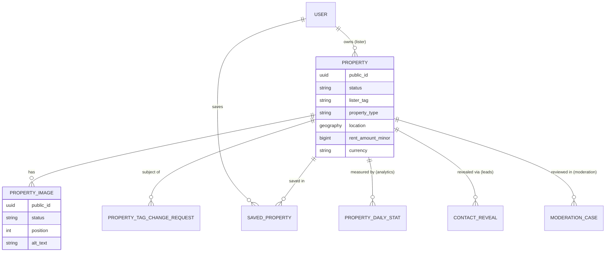
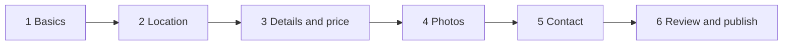
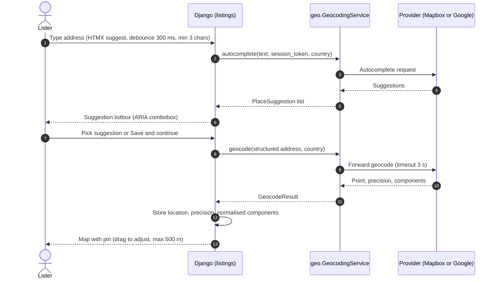
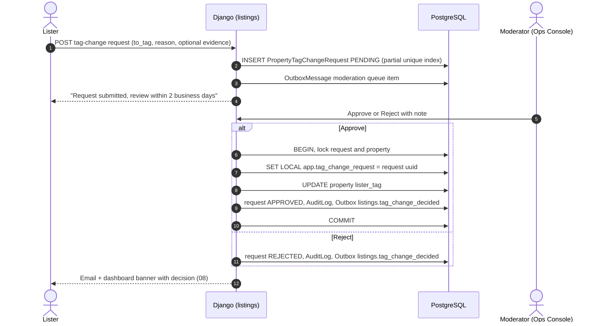
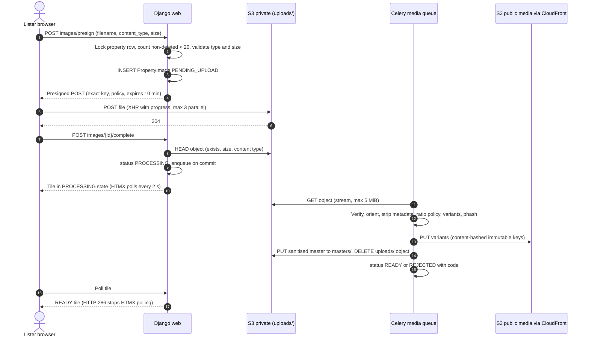
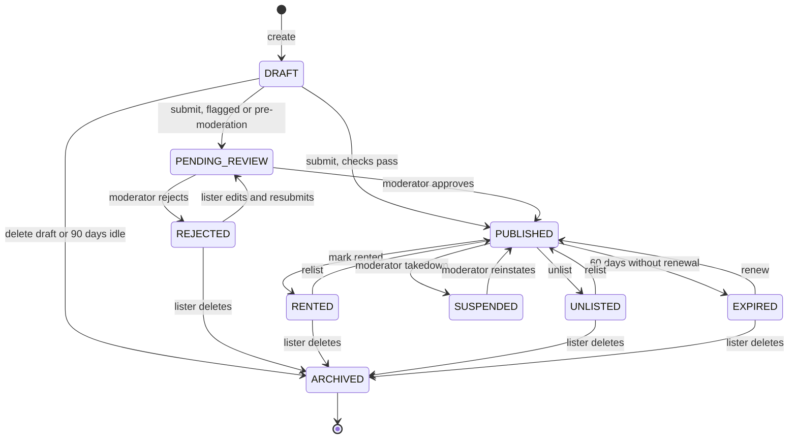

# Listings & Media — Design

Covers how listers create, publish and manage rental listings: the multi-step wizard, drafts, geocoding, pricing, lister-tag integrity, the photo pipeline, the listing lifecycle, the My Properties dashboard and moderation hooks.

Status: Draft v0.1 (2026-10-21)

| Item | Value |
|---|---|
| Owning apps | `apps.listings` (primary), `apps.geo` (geocoding), `apps.analytics` (metrics), `apps.moderation` (hooks) |
| Milestones | M2 Listings (core), M3 (saved properties, cards), M6 (tag-change review UI, moderation queue, dashboard polish) |
| Related designs | Search & Discovery (06), Payments (07), Notifications (08), External Integrations (09), plus the sibling credits/ledger, security and data-model designs in `docs/design/` |

---

## 1. Scope and traceability

| SRS ref (TOC numbering) | Requirement summary | Addressed in |
|---|---|---|
| §3.2 Account Verification | Unverified accounts cannot list | §3 |
| §4.1 Property Submission | Guided multi-step form, save as draft, client-side validation | §4 |
| §4.2 Required Fields | Address, type, price, description, images (3–20), contact info. Formats, aspect ratio, max size (5 MB), automatic thumbnails | §2, §5, §6, §8 |
| §4.3 Lister Tag Selection (CRITICAL) | Exactly one of AgentListed / OwnerListed. Changes only through formal admin review | §7 |
| §4.4 Listing Management | View, edit, mark rented, unlist. Dashboard controls and "real-time" metrics (views, saves, Show Number clicks) | §9, §10 |
| §7.2 My Properties tab | Dashboard with views, contact reveals, performance metrics | §10 |
| §11.1 Lister Tag Clarity | Distinct styling and icons on cards | §7.5 |
| §11.2 Guided Listing, Mobile-First | Progress timeline, inline validation, small steps | §4 |
| §12 Accessibility | WCAG 2.1 AA | §4.6, §8.8 |
| Architecture diagram | Ops Console (listing moderation, fraud review), Asset storage (photos, ownership proofs) | §11 |

> The SRS cross-references "My Properties tab – see 2.5.2.2" and "Property Submission form (2.2.1)" are broken. They mean §7.2 and §4.1 respectively (known issue #3).

**Final requirement IDs** (`FR-LIST-*`, `FR-PROF-*`) are defined in the requirements catalogue. This document references SRS sections.

---

## 2. Domain model



All models extend `core.TimeStampedModel` (`created_at`, `updated_at`). Internal PK is `bigint`. Everything public (URLs, HTMX endpoints, emails) uses `public_id` (UUIDv4, unique).

### 2.1 `listings.Property`

| Field | Type | Constraints / notes | Wizard step |
|---|---|---|---|
| `public_id` | UUID | unique, default `uuid4` | — |
| `owner` | FK `accounts.User` | `on_delete=PROTECT`, indexed | — |
| `status` | varchar(20) enum | `DRAFT`, `PENDING_REVIEW`, `PUBLISHED`, `REJECTED`, `RENTED`, `UNLISTED`, `EXPIRED`, `SUSPENDED`, `ARCHIVED`. Default `DRAFT`. See §9 | — |
| `lister_tag` | varchar(16) enum | `AGENT_LISTED` \| `OWNER_LISTED`. CHECK `status = 'DRAFT' OR lister_tag IS NOT NULL`. Immutable after first publish (§7) | 1 |
| `property_type` | varchar(32) enum | See §6.1 | 1 |
| `title` | varchar(100) | 10–100 chars after trim. Required because the reveal email includes "listing title" (SRS §5.5) | 1 |
| `agency_name` | varchar(120), null | Optional. Only allowed when `AGENT_LISTED` | 1 |
| `country` | char(2) | ISO 3166-1 alpha-2. Must be in `LISTINGS_LAUNCH_COUNTRIES`. Cannot change after first publish | 2 |
| `address_line1` | varchar(200) | Required to publish | 2 |
| `address_line2` | varchar(200), null | Unit/flat/floor. Never shown publicly | 2 |
| `locality` | varchar(120), null | Neighbourhood/district (strongly recommended) | 2 |
| `city` | varchar(120) | Required to publish | 2 |
| `region` | varchar(120), null | State/province. Required for countries configured `region_required` | 2 |
| `postal_code` | varchar(20), null | Per-country format validation where the country uses postcodes | 2 |
| `city_normalized`, `locality_normalized`, `title_normalized` | varchar | Derived on save: NFKD → strip accents → casefold → collapse whitespace. Used by trigram search (06) | derived |
| `location` | `geography(Point, 4326)`, null | True coordinates. Required to publish. Used for filtering only | 2 |
| `display_location` | `geography(Point, 4326)`, null | Public pin. Equals `location` for `EXACT`, fuzzed for `APPROXIMATE` (§5.4) | derived |
| `address_display` | enum | `EXACT` \| `APPROXIMATE` (default `APPROXIMATE`) | 2 |
| `geocode_status` | enum | `PENDING`, `OK`, `FAILED`, `MANUAL` | derived |
| `geocode_precision` | enum, null | `ROOFTOP`, `STREET`, `LOCALITY`, `MANUAL_PIN` | derived |
| `geocode_provider`, `geocode_place_id`, `geocoded_at` | varchar / varchar / timestamptz | Provenance. Re-geocode policy depends on provider terms (09 §6.1) | derived |
| `rent_amount_minor` | bigint | `> 0`. Per-currency sanity bounds (§6.2) | 3 |
| `currency` | char(3) | ISO 4217. Derived from `country` (§6.2) | 3 (read-only) |
| `rent_period` | enum | `MONTHLY` (default) \| `WEEKLY` | 3 |
| `rent_monthly_minor` | bigint | Derived monthly equivalent, used for search filter and sort (06) | derived |
| `deposit_amount_minor` | bigint, null | `>= 0`, same currency | 3 |
| `bedrooms` | smallint | 0–20 (`0` = studio). CHECK | 3 |
| `bathrooms` | smallint | 0–20. CHECK | 3 |
| `area_value` / `area_unit` | int, null / enum `SQM`\|`SQFT` | Both or neither (CHECK). Unit default per country | 3 |
| `furnishing` | enum, null | `UNFURNISHED`, `SEMI_FURNISHED`, `FURNISHED` | 3 |
| `available_from` | date, null | `>= today` when set on submit | 3 |
| `description` | text | 80–5,000 chars. No contact details (§4.3 rule V-12) | 3 |
| `contact_name` | varchar(120) | Required. Default: owner's profile name | 5 |
| `contact_phone` | `EncryptedTextField` (E.164) | Required (**Assumption:** "Show Number" implies a phone). AES-256-GCM field encryption per security design | 5 |
| `contact_phone_hmac` | char(64) | HMAC-SHA256 blind index for fraud and duplicate lookups. Indexed | derived |
| `contact_phone_verified_at` | timestamptz, null | Required to publish (§4.5) | 5 |
| `contact_email` | `EncryptedTextField`, null | Optional. Defaults to the owner's verified email if the lister ticks "show my email" | 5 |
| `search_vector` | tsvector (`GeneratedField`, persisted) | See 06 §6 | derived |
| `wizard_last_step` | smallint | Resume support | — |
| `version` | integer | Optimistic concurrency for autosave and edits. Incremented on every write | — |
| `first_published_at` | timestamptz, null | Set once. Marks lister-tag immutability | — |
| `listed_at` | timestamptz, null | Last transition into `PUBLISHED`. Used for "newest" sort. Bump rules in §9.3 | — |
| `expires_at` | timestamptz, null | `listed_at + 60 days` or last renewal + 60 days (§9.4) | — |
| `rented_at`, `unlisted_at`, `archived_at` | timestamptz, null | Lifecycle stamps | — |

Key DB constraints and indexes (search indexes are specified in 06 §6):

```sql
ALTER TABLE listings_property
  ADD CONSTRAINT ck_property_rent_positive     CHECK (rent_amount_minor > 0),
  ADD CONSTRAINT ck_property_tag_required      CHECK (status = 'DRAFT' OR lister_tag IS NOT NULL),
  ADD CONSTRAINT ck_property_published_located CHECK (status <> 'PUBLISHED' OR (location IS NOT NULL AND listed_at IS NOT NULL)),
  ADD CONSTRAINT ck_property_area_pair         CHECK ((area_value IS NULL) = (area_unit IS NULL));
CREATE INDEX ix_property_owner_status ON listings_property (owner_id, status, updated_at DESC);
CREATE INDEX ix_property_contact_phone_hmac ON listings_property (contact_phone_hmac);
CREATE INDEX ix_property_expires ON listings_property (expires_at) WHERE status = 'PUBLISHED';
```

### 2.2 `listings.PropertyImage`

| Field | Type | Notes |
|---|---|---|
| `public_id` | UUID | unique. Part of S3 keys |
| `property` | FK Property | `on_delete=CASCADE` (rows only; S3 cleanup is asynchronous) |
| `uploaded_by` | FK User | Audit |
| `status` | enum | `PENDING_UPLOAD`, `PROCESSING`, `READY`, `REJECTED`, `DELETED` |
| `position` | smallint | 0-based order. **Cover image = lowest position among READY images.** Unique `(property, position)` among non-deleted rows (partial unique index, `DEFERRABLE INITIALLY DEFERRED` so a reorder fits in one transaction) |
| `alt_text` | varchar(150) | Lister-provided. Falls back to the generated default (§8.8) |
| `original_filename` | varchar(255) | Sanitised. Display only |
| `original_content_type`, `original_size_bytes` | varchar / int | From the presign request, verified by HEAD |
| `upload_sha256` | char(64), null | Rejects the same file uploaded twice to one listing |
| `width`, `height` | int | Of the processed master |
| `crop_applied` | enum | `NONE`, `CENTER_TO_4_3`, `CENTER_TO_16_9` |
| `variants` | JSONB | `{"card": {"key": "...", "w": 640, "h": 480, "bytes": 51234}, ...}` |
| `phash` | char(16), null | Perceptual hash (`imagehash.phash`) for duplicate and fraud detection |
| `rejection_code` | varchar(40), null | `UNSUPPORTED_FORMAT`, `TOO_LARGE`, `TOO_SMALL`, `CORRUPT`, `ASPECT_RATIO`, `DECOMPRESSION_BOMB`, `MODERATION` |
| `processed_at` | timestamptz, null | |

### 2.3 `listings.PropertyTagChangeRequest`

| Field | Type | Notes |
|---|---|---|
| `public_id` | UUID | |
| `property` | FK Property | |
| `requested_by` | FK User | Must be the property owner |
| `from_tag`, `to_tag` | enum | CHECK `from_tag <> to_tag` |
| `reason` | text | 20–1,000 chars |
| `evidence_keys` | JSONB list | Optional private-bucket object keys (agency licence, ownership proof). Up to 3 files, PDF/JPEG/PNG, 10 MB each (private bucket, see 09 §6.9) |
| `status` | enum | `PENDING`, `APPROVED`, `REJECTED`, `CANCELLED` |
| `reviewed_by` | FK User, null | Staff with `listings.review_tagchange` permission (Moderator group) |
| `reviewed_at`, `decision_note` | timestamptz / text | Note is shown to the lister on rejection |

Constraint: at most one `PENDING` request per property (`UNIQUE (property_id) WHERE status = 'PENDING'`).

### 2.4 `listings.SavedProperty`

`user` FK, `property` FK, `created_at`, `UNIQUE (user_id, property_id)`, index `(user_id, created_at DESC)`. Behaviour and UX are in 06 §13.

---

## 3. Access rules and preconditions

| Rule | Detail |
|---|---|
| Who can list | Any **verified** account (SRS §3.2). "Lister" is a capability, not a separate account type. A single account can both rent and list (baseline RBAC). Unverified users who open "List a property" are redirected to verification with `next=` preserved |
| Object access | Lister views use `Property.objects.get(public_id=..., owner=request.user)`. Non-owners get **404, not 403**, so the views can't be used to probe which IDs exist (IDOR protection). Staff act only through the ops console, with Django permissions |
| Draft cap | Max **10** open drafts per user (`LISTINGS_MAX_OPEN_DRAFTS`) |
| Publish rate | New listings published per rolling 24 h: **5** for accounts younger than 30 days, **50** otherwise (`LISTINGS_PUBLISH_RATE_*`). Exceeding the cap returns a form error and opens a moderation flag at 3× the cap |
| Restricted accounts | Users with an active staff restriction (fraud, chargeback) cannot create or publish. Mechanism is in the moderation design |

---

## 4. Multi-step listing wizard (SRS §4.1, §11.2)

### 4.1 Steps and fields



| # | Step (URL slug) | Fields | Step-complete rule (strict) |
|---|---|---|---|
| 1 | Basics (`basics`) | `lister_tag` (radio cards with icon and explanation, plus the warning "This cannot be changed after publishing without admin review"), `property_type`, `title`, `agency_name` (shown only for AgentListed) | Tag, type and title valid |
| 2 | Location (`location`) | `country` (default from account region), address fields, map pin confirmation, `address_display` | Address valid **and** geocode `OK` with precision `ROOFTOP`/`STREET`, or `MANUAL_PIN` |
| 3 | Details and price (`details`) | `rent_amount` (major units in UI), `rent_period`, `deposit_amount`, `bedrooms`, `bathrooms`, `area_value`/`area_unit`, `furnishing`, `available_from`, `description` | All required present and valid |
| 4 | Photos (`photos`) | Uploads, reorder, cover, alt text (§8) | ≥ 3 `READY` images, none `PROCESSING` |
| 5 | Contact (`contact`) | `contact_name`, `contact_phone` (default: owner's verified phone), "show my email" toggle, `contact_email` | Phone verified (§4.5) |
| 6 | Review and publish (`review`) | Read-only summary with per-section "Edit" links. Declarations: "I am authorised to list this property", "The lister tag is accurate", Terms acceptance (versioned) | All steps complete. Server re-validates everything |

The lister tag is collected in step 1 on purpose. Its trust weight (SRS §4.3) earns it a deliberate choice up front rather than a buried field.

### 4.2 Request model

- Each step is a normal Django view at `GET|POST /my/properties/<public_id>/edit/<step>/`, built on a per-step `ModelForm` subclass. The wizard works without JavaScript except for photo upload (§8), which needs JS for direct-to-S3 upload.
- `hx-boost` makes step transitions feel instant. Responses follow POST → redirect → GET.
- Buttons:
  - **Save and continue** runs strict validation for the step, saves, and redirects to the next step.
  - **Save draft** runs lenient validation (types and lengths only, not required-ness), saves, and stays on the step.
  - **Back** never validates and never loses data, because autosave has already persisted it.
- `POST /my/properties/new/` creates the `DRAFT` row (cap check) and redirects to step 1. Drafts are therefore always server-side, from the first keystroke.
- After publish, the same step forms serve **Edit** (§9.5). The progress timeline becomes a section nav.

### 4.3 Validation rules (client and server)

Client-side validation exists for UX only (SRS §4.1 "robust client-side validation"). **The server is always authoritative.** Each rule below runs in both places where possible: HTML5 constraint attributes (`required`, `minlength`, `maxlength`, `min`, `max`, `pattern`, `inputmode`), with Alpine.js for cross-field rules and the server-side form/service as the source of truth.

| ID | Field(s) | Rule | Error copy (en) |
|---|---|---|---|
| V-01 | `lister_tag` | Required. One of two values | "Choose who is listing this property." |
| V-02 | `title` | 10–100 chars. No URLs, no phone/email (V-12) | "Title must be 10–100 characters." |
| V-03 | `country` | In launch countries | "We don't support listings in this country yet." |
| V-04 | address | Line 1 3–200 chars. City required. Postcode regex per country | Field-specific |
| V-05 | geocode | Precision ≥ STREET, or user-confirmed pin | "We couldn't pinpoint this address. Drag the pin to the exact location." |
| V-06 | `rent_amount` | > 0. Within per-currency bounds. At most the currency's minor-unit decimals | "Enter a monthly rent between {min} and {max}." |
| V-07 | `deposit_amount` | ≥ 0. ≤ 24 × monthly rent (soft warning above 6 ×) | — |
| V-08 | `bedrooms`, `bathrooms` | Integer 0–20 | — |
| V-09 | `area` | 50–100,000 sq ft equivalent when present | — |
| V-10 | `available_from` | Not in the past at submit | — |
| V-11 | `description` | 80–5,000 chars after trim. Plain text only. HTML stripped, line breaks preserved | "Description must be at least 80 characters." |
| V-12 | `title`, `description` | **No contact details.** `phonenumbers.PhoneNumberMatcher(text, region=country)`, plus an email regex and a URL regex. Clear matches block submission. Obfuscated matches ("nine eight seven…", "name at gmail dot com") raise a moderation flag (§11) | "Please remove phone numbers, emails and links. Renters see your contact details through Show Number." |
| V-13 | `contact_phone` | Valid E.164 for any country (`phonenumbers.is_valid_number`). Must be verified | "Enter a valid mobile number including country code." |
| V-14 | `contact_email` | RFC-valid. Not a disposable domain (shared blocklist with signup) | — |
| V-15 | photos | 3 ≤ READY ≤ 20 | "Add at least 3 photos ({n} uploaded)." |

V-12 protects the monetisation model. Contact details in free text would let renters skip the 2-credit reveal. **Assumption:** this is a business rule the SRS does not spell out, and it is flagged in OQ-LST-04.

### 4.4 Draft autosave and resume

- **Autosave:** fields carry `hx-post="/my/properties/<id>/edit/<step>/autosave/"` with `hx-trigger="change delay:800ms, keyup changed delay:2s"` and `hx-include="closest form"`. The endpoint runs **lenient** validation and saves only valid fields. It returns a small status fragment, "Saved 12:03" (`role="status"`, `aria-live="polite"`), and never re-renders the form, so focus stays put.
- **Concurrency:** every write sends `version`. The service runs `UPDATE ... WHERE id = %s AND version = %s`. If 0 rows change, it returns **409** with "This listing was changed in another tab. Reload to continue." (`DraftVersionConflict`). This stops two tabs from silently overwriting each other.
- **Resume:** "My Properties → Drafts" lists drafts with completion % (completed strict steps / 6) and **Continue**. Continue opens the first incomplete step (computed server-side), not `wizard_last_step`, so the user lands on what is actually missing.
- **Retention:** drafts untouched for **90 days** are archived, and their images are deleted by a Celery beat job. Reminder email at day 80 (`listings.draft_expiring`, optional, see 08).
- **Abandoned uploads:** see §8.6.

### 4.5 Contact phone verification

- If `contact_phone` equals the owner's verified account phone, `contact_phone_verified_at` is set automatically.
- Otherwise step 5 shows **Verify number**, which sends an OTP through `PhoneVerificationService` (Twilio Verify, 09 §6.2). Rate limits: 3 sends per number per hour, 10 per user per day.
- Rationale: renters pay 2 credits for this number. A wrong or fake number is the single most likely refund and complaint driver. **Assumption** (OQ-LST-03).
- Changing the phone on a published listing re-requires verification **before** the change takes effect. Until then the old number stays active.

### 4.6 UX and accessibility

- Progress indicator: `<nav aria-label="Listing steps"><ol>` with `aria-current="step"`. Each step has a text state (Complete, In progress, Not started, Needs attention), never colour alone.
- On a strict-validation failure, the page shows an error summary at the top (`role="alert"`, links to each field) and moves focus to the summary. Each field links its error through `aria-describedby`.
- Mobile-first: one column, large touch targets (≥ 44×44 px), sticky bottom bar with Back / Save and continue, numeric `inputmode` for money and counts.
- Money input: major units with the currency symbol prefix, converted server-side to minor units using the currency exponent (JPY 0, USD 2, KWD 3). **Floats are never used.** Parsing uses `decimal.Decimal`.

### 4.7 Publish (submit) sequence

1. Lock: `select_for_update()` on the property row.
2. Strict-validate **all** steps again (step-complete flags are never trusted).
3. Check publish rate limit and account restrictions.
4. Run automated checks (§11.1). Each returns `PASS`, `FLAG` (needs review) or `BLOCK` (form error).
5. Decide the target status from `LISTINGS_PREMODERATION_MODE`:
   - `flagged_only` (default): `PUBLISHED` unless there is any FLAG, otherwise `PENDING_REVIEW`.
   - `first_listing`: the user's first listing always goes to `PENDING_REVIEW`.
   - `all`: everything goes to `PENDING_REVIEW`.
6. On `PUBLISHED`: set `first_published_at` (if null), `listed_at`, `expires_at`. Write `AuditLog`. Enqueue outbox `listings.published` (notification, search cache generation bump, sitemap). All of this happens in **one transaction**. Side-effects run after commit via the outbox.

---

## 5. Address, geocoding and location privacy

### 5.1 Flow



- The address fields are the source of truth for display. Provider components are used to **normalise** city and locality (casing, canonical names) only when the user picked a suggestion. A free-typed address is kept as typed.
- **Pin adjustment:** the user may drag the pin up to **500 m** from the geocoded point. That sets precision `MANUAL_PIN` (larger moves require re-entering the address). If the geocode fails or returns only `LOCALITY` precision, the user must place the pin manually (`geocode_status = MANUAL`).
- **Provider failure** (timeout, 5xx, breaker open): the draft saves with `geocode_status = PENDING`. A Celery retry runs at 1, 5 and 30 minutes. The step cannot complete until a point exists, and manual pin placement on the map remains available as long as tiles load.
- Provider choice, ToS caching and storage limits are in 09 §6.1. **The stored point must come from a provider or contract that allows permanent storage, or from a user-placed pin** (OQ-INT-01).

### 5.2 Re-geocoding on edit

Editing any address field after publish re-geocodes the listing:

- If the new point is **more than 1 km** from the old one, the edit opens a `ModerationCase(reason=LOCATION_CHANGED)` and is applied immediately (post-moderation).
- `country` is immutable after first publish. Moving countries means a new listing.

### 5.3 Normalisation

`city_normalized` and `locality_normalized` are computed in Python (`unicodedata.normalize("NFKD")`, combining marks removed, `casefold()`, whitespace collapsed). Doing this in the app avoids PostgreSQL's non-IMMUTABLE `unaccent()` in index expressions.

### 5.4 Location privacy (**Assumption**, OQ-LST-02)

Owner-listed homes are often the owner's residence. The SRS is silent, so the baseline is:

| `address_display` | Public detail page | Public map pin | Search filtering |
|---|---|---|---|
| `APPROXIMATE` (default) | Locality, city, region, postcode prefix. **Line 1 and line 2 hidden** | `display_location` = true point offset by a deterministic pseudo-random bearing and distance of 150–300 m, seeded by HMAC(property_id). Rendered as a ~400 m circle | True `location` |
| `EXACT` | Line 1, locality, city, region (line 2 is never shown) | True point | True `location` |

- Distances on cards are rounded to 0.5 km, so a listing can't be trilaterated.
- The full address is never in JSON-LD for `APPROXIMATE` listings (06 §12).

---

## 6. Property taxonomy and pricing

### 6.1 Property types

`PropertyType` is a Django `TextChoices` enum. Stable codes are used in URLs, filters and SEO slugs. Labels are translated with `gettext`. Changes ship with a deploy, which is acceptable for a taxonomy that should change rarely.

| Code | Label (en) | SEO slug | Bedrooms semantics |
|---|---|---|---|
| `APARTMENT` | Apartment / Flat | `apartments` | ≥ 1 |
| `STUDIO` | Studio | `studios` | forced 0 |
| `HOUSE` | House | `houses` | ≥ 1 |
| `TOWNHOUSE` | Townhouse | `townhouses` | ≥ 1 |
| `VILLA` | Villa | `villas` | ≥ 1 |
| `ROOM` | Private room in shared home | `rooms` | forced 1 |
| `SHARED_ACCOMMODATION` | Shared accommodation / PG / Hostel bed | `shared` | forced 0 |

Commercial property and short-term (nightly) rentals are **out of scope** (OQ-LST-05).

### 6.2 Price, currency and rent period

- Money is stored as `rent_amount_minor` (bigint) plus `currency` (ISO 4217), following the canonical money rule.
- `currency` is **derived from `country`** through `LISTINGS_COUNTRY_CURRENCY` (for example `IN→INR`, `GB→GBP`, `US→USD`, `AE→AED`), and listers cannot pick an arbitrary currency. This keeps search price filters coherent: there is no FX anywhere in the listings domain.
- `rent_period`: `MONTHLY` (default) or `WEEKLY`. `rent_monthly_minor` is computed as `round(weekly × 52 / 12)` with `ROUND_HALF_EVEN` and used for search filtering and sorting (06).
- Sanity bounds per currency (`LISTINGS_RENT_BOUNDS = {"USD": (50_00, 100_000_00), "INR": (1_000_00, 50_00_000_00), ...}`). Out-of-range values are a hard error. Statistical outliers relative to the city median raise a moderation FLAG (post-MVP, M6+).
- Display uses Babel `format_currency(amount, currency, locale=user_locale)` with the period suffix ("₹25,000 / month").

---

## 7. Lister tag rules and `PropertyTagChangeRequest` (SRS §4.3 CRITICAL)

### 7.1 Rules

| ID | Rule |
|---|---|
| T-01 | Exactly one tag, `AGENT_LISTED` or `OWNER_LISTED`. No default selection: the lister must choose actively |
| T-02 | Freely editable while `first_published_at IS NULL` (draft, or pending first review) |
| T-03 | After first publish, the tag is **read-only in every lister form**. The service raises `ListerTagImmutableError` |
| T-04 | Defence in depth: a PostgreSQL trigger rejects any `UPDATE` of `lister_tag` after first publish unless the transaction has set `app.tag_change_request` (only the approval service does this). Admin bulk edits, shell scripts and bugs are all blocked |
| T-05 | Changes only via an approved `PropertyTagChangeRequest`, reviewed by staff holding `listings.review_tagchange` (Moderator group) |
| T-06 | One pending request per property. After a rejection, a **14-day cooldown** applies before another request |
| T-07 | Every change produces an `AuditLog` row (actor, from, to, request id) and a notification to the lister |
| T-08 | Moderators may also **initiate** a change from a fraud case. This creates and approves a request authored by staff, with a mandatory note, so the trail is the same |

```sql
CREATE FUNCTION listings_guard_lister_tag() RETURNS trigger AS $$
BEGIN
  IF OLD.first_published_at IS NOT NULL
     AND NEW.lister_tag IS DISTINCT FROM OLD.lister_tag
     AND coalesce(current_setting('app.tag_change_request', true), '') = '' THEN
    RAISE EXCEPTION 'lister_tag is immutable after publish' USING ERRCODE = 'check_violation';
  END IF;
  RETURN NEW;
END $$ LANGUAGE plpgsql;

CREATE TRIGGER trg_guard_lister_tag
  BEFORE UPDATE OF lister_tag ON listings_property
  FOR EACH ROW EXECUTE FUNCTION listings_guard_lister_tag();
```

`SET LOCAL` is transaction-scoped, so it is safe with PgBouncer transaction pooling.

### 7.2 Flow



```python
# apps/listings/services.py (illustrative; core helper names per core design)
@transaction.atomic
def tag_change_request_approve(*, request_id: int, reviewer: User, note: str) -> PropertyTagChangeRequest:
    tcr = PropertyTagChangeRequest.objects.select_for_update().get(pk=request_id)
    if tcr.status != TagChangeStatus.PENDING:
        raise TagChangeNotPendingError(tcr.public_id)
    prop = Property.objects.select_for_update().get(pk=tcr.property_id)
    if prop.lister_tag != tcr.from_tag:
        raise TagChangeStaleError(tcr.public_id)          # tag changed since the request was filed
    with connection.cursor() as cur:
        cur.execute("SELECT set_config('app.tag_change_request', %s, true)", [str(tcr.public_id)])
    Property.objects.filter(pk=prop.pk).update(lister_tag=tcr.to_tag, version=F("version") + 1, updated_at=timezone.now())
    tcr.status, tcr.reviewed_by, tcr.reviewed_at, tcr.decision_note = TagChangeStatus.APPROVED, reviewer, timezone.now(), note
    tcr.save(update_fields=["status", "reviewed_by", "reviewed_at", "decision_note", "updated_at"])
    audit_log_record(actor=reviewer, action="listing.lister_tag_changed", target=prop,
                     data={"from": tcr.from_tag, "to": tcr.to_tag, "request": str(tcr.public_id)})
    outbox_enqueue(topic="listings.tag_change_decided", payload={"request": str(tcr.public_id)},
                   dedupe_key=f"tcr:{tcr.public_id}:decided")
    return tcr
```

### 7.3 Review SLA and queue

- Target: decision within **2 business days**. This is an **Assumption** that needs a staffing decision.
- The moderation queue (M6) shows requests oldest first, with listing snapshot, reason, evidence via 5-minute signed URLs, and the owner's history (prior requests, fraud flags, agent indicators such as many listings or one phone across many accounts).
- Until M6 ships, review runs through the hardened Django admin action (M2/M3) with the same service.

### 7.4 Effects

- The search cache generation is bumped (06 §8).
- Existing `ContactReveal` rows are not affected.
- `AuditLog` keeps the tag history, so a "tag changed on {date}" note can appear on the listing if the PM wants that for transparency (OQ-LST-06).

### 7.5 Presentation (SRS §11.1)

| Tag | Badge text | Icon | Style tokens |
|---|---|---|---|
| `AGENT_LISTED` | "Agent" (full label "Listed by agent") | Briefcase (SVG, `aria-hidden="true"`) | `--tag-agent-bg`, `--tag-agent-fg` (contrast ≥ 4.5:1) |
| `OWNER_LISTED` | "Owner" (full label "Listed by owner") | House | `--tag-owner-bg`, `--tag-owner-fg` (contrast ≥ 4.5:1) |

The badge always carries text, so colour is never the only signal (WCAG 1.4.1). One `` component is used on cards, detail and dashboard.

---

## 8. Image pipeline (SRS §4.2)

### 8.1 Policy

| Rule | Value |
|---|---|
| Count | Min **3** READY to publish, max **20** non-deleted per listing |
| Accepted upload types | `image/jpeg`, `image/png`, `image/webp`. `image/heic`/`heif` is a stretch goal via `pillow-heif` after licence review. iOS Safari usually transcodes HEIC to JPEG when `accept` excludes HEIC; verify on target iOS versions. GIF, SVG, TIFF and BMP are rejected |
| Max upload size | **5 MiB** (5,242,880 bytes), enforced in the browser, in the presigned POST policy and on HEAD |
| Min dimensions | Long edge ≥ 1,024 px, and short edge ≥ 576 px **after** any crop |
| Max pixels | 50 MP (`Image.MAX_IMAGE_PIXELS = 50_000_000`, and `DecompressionBombWarning` is treated as an error) |
| Aspect ratio (r = w/h after EXIF orientation) | See §8.3 |
| Metadata | Removed entirely: EXIF (including GPS), XMP, IPTC, comments. Colour converted to sRGB. Alpha flattened on white |
| Original | Never served publicly. A sanitised master is kept privately for re-processing |

### 8.2 Upload sequence (direct-to-S3, presigned POST)



Presign specifics (boto3 `generate_presigned_post`):

- `Key = uploads/{property_public_id}/{image_public_id}` (exact, no `starts-with`).
- `Conditions`: `["content-length-range", 1, 5242880]`, `{"Content-Type": <declared>}`, `{"x-amz-server-side-encryption": "aws:kms"}`.
- `ExpiresIn=600`.
- The bucket policy rejects unencrypted PUTs. Bucket CORS allows `POST` only from the app's origins.
- The presign service checks the **count under a row lock** (`select_for_update` on Property), so parallel presigns cannot exceed 20.

The browser checks type, size and ratio before upload to save round trips. Images over 5 MiB that the browser can decode (JPEG/PNG/WebP) are **downscaled client-side** to a 4,096 px long edge, JPEG q=0.9, via `<canvas>`/`createImageBitmap`. This is an optimisation only; the server enforces everything again.

### 8.3 Aspect-ratio policy

Target display ratios: cards use **4:3**; gallery and detail views keep the accepted ratio within **4:3 to 16:9**.

| Input ratio r (after orientation) | Action | `crop_applied` |
|---|---|---|
| 1.30 ≤ r ≤ 1.80 (≈ 4:3 to 16:9 with tolerance) | Accept as-is | `NONE` |
| 1.00 ≤ r < 1.30 (square-ish) | Auto centre-crop to 4:3 (keeps ≥ 75 % of pixels) | `CENTER_TO_4_3` |
| 1.80 < r ≤ 2.40 (wide) | Auto centre-crop to 16:9 (keeps ≥ 74 %) | `CENTER_TO_16_9` |
| r < 1.00 (portrait) or r > 2.40 (panorama) | **Reject** server-side (`ASPECT_RATIO`) | — |

Before upload, the client detects out-of-range photos and offers an **in-browser crop dialog** (Cropper.js, MIT licence). The dialog defaults to a centred 4:3 box and includes a keyboard-accessible "Auto-crop to centre" button plus arrow-key nudging. The cropped blob is what gets uploaded. Portrait phone photos therefore remain usable, and the server rule stays strict, as the SRS requires.

### 8.4 Variants

All public variants are stored at `listings/{property_public_id}/{image_public_id}/{variant}-{sha256[:10]}.{ext}` in the **public media bucket** (CloudFront origin with OAC; the bucket itself is not public). Headers: `Cache-Control: public, max-age=31536000, immutable`.

| Variant | Size (px) | Fit | Format / quality | Used for |
|---|---|---|---|---|
| `thumb` | 320×240 | cover crop 4:3 | WebP q75 | Dashboard rows, admin, small cards |
| `card` | 640×480 | cover crop 4:3 | WebP q78 | Search cards (`srcset` 1x/2x with `thumb`) |
| `md` | 1024 wide | keep ratio | WebP q80 | Detail gallery (mobile) |
| `lg` | 1600 wide | keep ratio | WebP q82 | Detail gallery (desktop), lightbox |
| `og` | 1200×630 | cover crop 1.91:1 | JPEG q82 | Open Graph / social, JSON-LD `image` |
| `email` | 600×450 | cover crop 4:3 | JPEG q80 | Email templates. JPEG because several email clients do not render WebP |
| master (private) | ≤ 4096 long edge | keep | JPEG q90 | `masters/` prefix in the private bucket, for re-processing only |

- **AVIF** (`card`, `lg`) is post-MVP. Enable it via `<picture>` once the media worker's CPU budget is measured. Pillow AVIF support or `pillow-avif-plugin` must be verified at project start.
- Rendering uses ``. The first search card image and the detail hero use `loading="eager" fetchpriority="high"` for LCP. `width`/`height` attributes prevent CLS.

### 8.5 Processing task

`listings.tasks.process_property_image(image_id)` runs on the `media` queue with `acks_late=True`, 3 retries for transient S3 errors, a 60 s soft time limit, and an idempotent no-op if the image is already `READY`/`REJECTED`.

1. Stream the object (abort beyond 5 MiB). Compute SHA-256. Reject a duplicate within the same listing.
2. `Image.open()`, then `verify()`, then **re-open** (verify invalidates the image). Check that the decoded format is in the allowlist; the declared content type is not trusted.
3. For JPEG, use `img.draft("RGB", (4096, 4096))` to decode at reduced size (faster, less memory).
4. `ImageOps.exif_transpose()`, then convert to sRGB through `ImageCms` when an ICC profile is present, then flatten alpha.
5. Apply the dimension and ratio policy (§8.1, §8.3).
6. Build the variants with `Image.resize(..., Image.LANCZOS)`. Save with `exif=b""` and no `icc_profile` (sRGB is assumed), so no metadata is written.
7. Compute `phash`. Look up near duplicates (Hamming distance ≤ 6) among **other owners'** published images and, on a hit, open a `ModerationCase(reason=DUPLICATE_IMAGES)` (fraud signal).
8. Upload variants and the master. Delete the upload object. Set `READY` and the dimensions.
9. Image moderation hook `ImageModerationService.check(master)`. MVP: no-op. Post-MVP: AWS Rekognition `DetectModerationLabels` and OCR for phone numbers in images (09 §6.10).

Worker sizing: a 50 MP RGB decode is about 150 MB, so start with media workers at 2 GB / concurrency 4. Re-encoding through Pillow neutralises polyglot payloads, and originals are never served, so antivirus scanning is not required for images (it is required for KYC documents, see 09 §6.9).

### 8.6 Cleanup

- `PENDING_UPLOAD` rows older than 1 h are deleted by Celery beat every 15 min. The same sweeper re-enqueues `PROCESSING` rows older than 15 min, up to 5 times, then alerts.
- An S3 lifecycle rule expires `uploads/` objects after 1 day as a backstop.
- Deleting an image sets `DELETED` and enqueues asynchronous deletion of its S3 variants.
- Moderation removal of illegal content additionally issues a CloudFront invalidation for the image's keys.
- An archived draft deletes all its images. A rented, unlisted or expired listing **keeps** its images, because relist is possible.

### 8.7 Ordering, cover, deletion rules

- Drag-and-drop with SortableJS, plus an accessible alternative: "Move earlier" / "Move later" buttons and "Make cover" (moves to position 0).
- Order changes post the full ordered list of `public_id`s. The server rewrites positions in one transaction (deferred unique constraint).
- The cover is the first READY image. A REJECTED or PROCESSING image is never the cover.
- Deleting an image from a **published** listing is blocked if READY images would drop below 3 ("A live listing needs at least 3 photos. Add another before removing this one.").

### 8.8 Alt text

- Each tile has an optional "Describe this photo" field (max 150 chars) with an example ("Living room with balcony and city view").
- Fallback when empty: `"{type label} in {locality or city} – photo {n} of {N}"`.
- The rendered `alt` is never empty for gallery images (they are content, not decoration).
- The review step nudges: "Photos with descriptions help renters using screen readers."

### 8.9 Failure cases

| Case | Detection | Behaviour |
|---|---|---|
| File > 5 MiB | Client, presign policy, HEAD | Inline tile error "Max 5 MB per photo". Presign is never issued for declared > 5 MiB |
| Wrong or forged type | Pillow decode | `REJECTED/UNSUPPORTED_FORMAT` |
| Corrupt or truncated | `verify()` fails | `REJECTED/CORRUPT` |
| Too small | Dimension check | `REJECTED/TOO_SMALL` with "at least 1024 px wide" |
| Portrait or panorama | Ratio check | `REJECTED/ASPECT_RATIO` plus a "Crop and retry" link to the crop dialog |
| Upload never completed | Sweeper | Row deleted, tile disappears |
| Worker crash mid-processing | `acks_late` redelivery | Idempotent reprocess |
| S3 outage | boto3 errors | Retry 3× with exponential backoff. If S3 is still failing, the row stays `PROCESSING` (never `REJECTED`, because the photo is not at fault), an alert fires, and the 15-minute sweeper re-enqueues it. Lister copy: "Processing is delayed, we'll keep trying" |

---

## 9. Listing lifecycle (SRS §4.4)

### 9.1 State machine



Transitions are enforced in `listings.services.property_transition()` against an explicit allowed-transition table. Every transition writes `AuditLog` and bumps the search cache generation when it enters or leaves `PUBLISHED`. Listings are **never hard-deleted** once they have been published, because `ContactReveal` and ledger entries reference them (financial audit trail). `ARCHIVED` hides them from the lister UI.

### 9.2 Visibility matrix

| Status | In search | Public detail page | Show Number | Owner sees | Renters who revealed |
|---|---|---|---|---|---|
| DRAFT, PENDING_REVIEW, REJECTED | No | 404 | — | Yes | — |
| PUBLISHED | Yes | 200 | Yes (per credits rules) | Yes | Contact shown free (leads design) |
| RENTED, UNLISTED, EXPIRED | No | **410** "No longer available" page with similar listings, `noindex` | Hidden | Yes | Full page (200) plus revealed contact, and the contact stays in transaction history (SRS §5.4) |
| SUSPENDED | No | 410 (same page, no reason disclosed) | Hidden | Yes, with reason banner | Contact via transaction history only |
| ARCHIVED | No | 410 | Hidden | No (hidden) | Contact via transaction history only |

### 9.3 Mark rented, unlist, relist

- **Mark rented:** confirm dialog ("Renters won't see this listing anymore"). Optionally records whether the property was rented via the platform (yes / no / prefer not to say), a cheap ROI signal for analytics. Status becomes `RENTED`.
- **Unlist:** status becomes `UNLISTED`.
- **Relist** (from RENTED or UNLISTED): runs the publish checks again (§4.7). If more than 90 days have passed since `listed_at`, the lister must first confirm price, availability and photos (opens the review step).
- **"Newest" bump rule:** relist sets `listed_at = now()` only if the previous `listed_at` is more than **7 days** old. Otherwise `listed_at` keeps its old value. This stops unlist/relist cycling to the top of "newest" sort.

### 9.4 Expiry and renewal (**Assumption / addition**, OQ-LST-01)

The SRS has no expiry, but stale listings lead to renters paying 2 credits for a property that is already let, which is the leading refund risk. Baseline:

- `expires_at = listed_at + 60 days`.
- Reminder notification 7 days before (`listings.expiring_soon`).
- One-click **"Still available – renew"** from the email (signed link, still requires login) or from the dashboard. Renew extends `expires_at` by 60 days and does **not** bump `listed_at`.
- Celery beat job (hourly) moves overdue listings to `EXPIRED` in batches of 500 with `FOR UPDATE SKIP LOCKED`.

### 9.5 Editing a published listing

- Edits apply immediately (post-moderation) and re-run the automated checks. FLAG results open a `ModerationCase` without hiding the listing. BLOCK results are form errors.
- **Locked fields:** `lister_tag` (via §7 only), `country`.
- **Re-verification:** a `contact_phone` change requires OTP before it takes effect (§4.5).
- **Re-geocode:** see §5.2.
- **Optimistic concurrency** via `version` (409 on conflict).

---

## 10. My Properties dashboard (SRS §4.4, §7.2)

### 10.1 Layout

- Route: `/my/properties/`, reachable from the profile dropdown "My Properties".
- Status tabs with counts: **Live** (PUBLISHED), **In review** (PENDING_REVIEW, REJECTED), **Drafts**, **Rented**, **Inactive** (UNLISTED, EXPIRED, SUSPENDED).
- Summary strip for the last 30 days: total views, saves, Show Number clicks, contact reveals, live listings.
- Each row (mobile: card) shows:
  - cover `thumb`, title, status badge, tag badge, price, `expires_at` countdown for live listings
  - metrics: views (7 d / total), saves (current), reveals (7 d / total)
  - actions: Edit, Mark rented, Unlist, Relist / Renew, View public page, Request tag change, Delete (where allowed)
- Detail drill-down `/my/properties/<id>/insights/`: daily chart for 30/90 days (views, saves, reveal clicks, reveals), conversion "reveals per 100 views", and a comparison with similar listings in the same city (median, post-MVP).

### 10.2 Metric definitions

| Metric | Definition | Source of truth | Latency |
|---|---|---|---|
| Views | Detail-page renders by a non-owner, non-bot viewer, deduplicated per (viewer key, property) per 30 min. Viewer key = user id, or the session key for anonymous viewers. Bots are excluded by UA allow/deny list and only HTTP 200 responses count | Redis counters `stats:{property_id}:{yyyymmdd}` (HINCRBY), flushed every 60 s into `analytics.PropertyDailyStat` with `INSERT ... ON CONFLICT DO UPDATE SET views = views + EXCLUDED.views` | ≤ 60 s |
| Saves | Current count of `SavedProperty` rows, plus daily "saves added" | DB (exact) | Immediate |
| Show Number clicks | Every click on Show Number by a logged-in non-owner, **including** insufficient-credit outcomes | Redis counter, then PropertyDailyStat | ≤ 60 s |
| Contact reveals | Successful paid reveals (first reveal per user per property) | `leads.ContactReveal` count (exact) | Immediate |

The SRS asks for "clicks on Show Number". Both raw clicks and successful reveals are reported because they answer different questions: clicks measure demand, reveals measure monetised leads.

### 10.3 "Real-time" refresh

- The metrics fragment is loaded with `hx-get="/my/properties/metrics/" hx-trigger="load, every 30s [document.visibilityState === 'visible']" hx-swap="outerHTML"`, so polling pauses in background tabs. This is the diagram's "Periodic HTTP Polling".
- Server side: one selector reads today's Redis counters plus aggregated `PropertyDailyStat`. It is cached per owner for 10 s (`cache key owner_metrics:{user_id}`).
- Target p95 < 150 ms for owners with up to 200 listings. More than 200 listings paginates at 50 per page, with metrics only for the visible page.
- **Deviation from SRS:** "instantly" is interpreted as **≤ 60 s** freshness for counters and immediate for saves and reveals. True push (WebSockets/SSE) is not justified for a dashboard and would add ASGI infrastructure. The SRS intent (near-real-time visibility) is met.

---

## 11. Moderation hooks

### 11.1 Automated checks (submit, edit, relist)

| Code | Check | Result |
|---|---|---|
| `CONTACT_IN_TEXT` | V-12 clear match | BLOCK (form error) |
| `CONTACT_IN_TEXT_FUZZY` | Obfuscated phone/email patterns | FLAG |
| `PROFANITY` | Word list per language | FLAG |
| `DUPLICATE_LISTING` | Same owner, same normalised address (+ line 2), another active listing | BLOCK ("You already have a live listing at this address") |
| `DUPLICATE_IMAGES` | pHash match with another owner's images | FLAG (fraud signal, async after processing) |
| `SHARED_CONTACT_PHONE` | `contact_phone_hmac` used by ≥ 3 distinct owner accounts | FLAG (agent posing as owner, or a ring) |
| `TAG_MISMATCH_SIGNAL` | `OWNER_LISTED`, but the owner has > 5 live listings in 90 days | FLAG (possible agent mis-tagging) |
| `LOW_GEOCODE_PRECISION` | Manual pin far from the geocoded locality | FLAG |
| `VELOCITY` | Publish-rate cap × 3 | FLAG plus a rate-limit error |
| `PRICE_OUTLIER` (M6+) | Rent outside the p1–p99 band for city and type | FLAG |

Checks are implemented as a registry of small classes (`ListingCheck.run(property) -> CheckResult`), so new checks never touch the publish service.

### 11.2 Signals to the moderation app

```python
moderation.services.case_open(subject=property, reason_code="DUPLICATE_IMAGES",
                              severity=Severity.MEDIUM, source=CaseSource.AUTOMATED,
                              evidence={"matched_image": str(other.public_id), "distance": 4})
```

- **Renter "Report listing"** (MVP, small scope, addition backing the diagram's "fraud review"): reasons are already rented, fake/scam, wrong agent/owner tag, wrong details, offensive. Logged-in users only. Rate-limited to 10 per day. Opens a `ModerationCase(source=USER_REPORT)`. Three distinct "already rented" reports in 7 days move the listing to `UNLISTED` with an owner notification ("Please confirm availability").
- **Moderator actions on a listing:** approve, reject (reason code plus note), suspend, reinstate, remove image, force tag change (§7, T-08). All of these call `listings.services`, never the ORM directly.

---

## 12. Code organisation, endpoints and errors

### 12.1 Services and selectors (HackSoft style)

| Module | Functions |
|---|---|
| `listings/services.py` | `property_create_draft`, `property_update_step`, `property_autosave`, `property_submit`, `property_transition`, `property_update_published`, `property_renew`, `image_presign`, `image_complete_upload`, `image_reorder`, `image_delete`, `image_update_alt_text`, `tag_change_request_create`, `tag_change_request_approve`, `tag_change_request_reject`, `saved_property_toggle` |
| `listings/selectors.py` | `property_get_public(public_id)` (returns `PublicPropertyDTO` **without contact fields**), `property_get_for_owner`, `property_list_for_owner(owner, tab, page)`, `owner_dashboard_metrics(owner)` |
| `listings/checks.py` | Automated check registry (§11.1) |
| `listings/tasks.py` | `process_property_image`, `sweep_pending_uploads`, `expire_listings`, `archive_stale_drafts`, `delete_image_objects` |
| `geo/services.py` | `GeocodingService` port and adapters (09 §6.1) |

### 12.2 Domain exceptions

`ListingNotEditableError`, `ListerTagImmutableError`, `TagChangeAlreadyPendingError`, `TagChangeCooldownError`, `TagChangeStaleError`, `ImageLimitExceededError`, `MinimumImagesRequiredError`, `DraftLimitExceededError`, `PublishRateLimitedError`, `DraftVersionConflictError`, `GeocodingUnavailableError`, `ContactNotVerifiedError`. Views map these to form errors, HTTP 409 or HTTP 429. The mapping lives in one place (`listings/views/errors.py`).

### 12.3 Routes (server-rendered and HTMX fragments)

| Method | Path | Purpose |
|---|---|---|
| GET | `/properties/<public_id>/<slug>/` | Public detail. 301 to the canonical slug if it differs |
| POST | `/my/properties/new/` | Create draft |
| GET, POST | `/my/properties/<id>/edit/<step>/` | Wizard step / edit section |
| POST | `/my/properties/<id>/edit/<step>/autosave/` | Autosave (HTMX) |
| POST | `/my/properties/<id>/submit/` | Publish |
| POST | `/my/properties/<id>/images/presign/` | Presigned POST |
| POST | `/my/properties/<id>/images//complete/` | Upload complete |
| GET | `/my/properties/<id>/images//` | Tile fragment (polling) |
| POST | `/my/properties/<id>/images/order/` | Reorder |
| POST | `/my/properties/<id>/images//delete/` | Delete image |
| POST | `/my/properties/<id>/transition/<action>/` | `rent`, `unlist`, `relist`, `renew`, `archive` |
| GET, POST | `/my/properties/<id>/tag-change/` | Request a tag change |
| GET | `/my/properties/` and `/my/properties/metrics/` | Dashboard and polling fragment |
| POST | `/properties/<id>/report/` | Report listing |

All POSTs are CSRF-protected (the HTMX `hx-headers` carries the token).

---

## 13. Security and privacy of listing contact data (known issue #20)

The contact phone and email are the monetised asset. They **must never reach a client that has not revealed them**, not even hidden in the DOM.

| Control | Implementation |
|---|---|
| Storage | `EncryptedTextField` (application-level AES-256-GCM, KMS-wrapped data keys, per the security design) plus an HMAC blind index for fraud lookups |
| Read path | Only `leads.selectors.revealed_contact_for(user, property)` decrypts contact fields, after checking for a `ContactReveal` row (or ownership). `PublicPropertyDTO` has no contact attributes, so a template cannot leak them by accident |
| Exclusions | Not in search cache entries, card fragments, JSON-LD, Open Graph, sitemaps, map JSON, analytics events, structlog output (a redaction processor drops `contact_*` keys) or Sentry events (`before_send` scrubber) |
| Admin | The Django admin shows contact fields masked (`+44 •••• ••• 123`). Unmasking needs `listings.view_contact` permission and is audit-logged |
| Tests | A regression test renders detail, search, card and map responses for a seeded listing and asserts the plaintext phone, email and their common formats (spaced, dashed) **do not appear** for anonymous, zero-credit and non-revealed users |

---

## 14. Testing and acceptance criteria

### 14.1 Test focus

- **Unit:**
  - validation rules V-01 to V-15
  - ratio policy table (boundaries 0.99 / 1.00 / 1.30 / 1.80 / 2.40 / 2.41)
  - money conversion per currency exponent
  - weekly→monthly normalisation
  - transition table (every allowed and disallowed pair)
  - bump rule
- **Integration (pytest-django + PostGIS):**
  - tag trigger blocks raw `UPDATE`
  - approval service succeeds
  - concurrent presigns never exceed 20 (threads plus `select_for_update`)
  - autosave version conflict returns 409
  - publish is atomic with outbox rows
- **Image pipeline:** fixture corpus covering JPEG with GPS EXIF (assert stripped), CMYK JPEG, PNG with alpha, 16-bit PNG, truncated file, decompression bomb, polyglot file, portrait, panorama, exactly 5 MiB and 5 MiB + 1 byte. S3 is faked with `moto`.
- **E2E (Playwright):** full wizard on a mobile viewport, resume a draft, upload 3 images, publish, edit, mark rented, renew. axe-core passes on every wizard step.

### 14.2 Acceptance criteria

| ID | Criterion |
|---|---|
| AC-LST-01 | An unverified user cannot create a draft and is redirected to verification with `next` preserved |
| AC-LST-02 | Closing the browser mid-wizard and returning via My Properties → Drafts → Continue lands on the first incomplete step with all entered data intact |
| AC-LST-03 | Publishing with 2 READY photos fails with "Add at least 3 photos". The 21st presign is refused |
| AC-LST-04 | An uploaded JPEG with GPS EXIF yields public variants with no EXIF/XMP (verified with `exiftool`) |
| AC-LST-05 | After first publish, the lister tag is not editable in the UI, and a direct SQL `UPDATE` of `lister_tag` fails. An approved request changes it and creates an AuditLog row |
| AC-LST-06 | A second tag-change request while one is pending is refused |
| AC-LST-07 | The listing's contact phone does not appear in any response body for a user who has not revealed it |
| AC-LST-08 | The dashboard shows a new detail-page view within ≤ 60 s and a new save or reveal on the next poll (≤ 30 s) |
| AC-LST-09 | A RENTED listing returns 410 to anonymous users and disappears from search within one cache TTL (≤ 60 s) |
| AC-LST-10 | Every wizard step passes axe-core with zero serious or critical violations and is completable by keyboard only |

---

## 15. Open questions

| ID | Question | Baseline until answered |
|---|---|---|
| OQ-LST-01 | Should listings expire? What period? | 60 days with renewal (§9.4) |
| OQ-LST-02 | Is the exact street address public, or only after reveal or never? | Lister choice, default APPROXIMATE (§5.4) |
| OQ-LST-03 | Must a listing's contact phone be OTP-verified when it differs from the account phone? | Yes (§4.5) |
| OQ-LST-04 | Is blocking contact details in title/description acceptable to the business? | Yes, hard block on clear matches (V-12) |
| OQ-LST-05 | Are commercial property and short-term rentals in scope? Which rent periods? | Residential only. Monthly and weekly |
| OQ-LST-06 | Should a tag-change history be visible to renters? | No (audit only) |
| OQ-LST-07 | Pre-moderation policy: flagged only, first listing, or all? | `flagged_only` |
| OQ-LST-08 | Launch countries (drives currency map, address formats, postcode rules, units) | Configurable. Needs the list for M2 |
| OQ-LST-09 | Tag-change review SLA and Moderator staffing | 2 business days |
| OQ-LST-10 | Should listers be told when someone reveals their number (no renter identity)? | Counts on the dashboard only. Per-reveal lister email deferred (see 08) |
