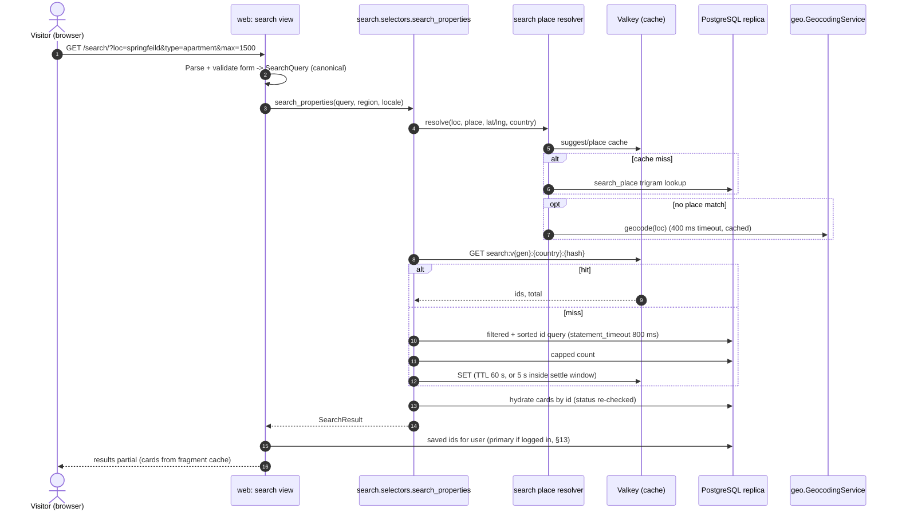
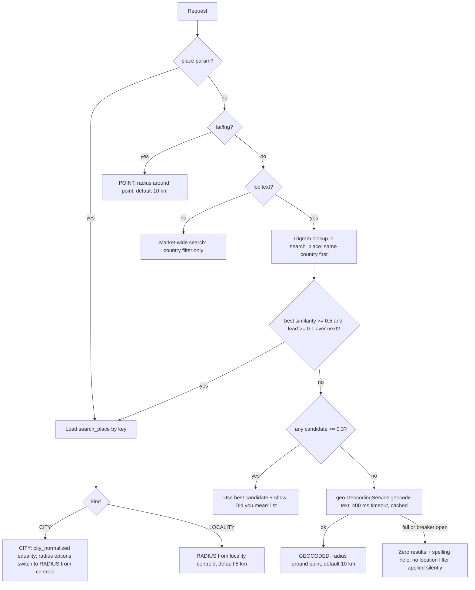
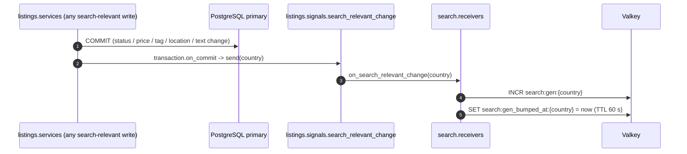

# Search & Discovery — Design

How renters find listings: the search URL contract, location resolution, filters, fuzzy and full-text matching on PostgreSQL, sorting and pagination, indexes and query plans, caching, read-replica routing, the latency budget, map view, SEO, saved properties, and the trigger-based path to OpenSearch.

Status: Draft v0.1 (2026-10-21)

| Item | Value |
|---|---|
| Owning apps | `apps.search` (primary), `apps.listings` (`Property`, `SavedProperty`, card component), `apps.geo` (geocoding fallback, region), `apps.analytics` (save counters) |
| Milestones | M3 Search & Discovery (all MVP scope), M6 (search analytics in ops), Post-MVP (viewport map search, saved searches, OpenSearch) |
| Related | [05 Listings & Media](05-listings-and-media.md) · [08 Notifications](08-notifications.md) · [09 External Integrations](09-external-integrations.md) · [System Architecture](../architecture/01-system-architecture.md) (§9, §12, §13.2, §16) · [Milestones & Backlog](../delivery/02-milestones-and-backlog.md) (M3) |

---

## 1. Scope and traceability

| SRS ref (TOC numbering) | Requirement summary | Addressed in |
|---|---|---|
| §4.5 Search & Filter | Visitors search and filter by location, price range, property type and AgentListed/OwnerListed. Index optimised for fast, relevant results using geospatial queries, multi-select filters, sorting (newest, price), fuzzy matching | §2–§7 |
| §4.4 Listing Management | "saves" metric implies a save/favourite feature | §13 |
| §8.1 Latency | Search p95 < 500 ms standard load, < 1,000 ms peak. Indexing, read replicas, CDN | §6, §8, §9, §10 |
| §11.1 Lister Tag Clarity | Distinct tag styling on property cards | §2.4 (card uses `` from 05 §7.5) |
| §11.2 Mobile-First | Search filters optimised for mobile first | §2.3 |
| §12 Accessibility | WCAG 2.1 AA | §2.5, §11.3 |
| Architecture diagram | "Real-time State / Cache: hot search results" | §8 |

Backlog stories: US-301 to US-314 (M3). Requirement ID: **FR-LIST-05** (search), FR-LIST-04 (saves metric), NFR-PERF-01. The requirements catalogue owns final IDs. The SRS section is the binding reference.

**Out of scope for MVP:** viewport "search this area" map search (US-907), saved searches and alerts (US-906), OpenSearch (US-908), multilingual stemming, personalised ranking.

---

## 2. Search experience and URL contract

### 2.1 Entry points

| Route | Purpose | Indexable |
|---|---|---|
| `GET /` | Home. Search hero (Where, type, max price), recent listings in the visitor's market | Yes |
| `GET /search/` | Results page. All state lives in the query string (shareable, back-button safe) | Only the canonical forms in §12.2 |
| `GET /rent/<country>/<city-slug>/` | City landing page. Same template as `/search/` with the city preselected | Yes |
| `GET /rent/<country>/<city-slug>/<type-slug>/` | City + property type landing page (`type-slug` from 05 §6.1, e.g. `apartments`) | Yes |
| `GET /search/suggest/?loc=...` | HTMX location suggestions (ARIA combobox listbox fragment) | No |
| `GET /search/map/?...` | Map pins for the current result page (JSON, §11) | No |

### 2.2 Query parameters

All parameters are optional. Unknown parameters are ignored. Invalid values are dropped and a non-blocking notice says which filter was ignored (US-303 "invalid parameters are ignored safely").

| Param | Type / allowed values | Default | Notes |
|---|---|---|---|
| `loc` | text, 2–100 chars | — | Free-text "Where". Resolved by §5 |
| `place` | opaque place key (`search_place.key`, 32 hex) | — | Set when the user picks a suggestion. Wins over `loc` |
| `lat`, `lng` | decimal, rounded to 4 dp (≈ 11 m) | — | "Near me" (browser geolocation, opt-in only) |
| `r` | km ∈ {2, 5, 10, 25, 50} | Place-dependent (§5.2) | Radius |
| `bbox` | `w,s,e,n` decimals | — | Post-MVP map search. Accepted by the backend from M3 so the contract is stable |
| `q` | text, 2–100 chars | — | Keywords ("balcony", "pet friendly"). Full-text + fuzzy (§7.1) |
| `min`, `max` | integer, **major units per month** in the market currency | — | Converted to minor units with the currency exponent. `min > max` → swapped |
| `type` | repeatable; lowercase `PropertyType` codes (`apartment`, `studio`, `house`, `townhouse`, `villa`, `room`, `shared_accommodation`) | all | OR within the filter |
| `tag` | repeatable; `agent`, `owner` | both | Maps to `AGENT_LISTED` / `OWNER_LISTED`. OR within the filter |
| `beds` | integer 0–5 (`5` = 5+; `0` = studio only) | — | Minimum bedrooms, except `0` which is "studio" (exact) |
| `baths` | integer 1–4 (`4` = 4+) | — | Minimum bathrooms |
| `furn` | repeatable; `unfurnished`, `semi_furnished`, `furnished` | all | OR within the filter |
| `avail` | ISO date | — | "Available by": `available_from IS NULL OR available_from <= avail` |
| `sort` | `newest`, `price_asc`, `price_desc`, `distance`, `relevance` | §7.3 | Invalid combinations fall back to the default |
| `page` | integer 1–50 | 1 | §7.4 |

Filters combine with **AND across filters, OR within a filter** (US-303).

**Canonicalisation.** Before cache lookup and before rendering canonical links, the parsed `SearchQuery` is normalised: multi-values sorted and de-duplicated, defaults removed, text trimmed, NFKD-folded and case-folded (same normaliser as 05 §5.3), coordinates rounded to 4 dp. The canonical string is used for the cache key (§8) and for `<link rel="canonical">` (§12).

### 2.3 Page behaviour (HTMX, mobile-first)

- The filter form is a normal `GET` form. Without JavaScript it submits and the full page renders.
- With HTMX: `hx-get="/search/"`, `hx-target="#results"`, `hx-push-url="true"`, `hx-trigger="change, keyup changed delay:300ms from:input[type=search]"`. The server returns only the `#results` partial when `request.htmx` is true.
- `hx-sync="this:replace"` cancels in-flight requests when filters change again, so a slow response never overwrites a newer one.
- Below the `lg` breakpoint, filters live in a "Filters (n)" `<dialog>` sheet with Apply / Reset (US-307). Apply triggers one request; individual changes inside the sheet do not.
- A skeleton of fixed-height cards is shown during requests (`htmx-request` class), so there is no layout shift.
- The result count is rendered into a polite live region: `<p id="result-count" role="status" aria-live="polite">1,240 homes in Springfield</p>`. Focus is never moved by a filter change.
- "Load more" on mobile appends the next page (`hx-get` with `page=n+1`, `hx-swap="beforeend"`). Page links remain for desktop and for crawlers.

### 2.4 Property card (search result)

Card content follows US-308 and the UX spec. The card component is owned by `listings` (``). Search-relevant rules:

- Image: `card` variant 640×480 WebP with `srcset` (`thumb` 320w, `card` 640w), `width`/`height` set, `loading="lazy"` except the first row (`eager`, first card `fetchpriority="high"`).
- Price: `format_currency(rent_amount, currency, locale)` + period suffix. Weekly listings show the weekly amount and "≈ {monthly}/month".
- Distance (only when a point is known): rounded to 0.5 km and computed from `display_location` (05 §5.4).
- Tag badge: `` (icon + text + colour; never colour alone).
- **Never** contact data. Cards are rendered from `PublicPropertyDTO`, which has no contact attributes (05 §13).
- The **save button is rendered outside the cached card fragment** because it is per user (§8.4, §13).

### 2.5 Accessibility specifics

| Concern | Rule |
|---|---|
| Filters | Each group is a `<fieldset>` with `<legend>`. Multi-selects are native checkboxes (not custom listboxes). Price inputs have visible labels and `inputmode="numeric"` |
| Location combobox | WAI-ARIA 1.2 combobox pattern: `role="combobox"`, `aria-expanded`, `aria-controls`, `aria-activedescendant`; arrow keys move, Enter selects, Esc closes. Suggestions fetched with `hx-trigger="keyup changed delay:250ms"`, minimum 2 characters |
| Results | `<ol>` of `<article>` cards. Card title is the link (stretched-link pattern, single tab stop per card plus the save button) |
| Pagination | `<nav aria-label="Pagination">`, current page `aria-current="page"` |
| Map | Supplementary only; the list is the accessible equivalent (§11.3) |
| Empty state | Heading "No homes match these filters", one-click chips to remove each filter, "Widen to 25 km" action, spelling suggestion (§5.4) |

---

## 3. Architecture: SearchBackend and request flow

### 3.1 Request flow



### 3.2 SearchBackend interface

`search.selectors.search_properties()` is the only entry point for listing search (architecture §16). It delegates to a backend chosen by `SEARCH_BACKEND` (default `postgres`). This is the seam for OpenSearch (§14).

```python
# apps/search/types.py (illustrative)
from dataclasses import dataclass
from datetime import date
from enum import StrEnum

class SortKey(StrEnum):
    NEWEST = "newest"; PRICE_ASC = "price_asc"; PRICE_DESC = "price_desc"
    DISTANCE = "distance"; RELEVANCE = "relevance"

@dataclass(frozen=True, slots=True)
class GeoFilter:
    kind: str                     # "CITY" | "RADIUS" | "BBOX"
    country: str
    city_normalized: str | None = None
    lng: float | None = None
    lat: float | None = None
    radius_m: int | None = None
    bbox: tuple[float, float, float, float] | None = None   # w, s, e, n

@dataclass(frozen=True, slots=True)
class SearchQuery:
    country: str                  # market; resolved from place or request.region
    currency: str                 # market currency (price filter unit)
    geo: GeoFilter | None
    text: str | None              # normalised q
    price_min_minor: int | None
    price_max_minor: int | None
    property_types: tuple[str, ...] = ()
    lister_tags: tuple[str, ...] = ()
    bedrooms_min: int | None = None
    studio_only: bool = False
    bathrooms_min: int | None = None
    furnishing: tuple[str, ...] = ()
    available_by: date | None = None
    sort: SortKey = SortKey.NEWEST
    page: int = 1
    page_size: int = 20

    def cache_fingerprint(self) -> str: ...   # sha256 of the canonical form

@dataclass(frozen=True, slots=True)
class SearchResult:
    property_ids: list[int]       # internal ids, never rendered
    total: int
    total_capped: bool            # True => display "10,000+"
    applied_sort: SortKey
    resolved_place: "ResolvedPlace | None"
    did_you_mean: list["PlaceSuggestion"]
    cache_hit: bool
```

```python
# apps/search/backends/base.py (illustrative)
class SearchBackend(Protocol):
    def search(self, query: SearchQuery) -> SearchResult: ...
    def suggest_places(self, prefix: str, *, country: str | None, limit: int = 8) -> list[PlaceSuggestion]: ...
    def health(self) -> bool: ...
```

`PostgresSearchBackend` implements both methods with the ORM plus a small amount of raw SQL (bbox, KNN). Hydration into `PublicPropertyDTO`s happens in `listings.selectors` (search must not render `listings` models directly: rule R2).

---

## 4. Filters and validation

| Filter | Column(s) | SQL predicate | Index support |
|---|---|---|---|
| Market | `country` | `country = :c` | Leading column of every composite index (§6.2) |
| City | `city_normalized` | `city_normalized = :city` | `ix_prop_pub_city_*` |
| Radius | `location` | `ST_DWithin(location, :pt::geography, :radius_m)` | GiST `ix_prop_pub_location` |
| Bounding box | `display_location` | `ST_Intersects(display_location, ST_MakeEnvelope(:w,:s,:e,:n,4326)::geography)` | GiST `ix_prop_pub_display_location` |
| Price | `rent_monthly_minor`, `currency` | `currency = :cur AND rent_monthly_minor BETWEEN :min AND :max` | `ix_prop_pub_city_price` (range scan) or row filter |
| Type | `property_type` | `property_type = ANY(:types)` | Row filter (low cardinality) |
| Tag | `lister_tag` | `lister_tag = ANY(:tags)` | Row filter (two values) |
| Bedrooms | `bedrooms` | `bedrooms >= :n` or `bedrooms = 0` (studio) | Row filter |
| Bathrooms | `bathrooms` | `bathrooms >= :n` | Row filter |
| Furnishing | `furnishing` | `furnishing = ANY(:f)` | Row filter |
| Available by | `available_from` | `available_from IS NULL OR available_from <= :d` | Row filter |
| Keywords | `search_vector`, `title_normalized` | §7.1 | GIN |
| Always | `status`, `expires_at` | `status = 'PUBLISHED' AND expires_at > now()` | Partial index predicate (`status`) + cheap row filter (`expires_at` guards the up-to-1-hour lag of the expiry job, 05 §9.4) |

**Price and currency.** Listing currency is derived from country (05 §6.2), so within one market all listings share one currency and the price filter is exact. A radius can cross a border (rare). Rule: when a price filter is active, only listings in the market currency match; with no price filter, foreign-currency listings inside the radius are shown with their own currency. **There is no FX conversion anywhere in search** (consistent with 05 §6.2).

**Market resolution.** `SearchQuery.country` = the resolved place's country, else `request.region.country` (set by `RegionMiddleware`: account setting → `CloudFront-Viewer-Country` → GeoLite2 → default; architecture §8.1). If the region is not a launch country, the default launch market is used and a market switcher is shown.

**Validation** runs in a Django `Form` (`SearchForm`). Rules: lengths, enumerations, `page ≤ 50`, `bbox` area ≤ 2,500 km² (MVP cap; larger viewports are clustered post-MVP), `lat ∈ [-90, 90]`, `lng ∈ [-180, 180]`. `bbox` crossing the antimeridian (`w > e`) is split into two envelopes.

---

## 5. Location: text, place, radius, bounding box

### 5.1 Place index (`search_place` materialized view)

Location text is resolved **locally first** against an index of places that actually have listings. This keeps keystroke-level suggestions free of geocoding cost and fast (< 20 ms), and makes "Springfeild" match "Springfield" through trigram similarity.

```sql
-- migration in apps/search (RunSQL); read through an unmanaged model search.Place
CREATE MATERIALIZED VIEW search_place AS
WITH pub AS (
  SELECT country, city, city_normalized, locality, locality_normalized,
         display_location::geometry AS g                -- fuzzed point: never leak true locations (05 §5.4)
  FROM listings_property
  WHERE status = 'PUBLISHED'
)
SELECT md5('CITY|' || country || '|' || city_normalized)            AS key,
       'CITY'::text AS kind, country, city_normalized AS name_normalized,
       NULL::text AS parent_normalized,
       mode() WITHIN GROUP (ORDER BY city)                            AS display_name,
       NULL::text                                                     AS parent_display,
       ST_Centroid(ST_Collect(g))::geography                          AS centroid,
       ST_Envelope(ST_Collect(g))                                     AS bbox,
       count(*)                                                       AS listing_count
FROM pub GROUP BY country, city_normalized
UNION ALL
SELECT md5('LOCALITY|' || country || '|' || city_normalized || '|' || locality_normalized),
       'LOCALITY', country, locality_normalized, city_normalized,
       mode() WITHIN GROUP (ORDER BY locality), mode() WITHIN GROUP (ORDER BY city),
       ST_Centroid(ST_Collect(g))::geography, ST_Envelope(ST_Collect(g)), count(*)
FROM pub WHERE locality_normalized IS NOT NULL
GROUP BY country, city_normalized, locality_normalized
HAVING count(*) >= 3;                                   -- privacy: no single-listing localities

CREATE UNIQUE INDEX ux_search_place_key ON search_place (key);      -- required for REFRESH ... CONCURRENTLY
CREATE INDEX ix_search_place_name_trgm ON search_place USING gin (name_normalized gin_trgm_ops);
CREATE INDEX ix_search_place_country ON search_place (country, kind, listing_count DESC);
```

- Refreshed with `REFRESH MATERIALIZED VIEW CONCURRENTLY search_place` by celery-beat every **10 minutes** (`maintenance` queue). A new city therefore becomes suggestible within 10 minutes. Until then the geocoding fallback (§5.3) still finds it.
- Centroids and boxes come from `display_location` and localities need ≥ 3 listings, so the index cannot be used to locate an individual APPROXIMATE listing.
- **Addition to the architecture app catalogue:** `search` gains one unmanaged, read-only model (`search.Place`) over this view. It owns no writable tables, so rule R3 is unaffected.
- **Option (post-M3, OQ-SRCH-03):** seed a static gazetteer (for example GeoNames `cities15000`, CC BY 4.0, attribution required) for launch countries, so places with zero listings can still be suggested without a geocoder call.

### 5.2 Resolution algorithm



| Resolved kind | Geo filter | Default radius | Distance shown from |
|---|---|---|---|
| CITY | `country = :c AND city_normalized = :city` ("Anywhere in Springfield"). Choosing a radius switches to RADIUS around the centroid | — | City centroid |
| LOCALITY | RADIUS around the locality centroid | 5 km | Locality centroid |
| POINT ("near me") | RADIUS | 10 km | The point |
| GEOCODED | RADIUS (or the provider's bbox if it returns a region-level result) | 10 km | The point |
| none | Country only | — | No distance |

**Deviation from backlog wording (US-302):** a city match uses city equality by default instead of a 10 km radius around the centroid, because large cities exceed 20 km across and a centroid radius silently drops their outskirts. The radius selector still offers 2/5/10/25/50 km.

Similarity uses `word_similarity` against `name_normalized` (pg_trgm `%>` operator, index-assisted). Ranking among candidates: `similarity DESC, kind = 'CITY' DESC, listing_count DESC`. Candidates in the visitor's market rank above other countries.

### 5.3 Geocoding fallback

- Only when the place index has no candidate ≥ 0.3. Expected on < 5 % of searches (measured: `search_geocode_fallback_total`).
- `geo.services.geocode_address(text, country=..., purpose="search")` with a **400 ms timeout** (not the 3 s wizard timeout), so the fallback cannot break the latency budget.
- Cached per provider terms (09 §6.1). Per-IP rate limit 20/min on fallback calls (cost control).
- Circuit breaker open → skip straight to the zero-result state with spelling help. Search never fails because the geocoder is down.

### 5.4 Suggestions and "Did you mean"

- `GET /search/suggest/?loc=spr` → top 8 places by `word_similarity`, country-first, formatted "Springfield" / "Old Town, Springfield". Cached in Valkey under `suggest:{country}:{normalised prefix}` for 10 minutes. Per-IP rate limit 60/min.
- Zero results with a text location → up to 3 "Did you mean" links from `search_place` (similarity ≥ 0.3, excluding the term used).
- An auto-applied correction is announced: "Showing results for **Springfield**. Search instead for 'Springfeild'" (link with `place` cleared and `exact=1`, which disables auto-correction).

---

## 6. Schema, indexes and search vector

Referenced from 05 §2.1 (`search_vector`) and US-301.

### 6.1 `search_vector` (stored generated column)

```python
# apps/listings/models.py (excerpt, illustrative)
from django.contrib.postgres.search import SearchVector, SearchVectorField

class Property(TimeStampedModel):
    ...
    search_vector = models.GeneratedField(
        expression=(
            SearchVector("title", weight="A", config=SEARCH_FTS_CONFIG)
            + SearchVector("locality", weight="B", config=SEARCH_FTS_CONFIG)
            + SearchVector("city", weight="B", config=SEARCH_FTS_CONFIG)
            + SearchVector("description", weight="C", config=SEARCH_FTS_CONFIG)
        ),
        output_field=SearchVectorField(),
        db_persist=True,
    )
```

- `SEARCH_FTS_CONFIG = "english"` (a deployment setting; changing it requires a migration). One config for all weights keeps document and query stemming consistent.
- Single-column `SearchVector`s are summed (`||`) instead of one multi-column `SearchVector`, so the expression contains no `CONCAT` (PostgreSQL generated columns require IMMUTABLE expressions). **Verify at M3** that the generated migration SQL is accepted; the fallback is a `RunSQL` generated column with the same expression.
- A generated column means no trigger and no service code to keep the vector in sync. The cost is a rewrite of the vector on every row update, which is acceptable because view, save and reveal counters live in `analytics`, **not** on `Property` (hot counters on a heavily indexed table would cause write amplification).
- **Multilingual search is post-MVP** (US-910). Options then: a per-row `regconfig` column used in the expression, or OpenSearch language analyzers (§14).

### 6.2 Index set (all partial on `status = 'PUBLISHED'`)

| Name | Type | Definition | Serves |
|---|---|---|---|
| `ix_prop_pub_city_newest` | B-tree | `(country, city_normalized, listed_at DESC, id DESC)` | City + newest (the most common query): index scan + `LIMIT`, no sort |
| `ix_prop_pub_city_price` | B-tree | `(country, city_normalized, rent_monthly_minor, id)` | City + price range + price sort (both directions via backward scan) |
| `ix_prop_pub_country_newest` | B-tree | `(country, listed_at DESC, id DESC)` | Home page "recent", market-wide browse |
| `ix_prop_pub_location` | GiST | `(location)` | Radius filter (`ST_DWithin`) |
| `ix_prop_pub_display_location` | GiST | `(display_location)` | Map bbox (post-MVP viewport search), distance ordering |
| `ix_prop_pub_search_vector` | GIN | `(search_vector)` | Keyword full-text |
| `ix_prop_pub_title_trgm` | GIN | `(title_normalized gin_trgm_ops)` | Fuzzy keyword fallback (§7.1) |
| `ux_search_place_key`, `ix_search_place_name_trgm` | B-tree / GIN | §5.1 | Place resolution and suggestions |

```sql
CREATE INDEX CONCURRENTLY ix_prop_pub_city_newest
  ON listings_property (country, city_normalized, listed_at DESC, id DESC) WHERE status = 'PUBLISHED';
CREATE INDEX CONCURRENTLY ix_prop_pub_location
  ON listings_property USING gist (location) WHERE status = 'PUBLISHED';
CREATE INDEX CONCURRENTLY ix_prop_pub_search_vector
  ON listings_property USING gin (search_vector) WHERE status = 'PUBLISHED';
CREATE INDEX CONCURRENTLY ix_prop_pub_title_trgm
  ON listings_property USING gin (title_normalized gin_trgm_ops) WHERE status = 'PUBLISHED';
-- remaining indexes follow the same pattern
```

Rules:

- Created with `AddIndexConcurrently` / `RemoveIndexConcurrently` in non-atomic migrations (US-301), so deploys never lock the table.
- **Partial-index matching:** queries must contain the literal `status = 'PUBLISHED'`. Django's psycopg backend uses client-side parameter binding by default, so the literal reaches the planner. **Do not enable `server_side_binding`** for the replica alias, because generic plans can stop matching partial-index predicates.
- Extensions `postgis`, `pg_trgm` and `btree_gist` (used by payments, 07 §4.2) are created in the first migration of `core`.
- Bedrooms, type, tag and furnishing deliberately have no index: they are low-cardinality row filters applied after a selective geo or city scan. Add a composite only if a stored plan (§10.3) shows a problem.
- Autovacuum: default settings are adequate because `Property` update churn is low. Monitor `n_dead_tup` and GIN pending-list size (`gin_pending_list_limit`) on the replica dashboard.

---

## 7. Query construction: matching, ranking, sorting, pagination

### 7.1 Keyword matching (`q`)

1. **Full-text:** `search_vector @@ websearch_to_tsquery(:cfg, :q)`. `websearch_to_tsquery` accepts user syntax safely (quotes, `-exclude`, `or`) and never raises on malformed input.
2. **Fuzzy fallback:** if full-text returns fewer than 5 results on page 1, re-run with `title_normalized %> :q_normalized` (pg_trgm `word_similarity`, threshold 0.4 via `SET LOCAL pg_trgm.word_similarity_threshold = 0.4`) OR-ed with the full-text predicate. Handles typos in keywords ("balcny").
3. Only the `%`, `%>` and `<%` **operators** use the trigram index. Never filter on `similarity(...) > x`; use it only for ordering after an indexed filter.

```python
# apps/search/backends/postgres.py (illustrative)
from django.contrib.gis.db.models.functions import Distance
from django.contrib.gis.measure import D
from django.contrib.postgres.search import SearchQuery as PgQuery, SearchRank
from django.db import transaction

def _base_qs(q: SearchQuery, alias: str):
    qs = (Property.objects.using(alias)
          .filter(status=PropertyStatus.PUBLISHED, expires_at__gt=Now(), country=q.country))
    if q.geo and q.geo.kind == "CITY":
        qs = qs.filter(city_normalized=q.geo.city_normalized)
    elif q.geo and q.geo.kind == "RADIUS":
        qs = qs.filter(location__dwithin=(Point(q.geo.lng, q.geo.lat, srid=4326), D(m=q.geo.radius_m)))
    if q.price_min_minor is not None or q.price_max_minor is not None:
        qs = qs.filter(currency=q.currency)
        if q.price_min_minor is not None:
            qs = qs.filter(rent_monthly_minor__gte=q.price_min_minor)
        if q.price_max_minor is not None:
            qs = qs.filter(rent_monthly_minor__lte=q.price_max_minor)
    if q.property_types:
        qs = qs.filter(property_type__in=q.property_types)
    if q.lister_tags:
        qs = qs.filter(lister_tag__in=q.lister_tags)
    # bedrooms, bathrooms, furnishing, available_by: same pattern
    if q.text:
        tsq = PgQuery(q.text, search_type="websearch", config=SEARCH_FTS_CONFIG)
        qs = qs.filter(search_vector=tsq).annotate(
            rank=SearchRank("search_vector", tsq, cover_density=True, normalization=Value(32)))
    return qs

def search(q: SearchQuery) -> SearchResult:
    alias = read_alias()                                   # architecture §13.2
    with transaction.atomic(using=alias):
        with connections[alias].cursor() as cur:
            cur.execute("SET LOCAL statement_timeout = '800ms'")
        qs = _apply_sort(_base_qs(q, alias), q)
        offset = (q.page - 1) * q.page_size
        ids = list(qs.values_list("id", flat=True)[offset: offset + q.page_size])
        total, capped = _capped_count(qs, cap=10_000)
    ...
```

### 7.2 Relevance

- Relevance = `ts_rank_cd(search_vector, query, 32)` (cover density, normalised to 0–1) with weights A (title) > B (locality, city) > C (description). Ties break on `listed_at DESC, id DESC`.
- No freshness or quality boost in MVP. Tuning (for example a recency decay or photo-count boost) is a product decision measured against click-through (post-MVP, OQ-SRCH-05).
- Ranking cost grows with the matched set. Relevance sort is offered only when `q` is present, and a geo or city filter normally bounds the candidate set (§10.2 budgets ≤ 120 ms p95 at 20k candidates).

### 7.3 Sorting

| `sort` | ORDER BY | Allowed when | Default when |
|---|---|---|---|
| `newest` | `listed_at DESC, id DESC` | Always | No `q` |
| `price_asc` | `rent_monthly_minor ASC, id ASC` | Always | — |
| `price_desc` | `rent_monthly_minor DESC, id DESC` | Always | — |
| `distance` | `ST_Distance(display_location, :pt) ASC, id ASC` | A point is known (LOCALITY, POINT, GEOCODED, or CITY centroid) | — |
| `relevance` | `rank DESC, listed_at DESC, id DESC` | `q` present | `q` present |

- Every ordering ends with `id` so results are deterministic and pagination never repeats or skips rows (US-304 asks for a stable tie-breaker; `id` is used instead of `public_id` because it is in the composite indexes. It is never rendered: rule R10).
- `listed_at` follows the bump rules in 05 §9.3 (relist within 7 days does not jump to the top).
- Distance sort and displayed distance use `display_location`, while the radius **filter** uses the true `location` (05 §5.4). This stops repeated "near me" queries with shifted points from trilaterating an APPROXIMATE listing by its sort position.
- Index-assisted KNN (`display_location <-> :pt`) is available if distance sort over very large candidate sets ever shows in stored plans. In MVP the radius filter bounds the set, so a top-N heapsort over computed distances is cheaper and simpler.

### 7.4 Pagination and counts

- **Page-number (OFFSET) pagination**, 20 per page, capped at page 50 (offset ≤ 980), per US-305. Beyond the cap: "Refine your search to see more homes". The cap bounds OFFSET cost and limits bulk scraping.
- **Count:** `SELECT count(*) FROM (<filtered query without ORDER BY> LIMIT 10001) t`. Display the exact count up to 10,000, otherwise "10,000+". The count is cached with the page-1 entry (§8) and reused for later pages.
- **Keyset pagination** is reserved for the post-MVP JSON API: an opaque cursor encoding `(sort value, public_id)`, with a matching index variant added when the API ships. HTML pages keep page numbers because they are shareable and crawlable.

### 7.5 Degradation under load

| Condition | Behaviour |
|---|---|
| `statement_timeout` (800 ms) hit on replica | Retry once on the primary only if the query had no `q` (cheap shapes). Otherwise render "This search is too broad. Add a location or remove keywords" and increment `search_statement_timeouts_total` |
| Replica unhealthy (`db:replica:unhealthy`) | `read_alias()` returns `default`. Search runs on the primary with the same timeouts |
| Cache unavailable | Compute every request (django-redis `IGNORE_EXCEPTIONS`). Alert on hit-ratio drop |
| Geocoder unavailable | §5.3 |

---

## 8. Caching and invalidation

Referenced from 05 §4.7, §7.4 and architecture §12 ("hot search results" in the diagram's cache box).

### 8.1 What is cached

| Item | Key | TTL | Value |
|---|---|---|---|
| Result page | `search:v{gen}:{country}:{fingerprint}:p{page}` | **60 s ± 10 % jitter** (5 s inside the settle window, §8.3) | `{ids, total, capped, place_key, sort, computed_at}` (JSON, zlib-compressed by django-redis) |
| Place suggestions | `suggest:{country}:{prefix}` | 10 min | List of place keys and labels |
| Resolved free-text place | `place:{country}:{normalised loc}` | 10 min | Place key or geocoded point |
| Card fragment | `card:{property_id}:{updated_at_ts}:{lang}` (architecture §12) | 1 h | Rendered card HTML **without** the save button |
| Home "recent listings" | `home:recent:v{gen}:{country}:{lang}` | 60 s | Ids |

`{fingerprint}` = sha256 of the canonical `SearchQuery` (§2.2) plus locale. Region does not need to be in the key because it is folded into `country` and `currency`.

**Refinement of architecture §12:** the architecture lists one global `search:gen` and a 120 s TTL. This design uses a **per-country generation** (an update in one market does not flush every market) and a **60 s TTL** to match US-311 and 05 AC-LST-09. Proposed for harmonisation in the architecture doc.

### 8.2 Invalidation (generation bump)



- **Search-relevant changes** (bump): transition into or out of `PUBLISHED` (publish, rent, unlist, relist, renew-from-expired, expire, suspend, reinstate), edits of `title`, `description`, `rent_amount_minor`, `rent_period`, `property_type`, `bedrooms`, `bathrooms`, `furnishing`, `available_from`, address/location fields, approved tag change (05 §7.4), cover image change (cards only, covered by `updated_at` in the card key, no bump needed).
- **Not relevant** (no bump): alt text, image reorder below position 0, contact changes, draft autosaves.
- The expiry job (05 §9.4) bumps **once per batch per country**, not per row.
- Dependency direction: `listings` (layer 2) defines the signal in `listings/signals.py`; `search` (layer 3) subscribes in `search/receivers.py` and calls `search.services.invalidate_search_cache(country)`. This follows rule R8 (signals only for dependency inversion). The `listing.*` outbox events (05 §4.7) are still published for the sitemap and notifications; the search receiver is idempotent, so a second bump from an outbox handler is harmless.
- Old generations are never deleted explicitly; they expire by TTL.

### 8.3 Replica-lag settle window

Race: a bump happens on commit, the next request misses the cache and reads a replica that has not yet replayed the commit, then caches the stale result under the new generation.

Rule: if `now − search:gen_bumped_at:{country} < SEARCH_SETTLE_SECONDS` (default **5 s**, equal to the replica-lag threshold in architecture §13.2), the miss is computed normally but cached with a **5 s TTL**. Stale entries therefore live at most a few seconds.

### 8.4 Correctness guards independent of cache

- **Hydration always re-checks status.** Cards are loaded with `Property.objects.filter(id__in=ids, status=PUBLISHED)`, so an id from a stale cache entry for a listing that has since been rented or suspended is simply dropped. This makes 05 AC-LST-09 hold immediately, not "within one TTL". The visible count may be off by a few for up to 60 s, which is acceptable.
- Prices on cards come from the hydration read (fresh within replica lag), not from the cached entry.
- Per-user state (saved hearts, own-listing marker) is **never** inside a cached fragment. It is computed per request from one query (§13.3).

### 8.5 Stampede protection

On a miss: `cache.add(f"lock:{key}", 1, timeout=3)`. The winner computes and stores. Losers poll the key twice at 75 ms intervals, then compute without caching. This bounds duplicate work when a popular page expires.

### 8.6 Hit-ratio expectations

Target ≥ 50 % hit ratio on page-1 requests in the busiest markets (metric `search_cache_hit_ratio`, per route). If per-country generation churn erodes hit ratio as listing volume grows (for example a bump more often than every 30 s), the next step is a per-geohash-cell generation (precision 4, ~20 km cells). Measured, not built up front.

---

## 9. Read-replica routing and consistency

| Read | Database | Why |
|---|---|---|
| Search ids, counts, hydration, place suggestions, home "recent" | `read_alias()` (replica; primary if unhealthy) | Lag-tolerant, high volume |
| `search_place` refresh | Primary (materialized views refresh on the primary; the result replicates) | Writes |
| Saved-property ids for the current user, `/account/saved/` | **Primary** | Read-your-own-writes: a just-saved property must show as saved |
| Listing detail page, My Properties | Primary (05) | Owner sees their own edits immediately |

- Replica health and lag probe: architecture §13.2 (beat every 15 s; > 5 s lag marks the replica unhealthy for 30 s).
- **Read-your-writes for listers:** a lister who has just published may not see the listing in search for up to the replica lag (normally < 1 s). The publish success page links to the detail page (primary), not to a search, so this is not visible in practice.
- Hot-standby query cancellation: search queries are bounded by the 800 ms statement timeout, so they finish well within the replica's `max_standby_streaming_delay`. Do not enable `hot_standby_feedback` for search (it bloats the primary).
- Connection settings for the `replica` alias: `CONN_MAX_AGE=60`, `CONN_HEALTH_CHECKS=True`, and a connection-level `statement_timeout` of 1,500 ms as a hard cap (`OPTIONS={"options": "-c statement_timeout=1500"}`) beneath the per-query 800 ms `SET LOCAL`.

---

## 10. Latency budget and performance verification

### 10.1 Targets

From SRS §8.1 and architecture §1.1: **p95 ≤ 500 ms at standard load, ≤ 1,000 ms at peak**, measured server-side (ALB `TargetResponseTime` and the OTel span `search.search_properties`). Internal target: **p95 ≤ 250 ms** on a cache miss at standard load, leaving headroom for peak.

### 10.2 Budget (cache miss, standard load)

| Step | p95 budget | Notes |
|---|---|---|
| Middleware, session, auth, region | 15 ms | `cached_db` session hit in Valkey |
| Form parse, canonicalise, fingerprint | 2 ms | |
| Place resolution | 10 ms (cache) / 20 ms (DB) | Geocoder fallback ≤ 400 ms, expected on < 5 % of requests and cached afterwards |
| Cache lookup | 2 ms | |
| Id query on replica | 120 ms | 20k-candidate radius + keyword rank worst case. City + newest is < 10 ms |
| Capped count | 50 ms | Page 1 only; reused from cache afterwards |
| Hydration (20 rows + cover image) | 15 ms | Primary-key lookup + one prefetch |
| Saved-ids query (logged in) | 3 ms | Primary, unique index |
| Render (cards from fragment cache) | 30 ms | 20 fragment-cache `get_many` |
| **Total** | **≈ 250 ms** | Cache hit path ≈ 70 ms |

### 10.3 Verification

| Item | Detail |
|---|---|
| Dataset | `seed_perf` (US-219): 500k listings, 200k users, Zipf-distributed city sizes (largest city ≈ 15 % of listings), realistic text lengths. Run `ANALYZE` after seeding |
| Canonical queries (stored plans) | Q1 city + newest · Q2 radius 10 km + price range + type multi-select · Q3 keyword relevance in a city · Q4 radius + distance sort · Q5 misspelled place (place index) · Q6 market-wide newest (home) |
| Plan guard | Nightly job runs `EXPLAIN (ANALYZE, BUFFERS, FORMAT JSON)` for Q1–Q6 on staging, stores the plans as artefacts, and fails (alerts) if any plan contains `Seq Scan` on `listings_property` or exceeds its per-query budget. `auto_explain` (`log_min_duration = 200ms`) and `pg_stat_statements` are on in staging and production |
| Load test (US-312, US-702) | k6 against staging with production-like sizing. Standard: 50 search req/s (**Assumption** until the traffic forecast, architecture A-4). Peak: 5× standard. Mix: 60 % page 1, 25 % pages 2–5, 10 % keyword, 5 % suggest. Pass: p95 < 500 ms standard, < 1,000 ms peak, error rate < 0.1 %, replica CPU < 70 % |
| Cache-cold test | Same scenario with `SEARCH_CACHE_ENABLED=False` must still meet the **peak** target at standard load, proving the database alone is sufficient |
| Frontend | Search page LCP ≤ 2.5 s p75 mobile (lab, Lighthouse CI), CLS ≤ 0.1 (skeletons with fixed dimensions) |

---

## 11. Map view

### 11.1 MVP scope

- **Listing detail page:** map with the public pin or the APPROXIMATE circle (05 §5.4). Owned by 05; the provider is in 09 §6.1.
- **Search results:** an optional "Map" toggle shows the **current page's** results (≤ 20 pins) on a map. Pins come from the already-hydrated results (`display_location`, price label, `public_id`); no extra search query.
- The map library and tiles load **only when the user opens the map** (lazy `import()` on toggle). This keeps the ≤ 50 KB JS budget (architecture §1.1) and avoids paying per map load for visitors who never use it.
- Static-image fallback (provider static maps API) when JavaScript is off or the map fails to load.

### 11.2 Post-MVP viewport search (US-907, designed now)

- `GET /search/map/?bbox=w,s,e,n&<filters>` → JSON `{clusters: [...], pins: [...]}` with ≤ 500 pins.
- Above 500 matches, or at low zoom, the server clusters with `ST_SnapToGrid(display_location::geometry, cell)` grouped counts (cell size by zoom level), served from cache keyed by the snapped bbox.
- "Search this area" button (never auto-search on pan: it is disorienting and generates requests per drag).
- No contact data, no true `location` in any map payload (05 §13).

### 11.3 Accessibility and privacy

- The list is the accessible equivalent of the map. The map container has `role="region"` and `aria-label="Map of results"`. Pins are focusable buttons that move focus to the matching card.
- APPROXIMATE listings render as ~400 m circles, never pins.
- Map provider scripts and tiles appear in the CSP only on pages with a map and are **never** loaded on purchase pages (07 §17).

---

## 12. SEO

Referenced from 05 §5.4 and §9.2. US-314 is a stretch story in M3; this section is the design for it.

### 12.1 Rendering

All public pages are server-rendered HTML; results are in the initial response (HTMX is enhancement only), so crawlers need no JavaScript.

### 12.2 Indexable URL policy

| URL shape | Robots | Canonical |
|---|---|---|
| `/rent/<country>/<city>/` and `/rent/<country>/<city>/<type>/` | `index, follow` | Self |
| Those pages with `?page=n` | `index, follow` | Self (each page canonical to itself; `rel=prev/next` is not used) |
| `/search/` with only `place` of kind CITY (± one type) | `noindex, follow` | The matching `/rent/...` landing page |
| Any other `/search/` combination (price, tag, radius, keywords, sort) | `noindex, follow` | The nearest landing page |
| Listing detail `PUBLISHED` | `index, follow` | `/properties/<public_id>/<slug>/` |
| Listing detail RENTED, UNLISTED, EXPIRED, SUSPENDED, ARCHIVED | 410 page, `noindex` (05 §9.2) | — |
| `/my/`, `/account/`, `/credits/`, `/payments/`, `/ops/`, `/search/suggest/`, `/search/map/` | Disallowed in `robots.txt` and `noindex` | — |

Landing pages are generated only for cities with ≥ 5 published listings (avoids thin content). Below that they return 200 with `noindex`.

### 12.3 Metadata

- `<title>`: "{Type plural} for rent in {City} | {Brand}" / "{Listing title}, {Locality} – {Price}/month | {Brand}".
- `<meta name="description">`: generated from facts (count, price range, types) for landing pages; first 155 characters of the description for listings.
- Open Graph / Twitter: `og:title`, `og:description`, `og:image` = listing `og` variant (1200×630 JPEG, 05 §8.4), `og:url` = canonical.
- `hreflang`: not needed while English-only (US-910 adds it).

### 12.4 Sitemaps

- `sitemap.xml` is an index of `sitemap-listings-{n}.xml` (≤ 50,000 URLs and ≤ 50 MB uncompressed per file, per the sitemaps protocol) and `sitemap-places.xml` (landing pages).
- Listing entries: canonical URL and `lastmod` = `updated_at`. Only `PUBLISHED` listings. Images are referenced by the page, not listed separately.
- Generated by Django's sitemaps framework with section pagination, served through the cache (`sitemap:{section}:{page}:v{gen}`, TTL 1 h). Published to search engines via `robots.txt` `Sitemap:` line.
- Listings leaving `PUBLISHED` disappear on the next regeneration and their URLs return 410, which search engines treat as removed.

### 12.5 Structured data (JSON-LD)

There is no search-engine rich-result type for rental listings, so structured data is for understanding, not for guaranteed rich snippets. It is cheap and is included with US-314. Validate with the Schema.org validator.

```json
{
  "@context": "https://schema.org",
  "@type": "RealEstateListing",
  "url": "https://example.com/properties/1f0c.../bright-2-bed-flat-old-town/",
  "name": "Bright 2-bed flat in Old Town",
  "datePosted": "2026-10-12",
  "image": ["https://media.example.com/listings/.../og-3f9a1c2b7e.jpg"],
  "about": {
    "@type": "Apartment",
    "numberOfBedrooms": 2,
    "numberOfBathroomsTotal": 1,
    "floorSize": {"@type": "QuantitativeValue", "value": 68, "unitCode": "MTK"},
    "address": {"@type": "PostalAddress", "addressLocality": "Old Town", "addressRegion": "Springfield", "addressCountry": "GB"}
  },
  "offers": {
    "@type": "Offer",
    "price": "1450.00",
    "priceCurrency": "GBP",
    "priceSpecification": {"@type": "UnitPriceSpecification", "price": "1450.00", "priceCurrency": "GBP", "unitCode": "MON"},
    "availability": "https://schema.org/InStock"
  }
}
```

Rules:

- `about.@type` maps from `PropertyType`: APARTMENT/STUDIO → `Apartment`, HOUSE/TOWNHOUSE/VILLA → `House`, ROOM/SHARED_ACCOMMODATION → `Room`.
- **APPROXIMATE listings: no `streetAddress`, no `postalCode`, no `geo`** (05 §5.4). EXACT listings may include `streetAddress` (line 1 only) and `geo` from `display_location`.
- **Never** `telephone`, `email`, `contactPoint`, agent names or any contact data (05 §13). The regression test in 05 AC-LST-07 covers JSON-LD.
- Landing pages carry `BreadcrumbList` (Home › Country › City › Type).

---

## 13. Saved properties

Referenced from 05 §2.4 (`SavedProperty` model) and US-313. Small MVP scope added because the SRS "saves" metric (§4.4) needs it.

### 13.1 Behaviour

| Actor / state | Behaviour |
|---|---|
| Anonymous visitor | Save button is a `POST` form. The view stores `pending_save=<public_id>` in the session and redirects to login with `next=<listing or search URL>`. After login, an allauth `user_logged_in` receiver (in `listings/receivers.py`, delegating to `listings.services`) completes the pending save and shows a toast "Saved". Django keeps session data across `login()`, so the intent survives the session-key rotation |
| Logged in, unverified | Redirect to the verification page (the backlog's `verified_required` covers saved properties, US-104) |
| Verified user | `POST /properties/<public_id>/save/` toggles. Idempotent: `INSERT ... ON CONFLICT (user_id, property_id) DO NOTHING` / `DELETE`. Returns the button partial with `aria-pressed` and label "Save" / "Saved", plus an `HX-Trigger` for a polite announcement |
| Own listing | No save button |
| Listing not PUBLISHED | Cannot be newly saved (404 from the toggle). Existing saves remain and show as "No longer available" |
| Cap | 500 saved properties per user (`SAVED_PROPERTIES_MAX`). Above the cap: "Remove some saved homes to save more" |
| Rate limit | 60 toggles/min/user (stops scripted metric inflation) |

### 13.2 Saved page `/account/saved/`

- Newest-saved first, 24 per page, read from the **primary**.
- Unavailable listings are shown greyed with status text ("Rented", "No longer available"), a "Remove" action and, if the user previously revealed the contact, "View contact" (free, per SRS §5.4).
- Empty state explains the heart icon and links to search.

### 13.3 Rendering saved state on result pages

One query per page: `SavedProperty.objects.filter(user=u, property_id__in=ids).values_list("property_id", flat=True)` on the primary. The heart is rendered next to the cached card fragment, never inside it (§8.4).

### 13.4 Metrics

- `listings.services.saved_property_toggle` calls `analytics.services.record_save(property_id, delta=±1)` after commit (Valkey `HINCRBY`, flushed every 60 s into `PropertyDailyStat`, per 05 §10.2).
- The dashboard "Saves" figure is the exact current `SavedProperty` count (05 §10.2). Daily "saves added" comes from the counters.
- Saves by the listing owner are impossible (no button), so self-inflation is excluded by construction.

### 13.5 Post-MVP

Saved searches with email alerts (US-906) reuse the canonical `SearchQuery` (§2.2) as the stored definition and `notifications` for delivery (08 §3, NTF-27).

---

## 14. OpenSearch migration path

PostgreSQL is the MVP search engine (architecture ADR-0004). OpenSearch is adopted **only when evidence says so**.

### 14.1 Triggers (any one, sustained)

| # | Trigger | Measured by |
|---|---|---|
| T1 | Search p95 > 400 ms at standard load for 7 consecutive days **after** index and query tuning and with a healthy replica | ALB + OTel |
| T2 | Replica CPU > 60 % sustained at standard load, with search the top consumer in `pg_stat_statements` and a second replica not cost-effective | CloudWatch, `pg_stat_statements` |
| T3 | > 2 million published listings in one market, or > 5 million overall | DB |
| T4 | Product needs that PostgreSQL serves poorly: faceted counts on many attributes at once, per-language analyzers and synonyms, learning-to-rank, large-scale map clustering | Product decision (ADR) |

### 14.2 Migration plan

1. **ADR** with the measured evidence (US-908).
2. **Indexer:** a `search` outbox consumer for `listing.*` events upserts or deletes documents in Amazon OpenSearch Service. Document = `PublicPropertyDTO` fields + `location` (geo_point) + `display_location` + text fields with per-language analyzers. No contact data.
3. **Backfill:** `manage.py search_reindex --market XX` bulk-indexes into a versioned index (`listings_v{n}`) and swaps an alias atomically.
4. **Shadow mode:** `OpenSearchBackend` runs alongside `PostgresSearchBackend` for a sample of production queries. Compare overlap@20 and latency. Results still come from PostgreSQL.
5. **Cut-over per market** behind a feature flag (`search.backend.<market>`). Hydration stays in PostgreSQL by id, so the status re-check (§8.4) still applies and OpenSearch lag can never surface an unavailable listing.
6. **Rollback:** flip the flag. PostgreSQL indexes are kept until the next major review.

The `SearchBackend` interface (§3.2), id-based hydration and the `listing.*` events are the seams that make this a contained change.

---

## 15. Observability

| Signal | Detail |
|---|---|
| Span | `search.search_properties` with attributes `search.place_kind`, `search.has_text`, `search.sort`, `search.page`, `search.cache_hit`, `search.result_bucket` (0, 1–20, 21–200, 200+), `db.alias`. **No raw query text** (people type phone numbers and names into search boxes) |
| Metrics | `search_requests_total{route,cache}`, `search_db_duration_seconds{query_shape}`, `search_zero_results_total`, `search_geocode_fallback_total`, `search_statement_timeouts_total`, `search_cache_hit_ratio`, `search_place_refresh_duration_seconds` |
| Logs | structlog event `search.executed` with the same attributes and `duration_ms` |
| Alerts | p95 > 500 ms for 10 min (warning), > 1,000 ms for 5 min (page); statement timeouts > 1 % of requests; place-view refresh failed twice in a row; hit ratio < 20 % for 30 min |
| Product analytics | Zero-result rate and top filter combinations (aggregated, no text) on the ops dashboard (M6). Free-text query analytics is post-MVP and needs a privacy review |

---

## 16. Testing and acceptance criteria

### 16.1 Test focus

- **Unit:** form validation and canonicalisation (ordering, defaults, rounding, antimeridian bbox split); price conversion per currency exponent; sort fallback rules; fingerprint stability.
- **Integration (pytest-django on PostGIS, `replica` mirrors `default`):**
  - every filter alone and in combination against a seeded fixture with known answers;
  - radius boundary (inside, on, outside the circle; true `location` vs `display_location`);
  - `websearch_to_tsquery` with hostile input (`"`, `-`, `or`, unbalanced quotes) never errors;
  - trigram place resolution: "Springfeild" → Springfield; similarity tie handling;
  - partial-index usage: `EXPLAIN` of Q1–Q6 contains the expected index names;
  - cache: hit/miss, generation bump on each search-relevant transition, no bump on irrelevant edits, settle-window short TTL, hydration drops a listing rented after caching;
  - saved toggle idempotency under concurrent double-clicks; anonymous pending-save completion after login;
  - **leak test:** search page, results partial, suggest, map JSON and JSON-LD contain no contact phone/email (shared with 05 AC-LST-07).
- **E2E (Playwright):** mobile filter sheet, keyboard-only combobox, result count announced (axe + manual screen reader check per milestone), copy-paste URL restores state, save from logged-out state.
- **Performance:** §10.3.

### 16.2 Acceptance criteria

| ID | Criterion |
|---|---|
| AC-SRCH-01 | Searching "Springfeild" on the seeded dataset returns Springfield listings and shows "Showing results for Springfield" with an option to search the exact text |
| AC-SRCH-02 | Filters for type (2 values), tag (OwnerListed) and price range return exactly the seeded expected set; changing filters updates results without a full page load and the count is announced politely |
| AC-SRCH-03 | Sort by price ascending/descending and newest are deterministic across pages: no listing appears twice or is skipped when walking pages 1–5 |
| AC-SRCH-04 | A radius search of 5 km around a locality includes a listing 4.9 km away and excludes one 5.1 km away (true location) |
| AC-SRCH-05 | Page 51 is refused with the refine message; counts above 10,000 display "10,000+" |
| AC-SRCH-06 | A listing marked RENTED disappears from the next search response immediately (hydration re-check), and from cached totals within 60 s |
| AC-SRCH-07 | k6 at standard load: p95 < 500 ms; at peak (5×): p95 < 1,000 ms; errors < 0.1 %. Stored plans for Q1–Q6 contain no sequential scan on `listings_property` (500k dataset) |
| AC-SRCH-08 | With the geocoding provider blocked, searches with known place names still work and unknown places show the zero-result help within 500 ms |
| AC-SRCH-09 | A logged-out user who clicks Save, logs in and returns sees the property saved; double-clicking Save produces one `SavedProperty` row |
| AC-SRCH-10 | No search, suggest, map or JSON-LD response contains a listing's contact phone or email in any format |
| AC-SRCH-11 | JSON-LD for an APPROXIMATE listing has no street address, postcode or coordinates; the sitemap lists only PUBLISHED listings |
| AC-SRCH-12 | The search page, filter sheet and saved page pass axe-core with zero serious/critical violations and are fully operable by keyboard |

---

## 17. Open questions

| ID | Question | Baseline until answered |
|---|---|---|
| OQ-SRCH-01 | Is a search always scoped to one market (country/currency)? Should cross-border radius searches mix currencies? | One market per search; price filter applies only to the market currency (§4) |
| OQ-SRCH-02 | Default behaviour for a city search: whole city or radius from centre? | Whole city by city name, radius optional (§5.2) |
| OQ-SRCH-03 | Seed a gazetteer (e.g. GeoNames) so places without listings are suggestible? | No; geocoding fallback only. Revisit after launch-country list (OQ-LST-08) |
| OQ-SRCH-04 | Standard and peak search load numbers (requests/s) for the performance targets | 50 req/s standard, 5× peak (**Assumption**, architecture A-4) |
| OQ-SRCH-05 | Any ranking boosts (recency, photo count, verified owner) or paid promotion slots? | None in MVP; pure relevance or chosen sort |
| OQ-SRCH-06 | Is map-based search wanted at launch (cost per map load)? | Map toggle for the current page only; viewport search post-MVP |
| OQ-SRCH-07 | Should saving require a verified account, or only a login? | Verified (US-104). Low-risk action, so "login only" is an acceptable simplification if Product prefers |
| OQ-SRCH-08 | Which languages need stemming at launch? | English only (`SEARCH_FTS_CONFIG = english`) |
