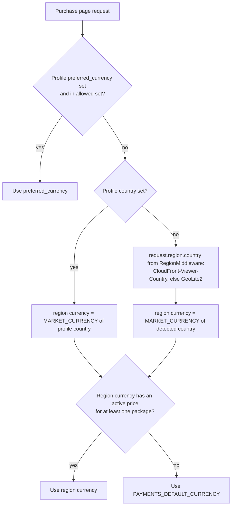
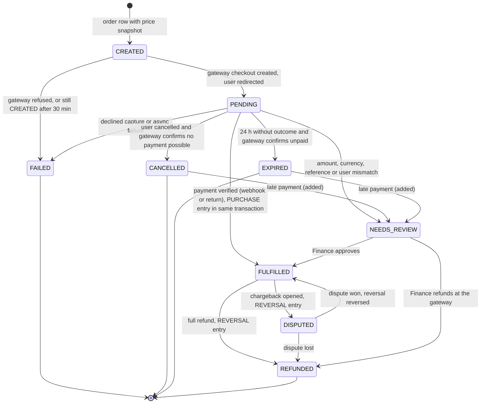
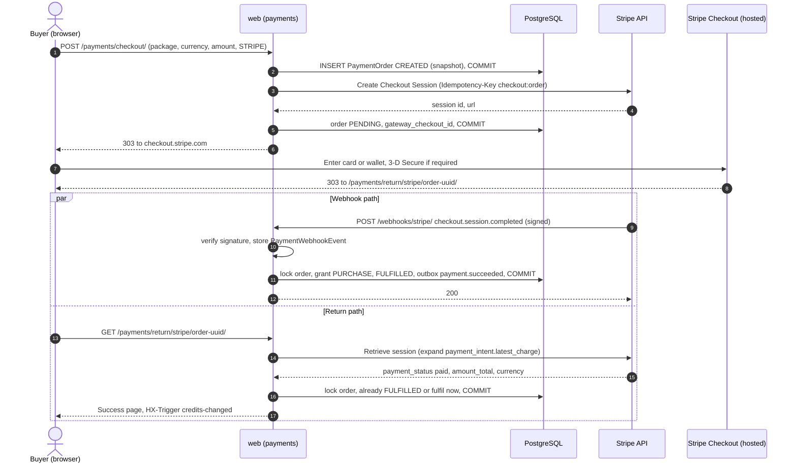
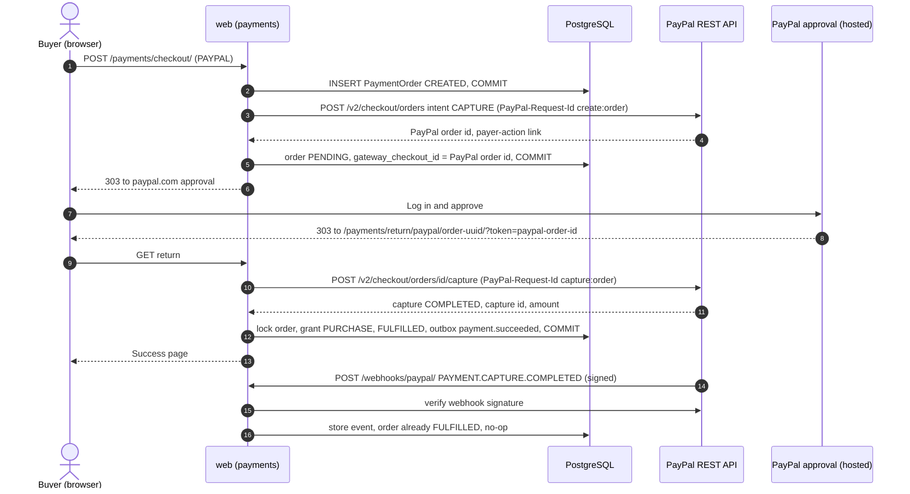
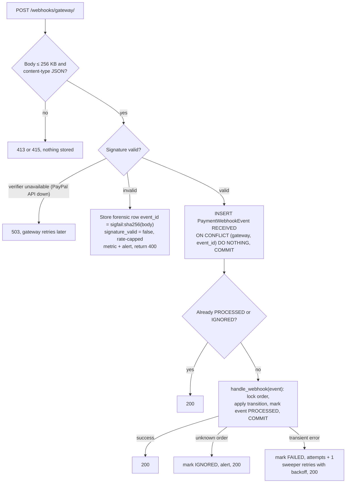
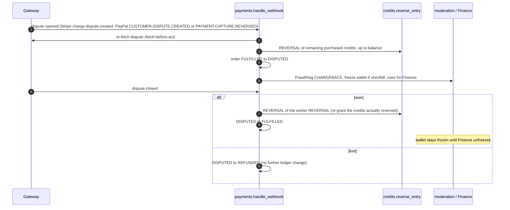
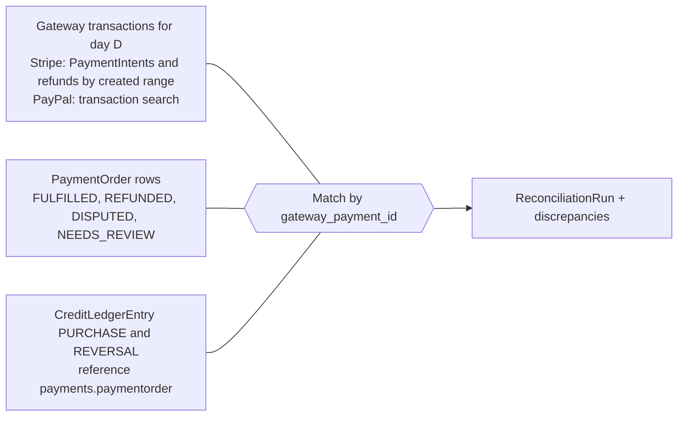

# Payments & Credit Purchase — Design

How users buy credit packages: packages and per-currency price books, currency resolution, the Purchase Credits page, the `PaymentGateway` adapter, Stripe Checkout and PayPal Orders v2 flows, the `PaymentOrder` state machine, webhook security, allocation within 5 s, refunds and disputes, reconciliation, receipts, PCI DSS scope, testing and runbooks.

Status: Draft v0.1 (2026-10-21)

| Item | Value |
|---|---|
| Owning app | `apps.payments` (layer 3). Credits are granted only through `credits.services.grant_credits` ([02 Credit wallet & ledger](02-credit-wallet-and-ledger.md)) |
| Milestones | M1 (dropdown link only), M4 (history consumption rows), **M5 Payments** (everything here), M6 (payments ops in the console), M7 (live verification, SAQ A sign-off) |
| Requirement IDs | FR-PAY-01 … FR-PAY-06, FR-PROF-02.10/02.11, NFR-SEC-03, NFR-PERF-01.3/01.4, NFR-UX-06 ([catalog §5](../requirements/02-requirements-catalog.md#5-credit-management--purchase-fr-pay)) |
| Schema of record | [01 Domain model §8](01-domain-model.md#8-payments) (`CreditPackage`, `CreditPackagePrice`, `PaymentOrder`, `PaymentWebhookEvent`). This document owns **behaviour** |
| Related | [08 Notifications](08-notifications.md) · [09 External integrations](09-external-integrations.md) (§6.4 Stripe, §6.5 PayPal, §6.6 Razorpay, §6.7 MaxMind) · [Security §9 PCI](../quality/01-security-and-compliance.md#9-pci-dss-scope-saq-a) · [Testing strategy §8–§9](../delivery/04-testing-strategy.md#8-payment-webhook-tests-with-recorded-fixtures) · [Backlog M5](../delivery/02-milestones-and-backlog.md#m5--payments) |

---

## 1. Scope and traceability

| SRS ref (TOC numbering) | Requirement summary | Addressed in |
|---|---|---|
| §6.1 Purchase Access | Dedicated "Purchase Credits" tab in the profile dropdown; quick, minimal-step, responsive funnel | §5 |
| §6.1 (stray text) | `Users.last_login_date`, `mfa_enabled` (kept, owned by identity design); `Menu_Items.allergy_flags` (dropped, copy-paste error, known issue #2) | Not here |
| §6.2 Credit Packages | Multiple packages (e.g. 20/50/120), volume discounts, price in the user's localised currency by IP or account region | §3, §4 |
| §6.3 Payment Integration | ≥ 2 global gateways (Stripe, PayPal or local equivalent), tokenisation, webhooks for fulfilment, status and errors | §6, §8, §9, §10 |
| §6.4 Instant Allocation (CRITICAL) | Credits within 5 s of confirmation, verified with the gateway before applying | §11 |
| §6.5 Transaction History | Purchases distinguished from consumption, with payment method | §16 |
| §9.3 Payment Compliance | PCI DSS via certified gateways; no raw card data stored, transmitted or processed | §17 |
| §8.1 Latency | Credit transactions ≤ 500 ms standard / ≤ 1,000 ms peak | §11.5 |
| Flow chart | "Select credit pack & pay" → "Payment successful?" NO → retry | §5, §12 |

**Known-issue resolutions applied here:** #9 (webhook or server-side verification, idempotent on `(gateway, gateway_payment_id)`, reconciliation), #13 (explicit price book, GeoIP default, account region override), #14 (gateway adapter; Stripe Checkout + PayPal Orders v2; Razorpay optional). #1: the purchase flow is entry-type agnostic, so a post-MVP lister-pays "lead unlock" model buys credits through the same packages without changes here.

---

## 2. Concepts and money rules

| Concept | Rule |
|---|---|
| Credits | Integers. A package grants a fixed integer number of credits. Credits are not money and have no currency |
| Money | `bigint` minor units + ISO 4217 currency on every persisted amount (`amount_minor`, `currency`). No `float`, no persisted `Decimal`. Conversions use `decimal.Decimal` with the currency exponent (JPY 0, USD 2, KWD 3) |
| Two ledgers | **Credits** move in `credits.CreditLedgerEntry`. **Money** moves in `payments.PaymentOrder` (and at the gateway). A purchase links them: `PaymentOrder.ledger_entry` → the `PURCHASE` entry |
| Merchant of record | The platform's legal entity (OQ-PAY-08). Gateways settle to that entity's accounts. Gateway FX on settlement is the gateway's concern; the app never converts currencies |
| Source of truth for "paid" | The gateway, read server-to-server (signed webhook or API call). Never a browser parameter |
| Price shown = price charged | The order snapshots package, credits, amount and currency at creation; the gateway session is created from that snapshot (FR-PAY-02.6) |

---

## 3. Credit packages

### 3.1 Catalogue (seed values)

`payments.CreditPackage` rows: `code`, `credits`, `is_active`, `sort_order`, `best_value` ([01 §8.1](01-domain-model.md#81-paymentscreditpackage)). Seeded by a data migration, then managed by Finance in the hardened admin (audited, no deploy).

| Code | Credits | Reveals at 2 credits | Badge |
|---|---|---|---|
| `PACK_20` | 20 | 10 | — |
| `PACK_50` | 50 | 25 | — |
| `PACK_120` | 120 | 60 | "Best value" (`best_value = true`, at most one active) |

**Assumption:** illustrative prices for the price book until Finance answers OQ-PAY-01 (= OQ-03):

| Currency | PACK_20 | PACK_50 | PACK_120 | Per credit (20 / 50 / 120) | "Save" vs PACK_20 |
|---|---|---|---|---|---|
| USD | 499 (= $4.99) | 999 | 1999 | $0.25 / $0.20 / $0.17 | — / 19 % / 33 % |
| EUR | 499 | 999 | 1999 | €0.25 / €0.20 / €0.17 | — / 19 % / 33 % |
| GBP | 399 | 849 | 1699 | £0.20 / £0.17 / £0.14 | — / 14 % / 29 % |
| INR | 19900 (= ₹199) | 44900 | 89900 | ₹9.95 / ₹8.98 / ₹7.49 | — / 9 % / 24 % |

### 3.2 Display rules

- **Per-credit price** = `amount_minor / credits`, rounded half-up to the currency's minor unit for display only.
- **Savings** = `1 − (ppc_package / ppc_smallest_active_package)`, **floored** to a whole percent, shown only when ≥ 5 %. Flooring never overstates a discount (consumer-protection safe).
- **"≈ N contact reveals"** helper = `credits // CREDITS_REVEAL_COST`. The reveal cost is read from settings, never hard-coded.
- The badge is text ("Best value") plus styling, never colour alone (NFR-A11Y-01.3).

### 3.3 Lifecycle rules

- A package can be deactivated (`is_active = false`) but never deleted once an order references it (`PROTECT`).
- Changing `credits` on a package that has orders is blocked; create a new package code instead. Orders snapshot `credits` anyway, so history stays correct.
- At least one active package must exist; the admin refuses to deactivate the last one.

---

## 4. Price book and localised currency (SRS §6.2, known issue #13)

### 4.1 Model summary

`payments.CreditPackagePrice(package, currency, amount_minor, valid_from, valid_to, created_by)` ([01 §8.2](01-domain-model.md#82-paymentscreditpackageprice-per-currency-price-book-known-issue-13)).

| Rule | Detail |
|---|---|
| One price per package, currency and instant | Enforced by the exclusion constraint in §4.2 |
| Immutable rows | `amount_minor`, `currency` and `valid_from` cannot change after creation (admin read-only + service check). A price change = set `valid_to` on the current row and insert a new row. Orders reference the exact row (`PaymentOrder.price`, `PROTECT`) |
| Scheduling | `valid_from` in the future schedules a change (for example a promotion). `valid_to = NULL` is open-ended |
| Tax | `amount_minor` is the **gross amount the buyer pays** (tax-inclusive) in the MVP (§15, OQ-PAY-02 = A-8) |
| Who edits | Finance group only (`payments.add_creditpackageprice`, `payments.change_creditpackageprice`). Every change writes `AuditLog` (`payments.price_changed`) with before/after |
| **Deviation from SRS:** | "prices dynamically displayed in the user's localised currency" is implemented as an explicit price per currency, not live FX conversion. Reasons: the charged amount must equal the displayed amount; psychological price points (₹199, not ₹207.43); gateway settlement and refunds stay exact; no FX feed dependency in the purchase path (GAP-13) |

### 4.2 Validity and non-overlap constraint (`btree_gist`)

The `btree_gist` extension (created in the first `core` migration, [01 §16](01-domain-model.md#16-database-conventions-and-raw-sql-migrations)) lets one GiST exclusion constraint combine equality on `package_id`/`currency` with range overlap on validity:

```sql
ALTER TABLE payments_creditpackageprice ADD CONSTRAINT ex_price_no_overlap
  EXCLUDE USING gist (package_id WITH =, currency WITH =,
                      tstzrange(valid_from, valid_to, '[)') WITH &&);
ALTER TABLE payments_creditpackageprice ADD CONSTRAINT ck_price_validity
  CHECK (valid_to IS NULL OR valid_to > valid_from);
CREATE INDEX ix_price_current ON payments_creditpackageprice (currency, package_id, valid_from DESC);
```

Current price lookup (one indexed query per page render, then cached, §4.7):

```sql
SELECT p.* FROM payments_creditpackageprice p
JOIN payments_creditpackage k ON k.id = p.package_id AND k.is_active
WHERE p.currency = %(currency)s
  AND p.valid_from <= now() AND (p.valid_to IS NULL OR p.valid_to > now());
```

### 4.3 Volume-discount and chargeability validation

FR-PAY-02.3 requires the per-credit price to fall as the package grows. Division is avoided by cross-multiplying:

```python
# apps/payments/services.py (illustrative)
def price_book_validate(*, currency: str, at: datetime) -> None:
    rows = sorted(current_prices(currency=currency, at=at), key=lambda r: r.package.credits)
    for small, large in itertools.pairwise(rows):
        # ppc(large) < ppc(small)  <=>  large.amount * small.credits < small.amount * large.credits
        if large.amount_minor * small.package.credits >= small.amount_minor * large.package.credits:
            raise PriceBookInvalidError(currency, small.package.code, large.package.code, "VOLUME_DISCOUNT")
    for r in rows:
        for gw in gateways_for_currency(currency):
            gw.assert_chargeable(r.amount_minor, currency)   # gateway minimums, Stripe three-decimal rule, PayPal integer-only currencies
```

- Runs on every admin save of a price or package activation change, **for every boundary instant** (each distinct `valid_from`/`valid_to`) in the next 90 days, so a scheduled change cannot create an invalid combination later. A violation rejects the save (catalog FR-PAY-02.3; the backlog's "warning" is superseded).
- Nightly task `payments.check_price_book` re-runs the check and also flags **incomplete currencies** (an active package without a current price in an offered currency) on the ops console.
- `assert_chargeable` encodes gateway rules in the adapter ([09 §6.4–6.6](09-external-integrations.md#6-provider-catalogue)): gateway minimum charge per currency, Stripe's requirement that three-decimal currency amounts end in 0, PayPal's integer-only currencies. A price a gateway cannot charge is rejected rather than failing at checkout.

### 4.4 Currency resolution

Order of precedence (FR-PAY-02.4):



| Input | Source | Notes |
|---|---|---|
| `UserProfile.preferred_currency` | Account setting ([01 §3.2](01-domain-model.md#32-accountsuserprofile)) | Accepted only if it is in the **allowed set** = {region currency, `PAYMENTS_DEFAULT_CURRENCY`} (§4.5) |
| `UserProfile.country` | Account region | Overrides GeoIP (known issue #13) |
| `request.region.country` | `apps.geo.middleware.RegionMiddleware` (architecture §8.1): `CloudFront-Viewer-Country` header, else MaxMind GeoLite2 on the client IP ([09 §6.7](09-external-integrations.md#67-maxmind-geolite2-region-detection)) | Anonymous `/pricing/` visitors use this only |
| `MARKET_CURRENCY` | Setting, country → currency (`{"IN": "INR", "GB": "GBP", "US": "USD", "DE": "EUR", …}`) | Same map family as `LISTINGS_COUNTRY_CURRENCY` ([05 §6.2](05-listings-and-media.md#62-price-currency-and-rent-period)) |
| `PAYMENTS_DEFAULT_CURRENCY` | Setting | **Assumption:** `USD` until launch markets are known (OQ-LST-08, A-1) |

A package without a current price in the resolved currency is not shown in that currency (FR-PAY-02.2). If none is priced, the default currency is used. The chosen currency and the country it came from are snapshotted on the order (`currency`, `pricing_country`).

### 4.5 Price-arbitrage controls (Security T-20, OQ-SEC-04)

A user on a VPN, or one who picks the cheapest currency, could pay less than the price for their real market. Baseline controls:

| Control | Detail |
|---|---|
| Narrow choice | The currency switcher offers only the allowed set {region currency, default currency}, never the whole price book |
| Region lock after first purchase | On the first `FULFILLED` order, `UserProfile.country` is set to the order's `pricing_country` if it was empty. Later changes of account country are allowed (people move) but limited to one per 30 days and audited (`accounts.region_changed`). **Assumption** pending OQ-PAY-05 |
| Card-country signal | After fulfilment, if the gateway reports a card or payer country that differs from `pricing_country` **and** the pricing currency is cheaper than the card-country currency at list price, open `FraudFlag(rule_code="PRICE_REGION_MISMATCH")` (new rule code, M6). No automatic block |
| Gateway-side | Stripe Radar default rules stay on. Custom Radar rules (paid tier) are an option, not a dependency (OQ-PAY-10) |

### 4.6 Formatting

`Babel.numbers.format_currency(Decimal(amount_minor).scaleb(-exponent), currency, locale=request.LANGUAGE_CODE)`. The exponent comes from a vetted ISO 4217 table in `apps.core.money` (shared with listings). Tests cover JPY (0), USD (2), KWD (3) and INR grouping (₹1,00,000).

### 4.7 Caching

Key `pricebook:{currency}` in the Valkey `default` cache, value = list of `(package_public_id, credits, amount_minor, best_value, sort_order)`. TTL = `min(600 s, seconds until the next validity boundary)`, so scheduled changes take effect on time. Explicit delete on every admin save (architecture §12). The price shown is re-checked against the database at checkout (§7.3), so a stale cache can never produce a wrong charge.

---

## 5. Purchase Credits UX (SRS §6.1, §11.2, FR-PAY-01, FR-PROF-02.11)

### 5.1 Entry points and routes

| Entry | Route | Notes |
|---|---|---|
| Profile dropdown → **Purchase Credits** | `GET /my/credits/buy/` | Login + verified (FR-AUTH-03.4) |
| Insufficient-credit toast ("Buy credits") and "Get credits to view number" CTA | `GET /my/credits/buy/?package=<code>&next=<listing path>` | Preselects the smallest package that covers the shortfall. `next` is validated as same-site and used for "Back to the listing" after success |
| Anonymous visitors | `GET /pricing/` | Same cards, CTA "Log in to buy" → login with `next=/my/credits/buy/?package=…`. **Addition** to the URL map ([codebase §7](../architecture/03-codebase-structure.md#7-url-namespace-map)) |

> **Route harmonisation.** The codebase URL map is the route owner and is used throughout this document. Other documents use older aliases that resolve as follows: `/credits/buy/` (catalog FR-PAY-01.1, security §9.2, NFR §3) → `/my/credits/buy/`; `/credits/checkout/` → `/payments/checkout/`; `/payments/<id>/status/` (US-509, NFR C5) → `/payments/status/<uuid>/`; `/payments/<id>/return/` → `/payments/return/<gateway>/<uuid>/`; `/payments/<id>/receipt/` (US-511) → `/payments/receipt/<uuid>/`. **Proposed change:** update those documents to the canonical paths in the same review cycle.

### 5.2 Page layout (mobile-first, ≤ 3 interactions)

```
┌ Purchase credits ───────────────────────────────┐
│ Your balance: 1 credit                          │
│ Prices in EUR · Change                          │
│ ( ) 20 credits   €4.99   €0.25/credit  ≈10 reveals│
│ (•) 50 credits   €9.99   €0.20/credit  Save 19 %  │
│ ( ) 120 credits  €19.99  €0.17/credit  Save 33 % · Best value │
│ Pay with: (•) Card / Apple Pay / Google Pay  ( ) PayPal │
│ [ Pay €9.99 ]   (sticky on mobile)               │
│ Secure payment by Stripe or PayPal. We never see your card. │
└─────────────────────────────────────────────────┘
```

| Interaction | Default that saves a step |
|---|---|
| 1 Choose package | Preselected from `?package=` or the user's last purchased package, else `PACK_50` |
| 2 Choose method | Preselected to the last method used, else the first gateway available for the currency |
| 3 Pay | Button label includes the amount ("Pay €9.99") |

From the dropdown to the hosted gateway page is therefore 1–3 interactions (FR-PAY-01.2).

- **Markup:** packages and methods are native radio groups (`<fieldset>`/`<legend>`), styled as cards. Each card's accessible name includes credits, price, per-credit price and savings. Touch targets ≥ 44 px; works at 320 px width (FR-PAY-01.3).
- **Form:** a plain `POST /payments/checkout/` with hidden `package`, `currency`, `amount_minor` (the price the user saw) and a `checkout_nonce`. No `hx-boost` (the response leaves the site). Alpine disables the button on submit; the server is idempotent anyway (§7.3).
- **EU/UK consumer notice (Assumption, OQ-PAY-03):** in markets where it applies, a required checkbox under the Pay button: "I want my credits delivered immediately and understand I lose my right to withdraw once they are delivered." Kept on the same page so the interaction count does not grow by a page.
- **Gateways shown** are those registered for the resolved currency and market (`PAYMENTS_GATEWAYS_BY_MARKET`, §6.4). If one gateway's circuit breaker is open, its option shows "Temporarily unavailable" and is disabled; the other stays usable (NFR-AVAIL-01.8).
- **Blocked states:** unverified → "Verify your account to buy credits" CTA; `AccountRestriction(PURCHASE_BLOCKED)` or wallet `FROZEN` → "Purchases are paused on your account. Contact support." (no reason disclosed). Checkout POST re-checks all of these in the service.
- **No third-party scripts** on this page (§17).

### 5.3 Return and status page

`GET /payments/return/<gateway>/<order uuid>/` renders one of these states; the status fragment is `GET /payments/status/<uuid>/` (HTMX).

| State | Shown when | Content |
|---|---|---|
| Confirming | Order `PENDING` and not yet verified as paid | "Confirming your payment…" with a progress indicator (`role="status"`). Polls (§11.4) |
| Success | Order `FULFILLED` | "50 credits added. Your balance is 51." Receipt link, "Back to the listing" (if `next`), "Buy more". `HX-Trigger: credits-changed` plus an out-of-band header badge update |
| Still confirming | 60 s of polling without an outcome | "Your payment is still being confirmed. You don't need to pay again. We'll email you as soon as the credits are added." Polling stops |
| Needs review | Order `NEEDS_REVIEW` | "We're checking this payment. You don't need to pay again. Credits usually appear within one business day." |
| Failed | Order `FAILED` | Reason category (§12), "Try again" (same package preselected) and the other gateway |
| Cancelled | User returned via the cancel URL | Redirect to `/my/credits/buy/?package=<code>` with an info toast "Payment cancelled. You have not been charged." |

All payment pages send `Cache-Control: no-store` and set `htmx.config.historyCacheSize = 0` (personal data).

---

## 6. `PaymentGateway` interface (known issue #14, FR-PAY-03.5)

### 6.1 Port

```python
# apps/payments/gateways/base.py (illustrative)
from dataclasses import dataclass
from enum import StrEnum
from typing import Mapping, Protocol, Iterator

class GatewayCode(StrEnum):
    STRIPE = "STRIPE"; PAYPAL = "PAYPAL"; RAZORPAY = "RAZORPAY"

class VerificationStatus(StrEnum):
    PAID = "PAID"; PENDING = "PENDING"; FAILED = "FAILED"
    CANCELLED = "CANCELLED"; EXPIRED = "EXPIRED"; UNKNOWN = "UNKNOWN"

@dataclass(frozen=True, slots=True)
class OrderSnapshot:              # built from PaymentOrder; no PII beyond public ids
    order_public_id: str
    user_public_id: str
    credits: int
    amount_minor: int
    currency: str
    description: str              # "50 credits"
    gateway_checkout_id: str | None

@dataclass(frozen=True, slots=True)
class CheckoutSession:
    gateway_checkout_id: str      # Stripe Checkout Session id / PayPal order id
    redirect_url: str             # validated against the gateway's allowed hosts

@dataclass(frozen=True, slots=True)
class PaymentVerification:
    status: VerificationStatus
    order_reference: str | None   # our order public_id as echoed by the gateway
    gateway_payment_id: str | None   # Stripe PaymentIntent id / PayPal capture id
    amount_minor: int | None
    currency: str | None
    method_summary: str | None    # "Visa •••• 4242" | "PayPal"
    payer_country: str | None     # card or payer country, for §4.5
    failure_category: str | None  # DECLINED, AUTH_FAILED, EXPIRED, GATEWAY_ERROR, CANCELLED_BY_USER
    refunded_total_minor: int = 0

class PaymentGateway(Protocol):
    code: GatewayCode
    def supports(self, *, currency: str, country: str | None) -> bool: ...
    def assert_chargeable(self, amount_minor: int, currency: str) -> None: ...
    def create_checkout(self, order: OrderSnapshot, *, return_url: str, cancel_url: str) -> CheckoutSession: ...
    def confirm_return(self, order: OrderSnapshot, params: Mapping[str, str]) -> PaymentVerification: ...
    def verify_payment(self, order: OrderSnapshot) -> PaymentVerification: ...      # read-only status
    def cancel_checkout(self, order: OrderSnapshot) -> bool: ...                     # True = no payment can happen any more
    def parse_webhook(self, body: bytes, headers: Mapping[str, str]) -> "GatewayEvent": ...  # verifies signature first
    def list_transactions(self, *, start: datetime, end: datetime) -> Iterator["GatewayTxn"]: ...  # reconciliation
```

| Method | Stripe | PayPal |
|---|---|---|
| `create_checkout` | Create Checkout Session | Create order (intent `CAPTURE`) |
| `confirm_return` | Retrieve the session (read-only) | **Capture** the approved order (idempotent), or read it if already captured |
| `verify_payment` | Retrieve session + PaymentIntent | Get order (+ capture) |
| `cancel_checkout` | Expire the session (`POST /v1/checkout/sessions/{id}/expire`) | No call needed: money moves only when *we* capture, so refusing to capture is sufficient. Returns `True` |
| `parse_webhook` | `stripe.Webhook.construct_event` | Verify via PayPal's signature-verification API, then parse |

`GatewayEvent` carries `event_id`, `event_type`, a normalised `kind` (`PAYMENT_SUCCEEDED`, `PAYMENT_PENDING`, `PAYMENT_FAILED`, `CHECKOUT_EXPIRED`, `ORDER_APPROVED`, `REFUND_UPDATED`, `DISPUTE_OPENED`, `DISPUTE_CLOSED`, `IGNORED`), `order_reference`, `gateway_checkout_id`, `gateway_payment_id`, `amount_minor`, `currency`, `refunded_total_minor`, `dispute_id`, `dispute_outcome`, `occurred_at`, and a redacted `summary` dict that becomes `PaymentWebhookEvent.payload_summary`.

### 6.2 Errors

| Exception | Meaning | Caller behaviour |
|---|---|---|
| `GatewayUnavailableError` | Timeout, 5xx, 429, or circuit breaker open | Checkout: show "Provider temporarily unavailable" + the other gateway. Return/reconcile: treat as unknown, retry later. Never mark the order FAILED on this alone |
| `GatewayRejectedError(category)` | The gateway refused the operation for a business reason (declined capture, invalid currency) | Map to `failure_category` |
| `InvalidWebhookSignatureError` | Signature or timestamp invalid | 400 (§10) |
| `GatewayConfigurationError` | Missing key, unsupported currency | Fail fast at startup (system check) or 500 + alert |

### 6.3 Adapter rules

- Vendor SDKs are imported only in `apps/payments/gateways/` (architecture R11). `stripe` (pinned API version, never the account default) and `paypal-server-sdk` (`httpx` inside the adapter for any endpoint the SDK lacks).
- Every call has explicit timeouts: connect 2 s, read 5 s (NFR C6/C7). A per-gateway circuit breaker ([09 §5](09-external-integrations.md#5-resilience-standards)) opens after repeated failures.
- Retries only with an idempotency key: Stripe `Idempotency-Key` (and `max_network_retries=2`, which reuses keys), PayPal `PayPal-Request-Id`. Never retry a non-idempotent call blind.
- Amount conversion (`to_gateway_amount`, `from_gateway_amount`) lives in each adapter with a per-currency table. Stripe takes integer minor units; PayPal takes a decimal string with the currency's decimals.
- `redirect_url` is checked against `ALLOWED_REDIRECT_HOSTS[gateway]` (`checkout.stripe.com`; `www.paypal.com` / `www.sandbox.paypal.com`) before it is returned. This is a cheap guard against a tampered response.
- A `FakeGateway` (settings-selected for local, CI and E2E) implements the full port with deterministic scenarios (`?scenario=paid|declined|pending|webhook_delayed`). It passes the same contract suite as the real adapters ([testing §9](../delivery/04-testing-strategy.md#9-contract-tests-for-adapters)).

### 6.4 Registry and market availability

```python
PAYMENTS_GATEWAYS_BY_MARKET = {          # settings; order = display order
    "DEFAULT": ["STRIPE", "PAYPAL"],
    "IN": ["RAZORPAY", "STRIPE"],        # only if OQ-PAY-04 makes India a launch market
}
```

`payments.gateways.registry.gateways_for(currency, country)` returns the adapters whose `supports()` is true and whose breaker is closed. At least two gateways must be offered in every launch market (SRS §6.3). A system check fails startup if any launch market has fewer than two configured gateways.

**Assumption:** PayPal does not serve India-domestic payments and Stripe onboarding for Indian businesses is restricted. Verify both before launch ([09 §6.5–6.6](09-external-integrations.md#65-paypal-orders-v2)). This is why Razorpay is the India adapter.

### 6.5 Razorpay (optional adapter, US-508, OQ-PAY-04)

Implemented only if India is a launch market. To keep SAQ A and the strict CSP, the adapter uses a **hosted, redirect-based** Razorpay flow (Payment Links or the hosted checkout page), **not** the embedded `checkout.js` modal, which would put a third-party script on our purchase page. Webhooks are verified with HMAC-SHA256 of the raw body using the webhook secret (`X-Razorpay-Signature`). The idempotency key format (`pay:razorpay:<payment id>`), state machine and fulfilment are identical to the other gateways. Details are in [09 §6.6](09-external-integrations.md#66-razorpay-optional).

---

## 7. `PaymentOrder` lifecycle

### 7.1 State machine

Schema-of-record states are from [01 §12.4](01-domain-model.md#124-paymentorderstatus). Two late-payment transitions are added here (**Proposed change** to 01 §12.4, marked ➕):



- **No `PAID` state** (01 §12.4; supersedes the indicative US-505 list and the "PAID → FULFILLED" wording in testing W-01). Verification and the credit grant commit in one transaction.
- **Late payment** (➕): a success signal for a `CANCELLED` or `EXPIRED` order means the customer paid. It is never dropped and never auto-granted. It goes to `NEEDS_REVIEW`, and Finance either fulfils or refunds. The design makes this rare (§7.2), but the money path must be total.
- Partial refunds keep `FULFILLED` with `refunded_amount_minor > 0` and a proportional `REVERSAL` (§13).

### 7.2 Transition triggers

| From → To | Trigger | Guard / notes |
|---|---|---|
| CREATED → PENDING | `start_checkout` after `create_checkout` returns | Stores `gateway_checkout_id` |
| CREATED → FAILED | `GatewayRejectedError` at creation; or reconciliation finds a `CREATED` order older than 30 min (it re-issues the create with the same idempotency key, then cancels the session) | `failure_category = GATEWAY_ERROR` |
| PENDING → FULFILLED | `fulfill_order` from a verified webhook, `confirm_return`, the status-poll verifier or reconciliation | §11 snapshot checks pass |
| PENDING → FAILED | Stripe `checkout.session.async_payment_failed`; PayPal capture `DECLINED` (after the user has had the chance to re-approve, §9.3) | Declines inside Stripe Checkout do **not** fail the order: the user retries on the hosted page |
| PENDING → CANCELLED | Cancel URL hit **and** `cancel_checkout()` returned `True` (Stripe session expired successfully; PayPal order never captured) | If Stripe refuses to expire because the session is already complete, the order is paid: fulfil instead |
| PENDING → EXPIRED | Stripe `checkout.session.expired`; or reconciliation at `expires_at` (created + 24 h) with the gateway confirming no payment | Stripe sessions are created with `expires_at = order.expires_at` |
| PENDING → NEEDS_REVIEW | Snapshot mismatch (§11.2) | `FraudFlag`/alert; no credits |
| FULFILLED → REFUNDED / DISPUTED, DISPUTED → … | §13 | |
| NEEDS_REVIEW → FULFILLED / REFUNDED | Finance action in `/ops/payments/` (M6), maker-checker not required (money already received), audited | Before M6: Django admin action calling the same service |

Every transition goes through `payments.services._transition(order, to, reason)` against an allowed-transition table, writes `AuditLog` (`payments.order_<status>`), and raises `InvalidOrderTransition` otherwise.

### 7.3 `start_checkout` sequence (no network I/O inside a transaction)

1. **View** validates the form (`package`, `currency`, `amount_minor`, `gateway`, `checkout_nonce`, EU consent where required) and calls one service.
2. **Guards** (service): `can_transact(user)`; no active `PURCHASE_BLOCKED` restriction; wallet not `FROZEN`; rate limits 10/h per user and 30/h per IP, **fail closed** if Valkey is down (security §6.5); at most 3 open (`CREATED`/`PENDING`) orders per user.
3. **Double-submit guard:** `cache.add("checkout:nonce:{user}:{nonce}", order_id, 600)`. A repeated nonce returns the existing order's redirect instead of creating a second order.
4. **Price check:** the current price for (package, currency) must equal the posted `amount_minor`. Otherwise raise `PriceChangedError` and re-render the page with "Prices were updated. Please review and try again." The user is never charged a price they did not see.
5. **Transaction 1:** insert `PaymentOrder(status=CREATED, …snapshot, pricing_country, expires_at=now+24h)`; commit.
6. **Gateway call** (outside any transaction): `create_checkout(snapshot)` with idempotency key `checkout:<order_public_id>`, 5 s read timeout.
7. **Transaction 2:** set `gateway_checkout_id`, status `PENDING`; commit.
8. **Response:** `303 See Other` to `redirect_url` (or `HX-Redirect` if the request came through HTMX).

| Failure at step | Result |
|---|---|
| 2–4 | Form error or toast; no order row |
| 6 timeout | Order stays `CREATED` (the gateway may have created the session). User sees "The payment provider didn't respond. Try again or use PayPal." Reconciliation resolves it (§14.1) |
| 6 rejected | `CREATED → FAILED (GATEWAY_ERROR)`; same message |

---

## 8. Stripe Checkout flow

### 8.1 Sequence



Whichever path commits first fulfils. The other finds `FULFILLED` under the row lock and does nothing (concurrency scenario C-04).

### 8.2 Session parameters

| Parameter | Value | Why |
|---|---|---|
| `mode` | `payment` | One-off purchase |
| `line_items[0].price_data` | `currency` = order currency (lower-case), `unit_amount` = `to_gateway_amount(amount_minor)`, `product_data.name` = "50 credits" | Amount comes from **our** snapshot; no Stripe Price objects to keep in sync with the price book |
| `line_items[0].quantity` | 1 | |
| `client_reference_id` | order `public_id` | Echoed in webhooks and on retrieve; reference check |
| `metadata` and `payment_intent_data.metadata` | `{"order": <order uuid>, "user": <user uuid>}` | Public UUIDs only (R10), no PII |
| `success_url` | `https://<host>/payments/return/stripe/<order uuid>/` | The session id is **not** needed in the URL: the order already stores `gateway_checkout_id`, and any query parameter is ignored except as a log hint (Security T-19) |
| `cancel_url` | `https://<host>/payments/cancel/<order uuid>/` | |
| `expires_at` | `order.expires_at` (24 h) | Keeps gateway and order expiry aligned |
| `payment_method_types` | `["card"]` | Cards, plus Apple Pay / Google Pay when enabled in the Stripe dashboard. Delayed-notification methods (bank debits, vouchers) are excluded in the MVP because they cannot meet "instant" (OQ-PAY-09). The handler still supports `async_payment_*` events defensively |
| `customer_email` | **Not sent** (data minimisation). Stripe collects the email it needs on its own page | |
| `locale` | User locale or `auto` | |
| Automatic receipts | Stripe receipt emails **off** at account level | Our receipt is the record (§15); avoids duplicate, inconsistent receipts |
| Statement descriptor | Account-level, short brand name (OQ-PAY-08) | Reduces "unrecognised charge" disputes |

### 8.3 Return verification (`confirm_return`)

1. Load the order by `(public_id, user=request.user)`; 404 otherwise (IDOR).
2. If it is already `FULFILLED`, render success (no gateway call).
3. Retrieve the session by the **stored** `gateway_checkout_id` (5 s timeout, outside any transaction).
4. Paid when `payment_status == "paid"`. Then require `client_reference_id == order.public_id`, `amount_total == to_gateway_amount(order.amount_minor)` and `currency == order.currency.lower()`.
5. `gateway_payment_id` = the PaymentIntent id. `method_summary` and `payer_country` come from `latest_charge.payment_method_details.card` (brand, last 4, country) or the wallet type.
6. Call `fulfill_order` (§11.2). On a timeout or breaker-open, render "Confirming…" and let polling and webhooks finish the job.

### 8.4 Stripe webhook events handled

| Event | Normalised kind | Action |
|---|---|---|
| `checkout.session.completed` with `payment_status = paid` | `PAYMENT_SUCCEEDED` | `fulfill_order` |
| `checkout.session.completed` with `payment_status = unpaid` | `PAYMENT_PENDING` | Keep `PENDING` (only possible for delayed methods) |
| `checkout.session.async_payment_succeeded` | `PAYMENT_SUCCEEDED` | `fulfill_order` |
| `checkout.session.async_payment_failed` | `PAYMENT_FAILED` | `PENDING → FAILED` |
| `checkout.session.expired` | `CHECKOUT_EXPIRED` | `PENDING → EXPIRED` (or `CANCELLED` if the user had cancelled) |
| `charge.refunded` | `REFUND_UPDATED` (cumulative `amount_refunded`) | §13 |
| `charge.dispute.created` | `DISPUTE_OPENED` | §13 |
| `charge.dispute.closed` | `DISPUTE_CLOSED` (`won` / `lost`) | §13 |
| `payment_intent.payment_failed` | `IGNORED` (metrics only) | Counted for the decline-rate alert (§18) |
| Anything else | `IGNORED` | Stored, 200 |

The webhook endpoint in the Stripe dashboard subscribes **only** to these event types (less noise, smaller attack surface).

---

## 9. PayPal Orders v2 flow

### 9.1 Sequence



### 9.2 Order parameters

| Field | Value | Why |
|---|---|---|
| `intent` | `CAPTURE` | Immediate capture; no separate authorisation |
| `purchase_units[0].reference_id` and `custom_id` | order `public_id` | Echoed in captures and webhooks; reference check |
| `purchase_units[0].invoice_id` | order `public_id` | PayPal rejects a second payment with the same invoice id on the account, an extra guard against double charging |
| `purchase_units[0].amount` | `{"currency_code": currency, "value": "9.99"}` formatted from minor units with the currency's decimals | |
| `purchase_units[0].description` | "50 credits" | |
| `payment_source.paypal.experience_context` | `return_url`, `cancel_url`, `user_action = PAY_NOW`, `shipping_preference = NO_SHIPPING`, `brand_name`, `locale` | "Pay now" on PayPal, no shipping address collected (data minimisation) |
| Header `PayPal-Request-Id` | `create:<order uuid>` / `capture:<order uuid>` | Idempotent create and capture |
| Auth | OAuth2 client-credentials token cached in Valkey until shortly before `expires_in` | One token fetch per expiry window, not per request |

### 9.3 Capture handling on return (`confirm_return`)

| Capture outcome | Action |
|---|---|
| `COMPLETED` capture | Verify `custom_id`, amount and currency against the snapshot → `fulfill_order` with `gateway_payment_id` = capture id, `method_summary = "PayPal"` |
| Capture `PENDING` (for example PayPal risk review) | Keep the order `PENDING`; show "Confirming…"; fulfil on `PAYMENT.CAPTURE.COMPLETED` |
| `422 ORDER_ALREADY_CAPTURED` | `GET` the order and continue as `COMPLETED` (a webhook-triggered or reconciliation capture got there first) |
| `422 INSTRUMENT_DECLINED` | Redirect the buyer back to the PayPal approval link to choose another funding source (PayPal's recommended recovery). After the second decline, `PENDING → FAILED (DECLINED)` |
| Timeout / 5xx | "Confirming…". Capture is idempotent (`PayPal-Request-Id`), so the status-poll verifier, the `CHECKOUT.ORDER.APPROVED` webhook and reconciliation can all safely retry it |
| Order is `CANCELLED` or `EXPIRED` on our side | **Do not capture.** No money moves, so no late payment is possible for PayPal |

> **Why capture on a GET.** The return redirect is a browser GET we cannot change. Capture runs only for the logged-in owner of the order, only after the buyer approved it at PayPal, and it is idempotent. A cross-site request can at most complete a payment the victim already approved.

### 9.4 PayPal webhook events handled

| Event | Kind | Action |
|---|---|---|
| `CHECKOUT.ORDER.APPROVED` | `ORDER_APPROVED` | If the order is `PENDING` and not captured (the buyer approved but never came back), capture server-side, then fulfil |
| `PAYMENT.CAPTURE.COMPLETED` | `PAYMENT_SUCCEEDED` | `fulfill_order` (no-op if already fulfilled) |
| `PAYMENT.CAPTURE.PENDING` | `PAYMENT_PENDING` | Keep `PENDING` |
| `PAYMENT.CAPTURE.DENIED` / `PAYMENT.CAPTURE.DECLINED` | `PAYMENT_FAILED` | `PENDING → FAILED (DECLINED)` |
| `PAYMENT.CAPTURE.REFUNDED` | `REFUND_UPDATED` | §13 (re-fetch the capture to get the cumulative refunded amount) |
| `PAYMENT.CAPTURE.REVERSED` | `DISPUTE_OPENED` | Card-issuer chargeback: §13 |
| `CUSTOMER.DISPUTE.CREATED` / `CUSTOMER.DISPUTE.RESOLVED` | `DISPUTE_OPENED` / `DISPUTE_CLOSED` | §13 |
| Anything else | `IGNORED` | Stored, 200 |

---

## 10. Webhook ingestion and security (FR-PAY-03.4, NFR-SEC-03.3)

### 10.1 Endpoint pipeline

Routes: `POST /webhooks/stripe/`, `/webhooks/paypal/`, `/webhooks/razorpay/` (outside i18n, CSRF-exempt by explicit allow-list, POST only).



| Rule | Detail |
|---|---|
| Raw body first | The view reads `request.body` (bytes) and verifies the signature **before** any JSON parsing (security §6.4) |
| Stripe signature | `stripe.Webhook.construct_event(body, headers["Stripe-Signature"], STRIPE_WEBHOOK_SECRET, tolerance=300)`. HMAC-SHA256 over `"{t}.{body}"`; the 300 s timestamp tolerance is replay protection. During a secret roll, both secrets are tried |
| PayPal signature | `POST /v1/notifications/verify-webhook-signature` with `transmission_id`, `transmission_time`, `cert_url`, `auth_algo`, `transmission_sig`, `webhook_id` (ours) and the event body; accept only `verification_status = SUCCESS`. Verifier call has a 3 s timeout; if PayPal is unreachable the endpoint returns **503** so PayPal redelivers (the event is not stored as invalid). Offline verification (CRC32 + PayPal certificate) is a later optimisation |
| Razorpay signature | HMAC-SHA256 of the raw body with the webhook secret, compared in constant time with `X-Razorpay-Signature` |
| Forensic rows for bad signatures | Stored with a **synthetic** `event_id = "sigfail:" + sha256(body)[:40]`, so a forged request can never occupy a real event id and block the genuine event. Storage is capped at 100 rows per gateway per hour; beyond that only the metric increments |
| Replay protection | (1) Stripe timestamp tolerance; (2) `UNIQUE (gateway, event_id)`; (3) idempotent effects (ledger `idempotency_key`, `UNIQUE (gateway, gateway_payment_id)`, order state checks). A replayed valid event is a no-op by construction |
| Response codes | 2xx means "durably recorded". Processing failures after the row is stored still return 200, because **we** own the retry (sweeper), with deterministic backoff and visibility in `/ops/jobs/`. Gateways retry only non-2xx, so we return 503 only when nothing could be recorded |
| Throughput protection | WAF rate rule 600/min per IP on `/webhooks/*` (security §6.5). Optional WAF allow-list of the gateways' published webhook IP ranges as defence in depth; the signature remains the control |
| Secrets | `rpl/<env>/stripe-webhook-secret`, `rpl/<env>/paypal-webhook-id`, `rpl/<env>/razorpay-webhook-secret` in Secrets Manager |
| Payload storage | Raw body in `payload_encrypted` ([ENC]; contains payer name and email), redacted `payload_summary` (ids, amounts, currency, statuses). Raw payload nulled after 18 months ([01 §15](01-domain-model.md#15-data-retention-schedule)) |

### 10.2 Processing rules (`handle_webhook`)

- **Latency-critical events** (payment succeeded) act on the **signed payload** directly, so the webhook path needs no extra API round trip (Stripe). For PayPal, the verified payload's capture is used.
- **Non-latency-critical events** (refunds, disputes, expiry) **re-fetch** the current object from the gateway before acting ("fetch-before-act"). This makes out-of-order delivery harmless: the handler acts on the latest state, not on the event's snapshot.
- **Refund or dispute for an order that is not yet `FULFILLED`** (out-of-order, testing W-07): the handler first runs `reconcile_order` (verify → fulfil if paid), then applies the refund. The final state is "granted, then reversed", whatever the delivery order.
- **Unknown order reference** (for example events from `stripe trigger` or a payment created outside the app): store, mark `IGNORED`, alert `payments_webhook_unknown_order_total`, return 200 (W-06).
- **Retry sweeper:** `payments.retry_webhook_events` (beat, every minute) reprocesses `FAILED` events with backoff 1, 2, 5, 10, 30, 60 min, then hourly up to 24 h; then the event stays `FAILED` and pages on-call (it may hold money).

---

## 11. Fulfilment and instant allocation ≤ 5 s (SRS §6.4 CRITICAL)

### 11.1 Strategy

**Deviation from SRS:** the SRS says fulfilment "must be verified via the payment gateway's webhook response". Webhooks can lag by seconds to minutes, which would break the same requirement's 5-second target. Fulfilment therefore runs on the **first** of these gateway-verified, server-to-server signals (GAP-09, FR-PAY-04.2):

| Path | Trigger | Verification | Typical time to commit |
|---|---|---|---|
| A. Webhook | Gateway POSTs a signed success event | Signature (and PayPal verify API) | < 0.5 s Stripe, < 2 s PayPal after receipt |
| B. Return redirect | Buyer's browser lands on the return URL | Server-side API retrieve (Stripe) or capture (PayPal) | < 1 s Stripe, < 2.5 s PayPal |
| C. Status-poll verifier | Return page polling while still `PENDING` | Enqueues `payments.verify_order` (deduplicated, at most one in flight per order per 3 s); the poll endpoint itself never calls the gateway | Within 1–3 s of a missed A/B |
| D. Reconciliation | Beat sweep (§14.1) | API retrieve / capture | Minutes (safety net) |

Client-side signals alone never grant credits. A forged return URL for an unpaid order shows "Payment not confirmed yet" and grants nothing (FR-PAY-04.2 scenario).

### 11.2 `fulfill_order` (idempotent, one transaction)

```python
# apps/payments/services.py (illustrative)
@dataclass(frozen=True)
class FulfilmentSource:
    kind: str            # "WEBHOOK" | "RETURN" | "POLL" | "RECONCILE" | "FINANCE"
    received_at: float   # monotonic receipt time of the gateway confirmation, for the latency metric

def fulfill_order(*, order_id: int, v: PaymentVerification, source: FulfilmentSource) -> PaymentOrder:
    with transaction.atomic():
        order = PaymentOrder.objects.select_for_update().get(pk=order_id)
        if order.status == OrderStatus.FULFILLED:
            return order                                            # webhook and return raced: no-op
        if order.status in (OrderStatus.CANCELLED, OrderStatus.EXPIRED, OrderStatus.FAILED):
            return _to_needs_review(order, reason="LATE_PAYMENT", v=v)
        if order.status not in (OrderStatus.PENDING, OrderStatus.CREATED, OrderStatus.NEEDS_REVIEW):
            raise InvalidOrderTransition(order.public_id, order.status, OrderStatus.FULFILLED)
        mismatch = _snapshot_mismatch(order, v)                    # reference, amount, currency, gateway
        if mismatch and source.kind != "FINANCE":
            return _to_needs_review(order, reason=mismatch, v=v)
        entry = credits_services.grant_credits(
            user_id=order.user_id,
            amount=order.credits,
            entry_type=EntryType.PURCHASE,
            reference_type="payments.paymentorder",
            reference_id=str(order.public_id),
            idempotency_key=f"pay:{order.gateway.lower()}:{v.gateway_payment_id}",
            metadata={"order": str(order.public_id), "gateway": order.gateway,
                      "credits": order.credits, "source": source.kind},
        )
        now = timezone.now()
        order.gateway_payment_id = v.gateway_payment_id
        order.payment_method_summary = v.method_summary
        order.ledger_entry = entry
        order.paid_at = order.paid_at or now
        order.fulfilled_at = now
        _transition(order, OrderStatus.FULFILLED, reason=source.kind)   # saves, AuditLog
        outbox.publish("payment.succeeded", {"order": str(order.public_id)},
                       dedupe_key=f"payment.succeeded:{order.public_id}")
    transaction.on_commit(lambda: metrics.observe_fulfilment(order, source))
    return order
```

| Guarantee | Mechanism |
|---|---|
| Exactly one credit grant per gateway payment | Order row lock + status check; `UNIQUE (gateway, gateway_payment_id)` on `PaymentOrder`; ledger `UNIQUE (idempotency_key)` = `pay:<gateway>:<gateway_payment_id>` (FR-PAY-04.3) |
| No partial state | Grant, order update, audit and outbox commit together. A crash before commit leaves `PENDING`; another path fulfils later |
| Snapshot integrity | `_snapshot_mismatch` compares the gateway's echoed order reference, amount (converted back to minor units) and currency with the order. Any difference → `NEEDS_REVIEW`, `FraudFlag`/alert, no credits (FR-PAY-04.5) |
| Frozen wallets still receive purchases | A `FROZEN` wallet blocks user debits but allows grants ([01 §6.1](01-domain-model.md#61-creditscreditwallet)); the buyer paid, so credits are granted. Checkout start is blocked for frozen wallets (§7.3), so this only affects payments that were already in flight |
| Lock order | Order row, then wallet row (inside `grant_credits`). Refund and dispute handlers use the same order, avoiding deadlocks (testing C-07) |

### 11.3 Return page polling

The status fragment uses the CSP-safe polling convention ([codebase §8.2](../architecture/03-codebase-structure.md#82-htmx-conventions)): `data-poll` plus `hx-trigger="load delay:1s, every 1s"`, `hx-get="/payments/status/<uuid>/"`, `hx-swap="outerHTML"`. No HTMX trigger filters (they need `eval`).

| Elapsed since return | Poll interval | Server behaviour |
|---|---|---|
| 0–10 s | 1 s | Primary-key read of order status. If still `PENDING` and no verifier ran in the last 3 s, enqueue `payments.verify_order` (path C) |
| 10–60 s | 2 s (the fragment re-renders itself with `every 2s`) | Same |
| > 60 s | Stop (HTTP 286) | Render "Still confirming…" (§5.3); the outbox email (NTF-12) tells the user when credits arrive |
| Any terminal state | Stop (HTTP 286) | Render the final state; on `FULFILLED` add `HX-Trigger: credits-changed` and an OOB badge |

> **Harmonisation.** FR-PAY-04.4 says 1 s polling; US-509 and NFR §7.3 say 2 s for 60 s. The schedule above meets the 1 s requirement during the 5 s window and halves the poll volume afterwards.

The poll endpoint is budget class C5 (p95 ≤ 100 ms, one primary-key read, no gateway call, [NFR §3](../quality/02-nfr-performance-and-scalability.md#3-latency-budgets-per-endpoint-class)).

### 11.4 Latency budget and measurement

The SRS clock starts at "successful payment confirmation from the gateway". We measure from **our receipt** of the first confirmation (webhook request start, or the return-path verification response) to the committed `PURCHASE` entry: `payment_fulfillment_latency_seconds{gateway, source}`. Target **p99 ≤ 5 s** (the stricter of p95/p99, NFR P-05).

| Segment | Budget (p99) |
|---|---|
| Webhook: body read + Stripe signature check | 10 ms |
| Webhook: PayPal verify-signature API call | 1,500 ms |
| Event insert + commit | 20 ms |
| `fulfill_order` transaction (lock order, lock wallet, ledger insert with hash, order update, outbox insert) | 40 ms |
| Return path: Stripe retrieve / PayPal capture | 1,500 ms / 2,500 ms |
| Poll pick-up after commit (user-visible) | ≤ 1 s |
| **Total (worst path: PayPal return)** | **≈ 4.1 s** |

Supporting metrics: `payment_webhook_delivery_lag_seconds{gateway}` (gateway event `created` → our receipt; shows when gateways are slow), `payment_return_to_success_seconds` (return request → first poll that renders success), `payment_fulfillment_source_total{source}` (share of A/B/C/D; a growing D share means webhooks or returns are failing).

### 11.5 Credit-transaction latency (SRS §8.1)

Our side of the purchase (NFR-PERF-01.3/01.4) is the `fulfill_order` transaction and the checkout-start DB work: p95 ≤ 500 ms standard, ≤ 1,000 ms peak, **excluding** gateway-hosted time and gateway API latency (GAP-55). Gateway calls are budgeted separately (NFR classes C6/C7).

---

## 12. Failure, cancellation and retry UX (FR-PAY-03.6, US-510)

| Situation | Order state | User sees | Next step offered |
|---|---|---|---|
| Card declined inside Stripe Checkout | `PENDING` | Stripe's own message on its page | Retry on the Stripe page (no new order) |
| User clicks "Back"/cancel at the gateway | `CANCELLED` (after `cancel_checkout`) | Toast "Payment cancelled. You have not been charged." | Purchase page with the same package preselected |
| PayPal funding source declined twice | `FAILED (DECLINED)` | "Your payment was declined. Try another card or PayPal account." | Try again, or switch gateway |
| 3-D Secure failed | `PENDING` (Stripe) | Stripe page | Retry on Stripe |
| Gateway unavailable at checkout | `CREATED`/`FAILED (GATEWAY_ERROR)` | "The payment provider is temporarily unavailable." | The other gateway |
| Async payment failed later | `FAILED` | Email NTF-13 "Your payment didn't go through. You have not been charged." | Link to purchase page |
| Amount mismatch | `NEEDS_REVIEW` | "We're checking this payment. Don't pay again." | Support contact |

Reason categories (`failure_category`) map to fixed, translated copy. Raw gateway messages are never displayed (they can leak risk-engine details and are not translated).

---

## 13. Refunds, chargebacks and disputes (FR-PAY-06)

### 13.1 Policy

| Rule | Detail |
|---|---|
| Who initiates refunds | Finance, in the gateway dashboard (gateway MFA). **No self-service refunds in the MVP** (OQ-PAY-03 = OQ-05). An ops-console refund button that calls the gateway is post-MVP |
| Ledger effect | Every refund or dispute creates a `REVERSAL` ledger entry (`reverses_entry` = the order's `PURCHASE` entry), driven by the gateway webhook. Balance changes only through `credits.services.reverse_entry` ([02 §9](02-credit-wallet-and-ledger.md#9-reversals)) |
| Consumed credits | Reveals already made are **not** undone. `ContactReveal` rows and revealed contacts stay (the renter got the service) |
| Negative balance | **Never.** `CHECK (balance >= 0)` holds. A reversal takes `min(credits_to_reverse, current_balance)`; the remainder is a **shortfall** |
| Shortfall | Recorded in the REVERSAL `metadata` (`{"shortfall": n, "order": uuid}`), `FraudFlag(rule_code="CLAWBACK_SHORTFALL")` and a `ModerationCase(subject_type="PAYMENT_ORDER", reason_code="CLAWBACK_SHORTFALL")`. Not recovered automatically from later purchases (surprising to users, and a consumer-law risk); Finance decides (OQ-PAY-07) |
| Wallet freeze | **Disputes:** always `FraudFlag(CHARGEBACK)`; if there is a shortfall, the wallet is `FROZEN` (`frozen_reason = CHARGEBACK`) pending Finance review (Security T-21). **Refunds** (Finance-initiated): shortfall is flagged, the wallet is not frozen |

### 13.2 Credits to reverse (cumulative, rounding)

Gateways report the **cumulative** refunded amount (Stripe `charge.amount_refunded`, PayPal capture refunds re-fetched). The handler works from cumulative values, so duplicate or out-of-order refund events cannot double-reverse:

```
target_reversed_credits = min(order.credits, ceil(order.credits × refunded_total_minor / order.amount_minor))
delta = target_reversed_credits − credits_already_reversed_for_this_order
reverse min(delta, wallet.balance) now; shortfall = delta − reversed
idempotency_key = f"rev:{gateway}:{gateway_payment_id}:refund:{refunded_total_minor}"
```

**Assumption:** partial refunds round the reversed credits **up** (a refund of any amount removes at least one credit), so the user can never keep more credits than they paid for. Finance can issue a goodwill `ADMIN_ADJUSTMENT` when that is unfair. `refunded_amount_minor` on the order is set to the cumulative amount; the status becomes `REFUNDED` only when `refunded_amount_minor = amount_minor`.

### 13.3 Disputes



Credits are reversed when the dispute **opens**, because that is when the gateway withdraws the funds. Evidence submission happens in the gateway dashboard (Finance). The order's receipt, ledger entries, reveal history (property IDs, timestamps) and `AuditLog` IP/user-agent rows form the evidence pack (Security T-03).

---

## 14. Reconciliation (FR-PAY-04.6, US-512)

### 14.1 Pending-order sweep (`payments.reconcile_pending_orders`)

Beat every **5 minutes** (catalog and US-512; architecture §9 says 10 min, harmonised to 5). Runs on the `maintenance` queue; moves to `critical` if NFR P-04 is adopted.

| Order condition | Check cadence | Action |
|---|---|---|
| `CREATED`, age > 30 min | Once | Re-issue `create_checkout` with the same idempotency key (returns the existing session/order if one was created), then `cancel_checkout`; if the gateway says it was paid, fulfil; else `FAILED (GATEWAY_ERROR)` |
| `PENDING`, age 10–60 min | Every 5 min | `verify_payment` (PayPal: capture if `APPROVED`) → fulfil, fail or leave |
| `PENDING`, age 1–24 h | Hourly (bucketed by `created_at` minute) | Same |
| `PENDING`, past `expires_at` | Once, then hourly until resolved | Gateway confirms unpaid → `EXPIRED`; paid → fulfil |
| `FAILED` webhook events | §10.2 sweeper | |

Gateway calls happen outside transactions; each order is then fulfilled or transitioned in its own short transaction with a row lock, so the sweep never blocks user traffic. Batch size 200 per run; per-gateway concurrency 4; skipped when that gateway's breaker is open.

### 14.2 Daily three-way reconciliation (`payments.reconcile_daily`)

Runs daily at 06:00 UTC for the previous UTC day (the lag allows for gateway reporting delays; PayPal transaction search data is not real-time). Compares three sources:



| Discrepancy code | Meaning | Automatic action | Severity |
|---|---|---|---|
| `PAID_NOT_FULFILLED` | Gateway captured, order not fulfilled | Run `reconcile_order` (fulfils) and record | High until fixed |
| `FULFILLED_NOT_PAID` | Order fulfilled, no matching captured payment | None. **Page on-call** (possible forged grant, Security T-05) and freeze the wallet | Critical |
| `AMOUNT_MISMATCH` | Captured amount or currency ≠ order snapshot | Flag order for Finance | High |
| `LEDGER_MISSING` | Order `FULFILLED` without its `PURCHASE` entry, or entry amount ≠ order credits | None (DB constraints make this near-impossible); page | Critical |
| `PURCHASE_WITHOUT_ORDER` | `PURCHASE` entry whose reference is not a fulfilled order | Page; freeze wallet | Critical |
| `REFUND_NOT_REVERSED` | Gateway refund/dispute with no matching `REVERSAL` | Apply the refund handler (§13) | Medium |
| `ORPHAN_GATEWAY_PAYMENT` | Gateway payment not created by the app | Record for Finance | Low |

**Proposed schema addition** (to [01 §8](01-domain-model.md#8-payments)): `payments.ReconciliationRun(public_id, gateway, period_start, period_end, mode [SWEEP, DAILY, ON_DEMAND], status [RUNNING, PASSED, FAILED, ERROR], gateway_txn_count, orders_checked, discrepancies, started_at, finished_at, triggered_by)` and `payments.ReconciliationDiscrepancy(run FK CASCADE, order FK PROTECT null, gateway_payment_id, code, details jsonb (no PII), auto_resolved bool, resolved_at, resolved_by, resolution_note)`. They back the ops-console "reconciliation runs" view ([codebase §7](../architecture/03-codebase-structure.md#7-url-namespace-map)) and mirror `LedgerAuditRun`/`LedgerAuditDiscrepancy`. Retention 7 years.

The nightly ledger audit ([02](02-credit-wallet-and-ledger.md)) is complementary: it proves the ledger is internally consistent; reconciliation proves it matches the money.

---

## 15. Receipts, invoices and tax

### 15.1 Purchase receipt (FR-PAY-05.7, US-511)

| Channel | Detail |
|---|---|
| Email | Outbox `payment.succeeded` → `notifications.send_payment_receipt` (NTF-12 in [08 §3](08-notifications.md#3-notification-catalogue)). Sent after commit; never for a rolled-back fulfilment |
| Page | `GET /payments/receipt/<order uuid>/` (owner only, 404 otherwise, `no-store`), printable with a print stylesheet; "Download PDF" is the browser's print-to-PDF (no server PDF generation in the MVP) |

Content: receipt reference (`RPL-` + first 8 hex characters of the order UUID, upper case), order UUID, date and time in the user's timezone, package name, credits, amount and currency, payment method (`payment_method_summary`), ledger transaction ID (the `PURCHASE` entry's `public_id`), balance after, merchant legal name, address and tax registration (settings `MERCHANT_*`, OQ-PAY-08), and a support contact. A tax line is shown only when OQ-PAY-02 is resolved.

Refunds produce a refund notice (NTF-14) referencing the original receipt; the receipt page then shows "Refunded {amount} on {date}".

### 15.2 Tax (OQ-PAY-02 = A-8)

- **Baseline:** price-book amounts are tax-inclusive gross prices. The MVP calculates no tax and issues **receipts, not tax invoices**.
- **Risk:** credits are a digital service sold to consumers. VAT/GST on digital services is likely to apply in many markets (for example EU VAT via OSS, UK VAT, India GST on online services). Finance and a tax adviser must confirm per launch market **before M5 pricing is set**, because tax-inclusive prices then need a tax breakdown on the receipt.
- **If tax invoices are required:** add `PaymentOrder.invoice_number` (gapless sequence per legal entity and year, assigned in `fulfill_order` under a counter-row lock), seller and buyer tax fields, and the tax breakdown. Stripe Tax (`automatic_tax` on Checkout) is an option for Stripe purchases but does not cover PayPal, so a provider-neutral tax table may be needed. This is a schema change and therefore an explicit decision, not an MVP default.

---

## 16. Transaction history: purchase rows (SRS §6.5, FR-PAY-05)

The history page (`/my/credits/`) is owned by `credits` ([02](02-credit-wallet-and-ledger.md)). Purchase-specific rendering:

| Entry | Label | Extra columns |
|---|---|---|
| `PURCHASE` | "Purchased 50 credits" | Amount paid ("€9.99"), payment method ("Visa •••• 4242" / "PayPal"), receipt link; a purchase icon **and** a "Purchase" text tag (not colour alone, FR-PAY-05.3) |
| `REVERSAL` (reason `REFUND` / `CHARGEBACK`) | "Refund: 50 credits removed" / "Payment disputed: 50 credits removed" | Link to the original receipt; "Partially reversed (n not removed)" when there was a shortfall |

**Dependency direction.** `credits` (layer 2) must not import `payments` (layer 3), and listings is a same-layer sibling. **Proposed design:** `credits` defines a reference-resolver registry (`credits.history.register_resolver(reference_type, fn)`), and `payments/receivers.py` registers `resolve_orders(public_ids) -> {id: OrderSummaryDTO}` (method summary, amount, receipt URL) at app-ready time. `listings` registers the property resolver the same way. This is the dependency-inversion pattern allowed by architecture rule R8, and it keeps payment-method data out of the ledger's `metadata`.

---

## 17. PCI DSS scope and purchase-page security (SRS §9.3)

### 17.1 SAQ A posture

Target: PCI DSS v4.0.1 **SAQ A** ([security §9](../quality/01-security-and-compliance.md#9-pci-dss-scope-saq-a)). This design keeps the eligibility conditions true:

| Condition | How this design meets it |
|---|---|
| All cardholder-data entry is on PCI-validated provider pages | Full redirect to Stripe Checkout and PayPal approval. No Stripe Elements, no embedded Checkout, no PayPal JS SDK buttons, no Razorpay `checkout.js` |
| No CHD stored, processed or transmitted | We store gateway ids, amount, currency, status, card **brand and last 4** (as returned by the gateway) and the card/payer country. Webhook payloads never contain PANs |
| The merchant site cannot tamper with the payment page or redirect | Redirect URL comes from the gateway API response and is host-checked (§6.3); payment-initiating pages load **first-party scripts only** (§17.2) |

In-scope components: `/my/credits/buy/`, `/pricing/`, `/payments/*` views and templates, the `web` tasks and the CI/CD pipeline that deploys them, staff accounts that can change those pages or payment settings (MFA), webhook endpoints (fulfilment integrity, not CHD).

### 17.2 Script inventory and CSP on purchase pages

Payment-initiating pages get a **stricter, path-scoped CSP** on top of the global policy (django-csp per-view decorator; validate the 4.x decorator API at M5):

| Directive | Purchase pages (`/my/credits/buy/`, `/pricing/`, `/payments/*`) |
|---|---|
| `script-src` | `'self'` only. **No** Turnstile, **no** map provider scripts ([06 §11.3](06-search-and-discovery.md#113-accessibility-and-privacy)), no analytics/RUM, no third-party SDKs |
| `connect-src` | `'self'` |
| `img-src` | `'self' https://media.<domain> data:` |
| `frame-src` | `'none'` |
| `form-action` | `'self' https://checkout.stripe.com https://www.paypal.com` (+ `https://www.sandbox.paypal.com` outside prod, + the Razorpay hosted-page origin if enabled). Kept even though 303 redirects are not blocked by `form-action` in current browsers, so the no-JS path stays explicit |
| `frame-ancestors` | `'none'` (clickjacking on the Pay button) |

| Control | Detail |
|---|---|
| Allowed scripts | `static/vendor/htmx.min.js`, `static/vendor/alpine-csp.min.js`, `static/dist/app.js` (hashed filenames, served by WhiteNoise) |
| CI guard | A test renders every purchase page and asserts the set of `<script src>` and `<link rel=stylesheet>` URLs equals the allow-list. A new script fails CI and needs a CODEOWNERS (money-path) approval |
| Production tamper check | A daily synthetic check fetches `/pricing/` and compares a hash of the script/style inventory with the deployed release's expected hash; a mismatch pages on-call |
| Change control | Payment templates and views are under CODEOWNERS money-path review (2 approvals, NFR-CODE-01.2) |
| Bot step-up without third-party JS | When risk rules require a challenge before checkout (§18), the checkout POST redirects to `GET /payments/challenge/` (a separate page that may load Turnstile but **never** issues a gateway redirect). Passing it sets a 10-minute session flag and returns to `/my/credits/buy/`. **Refinement** of security §6.5 ("step-up on checkout"), which would otherwise put Turnstile on a payment-initiating page |

---

## 18. Fraud and abuse controls

| Threat | Control | Source |
|---|---|---|
| Card testing via many checkout sessions | Verified accounts only; 10 checkouts/h per user, 30/h per IP (fail closed); ≤ 3 open orders per user; Turnstile step-up (§17.2) after 3 `FAILED`/abandoned checkouts in 1 h; Stripe Radar and PayPal risk tools on the hosted pages | Security T-22 |
| Decline-rate spike | Metric from `payment_intent.payment_failed` and PayPal denials; alert when the decline ratio > 30 % over 15 min with ≥ 20 attempts | §19 |
| Friendly fraud (chargeback after spending) | §13 reversal, freeze on shortfall, `FraudFlag(CHARGEBACK)`; repeated chargebacks → `AccountRestriction(PURCHASE_BLOCKED)` by Finance | Security T-21 |
| Price arbitrage | §4.5 | Security T-20 |
| Forged success redirect | Server-side verification by stored session/order id | Security T-19 |
| Forged or replayed webhook | §10 | Security T-18 |
| Compromised code appending `PURCHASE` entries | Daily three-way reconciliation `PURCHASE_WITHOUT_ORDER`, `FULFILLED_NOT_PAID` | Security T-05 |

---

## 19. Observability

| Signal | Detail |
|---|---|
| Spans | `payments.start_checkout`, `payments.gateway.<op>` (attributes `gateway`, `op`, `http.status`, `breaker_state`), `payments.handle_webhook` (`event_kind`), `payments.fulfill_order` (`source`). No PII, no amounts as labels |
| Metrics | `payment_fulfillment_latency_seconds{gateway,source}`, `payment_webhook_delivery_lag_seconds{gateway}`, `payment_orders_total{gateway,status}`, `payment_fulfillment_source_total{source}`, `webhook_signature_failures_total{gateway}`, `payments_webhook_unknown_order_total`, `payments_webhook_failed_events` (gauge), `payment_gateway_errors_total{gateway,op,kind}`, `payment_decline_ratio{gateway}`, `reconciliation_discrepancies_total{code}`, `payments_pending_orders_older_than_15m` (gauge) |
| Logs | structlog `payments.*` events with order and event public ids, gateway, status, `duration_ms` |
| Alerts | Fulfilment p99 > 5 s for 10 min (page); any `webhook_signature_failures_total` burst > 10 in 5 min (warn); webhook `FAILED` events older than 30 min (page); pending orders > 15 min old > 5 (warn) or > 20 (page); any Critical reconciliation discrepancy (page); gateway error rate > 5 % for 5 min or breaker open > 2 min (page; one gateway down still leaves the other); decline ratio (§18) |
| Dashboards | Purchase funnel (page views → checkout started → fulfilled), fulfilment latency by source, webhook lag, reconciliation status. Ops console tile "Stuck payments" (US-602) |

---

## 20. Testing strategy

Builds on [testing §8–§9](../delivery/04-testing-strategy.md#8-payment-webhook-tests-with-recorded-fixtures) (webhook matrix W-01 … W-15, contract suite) and §5.1 money-path checklist.

| Layer | What | How |
|---|---|---|
| Unit | Price-book validator (volume discount, boundaries, gateway chargeability), savings floor, currency resolution precedence, amount conversion per currency exponent (Hypothesis over ISO 4217), refund credit maths (cumulative, rounding, shortfall), transition table (every allowed and disallowed pair) | pytest, Hypothesis |
| Integration | `start_checkout` guards and nonce dedupe; `fulfill_order` idempotency (same verification twice, webhook + return race C-04 with threads); late payment → `NEEDS_REVIEW`; refund before completion (W-07); dispute open/won/lost; frozen wallet receives purchase; outbox `payment.succeeded` written in the same transaction | pytest-django, `FakeGateway`, thread harness |
| Webhooks | Recorded, scrubbed fixtures signed locally (Stripe `t=…,v1=…`); PayPal verify-signature cassettes with `SUCCESS`/`FAILURE`; 256 KB limit; forged-signature synthetic event id never blocks the real event | `tests/fixtures/payments/<gateway>/` |
| Contract | `PaymentGatewayContract` for Stripe, PayPal, Razorpay (if enabled) and Fake, on recorded HTTP; nightly `contract_live` against sandboxes | pytest-recording |
| Local manual | **Stripe CLI:** `stripe listen --forward-to localhost:8000/webhooks/stripe/` (prints the endpoint secret for `.env`), real test-mode Checkout from the dev server. `stripe trigger checkout.session.completed` creates objects **without our metadata**, so it exercises the unknown-order path (W-06), not fulfilment. **PayPal sandbox:** personal + business sandbox accounts; negative testing with the `PayPal-Mock-Response` header (for example `INSTRUMENT_DECLINED`). The PayPal webhook **simulator's events cannot be signature-verified**, so signature tests use events from real sandbox purchases |
| Test cards | Stripe test cards for success, 3-D Secure required, generic decline, insufficient funds and dispute creation (numbers from Stripe's testing docs, kept in `tests/fixtures/payments/stripe/cards.md`) | |
| E2E (Playwright) | PR suite: full purchase with `FakeGateway` (mobile viewport), cancel, fail-then-switch-gateway, insufficient-credit → buy → back to listing → reveal. Nightly: real Stripe test-mode Checkout and PayPal sandbox (hosted pages; flaky-tolerant, retried) | axe-core on purchase and return pages |
| Load | `fulfill_order` p95 ≤ 500 ms at standard load with `FakeGateway`; webhook burst of 1,000 events in 60 s (no event lost, all processed ≤ 5 s p99); 500 concurrent return-page pollers stay within C5 | k6 |
| Security | Forged return URL grants nothing; IDOR on return/status/receipt (other user's order → 404); CSP script inventory guard (§17.2); `csrf_exempt` only on webhook routes | |
| Launch (M7, FR-PAY-06.3) | One real low-value purchase per gateway in production, then refunded: verify fulfilment, receipt, refund reversal and the next daily reconciliation | |

---

## 21. Failure modes and runbooks

Runbook entries live in [04 Runbooks](../quality/04-runbooks.md) ("payment API failure (per gateway)" and "webhook backlog" are required by US-707).

| # | Failure | Detection | User impact | Automatic behaviour | Manual action |
|---|---|---|---|---|---|
| P-F1 | Stripe API down or slow | Gateway error rate, breaker open | Card option disabled ("temporarily unavailable") | PayPal still offered; return verification falls back to webhooks/reconciliation | Runbook "payment API failure — Stripe": check status page, confirm breaker, communicate |
| P-F2 | PayPal API down | Same | PayPal option disabled; PayPal webhooks get 503 from verifier failures and are redelivered | Stripe still offered | Runbook "payment API failure — PayPal" |
| P-F3 | Webhooks not arriving (endpoint misconfigured, secret rotated wrongly) | `payment_fulfillment_source_total` shifts to RETURN/RECONCILE; signature failures spike; gateway dashboard shows failed deliveries | Mostly none (return path fulfils) | Return + poll verifier + 5-min sweep | Runbook "webhook backlog": fix endpoint/secret, replay from gateway dashboard (idempotent) |
| P-F4 | Webhook processing failures | `FAILED` events gauge | Possible delay | Sweeper retries with backoff | Inspect error, fix, retry from `/ops/jobs/` |
| P-F5 | Fulfilment latency > 5 s | p99 alert | Slow "Confirming…" | — | Check DB lock waits (RB-04), webhook lag metric, gateway latency |
| P-F6 | Amount/currency mismatch | `NEEDS_REVIEW` count, alert | "We're checking this payment" | No credits granted | Finance reviews; price book or adapter conversion bug likely |
| P-F7 | `FULFILLED_NOT_PAID` / `PURCHASE_WITHOUT_ORDER` | Daily reconciliation, page | None visible | Wallet frozen | Security incident (RB-08), ledger review (RB-03) |
| P-F8 | Refund/dispute shortfall | `CLAWBACK_SHORTFALL` flag | Wallet frozen (disputes) | Reversal up to balance | Finance decision (OQ-PAY-07) |
| P-F9 | Card-testing attack | Decline-ratio alert, checkout rate-limit hits | Legitimate users may meet a challenge | Rate limits, step-up | Tighten limits, enable WAF Bot Control (RB-13) |
| P-F10 | Valkey down | Health checks | Checkout refused with a retry message (rate limiter fails closed) | Purchases resume when Valkey returns | Redis outage runbook |
| P-F11 | Webhook secret leak | Secret scanning, anomaly | None if rotated fast | — | Roll the secret (overlap supported, §10.1), RB-08 |

---

## 22. Code organisation, routes and errors

### 22.1 Modules

| Module | Contents |
|---|---|
| `payments/models.py` | `CreditPackage`, `CreditPackagePrice`, `PaymentOrder`, `PaymentWebhookEvent` (+ proposed `ReconciliationRun`, `ReconciliationDiscrepancy`) |
| `payments/services.py` | `start_checkout`, `confirm_return`, `cancel_checkout`, `handle_webhook`, `fulfill_order`, `reconcile_order`, `reconcile_daily`, `apply_refund_update`, `apply_dispute_update`, `finance_resolve_review`, `price_book_validate` |
| `payments/selectors.py` | `list_packages_for_region(user, region)` (returns `PricingContext` with currency, packages, gateways), `get_order_status(user, order_public_id)`, `list_orders_for_user`, `get_receipt(user, order_public_id)` |
| `payments/gateways/` | `base.py`, `stripe.py`, `paypal.py`, `razorpay.py`, `fake.py`, `registry.py` (R11) |
| `payments/tasks.py` | `payments.verify_order`, `payments.reconcile_pending_orders`, `payments.reconcile_daily`, `payments.retry_webhook_events`, `payments.check_price_book` |
| `payments/receivers.py` | History reference resolver registration (§16) |
| `payments/views.py`, `payments/views_webhooks.py` | Thin views; webhook views are the only `csrf_exempt` views in the app |

**Naming note:** architecture §6.1 uses `fulfill_order`; US-509 writes `fulfil_order`. The architecture spelling is canonical (it is also the OTel span name).

### 22.2 Routes (canonical, per the codebase URL map)

| Method | Path | Purpose | Auth |
|---|---|---|---|
| GET | `/pricing/` | Anonymous pricing (**addition**) | none |
| GET | `/my/credits/buy/` | Purchase Credits | login + verified |
| POST | `/payments/checkout/` | Start checkout → 303 to gateway | login + verified, CSRF |
| GET | `/payments/challenge/` | Bot step-up interstitial (**addition**) | login |
| GET | `/payments/return/<gateway>/<uuid>/` | Return + server-side verification | login, owner |
| GET | `/payments/status/<uuid>/` | Status fragment (polling) | login, owner |
| GET | `/payments/cancel/<uuid>/` | Cancel return | login, owner |
| GET | `/payments/receipt/<uuid>/` | Printable receipt (**addition**) | login, owner |
| POST | `/webhooks/stripe/`, `/webhooks/paypal/`, `/webhooks/razorpay/` | Gateway webhooks | signature |

### 22.3 Domain exceptions

`PurchaseNotAllowedError` (unverified, restricted, frozen), `CheckoutRateLimitedError`, `TooManyOpenOrdersError`, `PriceChangedError`, `GatewayNotAvailableForMarketError`, `GatewayUnavailableError`, `GatewayRejectedError`, `InvalidWebhookSignatureError`, `InvalidOrderTransition`, `PriceBookInvalidError`. Views map them in one place (`payments/views/errors.py`) to form errors, 429, toasts or the failure page.

### 22.4 Settings

| Setting | Example / default | Secret? |
|---|---|---|
| `PAYMENTS_DEFAULT_CURRENCY` | `USD` | no |
| `MARKET_CURRENCY` | country → currency map | no |
| `PAYMENTS_GATEWAYS_BY_MARKET` | §6.4 | no |
| `PAYMENTS_ORDER_TTL_HOURS` | `24` | no |
| `PAYMENTS_MAX_OPEN_ORDERS` | `3` | no |
| `STRIPE_API_VERSION` | pinned at M5 start | no |
| `STRIPE_SECRET_KEY`, `STRIPE_WEBHOOK_SECRET` (+ `_PREVIOUS` during rotation) | Secrets Manager | yes |
| `PAYPAL_ENV` | `sandbox` / `live` | no |
| `PAYPAL_CLIENT_ID`, `PAYPAL_CLIENT_SECRET`, `PAYPAL_WEBHOOK_ID` | Secrets Manager | yes (ID is not secret but kept with them) |
| `RAZORPAY_KEY_ID`, `RAZORPAY_KEY_SECRET`, `RAZORPAY_WEBHOOK_SECRET` | Secrets Manager, only if enabled | yes |
| `MERCHANT_LEGAL_NAME`, `MERCHANT_ADDRESS`, `MERCHANT_TAX_ID`, `MERCHANT_SUPPORT_EMAIL` | Receipt content | no |

---

## 23. Acceptance criteria

| ID | Criterion | Requirement |
|---|---|---|
| AC-PAY-01 | The profile dropdown's "Purchase Credits" opens `/my/credits/buy/`; from there a purchase reaches the hosted gateway page in ≤ 3 interactions on a 360 px viewport | FR-PAY-01.1/01.2 |
| AC-PAY-02 | With GeoIP forced to a eurozone country and no profile region, prices show in EUR with per-credit price and floored savings; setting the profile region to GB switches to GBP | FR-PAY-02.4 |
| AC-PAY-03 | Saving a price where the 120-credit package's per-credit price is ≥ the 50-credit package's (same currency, any instant in the next 90 days) is rejected | FR-PAY-02.3 |
| AC-PAY-04 | A Stripe test purchase fulfils within 5 s of the first gateway confirmation, shown by `payment_fulfillment_latency_seconds`; the return page shows the new balance without manual reload | FR-PAY-04.1/04.4 |
| AC-PAY-05 | With webhook delivery blocked, the return-path verification fulfils the order; with the return also blocked, the 5-minute sweep fulfils it | FR-PAY-04.2/04.6 |
| AC-PAY-06 | Replaying a valid Stripe webhook, and racing webhook vs return, each produce exactly one `PURCHASE` entry with key `pay:stripe:<payment_intent>` | FR-PAY-04.3 |
| AC-PAY-07 | Requesting the success URL for an unpaid order grants nothing and shows "Payment not confirmed yet" | FR-PAY-04.2 |
| AC-PAY-08 | A webhook with an invalid signature returns 400, is stored with a synthetic event id and `signature_valid = false`, changes nothing, and does not prevent the genuine event with the same id from processing | FR-PAY-03.4 |
| AC-PAY-09 | An order whose gateway amount differs from its snapshot becomes `NEEDS_REVIEW` with no credits and an alert | FR-PAY-04.5 |
| AC-PAY-10 | A PayPal sandbox purchase fulfils, and the history row shows "PayPal" with a receipt link; a Stripe purchase shows card brand and last 4 | FR-PAY-03.1, FR-PAY-05.3 |
| AC-PAY-11 | A full refund from the Stripe dashboard creates a `REVERSAL` equal to the remaining purchased credits (never below 0 balance), the order becomes `REFUNDED`, and the nightly ledger audit stays clean | FR-PAY-06.1 |
| AC-PAY-12 | A dispute on a purchase whose credits were partly spent reverses up to the balance, records the shortfall, freezes the wallet and opens a Finance case | FR-PAY-06.1 |
| AC-PAY-13 | Purchase pages contain only the allow-listed first-party scripts; no page on our domain has card input fields | NFR-SEC-03.2 |
| AC-PAY-14 | Declined PayPal funding and a cancelled Stripe checkout both return the user to the purchase page with the package preselected, a clear reason, and the other gateway offered; no credits granted | FR-PAY-03.6 |
| AC-PAY-15 | The receipt email arrives after fulfilment and is never sent for an order that did not reach `FULFILLED` | FR-PAY-05.7 |
| AC-PAY-16 | Purchase and return pages pass axe-core with zero serious/critical violations and are keyboard-operable | NFR-A11Y-01 |

---

## 24. Open questions

| ID | Question | Baseline until answered | Register |
|---|---|---|---|
| OQ-PAY-01 | Final packages and prices per currency | 20/50/120; illustrative prices §3.1 | = OQ-03 |
| OQ-PAY-02 | Do purchases incur VAT/GST per launch market? Tax invoices needed? Who calculates (Stripe Tax, adviser)? | Tax-inclusive price book; receipts only; no invoice numbering | = A-8 |
| OQ-PAY-03 | Refund policy, and the EU/UK right of withdrawal for digital content (consent to immediate delivery) | No self-service refunds; consent checkbox where legally required | = OQ-05 |
| OQ-PAY-04 | Is India a launch market (Razorpay adapter, PayPal/Stripe India limits)? | Razorpay not built | = OQ-07 |
| OQ-PAY-05 | Currency choice rules and region lock after first purchase | Region currency + default only; region set on first purchase; 1 change per 30 days | = OQ-SEC-04 |
| OQ-PAY-06 | Do purchased or promo credits expire? | Never | = OQ-DM-02 |
| OQ-PAY-07 | Shortfall recovery after refunds/chargebacks (recover from later purchases? collections?) | Finance decides case by case; no automatic recovery | New |
| OQ-PAY-08 | Merchant legal entity, address, tax ID, statement descriptor, support contact | Settings placeholders | New |
| OQ-PAY-09 | Any delayed-notification payment methods (SEPA debit, bank transfer, UPI collect) at launch? | No (cannot be "instant") | New |
| OQ-PAY-10 | Budget for paid fraud tooling (Stripe Radar for Fraud Teams custom rules) | Default Radar only | New |
| OQ-PAY-11 | Accept the proposed schema additions (`ReconciliationRun`, `ReconciliationDiscrepancy`) and the late-payment transitions to `NEEDS_REVIEW`? | Yes (needed for M5 reconciliation and correctness) | New |
