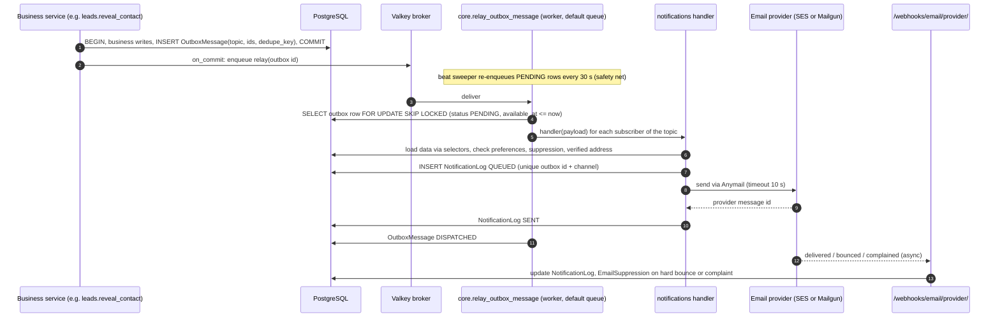

# Notifications — Design

How the platform tells people things: the notification catalogue, channels, templates, outbox-driven dispatch with retries and dead-lettering, provider delivery webhooks and suppression, preferences and unsubscribe, localisation, deliverability and monitoring.

Status: Draft v0.1 (2026-10-21)

| Item | Value |
|---|---|
| Owning app | `apps.notifications` (layer 4: subscribes to outbox topics, never called by lower layers). OTP SMS is sent by Twilio Verify from `apps.accounts` ([09 §6.2](09-external-integrations.md#62-twilio-verify-phone-otp)) |
| Milestones | M0 (outbox + relay), **M1** (auth emails, preferences, unsubscribe, delivery webhooks, suppression), M2 (listing lifecycle emails), **M4** (reveal receipt, welcome), **M5** (payment emails), M6 (moderation and Finance emails, ops monitoring), M7 (deliverability sign-off) |
| Requirement IDs | FR-NOTIF-01, FR-CRED-05 (reveal email), FR-AUTH-03/05 (verification, reset), FR-PROF-02.4/02.5/02.7 (security notices, preferences), FR-PAY-05.7 (receipt), FR-LIST-03.4/04.11/04.12 |
| Schema of record | [01 Domain model](01-domain-model.md): `core.OutboxMessage` (§2.1), `accounts.NotificationPreference` (§3.3), `notifications.NotificationLog`, `EmailSuppression` (§9) |
| Related | [05 Listings](05-listings-and-media.md) · [06 Search](06-search-and-discovery.md) (§13.5) · [07 Payments](07-payments-and-credit-purchase.md) · [09 External integrations](09-external-integrations.md) (§6.2 Twilio, §6.3 email provider) · [Architecture §8.2, §9](../architecture/01-system-architecture.md#9-synchronous-vs-asynchronous-paths) · [Security §6.5](../quality/01-security-and-compliance.md#65-rate-limiting-brute-force-and-bot-protection) |

---

## 1. Scope and traceability

| Source | Requirement | Addressed in |
|---|---|---|
| SRS §3.2 | Email confirmation or phone OTP to activate | NTF-01, NTF-02, §6, §8 |
| SRS §3.4 | Forgot password via secure, time-limited link | NTF-04, §6 |
| SRS §5.5 | Automated email "concurrently with the deduction": property link, lister name, title, full description, transaction confirmation; reliable, monitored transactional service | NTF-10, §4, §5, §15 |
| SRS §5.6 / §11.1 | Insufficient-credit toast; "Contact revealed. 2 credits deducted. Details emailed to you." | §9 (in-app) |
| SRS §6.4 / derived | Purchase receipt | NTF-12 |
| SRS §7.2 | Two-step sensitive changes; communication and email-notification preferences (promotional alerts) | NTF-05 … NTF-08, §10 |
| SRS §4.3 / §4.4 | Tag-change review outcome; listing management | NTF-17 … NTF-25 |
| Diagram "Notification Services (lead alerts, OTP delivery, Twilio, Mailgun)" | Provider-agnostic email, Twilio for OTP; lister lead alerts | §2, §8; lead alerts are post-MVP (NTF-29) |

**Deviation from SRS (§5.5, known issue #10):** the reveal email is sent **after** the debit commits, asynchronously through the transactional outbox, not "concurrently". Sending inside the transaction could email a receipt for a debit that then rolls back; sending after commit without an outbox could lose the email if the process dies. Target: p95 ≤ 60 s from commit to provider acceptance (FR-CRED-05.3).

---

## 2. Principles and channels

### 2.1 Principles

| # | Principle |
|---|---|
| N1 | **Every user-facing message is triggered by a committed fact.** Business services publish `core.OutboxMessage` rows inside their transaction. No service sends email or SMS directly, and no web request waits on an email provider (NFR §3 rule 3) |
| N2 | **Payloads carry public IDs, never PII or secrets.** Handlers re-read current data through selectors at send time. One controlled exception is listed in §6.3 |
| N3 | **At-least-once delivery, idempotent sending.** `NotificationLog UNIQUE (outbox_message_public_id, channel)` blocks repeats. A crash between provider acceptance and the log update can still cause a rare duplicate; that is accepted and documented (§5.4) |
| N4 | **Re-check relevance at send time.** A "listing published" email is skipped if the listing is no longer published when the handler runs |
| N5 | **Transactional messages carry no marketing content, no open-tracking pixels and no click tracking** (privacy; FR-CRED-05.2 assumption) |
| N6 | **Only verified addresses receive account email**, except the verification email itself (§5.3) |
| N7 | **Provider-agnostic.** Email goes through django-anymail; changing provider is configuration plus DNS (FR-NOTIF-01.1) |

### 2.2 Channels

| Channel | MVP use | Technology | Notes |
|---|---|---|---|
| Email | All notifications in §3 except OTP | django-anymail → Amazon SES (default) or Mailgun ([09 §6.3](09-external-integrations.md#63-email-provider-amazon-ses-or-mailgun-via-anymail)); provider decision OQ-NTF-01 (= OQ-32 / A-2) | Primary channel |
| SMS | **OTP only** (account and listing-contact phone verification) | Twilio Verify; Twilio composes and sends the message | No other SMS in the MVP. Programmable SMS for lead alerts is post-MVP and needs sender registration (§8.3) |
| In-app | Toasts, inline status, persistent banners | HTMX `HX-Trigger` toasts and server-rendered banners | Immediate feedback for the user's own actions (§9). No notification inbox in the MVP |
| Push / WhatsApp | None | — | Post-MVP, with the mobile API |

### 2.3 Categories

Every catalogue entry has exactly one category, which decides whether preferences apply and which headers are sent.

| Category | Preference | `List-Unsubscribe` | Examples |
|---|---|---|---|
| `SECURITY` | Always sent (to a verified address) | No | Password changed, email changed (old address), phone changed |
| `TRANSACTIONAL` | Always sent | No | Verification, reset, reveal receipt, purchase receipt, refund |
| `SERVICE` | Always sent | No | Listing published, review decision, moderation action, tag decision (they concern the user's own listing or account and may carry obligations) |
| `REMINDER` | `NotificationPreference.listing_reminders_email` (default **on**, opt-out) | Yes (one-click) | Expiring listing, expired listing, draft expiring |
| `PRODUCT_UPDATES` | `product_updates_email` (default off, opt-in) | Yes | Post-MVP |
| `PROMOTIONAL` | `promotional_email` (default **off**, opt-in; SRS §7.2 "promotional alerts") | Yes | Post-MVP |
| `STAFF` | Not user-configurable | No | Moderation SLA digest |

**Refinement:** the testing strategy lists `List-Unsubscribe` on promotional mail only. Reminders are also opt-out-able, so they carry it too.

---

## 3. Notification catalogue

Status column: **MVP** = ships in the milestone shown; **Could** = small, ships if capacity allows; **Post-MVP** = designed, not built.

| ID | Notification | Trigger (topic or source) | Channel | Category | Recipient | Template key | MS | Status |
|---|---|---|---|---|---|---|---|---|
| NTF-01 | Email verification link | Signup; resend; allauth `send_mail` → `account.email_verification_requested` | Email | TRANSACTIONAL | New address (unverified, by design) | `accounts.email_verification` | M1 | MVP |
| NTF-02 | Account phone OTP | `accounts.services.start_phone_verification` (synchronous Verify call) | SMS (Twilio Verify) | TRANSACTIONAL | Phone being verified | Verify service template | M1 | MVP |
| NTF-03 | Listing contact phone OTP | Listing wizard step 5 ([05 §4.5](05-listings-and-media.md#45-contact-phone-verification)) | SMS (Twilio Verify) | TRANSACTIONAL | Phone being verified | Verify service template | M2 | MVP |
| NTF-04 | Password reset link | allauth reset → `account.password_reset_requested` | Email | TRANSACTIONAL | Account email | `accounts.password_reset` | M1 | MVP |
| NTF-05 | Password changed / reset notice | `account.password_changed` | Email | SECURITY | Account email | `accounts.password_changed` | M1 | MVP |
| NTF-06 | Confirm new email address | Email change step 2 → `account.email_verification_requested` (purpose `change`) | Email | TRANSACTIONAL | New address | `accounts.email_change_confirm` | M1 | MVP |
| NTF-07 | Email changed (notice to old address) | `account.email_changed` | Email | SECURITY | **Old** address (§6.3) | `accounts.email_changed_old_address` | M1 | MVP |
| NTF-08 | Phone number or MFA changed | `account.phone_changed`, `account.mfa_changed` | Email | SECURITY | Account email | `accounts.security_change` | M1 | MVP |
| NTF-09 | Welcome, 10 credits added | `account.verified` (same transaction as the promo grant) | Email | TRANSACTIONAL | Account email | `credits.welcome` | M4 | MVP |
| NTF-10 | **Contact reveal receipt** (SRS §5.5) | `contact.revealed` | Email | TRANSACTIONAL | Renter's account email | `leads.contact_revealed` | M4 | MVP |
| NTF-11 | Low balance nudge | Reveal leaves balance < `CREDITS_REVEAL_COST` | In-app (MVP); email post-MVP | PROMOTIONAL (email) | Renter | `credits.low_balance` | M4 | MVP in-app only |
| NTF-12 | Purchase receipt | `payment.succeeded` | Email | TRANSACTIONAL | Buyer | `payments.receipt` | M5 | MVP |
| NTF-13 | Payment not completed | `payment.failed` with `async = true` (failure after the user left the return page) | Email | TRANSACTIONAL | Buyer | `payments.payment_not_completed` | M5 | MVP |
| NTF-14 | Refund processed, credits removed | `payment.refunded` | Email | TRANSACTIONAL | Buyer | `payments.refund_processed` | M5 | MVP |
| NTF-15 | Credits adjusted by staff | `credits.adjusted` (approved `ADMIN_ADJUSTMENT`, US-608) | Email | TRANSACTIONAL | Wallet owner | `credits.adjustment` | M6 | MVP |
| NTF-16 | Purchases or account under review | Finance/Support action in the ops console (manual, never automatic on a dispute) | Email | SERVICE | Account email | `credits.account_review` | M6 | MVP |
| NTF-17 | Listing is live | `listing.published` | Email | SERVICE | Owner | `listings.published` | M2 | MVP |
| NTF-18 | Listing submitted for review | `listing.submitted_for_review` | Email | SERVICE | Owner | `listings.submitted_for_review` | M2 | MVP |
| NTF-19 | Listing review decision (approved / rejected with reason) | `listing.review_decided` | Email | SERVICE | Owner | `listings.review_decision` | M2 (admin) / M6 | MVP |
| NTF-20 | Listing suspended, reinstated or changes requested | `listing.moderation_action` | Email | SERVICE | Owner | `listings.moderation_action` | M6 | MVP |
| NTF-21 | Listings expiring in 7 days (one email per owner per day, all affected listings, one-click renew) | `listing.expiring_soon` (daily beat job) | Email | REMINDER | Owner | `listings.expiring_soon` | M2 | MVP |
| NTF-22 | Listing expired | `listing.expired` | Email | REMINDER | Owner | `listings.expired` | M2 | MVP |
| NTF-23 | Draft will be archived in 10 days (day 80 of 90) | `listing.draft_expiring` | Email | REMINDER | Owner | `listings.draft_expiring` | M2 | MVP |
| NTF-24 | Tag-change decision | `listing.tag_change_decided` | Email (+ dashboard banner) | SERVICE | Owner | `listings.tag_change_decision` | M2 | MVP |
| NTF-25 | Listing unlisted after availability reports ("Please confirm availability") | `listing.auto_unlisted` | Email | SERVICE | Owner | `listings.auto_unlisted` | M6 | MVP |
| NTF-26 | Verify your account (day 5; unverified accounts are purged at day 7) | Daily beat job | Email | TRANSACTIONAL | New address | `accounts.verification_reminder` | M1 | Could |
| NTF-27 | Saved-search alerts (new listings matching a saved search) | `search` digest job ([06 §13.5](06-search-and-discovery.md#135-post-mvp), US-906) | Email | PRODUCT_UPDATES (own preference to be added) | Searcher | `search.saved_search_alert` | — | Post-MVP |
| NTF-28 | Lister weekly performance digest (views, saves, reveals) | Weekly beat job | Email | REMINDER (own preference to be added) | Lister | `listings.performance_digest` | — | Post-MVP |
| NTF-29 | Lister notified of a new lead / reveal (flow chart "Lister notified of new lead") | `contact.revealed` or future `lead.created` | Email / SMS | SERVICE | Lister | `leads.new_lead_for_lister` | — | Post-MVP (OQ-NTF-04) |
| NTF-30 | Promotional offers and newsletters | Campaign tool | Email | PROMOTIONAL | Opted-in users | `marketing.*` | — | Post-MVP |
| NTF-31 | Staff: moderation and tag-change SLA digest | Daily beat job (M6) | Email | STAFF | Each Moderator | `moderation.sla_digest` | M6 | MVP |

### 3.1 Content of the critical messages

**NTF-10 Contact reveal receipt** (FR-CRED-05.2; template snapshot test checks every field):

| Block | Content | Source at send time |
|---|---|---|
| Subject | "Contact details for {listing title}" | `listings.selectors` (public DTO) |
| Listing | Title, link to the canonical listing URL, `email` image variant, locality and city, price per period, **full description** (escaped plain text, line breaks kept) | Public DTO |
| Contact | Lister name, phone (`tel:` link), email if provided (`mailto:`) | `leads.selectors.get_revealed_contact(reveal)`: the **encrypted snapshot** on `ContactReveal` (decrypted in the worker only) |
| Transaction | Transaction ID (ledger entry `public_id`), credits deducted (2), balance after, date and time in the user's timezone | Ledger entry |
| Footer | "View this contact any time in your transaction history" link (free re-view, SRS §5.4), support contact, merchant details | — |

If the listing has since been unpublished, the email still goes out (the user paid) and says "This listing is no longer available, but you can still contact the lister."

**NTF-12 Purchase receipt:** content per [07 §15.1](07-payments-and-credit-purchase.md#151-purchase-receipt-fr-pay-057-us-511).

**NTF-05/07/08 Security notices:** what changed, when (user's timezone), approximate country and device family (from the request's GeoLite2 country and user-agent family, captured in the publishing request and passed as non-PII codes), and "If this wasn't you, reset your password" with a link. No IP address in the email.

---

## 4. Architecture

### 4.1 Flow



### 4.2 Topic registry

Topics are **singular domain nouns** (`listing.published`), per the codebase naming decision ([codebase §16 CS-1](../architecture/03-codebase-structure.md#16-open-questions-and-consistency-items)). Template keys use the **app label** (`listings.published`), matching `NotificationLog.template_key` examples. **Alignment note:** [05](05-listings-and-media.md) names two outbox topics `listings.published` and `listings.tag_change_decided`; under CS-1 they are `listing.published` and `listing.tag_change_decided`. The `listings.draft_expiring` and `listings.expiring_soon` names in 05 are template keys and stay as they are.

| Topic | Publisher (service) | Payload (public IDs only) | `dedupe_key` | Subscribers |
|---|---|---|---|---|
| `account.email_verification_requested` | `accounts` adapter (§6) | `{user, purpose: signup\|change\|resend}` | none (each resend is a new send) | notifications → NTF-01 / NTF-06 |
| `account.password_reset_requested` | `accounts` adapter | `{user}` | none | NTF-04 |
| `account.password_changed` | `accounts` | `{user, country, device}` | `pwchg:<user>:<ts>` | NTF-05 |
| `account.email_changed` | `accounts` | `{user, country, device, old_to_enc}` (§6.3) | `emailchg:<user>:<ts>` | NTF-07 |
| `account.phone_changed`, `account.mfa_changed` | `accounts` | `{user, change, country, device}` | per event | NTF-08 |
| `account.verified` | `accounts` (same transaction as wallet + promo) | `{user}` | `verified:<user>` | NTF-09 |
| `contact.revealed` | `leads.reveal_contact` | `{reveal}` | `contact.revealed:<reveal>` | NTF-10; analytics |
| `payment.succeeded` | `payments.fulfill_order` | `{order}` | `payment.succeeded:<order>` | NTF-12 |
| `payment.failed` | `payments` | `{order, async}` | `payment.failed:<order>` | NTF-13 (only `async = true`) |
| `payment.refunded` | `payments.apply_refund_update` | `{order, entry}` | `payment.refunded:<entry>` | NTF-14 |
| `credits.adjusted` | `credits` (approved adjustment) | `{entry}` | `credits.adjusted:<entry>` | NTF-15 |
| `listing.published` | `listings.property_submit` / relist | `{property}` | `listing.published:<property>:<listed_at>` | NTF-17; sitemap |
| `listing.submitted_for_review` | `listings.property_submit` | `{property}` | per submission | NTF-18 |
| `listing.review_decided` | `moderation` / admin action | `{property, decision, reason_code}` | per decision | NTF-19 |
| `listing.moderation_action` | `moderation` | `{property, action, reason_code}` | per action | NTF-20 |
| `listing.expiring_soon` | `listings` daily job | `{owner, date, properties: [...]}` | `expiring:<owner>:<date>` | NTF-21 |
| `listing.expired` | `listings.expire_listings` | `{property}` | `expired:<property>:<expires_at>` | NTF-22 |
| `listing.draft_expiring` | `listings` daily job | `{property}` | `draft_expiring:<property>` | NTF-23 |
| `listing.tag_change_decided` | `listings.tag_change_request_approve/reject` | `{request}` | `tcr:<request>:decided` | NTF-24 |
| `listing.auto_unlisted` | `listings` (report threshold) | `{property}` | per event | NTF-25 |

Handlers are registered in `notifications/apps.py` `ready()` with `core.outbox.register_handler(topic, handler)`. Lower layers never import `notifications` (architecture R1).

---

## 5. Dispatch pipeline

### 5.1 Handler steps

```python
# apps/notifications/handlers.py (illustrative)
def on_contact_revealed(msg: OutboxEnvelope) -> None:
    reveal = leads_selectors.get_reveal(public_id=msg.payload["reveal"])        # renter, property, entry
    notifications_services.send_email(
        spec=CATALOGUE["NTF-10"],               # key, category, hold policy, headers
        user_id=reveal.user_id,
        outbox_message_public_id=msg.public_id,
        subject=("leads.contactreveal", reveal.public_id),
        context_builder=lambda: build_reveal_context(reveal),   # decrypts the contact snapshot here only
    )
```

`notifications.services.send_email` performs, in order:

| Step | Rule | Outcome if it fails the rule |
|---|---|---|
| 1 Idempotency | `NotificationLog` row for `(outbox_message_public_id, EMAIL)` already `SENT`/`DELIVERED` | Return (no-op) |
| 2 Recipient state | User `DELETED` or anonymised | Skip (structlog `notification.skipped`, no log row) |
| 3 Preference | Category allowed by `NotificationPreference` (§2.3) | Skip |
| 4 Relevance | Spec's `still_relevant(context)` (for example listing still published for NTF-17) | Skip |
| 5 Verified address | Primary address verified (§5.3) | `HELD` (receipts) or `SUPPRESSED` (other kinds) |
| 6 Suppression | `EmailSuppression` has `HMAC(addr)` | `SUPPRESSED`; in-app banner (§9) |
| 7 Non-prod allow-list | In dev and staging, recipient must match `NOTIFICATIONS_RECIPIENT_ALLOWLIST` (US-118) | `SUPPRESSED` (reason `NON_PROD_ALLOWLIST`) |
| 8 Render | Subject, text and HTML in the user's locale and timezone (§12) | Template error → permanent failure (§5.2) |
| 9 Log | Upsert `NotificationLog(status=QUEUED, attempts += 1, to_hmac, to_masked, template_key, provider)` | — |
| 10 Send | Anymail `EmailMultiAlternatives.send()`, with `tags=[template_key]`, `metadata={"log": log.public_id}`, provider configuration set per category | Provider error → §5.2 |
| 11 Record | `SENT`, `provider_message_id`, `sent_at`; metric `notification_dispatch_latency_seconds` = now − outbox `created_at` | — |

### 5.2 Errors, retries and dead letter

Retries use the **outbox's** `attempts`/`available_at`, not Celery `countdown` (architecture §9: no long countdowns on the Redis transport). The relay marks a message `DISPATCHED` only when every handler for its topic returned without a retryable error; already-completed handlers are no-ops on retry because of step 1.

| Error class | Examples | Behaviour |
|---|---|---|
| Transient | Provider 5xx, timeout, connection error, throttling (`Throttling`, max send rate) | Re-raise `RetryableNotificationError`; relay sets `available_at` by the backoff table; `NotificationLog.last_error` updated |
| Permanent, recipient | Provider rejects the address, invalid syntax | `NotificationLog.FAILED`, no retry. If the provider reports that the mailbox does not exist, also add `EmailSuppression(reason=HARD_BOUNCE)` |
| Permanent, code or config | Missing template, render error, provider auth error (4xx credentials) | Up to 3 attempts (in case of a deploy race), then `OutboxMessage.DEAD` and a page |
| Skip | §5.1 steps 2–4 | Message counts as handled |

Backoff schedule (10 attempts, about 24 h in total, matching [01 §12.8](01-domain-model.md#128-outboxmessagestatus)):

| Attempt | 1 | 2 | 3 | 4 | 5 | 6 | 7 | 8 | 9 | 10 |
|---|---|---|---|---|---|---|---|---|---|---|
| Delay before next | 30 s | 1 min | 5 min | 15 min | 30 min | 1 h | 2 h | 4 h | 6 h | 10 h → `DEAD` |

Each delay gets ±10 % jitter so a provider outage does not produce synchronised retry waves.

**Dead letter:** `OutboxMessage.status = DEAD` (rows are kept; they are not purged like `DISPATCHED` rows). `/ops/jobs/` lists them with topic, attempts and last error; a Superadmin can retry one or a filtered batch, which resets `attempts` and `available_at` (FR-OPS-05.1). Any `DEAD` message whose topic is `contact.revealed`, `payment.*` or `account.password_*` pages on-call.

### 5.3 Verified-address rule and held emails

- Only the verification emails (NTF-01, NTF-06, NTF-26) go to an unverified address.
- A user verified **by phone only** (FR-AUTH-03.3) has an unverified email. For **receipts** (NTF-10, NTF-12, NTF-14) the email is **held**: `NotificationLog.status = HELD`, and the UI says so (toast variant "Contact revealed. 2 credits deducted. Verify your email to receive the details.", NFR-UX-02.2). When the address is verified (allauth `email_confirmed` signal → `notifications.receivers` → `release_held_for_user`), every `HELD` log for that user is re-sent by re-rendering from its subject reference.
- Other messages to an unverified address (welcome, reminders, security notices) are **not** held, because they lose their value later. They are logged as `SUPPRESSED` (reason `UNVERIFIED_ADDRESS`). Security notices are still visible in the user's session list and audit history.

**Proposed schema change** (to [01 §9.1](01-domain-model.md#91-notificationsnotificationlog)): add status `HELD`, plus `subject_type varchar(50) NULL` and `subject_public_id uuid NULL` (for example `leads.contactreveal` + reveal UUID). Held receipts can then be re-rendered after the 14-day outbox purge, and Support can answer "did the receipt for order X go out?" with one indexed lookup (`(subject_type, subject_public_id)`).

### 5.4 Delivery semantics and known duplicate window

The provider call cannot join our database transaction, and SES/Mailgun do not offer idempotency keys. If a worker dies after the provider accepted the message but before `SENT` is committed, the retry sends again. Mitigations: the window is milliseconds; `acks_late` plus the log row make it visible (`attempts > 1` with `provider_message_id` already set on the earlier attempt is logged as `notification.possible_duplicate`). A duplicate receipt is harmless; a missing one is not, so at-least-once is the right trade-off.

### 5.5 Timing targets and throughput

| Message | Target (commit → provider accepted) |
|---|---|
| NTF-01, NTF-04, NTF-06 (user is waiting) | p95 ≤ 30 s |
| NTF-10 reveal receipt | p95 ≤ 60 s (FR-CRED-05.3, US-708 SLO) |
| NTF-12 purchase receipt | p95 ≤ 60 s |
| Reminders (NTF-21 … NTF-23) | Scheduled for 09:00–20:00 in the recipient's timezone via `available_at`; delivered within that window |

- Workers: `default` queue (architecture §5); security notices move to `critical` if NFR P-04 is adopted.
- **Provider send-rate guard:** a Valkey token bucket `rl:email:send:{provider}` keeps sends under `EMAIL_MAX_SEND_RATE` (the provider account's per-second limit). An empty bucket raises `RetryableNotificationError` with a short delay instead of failing.
- At the 1,000 reveals/s design ceiling the receipt volume would be 1,000 emails/s. The pipeline is load-tested with a sink adapter (NFR §8.3); the provider quota for that volume is a business decision (OQ-PERF-04).

---

## 6. Authentication emails through the outbox

django-allauth sends its emails through `AccountAdapter.send_mail(template_prefix, email, context)`. The project's `accounts.adapter.AccountAdapter` overrides it to **publish an outbox message instead of sending** (NFR P-06), so signup, reset and email change never block on the provider.

### 6.1 No secrets in payloads

allauth's context contains activation keys and reset tokens. They must not be stored in `OutboxMessage.payload`. The handler **regenerates** the secret at send time from IDs:

| allauth email | Topic | Regenerated at send time by the handler |
|---|---|---|
| `account/email/email_confirmation_signup`, `email_confirmation` | `account.email_verification_requested` | `EmailConfirmationHMAC(email_address).key` for the user's pending address. **Requires link-based HMAC confirmation** (`ACCOUNT_EMAIL_CONFIRMATION_HMAC = True`) |
| `account/email/password_reset_key` | `account.password_reset_requested` | Django's `default_token_generator.make_token(user)` and the user's base-36 id, as allauth builds the reset URL. The token is time-bound (1 h, FR-AUTH-05.5) and invalidated by a password change |
| `account/email/password_changed`, `password_set`, `password_reset` | `account.password_changed` | Nothing secret |
| `account/email/email_changed` | `account.email_changed` | Nothing secret; recipient is the old address (§6.3) |
| `account/email/unknown_account` | **Not sent** (`ACCOUNT_EMAIL_UNKNOWN_ACCOUNTS = False`): emails to non-users are a spam vector, and the reset response is identical either way | — |

**Decision:** email verification uses **links**, not codes. allauth's code-based verification keeps the code in the session, which a worker cannot regenerate; putting it in the outbox would store a live secret in the database. US-102 allows "code or link". If Product requires codes, the code must travel in an encrypted payload field with immediate purge on dispatch (OQ-NTF-02).

### 6.2 Latency

The verification email is enqueued on commit and relayed immediately (p95 ≤ 30 s, normally a few seconds). The resend button keeps its 60 s cooldown (US-102).

### 6.3 The one PII exception: old-address notice

NTF-07 must reach the **old** address after it has been replaced, so the handler cannot re-read it. The publisher stores it in the payload as `old_to_enc`, encrypted with the application field-encryption module (`apps.core.crypto`, AAD `"core.outboxmessage.payload.old_to"`). The handler decrypts it, sends, and the row is purged with other `DISPATCHED` rows after 14 days. **Proposed refinement** to the "IDs only" rule in [01 §2.1](01-domain-model.md#21-coreoutboxmessage): ciphertext fields named `*_enc` are allowed, listed in the PII register, and never logged.

---

## 7. Templates

### 7.1 Technology decision

| Option | Pros | Cons | Decision |
|---|---|---|---|
| **Django templates, hand-authored table layout with inline styles** | No new toolchain; same i18n (``), autoescaping and test tooling as pages; small number of templates | Email HTML must be written carefully (Outlook) | **Chosen for the MVP** |
| MJML compiled to Django templates in CI | Robust responsive output across clients | Needs Node in CI (allowed only for CI tooling, T-5); two template languages; Django tags inside MJML need care | Re-evaluate if the template count passes ~40 or rendering defects appear |
| Provider-hosted templates (SES templates, Mailgun templates) | Editable without deploy | Splits copy across systems; weaker i18n and tests; provider lock-in (breaks N7) | Rejected |

### 7.2 Layout and files

```
apps/notifications/templates/notifications/email/
  _base.html            # 600 px table layout, inline styles, lang/dir, preheader, footer slot
  _base.txt
  _components/          # button.html, heading.html, key_value_table.html, listing_card.html (inline styles)
  leads.contact_revealed/
    subject.txt
    body.txt            # authored, not generated from HTML
    body.html
  payments.receipt/ ...
```

| Rule | Detail |
|---|---|
| Parts | Every email has `subject.txt`, `body.txt` and `body.html` (multipart/alternative). The text part is written for reading, not stripped from HTML (FR-NOTIF-01.3) |
| Escaping | Autoescape on. User-generated text (titles, descriptions, names) is always escaped; descriptions use `linebreaksbr` on escaped text only |
| Links | Absolute URLs from `settings.SITE_URL` and `reverse()`; never built from the request host |
| Images | Only the listing `email` variant (600×450 JPEG, [05 §8.4](05-listings-and-media.md#84-variants)) and the logo, from the media CDN, with `alt` text, `width`/`height`. No remote fonts. Emails read correctly with images blocked |
| Accessibility | `<html lang>`; `role="presentation"` on layout tables; one `<h1>`; body text ≥ 14 px; contrast ≥ 4.5:1; meaningful link text ("View the listing", not "click here"); buttons are links with padding (VML fallback not used) |
| Preheader | Hidden preview text per template (for example "Transaction 3f9c… · 2 credits · Balance 8") |
| Brand and legal footer | Brand, merchant legal name and postal address (`MERCHANT_*` settings, [07 §22.4](07-payments-and-credit-purchase.md#224-settings)), support contact, "Why am I getting this?" line per category; unsubscribe link for `REMINDER`/`PRODUCT_UPDATES`/`PROMOTIONAL` |
| Headers | `From: "<Brand>" <notifications@mail.<domain>>`, `Reply-To: support@<domain>`, `List-Unsubscribe` + `List-Unsubscribe-Post: List-Unsubscribe=One-Click` on unsubscribable categories; `Auto-Submitted: auto-generated` on all |
| Never in emails | Passwords, OTP codes (Twilio sends OTPs), full IP addresses, internal integer IDs, other users' data. Listing contact details appear **only** in NTF-10 to the renter who paid |
| Preview | `/ops/notifications/preview/<template_key>/` (staff, M6) renders each template with factory data in each locale; in dev, Mailpit shows real sends |

---

## 8. SMS and OTP

### 8.1 OTP via Twilio Verify (NTF-02, NTF-03)

- `accounts.integrations.twilio_verify` implements `PhoneVerificationService` ([09 §6.2](09-external-integrations.md#62-twilio-verify-phone-otp)). Twilio generates, sends and checks the code. **We never store an OTP.**
- The start call is made synchronously in the request (the user is waiting), outside any DB transaction, with a 5 s timeout. It is not routed through the outbox: there is no committed business fact to protect, and queueing would only add delay.
- Code: 6 digits, 10-minute validity, 5 check attempts (FR-AUTH-03.3). Rate limits from [security §6.5](../quality/01-security-and-compliance.md#65-rate-limiting-brute-force-and-bot-protection): 3 sends per 10 min per phone, 10/hour per IP, Turnstile, country allow-list; **fail closed** if Valkey is down (SMS pumping risk).
- Message text: Verify's localised template with our service name. Custom wording requires Twilio template approval (not needed for the MVP).
- Fallbacks: after 2 failed deliveries, offer "Call me instead" (Verify voice channel). For account activation, email verification is always an alternative (either method activates).

### 8.2 No non-OTP SMS in the MVP

`notifications/channels/sms.py` (Twilio Programmable Messaging) exists as an adapter seam with a fake, but no MVP notification uses it. Reasons: cost, sender-registration lead times (§8.3) and no SRS requirement.

### 8.3 Post-MVP SMS prerequisites

Lister lead alerts (NTF-29) by SMS would need per-market sender registration before the first message: US A2P 10DLC brand and campaign registration, India DLT entity and template registration, alphanumeric sender IDs where supported (for example UK). Each takes days to weeks, so registration starts as soon as the feature is scheduled.

---

## 9. In-app notifications

| Type | Use | Mechanism |
|---|---|---|
| Toast | Result of the user's own action: reveal confirmation (exact SRS copy, NFR-UX-02.1), insufficient credit with "Buy credits" link (FR-CRED-06), saved, payment cancelled | `HX-Trigger` + out-of-band swap into `#toasts` (`role="status"`) or `#alerts` (`role="alert"`); not auto-dismissed in under 10 s or while focused (FR-CRED-06.4) |
| Inline status | Upload processing, "Confirming payment…", autosave "Saved 12:03" | Fragment polling or swaps |
| Persistent banner | Held receipts ("Verify your email to receive your receipts"); suppressed address ("We couldn't deliver email to j•••@example.com. Update your email."); listing decisions on My Properties; account under review | Rendered server-side from selectors (`notifications.selectors.email_delivery_problem(user)`, listing selectors); dismissible per session, reappears until resolved |
| Low balance (NTF-11) | After a reveal that leaves balance < 2: a quiet line in the reveal toast area, "1 credit left · Buy credits" | Same response as the reveal; no email in the MVP |

An in-app notification inbox (bell icon, read state) is post-MVP.

---

## 10. Preferences, consent and unsubscribe (SRS §7.2, FR-PROF-02.7)

### 10.1 Preference page `/my/notifications/`

| Setting (`NotificationPreference` field) | Default | Controls |
|---|---|---|
| Listing reminders (`listing_reminders_email`) | On | NTF-21, NTF-22, NTF-23 (and NTF-28 until it gets its own field) |
| Product updates (`product_updates_email`) | Off | Post-MVP announcements |
| Promotional alerts (`promotional_email`) | **Off** (opt-in; **Assumption**, GDPR-safe, US-112) | NTF-30, NTF-11 email |
| Always sent (read-only list) | — | Security, transactional and service messages, each listed by name so users understand what they will still receive |

- Changes to `promotional_email` and `product_updates_email` write `AuditLog` (`accounts.consent_changed`, `{category, value, source: "preferences"\|"unsubscribe_link"}`) as consent evidence.
- New categories (saved searches, digests) each get their own field when built, default off unless the user creates the subscription (for example saving a search with "Email me" ticked).

### 10.2 Unsubscribe

| Aspect | Design |
|---|---|
| Token | `django.core.signing.dumps({"u": user_public_id, "c": category}, salt="notifications.unsubscribe")`, verified with `max_age = 365 days`. No token table ([01 §3.3](01-domain-model.md#33-accountsnotificationpreference)) |
| URL | `/n/unsubscribe/<token>/` |
| GET | Confirmation page: "Stop {category} emails?" with one button. **GET never changes state** (mail-security scanners prefetch links) |
| POST | Sets the preference off, shows "You're unsubscribed" with a link to all preferences, writes the consent audit row |
| One-click (RFC 8058) | Mail clients POST `List-Unsubscribe=One-Click` to the same URL; handled without login or CSRF token because the signed token is the credential |
| Scope | Only the token's category. Transactional, service and security messages cannot be unsubscribed (they are not marketing), which the confirmation page explains |

**Proposed change** to [security §6.4](../quality/01-security-and-compliance.md#64-csrf-request-integrity-and-fail-closed-behaviour): the `csrf_exempt` allow-list (Semgrep rule) must include the unsubscribe POST view and the Anymail tracking views, not only gateway webhooks. Both authenticate by signature/token instead of session.

---

## 11. Provider webhooks: delivery, bounces, complaints

### 11.1 Endpoints

Anymail's tracking URLs are mounted at `/webhooks/email/` (outside i18n), giving for example `/webhooks/email/amazon_ses/tracking/` and `/webhooks/email/mailgun/tracking/` ([codebase §7](../architecture/03-codebase-structure.md#7-url-namespace-map)).

| Provider | Delivery path | Authentication |
|---|---|---|
| Amazon SES | SES configuration set → event destination SNS topic → HTTPS subscription to the tracking URL. Anymail confirms the SNS subscription | Shared secret as HTTP basic auth in the subscription URL (`ANYMAIL["WEBHOOK_SECRET"]`), HTTPS only. **Verify at M1** whether the pinned Anymail also validates SNS message signatures; if not, add a topic-ARN allow-list check in a thin wrapper view |
| Mailgun | Mailgun webhooks for delivered, permanent fail, temporary fail, complained | HMAC signature with the webhook signing key, verified by Anymail; replay window enforced by timestamp |

Requests over 256 KB are rejected; WAF rate rule as for payment webhooks.

### 11.2 Event handling

Anymail emits its normalised `tracking` signal; `notifications/receivers.py` delegates to `notifications.services.record_delivery_event(event)`.

| Anymail event | `NotificationLog` | Suppression |
|---|---|---|
| `delivered` | `DELIVERED`, `delivered_at` | — |
| `bounced` (permanent / hard) | `BOUNCED` | `EmailSuppression(reason=HARD_BOUNCE)` |
| `bounced` (transient / soft), `deferred` | unchanged | None; 3 soft bounces for one address within 7 days → treat as hard |
| `complained` | `COMPLAINED` | `EmailSuppression(reason=COMPLAINT)`; also turns off `promotional_email` and `product_updates_email` |
| `rejected`, `failed` | `FAILED` | Only if the reason is a non-existent mailbox |
| `opened`, `clicked` | — | Not enabled (N5) |
| Unknown `provider_message_id` | Ignored, counted | — |

Events are matched by `provider_message_id` (indexed). Updates are idempotent (status only moves forward: `SENT → DELIVERED → COMPLAINED`; `BOUNCED` is terminal).

### 11.3 Suppression policy

- `EmailSuppression` is checked before every send (step 6). Suppression applies to **all** categories: repeatedly sending to a hard-bounced address damages the domain's reputation for everyone. The user is told in-app (§9).
- SES account-level suppression for bounces and complaints is also enabled, as a second layer.
- **Clearing:** when the user verifies a **new** address, nothing needs clearing. If they re-verify the **same** address (a user-initiated resend from the banner), the verification email bypasses our list once; on successful confirmation the `EmailSuppression` row is deleted and the address is removed from the provider's suppression list through the provider API. Limited to once per 24 h per user and audited (`notifications.suppression_cleared`).

---

## 12. Localisation and time

| Aspect | Rule |
|---|---|
| Language | `UserProfile.locale` (BCP 47), falling back to `en`. Rendering runs inside `translation.override(locale)`. English only at launch (OQ-31); every string is still marked for translation (NFR-UX-07.1) |
| Pre-account emails | NTF-01/NTF-26 use the locale captured at signup (from `LocaleMiddleware`) |
| Time | All timestamps rendered in `UserProfile.timezone` with the zone abbreviation ("21 Oct 2026, 14:05 IST"); stored in UTC |
| Money | Babel `format_currency` in the user's locale (receipts, refund notices) |
| Direction | `<html dir>` from the locale, so RTL languages need no template changes |
| Subjects | Translated; brand name not translated |
| Legal footer | Per-market variants (merchant address, consumer-law lines) selected by the user's account region |
| Tests | A pseudo-locale render (accented, lengthened strings) of every template in CI catches untranslated strings and layout overflow |

---

## 13. Deliverability

| Item | Design |
|---|---|
| Sending domains | Transactional mail from a dedicated subdomain, `mail.<domain>`. Post-MVP promotional mail from a separate subdomain (for example `news.<domain>`) and a separate SES configuration set, so marketing complaints cannot hurt receipts and resets |
| SPF | SES **custom MAIL FROM** domain (`bounce.mail.<domain>`) with its SPF record, so SPF aligns with the From domain. Mailgun equivalent if Mailgun is chosen |
| DKIM | SES Easy DKIM (2048-bit) on `mail.<domain>`; Mailgun DKIM if chosen. If a standby provider is kept warm ([09 §6.3](09-external-integrations.md#63-email-provider-amazon-ses-or-mailgun-via-anymail)), its DKIM records are published too |
| DMARC | On the organisational domain: start `p=none` with aggregate reports (`rua`) to a monitored mailbox or DMARC report service for 2–4 weeks; move to `p=quarantine`, then `p=reject` once reports show all legitimate mail aligned. Target: enforcement before go-live (M7, US-710) |
| Mailbox-provider rules | Meet the Gmail and Yahoo sender requirements: SPF and DKIM pass with DMARC alignment, a published DMARC record, one-click unsubscribe on marketing and reminder mail, user-reported spam rate kept well below 0.3 % (our alert threshold is far lower, §15) |
| TLS | Opportunistic TLS by default. A separate SES configuration set with **TLS required** is used for NTF-10 (it contains contact details); the rare recipient server without TLS bounces instead of receiving plaintext. **Assumption**, OQ-NTF-05 |
| Reputation | Separate configuration sets per stream (`txn`, `txn-pii`, `reminder`); SES reputation metrics alarmed (§15). Dedicated IPs are not needed at MVP volume (shared pool), re-evaluated above ~100k emails/day |
| Warm-up and limits | SES starts in sandbox: production access is requested in M0 (long-lead item, [development approach §8.4](../delivery/01-development-approach.md#84-long-lead-external-items-start-in-m0-owner-clientpo-unless-stated)). Volume ramps naturally with launch; quotas are raised ahead of marketing pushes |
| List hygiene | Disposable-domain blocklist at signup ([01 §3.5](01-domain-model.md#35-accountsblockedemaildomain)); verification before any non-verification mail; immediate suppression on hard bounce and complaint; unverified accounts purged at 7 days |
| Content | Plain, consistent From name; no URL shorteners; links on our own domain; text and HTML parts; no attachments in the MVP |

---

## 14. Privacy and security

| Topic | Rule |
|---|---|
| Data in payloads | Public IDs only (§6.3 exception) |
| Data in `NotificationLog` | `to_hmac` (HMAC of the normalised address, `addr:v1:`) and `to_masked` (`j•••@gmail.com`); **no rendered bodies** are stored. Retention 13 months ([01 §15](01-domain-model.md#15-data-retention-schedule)) |
| Contact data | Decrypted only inside the NTF-10 handler from the `ContactReveal` snapshot; never logged, never in Sentry (scrubber), never in payload or tags/metadata sent to the provider |
| Provider metadata | `tags = [template_key]`, `metadata = {"log": <log public id>}` only. No user email in metadata, no names |
| Processors | The email provider (SES in our AWS account, or Mailgun) and Twilio are processors under DPAs ([09 §7](09-external-integrations.md#7-data-sharing-and-privacy), [privacy §11](../quality/05-privacy-and-data-protection.md#11-processors-and-international-transfers)) |
| Logging | structlog events `notification.sent/skipped/held/suppressed/failed` with `template_key`, `log` public id, `user_public_id`; addresses never logged (redaction processor) |
| Abuse | Users cannot trigger arbitrary emails to arbitrary addresses: every send targets the account's own verified address, except verification (rate-limited, 60 s cooldown) and the old-address notice |

---

## 15. Monitoring and alerting

| Metric | Labels | Alert |
|---|---|---|
| `notifications_sent_total` | `template, channel, status` | Failure ratio (`FAILED` + retryable errors) > 2 % over 15 min (FR-CRED-05.4) |
| `notification_dispatch_latency_seconds` | `template` | NTF-10 p95 > 60 s for 15 min; NTF-01/04 p95 > 30 s |
| `outbox_pending_count`, `outbox_oldest_pending_age_seconds` | `topic` | Oldest pending > 5 min (warn), > 15 min (page) |
| `outbox_dead_total` | `topic` | Any `DEAD` on `contact.revealed`, `payment.*`, `account.password_*` (page); others (warn) |
| `email_bounce_rate`, `email_complaint_rate` | `stream` | Rolling 24 h bounce > 2 % or complaint > 0.05 % (warn); SES reputation `BounceRate` > 4 % or `ComplaintRate` > 0.08 % (page, well before the provider's own review thresholds) |
| `email_provider_errors_total` | `provider, kind` | Provider error rate > 10 % for 5 min (page; runbook "email provider outage") |
| `notifications_held_total`, `notifications_suppressed_total` | `reason` | Trend only |
| `otp_send_total`, `otp_check_total` | `result, country` | Verify start failures > 5 % for 10 min; **OTP conversion** (approved/started) dropping below 50 % in any country with > 50 sends/hour, which is the classic SMS-pumping signature (runbook RB-07) |

Dashboards: dispatch latency by template, outbox depth and age, delivery funnel (queued → sent → delivered), bounce/complaint rates by stream, OTP conversion by country. The ops console `/ops/jobs/` shows outbox pending, failed and dead counts with retry (US-611).

---

## 16. Testing

| Layer | What | How |
|---|---|---|
| Unit | Catalogue integrity (every NTF has templates in all three parts, a category and a test); category → preference mapping; unsubscribe token round-trip, tampering, expiry, category scope; backoff schedule; masking and HMAC of addresses | pytest |
| Template snapshots | Each template rendered with factory data in `en` and the pseudo-locale; golden files for subject, text and HTML; NTF-10 asserts every SRS §5.5 field plus contact and transaction blocks | pytest + `selectolax` |
| Handlers | Idempotent re-run (relay twice → one send); skip when the preference is off; held receipt released on email confirmation; suppressed address → `SUPPRESSED` + banner; listing no longer published → NTF-17 skipped; permanent vs transient errors | Anymail test backend (`anymail.backends.test.EmailBackend`) |
| Money-path coupling | **Rollback → no email:** fault injected after the debit leaves no outbox row and no send (FR-CRED-03.5); payment rollback → no receipt | `django_capture_on_commit_callbacks` |
| allauth integration | Signup, resend, reset and email change publish outbox rows; no token or code is stored in any payload (assert by scanning payload JSON); regenerated links work | Integration tests |
| Webhooks | SES SNS notifications (subscription confirmation, bounce permanent/transient, complaint, delivery) and Mailgun signed events from recorded fixtures; bad basic-auth or signature → 4xx; status only moves forward | Recorded fixtures |
| Contract | Email channel adapter on SES and Mailgun configurations (headers, tags, `List-Unsubscribe` only on unsubscribable categories); Twilio Verify contract ([09 §11](09-external-integrations.md#11-testing)) | Contract suite |
| Rendering in clients | Manual check per milestone of NTF-01, NTF-10, NTF-12 in Gmail (web, Android), Apple Mail (iOS, macOS) and Outlook (Windows desktop, web); dark mode | Checklist; optional rendering service |
| Local dev | Mailpit in docker compose catches all mail with a web UI; Twilio Verify fake accepts code `000000` | compose |
| Load | Outbox → relay → sink adapter at 1,000 messages/s (NFR PT-03) | k6 + sink |

---

## 17. Code organisation

| Module | Contents |
|---|---|
| `notifications/catalogue.py` | `CATALOGUE: dict[str, NotificationSpec]` (id, template key, category, channel, hold policy, `still_relevant`, unsubscribable). Single source for §3 in code |
| `notifications/handlers.py` | One handler per topic (`on_contact_revealed`, `on_payment_succeeded`, …), registered in `apps.py` `ready()`. Architecture names `send_contact_reveal_email` and `send_payment_receipt` are the service functions these handlers call |
| `notifications/services.py` | `send_email`, `release_held_for_user`, `record_delivery_event`, `suppress_address`, `clear_suppression`, `unsubscribe` |
| `notifications/selectors.py` | `email_delivery_problem(user)`, `list_logs_for_subject(subject_type, public_id)` (Support) |
| `notifications/channels/email.py` | Anymail wrapper: configuration set per category, send-rate guard, error classification |
| `notifications/channels/sms.py` | Twilio Programmable Messaging seam (post-MVP), fake |
| `notifications/receivers.py` | Anymail `tracking` signal, allauth `email_confirmed` |
| `notifications/views.py` | Unsubscribe GET/POST, staff preview (M6) |
| `accounts/adapter.py` | `AccountAdapter.send_mail` → outbox (§6) |
| `accounts/integrations/twilio_verify.py` | `PhoneVerificationService` (§8, [09 §6.2](09-external-integrations.md#62-twilio-verify-phone-otp)) |

Settings: `EMAIL_BACKEND` (Anymail backend for the chosen provider), `ANYMAIL` (provider credentials, `WEBHOOK_SECRET`), `DEFAULT_FROM_EMAIL`, `NOTIFICATIONS_REPLY_TO`, `NOTIFICATIONS_CONFIGURATION_SETS`, `EMAIL_MAX_SEND_RATE`, `NOTIFICATIONS_RECIPIENT_ALLOWLIST` (non-prod), `ACCOUNT_EMAIL_CONFIRMATION_HMAC = True`, `ACCOUNT_EMAIL_UNKNOWN_ACCOUNTS = False`. Secrets in Secrets Manager under `rpl/<env>/…` ([09 §4](09-external-integrations.md#4-configuration-and-secrets)).

---

## 18. Acceptance criteria

| ID | Criterion | Requirement |
|---|---|---|
| AC-NTF-01 | A successful reveal produces exactly one receipt email containing listing link, lister name, title, full description, contact details, transaction ID, credits deducted and balance after; p95 ≤ 60 s from commit in staging | FR-CRED-05.1–05.3 |
| AC-NTF-02 | A reveal whose transaction is rolled back by fault injection produces no outbox row and no email | FR-CRED-03.5 |
| AC-NTF-03 | Relaying the same outbox message twice sends one email (`NotificationLog` unique) | FR-CRED-05.5 |
| AC-NTF-04 | A phone-only-verified user who reveals sees the "verify your email" toast variant; after verifying the email, the held receipt arrives | FR-CRED-05.1, NFR-UX-02.2 |
| AC-NTF-05 | No outbox payload for signup, reset or email change contains a token, code or address (except the encrypted `old_to_enc`), and the regenerated links work | §6 |
| AC-NTF-06 | A permanent bounce event suppresses the address; the next send is logged `SUPPRESSED` and the user sees the delivery-problem banner | FR-NOTIF-01.2 |
| AC-NTF-07 | A one-click unsubscribe POST from a reminder email turns off `listing_reminders_email` only; GET on the same URL changes nothing | FR-PROF-02.7 |
| AC-NTF-08 | Promotional emails are never sent to a user with `promotional_email = false` (default) | FR-PROF-02.7 |
| AC-NTF-09 | SPF, DKIM and DMARC pass with alignment for mail from `mail.<domain>` (checked with a seed-mailbox test before launch) | FR-CRED-05.4, US-710 |
| AC-NTF-10 | A provider outage (adapter forced to fail) delays emails, retries per the backoff table, and delivers them after recovery without loss or duplicates; a message failing 10 times becomes `DEAD` and is retryable from `/ops/jobs/` | FR-OPS-05.1, NFR-AVAIL-01.8 |
| AC-NTF-11 | Every email template renders in the pseudo-locale with no untranslated strings, and every HTML part has a text alternative | FR-NOTIF-01.3 |
| AC-NTF-12 | The tag-change decision (approve and reject) emails the lister with the outcome and, on rejection, the moderator's note | FR-LIST-03.4 |

---

## 19. Open questions

| ID | Question | Baseline until answered | Register |
|---|---|---|---|
| OQ-NTF-01 | Email provider: Amazon SES or Mailgun (named in the diagram)? | SES through Anymail | = OQ-32 / A-2 |
| OQ-NTF-02 | Email verification by link or code? | Link (HMAC), so no secret is stored for async sending | New |
| OQ-NTF-03 | Should low-balance and win-back emails exist (promotional consent needed)? | In-app only | New |
| OQ-NTF-04 | Notify listers when their number is revealed ("Lister notified of new lead")? Privacy and expectations | No (counts on the dashboard only) | = A-9, OQ-17, OQ-LST-10 |
| OQ-NTF-05 | Require TLS for emails that contain contact details, accepting rare bounces? | Yes (TLS-required configuration set for NTF-10) | New |
| OQ-NTF-06 | Brand name, sending domain and support address | Placeholders | New |
| OQ-NTF-07 | Weekly lister performance digest at launch? | Post-MVP | New |
| OQ-NTF-08 | Accept the schema additions (`NotificationLog.HELD`, `subject_type`, `subject_public_id`) and the encrypted-payload exception for the old-address notice? | Yes | New |
