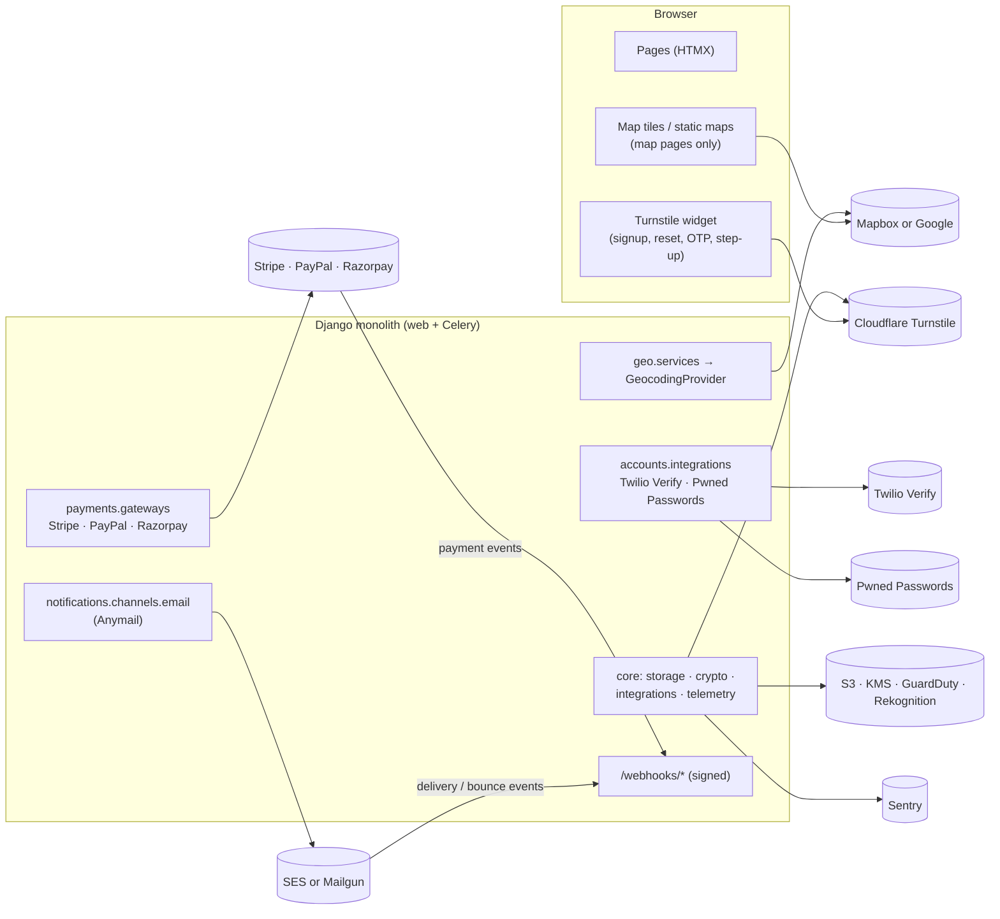
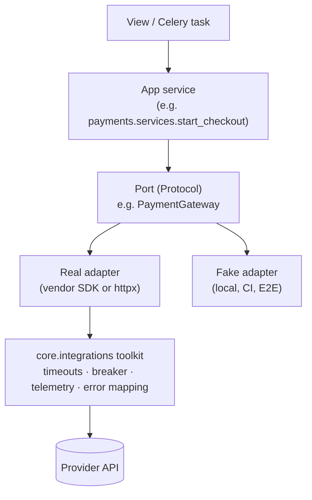
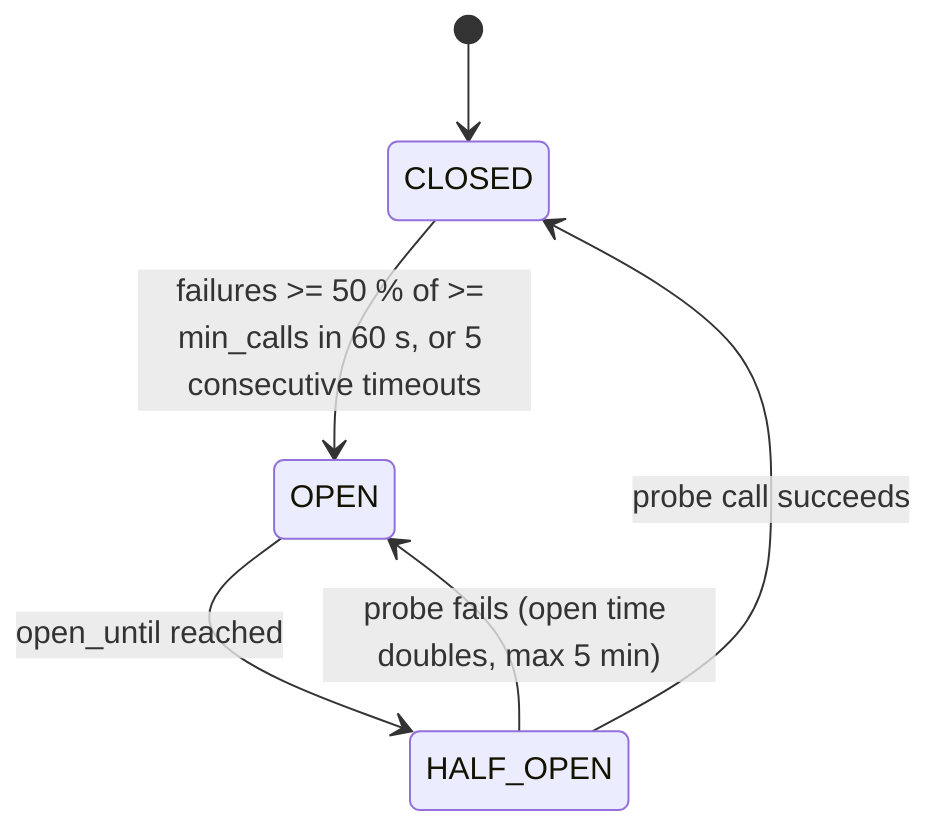
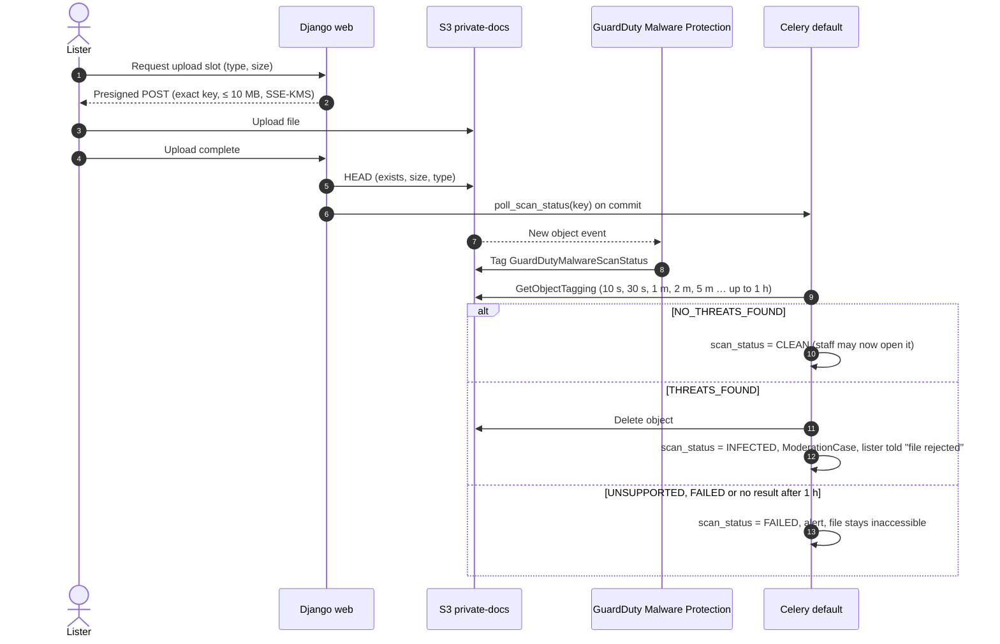

# External Integrations — Design

Covers every third-party service the platform calls or is called by: purpose, adapter interface, configuration and secrets, sandboxes, limits and cost drivers, failure handling and fallbacks, and the data each one receives. Also sets the shared resilience, testing and governance rules every integration follows.

Status: Draft v0.1 (2026-10-21)

> **Hosting change (2026-10-27):** AWS is no longer the target ([ADR-0014](../adr/0014-portable-hosting-paas-and-self-hosted.md)). AWS service names, CLI commands, sizing and alarms in this document are superseded; read them through the mapping table in ADR-0014 and [Hosting and deployment](../architecture/05-hosting-and-deployment.md). The provider-neutral intent (controls, targets, procedures) still applies.

| Item | Value |
|---|---|
| Owning apps | `apps.geo` (maps, geocoding, region), `apps.accounts` (Twilio Verify, Pwned Passwords, social sign-in), `apps.notifications` (email, SMS channel), `apps.payments` (gateways), `apps.core` (storage, crypto, shared integration toolkit, Turnstile), `apps.listings` (image-moderation hook), `apps.verification` (post-MVP KYC) |
| Milestones | M0 (toolkit, Sentry, S3/KMS, SES production-access request), M1 (Twilio Verify, email, Turnstile, Pwned Passwords, optional social sign-in), M2 (maps and geocoding, private-docs bucket), M5 (Stripe, PayPal, optional Razorpay, GeoLite2), M6 (malware scanning of tag-change evidence), M7 (live verification, onboarding complete), Post-MVP (KYC, image moderation, SMS lead alerts) |
| Requirement IDs | FR-NOTIF-01.1, FR-PAY-03.5, FR-AUTH-02, FR-AUTH-03.3, FR-KYC-01.1–01.3, NFR-AVAIL-01.8, NFR-SEC-01.5–01.7, NFR-SEC-03, NFR-SEC-04.4 ([catalog](../requirements/02-requirements-catalog.md)) |
| Related | [05 Listings](05-listings-and-media.md) (§5 geocoding, §8 images) · [06 Search](06-search-and-discovery.md) (§5.3, §11) · [07 Payments](07-payments-and-credit-purchase.md) (§6, §8–§10) · [08 Notifications](08-notifications.md) (§8, §11, §13) · [Architecture §7, R11](../architecture/01-system-architecture.md) · [Codebase §4.3](../architecture/03-codebase-structure.md#43-adapter-sub-packages-third-party-sdk-boundary-r11) · [Infrastructure §10](../architecture/04-infrastructure-and-deployment.md) · [Security §6.5–6.7](../quality/01-security-and-compliance.md#65-rate-limiting-brute-force-and-bot-protection) · [Observability](../quality/03-observability-and-operations.md) · [Testing §9](../delivery/04-testing-strategy.md#9-contract-tests-for-adapters) |

---

## 1. Scope and traceability

| Source | Requirement / item | Addressed in |
|---|---|---|
| SRS §3.2 | Email confirmation or phone OTP | §6.2, §6.3 |
| SRS §3.1 | Optional Google and Apple sign-on | §6.13 |
| SRS §4.2 | Image handling | §6.10 (moderation hook), §6.14 (S3) |
| SRS §4.5 | Geospatial search by location | §6.1 |
| SRS §5.5 | Email "via a highly reliable, monitored transactional email service" | §6.3, §10 |
| SRS §6.2 | Localised currency "by IP or account region" | §6.7 |
| SRS §6.3 | At least two global gateways, tokenisation, webhooks | §6.4–6.6, §3.6 |
| SRS §8.3 | Runbooks for "payment API failure" and similar incidents | §10 |
| SRS §9.1 | Encryption in transit; PII pseudonymised | §5.1 (TLS), §7 |
| SRS §9.3 | PCI DSS through certified gateways; no raw card data | §6.4–6.6 (hosted pages only) |
| Diagram "External services" | Maps & Geocoding API, Verification API, Payment Gateway (Stripe, PayPal), Notification Services (Twilio, Mailgun) | §2, §6 |

**Known-issue resolutions applied here:** #9 (gateway-verified fulfilment, see 07 §11), #12 (no PII in provider metadata; field encryption unaffected by providers), #13 (GeoIP default, account region override), #14 (adapter interface; Stripe + PayPal; Razorpay optional), #18 (Verification/KYC API is post-MVP, with storage and hooks designed now), #21 (S3 presigned upload, Pillow pipeline).

**Deviation from diagram:** the diagram's "Verification API (owner identity & listing checks)" is **post-MVP** (§6.9, OQ-20). Its "lead alerts" under Notification Services are **post-MVP** (08 NTF-29, OQ-17). Neither is in the SRS.

---

## 2. Integration inventory

| ID | Provider | Purpose | Milestone | Adapter module (R11) | Direction | Criticality |
|---|---|---|---|---|---|---|
| INT-01 | **Mapbox or Google Maps Platform** | Address autocomplete, geocoding → PostGIS point, static and interactive maps | M2 | `geo/providers/` | Server → provider; browser → provider (maps) | Medium: degrades to manual pin |
| INT-02 | **Twilio Verify** | Phone OTP for account activation and listing contact phone | M1 | `accounts/integrations/twilio_verify.py` | Server → provider | High for phone-only users |
| INT-03 | **Amazon SES or Mailgun** via django-anymail | All transactional email; delivery and bounce webhooks | M1 | `notifications/channels/email.py` | Both | High (async, queued) |
| INT-04 | **Stripe** (Checkout) | Credit purchases | M5 | `payments/gateways/stripe.py` | Both | Critical (money) |
| INT-05 | **PayPal** (Orders v2) | Credit purchases | M5 | `payments/gateways/paypal.py` | Both | Critical (money) |
| INT-06 | **Razorpay** (optional) | Credit purchases in India | M5, only if India launches | `payments/gateways/razorpay.py` | Both | Critical when enabled |
| INT-07 | **MaxMind GeoLite2** (+ CloudFront header) | Country detection for default market and currency | M5 | `geo/region.py` | Local file, no network | Low |
| INT-08 | **Sentry** | Error tracking, release health, CSP reports | M0 | `core/telemetry.py` | Server → provider; browser → provider (CSP reports) | Low (observability only) |
| INT-09 | **GuardDuty Malware Protection for S3**; **KYC provider** (post-MVP) | Malware scan of private documents; owner identity checks | M6 (scan); Post-MVP (KYC) | `core/storage.py`; `verification/providers/` | AWS-internal; both (KYC) | Medium |
| INT-10 | **AWS Rekognition** (post-MVP) | Image moderation and OCR for contact leaks | Post-MVP | `listings/integrations/image_moderation.py` | AWS-internal | Low (signal only) |
| INT-11 | **Cloudflare Turnstile** | Bot challenge on signup, reset, OTP send, risk step-up | M1 | `core/integrations/turnstile.py` | Browser → provider; server → provider | Medium |
| INT-12 | **Have I Been Pwned: Pwned Passwords** | Breached-password check | M1 | `accounts/integrations/pwned_passwords.py` | Server → provider | Low (fail-open) |
| INT-13 | **Google and Apple sign-in** (optional) | Social sign-on | M1 stretch / Post-MVP (OQ-14) | django-allauth `socialaccount` providers | Browser redirect + server → provider | Low |
| INT-14 | **AWS APIs**: S3, KMS, SES, CloudWatch | Media, private docs, field-encryption keys, email, metrics | M0 | `core/storage.py`, `core/crypto/`, `core/metrics.py` | Server → AWS (task role) | Critical (S3, KMS) |
| INT-15 | **Static data feeds** | Disposable-email domains, GeoNames (optional), phone metadata, currency table | M1+ | Vendored files / libraries | None at runtime | Low |



---

## 3. Integration architecture

### 3.1 Ports and adapters

Every provider sits behind a **port** (a `typing.Protocol` owned by the app that needs it) and one or more **adapters** (the only modules allowed to import the vendor SDK, rule R11). Services call ports, never SDKs. Views never call ports directly except through a service or a dedicated facade (`geo.services`).



Rules:

| # | Rule |
|---|---|
| I-1 | **Vendor types never leave the adapter.** Adapters return frozen dataclasses defined next to the port (`GeocodeResult`, `PaymentVerification`, `VerificationCheck`). A Stripe object, a Twilio `InstanceResource` or an `httpx.Response` never reaches a service |
| I-2 | **Errors are translated** to the taxonomy in §3.4 inside the adapter |
| I-3 | **No network I/O inside `transaction.atomic()`** (architecture §11). Services call the provider before or after the transaction, never inside it |
| I-4 | **Every adapter has a fake** that passes the same contract suite (§11.1), selected by settings in local, CI and E2E. No developer needs real credentials to run the app |
| I-5 | **Only public UUIDs leave the system as references** (order, user, log). Names, emails and phone numbers are sent only when the provider's function needs them (Twilio needs the phone; email needs the address) |
| I-6 | **Versioned APIs are pinned** in adapter code (Stripe API version, PayPal Orders v2, Twilio Verify v2, Mapbox Geocoding v6 / Google Geocoding) and upgraded deliberately with contract tests (tech stack V10) |
| I-7 | Import-linter `forbidden` contract covers `stripe`, `paypalserversdk`, `razorpay`, `twilio`, `boto3`, `botocore`, `geoip2`, `httpx` and `sentry_sdk` outside their allowed modules (§13 item 5) |

### 3.2 Port catalogue

| Port | Module | Implementations | Selected by |
|---|---|---|---|
| `GeocodingProvider` (vendor port) and `geo.services` (the **GeocodingService** facade: caching, breaker, rate limits, metrics) | `apps/geo/providers/base.py`, `apps/geo/services.py` | `MapboxProvider`, `GoogleMapsProvider`, `FakeGeocodingProvider` | `GEOCODING_PROVIDER` |
| `RegionResolver` | `apps/geo/region.py` (used by `geo.middleware.RegionMiddleware`) | CloudFront header + GeoLite2; MaxMind test database | `GEOIP_PATH` |
| `PhoneVerificationService` | `apps/accounts/integrations/base.py` | `TwilioVerifyService`, `FakePhoneVerificationService` | `PHONE_VERIFICATION_BACKEND` |
| `BreachedPasswordChecker` | `apps/accounts/integrations/pwned_passwords.py` (used by `accounts.validators.PwnedPasswordValidator`) | HIBP range API, offline fake list | `PWNED_PASSWORDS_BACKEND` |
| Email channel | `apps/notifications/channels/email.py` | Anymail SES v2 or Mailgun backend; Anymail test backend; SMTP to Mailpit (local) | `EMAIL_PROVIDER`, `EMAIL_BACKEND` |
| SMS channel (post-MVP) | `apps/notifications/channels/sms.py` | Twilio Programmable Messaging, fake | `SMS_BACKEND` |
| `PaymentGateway` | `apps/payments/gateways/base.py` | `StripeGateway`, `PayPalGateway`, `RazorpayGateway`, `FakeGateway` | 07 §6.3–6.4 |
| `BotChallengeVerifier` | `apps/core/integrations/turnstile.py` | Turnstile; Turnstile dummy keys; always-pass fake | `BOT_CHALLENGE_BACKEND` |
| `MalwareScanner` (status reader) | `apps/core/storage.py` (`scan_status(key)`) | GuardDuty tag reader, ClamAV worker (fallback), fake (EICAR → infected) | `PRIVATE_DOCS_SCAN_BACKEND` |
| `ImageModerationService` | `apps/listings/integrations/image_moderation.py` | `NullImageModeration` (MVP), `RekognitionImageModeration` (post-MVP) | `IMAGE_MODERATION_BACKEND` |
| `IdentityVerificationProvider` (post-MVP) | `apps/verification/providers/base.py` | Chosen vendor (§6.9), fake | `VERIFICATION_PROVIDER` |
| Storage | `apps/core/storage.py` | S3 via django-storages; local S3-compatible emulator; `moto` in tests | `STORAGES` |

### 3.3 Shared toolkit `apps.core.integrations` (**Proposed addition** to codebase §5)

`core` holds mechanisms, not business rules, so the cross-provider plumbing lives there:

| Module | Contents |
|---|---|
| `core/integrations/http.py` | `client_for(provider)` returns one `httpx.Client` per provider per process, with explicit `httpx.Timeout`, `httpx.Limits(max_connections=20, max_keepalive_connections=10)`, `follow_redirects=False`, TLS verification on (Python's default context enforces TLS ≥ 1.2), `User-Agent: rpl/<release>` |
| `core/integrations/breaker.py` | Valkey-backed circuit breaker (§5.3) |
| `core/integrations/calls.py` | `guarded_call(provider, op, fn, *, breaker=True)`: breaker check, OTel span, metrics, error translation |
| `core/integrations/errors.py` | Error taxonomy (§3.4) |
| `core/integrations/checks.py` | Django system checks: required settings per enabled provider, live/test key guard (§4.5) |
| `core/integrations/turnstile.py` | `BotChallengeVerifier` (§6.11) |

```python
# apps/core/integrations/calls.py (illustrative)
def guarded_call(provider: str, op: str, fn: Callable[[], T], *, breaker: bool = True) -> T:
    cb = breakers.get(provider, op) if breaker else None
    if cb is not None and not cb.allow():
        metrics.external_call(provider, op, outcome="breaker_open", seconds=0.0)
        raise ProviderUnavailableError(provider, op, reason="breaker_open")
    started = time.perf_counter()
    with tracer.start_as_current_span(f"{provider}.{op}", attributes={"peer.service": provider}) as span:
        try:
            result = fn()
        except ProviderRejectedError:          # business rejection: the provider is healthy
            cb and cb.record_success()
            _record(provider, op, "rejected", started, span)
            raise
        except ProviderUnavailableError:       # adapter already translated timeout / 5xx / 429
            cb and cb.record_failure()
            _record(provider, op, "unavailable", started, span)
            raise
        cb and cb.record_success()
        _record(provider, op, "ok", started, span)
        return result
```

### 3.4 Error taxonomy

| Base class (`core.integrations.errors`) | Raised for | Typical caller behaviour | App-specific subclasses |
|---|---|---|---|
| `ProviderUnavailableError` | Timeout, connection error, 5xx, 429, breaker open | Degrade (§5.4) or retry later. **Never** treat as a business failure (for example never mark an order `FAILED` on this alone) | `GatewayUnavailableError` (07), `GeocodingUnavailableError` (05), `PhoneVerificationUnavailableError`, `RetryableNotificationError` (08) |
| `ProviderRejectedError(reason)` | Provider says no for a business reason (declined, invalid number, address not found) | Show the normalised reason | `GatewayRejectedError`, `InvalidPhoneNumberError`, `TooManyAttemptsError` |
| `ProviderConfigurationError` | 401/403, missing or revoked key, unsupported currency | Fail fast at startup when detectable; otherwise 500 + page | `GatewayConfigurationError` |
| `InvalidSignatureError` | Inbound webhook signature or auth invalid | 400, forensic row (07 §10) | `InvalidWebhookSignatureError` |

All inherit from `core.exceptions.DomainError` and carry a stable `code` (for example `INT_UNAVAILABLE`, `INT_REJECTED`) used in logs and templates.

### 3.5 Where calls happen

| Call | Context | Why there |
|---|---|---|
| Geocode autocomplete, geocode on "Save and continue" | Web request (HTMX), outside transactions | The lister is waiting; failure degrades to manual pin |
| Geocode retry after failure | Celery `default` queue | 1, 5 and 30 min retries (05 §5.1) |
| Search geocoding fallback | Web request, 400 ms budget | Rare (< 5 % of searches) and cached (06 §5.3) |
| Twilio Verify start / check | Web request | The user is waiting; no committed fact to protect (08 §8.1) |
| Turnstile siteverify, Pwned Passwords range | Web request | Part of form validation |
| Email send | Celery, from the outbox | Never in a request (NFR rule 3); retries via outbox backoff (08 §5.2) |
| Gateway create checkout, return verification | Web request | Redirect needs the session URL; return verification gives ≤ 5 s fulfilment (07 §11) |
| Gateway reconciliation, refunds, disputes (fetch-before-act) | Celery | 07 §10.2, §14 |
| S3 presign | Web request (no network: signing is local) | — |
| S3 HEAD on upload complete | Web request | 05 §8.2 |
| Image processing, variant upload | Celery `media` queue | 05 §8.5 |
| Malware scan status polling | Celery `default` | §6.9 |
| KMS data-key unwrap | Process start | Keys are cached in memory ([ADR-0010](../adr/0010-field-level-pii-encryption-blind-indexes.md)) |
| Sentry event send | SDK background thread | Never blocks a request |

### 3.6 Inbound webhooks

| Route | Provider | Authentication | Behaviour owner |
|---|---|---|---|
| `POST /webhooks/stripe/` | Stripe | `Stripe-Signature` HMAC-SHA256, 300 s timestamp tolerance | 07 §10 |
| `POST /webhooks/paypal/` | PayPal | `verify-webhook-signature` API with our `webhook_id` | 07 §10 |
| `POST /webhooks/razorpay/` (if enabled) | Razorpay | `X-Razorpay-Signature` HMAC-SHA256 of the raw body | 07 §10, §6.6 |
| `POST /webhooks/email/amazon_ses/tracking/` | SES via SNS | Basic-auth shared secret in the subscription URL; SNS signature or topic-ARN check (08 §11.1) | 08 §11 |
| `POST /webhooks/email/mailgun/tracking/` | Mailgun | HMAC with the webhook signing key, timestamp window | 08 §11 |
| `POST /webhooks/verification/<provider>/` (post-MVP) | KYC vendor | Vendor HMAC signature | §6.9 |

Common rules for every webhook route:

1. POST only, outside the i18n URL prefix, listed in the `csrf_exempt` allow-list enforced by Semgrep (security §6.4, extended per 08 §10.2).
2. Body ≤ 256 KB and JSON content type, checked before anything else.
3. Signature verified on the **raw bytes** before any parsing.
4. Store first (`UNIQUE (provider, event_id)`), then process. A 2xx means "durably recorded". We own the retries after that.
5. Unknown references are stored as `IGNORED`, counted and answered with 200, so the provider does not retry forever.
6. WAF rate rule 600/min per IP on `/webhooks/*`. Provider IP allow-lists are optional defence in depth; the signature is the control.

Twilio Verify, Turnstile, Pwned Passwords and the maps provider need **no** inbound webhooks in the MVP. GuardDuty scan results are read by polling object tags (§6.9), so no extra inbound endpoint is opened.

---

## 4. Configuration and secrets

### 4.1 Rules

| # | Rule |
|---|---|
| C-1 | Code reads only `django.conf.settings`. Environment variables are read only in `config/settings/` (R12) |
| C-2 | Secrets live in AWS Secrets Manager as `rpl/<env>/<provider>/<name>` and are injected by ECS as environment variables (infra §10.1). They are never in the repository, the image, `.env.example` (placeholders only), logs or Sentry |
| C-3 | Every enabled provider has a Django system check (`core.integrations.checks`) that fails startup in `production.py` when a required setting is missing |
| C-4 | Each environment has its **own** provider credentials and webhook endpoints. Sandbox/test credentials never reach prod, and live credentials never reach non-prod (§4.5) |
| C-5 | Least privilege at the provider: restricted API keys where the provider supports them (Stripe restricted keys, Twilio API keys, Mapbox scoped tokens, Google keys restricted by API and by referrer/IP) |
| C-6 | Browser-visible keys (maps public token, Turnstile site key) are **not secrets**. They are restricted at the provider by URL/referrer and kept in plain settings |

### 4.2 Secret inventory

Canonical names follow [infrastructure §10.2](../architecture/04-infrastructure-and-deployment.md). Rows marked ➕ are **additions** proposed by this document (§13).

| Secret (`rpl/<env>/…`) | Provider | Consumers | Rotation | Notes |
|---|---|---|---|---|
| `maps/server-api-key` | Mapbox secret token (`sk.`) with geocoding scope only, or Google server key restricted to Geocoding/Places APIs | web, worker | Yearly | Server-side calls only |
| ➕ `maps/static-url-signing-secret` | Google only | web | Yearly | Signs Static Maps URLs if Google is chosen |
| `twilio/account-sid`, `twilio/verify-service-sid` | Twilio | web, worker | — | Identifiers, kept with the secrets for uniformity |
| ➕ `twilio/api-key-sid`, `twilio/api-key-secret` | Twilio | web, worker | Yearly, overlap with a second key | **Proposed change:** the app authenticates with a Standard API key, not the account `auth-token`. The auth token stays out of the runtime (break-glass only) |
| `stripe/secret-key` | Stripe **restricted** key (`rk_live_…`), §6.4 | web, worker | Yearly / on suspicion | Name kept; content is a restricted key |
| `stripe/webhook-secret` (+ `…-previous` during a roll) | Stripe | web | On roll | One per endpoint per environment |
| `paypal/client-id`, `paypal/client-secret`, `paypal/webhook-id` | PayPal | web, worker | Yearly | One REST app per environment |
| `razorpay/key-id`, `razorpay/key-secret`, `razorpay/webhook-secret` | Razorpay | web, worker | Yearly | Only if enabled |
| `mailgun/api-key` | Mailgun | worker | Yearly | Only if Mailgun is primary or standby |
| ➕ `email/webhook-secret` | Anymail `WEBHOOK_SECRET` (basic auth on tracking URLs) | web | Yearly | Both providers |
| ➕ `mailgun/webhook-signing-key` | Mailgun | web | Yearly | Only if Mailgun |
| `turnstile/secret-key` | Cloudflare | web | Yearly | |
| `sentry/dsn` | Sentry | all | n/a | Low sensitivity |
| ➕ `social/google-client-secret`, `social/apple-private-key` | Google, Apple | web | Google yearly; Apple key on suspicion | Only if social sign-in ships (OQ-14) |
| ➕ `kyc/<vendor>/api-key`, `kyc/<vendor>/webhook-secret` | KYC vendor | web, worker | Yearly | Post-MVP |

**No secret needed:** SES, S3, KMS, GuardDuty, Rekognition (ECS task roles), Pwned Passwords (keyless range API), GeoLite2 at runtime (the file is baked in; the MaxMind licence key is a **CI-only** secret used as a BuildKit secret mount, so it never lands in an image layer).

### 4.3 Non-secret settings

| Setting | Example / default | Purpose |
|---|---|---|
| `GEOCODING_PROVIDER` | `mapbox` \| `google` \| `fake` | Adapter selection |
| `GEOCODING_TIMEOUTS` | `{"autocomplete": 1.5, "geocode": 3.0, "search": 0.4, "task": 5.0}` (seconds, total) | §5.1 |
| `GEOCODING_SEARCH_CACHE_TTL_S` | `≤ adapter.terms.max_cache_ttl_s` (system check) | 06 §5.3 |
| `MAPS_BROWSER_KEY` | Mapbox public token (`pk.`, URL-restricted) or Google browser key (referrer-restricted) | Static and interactive maps |
| `GEOIP_PATH`, `GEOIP_COUNTRY` | `/opt/geoip`, `GeoLite2-Country.mmdb` | Django `GeoIP2` |
| `PHONE_VERIFICATION_BACKEND` | `twilio` \| `fake` | |
| `PHONE_OTP_ALLOWED_COUNTRIES` | `["GB"]` (launch markets, OQ-33) | Country allow-list (security §6.5) |
| `EMAIL_PROVIDER` | `ses` \| `mailgun` | Plus `EMAIL_BACKEND`, `ANYMAIL` (08 §17) |
| `PAYPAL_ENV` | `sandbox` \| `live` | 07 §22.4 |
| `STRIPE_API_VERSION` | Pinned at M5 start | Also set on the webhook endpoint (§6.4) |
| `TURNSTILE_SITE_KEY`, `BOT_CHALLENGE_BACKEND` | Site key; `turnstile` \| `fake` | |
| `PWNED_PASSWORDS_BACKEND` | `hibp` \| `fake` | |
| `PRIVATE_DOCS_SCAN_BACKEND` | `guardduty` \| `clamav` \| `fake` | |
| `IMAGE_MODERATION_BACKEND` | `null` (MVP) \| `rekognition` | |
| `SENTRY_ENVIRONMENT`, `SENTRY_TRACES_SAMPLE_RATE` | `prod`, `0` | Observability §4.3 |
| `INTEGRATIONS_EXPECT_LIVE_KEYS` | `true` in prod only | §4.5 |
| `INTEGRATIONS_FAULT_INJECTION_ALLOWED` | `true` in staging only | §11.4 |

### 4.4 Environment matrix

| Integration | local | CI | dev | staging | prod |
|---|---|---|---|---|---|
| Maps / geocoding | Fake (real key optional via `.env`) | Fake + recorded HTTP | Real, low-quota key | Real, separate key | Real |
| Twilio Verify | Fake (code `000000`) | Fake | Fake | Real Verify service, team numbers only (TQ-2) | Real |
| Email | Mailpit (SMTP) | Anymail test backend | Provider + `NOTIFICATIONS_RECIPIENT_ALLOWLIST` | Provider + allow-list | Provider |
| Stripe | Fake; optional test mode + Stripe CLI | Fake + recorded HTTP | Test mode | Test mode | **Live** |
| PayPal | Fake; optional sandbox | Fake + recorded HTTP | Sandbox | Sandbox | **Live** |
| Razorpay (if enabled) | Fake | Fake | Test mode | Test mode | Live |
| GeoIP | MaxMind test DB | MaxMind test DB | Real GeoLite2 file | Real | Real |
| Sentry | Off | Test transport | `dev` | `staging` | `prod` |
| Turnstile | Dummy keys | Dummy keys | Real keys, dev hostname | Real keys | Real keys |
| Pwned Passwords | Fake list | Fake list | Real | Real | Real |
| Malware scan | Fake | Fake | GuardDuty (if enabled) or fake | GuardDuty | GuardDuty |
| Social sign-in | Off | Off | Test OAuth clients | Test OAuth clients | Prod clients |
| Nightly `contract_live` | — | Sandboxes (§11.3) | — | — | — |

### 4.5 Live/test key guard

A system check (`core.integrations.checks.E010`–`E019`) runs at startup:

| `INTEGRATIONS_EXPECT_LIVE_KEYS` | Fails startup if |
|---|---|
| `true` (prod) | Stripe key starts with `sk_test_`/`rk_test_`; `PAYPAL_ENV != "live"`; Razorpay key starts with `rzp_test_`; Turnstile or any backend set to a dummy/fake; `NOTIFICATIONS_RECIPIENT_ALLOWLIST` non-empty; `INTEGRATIONS_FAULT_INJECTION_ALLOWED` true |
| `false` (all other envs) | Any live key prefix (`sk_live_`, `rk_live_`, `rzp_live_`) or `PAYPAL_ENV == "live"`; email allow-list empty outside local/CI |

This turns "a staging deploy charged a real card" and "prod is silently on a sandbox" into startup failures instead of incidents.

### 4.6 Rotation

| Provider | Overlap mechanism | Procedure |
|---|---|---|
| Stripe webhook secret | Roll in the dashboard with an expiry on the old secret; app tries `stripe/webhook-secret` then `…-previous` (07 §10.1) | Set new secret → restart-only deploy → let the old one expire |
| Stripe restricted key | Create the new key, deploy, revoke the old one | Contract smoke test after deploy |
| Twilio API key | Two active keys | Create key 2 → deploy → delete key 1 |
| PayPal client secret | PayPal allows a second secret on the app (**verify at M5**) | Same as Twilio |
| Maps server key | Two keys on the provider | Same as Twilio |
| Turnstile secret | Rotate in the dashboard (Cloudflare keeps the old secret valid for a short grace period; **verify**) | Restart-only deploy |
| Any leak | — | RB-08: revoke first, rotate, then investigate |

---

## 5. Resilience standards

### 5.1 Timeouts

Every outbound call has explicit timeouts (NFR rule 2). Values are totals unless split.

| Provider | Operation | Context | Connect | Read / total | Retries |
|---|---|---|---|---|---|
| Maps | Autocomplete | Web (HTMX) | 1 s | 1.5 s total | 0 |
| Maps | Geocode (wizard save) | Web | 1 s | 3 s total | 0 |
| Maps | Geocode (search fallback) | Web | 0.2 s | 0.4 s total | 0 |
| Maps | Geocode (retry task) | Celery | 2 s | 5 s | Task schedule (05 §5.1) |
| Twilio Verify | Start, check | Web | 2 s | 5 s total | 0 (a retried start can send a second SMS) |
| Email provider | Send | Celery | 2 s | 10 s | Outbox backoff (08 §5.2) |
| Stripe | Create session, retrieve, expire | Web / Celery | 2 s | 5 s | `max_network_retries=2` (reuses idempotency keys) |
| PayPal | Create, capture, get | Web / Celery | 2 s | 5 s | 1, with `PayPal-Request-Id` |
| PayPal | Verify webhook signature | Webhook | 1 s | 3 s | 0 (return 503 so PayPal redelivers) |
| Razorpay | Create link, fetch | Web / Celery | 2 s | 5 s | 1 on reads only |
| Turnstile | `siteverify` | Web | 1 s | 3 s total | 0 |
| Pwned Passwords | Range | Web | 0.5 s | 1 s total | 0 |
| S3 | HEAD, GET, PUT | Web / Celery | 2 s | 5 s (streaming GET 30 s) | botocore `standard` retry mode, 3 attempts |
| KMS | Decrypt data keys | Startup | 2 s | 5 s | botocore `standard` |
| Rekognition (post-MVP) | Moderation, text | Celery `media` | 2 s | 10 s | 2 |
| KYC (post-MVP) | Create session, fetch result | Web / Celery | 2 s | 5 s | 1 on reads |

botocore is configured once in `core/storage.py`: `Config(connect_timeout=2, read_timeout=5, retries={"mode": "standard", "max_attempts": 3})`.

### 5.2 Retries and idempotency

| Rule | Detail |
|---|---|
| R-1 | Retry only operations that are idempotent by nature (GET, signature verification) or by key (Stripe `Idempotency-Key`, PayPal `PayPal-Request-Id`). Never retry Twilio Verify start or an email send inside the same attempt |
| R-2 | Inside a web request, at most **one** retry, and only if the remaining time budget covers a full timeout |
| R-3 | Asynchronous retries belong to the outbox or Celery with exponential backoff and ±10 % jitter, never `countdown` longer than 15 min on the Redis transport (architecture §9) |
| R-4 | 429 responses honour `Retry-After` when present (capped at the backoff maximum) and count as breaker failures |
| R-5 | A 4xx that is not 408/429 is not retried; it is a `ProviderRejectedError` or `ProviderConfigurationError` |

### 5.3 Circuit breakers

**Decision:** a small in-house breaker in `core/integrations/breaker.py` with state in the Valkey `default` cache, shared by all Gunicorn threads, web tasks and Celery workers. Reasons: one shared view of provider health across ~10–40 processes, per-operation keys, and our own metrics and fail-mode semantics. A library (for example pybreaker with Redis storage) is an acceptable substitute if it meets the same behaviour and passes the same tests (decide at M1, when Twilio Verify needs the first breaker).



| Mechanism | Implementation |
|---|---|
| Window | Six 10-second buckets: `INCR cb:{provider}:{op}:{bucket}:ok` (or `:fail`) with a 70 s TTL |
| Open | `SET cb:{provider}:{op}:open_until <ts> PX <duration>` |
| Half-open probe | `SET cb:{provider}:{op}:probe 1 NX PX 10000`; only the holder calls the provider, everyone else still gets `breaker_open` |
| Valkey unavailable | Falls back to an in-process breaker with the same algorithm (not shared, still protective) |
| What counts as failure | Timeout, connection error, 5xx, 429. Business rejections (declined card, invalid number) are **successes** for the breaker |

| Breaker key | `min_calls` | Initial open | Fallback while open |
|---|---|---|---|
| `maps:autocomplete` | 10 | 60 s | Free-text address entry |
| `maps:geocode` | 10 | 60 s | Draft saves with `geocode_status = PENDING`; manual pin |
| `maps:search` | 20 | 60 s | Zero-result state with spelling help (06 §5.3) |
| `twilio:verify` | 10 | 30 s | "Phone verification is temporarily unavailable"; email verification offered |
| `stripe:api`, `paypal:api`, `razorpay:api` | 10 | 30 s | That gateway shown as unavailable; the other stays usable (07 §6.4) |
| `turnstile:verify` | 20 | 30 s | Per fail mode (§6.11) |
| `hibp:range` | 20 | 60 s | Check skipped and logged |
| Email, S3, KMS | — | — | No app breaker: email is queued (outbox backoff and send-rate guard); S3 and KMS failures surface directly |

### 5.4 Degradation matrix (NFR-AVAIL-01.8)

| Integration down | User-visible effect | Mode | Recovery |
|---|---|---|---|
| Geocoding (wizard) | Address saved; map pin placement required or publish waits for retry | Degrade | Retry task at 1/5/30 min |
| Geocoding (search fallback) | Unknown place names return the zero-result help page; known places still work (local place index) | Degrade | Automatic |
| Map tiles / static maps | Address text and list view remain; map area shows "Map unavailable" | Degrade | Automatic |
| Twilio Verify | No phone OTP. Activation by email still works. A listing whose contact phone differs from the verified account phone cannot publish until verification works | **Fail closed** (no bypass) | Automatic |
| Email provider | Emails delayed; outbox retries for ~24 h; nothing lost | Queue | Outbox drains; RB-06 |
| One payment gateway | That option disabled; the other works | Failover | RB-01 |
| All gateways | Purchase page shows "Payments are temporarily unavailable"; reveals with existing balances continue | Fail closed | RB-01 |
| GeoLite2 file missing | Prod refuses to start (system check). Runtime lookup error → market default | Default | Rebuild image |
| Sentry | Errors still in CloudWatch logs (`exc_info`); no alerts from Sentry rules | Silent degrade | Automatic |
| Turnstile | Signup proceeds (logged, tighter IP limits); OTP send and risk step-ups refuse | Mixed (security §6.5) | Automatic |
| Pwned Passwords | Password accepted without the breach check (logged) | Fail open | Automatic |
| GuardDuty scan | Evidence stays `PENDING` and inaccessible to staff; review delayed | Fail closed | Alert after 1 h |
| S3 | Uploads and processing delayed (05 §8.9); existing images keep serving from CloudFront | Queue | Sweeper re-enqueues |
| KMS | New processes cannot start (data keys); running processes keep keys in memory | Fail closed at start | AWS recovery |
| Rekognition (post-MVP) | Image becomes READY; moderation re-check queued | Fail open | Re-check task |
| KYC (post-MVP) | Verification queue paused; no badge granted | Fail closed | Automatic |

### 5.5 Outbound rate and quota guards

| Guard | Detail |
|---|---|
| Email send rate | Valkey token bucket `rl:email:send:{provider}` sized to `EMAIL_MAX_SEND_RATE` (08 §5.5) |
| Geocoding | Autocomplete: logged-in verified listers only, debounce 300 ms, min 3 chars, 60/min per user. Search fallback: 20/min per IP (06 §5.3) |
| Twilio Verify | 3 sends per 10 min per phone, 10/hour per IP, Turnstile, country allow-list; fail closed if Valkey is down (security §6.5) |
| Checkout creation | 10/hour per user, 30/hour per IP (07 §18) |
| Provider-side caps | Mapbox/Google usage caps or alerts, Twilio Usage Triggers, AWS Budgets (§8) |
| Quota exhaustion | A 429 with a quota reason is logged as `quota_exhausted` and raises a warn alert, so cost caps are visible rather than looking like an outage |

### 5.6 Egress host inventory

Kept current so a domain allow-list firewall can be added later without archaeology (OQ-SEC-05). ECS tasks reach these through NAT on port 443; AWS APIs use the VPC endpoints listed in infra §5.2 where present.

| Provider | Hosts (server-side) |
|---|---|
| Mapbox | `api.mapbox.com` |
| Google Maps Platform | `maps.googleapis.com`, `places.googleapis.com` |
| Twilio | `verify.twilio.com` (+ `api.twilio.com` if Programmable Messaging is enabled) |
| Mailgun | `api.mailgun.net` or `api.eu.mailgun.net` |
| SES | `email.<region>.amazonaws.com` |
| Stripe | `api.stripe.com` |
| PayPal | `api-m.paypal.com` (prod), `api-m.sandbox.paypal.com` (non-prod) |
| Razorpay | `api.razorpay.com` |
| Sentry | Region ingest host from the DSN |
| Cloudflare Turnstile | `challenges.cloudflare.com` |
| Pwned Passwords | `api.pwnedpasswords.com` |
| Google / Apple sign-in | `oauth2.googleapis.com`, `www.googleapis.com`, `appleid.apple.com` |

### 5.7 Telemetry for every call

| Signal | Detail |
|---|---|
| Span | `{provider}.{op}` with `peer.service`, `app.timeout_s`, `app.breaker_state`, `http.response.status_code`. No URLs with query strings, no bodies (observability §2.6 allow-list) |
| Metrics | `external_call_duration_seconds{provider,op,outcome}` (histogram), `external_call_total{provider,op,outcome}`, `external_circuit_open{provider,op}` (gauge 0/1). `outcome` ∈ `ok`, `rejected`, `unavailable`, `timeout`, `breaker_open`, `quota_exhausted`. **Addition** to the metric-label allow-list (observability §3.1) |
| Logs | `integration.call_failed` / `integration.breaker_opened` / `integration.breaker_closed` with provider, op, outcome, duration; never request or response bodies |
| Alerts | Payments: AL-21 (observability). Others: unavailable ratio > 20 % for 5 min with ≥ 10 calls (warn, business hours); breaker open > 5 min for `twilio:verify` or `maps:geocode` (warn) |

---

## 6. Provider catalogue

### 6.1 Maps and geocoding: Mapbox or Google Maps Platform

| Aspect | Detail |
|---|---|
| Purpose | Address autocomplete in the listing wizard; forward geocoding to a PostGIS `geography(Point, 4326)`; search fallback for place names not in the local place index (06 §5.3); static map on the detail page; interactive map on the results-page toggle (06 §11) |
| Port → adapters | `geo/providers/base.py` `GeocodingProvider` → `mapbox.py`, `google.py`, `fake.py`; facade `geo/services.py` |
| Calls | Autocomplete and resolve (session-token billed), forward geocode, static image URL building (no server call) |
| Config & secrets | `GEOCODING_PROVIDER`, `GEOCODING_TIMEOUTS`, `MAPS_BROWSER_KEY`; secret `maps/server-api-key` (+ Google URL-signing secret) |
| Sandbox | No separate sandbox: a dev key with a low usage cap; CI uses the fake and recorded HTTP |
| Limits & cost | Billed per request/session/map load with free monthly tiers per SKU (§8). Provider QPS limits are far above our volume; cost is the real limit |
| Failure & fallback | §5.4: manual pin, retry task, zero-result help |
| Data shared | Server: address text and country (may be the owner's home address), session token. Browser: visitor IP and viewport when map tiles load (§7.3) |

#### 6.1.1 Storage terms decide the provider (OQ-27 / OQ-INT-01)

Listings store coordinates **permanently** for search. Provider terms differ on exactly this. Our reading at time of writing, **to be verified by the client's legal/procurement at M2 start (Assumption):**

| | Mapbox | Google Maps Platform |
|---|---|---|
| Permanent storage of geocoded coordinates | Allowed when using **permanent** geocoding (Geocoding API v6 with `permanent=true`), billed at a separate rate | Latitude/longitude may be cached only **temporarily (up to 30 days)**; place IDs may be stored indefinitely |
| Display restriction | Attribution on maps required | Google content must not be displayed on a non-Google map; "Powered by Google" attribution where no Google map is shown |
| Autocomplete | Search Box API (`suggest` / `retrieve`, session token) | Places Autocomplete (New) + Place Details, session token |
| Static map | Static Images API | Maps Static API (signed URLs recommended) |
| Interactive map | Mapbox GL JS, CSP build | Maps JavaScript API |

**Recommendation (pending OQ-27):** **Mapbox**. Use permanent geocoding for the stored listing point and for the cached search fallback, the Search Box API for wizard autocomplete, the Static Images API on the detail page and Mapbox GL JS (CSP build) for the results-page map. This keeps PostGIS storage within the terms without re-geocoding.

**If Google is chosen:** the stored point cannot come from the Geocoding API without a contract addendum. The wizard would store the `place_id` and require the lister to **confirm the pin on the map**, storing the lister-confirmed coordinates (`geocode_precision = MANUAL_PIN`). Whether a pin placed on a Google basemap counts as user content must be confirmed by legal. This is the fallback that 05 §5.1 already anticipates ("or from a user-placed pin").

Other providers (HERE, TomTom, OSM-based services) fit behind the same port. They are evaluated against the same storage question.

#### 6.1.2 Port

```python
# apps/geo/providers/base.py (illustrative)
class Precision(StrEnum):
    ROOFTOP = "ROOFTOP"; STREET = "STREET"; LOCALITY = "LOCALITY"   # MANUAL_PIN is set by the app, never by a provider

class StorageRight(StrEnum):
    PERMANENT = "PERMANENT"; TEMPORARY = "TEMPORARY"

@dataclass(frozen=True, slots=True)
class ProviderTerms:
    listing_storage: StorageRight      # may the listing point be stored indefinitely?
    max_cache_ttl_s: int               # 0 = results may not be cached
    attribution_html: str

@dataclass(frozen=True, slots=True)
class AddressQuery:
    line1: str; locality: str | None; city: str; region: str | None; postal_code: str | None; country: str

@dataclass(frozen=True, slots=True)
class GeocodeResult:
    lon: float; lat: float             # stored as Point(lon, lat, srid=4326): x = longitude
    precision: Precision
    place_id: str | None
    components: dict[str, str]         # normalised city, locality, region, postal_code, country
    bbox: tuple[float, float, float, float] | None   # for region-level search results
    provider: str

@dataclass(frozen=True, slots=True)
class PlaceSuggestion:
    suggestion_id: str; label: str     # no coordinates until resolved (billing and terms)

class GeocodingProvider(Protocol):
    code: str
    terms: ProviderTerms
    def autocomplete(self, text: str, *, session_token: str, country: str, limit: int = 5) -> list[PlaceSuggestion]: ...
    def resolve(self, suggestion_id: str, *, session_token: str) -> GeocodeResult: ...
    def geocode(self, query: AddressQuery | str, *, country: str) -> GeocodeResult | None: ...   # None = not found
    def static_map_url(self, *, center: tuple[float, float], zoom: int, size: tuple[int, int],
                       marker: bool, circle_m: int | None) -> str: ...
```

Facade functions in `geo/services.py` (the names 05 and 06 use): `autocomplete_address(text, *, session_token, country)`, `resolve_suggestion(suggestion_id, *, session_token)`, `geocode_address(query, *, country, purpose)` with `purpose` ∈ `listing`, `search`, and `static_map_url(property)`. The facade adds the breaker (§5.3), timeouts per purpose (§5.1), the search cache, rate limits and metrics.

#### 6.1.3 Normalisation rules

| Topic | Rule |
|---|---|
| Axis order | GeoJSON and Mapbox return `[lon, lat]`; Google returns `{lat, lng}`. Adapters convert to `GeocodeResult(lon, lat)`. A contract test asserts that a known fixture address lands inside its country's bounding box, which catches swapped axes |
| Precision (Mapbox v6) | `feature_type = address` with coordinate accuracy `rooftop`/`parcel`/`point` → `ROOFTOP`; `interpolated`/`intersection` → `STREET`; `street` → `STREET`; `neighborhood`/`locality`/`place`/`postcode` → `LOCALITY` (verify field names against the pinned API version) |
| Precision (Google) | `location_type` `ROOFTOP` → `ROOFTOP`; `RANGE_INTERPOLATED` → `STREET`; `GEOMETRIC_CENTER` → `STREET` for `route`/`street_address` results, otherwise `LOCALITY`; `APPROXIMATE` → `LOCALITY` |
| Country lock | Every request passes `country`. A result outside that country is discarded (returns `None`) |
| Components | Used only to normalise city/locality when the lister picked a suggestion (05 §5.1). Free-typed addresses keep the lister's text |
| Provenance | `geocode_provider`, `geocode_place_id`, `geocoded_at` stored on the listing (05 §2.1) |

#### 6.1.4 Caching (terms-bound)

| Data | Cache | TTL |
|---|---|---|
| Autocomplete suggestions | None (session-billed, short-lived) | — |
| Search fallback result (point, bbox, precision) | Valkey `geocode:search:{provider}:{country}:{sha256(normalised text)}` | `GEOCODING_SEARCH_CACHE_TTL_S`, which a system check keeps ≤ `terms.max_cache_ttl_s` (Mapbox permanent: 30 days; Google: ≤ 30 days; a provider that forbids caching: 0) |
| Listing point | PostgreSQL | Permanent only if `terms.listing_storage = PERMANENT`, else lister-confirmed pin |
| Static map images | Browser cache only (no CloudFront proxying of provider images) | Provider headers |

#### 6.1.5 Browser-side maps

| Topic | Rule |
|---|---|
| Detail page | Static map ``, so a map is billed only when it scrolls into view. `APPROXIMATE` listings draw a ~400 m circle polygon (24 vertices, polyline-encoded to stay within URL limits) around `display_location`; never the true point (05 §5.4) |
| Results map | GL library loaded with `import()` only on the "Map" toggle (06 §11.1). Mapbox GL JS **CSP build**, self-hosted under `static/vendor/` with a SHA-256 manifest |
| CSP | Added **only on pages with a map**: Mapbox `connect-src https://api.mapbox.com https://events.mapbox.com`, `img-src https://api.mapbox.com data: blob:`, `worker-src 'self' blob:`. Never on purchase pages (07 §17.2). Google's equivalent follows its nonce-based CSP guide |
| Token | `MAPS_BROWSER_KEY` is a public token restricted to our URLs, with no geocoding scope |
| Attribution | Provider logo and attribution text visible on every map (provider requirement) |

### 6.2 Twilio Verify (phone OTP)

| Aspect | Detail |
|---|---|
| Purpose | OTP for account activation by phone (FR-AUTH-03.3) and for listing contact phones that differ from the verified account phone (05 §4.5, OQ-25) |
| Port → adapters | `accounts/integrations/base.py` `PhoneVerificationService` → `twilio_verify.py` (`TwilioVerifyService`), `fake_verify.py` |
| Calls | `POST /v2/Services/{sid}/Verifications` (start), `POST /v2/Services/{sid}/VerificationCheck` (check) |
| Config & secrets | `twilio/account-sid`, `twilio/verify-service-sid`, `twilio/api-key-sid`, `twilio/api-key-secret`; `PHONE_OTP_ALLOWED_COUNTRIES` |
| Verify service settings | Code length 6, validity 10 min, Fraud Guard on, Verify geo permissions limited to launch countries, friendly name = brand. Recorded in a checked-in console checklist (`docs/` runbook appendix) because the settings live at Twilio |
| Sandbox | Twilio test credentials do not cover Verify (**verify at M1**). CI uses the fake (`000000` approves); staging uses the real service with team numbers (TQ-2); `contract_live` uses one team number with a daily cap |
| Limits & cost | Charged per successful verification plus a per-message channel fee that varies by destination country. Twilio limits send attempts per verification (error 60203) and check attempts (60202). The main cost risk is **SMS pumping** (§5.5, 08 §15 OTP-conversion alert, RB-07) |
| Failure & fallback | Voice channel ("Call me instead") after 2 failed deliveries; email activation as alternative; breaker open → fail closed with a clear message |
| Data shared | Phone number (E.164), channel, locale. Twilio is a processor; data processing location to be confirmed against OQ-33 |

```python
# apps/accounts/integrations/base.py (illustrative)
class VerificationChannel(StrEnum):
    SMS = "sms"; CALL = "call"

class CheckOutcome(StrEnum):
    APPROVED = "APPROVED"; WRONG_CODE = "WRONG_CODE"; EXPIRED = "EXPIRED"

@dataclass(frozen=True, slots=True)
class VerificationCheck:
    outcome: CheckOutcome
    attempts_left: int | None

class PhoneVerificationService(Protocol):
    def start(self, phone_e164: str, *, channel: VerificationChannel, locale: str) -> None: ...
    def check(self, phone_e164: str, code: str) -> VerificationCheck: ...
```

| Twilio response | Normalised result |
|---|---|
| Start `201`, `status = pending` | `None` (sent) |
| Check `status = approved` | `APPROVED` |
| Check `status = pending` | `WRONG_CODE` |
| `20404` (verification not found: expired or already used) | `EXPIRED` |
| `60202` (max check attempts), `60203` (max send attempts) | `TooManyAttemptsError` |
| `60200` (invalid parameter), `60205` (SMS not supported, e.g. landline) | `InvalidPhoneNumberError` (UI suggests "Call me instead" for 60205) |
| `60410` (delivery blocked, e.g. Fraud Guard or geo permissions) | `ProviderRejectedError("BLOCKED")`, metric `otp_send_total{result="blocked"}` |
| 401/403 | `ProviderConfigurationError` (page) |
| Timeout, 5xx, 429 | `PhoneVerificationUnavailableError` |

Error codes are taken from Twilio's documentation at time of writing; the contract suite pins each mapping with recorded responses (**verify at M1**).

Rules: numbers are normalised with `phonenumbers` before the call and rejected locally if the country is not allowed. The code is never logged, stored or sent to Sentry (the redaction deny-list includes `code` and `otp`). The adapter builds the client with `Client(api_key_sid, api_key_secret, account_sid, http_client=TwilioHttpClient(timeout=5))`. **Optional post-MVP:** Twilio Lookup line-type checks to refuse non-mobile numbers before sending, if pumping persists.

### 6.3 Email provider: Amazon SES or Mailgun (via Anymail)

| Aspect | Detail |
|---|---|
| Purpose | All transactional email (08 catalogue): verification, reset, reveal receipt (with lister contact details), purchase receipt, service and reminder mail |
| Port → adapters | `notifications/channels/email.py` → django-anymail backend (`amazon_sesv2` or `mailgun`); the provider is configuration (FR-NOTIF-01.1, 08 N7) |
| Default | **Amazon SES** (OQ-32 / A-2): in our AWS account and region, task-role auth (no secret), lowest cost. Mailgun (named in the diagram) is a configuration switch |
| Calls | Send (SES v2 `SendEmail` through Anymail, or Mailgun Messages API); SES suppression-list removal on user-initiated re-verification (08 §11.3) |
| Inbound | Delivery, bounce and complaint events (§3.6, 08 §11) |
| Config & secrets | `EMAIL_PROVIDER`, `EMAIL_BACKEND`, `ANYMAIL` (`WEBHOOK_SECRET` from `email/webhook-secret`), `DEFAULT_FROM_EMAIL`, `NOTIFICATIONS_CONFIGURATION_SETS` (`txn`, `txn-pii` with TLS required, `reminder`), `EMAIL_MAX_SEND_RATE`; Mailgun: `mailgun/api-key`, `mailgun/webhook-signing-key`, region endpoint |
| Sandbox | SES starts in the sandbox (verified recipients only, low daily and per-second limits); production access is requested in M0 (long-lead). Local: Mailpit. CI: Anymail test backend |
| Limits & cost | SES: per-message pricing; account sending quota and max send rate per region, raised on request ahead of growth. Mailgun: plan-based. Receipt volume equals reveal volume (1:1), so the provider quota follows the traffic forecast (OQ-09) |
| Failure & fallback | Outbox retries ~24 h with backoff, then `DEAD` (08 §5.2); send-rate guard; RB-06 |
| Data shared | Recipient address, rendered subject and body (NTF-10 contains revealed contact details), tags `[template_key]`, metadata `{"log": <uuid>}` only (08 §14) |

**Standby provider (OQ-INT-03):** the MVP baseline is **one active provider, no automatic failover**. The outbox already absorbs outages of up to ~24 h. **Recommendation:** before go-live, provision the other provider as a **cold standby**: domain verified, DKIM and SPF/MAIL FROM records published, account out of sandbox, webhook configured, not sending. A switch is then an `EMAIL_PROVIDER` change plus a restart-only deploy (< 1 h). The cost is a basic plan; the benefit is an RTO for email measured in hours, not days. Automatic dual-provider routing is not planned (it would double DNS, reputation and webhook work).

**Region note:** with Mailgun, use the EU region (`api.eu.mailgun.net`) if EU residency applies (OQ-33). SES sends from the primary AWS region; SES must have production access in that region (infra §19 region check).

### 6.4 Stripe (Checkout)

| Aspect | Detail |
|---|---|
| Purpose | Credit purchases through hosted **Stripe Checkout** (SAQ A, 07 §17) |
| Port → adapter | `PaymentGateway` → `payments/gateways/stripe.py` (07 §6) |
| Calls | Create / retrieve / expire Checkout Sessions; retrieve PaymentIntent and latest charge; list balance transactions and charges for reconciliation (07 §14); refunds and disputes are read, never created by the app (Finance uses the dashboard) |
| Webhooks | Endpoint subscribed **only** to the events in 07 §8.4, created with `api_version = STRIPE_API_VERSION`, so payload shapes match the pinned SDK version |
| Config & secrets | `STRIPE_API_VERSION`; `stripe/secret-key` (restricted key), `stripe/webhook-secret` |
| Restricted key permissions | Checkout Sessions: write. PaymentIntents, Charges, Refunds, Disputes, Balance transactions, Events: read. Everything else: none. The contract suite and the M7 live smoke test run with this key, which proves its coverage (**Proposed change:** infra lists a "secret key"; a restricted key is the least-privilege form of the same secret) |
| Account settings | Stripe receipt emails off (07 §8.2); Radar default rules on; statement descriptor set (OQ-45); Apple Pay / Google Pay enabled in the dashboard (hosted Checkout needs no domain verification on our side; **verify at M5**) |
| Sandbox | Test mode / sandbox keys; Stripe CLI `listen --forward-to` locally; test cards for success, 3-D Secure, declines and disputes (07 §20) |
| Limits & cost | Default API rate limits are of the order of 100 operations/s in live mode and lower in test mode (**verify**); our purchase rate is orders of magnitude below. Fees are per transaction (percentage + fixed, by card country and method). A fixed fee weighs most on the smallest package; Finance should price `PACK_20` with that in mind (OQ-03) |
| Failure & fallback | Breaker `stripe:api`; PayPal remains; return-path verification falls back to webhooks and the 5-min sweep (07 §21 P-F1) |
| Data shared | Order and user public UUIDs (metadata, `client_reference_id`), amount, currency, "N credits" description. `customer_email` is **not** sent (07 §8.2). Stripe collects card, email and billing details on its own page |

**Chargeability rules** (encoded in the adapter's per-currency table, enforced by `assert_chargeable`, 07 §4.3). Values as documented by Stripe at time of writing; **verify at M5** and test each row:

| Rule | Detail |
|---|---|
| Minimum charge | USD 0.50, EUR 0.50, GBP 0.30, INR 0.50, JPY 50, AUD 0.50, CAD 0.50 (settlement-currency effects aside) |
| Zero-decimal currencies | JPY, KRW, VND and others: amount in whole units |
| Three-decimal currencies | BHD, JOD, KWD, OMR, TND: amount in minor units and **must end in 0** |
| Maximum | 8 digits of minor units for most currencies |

### 6.5 PayPal Orders v2

| Aspect | Detail |
|---|---|
| Purpose | Second global gateway (SRS §6.3) through PayPal's hosted approval flow |
| Port → adapter | `PaymentGateway` → `payments/gateways/paypal.py` using `paypal-server-sdk` (+ `httpx` inside the adapter for endpoints the SDK lacks, such as webhook signature verification) |
| Calls | OAuth2 client-credentials token (cached in Valkey until shortly before expiry, 07 §9.2); create order (`intent = CAPTURE`, `experience_context`); capture on return; get order/capture; verify webhook signature; list transactions for reconciliation (Transaction Search API, which must be enabled on the account; **verify at M5**) |
| Webhooks | Events in 07 §9.4, registered on the REST app per environment; `PAYPAL_WEBHOOK_ID` identifies the subscription for signature verification |
| Config & secrets | `PAYPAL_ENV`; `paypal/client-id`, `paypal/client-secret`, `paypal/webhook-id` |
| Sandbox | developer.paypal.com sandbox business and personal accounts; negative testing with `PayPal-Mock-Response`; webhook simulator events **cannot** be signature-verified (07 §20) |
| Limits & cost | PayPal throttles with 429 without fixed public limits: treated as unavailable with backoff. Fees per transaction by country |
| Currency rules | Only PayPal-supported currencies; HUF, JPY and TWD **without decimals**; amounts sent as decimal strings with the currency's decimals (07 §6.3) |
| Market availability | **Assumption:** PayPal does not process India-domestic payments (07 §6.4). Verify merchant-country eligibility for every launch market before M5 |
| Failure & fallback | Breaker `paypal:api`; Stripe remains; verifier unavailable → webhook 503 so PayPal redelivers (07 §21 P-F2) |
| Data shared | Order public UUID (`reference_id`, `custom_id`, `invoice_id`), amount, "N credits" description, return/cancel URLs, `shipping_preference = NO_SHIPPING`. PayPal returns payer name, email and country; these are stored only in the encrypted raw webhook payload (07 §10.1) and `payer_country` |

### 6.6 Razorpay (optional)

Built only if India is a launch market (OQ-07 / OQ-PAY-04).

| Aspect | Detail |
|---|---|
| Purpose | India gateway (cards, UPI, netbanking) where Stripe onboarding is restricted and PayPal does not serve domestic payments (07 §6.4 assumption) |
| Flow | **Hosted redirect** via the Payment Links API (`POST /v1/payment_links` with `reference_id` = order UUID, `callback_url`, `callback_method = get`), never the embedded `checkout.js` modal (keeps SAQ A and the strict CSP, 07 §6.5) |
| Return verification | Callback carries `razorpay_payment_id`, `razorpay_payment_link_id`, `razorpay_payment_link_reference_id`, `razorpay_payment_link_status`, `razorpay_signature`. The adapter verifies the signature (HMAC-SHA256 with the key secret) **and** fetches the payment link and payment server-side before fulfilment; the callback alone is never trusted |
| Webhooks | `payment_link.paid`, `payment.captured`, `payment.failed`, `refund.processed`, dispute events (names to verify at enablement); `X-Razorpay-Signature` on the raw body; `x-razorpay-event-id` as `event_id` |
| Capture | Auto-capture enabled, so a paid link is a captured payment |
| Currency | INR only (`supports(currency="INR", country="IN")`) |
| Delayed methods | UPI collect requests can complete minutes later. They are excluded unless OQ-PAY-09 accepts delayed fulfilment; UPI intent/QR (immediate) is acceptable |
| Config & secrets | `razorpay/key-id`, `razorpay/key-secret`, `razorpay/webhook-secret` |
| Sandbox | Test mode keys (`rzp_test_…`) and Razorpay's test instruments |
| Data shared | Order UUID, amount, description; payer data collected by Razorpay. Data stays in India under Razorpay's terms (relevant if India's DPDP Act applies, OQ-33) |

### 6.7 MaxMind GeoLite2 (region detection)

| Aspect | Detail |
|---|---|
| Purpose | Default country, and therefore default market and display currency, for visitors without an account region (SRS §6.2 "by IP"; 07 §4.4) |
| Resolution order | Account region (`UserProfile.country`) → `CloudFront-Viewer-Country` header → GeoLite2 lookup on the client IP → market default (`PAYMENTS_DEFAULT_CURRENCY` market) |
| Port → adapter | `geo/region.py` `RegionResolver`, used by `geo.middleware.RegionMiddleware` (architecture §8.1); GeoLite2 via `django.contrib.gis.geoip2.GeoIP2` |
| Client IP | `CloudFront-Viewer-Address` when the origin request policy forwards it; otherwise the `X-Forwarded-For` entry at the trusted-hop position (CloudFront + ALB = 2 hops). Leftmost client-supplied entries are never trusted |
| Database delivery | GeoLite2 **Country** `.mmdb` downloaded in the Docker build with the MaxMind licence key as a BuildKit secret; the weekly image rebuild (tech stack V8) keeps it ≤ 7 days old, as the EULA expects |
| Performance | In-process memory-mapped lookup, well under 1 ms; no network |
| Caching of the result | `request.region` per request; anonymous visitors' country stored in the session. Pages whose content depends on region are `Cache-Control: private` (or vary on the header) so the CDN never serves one country's prices to another |
| Accuracy | Country-level is good but VPNs and proxies defeat it; that is why the account region overrides GeoIP and the region locks after the first purchase (07 §4.5) |
| Sandbox / tests | MaxMind's published test databases (`GeoLite2-Country-Test.mmdb` in the MaxMind-DB repository) map known test IPs (testing §9) |
| Failure | Missing file → production system check fails; lookup error or unknown IP → market default |
| Licence | Free GeoLite2 EULA: account, licence key, timely updates and the attribution MaxMind requires (credits page, **verify the current EULA**). The paid GeoIP2 service is not needed |
| Data shared | None. The IP is processed locally and not stored |

### 6.8 Sentry (error tracking)

| Aspect | Detail |
|---|---|
| Purpose | Exception tracking with release and environment, ownership routing, alert rules (observability §4.3). Traces go to OTel, not Sentry (`traces_sample_rate = 0`) |
| Integration | `sentry-sdk[django,celery]` initialised in `core/telemetry.py` from `production.py`: `send_default_pii=False`, `max_request_body_size="never"`, `include_local_variables=False`, `before_send` and `before_send_transaction` = the shared scrubber, `release` = OP-6 release identity |
| User context | `set_user({"id": <public UUID>})` only, never email or IP |
| Config & secrets | `sentry/dsn`, `SENTRY_ENVIRONMENT`; CI-only Sentry auth token for release creation |
| Region | Sentry SaaS in the EU or US data region matching the primary AWS region (T-3 / OQ-46) |
| Limits & cost | Plan event quota; spike protection and per-key rate limits on; ignored exceptions (observability §4.3) keep volume down |
| Failure | SDK sends in a background thread with a bounded queue; if Sentry is down, events are dropped and errors remain in CloudWatch logs |
| CSP reports | The security design points `report-uri` at Sentry's CSP endpoint. Browsers then send the reporting page URL and the visitor's IP to Sentry. Acceptable (Sentry is a listed processor) as long as the privacy notice says so. **Alternative** if LEGAL prefers: a first-party `/csp-report/` endpoint that rate-limits, strips query strings and logs to CloudWatch (§13 item 8) |
| Data shared | Stack traces, route names, release, public user UUID, scrubbed context. No request bodies, no PII (seeded-PII test, observability §2.6) |

### 6.9 Private documents: malware scanning and KYC / verification provider

#### 6.9.1 Malware scanning (MVP, M6)

Applies to every object in the private-docs bucket (`rpl-<env>-private-docs`): tag-change evidence now (05 §2.3, FR-KYC-01.3), KYC documents later. Policy from security §6.7: PDF/JPEG/PNG, ≤ 10 MB, private, 5-minute signed URLs with `Content-Disposition: attachment`.

**Decision:** Amazon **GuardDuty Malware Protection for S3** on the bucket. It scans new objects and writes the tag `GuardDutyMalwareScanStatus` (`NO_THREATS_FOUND`, `THREATS_FOUND`, `UNSUPPORTED`, `ACCESS_DENIED`, `FAILED`). ClamAV on a Celery worker is the fallback if the service is unavailable in the chosen region (infra §19 check).



| Control | Detail |
|---|---|
| Access gate | The bucket policy denies `s3:GetObject` to the staff-download path unless `s3:ExistingObjectTag/GuardDutyMalwareScanStatus = NO_THREATS_FOUND`, so a bug in the app cannot serve an unscanned file. The app also checks `scan_status` before issuing a signed URL |
| Why polling | No new inbound endpoint and no EventBridge → app plumbing for a low-volume flow. EventBridge scan-result events can replace polling later if volume grows |
| Record of status | **Proposed refinement** to 05 §2.3: `evidence_keys` becomes a list of objects `{key, sha256, size, content_type, scan_status}` (mirrors `VerificationDocument.av_scan_status`, 01 §11) |
| Cost | Per GB scanned plus per object; negligible at expected evidence volume |
| Tests | EICAR test file → `INFECTED` (fake scanner in CI; real GuardDuty in staging) |

#### 6.9.2 KYC / verification provider (post-MVP, OQ-20, FR-KYC-01)

The MVP keeps only hooks: the private bucket, the scanning above, the `verification` app sketch (01 §11) and this port.

```python
# apps/verification/providers/base.py (post-MVP, illustrative)
class IdentityVerificationProvider(Protocol):
    code: str
    def create_session(self, *, request_public_id: str, user_public_id: str, country: str,
                       kind: str, return_url: str) -> VerificationSession: ...   # hosted flow URL + provider_ref
    def get_result(self, provider_ref: str) -> VerificationResult: ...          # status + check summary, no images
    def parse_webhook(self, body: bytes, headers: Mapping[str, str]) -> VerificationEvent: ...
    def delete_subject_data(self, provider_ref: str) -> None: ...               # data minimisation after decision
```

| Candidate | Fit (to evaluate, not a recommendation yet) |
|---|---|
| Onfido (Entrust) | Global document + biometric checks; hosted and SDK flows |
| Persona | Configurable hosted flows; strong for multi-step KYC |
| IDfy | India-focused (Aadhaar/PAN-style checks); relevant if India launches |
| Veriff, Sumsub | Global alternatives with hosted flows |
| Stripe Identity | Reuses the Stripe relationship; narrower coverage |

| Selection criterion | Why |
|---|---|
| Hosted / redirect flow available | Keeps third-party scripts off our pages and the CSP strict |
| Document coverage for launch markets | Owner identity checks must work for local IDs |
| Data residency and retention controls; deletion API | Identity documents and selfies are high-risk data; biometric data is special-category under GDPR |
| Signed webhooks; sandbox | Same webhook rules as §3.6 |
| Price per verification; minimum commitments | Budget (OQ-47) |
| Ownership proof | No KYC vendor verifies property ownership in general. Ownership proofs stay a **staff review** of uploaded documents (scanned per §6.9.1) unless a market-specific registry API exists |

Storage rule: we keep `result_summary` (status, check names and outcomes, document country, decision time), **never** document images or biometric data returned by the provider (01 §11). A DPIA and explicit consent text are prerequisites (OQ-28).

### 6.10 Image moderation (post-MVP)

| Aspect | Detail |
|---|---|
| Purpose | Automated signals on listing photos: explicit or violent content, and phone numbers or emails written into images (contact-leak bypass of the paywall, GAP-65) |
| Hook | `ImageModerationService.check(master)` at step 9 of `process_property_image` (05 §8.5). MVP: `NullImageModeration` (no-op). The MVP still has pHash duplicate checks and renter reports (05 §11) |
| Post-MVP adapter | AWS Rekognition `DetectModerationLabels` (minimum confidence 80) and `DetectText` on the sanitised master, by S3 reference in the same region. Detected text runs through `phonenumbers.PhoneNumberMatcher` and the email pattern from V-12 |
| Outcomes | Explicit/violent labels above threshold → image `REJECTED` with `rejection_code = MODERATION` and a `ModerationCase`; contact text → `FLAG` `CONTACT_IN_IMAGE` for staff (not auto-reject: false positives on door numbers and signage) |
| Failure | Fail open: the image becomes `READY`, a re-check is queued; moderation is a signal, not a gate |
| Limits & cost | Per-image pricing for each API (two calls per image); regional TPS quotas, kept under by the `media` queue concurrency; quota increase requested if needed |
| Privacy | Opt out of AWS AI-service content use with an AWS Organizations AI services opt-out policy before enabling. Photos may contain people; no face analysis is used |
| Decision | OQ-INT-06 |

### 6.11 Cloudflare Turnstile (bot protection)

| Aspect | Detail |
|---|---|
| Purpose | Bot challenge on signup, password reset and OTP send, and as risk step-up on reveal and before checkout (security §6.5; 07 §17.2 challenge interstitial) |
| Port → adapter | `core/integrations/turnstile.py`: `verify_bot_challenge(token, *, action, remote_ip) -> ChallengeResult` |
| Server check | `POST https://challenges.cloudflare.com/turnstile/v0/siteverify` with `secret`, `response`, `remoteip`. Accept only `success = true`, `hostname` in our hosts, `action` equal to the widget's action (`signup`, `password_reset`, `otp_send`, `reveal_stepup`, `checkout_stepup`). Tokens are single-use and short-lived (about 5 minutes) |
| Fail modes | Timeout/unavailable: **open** for signup (logged, tighter IP limits), **closed** for OTP send and step-ups (security §6.5) |
| Browser | Widget script `https://challenges.cloudflare.com/turnstile/v0/api.js` and its frame are added to the CSP **only** on pages that render the widget; never on purchase pages |
| Accessibility | Turnstile's accessible mode; fallback per UX-OQ-12 (signup without phone OTP if the widget fails) |
| Config & secrets | `TURNSTILE_SITE_KEY`, `turnstile/secret-key`; Cloudflare's documented dummy keys (always pass, always fail, token already spent) in local/CI |
| Cost | Free tier sufficient at MVP volume (**verify** widget limits) |
| Data shared | The browser sends device and network signals, including IP, to Cloudflare; the server sends the token and the visitor IP Cloudflare already saw. Consent analysis in privacy §7 |

### 6.12 Have I Been Pwned: Pwned Passwords (breached-password check)

| Aspect | Detail |
|---|---|
| Purpose | Reject passwords known from breaches at signup, reset and change (security §6.2) |
| Integration | `accounts.validators.PwnedPasswordValidator` in `AUTH_PASSWORD_VALIDATORS`, calling `accounts/integrations/pwned_passwords.py` |
| Protocol | k-anonymity range API: `GET https://api.pwnedpasswords.com/range/{first 5 hex chars of SHA-1}` with header `Add-Padding: true`; the suffix comparison happens locally. Any match rejects the password ("This password has appeared in a data breach. Choose a different one.") |
| Fail mode | 1 s timeout, **fail open** with `accounts.pwned_check_skipped` log event and metric |
| Config | `PWNED_PASSWORDS_BACKEND`; no API key; free |
| Data shared | Five hex characters of an unsalted SHA-1 of the password. Not personal data on its own; no user identifier is sent; padding hides the response size |
| Tests | Fake backend with a fixed breached list; `contract_live` checks a well-known breached password is rejected |

### 6.13 Social sign-in: Google and Apple (optional)

SRS §3.1 marks social sign-on optional; delivery is an M1 stretch or post-MVP (OQ-14, FR-AUTH-02).

| Aspect | Detail |
|---|---|
| Integration | django-allauth `socialaccount` providers `google` and `apple` (OIDC/OAuth2 redirect flows; no provider JavaScript) |
| Linking rule | A social login links to an existing account only via a provider-asserted **verified** email (Google `email_verified`; Apple always verified), FR-AUTH-02.3 |
| Apple specifics | Needs an Apple Developer Program membership, a Services ID, a Sign in with Apple key (`.p8`) and the Team ID. allauth builds the client-secret JWT from the key. The user's name is sent only on the first authorisation, so it is stored then. Apple returns via cross-site `form_post`; with `SameSite=Lax` session cookies the callback must bounce through a same-site GET (allauth's Apple provider handles this; **verify with the pinned version**) |
| Apple private relay | Users may share a `@privaterelay.appleid.com` address. Our sending domain (`mail.<domain>`) and From address must be registered with Apple's private email relay service, or our emails to those users will not be delivered |
| CSP | `form-action` on the login page allows `https://accounts.google.com` and `https://appleid.apple.com` |
| Config & secrets | Client IDs in settings; `social/google-client-secret`, `social/apple-private-key` |
| Data shared | Google/Apple learn the user signed in to our app; we receive name and email (and Apple relay address). Both are independent controllers for their own accounts |

### 6.14 AWS service APIs used from application code

| Service | Use | Auth | Notes |
|---|---|---|---|
| S3 | Presigned POST, HEAD, GET, PUT variants, object tagging read, delete (05 §8, §6.9) | Task role, least-privilege per bucket/prefix | Traffic over the S3 gateway endpoint |
| KMS | Unwrap field-encryption data keys at process start; `GenerateDataKey` during key rotation (ADR-0010) | Task role, key policy | Interface endpoint in staging/prod |
| SES | Email (§6.3) | Worker task role | |
| CloudWatch | Queue-depth and business metrics (`core.metrics`) | Task role | OTel → ADOT for everything else |
| GuardDuty | No API call; results read as S3 tags (§6.9) | — | |
| Rekognition | Post-MVP (§6.10) | Media worker role | |

All AWS calls go through `boto3` in `core/storage.py`, `core/crypto/`, `core/metrics.py` (and the post-MVP moderation adapter), with the botocore config in §5.1. Local and CI use `moto` and a local S3-compatible emulator.

### 6.15 Static data feeds

| Feed | Use | Update path | Licence |
|---|---|---|---|
| Disposable-email domain list | `accounts.BlockedEmailDomain(source=BUNDLED)` (01 §3.5) | Vendored file updated by a monthly scheduled CI job that opens a PR (diff reviewed), then imported by a data migration/management command. Never fetched at runtime (supply-chain risk) | Choose a list with a permissive licence (for example CC0) at M1 |
| MaxMind GeoLite2 | §6.7 | Weekly image rebuild | GeoLite2 EULA |
| Phone metadata | `phonenumbers` library | Renovate | Apache-2.0 |
| ISO 4217 currency exponents | `apps.core.money` vetted table | Code review | — |
| GeoNames `cities15000` (optional) | Gazetteer seed for search suggestions (OQ-SRCH-03) | Manual import per launch country | CC BY 4.0 (attribution required) |

---

## 7. Data sharing and privacy

### 7.1 Data-sharing matrix

Roles and locations are our current understanding and must be confirmed by LEGAL against each provider's DPA (OQ-28); they feed the sub-processor list in the Privacy Policy (OQ-45) and [privacy §11](../quality/05-privacy-and-data-protection.md#11-processors-and-international-transfers).

| Provider | We send | The provider collects directly | Personal data? | Likely role | Location |
|---|---|---|---|---|---|
| Maps (server) | Address text, country, session token | — | Possibly (owner's home address) | Processor / service under ToS | Global |
| Maps (browser) | — | Visitor IP, user agent, viewed map area | Yes (IP) | Provider under its ToS | Global |
| Twilio Verify | Phone (E.164), locale, channel | — | Yes | Processor | Confirm (OQ-33) |
| SES | Recipient, subject, body, tags | — | Yes (receipts contain revealed contact details) | Processor | Our AWS region |
| Mailgun | Same as SES | — | Yes | Processor | US or EU region |
| Stripe | Public UUIDs, amount, currency, description | Card, email, name, billing country, device/fraud signals | Yes (collected by Stripe) | Processor, and independent controller for its own fraud and compliance purposes | Global |
| PayPal | Public UUID, amount, description, return URLs | PayPal account and funding data | Yes | Largely independent controller for its account holders | Global |
| Razorpay | Same as Stripe | Card/UPI details | Yes | Processor / controller per terms | India |
| MaxMind | Nothing (local file) | — | — | — | Local |
| Sentry | Scrubbed errors, public user UUID; CSP reports from browsers (page URL, IP) | — | Pseudonymous; IP in CSP reports | Processor | EU or US (T-3) |
| Cloudflare Turnstile | Token, visitor IP | Browser signals, IP | Yes | Processor per Cloudflare's terms | Global edge |
| Pwned Passwords | 5 hex chars of a SHA-1 | — | No | — | Global |
| Google / Apple sign-in | OAuth request (client id, state, nonce) | Login to their account | Yes | Independent controllers | Global |
| GuardDuty, Rekognition | Object contents, in-account | — | Possibly | AWS as processor | Our AWS region |
| KYC vendor (post-MVP) | Name, document images, selfie/liveness via hosted flow | Same | Yes, including biometric (special category) | Processor | Vendor-specific; prefer in-region |

### 7.2 Minimisation rules

| # | Rule |
|---|---|
| P-1 | Provider metadata carries **public UUIDs only** (orders, users, notification logs). No names, emails or phone numbers in metadata, tags, descriptions or URLs (07 §8.2, 08 §14) |
| P-2 | Data goes to a provider only when its function needs it: Twilio gets the phone, email providers get the address and the message; gateways do **not** get the user's email (`customer_email` not sent) |
| P-3 | Revealed contact details leave the system only in the NTF-10 receipt email, over the TLS-required SES configuration set (08 §13) |
| P-4 | Raw provider payloads containing PII are stored encrypted and purged on schedule (webhook payloads 18 months, 01 §15) |
| P-5 | No provider receives internal integer IDs, session identifiers or our encryption material |
| P-6 | Logs and spans never contain provider request/response bodies (observability §2.6) |

### 7.3 Third parties in the browser

Only three third-party origins can load in a user's browser, each only on the pages that need it:

| Origin | Pages | Never on |
|---|---|---|
| Maps provider (tiles, static images, GL JS telemetry) | Listing detail (static map), search results with Map toggle opened, wizard step 2 (pin placement) | Purchase and payment pages, account pages |
| Cloudflare Turnstile | Signup, password reset, OTP send, step-up interstitials | Purchase pages (07 §17.2) |
| Sentry (CSP report POSTs, no SDK) | Any page that triggers a CSP violation | — |

Whether loading these requires consent in the launch markets is part of OQ-28 (privacy §7). The default treats them as strictly necessary for the function the user invoked (security, the map the user opened), with disclosure in the privacy notice.

### 7.4 Residency and transfers

The primary AWS region (OQ-33) keeps the database, S3, SES, GuardDuty and Rekognition processing in-region. Providers outside it (Twilio, Stripe, PayPal, maps provider, Cloudflare, Sentry, Google/Apple) involve international transfers covered by their DPAs and standard contractual clauses where required. If a launch market imposes residency (for example India's DPDP Act rules or sector rules), the affected integrations are Twilio (OTP), the email provider (choose an in-region provider/region) and the KYC vendor.

---

## 8. Cost drivers and budget controls

Prices change and are negotiated, so this table lists **drivers**, not prices. Finance plugs in current list prices with the traffic forecast (OQ-09) at M0 and each milestone review.

| Provider | Billing unit | Volume driver | Controls |
|---|---|---|---|
| Maps: geocoding | Per request (permanent geocoding priced separately) | ≈ 1.2 × listings created + search fallbacks (< 5 % of location searches, then cached) | Local place index first (06 §5.1); cache within terms; per-IP limits |
| Maps: autocomplete | Per session (with session tokens) | ≈ 1 per listing created or edited address | Debounce, min 3 chars, logged-in listers only |
| Maps: static / interactive | Per image / per map load | Detail views that scroll the map into view; Map toggles | `loading="lazy"`; interactive map on demand only |
| Twilio Verify | Per successful verification + per message by country | Phone-activated signups, listing-phone verifications, resends, voice fallbacks | Rate limits, Fraud Guard, geo permissions, conversion alert, Twilio Usage Triggers |
| Email | Per message (SES) or plan (Mailgun) | 1 per reveal + 1 per purchase + auth mails + reminders | No marketing mail in MVP; suppression |
| Stripe / PayPal / Razorpay | % + fixed fee per transaction; dispute fees | Purchases | Package pricing (OQ-03), Radar, card-testing controls (07 §18) |
| Sentry | Events per month | Error volume | Ignore lists, spike protection, sample noisy issues |
| GuardDuty Malware Protection | Per GB scanned + per object | Evidence and KYC uploads | 10 MB cap |
| Rekognition (post-MVP) | Per image per API | Photos processed (≤ 20 per listing) | Only on new uploads |
| KYC (post-MVP) | Per verification | Verified owners | Offer to owners only; dedupe re-attempts |
| Turnstile, Pwned Passwords, GeoLite2 | Free | — | — |

**Budget alarms:** AWS Budgets per environment for AWS services (infra §12); provider-side alerts at 50/80/100 % of the monthly budget for maps (Mapbox usage notifications or Google Cloud budget alerts), Twilio (Usage Triggers) and Sentry (plan quota). Alerts go to `#rpl-ops`; thresholds per OQ-47.

---

## 9. Vendor onboarding and account governance

| Rule | Detail |
|---|---|
| Ownership | Every provider account is opened by and billed to the **client's legal entity** (merchant of record, OQ-45). The delivery team gets named, role-scoped user access, which is removed at handover |
| Access hygiene | MFA on every provider dashboard; at least two client-side admins; no shared logins; quarterly access review (security §8) |
| Separation | Separate sandbox/test and live credentials; one webhook endpoint and secret per environment |
| Status feeds | Each provider's status page is subscribed in `#rpl-ops` (observability §9.4) |

| Provider | What we need from the client | Needed by | Lead-time risk |
|---|---|---|---|
| AWS SES | Production-access request, sending domain DNS (DKIM, MAIL FROM, DMARC) | M1 (staging), M7 (prod) | Medium |
| Mailgun (if primary or standby) | Account, domain verification, EU/US region choice | M1 / M7 | Low |
| Twilio | Account, Verify service, geo permissions, any sender registration for future SMS (A2P 10DLC, DLT) | M1 | **High** (registrations take weeks) |
| Mapbox or Google | Billing account, server and browser keys, storage-terms confirmation (OQ-27) | M2 | Low (terms review: Medium) |
| MaxMind | Account and licence key (CI secret) | M5 | Low |
| Stripe | Business verification, statement descriptor, restricted key, webhook endpoints, Radar settings | M5 (test mode earlier) | **High** (business KYC) |
| PayPal | Business account, REST apps per environment, webhooks, Transaction Search enabled | M5 | **High** |
| Razorpay | Business KYC (India), Payment Links enabled | M5, if India | **High** |
| Cloudflare | Account, Turnstile widget per hostname | M1 | Low |
| Sentry | Organisation, project, data region (T-3) | M0 | Low |
| Apple / Google sign-in | Apple Developer Program, Services ID, key, private-relay registration; Google OAuth client and consent-screen verification | M1 stretch / Post-MVP | Medium |
| KYC vendor | Contract, DPA, DPIA | Post-MVP | **High** |

This extends the long-lead list in [development approach §8.4](../delivery/01-development-approach.md#84-long-lead-external-items-start-in-m0-owner-clientpo-unless-stated).

---

## 10. Operations: monitoring, status and runbooks

| Integration | Key signals | Alert (summary) | Runbook |
|---|---|---|---|
| Stripe, PayPal, Razorpay | 07 §19 metrics; breaker state | AL-21: gateway failing; fulfilment p99 > 5 s; webhook backlog | [RB-01](../quality/04-runbooks.md#rb-01-payment-gateway-outage-or-api-failure), [RB-02](../quality/04-runbooks.md#rb-02-webhook-backlog-or-delayed-fulfilment) |
| Email | 08 §15 metrics (failure ratio, bounce/complaint, dispatch latency) | Provider error rate > 10 % for 5 min; bounce/complaint thresholds | [RB-06](../quality/04-runbooks.md#rb-06-email-provider-failure-or-bounce-spike) |
| Twilio Verify | `otp_send_total`, `otp_check_total`, conversion by country, breaker | Start failures > 5 % for 10 min; conversion < 50 % (pumping) | [RB-07](../quality/04-runbooks.md#rb-07-sms-otp-failure-or-sms-pumping) |
| Maps / geocoding | `external_call_*{provider="maps"}`, `search_geocode_fallback_total`, `quota_exhausted` | Unavailable ratio > 20 % for 5 min; breaker open > 5 min; budget 80 % | RB-15 (proposed, §13) |
| Turnstile, Pwned Passwords | `external_call_*` | Unavailable ratio > 20 % for 5 min (warn) | RB-15 (proposed) / [RB-13](../quality/04-runbooks.md#rb-13-credential-stuffing-bot-or-l7-attack) during attacks |
| Malware scanning | Evidence `PENDING` > 1 h; `FAILED` count | Any `INFECTED` (warn, security review); any scan `FAILED` | RB-15 (proposed); [RB-08](../quality/04-runbooks.md#rb-08-credential-leak-or-security-incident) if malware is confirmed |
| Sentry | Event ingestion visible in Sentry stats | None (observability tool) | — |
| Any provider secret | gitleaks, provider leak notifications, anomalous usage | Immediate page | [RB-08](../quality/04-runbooks.md#rb-08-credential-leak-or-security-incident) |

Provider incidents post to `#rpl-ops` from status feeds; paging is driven by our own symptom alerts, not by provider status pages (observability §9.4).

---

## 11. Testing

### 11.1 Contract suites

Builds on [testing strategy §9](../delivery/04-testing-strategy.md#9-contract-tests-for-adapters): one contract suite per port; real adapters run it on recorded HTTP, fakes run it in-process, and the nightly `contract_live` job runs it against sandboxes.

| Port | Key contract cases (in addition to testing §9) |
|---|---|
| `GeocodingProvider` | Axis order (fixture lands inside its country bbox); precision mapping per provider table (§6.1.3); result outside the requested country → `None`; `terms.max_cache_ttl_s` ≥ `GEOCODING_SEARCH_CACHE_TTL_S`; autocomplete returns no coordinates; static map URL contains no true point for `APPROXIMATE` |
| `PhoneVerificationService` (Twilio Verify) | Start → sent; correct code → `APPROVED`; wrong code → `WRONG_CODE` with attempts left; expired (`20404`) → `EXPIRED`; `60202`/`60203` → `TooManyAttemptsError`; `60200`/`60205` → `InvalidPhoneNumberError`; `60410` → blocked; timeout → `PhoneVerificationUnavailableError`; E.164 normalisation before the call; the code never appears in logs or span attributes |
| Email channel | Per 08 §16 |
| `PaymentGateway` | Per testing §9 and 07 §20; plus chargeability table rows (§6.4); restricted-key coverage (live smoke) |
| `RegionResolver` | MaxMind test DB IPs → country; header beats GeoIP; account region beats both; spoofed leftmost `X-Forwarded-For` ignored |
| `BotChallengeVerifier` | Dummy keys pass/fail/already-spent; wrong `action` or `hostname` rejected; timeout → fail mode per action |
| `BreachedPasswordChecker` | Known breached password rejected; padding header sent; timeout → fail open with log event |
| `MalwareScanner` | EICAR → `INFECTED`; `UNSUPPORTED` → `FAILED`; no tag after the polling window → `FAILED` + alert |
| `ImageModerationService` | Null adapter returns PASS; post-MVP Rekognition fixtures → REJECT / FLAG mapping |

### 11.2 Recorded HTTP hygiene

| Rule | Detail |
|---|---|
| Tooling | `pytest-recording` (vcrpy) for SDKs that use `requests` (Stripe, Twilio, PayPal SDK); `respx` for `httpx` adapters (maps, Turnstile, Pwned Passwords) |
| Scrubbing | `before_record_request/response` hooks remove `Authorization`, API keys in query strings (`access_token`, `key`), cookies, and replace phone numbers, emails and names with fixture values |
| Guard | gitleaks runs on `tests/fixtures/` and cassettes; a test fails if a cassette contains a live-key prefix |
| Re-recording | Only against sandboxes, by a make target, reviewed in the PR diff |

### 11.3 Sandboxes and `contract_live`

Nightly, non-blocking (testing §9): Stripe test mode, PayPal sandbox, Twilio Verify with one team number and a daily cap, maps with a low-quota key, Pwned Passwords real API, Turnstile dummy keys, Razorpay test mode (if enabled). Failures alert the team and open a ticket; they do not block PRs. A provider deprecation notice or API-version change is first seen here.

### 11.4 Fault injection

| Level | Mechanism |
|---|---|
| Unit/integration | `slow_transport`, 5xx, 429 (with `Retry-After`), malformed JSON and TLS errors injected into each adapter; breaker opens and half-opens as specified (§5.3) |
| Staging | Waffle switches `integration_fault_<provider>` force the adapter to raise `ProviderUnavailableError`. Honoured only when `INTEGRATIONS_FAULT_INJECTION_ALLOWED` is true (staging); the live-key guard (§4.5) forbids it in prod. Used in the M5 and M7 degradation drills |

### 11.5 Local development

Fakes are the default in `local.py`: deterministic fake geocoder (hash of the address → a point inside a seeded city bounding box; text containing `TIMEOUT` raises unavailable), fake verifier (`000000`), Mailpit, `FakeGateway` scenarios (07 §6.3), MaxMind test DB, Turnstile dummy keys. Developers can opt into real sandboxes through `.env` (Stripe CLI forwarding for webhooks; PayPal sandbox with return-path verification, since PayPal webhooks cannot reach `localhost` without a tunnel).

---

## 12. Acceptance criteria

| ID | Criterion | Requirement |
|---|---|---|
| AC-INT-01 | import-linter fails CI when any module outside the allowed adapter list imports `stripe`, `paypalserversdk`, `razorpay`, `twilio`, `boto3`, `geoip2`, `httpx` or `sentry_sdk` | R11, NFR-SEC-04.4 |
| AC-INT-02 | Every adapter's client is built with explicit timeouts (asserted in tests), and a `slow_transport` test raises `ProviderUnavailableError` within the budget + 10 % | NFR rule 2 |
| AC-INT-03 | With `integration_fault_maps` on in staging, a lister can save a draft, place a pin manually and publish; a search for an unknown place returns the zero-result help page with p95 ≤ 500 ms | NFR-AVAIL-01.8 |
| AC-INT-04 | With Stripe faulted, the purchase page shows the card option unavailable and PayPal works end to end; the breaker opens within 60 s of failure onset and closes after a successful probe; and vice versa for PayPal | NFR-AVAIL-01.8, SRS §6.3 |
| AC-INT-05 | With Twilio faulted, OTP send shows "temporarily unavailable" and offers email verification; no path activates a phone without an approved check | FR-AUTH-03.3 |
| AC-INT-06 | A prod-configured container with a `sk_test_` key, `PAYPAL_ENV=sandbox`, a Turnstile dummy key or a non-empty email allow-list refuses to start; a non-prod container with a live key refuses to start | §4.5 |
| AC-INT-07 | A production image without the GeoLite2 file fails its system check; with the file, a request carrying `CloudFront-Viewer-Country: DE` and no account region shows EUR pricing (07 AC-PAY-02) | SRS §6.2 |
| AC-INT-08 | Recorded requests to Stripe and PayPal contain no email, name or phone number (cassette assertion over all request bodies), and the seeded-PII journey leaves no PII in Sentry events | NFR-SEC-01.7, P-1 |
| AC-INT-09 | An EICAR file uploaded as tag-change evidence ends `INFECTED`, is deleted, cannot be downloaded by staff (bucket policy test) and the lister is told | FR-KYC-01.3, security §6.7 |
| AC-INT-10 | A known breached password is rejected at signup; with Pwned Passwords faulted, signup succeeds and `accounts.pwned_check_skipped` is logged | Security §6.2 |
| AC-INT-11 | Map and Turnstile origins are absent from the CSP and script inventory of every purchase page (07 §17.2 guard) | NFR-SEC-03.2 |
| AC-INT-12 | `GEOCODING_SEARCH_CACHE_TTL_S` greater than the active provider's `max_cache_ttl_s` fails the system check | §6.1.4 |
| AC-INT-13 | Every provider in §2 that is enabled for launch has: a status-feed subscription, an alert with a runbook link, a contract suite and a row in the privacy sub-processor list | §7, §10 |

---

## 13. Consistency items and proposed changes to other documents

| # | Item | Proposal |
|---|---|---|
| 1 | Secret names: 07 §10.1 uses `rpl/<env>/stripe-webhook-secret`, `paypal-webhook-id`, `razorpay-webhook-secret`; infra §10.2 uses `stripe/webhook-secret` etc. | **Infra §10.2 is canonical** (path-style `<provider>/<name>`). 07's names are superseded |
| 2 | Gateway registry setting: `PAYMENTS_GATEWAYS_BY_MARKET` (07 §6.4) vs `PAYMENTS_GATEWAYS_BY_REGION` (codebase §6.2, infra §10.3) | Use `PAYMENTS_GATEWAYS_BY_MARKET` (it is keyed by market); update codebase and infra examples |
| 3 | Infra §10.2 secret inventory | Add `email/webhook-secret`, `mailgun/webhook-signing-key`, `twilio/api-key-sid`, `twilio/api-key-secret` (replacing runtime use of `twilio/auth-token`), `maps/static-url-signing-secret` (Google only), `social/*`, `kyc/*` (post-MVP); note that `stripe/secret-key` holds a restricted key |
| 4 | Codebase §5 (`apps.core` layout) and §4.3 (adapters) | Add `core/integrations/` (`http.py`, `breaker.py`, `calls.py`, `errors.py`, `checks.py`, `turnstile.py`), `accounts/integrations/base.py` and `pwned_passwords.py`, `geo/region.py`, `listings/integrations/image_moderation.py`, `verification/providers/` (post-MVP) |
| 5 | Architecture R11 | Extend the allowed-module list with the modules in item 4; add `httpx`, `geoip2` and `sentry_sdk` to the forbidden-import contract |
| 6 | 05 §2.3 `evidence_keys` | List of objects `{key, sha256, size, content_type, scan_status}` (§6.9.1) |
| 7 | Observability §3.1 metric-label allow-list | Add `provider`, `op`, `outcome` for the `external_call_*` metrics (§5.7) |
| 8 | Security CSP `report-uri` → Sentry | Keep, and list Sentry as receiving visitor IPs in the privacy notice; or switch to a first-party `/csp-report/` endpoint if LEGAL prefers (§6.8) |
| 9 | Runbooks | Add **RB-15 "Non-payment provider degradation"** (maps/geocoding, Turnstile, Pwned Passwords, malware scanning, quota exhaustion): confirm the breaker, check the provider status and quotas, communicate, and know what stays degraded |
| 10 | Testing §9 calls the geocoding port `GeocodingService`; codebase §4.3 calls it `GeocodingProvider` | Both are right at different layers: `GeocodingProvider` is the vendor port, `geo.services` is the GeocodingService facade (§3.2). The contract suite targets each `GeocodingProvider` |

---

## 14. Open questions

| ID | Question | Baseline until answered | Register |
|---|---|---|---|
| OQ-INT-01 | Do the chosen maps provider's terms allow **permanent storage** of geocoded coordinates? | Use Mapbox permanent geocoding, or store the lister-confirmed pin if Google is chosen (§6.1.1) | = OQ-27 |
| OQ-INT-02 | Accept the recommendation of **Mapbox** (permanent geocoding, Search Box, Static Images, GL JS) for the MVP? | Mapbox, unless the client has an existing Google Maps Platform agreement that covers storage | = OQ-27 |
| OQ-INT-03 | Keep a **cold-standby email provider** provisioned before go-live? | Yes: Mailgun standby if SES is primary (or the reverse); manual switch | New (relates OQ-32) |
| OQ-INT-04 | Where does Twilio Verify process data, and is that acceptable for the launch markets? | Accept Twilio's DPA and transfer terms; revisit if residency rules apply | = OQ-33 |
| OQ-INT-05 | Owner/KYC verification: wanted, which vendor, when? | Post-MVP; hooks and malware scanning only | = OQ-20 |
| OQ-INT-06 | Enable automated image moderation and OCR (Rekognition) after launch, and at what budget? | Post-MVP; MVP relies on pHash checks and reports | New |
| OQ-INT-07 | Sentry SaaS data region, or self-hosted? CSP reports to Sentry or first-party? | Sentry SaaS in the region matching AWS; CSP reports to Sentry with privacy-notice disclosure | = T-3 / OQ-46 |
| OQ-INT-08 | Are provider accounts opened and owned by the client's legal entity, and who are the two client-side admins per provider? | Client-owned accounts; delivery team as named users | New (suggest folding into OQ-46) |
| OQ-INT-09 | Social sign-in at launch? | M1 stretch, else post-MVP | = OQ-14 |
| OQ-INT-10 | Monthly budget thresholds for maps, SMS and error-tracking spend | Alerts at 50/80/100 % of a budget set by Finance | = OQ-47 |
| OQ-INT-11 | Do maps and Turnstile in the browser need consent in the launch markets? | Treated as strictly necessary for the invoked function, disclosed in the privacy notice | = OQ-28 |
