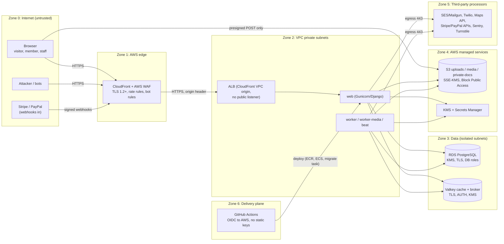
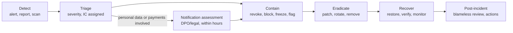

# Security and Compliance

Purpose: the security design for the Rent Property Listing platform. It covers the threat model, the control catalogue mapped to OWASP and ASVS, cryptography and key management, secrets, the supply chain, the PCI DSS scope, security testing and incident response. Engineers implement against this document, and QA and the pen-test vendor verify against it.

Status: Draft v0.1 (2026-10-21)

> **Hosting change (2026-10-27):** AWS is no longer the target ([ADR-0014](../adr/0014-portable-hosting-paas-and-self-hosted.md)). AWS service names, CLI commands, sizing and alarms in this document are superseded; read them through the mapping table in ADR-0014 and [Hosting and deployment](../architecture/05-hosting-and-deployment.md). The provider-neutral intent (controls, targets, procedures) still applies.

| | |
|---|---|
| Owner | Tech Lead (security owner until a dedicated role exists) |
| Audience | Engineers, QA, DevOps, pen-test vendor, Product |
| SRS anchors | §3.2 Verification, §3.4 Login, §5.2–5.3 Credit check/deduction, §7.3 Logout, §9.1 Data Encryption, §9.2 Credit Integrity, §9.3 Payment Compliance, §10.2 Code Standards |
| Requirement IDs | NFR-SEC-01 (§9.1), NFR-SEC-02 (§9.2), NFR-SEC-03 (§9.3), FR-AUTH-03/05, FR-PROF-03, FR-CRED-02/03 |
| Related | [System architecture §14](../architecture/01-system-architecture.md#14-security-architecture-summary) · [Listings & media §13](../design/05-listings-and-media.md#13-security-and-privacy-of-listing-contact-data-known-issue-20) · [02 NFR performance](02-nfr-performance-and-scalability.md) · [03 Observability](03-observability-and-operations.md) · [04 Runbooks](04-runbooks.md) · [05 Privacy](05-privacy-and-data-protection.md) |

> SRS section numbers follow the SRS table of contents (3.x–12.x). The SRS's own internal cross-references (2.x) are broken, so this document doesn't use them.

---

## 1. Security objectives

| # | Objective | Why it matters here | Primary SRS source |
|---|---|---|---|
| SO-1 | **No credit can be created, destroyed or moved except by an authorised, recorded, verifiable operation** | Credits are the product's currency; a defect is direct revenue loss | §5.2, §5.3, §9.2 |
| SO-2 | **Listing contact details reach only the owner and users who paid to reveal them** | The contact is the monetised asset *and* personal data | §4.2, §5.1, §5.4, §9.1 |
| SO-3 | **No raw card data ever touches our systems** | Keeps PCI DSS scope at SAQ A | §9.3 |
| SO-4 | **Accounts and sessions resist takeover, and logout really ends access** | Wallet balances and lister identities are valuable | §3.4, §7.3 |
| SO-5 | **Staff power is least-privilege, MFA-protected and fully audited** | The ops console can move credits and see PII | Diagram "Ops Console", §9.2 |
| SO-6 | **PII is encrypted in transit and at rest, and pseudonymised where possible** | Limits breach impact | §9.1 |
| SO-7 | **Security incidents are detected, contained and reported within regulatory deadlines** | Multinational ambitions bring notification duties | §1, §8.3 |

---

## 2. Data classification

Every model field, log field, file and secret gets one of these classes. The privacy inventory in [05 §3](05-privacy-and-data-protection.md#3-pii-inventory) assigns the class to each item.

| Class | Label | Examples | Minimum controls |
|---|---|---|---|
| C0 | Public | Published listing text, photos (EXIF-stripped variants), prices, public lister display name | Integrity controls only |
| C1 | Internal | Aggregated metrics, internal IDs, feature-flag state, non-PII logs | Authenticated access; not exposed publicly |
| C2 | Confidential (personal data) | User name, login email, IP address, session metadata, saved properties, reveal history, payment order metadata | Storage encryption (KMS), role-based access, log redaction, retention limits |
| C3 | Restricted | Listing contact phone/email, user phone, staff MFA secrets, KYC/ownership documents (post-MVP), tag-change evidence | C2 plus **application field-level encryption** or private bucket with signed URLs, masked by default in the ops console, reason-gated reveal with audit |
| C4 | Secret | KMS-wrapped data keys, `SECRET_KEY`, DB credentials, gateway API keys, webhook secrets, HMAC blind-index key | Secrets Manager or KMS only, never in code, image, logs or Sentry, rotation schedule (§7.4) |

---

## 3. System and trust boundaries



| Boundary | What crosses it | Key controls |
|---|---|---|
| TB-1 Internet → edge | All HTTP(S), webhooks | TLS 1.2+ (`TLSv1.2_2021`), WAF managed rule groups, rate-based rules, Shield Standard |
| TB-2 Edge → ALB | Forwarded requests | CloudFront VPC origin (ALB not internet-facing), HTTPS to origin, `ALLOWED_HOSTS` |
| TB-3 App → data stores | SQL, cache, broker traffic | Security groups (app SGs only), TLS (`rds.force_ssl=1`, `rediss://`), least-privilege DB roles, Valkey AUTH/RBAC |
| TB-4 Browser → S3 | Image uploads | Presigned POST with exact key, size range, content type and SSE-KMS conditions, 10-minute expiry, CORS limited to app origins ([design 05 §8.2](../design/05-listings-and-media.md#82-upload-sequence-direct-to-s3-presigned-post)) |
| TB-5 App → third parties | API calls with secrets and PII | Adapters only (architecture R11), TLS verification, timeouts, minimum data, DPAs ([05 §11](05-privacy-and-data-protection.md#11-processors-and-international-transfers)) |
| TB-6 Gateway → app | Webhooks | Signature verification, timestamp tolerance, idempotent storage, size limit, CSRF-exempt only on these routes |
| TB-7 Staff → ops console | Privileged actions, PII views | MFA, WAF IP allow-list (OQ A-6), short sessions, AuditLog |
| TB-8 CI/CD → AWS | Images, task definitions, migrations | GitHub OIDC role scoped to repo/branch/environment, protected environments with required reviewers for prod, ECR immutable tags |

---

## 4. Threat model (STRIDE)

Method: STRIDE per asset, focused on the assets the business would lose most from. Each threat lists its controls and how we verify them. The model is reviewed at each milestone exit and refreshed before the M7 pen test (US-703).

### 4.1 Assets

| ID | Asset | Class | Owner app(s) |
|---|---|---|---|
| A1 | Credit balances and the ledger (`CreditWallet`, `CreditLedgerEntry`) | C1 (integrity-critical) | `credits` |
| A2 | Listing contact data (`Property.contact_phone/contact_email`) | C3 | `listings`, `leads` |
| A3 | User accounts, credentials, sessions | C2–C4 | `accounts` |
| A4 | Payment flow (`PaymentOrder`, `PaymentWebhookEvent`, gateway keys) | C2/C4 | `payments` |
| A5 | Ops console and staff accounts | C4 (privilege) | `moderation`, admin |
| A6 | Listing integrity (tag, content, images) and the media pipeline | C0/C3 | `listings` |
| A7 | Secrets and keys | C4 | platform |
| A8 | PII at large (profiles, addresses, logs, backups, emails) | C2/C3 | all |

### 4.2 Threats and controls

| ID | Asset | STRIDE | Threat | Controls | Verification |
|---|---|---|---|---|---|
| T-01 | A1 | Tampering | Concurrent "Show Number" requests double-spend or drive a balance negative | One short transaction: wallet row lock (`SELECT … FOR UPDATE`) or conditional `UPDATE … WHERE balance >= 2`; `CHECK (balance >= 0)`; unique `ContactReveal(user, property)`; unique `idempotency_key` | Thread concurrency tests, hot-wallet load test PT-04 ([02 §9](02-nfr-performance-and-scalability.md#9-performance-testing-plan)) |
| T-02 | A1 | Tampering | Client sends a manipulated cost or a foreign wallet ID | The reveal endpoint accepts only the property `public_id`. Cost comes from server configuration. The wallet is resolved from `request.user` | Unit tests; pen test |
| T-03 | A1 | Repudiation | User disputes a charge ("I never clicked") | Ledger entry carries transaction ID, `request_id`, `server_process_id`, timestamp, property reference (SRS §5.3); AuditLog has IP and user agent; email receipt | Ledger schema review; support playbook |
| T-04 | A1 | Tampering | Insider or compromised credentials rewrite ledger history directly in the DB | Runtime role `rpl_app` has no `UPDATE`/`DELETE`/`TRUNCATE` on the ledger; trigger rejects them for every role; per-wallet SHA-256 hash chain; nightly audit; **daily anchoring of chain heads to an S3 Object Lock (WORM) bucket in a separate AWS account** (§4.3) | M4 demo step 8; audit job tests; anchor verification |
| T-05 | A1 | Tampering | Compromised app code *appends* forged `PURCHASE` or `ADMIN_ADJUSTMENT` entries (the hash chain can't detect a valid-looking append) | Nightly cross-check: every `PURCHASE` maps to a `FULFILLED` `PaymentOrder` that matches the gateway's record (daily reconciliation); every `ADMIN_ADJUSTMENT` maps to an approved maker-checker request; mismatches page on-call | Reconciliation tests; RB-03 drill |
| T-06 | A1 | Elevation | A staff member grants credits to an account they control | Maker-checker (approver must be a different Finance user, US-608); staff identities are separate from marketplace accounts; adjustments touching a staff-linked wallet need Superadmin approval | Authorisation matrix tests |
| T-07 | A1 | Spoofing | Promo-credit farming with many accounts (10 free credits each) | Promo granted only on verification; unique verified email/phone (blind index); disposable-domain blocklist; Turnstile on signup and OTP send; signup rate limits; fraud rules (US-606); promo-claim registry ([05 §6.4](05-privacy-and-data-protection.md#64-anti-abuse-retention-after-erasure)) | Fraud scenario script (M6 demo); RB-09 |
| T-08 | A2 | Info disclosure | Contact data leaks before payment (DOM, JSON, cache, sitemap, logs, Sentry) | `PublicPropertyDTO` has no contact attributes; only `leads.selectors` decrypts after a `ContactReveal` check; exclusions in [design 05 §13](../design/05-listings-and-media.md#13-security-and-privacy-of-listing-contact-data-known-issue-20); log and Sentry scrubbers | Contact-leak regression test (AC-LST-07) |
| T-09 | A2 | Info disclosure | Bulk scraping of contacts using many funded or promo accounts | Per-user reveal limits (US-409: 30/h, 100/day), velocity fraud rules, Turnstile step-up when risk is high, WAF bot rules, contact never in search or card payloads | Load of reveal limiter; fraud rule tests |
| T-10 | A2 | Info disclosure | IDOR: reading another user's revealed contact via history or a direct URL | Selectors scope by `request.user`; contact is returned only if a `ContactReveal` row exists for (user, property) or the user is the owner; non-owners get 404 | IDOR test suite for every object URL (US-202) |
| T-11 | A2, A8 | Info disclosure | Database dump, snapshot or backup exfiltrated | KMS storage encryption; C3 fields encrypted at application level with keys outside the DB (§7.2); snapshot sharing blocked by SCP | US-705 snapshot inspection |
| T-12 | A3 | Spoofing | Credential stuffing or password spraying | allauth rate limits per IP and per account key; breached-password check at signup/reset; Turnstile after failures; WAF rate rules; no hard lockout (avoids DoS lockouts) | Rate-limit tests; RB-13 |
| T-13 | A3 | Spoofing | Session hijack or fixation | Server-side sessions; `__Host-` cookies with `Secure`, `HttpOnly`, `SameSite=Lax`; session key rotated on login; HSTS; strict CSP against XSS | `check --deploy`; ZAP |
| T-14 | A3 | Spoofing | Account takeover by changing the email or phone | Re-authentication (10-minute window), verification of the new address, notification to the old one (US-111); phone change needs OTP (US-110) | E2E auth journey |
| T-15 | A3 | Info disclosure | Account enumeration | Password reset always gives the same response. **Trade-off:** SRS §3.1 requires a real-time email-uniqueness check at signup, which reveals whether an email is registered. Mitigated with 10/min/IP limit, Turnstile and monitoring (OQ-SEC-02) | Rate-limit tests |
| T-16 | A3 | Tampering | CSRF on state-changing actions (reveal, purchase, logout) | `CsrfViewMiddleware` on all POSTs including HTMX (`hx-headers`); `SameSite=Lax`; logout is POST-only; GET never changes state | Unit tests; ZAP |
| T-17 | A3 | Elevation | Unverified account performs transactions | `accounts.selectors.can_transact` enforced inside services, not just views (architecture §3) | Protected-URL test matrix (US-104) |
| T-18 | A4 | Spoofing | Forged or replayed webhook grants credits | Stripe signature check with timestamp tolerance; PayPal webhook signature verification; `PaymentWebhookEvent(gateway, event_id)` unique; fulfilment idempotent on `(gateway, gateway_payment_id)` | Replay test (M5 demo step 5) |
| T-19 | A4 | Tampering | Forged success-redirect parameters (`?session_id=…`) | On redirect, the server fetches the session/order from the gateway API and checks that order ID, amount, currency and paid status match our `PaymentOrder` snapshot. Client parameters are only lookup hints | Contract tests per adapter |
| T-20 | A4 | Tampering | Price manipulation: choosing a cheaper currency through a VPN or the currency switcher | Price computed server-side from the price book and snapshotted on the order. **Open risk:** if users may freely choose any price-book currency (US-502), they can pick the cheapest after FX. Proposed: offer only the account-region currency (plus a market default), lock the region after the first purchase, and add a gateway rule that flags card-country ≠ region mismatches (OQ-SEC-04) | Pricing tests |
| T-21 | A4 | Repudiation | "Friendly fraud": chargeback after spending the purchased credits | `REVERSAL` up to the current balance; shortfall recorded and wallet frozen pending Finance review (US-513); Stripe Radar / PayPal risk tools enabled | Refund/dispute webhook tests |
| T-22 | A4 | DoS / abuse | Card testing through our checkout | Checkout only for verified accounts; checkout-creation rate limit per user and IP; Turnstile step-up; gateway fraud tools; alert on decline-rate spike | Alert test |
| T-23 | A4 | Info disclosure | Card data exposure | Hosted pages only (Stripe Checkout redirect, PayPal approval redirect); no gateway JavaScript on our pages; we store only gateway IDs, card brand and last 4 | SAQ A evidence (US-514) |
| T-24 | A5 | Spoofing | Staff account takeover | Mandatory MFA (TOTP now, WebAuthn recommended); WAF IP allow-list or VPN/ZTNA (OQ A-6); 30-minute staff idle timeout; no social login for staff; separate staff and personal accounts | M1 demo step 6 |
| T-25 | A5 | Elevation | Privilege creep and over-broad groups | Groups `moderator`, `support`, `finance`, `superadmin` with explicit permissions; at most 2 superadmins; quarterly access review; role × view matrix tests | Matrix tests; review record |
| T-26 | A5 | Info disclosure | Insider browsing of PII | PII masked by default; "Reveal" needs a reason and writes AuditLog; monthly access report; alert on > 20 reveals per staff user per day ([05 §9](05-privacy-and-data-protection.md#9-audit-logging-of-staff-access-to-pii)) | Audit tests |
| T-27 | A5 | Repudiation | Staff deny an action | Append-only `core.AuditLog` (actor, action, object, diff without PII values, reason, request ID, IP) | Audit tests |
| T-28 | A6 | Tampering | Lister flips AgentListed/OwnerListed after publish | Tag immutable after first publish (service plus DB trigger); changes only through `PropertyTagChangeRequest` reviewed by a Moderator | AC-LST-05 |
| T-29 | A6 | Tampering / Elevation | Malicious upload: polyglot, decompression bomb, SVG script, EXIF GPS leak | Allow-list JPEG/PNG/WebP; Pillow verify, re-open and re-encode; 50 MP pixel cap; EXIF/XMP stripped; originals never served; variants served from a separate cookie-less media origin with `nosniff` | Image fixture corpus ([design 05 §14](../design/05-listings-and-media.md#14-testing-and-acceptance-criteria)) |
| T-30 | A6, A7 | Info disclosure | SSRF to the ECS task-credentials endpoint or internal services | No feature accepts a user-supplied URL; geocoding goes to fixed provider hosts; workers read S3 by server-generated key; egress limited (§6.6) | Code review rule; pen test |
| T-31 | A6 | Tampering | Stored XSS through listing title or description | Django autoescape; `|safe`/`mark_safe` banned outside an allow-list (Semgrep); descriptions rendered with escaping filters only; CSP blocks inline script | Semgrep; ZAP; unit tests |
| T-32 | A7 | Info disclosure | Secrets leak via the repo, logs, image layers or Sentry | Secrets Manager injection; gitleaks plus GitHub push protection; Sentry and structlog scrubbing; Trivy secret scanning of images | CI gates; RB-08 drill |
| T-33 | A7 | Tampering | Supply-chain compromise (malicious package, hijacked Action) | `uv.lock` with hashes; `uv sync --locked`; Actions pinned by commit SHA; dependency cooldown (§8.2); pip-audit; SBOM | CI gates |
| T-34 | Platform | DoS | L7 flood, or expensive endpoints (search, Argon2 login) used as amplifiers | CloudFront and Shield Standard; WAF rate rules; search cache and pagination cap (page 50); login rate limits so hashing cost can't be multiplied; autoscaling with caps | PT-11 spike test; RB-04 |
| T-35 | A8 | Info disclosure | PII in logs, traces, metrics labels or analytics | Redaction processor; `send_default_pii=False`; no user IDs as metric labels; OTel attribute allow-list ([03 §2](03-observability-and-operations.md#2-logging-standards)) | Log sampling in US-705 |
| T-36 | A8 | Info disclosure | Verbose errors or `DEBUG=True` in production | `production.py` refuses `DEBUG=True` (US-004); custom 4xx/5xx pages that show only the request ID | Settings test; ZAP |

### 4.3 Ledger anchoring (addition)

The hash chain proves a wallet's history wasn't edited **unless** an attacker who controls the database rewrites the history and recomputes every hash after the edited row. Anchoring closes that gap:

1. A daily `maintenance` task (after the nightly audit) writes a manifest to `s3://rpl-<env>-ledger-anchors/` in a **separate AWS account**. The manifest lists each wallet's `(wallet_id, head_seq, head_hash)`, the global max ledger ID and a SHA-256 over the whole manifest.
2. The bucket uses **S3 Object Lock in compliance mode**, with retention equal to the ledger retention period (8 years, an assumption; see [05 §8](05-privacy-and-data-protection.md#8-data-retention-schedule)). The app account can only `PutObject`.
3. The audit job verifies that each wallet's current chain still contains the anchored `(head_seq, head_hash)` from previous anchors. A mismatch is a SEV1 incident ([RB-03](04-runbooks.md#rb-03-ledger-audit-mismatch-or-hash-chain-break)).

**Assumption:** a one-file-per-day manifest is cheap enough. At 1M wallets it is about 100 MB uncompressed, much less gzipped. If it grows too large, anchor only wallets that changed that day.

---

## 5. OWASP Top 10 and ASVS mapping

### 5.1 OWASP Top 10 (2021 identifiers)

> The 2025 edition of the OWASP Top 10 reorders categories and adds *Software Supply Chain Failures* and *Mishandling of Exceptional Conditions*. Both are covered here (§8 supply chain; fail-closed handling in §6.4 and §6.8). Re-key this table to the 2025 identifiers once the security owner confirms which edition the pen-test vendor will report against.

| OWASP 2021 | Risk in this product | Concrete controls (where) |
|---|---|---|
| A01 Broken Access Control | IDOR on listings, reveals, orders; staff over-privilege; unverified users transacting | Ownership scoping in selectors with 404 for non-owners (US-202); `ContactReveal` check before decrypt; `can_transact` in services; Django permissions per ops view; role × view matrix tests; UUID `public_id` in URLs (defence in depth, not a control on its own) |
| A02 Cryptographic Failures | Contact PII, phone numbers, MFA secrets, transport | TLS 1.2+ everywhere (§7.1); KMS at rest; AES-256-GCM field encryption plus HMAC blind indexes (§7.2); Argon2id passwords (§6.2) |
| A03 Injection | SQL in search, template injection, email header injection | ORM and parameterised `SearchQuery`/trigram expressions; `raw()`/`extra()` banned outside reviewed modules (Semgrep); Django template autoescape; Django email API rejects header newlines |
| A04 Insecure Design | Business-logic abuse: promo farming, double-spend, webhook replay, price arbitrage | Threat model §4; DB-level invariants (CHECK, unique, triggers); idempotency keys; abuse cases tested in E2E and fraud scripts |
| A05 Security Misconfiguration | Debug pages, permissive CORS/CSP, public S3, default credentials | `manage.py check --deploy --fail-level WARNING` in CI against `production.py`; strict CSP (§6.3); S3 Block Public Access at account level; Terraform scanning (Trivy config); AWS Security Hub FSBP standard |
| A06 Vulnerable and Outdated Components | Django, Pillow, allauth, gateway SDKs, base image | pip-audit, Trivy image scan, Dependabot (uv ecosystem) with cooldown, monthly patch day, Django LTS line (5.2 → 6.2) |
| A07 Identification and Authentication Failures | Credential stuffing, weak passwords, session fixation, unverified accounts | allauth with mandatory verification, rate limits, breached-password validator, staff MFA, session rotation, reauth for sensitive changes (§6.2) |
| A08 Software and Data Integrity Failures | Ledger tampering, forged webhooks, CI pipeline compromise | Hash chain plus anchoring (§4.3); webhook signatures; Actions pinned by SHA; OIDC deploy role; image digests promoted, not rebuilt |
| A09 Security Logging and Monitoring Failures | Undetected fraud, staff abuse, attacks | AuditLog, CloudTrail, GuardDuty, WAF logs, alerting ([03 §7](03-observability-and-operations.md#7-alert-catalogue)) |
| A10 Server-Side Request Forgery | Geocoding, image fetch, future "import from URL" | No user-supplied URLs; fixed provider hosts; link-local ranges blocked (§6.6) |

### 5.2 ASVS Level 2 coverage

Target: **OWASP ASVS Level 2**, verified in M7 (US-703). The checklist uses ASVS 5.0. If the pen-test vendor works from 4.0.3, the same controls map across. Chapters are listed by topic rather than number, because the numbering differs between versions.

| ASVS topic | Our controls (section) | Evidence |
|---|---|---|
| Encoding and sanitisation | Autoescape; Semgrep bans `mark_safe`/`|safe` outside an allow-list; no user HTML or Markdown accepted | Semgrep report |
| Validation and business logic | Django forms server-side; service-level invariants; rate limits per business action (§6.5); idempotency | Unit and concurrency tests |
| Web frontend security | CSP, HSTS, XFO/`frame-ancestors`, `nosniff`, Referrer-Policy, Permissions-Policy, COOP, cookie prefixes (§6.3) | ZAP baseline, securityheaders check |
| File handling | Presigned POST policy, Pillow re-encode, size and pixel caps, separate media origin, private bucket for documents with malware scanning (§6.7) | Image fixture tests |
| Authentication | allauth, Argon2id, breached-password check, MFA for staff, rate limits, reset tokens 1 h single-use (§6.2) | Auth E2E, pen test |
| Session management | Server-side `cached_db` sessions, rotation, idle/absolute timeouts, logout-all, `Clear-Site-Data` (§6.2) | Session tests |
| Authorisation | Object ownership in selectors, Django permissions for staff, 404 on foreign objects | Matrix tests |
| Cryptography | AES-256-GCM via `cryptography`, KMS envelope keys, HMAC-SHA256 blind indexes, key rotation (§7) | Crypto unit and property tests; US-705 |
| Secure communication | TLS 1.2+ at edge and origin; TLS to RDS and Valkey; certificate validation on outbound calls | `testssl.sh`/SSL Labs; config review |
| Configuration | 12-factor settings, `DEBUG` blocked in prod, `check --deploy`, minimal image, non-root container, read-only root filesystem | CI gates, Trivy |
| Data protection | Classification (§2), field encryption, retention jobs, `no-store` on sensitive pages | US-705, [05](05-privacy-and-data-protection.md) |
| Logging and error handling | Structured logs with redaction, AuditLog, generic error pages with request ID, fail-closed money path | Log sampling, error-page tests |
| Secure coding and architecture | Modular monolith boundaries, adapters for SDKs, typed domain errors, review rules for money-path PRs | import-linter, CODEOWNERS |

---

## 6. Application controls

### 6.1 Control catalogue summary

| ID | Control | Milestone | Story |
|---|---|---|---|
| SEC-01 | Security headers, CSP (report-only on dev, enforced on staging/prod), secure cookies | M0 | US-015 |
| SEC-02 | CI security scanners (§10.1) | M0 | US-002, US-010 |
| SEC-03 | Secrets in Secrets Manager; OIDC deploy role; KMS keys | M0 | US-011 |
| SEC-04 | Authentication, verification, sessions, rate limits, reauth | M1 | US-101–US-111 |
| SEC-05 | Staff MFA and admin relocation | M1 | US-114 |
| SEC-06 | Auth AuditLog events | M1 | US-115 |
| SEC-07 | Bot protection (Turnstile) on signup, reset, OTP send | M1 | US-105 (extended, §6.5) |
| SEC-08 | Upload pipeline hardening | M2 | US-210, US-211 |
| SEC-09 | Contact field encryption and leak test | M2 | US-208 |
| SEC-10 | IDOR tests on lister URLs | M2 | US-202 |
| SEC-11 | Ledger DB permissions, trigger, hash chain, audit | M4 | US-401–US-404 |
| SEC-12 | Reveal rate limits and `no-store` | M4 | US-409 |
| SEC-13 | Webhook verification, PCI SAQ A evidence | M5 | US-506, US-507, US-514 |
| SEC-14 | Admin hardening, maker-checker, masked PII lookup | M6 | US-601, US-608, US-610 |
| SEC-15 | Ledger anchoring to WORM storage | M4 (proposed addition) | New story under EP-4.1 |
| SEC-16 | Pen test, ASVS L2 checklist, ZAP full scan, secrets rotation drill | M7 | US-703 |
| SEC-17 | PII verification (snapshot inspection, key rotation rehearsal) | M7 | US-705 |

### 6.2 Authentication and sessions

| Area | Decision |
|---|---|
| Library | django-allauth (account, mfa, usersessions; socialaccount only if US-119 is pulled in) |
| Password hashing | `PASSWORD_HASHERS = [Argon2PasswordHasher (tuned subclass), BCryptSHA256PasswordHasher, PBKDF2PasswordHasher]`. Argon2id is the default; bcrypt is kept as a fallback (the SRS's "e.g. bcrypt" is satisfied by an equal or stronger algorithm). Existing hashes upgrade on login |
| Argon2 parameters | Django's defaults use about 100 MiB of memory per hash with parallelism 8. On 1 vCPU / 2 GB Fargate tasks with 8 threads, that is a memory and DoS risk. Use a tuned subclass at or above the OWASP minimum (for example 46 MiB, t=1, p=1, or 19 MiB, t=2, p=1). Pick the parameters by benchmark: aim for 100–250 ms per hash on the production task size. Record the result in an ADR (OQ-SEC-01) |
| Password policy | Minimum length 12; Django validators (common password, similarity, numeric); **breached-password check** via the k-anonymity range API of Have I Been Pwned (Pwned Passwords) at signup, reset and change. Timeout 1 s, fail-open with a log event. No composition rules beyond the SRS "complexity" wording (the strength meter covers it) |
| Verification | Mandatory (email link/code or phone OTP, either activates). Unverified accounts are blocked from transactional actions by `can_transact` in services |
| Login errors | Generic "email or password is incorrect"; no indication of whether the account exists |
| Session store | `cached_db` (Valkey `sessions` alias + PostgreSQL), JSON serializer |
| Cookies | `SESSION_COOKIE_NAME="__Host-sessionid"`, `CSRF_COOKIE_NAME="__Host-csrftoken"`, `Secure`, `HttpOnly` (CSRF token is passed to HTMX via `hx-headers` in the template, so the CSRF cookie can be HttpOnly too), `SameSite=Lax`, no `Domain` attribute |
| Timeouts | Members: browser session, or 14 days with "remember me" (US-106 assumption). Staff: 30-minute idle, 12-hour absolute (US-601). Re-authentication window for sensitive actions: 10 minutes |
| Session rotation | On login, privilege change and password change (Django `cycle_key`; `update_session_auth_hash` keeps only the current session) |
| Logout | POST-only; deletes the server session; `Clear-Site-Data: "cache", "cookies", "storage"`; `Cache-Control: no-store` on authenticated pages (US-107). "Sign out other sessions" through `usersessions` (US-108). Password change or reset ends all other sessions |
| JWT | **Deviation from SRS §3.4** (already in ADR-0003): no JWT for browser sessions. Server-side sessions meet the SRS intent ("logout must invalidate all tokens") better, because a deleted session can't be replayed and a stateless JWT can. JWT (SimpleJWT) is reserved for the post-MVP mobile API |
| Staff MFA | allauth MFA (TOTP plus recovery codes) mandatory before any `/ops/` or `/ops/admin/` access. **Recommendation:** enable WebAuthn/passkeys for staff as soon as allauth's WebAuthn support is validated on the pinned version. Phishing-resistant MFA matters most for Superadmin and Finance |
| MFA secret storage | allauth MFA secrets are encrypted through the MFA adapter's encrypt/decrypt hooks, which call the same field-encryption module (§7.2) |
| Social login | Optional (US-119). Social accounts count as verified only if the provider asserts a verified email. `SOCIALACCOUNT_STORE_TOKENS=False`. Staff accounts can't log in socially |

### 6.3 HTTP security headers and browser controls

| Header / setting | Value | Notes |
|---|---|---|
| `Strict-Transport-Security` | `max-age=31536000; includeSubDomains` | `SECURE_HSTS_SECONDS=31536000`, `SECURE_HSTS_INCLUDE_SUBDOMAINS=True`. Submit to the preload list only after 30 days in production with no issues (`SECURE_HSTS_PRELOAD=True` then) |
| HTTPS redirect | CloudFront viewer protocol policy `redirect-to-https`; Django `SECURE_SSL_REDIRECT=True` with `SECURE_PROXY_SSL_HEADER=("HTTP_X_FORWARDED_PROTO","https")` | ALB sets `X-Forwarded-Proto`. `/healthz` is exempt (`SECURE_REDIRECT_EXEMPT`) |
| `Content-Security-Policy` | See below | django-csp until the move to Django 6.x built-in CSP (architecture §8.1) |
| `X-Frame-Options` | `DENY` | Plus CSP `frame-ancestors 'none'` (clickjacking on the reveal and purchase buttons) |
| `X-Content-Type-Options` | `nosniff` | Also on media via a CloudFront response-headers policy |
| `Referrer-Policy` | `strict-origin-when-cross-origin` | Listing URLs carry no secrets, but search queries may contain locations |
| `Cross-Origin-Opener-Policy` | `same-origin` | Django default |
| `Permissions-Policy` | `camera=(), microphone=(), geolocation=(self), payment=(), usb=()` | Geolocation only if "near me" search ships |
| `Cache-Control` | `no-store` on reveal responses, contact panels, payment pages and account pages | US-107, US-409 |
| `ALLOWED_HOSTS` / `CSRF_TRUSTED_ORIGINS` | Exact production hostnames | No wildcards |
| Upload limits | `DATA_UPLOAD_MAX_MEMORY_SIZE` default (2.5 MB); webhook views enforce 256 KB | Images never pass through Django (direct to S3) |

**CSP (enforced in staging and production; report-only in dev):**

```python
# config/settings/base.py (illustrative; django-csp 4.x dict format, validate against the pinned version)
from csp.constants import NONCE, NONE, SELF

CONTENT_SECURITY_POLICY = {
    "DIRECTIVES": {
        "default-src": [SELF],
        "script-src": [SELF, NONCE, "https://challenges.cloudflare.com"],   # Turnstile
        "style-src": [SELF],                                                # compiled Tailwind only
        "img-src": [SELF, "https://media.<domain>", "data:"],
        "font-src": [SELF],
        "connect-src": [SELF, "https://<uploads-bucket>.s3.<region>.amazonaws.com"],  # presigned POST
        "frame-src": ["https://challenges.cloudflare.com"],
        "form-action": [SELF, "https://checkout.stripe.com",
                        "https://www.paypal.com", "https://www.sandbox.paypal.com"],
        "frame-ancestors": [NONE],
        "base-uri": [NONE],
        "object-src": [NONE],
        "upgrade-insecure-requests": True,
        "report-uri": "<Sentry CSP report endpoint>",
    },
}
```

Rules that keep the policy strict:

- **Alpine.js CSP build** (`@alpinejs/csp`): components are registered with `Alpine.data()`, with no inline expressions that need `eval`. HTMX config: `allowEval=false`, `includeIndicatorStyles=false` (indicator CSS lives in Tailwind), `allowScriptTags=false`.
- No inline `<script>` without the nonce and no `style=""` attributes in templates. Server data for scripts goes through `json_script`, which is not executed.
- **`form-action` includes the gateway hosts.** Browsers apply `form-action` to the redirect that follows a form POST. Our "Pay" form posts to `/credits/checkout/`, which answers 302 to Stripe or PayPal, so without those hosts the redirect is blocked. An alternative is to answer with `HX-Redirect`, which is a script navigation and not governed by `form-action`. Keep the hosts listed either way so the no-JS fallback works.
- Map provider directives (tiles, workers) are added only in the story that ships an interactive map. The default for the detail page is a static map image (OQ-27 in the requirements register).
- The Django admin under `/ops/admin/` is tested under the same policy. If any admin page needs an exception, apply a path-scoped override; never relax the global policy.

### 6.4 CSRF, request integrity and fail-closed behaviour

- `CsrfViewMiddleware` is on. Every state change is a POST. HTMX requests carry `X-CSRFToken` through `hx-headers` on `<body>`.
- `csrf_exempt` is allowed **only** on gateway webhook views. A Semgrep rule fails CI on any other use. Webhook views verify the signature *before* parsing JSON and reject bodies over 256 KB.
- `next=` redirects are validated with `url_has_allowed_host_and_scheme` (open-redirect protection).
- **Fail closed on the money path:** if the wallet lock, ledger insert or `ContactReveal` insert raises, the whole transaction rolls back and the user sees "Something went wrong, you have not been charged". Exceptions are never swallowed in `credits`, `leads` or `payments` services. If Valkey is unavailable, rate limits on reveal, OTP send and checkout **fail closed** (deny with a retry message). Rate limits on search fail open (§6.5).

### 6.5 Rate limiting, brute force and bot protection

Layered: **WAF** (per IP, coarse, at the edge) → **allauth rate limits** (auth flows) → **app limiter** in `apps.core` (Valkey keys `rl:{scope}:{subject}:{window}`, architecture §12).

| Action | Limit (initial; tune with data) | Layer | On exceed | Fail mode if Valkey is down |
|---|---|---|---|---|
| Login failures | 10/min per IP; 5 per 5 min per account key | allauth `ACCOUNT_RATE_LIMITS["login_failed"]` + WAF | 429 page; Turnstile required on the next attempt | Open, with the WAF rule as backstop |
| Signup | 20/hour per IP; Turnstile always | allauth + Turnstile | 429 | Open (Turnstile still applies) |
| Email-availability check (real-time) | 10/min per IP (US-101) | App | Check pauses; final submit still validates | Open |
| Password reset request | 5/hour per IP; 3/hour per email key; Turnstile | allauth + Turnstile | Same generic response | Open |
| Verification email resend | 60 s cooldown (US-102) | allauth | Disabled button with timer | Open |
| Phone OTP send | 3 per 10 min per phone; 10/hour per IP; Turnstile; **country allow-list** | App + Twilio Verify Fraud Guard | 429 | **Closed** (SMS pumping risk, RB-07) |
| OTP verify | 5 attempts per code (US-103) | Twilio Verify | Code invalidated | n/a (Twilio side) |
| Show Number (reveal) | 10/min, 30/hour, 100/day per user (US-409, architecture §13.3) | App | 429 with support message; fraud velocity event | **Closed** |
| Checkout creation | 10/hour per user; 30/hour per IP | App | 429 | **Closed** |
| Listing publish | 5 per 24 h for accounts < 30 days old, else 50 ([design 05 §3](../design/05-listings-and-media.md#3-access-rules-and-preconditions)) | App | Form error; flag at 3× | Closed |
| Image presign | 60/hour per user | App | 429 | Closed |
| Report listing | 10/day per user | App | 429 | Open |
| Search (anonymous) | 120/min per IP | WAF rate rule | WAF 429 / challenge | n/a (edge) |
| Webhooks | 600/min per IP | WAF | 429 (gateways retry) | n/a |

**No hard account lockout.** Locking an account after N failures lets anyone lock out a victim. Throttling per account key plus a challenge after failures gives the same protection without the DoS.

**Bot protection:**

| Option | Decision |
|---|---|
| **Cloudflare Turnstile** | **Chosen** for signup, password reset, OTP send, and step-up on checkout and reveal when risk is high (velocity rule hit, new account < 24 h with > 5 reveals). Free, no puzzle for most users, collects less data than reCAPTCHA (consent analysis in [05 §7](05-privacy-and-data-protection.md#7-cookies-and-consent)). Server-side token verification with a 3 s timeout; on timeout, fail closed for OTP send and fail open for signup (logged) |
| Google reCAPTCHA v3 | Fallback if Turnstile is unavailable in a launch market. Heavier privacy footprint |
| AWS WAF Bot Control / CAPTCHA and Challenge actions | Edge-level escalation during an attack (RB-13). Bot Control is a paid add-on: enable on demand, not by default (cost) |

### 6.6 SSRF and egress

- **No feature accepts a user-supplied URL** (no "import photos from link", no avatar URL, no webhooks to user endpoints). Any future feature that does must use a fetcher that resolves DNS once, blocks private, loopback and link-local ranges (`169.254.0.0/16`, which includes the ECS task metadata and credentials endpoint at `169.254.170.2`), disables redirects, limits size and time, and allow-lists schemes.
- The geocoding adapter calls fixed provider hostnames from settings. The address text goes in query parameters and is never part of the host.
- Image workers fetch from S3 by the server-generated key (`uploads/{property}/{image}`), never by a URL from the client.
- Pillow decodes only allow-listed raster formats. SVG and other formats that can reference external resources are rejected before decode.
- **Egress:** ECS tasks run in private subnets behind NAT. Security groups allow outbound 443 to the internet, 5432 to RDS and 6379 to Valkey only. **Assumption:** a domain allow-list egress firewall (AWS Network Firewall) is not deployed at MVP because of cost. Revisit after launch (OQ-SEC-05).

### 6.7 File uploads

Listing photos follow [design 05 §8](../design/05-listings-and-media.md#8-image-pipeline-srs-42): presigned POST with exact key and conditions, Pillow verify then re-open, a 50 MP cap with decompression-bomb warnings treated as errors, re-encode to WebP/JPEG, metadata stripped, originals never served.

Additional security rules:

| Rule | Detail |
|---|---|
| Separate media origin | Variants are served from `media.<domain>` (CloudFront → S3 with OAC). `__Host-` cookies are never sent there, so a malicious file served from media can't read sessions |
| Content type | The worker sets `Content-Type` from the decoded format, never from the client. CloudFront adds `nosniff` |
| Private documents (tag-change evidence now, KYC post-MVP) | PDF/JPEG/PNG up to 10 MB in the private-docs bucket. **Malware scanning** with Amazon GuardDuty Malware Protection for S3 (or ClamAV on a worker as fallback); objects are tagged and stay inaccessible to staff until the scan is clean. Served only through 5-minute signed URLs with `Content-Disposition: attachment`. PDFs are never parsed server-side in the MVP |
| Filenames | The original filename is sanitised and used for display only; S3 keys are server-generated UUIDs |

### 6.8 Authorisation model

- **Members:** object ownership in selectors (`owner=request.user`). Non-owners get 404. `ContactReveal` existence gates decryption. Verified status gates transactions (`can_transact`).
- **Staff:** Django permissions on every `/ops/` view (`permission_required`). Groups carry permissions, never individual users. **No impersonation ("login as")** feature (M6 scope decision).
- **Matrix:** one parametrised test per (role, view, method) asserts the expected status. A new view without a matrix row fails CI (test collects all URL patterns).
- Object-level permission libraries (django-guardian, django-rules) are not needed, because ownership rules are simple and live in selectors.

### 6.9 Ops console and admin hardening

| Control | Detail |
|---|---|
| Location | Django admin at `/ops/admin/`; custom staff views under `/ops/` |
| Network | WAF IP allow-list rule on `/ops/*` (office/VPN egress IPs), or ZTNA (OQ A-6) |
| Identity | Staff accounts are dedicated (`staff+name@company`), have mandatory MFA and are separate from any personal marketplace account |
| Session | 30-minute idle timeout, 12-hour absolute; re-authentication for credit adjustments, PII reveal and CSV export |
| Least privilege | `moderator`: listings, cases, tag changes. `support`: user lookup (masked), resend verification, revoke sessions, read-only wallet summary. `finance`: price books, payments ops, adjustments (maker-checker), ledger audit, exports. `superadmin` (at most 2): group management, bans, break-glass |
| Financial models | Ledger, payment orders and webhook events are read-only in admin; `has_delete_permission` returns False; the DB role enforces it anyway |
| Audit | Every admin and ops write → `core.AuditLog` (actor, action, object, field-level diff with PII values masked, reason, request ID, IP) |
| Flower / job UIs | Not exposed (architecture §7). Job monitoring is in `/ops/jobs/` |
| Access review | Quarterly review of group membership and staff accounts, signed off by the PO, recorded in `docs/` |
| Break-glass | One sealed Superadmin credential and one DB break-glass IAM role. Use requires an incident ticket; every use pages the Tech Lead and is reviewed afterwards |

---

## 7. Cryptography and key management

### 7.1 Encryption in transit

| Hop | Protocol | Configuration |
|---|---|---|
| Browser → CloudFront | TLS 1.2+ (TLS 1.3 preferred) | Security policy `TLSv1.2_2021`, ACM certificate, HTTP/2 and HTTP/3 |
| CloudFront → ALB | HTTPS | Origin protocol policy HTTPS only; ALB policy restricted to TLS 1.2/1.3 |
| ALB → web tasks | HTTP inside the VPC | **Assumption:** acceptable inside private subnets with SG isolation. If a market's regulator requires end-to-end TLS, add a TLS sidecar (OQ-SEC-06) |
| App → RDS | TLS | `rds.force_ssl=1` parameter; Django `OPTIONS={"sslmode": "verify-full", "sslrootcert": <RDS CA bundle>}` |
| App → ElastiCache | TLS (`rediss://`) | In-transit encryption on; AUTH token or RBAC user per cluster |
| App → third parties | TLS 1.2+ | Certificate verification on (default in httpx/requests); no `verify=False` (Semgrep rule) |
| Email to recipients | Opportunistic STARTTLS from the provider | Provider-side; SES/Mailgun support TLS policy "require" per configuration set (use for receipts if deliverability allows) |

### 7.2 Encryption at rest

| Store | Mechanism | Key |
|---|---|---|
| RDS (data, snapshots, automated backups, replicas) | Storage encryption (AES-256) | Customer-managed KMS key `alias/rpl-<env>-rds` |
| S3 uploads, media, private-docs, exports, anchors | SSE-KMS with S3 Bucket Keys; bucket policies deny unencrypted PUTs | `alias/rpl-<env>-s3` (private-docs uses its own key `alias/rpl-<env>-s3-private`) |
| ElastiCache | At-rest encryption | `alias/rpl-<env>-cache` |
| CloudWatch Logs | KMS-encrypted log groups | `alias/rpl-<env>-logs` |
| Secrets Manager | KMS | `alias/rpl-<env>-secrets` |
| Fargate ephemeral storage | AES-256 (platform-managed) | AWS-owned key |
| **Application field-level encryption** (C3 fields) | AES-256-GCM, envelope encryption | Data keys wrapped by `alias/rpl-<env>-app-field` |

**Field-level encryption design (ADR-0010):**

| Aspect | Decision |
|---|---|
| Fields encrypted | `listings.Property.contact_phone`, `contact_email`; `accounts.User` phone (and `UserProfile` phone if split); allauth MFA secrets; `PropertyTagChangeRequest` free-text evidence notes; future KYC fields. The full list is maintained in [05 §3](05-privacy-and-data-protection.md#3-pii-inventory) |
| Library | **Custom thin layer** `apps.core.crypto` built on the `cryptography` package's `AESGCM` primitive, plus `boto3` KMS for key wrapping. About 150 lines with 100 % branch coverage and property-based tests (round-trip, tamper detection, wrong-AAD rejection) |
| Rejected alternatives | **Fernet-based packages** (django-fernet-fields, django-cryptography, django-encrypted-model-fields): Fernet is AES-**128**-CBC + HMAC, which doesn't meet the SRS's literal "AES-256", and several of these packages are unmaintained. **pgcrypto**: the key travels to the DB in SQL text and can appear in logs and `pg_stat_statements`. **AWS Encryption SDK**: sound, but adds a large per-value header and needs a caching materials manager to avoid a KMS call per field. **Google Tink**: a good choice if the team prefers a managed keyset; the acceptable alternative if the custom layer is rejected in review |
| Key hierarchy | KMS CMK (never leaves KMS) → data encryption keys (256-bit) generated with `GenerateDataKey`, stored **wrapped** in `core.FieldKey(version, wrapped_key, status, created_at)` → plaintext DEKs held only in process memory, loaded at startup with `kms:Decrypt` |
| Ciphertext format | Text column: `enc:v1:<key_version>:<base64(nonce‖ciphertext‖tag)>`, 96-bit random nonce per value. The prefix lets mixed plaintext/ciphertext rows exist during a backfill and makes key version visible for rotation |
| Associated data (AAD) | `"<app_label>.<model>.<field>"`, which binds a ciphertext to its column so it can't be copied into another column. Row binding (adding the row's `public_id`) was considered and rejected: Django's `from_db_value` has no access to the model instance |
| Blind indexes | `HMAC-SHA256(blind_index_key, "<domain>:" + normalised_value)`, hex-encoded (`char(64)`), for example `contact_phone_hmac` (E.164) and a verified-email or phone index for uniqueness and fraud lookups. The key is a separate 256-bit secret in Secrets Manager, never the field key |
| What is *not* field-encrypted | Login email (see trade-off below), display names, address lines (public for `EXACT` listings; see OQ-PRIV-03), IP addresses in sessions and AuditLog. These are protected by storage encryption, access control and retention |
| IAM | Web and worker task roles: `kms:Decrypt` on the app-field key only. `kms:GenerateDataKey` only for the key-rotation task role. No human role has `kms:Decrypt` on the app-field key in production except break-glass |

**Login email trade-off (known issue #12):**

The baseline is field-level encryption plus a blind index for login. In practice:

- allauth looks up users and `EmailAddress` rows with case-insensitive equality.
- Support needs exact-match lookup (US-610).
- Email must be decrypted to send any email anyway.

Encrypting it means overriding allauth's adapter lookups and the `EmailAddress` model behaviour, with blind-index equality instead of `iexact`. It works, but it's invasive and every allauth upgrade risks breaking it. Architecture AR-4 and ADR-0010 therefore propose keeping the **login email in plaintext under storage encryption**, with compensating controls: no email in logs or metrics, masked in the ops console, `rpl_readonly` replica role gets a masked view, and DB snapshots can't be shared outside the account.

**Proposed change** (consistent with ADR-0010): adopt the plaintext-login-email option for MVP and keep the blind-index option documented for a later hardening release. This document follows ADR-0010. If stakeholders insist on the literal baseline, the cost is about 3–5 extra days in M1 plus regression risk on allauth upgrades.

### 7.3 Key rotation

| Key / secret | Rotation | Mechanism | Impact |
|---|---|---|---|
| KMS CMKs | Automatic, yearly | KMS key rotation (old material retained for decrypt) | None |
| Field DEKs | Yearly, or on suspicion | New `FieldKey` version becomes active for writes; the `rotate_field_keys` task (`maintenance` queue) re-encrypts rows in batches of 1,000 by `key_version` prefix; the old version is retired when its row count reaches 0 | Background load only |
| Blind-index HMAC key | Only on compromise | Add `*_hmac_v2` columns, backfill by decrypt-and-rehash, switch reads, drop v1 | Planned change (rare) |
| Django `SECRET_KEY` | Yearly | Add new key; old one goes to `SECRET_KEY_FALLBACKS` for 14 days, then removed. **On leak:** replace with no fallback (all sessions and reset links invalidated; RB-08) | Users stay logged in (routine) |
| DB passwords (`rpl_app`, `rpl_migrator`, `rpl_readonly`) | 90 days | Secrets Manager rotation (alternating-users strategy); RDS master user password managed by Secrets Manager | Connections recycle within `CONN_MAX_AGE` |
| Gateway API keys (Stripe, PayPal) | Yearly and on staff departure | Stripe key roll with overlap expiry; new PayPal REST credentials | Planned |
| Webhook signing secrets | On suspicion | Stripe endpoint secret roll (old secret valid during overlap); PayPal webhook ID re-registration | Planned |
| Twilio, email provider, maps API keys | Yearly | Provider consoles → Secrets Manager | Planned |
| Valkey AUTH tokens | Yearly | ElastiCache AUTH token rotation (`ROTATE` strategy) | None |
| TLS certificates | Automatic | ACM | None |

### 7.4 Secrets management

- **Source of truth:** AWS Secrets Manager, one secret per credential, per environment, named `rpl/<env>/<name>`. Injected into ECS tasks through task-definition `secrets` (values never appear in the task definition), read through `django.conf.settings` only (architecture R12).
- **Never** in the repo, the image, Terraform state outputs (mark `sensitive`), CI logs, Sentry or structured logs.
- **Local development:** `.env` files ignored by git, with dummy values only. Real third-party sandbox keys are issued per developer.
- **CI:** GitHub OIDC → an AWS role per environment. No long-lived AWS keys. Gateway sandbox keys for contract tests live in GitHub environment secrets, readable only by protected branches.
- **Detection:** gitleaks in pre-commit and CI, GitHub secret scanning with push protection, Trivy secret scan on images. A detected live secret is a SEV2 incident ([RB-08](04-runbooks.md#rb-08-credential-leak-or-security-incident)).

---

## 8. Dependency and supply-chain security

### 8.1 Controls

| Control | Detail |
|---|---|
| Lockfile | `uv.lock` committed; CI and Docker builds use `uv sync --locked`; hashes verified |
| Vulnerability scanning | `pip-audit` on the exported lock (PR and nightly); Trivy on the built image (OS and Python packages) and on Terraform config; ECR enhanced scanning (Amazon Inspector) for continuous re-scan of deployed images |
| Update automation | Dependabot (uv and GitHub Actions ecosystems, weekly) with grouped minor and patch updates; security updates immediately. Renovate is an acceptable alternative |
| Dependency cooldown | New versions are adopted only after they've been public for **≥ 3 days**, except for security fixes. This protects against hijacked releases that are usually pulled within hours (Dependabot `cooldown` or Renovate `minimumReleaseAge`) |
| New dependency review | A PR adding a dependency states why it's needed, its licence, maintenance activity and download base. Money-path and auth dependencies need Tech Lead approval (CODEOWNERS) |
| GitHub Actions | Third-party actions pinned by full commit SHA; `permissions:` least-privilege per workflow; no `pull_request_target` with checkout of untrusted code |
| Base image | `python:3.13-slim` pinned by digest, rebuilt weekly; non-root user; read-only root filesystem with a `/tmp` tmpfs; no build tools in the runtime stage |
| Frontend assets | HTMX, Alpine and the Tailwind standalone CLI are vendored at exact versions with checksums verified in the build. No runtime CDN scripts except Turnstile |
| SBOM | CycloneDX SBOM generated per image (Syft or `cyclonedx-py`) and attached to the release; kept 1 year |
| Provenance (optional) | GitHub artifact attestations for images; verify before prod deploy (post-MVP) |
| Patch cadence | Critical CVE in a reachable component: fix in prod within 48 h. High: 7 days. Medium: 30 days. Django security releases: within 7 days |

### 8.2 Django lifecycle

Django 5.2 LTS is supported until about April 2028. Plan the move to 6.2 LTS after its release (about April 2027) and before 5.2 support ends. It also brings built-in CSP support, which replaces django-csp.

---

## 9. PCI DSS scope (SAQ A)

**Target: PCI DSS v4.0.1, SAQ A** (card-not-present merchant that fully outsources payment pages). Confirm the applicable SAQ and any ASV-scan requirement with the acquirer or the gateways, because SAQ A was revised in 2025.

### 9.1 Eligibility conditions we meet by design

| Condition | How |
|---|---|
| All payment pages are hosted by a PCI DSS-validated provider | **Stripe Checkout (hosted, full redirect)** and **PayPal approval redirect**. Not Stripe Elements and not embedded Checkout, which would put gateway scripts on our pages |
| We don't store, process or transmit cardholder data | We store only gateway IDs (`gateway_payment_id`), amount, currency, status, card brand and last 4 (as returned by the gateway) |
| Our site can't be used to tamper with the redirect | The redirect target is built server-side from the gateway API response (`session.url`, PayPal `approve` link) and returned as a 302/`HX-Redirect`. Strict CSP, no third-party scripts on purchase pages, and change control on the pages that start checkout |

### 9.2 In scope vs out of scope

| In scope (SAQ A obligations apply) | Out of scope |
|---|---|
| Pages that start checkout (`/credits/buy/`, `/credits/checkout/`) and their templates | Card entry and 3-D Secure (gateway domains) |
| `web` tasks serving those pages; the CI/CD pipeline and image that deploys them | Gateway-side tokenisation and vaulting |
| Staff and admin accounts able to change those pages or payment settings (MFA required) | Our database (no CHD) |
| Webhook endpoints (integrity of fulfilment, not CHD) | Refund processing UI at the gateway (Finance uses gateway dashboards with their own MFA) |

### 9.3 Evidence pack (US-514)

Kept in `docs/compliance/pci/` (created in M5): SAQ A form; network and data-flow diagram showing no CHD path; gateway AOC (Attestation of Compliance) copies (Stripe, PayPal); CSP and script-inventory review for payment-initiating pages; MFA evidence for admin access; vulnerability-management evidence (scans in §10); incident-response plan reference (§11); staff security-awareness acknowledgements.

---

## 10. Security testing

### 10.1 In CI/CD

| Stage | Tool | Scope | Gate |
|---|---|---|---|
| Pre-commit | ruff (incl. `S` flake8-bandit rules), gitleaks | Changed files | Blocks commit (can be bypassed locally; CI re-runs) |
| PR | bandit | `apps/`, `config/` | Fails on High; Medium needs a justification comment |
| PR | Semgrep (Django ruleset + custom rules) | Repo | Fails on custom-rule hits: `mark_safe` or `|safe` outside the allow-list, `csrf_exempt` outside webhooks, `raw()`/`extra()`/`cursor.execute` with string formatting, `verify=False`, `foreign-model-write` (architecture R3), `print(` of request data |
| PR | pip-audit | Lockfile | Fails on known vulnerabilities without an expiring ignore entry |
| PR | `manage.py check --deploy --fail-level WARNING` with `production.py` and dummy env | Settings | Fails on any warning |
| PR | Authorisation matrix tests, contact-leak test, IDOR tests | App | Must pass |
| PR | `makemigrations --check`; migration linter (see [03 §15](03-observability-and-operations.md#15-data-migration-policy)) | Migrations | Must pass |
| Build | Trivy image (vulns + secrets) and Trivy config (Dockerfile, Terraform) | Image, IaC | Fails on Critical/High with an available fix |
| Post-deploy (dev) | ZAP baseline (passive) | Public pages | Fails on High (US-010) |
| Nightly (staging) | ZAP full scan with an authenticated context (member and staff test users) | Whole app incl. `/ops/` | High → issue + SEV3; reviewed weekly |
| Continuous | GitHub secret scanning + push protection; Dependabot alerts; ECR/Inspector re-scans; GuardDuty | Repo, images, AWS | Alert routing per [03 §7](03-observability-and-operations.md#7-alert-catalogue) |

### 10.2 Penetration test (M7, US-703)

| Item | Plan |
|---|---|
| Vendor | Independent firm (CREST or equivalent certification), booked ≥ 6 weeks ahead (long-lead item) |
| Timing | M7 iteration 1, against **prod-like staging** with production configuration, followed by a short retest window in iteration 2. A smoke-level re-test on production before DNS cutover |
| Scope | Web app (public, member, lister, ops console), authentication and sessions, credit and reveal logic (race conditions explicitly in scope), payment flow (using gateway sandboxes only; **the gateways' own systems are out of scope**), file uploads, AWS configuration review (read-only role) |
| Rules of engagement | Test accounts provided per role; no DoS; no social engineering of staff unless agreed; AWS's pen-test policy followed (no prohibited activities) |
| Exit | All Critical/High fixed and retested; Medium triaged with dates; report in the Go/No-Go pack |
| Cadence after launch | Annual, and after major changes (new payment method, mobile API, KYC) |

### 10.3 Other security verification

- **Concurrency abuse tests** (double-click, parallel reveals, webhook replay) are part of the M4/M5 test suites ([02 §9](02-nfr-performance-and-scalability.md#9-performance-testing-plan)).
- **Secrets rotation drill** in M7: rotate `SECRET_KEY` (with fallback), one DB password and the Stripe webhook secret on staging, timing each.
- **Threat-model refresh** at each milestone exit (30 minutes, Tech Lead + one engineer + QA).

---

## 11. Incident response

### 11.1 Process

Based on NIST SP 800-61 phases. Operational steps are in [04 Runbooks](04-runbooks.md). Severity definitions are shared with [03 §8](03-observability-and-operations.md#8-severity-levels-and-on-call).



| Role | Responsibility |
|---|---|
| Incident Commander (IC) | Owns the incident, decisions and timeline; first on-call engineer until handed over |
| Security lead | Forensics, evidence preservation, containment decisions |
| Communications | Internal updates, customer messaging, regulator notifications with legal |
| Scribe | Timeline in the incident channel |
| DPO / legal (client side) | Decides whether notification is required |

### 11.2 Notification obligations (depends on launch markets, OQ A-1)

| Regime | Trigger | Deadline | Who notifies |
|---|---|---|---|
| GDPR / UK GDPR | Personal-data breach likely to risk individuals' rights | Supervisory authority **within 72 hours** of awareness; affected people without undue delay if high risk | Controller (client) with our evidence |
| India DPDP Act 2023 + DPDP Rules 2025 | Any personal-data breach | Data Protection Board and **each affected Data Principal**; the Rules require an intimation without delay and a detailed report within 72 hours (confirm the in-force dates with counsel) | Data Fiduciary (client) |
| India CERT-In Directions (2022) | Specified cyber incidents (e.g. data breach, unauthorised access, compromise of systems) | **Within 6 hours** of noticing | Client / service provider operating in India |
| PCI DSS | Suspected compromise affecting payment flows | Immediately to acquirer/gateway per their agreement | Client |
| Gateways (Stripe, PayPal) | Suspected key compromise | Immediately, through the dashboard, after rolling keys | Finance + Tech Lead |

**Evidence preservation:** before eradication, snapshot affected RDS instances (manual snapshot), export relevant CloudWatch and WAF logs to the incident S3 prefix (Object Lock), and save CloudTrail event history and the deployed image digests.

### 11.3 Readiness

- Security contact published (`security.txt` at `/.well-known/security.txt`), with an inbox monitored by the security lead.
- Tabletop exercise before go-live (M7) using RB-08 and RB-09.
- Contact list for AWS Support (Business tier recommended for production), Stripe, PayPal, Twilio and the email provider kept in the on-call handbook.

---

## 12. Cloud and platform security baseline

| Area | Control |
|---|---|
| Accounts | AWS Organizations with separate accounts for `dev`, `staging`, `prod`, `security/log-archive` (CloudTrail, anchors, backup vault copies). **Assumption:** multi-account from M0; if the client mandates one account, use strict resource-level IAM instead (OQ-SEC-07) |
| Guardrails | SCPs: deny leaving the org, disabling CloudTrail/GuardDuty/Config, making S3 public, sharing RDS snapshots publicly, using unapproved regions |
| Logging | Organisation CloudTrail (all regions, log-file validation), AWS Config, VPC flow logs (rejects at minimum), ALB, CloudFront and WAF logs to the log-archive account |
| Detection | GuardDuty (incl. RDS protection and S3 protection), Security Hub with the AWS Foundational Security Best Practices standard, IAM Access Analyzer |
| IAM | No IAM users with console passwords except break-glass; SSO (IAM Identity Center) with MFA for humans; task roles per ECS service (web, worker, worker-media, beat, migrate, rotation) with least privilege |
| Network | ALB internal (CloudFront VPC origin); RDS and Valkey in isolated subnets; no public IPs on tasks; SSM Session Manager for any interactive access (ECS Exec disabled in prod except break-glass) |
| Database roles | `rpl_migrator` (DDL), `rpl_app` (DML, no UPDATE/DELETE/TRUNCATE on ledger and AuditLog), `rpl_readonly` (replica, masked views for PII). pgAudit enabled for DDL and for sessions of `rpl_readonly` and break-glass roles |

---

## 13. Deviations from the SRS (security)

| # | SRS text | Our approach | Reason |
|---|---|---|---|
| DEV-SEC-1 | §3.4 "JWT for session management" | Server-side sessions; JWT only for a future mobile API | Real logout and revocation (SRS §7.3); fewer token-theft risks (ADR-0003) |
| DEV-SEC-2 | §3.4 "e.g., bcrypt" | Argon2id default, bcrypt as fallback hasher | Stronger, Django-recommended; "e.g." permits it |
| DEV-SEC-3 | §8.2 "serializable, optimistic locking, or Kafka" | READ COMMITTED + row locks + constraints | Correct for single-row debits, faster, no extra platform (ADR-0005; [02 §6](02-nfr-performance-and-scalability.md#6-database-scaling)) |
| DEV-SEC-4 | §9.1 "PII tokenised or pseudonymised" | Field-level encryption + HMAC blind indexes (pseudonymisation); no separate tokenisation vault | A vault service adds an availability dependency and little extra protection over KMS envelope encryption with separate keys ([05 §4](05-privacy-and-data-protection.md#4-pseudonymisation-and-tokenisation)) |
| DEV-SEC-5 | Known issue #12 baseline "blind index for login email" | Proposed: login email plaintext under storage encryption (ADR-0010) | allauth compatibility (§7.2) |

---

## 14. Open questions (security)

| ID | Question | Default until answered | Needed by |
|---|---|---|---|
| OQ-SEC-01 | Argon2 parameters after benchmarking on production task size | Tuned subclass (46 MiB, t=1, p=1) | M1 |
| OQ-SEC-02 | Keep the SRS real-time email-uniqueness check (enumeration risk) or switch to allauth's enumeration-safe signup (email sent to the existing owner)? | Keep, with rate limit + Turnstile | M1 |
| OQ-SEC-03 | Is WebAuthn/passkey MFA required for staff at launch, or is TOTP acceptable? | TOTP at launch; WebAuthn for Superadmin/Finance in M6 if the pinned allauth supports it | M6 |
| OQ-SEC-04 | Currency choice rules: can users pick any price-book currency (arbitrage risk, T-20)? | Region currency + market default only; region locked after first purchase | M5 |
| OQ-SEC-05 | Is an egress domain allow-list (AWS Network Firewall) required by the client's security policy? | No at MVP | M7 |
| OQ-SEC-06 | Is TLS required between ALB and tasks inside the VPC? | No | M7 |
| OQ-SEC-07 | Can we use a multi-account AWS organisation? | Yes | M0 |
| OQ-SEC-08 | Who is the security contact and DPO on the client side, and who signs regulator notifications? | Client to name | M7 |
| OQ-SEC-09 | Pen-test budget and vendor | External vendor, about 8–10 tester-days | M5 (booking) |
