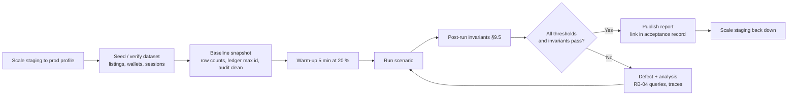

# NFR: Performance and Scalability

Purpose: measurable performance, capacity and scalability targets, the capacity model and sizing assumptions behind them, and the test plan that proves them. That includes the SRS's 1,000 credit transactions per second.

Status: Draft v0.1 (2026-10-21)

> **Hosting change (2026-10-27):** AWS is no longer the target ([ADR-0014](../adr/0014-portable-hosting-paas-and-self-hosted.md)). AWS service names, CLI commands, sizing and alarms in this document are superseded; read them through the mapping table in ADR-0014 and [Hosting and deployment](../architecture/05-hosting-and-deployment.md). The provider-neutral intent (controls, targets, procedures) still applies.

| | |
|---|---|
| Owner | Tech Lead + Platform |
| Audience | Engineers, QA (performance), DevOps, Product |
| SRS anchors | §1 (multinational, high volume), §6.4 (allocation ≤ 5 s), §8.1 Latency, §8.2 Concurrency, §8.3 Availability, §10.1 Cloud Native, §11.2 Mobile-first |
| Requirement IDs | NFR-PERF-01 (§8.1), NFR-PERF-02 (§8.2), NFR-AVAIL-01 (§8.3), NFR-SCAL-01 (§10.1), FR-PAY-04 (§6.4), NFR-UX-06 (§11.2) |
| Related | [Architecture §1.1, §9, §12, §13](../architecture/01-system-architecture.md#13-scaling-model) · [Milestones US-012, US-312, US-414, US-702, US-712](../delivery/02-milestones-and-backlog.md) · [01 Security](01-security-and-compliance.md) · [03 Observability](03-observability-and-operations.md) |

---

## 1. Definitions and measurement rules

| Term | Definition used in this project |
|---|---|
| **Latency (server-side)** | Time from the ALB receiving the request to the ALB receiving the last response byte (ALB `TargetResponseTime`), cross-checked with the OTel root span. It excludes client network time and edge time, because those depend on the user's location ([§12](#12-multinational-scaling)) |
| **Percentiles** | Computed over 5-minute windows for alerting and over the whole test run for test verdicts. p95 is the SRS-facing number; p99 is tracked as an internal guard |
| **Standard load** | **Assumption** (architecture §1.1; US-312): search **50 req/s**, credit debits **≤ 300/s** (30 % of the design point). Equivalent to daytime average traffic at the "growth" tier (§4) |
| **Peak load** | **Assumption:** search **250 req/s** (5× standard, US-312); credit debits **1,000/s** (SRS §8.2 design point) |
| **Credit transaction** | Any request that changes a wallet: Show Number reveal (`POST /properties/<id>/reveal/`), purchase fulfilment (webhook or return verification), admin adjustment. The SRS §8.1 latency target applies to all of them |
| **Error** | 5xx responses, timeouts and connection failures. 4xx business outcomes (insufficient credits, 429 rate limit, 404) are not errors, but they are counted separately |
| **Consistency** | No negative balance; `balance == SUM(ledger.amount)` for every wallet; hash chain valid; one debit per `(user, property)`; one grant per payment |

**The 1,000 TPS figure is a credit-path ceiling, not a traffic forecast.** In rental marketplaces searches and detail views outnumber contact reveals by one to two orders of magnitude, so 1,000 reveals/s would imply tens of thousands of page requests per second. That is far beyond any plausible launch. The SRS states the figure for the credit deduction mechanism specifically (§8.2), so we treat it as a **stress requirement on the debit path**, proved in isolation (PT-03), and size the rest of the system from the traffic tiers in §4. Product must confirm this reading (OQ-PERF-01 = architecture A-4).

---

## 2. NFR targets

| ID | Requirement | Target | How measured | Where / when proven | Source |
|---|---|---|---|---|---|
| PERF-T01 | Search latency | p95 ≤ **500 ms** at standard load; p95 ≤ **1,000 ms** at peak. Internal guard: p99 ≤ 1,000 ms standard | ALB `TargetResponseTime` filtered to `/search*`, OTel span `search.search_properties`; k6 thresholds | PT-01/PT-02 in M3 (US-312), M7 (US-702); production SLO ([03 §6](03-observability-and-operations.md#6-slos-and-error-budgets)) | SRS §8.1 |
| PERF-T02 | Credit transaction latency (reveal) | p95 ≤ **500 ms** standard and ≤ **1,000 ms** at 1,000 TPS. Internal target p95 ≤ 300 ms standard | OTel span `leads.reveal_contact`; k6 | PT-03 in M4 (US-414), M7 | SRS §8.1 |
| PERF-T03 | Debit throughput and consistency | **≥ 1,000 debits/s** sustained for 10 min (M4) and 15 min (M7) across distinct wallets; error rate < 0.1 %; **0** consistency violations | k6 + post-run `audit_wallets` + chain verification + SQL invariants (§9.5) | PT-03, PT-04 to PT-06 | SRS §8.2 |
| PERF-T04 | Purchase allocation | Gateway success event → committed `PURCHASE` ledger entry: **p99 ≤ 5 s** (architecture §1.1; stricter than US-509's p95) | Metric `payment_fulfillment_latency_seconds` (from `event.created` or redirect-verification start to commit) | PT-08 in M5, M7; production SLO | SRS §6.4 |
| PERF-T05 | Reveal email | Sent to the provider ≤ **60 s p95** after commit | `outbox_dispatch_latency_seconds{type="contact.revealed"}` | M4; production SLO | SRS §5.5 |
| PERF-T06 | Image processing | Upload complete → `READY`: ≤ **30 s p95** | `image_processing_seconds` | PT-15 in M2/M7 | SRS §4.2 |
| PERF-T07 | Listing detail page | p95 ≤ **300 ms** | ALB / OTel | PT-09 | Internal (architecture §9) |
| PERF-T08 | Other HTML pages and HTMX partials | p95 ≤ **400 ms** | ALB / OTel | PT-09 | Internal |
| PERF-T09 | Login (Argon2) | p95 ≤ **800 ms** at 50 logins/s | k6 | PT-14 | Internal |
| PERF-T10 | Availability | **99.9 % monthly** (proposed) | SLI: good requests / valid requests + synthetic checks | Production SLO ([03 §6](03-observability-and-operations.md#6-slos-and-error-budgets)) | SRS §8.3 has no number. **Proposed**, OQ A-5 |
| PERF-T11 | Recovery (single region) | **RPO ≤ 5 min, RTO ≤ 1 h** (proposed) | Restore drill measurements | US-706, quarterly drills ([03 §11](03-observability-and-operations.md#11-restore-testing-procedure-mandatory)) | SRS §8.3; **Proposed** |
| PERF-T12 | Recovery (regional disaster) | **RPO ≤ 1 h, RTO ≤ 8 h** (proposed) | Annual DR drill | M7 + yearly | Architecture A-5; **Proposed** |
| PERF-T13 | Core Web Vitals (field, mobile, p75) | LCP ≤ 2.5 s, INP ≤ 200 ms, CLS ≤ 0.1 | RUM beacons | US-712 | SRS §11.2 |
| PERF-T14 | Horizontal scalability | `web`, `worker` and `worker-media` scale out with no code change; no instance-local state | Spike test PT-11; architecture review | M7 | SRS §10.1 |
| PERF-T15 | Soak stability | 4 h at 50 % of peak: memory growth < 10 %, no connection or queue growth | PT-10 | M7 (US-702) | Internal |

---

## 3. Latency budgets per endpoint class

Server-side budgets at **standard** load (the peak budget is the SRS maximum: 1,000 ms for search and credit transactions, 1.5× standard for the others). "DB" is the summed time of DB spans in the request.

| Class | Examples | p95 | p99 | DB budget (p95) | External calls in request | Notes |
|---|---|---|---|---|---|---|
| C1 Credit transaction | `POST /properties/<id>/reveal/` | 300 ms | 800 ms | 20 ms (one transaction, ~6 statements) | None | `lock_timeout` 2 s; fails fast under hot-wallet contention (§6.4) |
| C2 Search | `GET /search/`, HTMX `#results` partial | 350 ms (SRS 500) | 1,000 ms | 120 ms (replica) | None (geocoder results cached) | Cache hit path ≤ 60 ms |
| C3 Detail | `GET /properties/<id>/<slug>/` | 300 ms | 700 ms | 30 ms | None | Fragment cache; contact block never cached |
| C4 Pages and partials | Home, My Properties, history, profile, dropdown | 400 ms | 900 ms | 80 ms | None | History paginated 25/page |
| C5 Polling endpoints | `/payments/<id>/status/`, `/my/properties/metrics/` | 100 ms | 250 ms | 10 ms | None | Must be cheap; see §7.3 |
| C6 Checkout start | `POST /credits/checkout/` | 1,500 ms | 3,000 ms | 15 ms | Gateway create-session (timeout 5 s) | Outside the SRS §8.1 scope (external dependency) |
| C7 Payment return / webhook | `GET /payments/<id>/return/`, `POST /webhooks/<gateway>/` | 1,000 ms | 2,500 ms | 25 ms | Return: gateway verify call (timeout 5 s) **outside** the DB transaction | Fulfilment ≤ 5 s end to end |
| C8 Auth | Login, signup submit | 600 ms | 1,200 ms | 20 ms | Breached-password API (1 s timeout) on signup/reset | Argon2 cost dominates |
| C9 Image presign / complete | `POST …/images/presign/` | 200 ms | 500 ms | 15 ms | S3 HEAD on complete | |
| C10 Health | `/healthz`, `/readyz` | 20 ms / 150 ms | — | `/readyz` only | None | |

**Rules that keep the budgets achievable:**

1. No network I/O inside `transaction.atomic()` (architecture §11).
2. Every outbound HTTP call has an explicit connect and read timeout (geocoding 3 s, gateways 5 s, Turnstile 3 s, breached-password check 1 s) plus a circuit breaker on repeated failure.
3. **Emails are never sent inside a web request.** This includes allauth's verification and reset emails, which go through a custom adapter `send_mail` that publishes to the outbox. A synchronous provider call adds 100–500 ms and couples signup to provider uptime.
4. Queries per request are capped by a test helper (`assertNumQueries`-style budget per view, enforced on C1–C4 views).
5. Pagination is capped (search: page ≤ 50; history: 25/page). Counts are bounded (`LIMIT 10001`, US-305).

---

## 4. Capacity model and sizing assumptions

**Assumption:** the SRS gives no traffic forecast (OQ-PERF-01). The tiers below are planning inputs, chosen to bracket a realistic launch and a two-year growth case. Replace them with Product's forecast when it arrives; the method stays the same.

### 4.1 Traffic tiers

| Parameter | Tier L (launch, single market) | Tier G (growth, 3–5 markets, ~24 months) | Tier C (design ceiling, stress only) |
|---|---|---|---|
| Registered users | 100 k | 2 M | 10 M |
| Daily active users | 10 k | 200 k | 1 M |
| Published listings | 20 k | 500 k (= `seed_perf` dataset) | 5 M (OpenSearch trigger, architecture §16) |
| Searches/day (requests incl. HTMX partials) | 200 k | 3 M | — |
| Detail views/day | 400 k | 6 M | — |
| Reveals/day | 5 k | 100 k | Stress: 1,000/s for 15 min |
| Purchases/day | 300 | 6 k | — |
| New listings/day (× ~10 photos) | 500 | 10 k | — |
| Signups/day | 1 k | 10 k | — |
| Logins/day | 8 k | 100 k | — |

**Shape assumptions:** 10 % of daily traffic falls in the peak hour, and the busiest second is 3× the peak-hour average.

### 4.2 Derived peak request rates

| Flow | Tier L peak | Tier G standard (daytime avg) | Tier G peak | Notes |
|---|---|---|---|---|
| Search | ~17 req/s | **50 req/s** | **250 req/s** | Matches US-312 standard/peak |
| Detail | ~33 req/s | 100 req/s | 500 req/s | |
| Other pages and partials | ~15 req/s | 60 req/s | 200 req/s | |
| Reveals | < 1/s | 2/s | ~8/s | 1,000/s is the stress ceiling (Tier C) |
| Logins | < 1/s | 2/s | ~8/s | Argon2 CPU is significant (§5.3) |
| Webhooks | < 1/s | < 1/s | ~1/s | Burst test 100/s (PT-08) |
| Image processing | 0.15 img/s | 0.6 img/s | ~3 img/s | `worker-media` |
| Emails | ~1/s | 3/s | ~10/s | Reveal, receipt, verification, notices |
| **Balance-badge polling (if US-411 polls every 30 s)** | ~30 req/s | 150 req/s | **~500 req/s** | Assumes 15 k visible logged-in tabs at Tier G peak. **This would be the largest single request source**; see §7.3 |

### 4.3 Web tier sizing

Per-request CPU cost (assumption; measured at M3/M4 and recorded here): search 15 ms average (70 % cache hits), detail 10 ms, pages 15 ms, reveal 25 ms, login 150 ms (Argon2), badge poll 3 ms. One task = 1 vCPU / 2 GB, Gunicorn `gthread`, 2 workers × 4 threads (architecture §13.3), scaled to keep CPU ≤ 55 %.

| | Tier L peak | Tier G peak (no global polling) | Tier G peak (with US-411 polling) | Tier C reveal stress |
|---|---|---|---|---|
| CPU-seconds per second | ~1.0 | ~13.2 | ~14.7 | ~25 (reveals only) |
| Tasks at 55 % CPU | 2 → **min 3** (one per AZ) | **24** | **27** | 36 at 55 %, or 25–30 at 70–80 % during the test |
| Max tasks (autoscaling ceiling) | 10 | 40 | 45 | 50 (test configuration) |

The architecture estimate of "about 20–25 tasks" for 1,000 debits/s assumed about 20 ms of CPU per reveal at high utilisation. The M0 spike and M4 test replace both figures with measurements.

### 4.4 Data tier sizing

| Component | Tier L | Tier G | Tier C stress | Basis |
|---|---|---|---|---|
| RDS primary | `db.r7g.large` (2 vCPU, 16 GiB), Multi-AZ | `db.r7g.xlarge`–`2xlarge`, Multi-AZ | Decided by PT-03 (expected `xlarge`) | Debit path is WAL/fsync bound; search is on the replica |
| Read replicas | 1 × `db.r7g.large` | 1–2 × `db.r7g.xlarge` | 1 | Search plus aggregates |
| Storage | gp3 100 GiB, autoscaling to 1 TiB | gp3 **400 GiB** | 400 GiB | RDS gp3 gives a higher baseline IOPS/throughput from 400 GiB; confirm current figures when sizing |
| DB size (data + indexes) | ~5 GB | ~60 GB | — | Listings ~4 KB/row incl. indexes; ledger ~400 B/row incl. indexes |
| Ledger growth | ~2 M rows/yr | ~40 M rows/yr | 0.9 M rows per 15-min test | Partition monthly beyond ~100 M rows (architecture §13.1) |
| Valkey cache | `cache.t4g.medium` + replica | `cache.r7g.large` + replica | same | Search ID lists ~1 KB/key, card fragments ~2 KB, sessions ~1–2 KB |
| Valkey broker | `cache.t4g.small` + replica | `cache.t4g.medium` + replica | same | Queues are short (IDs only); `noeviction` |
| Email volume | ~30 k/month | ~3.5 M/month | ~1,000 emails/s during a real 1,000 TPS event | **Provider quota:** a sending rate of 1,000/s needs a quota increase planned well ahead (OQ-PERF-04) |

### 4.5 DB connection budget

Each Gunicorn thread holds up to one connection per alias it uses (`default` and `replica`) with `CONN_MAX_AGE=60` (architecture §13.3).

| Source | Tier L | Tier G peak |
|---|---|---|
| web: tasks × 2 workers × 4 threads (primary) | 24 | 216 |
| web: same to replica (search/aggregate threads only) | ≤ 24 | ≤ 216 |
| worker + worker-critical + worker-media (Celery concurrency) | ~20 | ~60 |
| beat, migrate, ops scripts | ~5 | ~5 |
| **Primary total** | **~50** | **~280** |

The pooling decision ladder is in §6.3.

---

## 5. Application tier

### 5.1 Gunicorn configuration (web)

| Setting | Value | Why |
|---|---|---|
| Worker class | `gthread` | Sync Django ORM; threads overlap I/O waits (DB, cache). No ASGI needed (no WebSockets; architecture §7) |
| Workers × threads | 2 × 4 per vCPU | Architecture §13.3; re-tune after the M4 benchmark |
| `--timeout` | 30 s | Longer than any legitimate request (C6/C7 ≤ 5 s external timeout) |
| `--graceful-timeout` | 25 s | Below the ECS stop timeout (30 s) so in-flight requests finish on deploy |
| `--keep-alive` | 65 s | **Must exceed the ALB idle timeout (60 s)**. Otherwise Gunicorn closes connections the ALB still considers open, which causes sporadic 502s |
| `--max-requests` / `--max-requests-jitter` | 2,000 / 200 | Caps slow memory growth; jitter avoids synchronised restarts |
| `--worker-tmp-dir` | `/dev/shm` | Heartbeat file on tmpfs; avoids stalls on container storage |
| `--preload` | Off | Avoids sharing DB or SDK clients across forks |
| Access log | Off in Gunicorn; one structured line per request from middleware | Avoids double logging ([03 §2](03-observability-and-operations.md#2-logging-standards)) |

### 5.2 Statelessness rules

No local disk state (uploads go directly to S3); no in-process caches that must be consistent across tasks (only immutable config and decrypted field keys); sessions in Valkey/PostgreSQL; any task can serve any request. Field DEKs are loaded once per process at startup (one KMS call per key version).

### 5.3 Argon2 capacity

With Django's default Argon2 parameters (about 100 MiB per hash, parallelism 8), 8 concurrent logins on one task would need about 800 MiB and saturate the vCPU. The tuned parameters ([01 §6.2](01-security-and-compliance.md#62-authentication-and-sessions)) must be benchmarked on the production task size: target 100–250 ms per hash and < 64 MiB per hash. Login rate limits stop hashing from becoming a DoS amplifier.

### 5.4 Autoscaling

| Service | Policy | Min / max (prod, Tier L) | Notes |
|---|---|---|---|
| `web` | Target tracking: CPU 55 % **and** `ALBRequestCountPerTarget` (initial target 30 req/s per task, recalibrated from the M4 benchmark). Scale-out cooldown 60 s, scale-in 300 s | 3 / 10 (40 at Tier G) | Fargate tasks take about 60–90 s to become healthy, so keep ~40 % headroom at the minimum. Keep the image < 300 MB and pull from same-region ECR |
| `worker` (`default`, `maintenance`) | Step scaling on `celery_queue_depth` and `celery_oldest_message_age_seconds` (published every 30 s) | 1 / 6 | Scale out when the oldest `default` message is > 30 s old |
| `worker-critical` (proposed, §8) | Step scaling on `critical` oldest age > 10 s | 1 / 3 | Small and always on |
| `worker-media` | Step scaling on `media` depth > 20 per task | 1 / 8 | 2 vCPU / 4 GB tasks, concurrency 4 (design 05 §8.5: ~150 MB per 50 MP decode) |
| `beat` | None. **Exactly 1** (architecture §13.1) | 1 / 1 | Missing heartbeat alerts ([03 §7](03-observability-and-operations.md#7-alert-catalogue)) |
| RDS | Storage autoscaling only. Compute is resized by hand during a low-traffic window (a Multi-AZ resize causes a 60–120 s failover blip) | — | Aurora PostgreSQL (replica auto-scaling, faster failover) is the option if manual resizing becomes a burden; it would need an ADR |
| ElastiCache | Manual vertical scaling (online where supported) | — | |

Scheduled scaling: raise the `web` minimum before known daily peaks per market once real traffic curves exist (post-launch).

---

## 6. Database scaling

### 6.1 Isolation and the debit transaction

**Deviation from SRS §8.2** (ADR-0005): the SRS suggests "serializable, optimistic locking, or Kafka". We use **PostgreSQL READ COMMITTED with a row lock on the wallet** (or the equivalent conditional `UPDATE … WHERE balance >= :cost RETURNING balance`), a `CHECK (balance >= 0)` and unique constraints.

Why this is correct, not just faster:

- The only shared mutable state in a debit is **one wallet row**. `SELECT … FOR UPDATE` (or the conditional `UPDATE`, which takes the same row lock) serialises concurrent debits on that wallet. The second transaction waits, then re-reads the committed balance. PostgreSQL's READ COMMITTED re-evaluates the `WHERE` clause against the latest row version for `UPDATE`/`FOR UPDATE`, so the "check then debit" is atomic.
- Debits on **different** wallets never contend, so throughput scales with the number of active wallets, not with a global lock.
- `SERIALIZABLE` would add predicate-lock overhead and serialization failures that need retries, and it protects against anomalies that cannot happen on this access pattern (single-row read-modify-write under a row lock).
- Kafka would add a second system of record, asynchronous confirmation (the user must see the number immediately, SRS §5.4) and new failure modes. It solves a throughput problem we don't have at 1,000/s.
- The constraints (`CHECK`, `UNIQUE (user, property)` on `ContactReveal`, unique `idempotency_key`) are the backstop: even a code bug can't produce a negative balance or a double charge.

PT-03 to PT-07 prove this empirically (§9).

### 6.2 Settings and tuning

| Setting | Value | Scope |
|---|---|---|
| `statement_timeout` | 5 s | `ALTER ROLE rpl_app SET …`; search selectors set `SET LOCAL statement_timeout = '1500ms'` inside their read transaction |
| `lock_timeout` | 2 s in debit and fulfilment transactions (`SET LOCAL`); 5 s in migrations | Hot-wallet contention fails fast with "please try again" (no charge) instead of piling up threads |
| `idle_in_transaction_session_timeout` | 30 s | Kills leaked transactions |
| `timezone` | `UTC` (parameter group) | Also avoids per-connection `SET TIME ZONE` (helps poolers; §6.3) |
| `random_page_cost` | 1.1 | SSD storage |
| `pg_stat_statements` | On | Top-query analysis ([RB-04](04-runbooks.md#rb-04-database-performance-degradation)) |
| `auto_explain` | `log_min_duration = 500ms`, sampled 10 % | Slow-plan capture |
| Performance Insights | On (7-day free tier at minimum) | Wait-event analysis |
| `rds.force_ssl` | 1 | [01 §7.1](01-security-and-compliance.md#71-encryption-in-transit) |

**Table-level tuning:**

| Table | Pattern | Tuning |
|---|---|---|
| `credits_creditwallet` | Very frequent updates of `balance`, `head_hash`, `head_seq` | `fillfactor = 80` and **no index on any updated column** (including `updated_at`), so updates stay HOT (heap-only tuple: no index writes, less bloat) |
| `credits_creditledgerentry` | Insert-only | Default insert-triggered autovacuum (keeps the visibility map current for index-only scans). Monthly range partitioning on `created_at` beyond ~100 M rows |
| `core_outboxmessage` | Insert → update (dispatched) → purge | `autovacuum_vacuum_scale_factor = 0.01`; partial index `WHERE status = 'PENDING'`; dispatched rows deleted in batches after 7 days |
| `listings_property` | Read-heavy, moderate updates | Search indexes per US-301 (authoritative definitions in the search design, 06). Counters are **not** stored on this row (they live in `PropertyDailyStat`), which avoids hot-row churn |
| `analytics_propertydailystat` | Upserts every 60 s from the flush task | Batch `INSERT … ON CONFLICT DO UPDATE` per flush; unique `(property_id, date)` |

**Search indexes (summary, from US-301 and design 05):** GIN on `search_vector`; trigram GIN on `title_normalized`, `locality_normalized`, `city_normalized`; GiST on `location` (geography); partial B-tree indexes `WHERE status = 'PUBLISHED'` on `(listed_at DESC, id)` and `(rent_monthly_minor, id)`, each leading with `country` when the search is market-scoped. All created with `AddIndexConcurrently` ([03 §15](03-observability-and-operations.md#15-data-migration-policy)). A nightly job runs `EXPLAIN` on the six canonical queries and alerts if a sequential scan appears on `listings_property` (US-312).

### 6.3 Connection management ladder

| Step | When | How | Caveats |
|---|---|---|---|
| 1 (baseline) | Launch | `CONN_MAX_AGE=60`, `CONN_HEALTH_CHECKS=True` | One connection per thread per alias |
| 2 | Connection churn during autoscaling, or > ~300 primary connections | Django 5.1+ native psycopg pool per process (`OPTIONS["pool"] = {"min_size": 1, "max_size": 4}`), with `CONN_MAX_AGE=0` as Django requires | Only smooths per-process use; total stays ≤ threads × processes |
| 3 | > ~400 connections on the primary, or many short-lived tasks | **PgBouncer** in transaction mode (sidecar or central service) **or RDS Proxy** | Transaction pooling requires `DISABLE_SERVER_SIDE_CURSORS=True` (affects `.iterator()`), no session-level `SET` or advisory locks outside transactions, and care with server-side prepared statements (disable them in psycopg or use a PgBouncer version that supports them). With RDS Proxy, watch `DatabaseConnectionsCurrentlySessionPinned`. Decide by ADR after the M4 load test (risk R3) |

### 6.4 Hot-wallet behaviour

Contention exists only when **one user** sends many reveals at once (double-clicks, scripts). Controls:

1. `hx-disabled-elt` on the button.
2. The per-user reveal rate limit (10/min).
3. `lock_timeout 2s`.
4. The idempotent `ContactReveal` check: a repeat for the same property returns the contact without charge.

Expected serialised throughput on one wallet is about 200–400 debits/s (one ~3–5 ms transaction at a time). That far exceeds any legitimate single-user need.

### 6.5 Read replica

Explicit opt-in routing via `core.db.read_alias()` (architecture §13.2): public search, location suggestions, analytics aggregates, ops reports. Lag probe every 15 s; above 5 s the app falls back to the primary. Primary-only: anything the user just wrote, every service, wallet balances, history, payment status.

---

## 7. Caching layers

| Layer | What | TTL / invalidation | Hit-ratio target | Owner |
|---|---|---|---|---|
| L0 Browser | Hashed static assets; media variants | 1 year `immutable` | n/a | WhiteNoise / S3 headers |
| L1 CloudFront | `/static/*`, media host; HTML **not** cached at MVP | Same as L0; HTML `private, no-cache` | ≥ 95 % (static and media) | Platform |
| L2 Valkey app cache | Search ID lists, card and detail fragments, price book, geocode results, rate-limit counters, analytics counters | See architecture §12 | Search ≥ 60 % at Tier G | App |
| L3 PostgreSQL | `shared_buffers` / OS cache; index-only scans | n/a | Buffer hit ≥ 99 % | Platform |

### 7.1 Search result cache: proposed refinements

The architecture (§12) caches ordered result IDs under `search:v{gen}:{hash}` and bumps **one global generation** on every `listing.published/updated/unlisted` event. That's simple and correct, but at Tier G, with about 10 k new listings and many edits per day, the global generation would change every few seconds and **the search hit ratio would collapse to near zero**.

**Proposed change:**

1. **Stale-safe hydration:** hydrate cached IDs with `status = PUBLISHED` (and the current price) from the primary key lookup, so a stale ID list can never show a rented, unlisted or suspended listing. It can only *miss* a brand-new listing for at most one TTL.
2. **Scoped generations:** `search:gen:{country}:{city_normalized}`, bumped only for publish/unpublish/price/tag/type/location changes in that city. A global generation remains for schema or ranking changes.
3. **TTL 60 s ± 10 %**. This meets AC-LST-09 ("disappears from search within ≤ 60 s") even without a bump, and harmonises architecture (120 s) with US-311 (60 s).

The cache key also includes region and locale (architecture §12). The hit ratio is monitored per market ([03 §3](03-observability-and-operations.md#3-metrics)).

### 7.2 Never cached in shared stores

Wallet balance (a single primary-key read per request), revealed contacts, payment status, ledger entries (architecture §12). Responses that show them send `Cache-Control: no-store`.

### 7.3 Polling cost (balance badge)

US-411 specifies HTMX polling of the balance badge every 30 s while the tab is visible. At Tier G that's about 500 req/s, more than search and detail combined in some hours, and it buys almost nothing: the balance changes only after the user's own actions (reveal, purchase; already pushed via `HX-Trigger: credits-changed` and out-of-band swaps) or rare asynchronous events (late webhook fulfilment, admin adjustment, refund reversal).

**Proposed change** (aligns with architecture §7, which says the badge updates on `credits-changed` events rather than constant polling):

| Situation | Update mechanism |
|---|---|
| Any page load | Header rendered server-side with the current balance (primary read) |
| After a reveal or a purchase on the same tab | `HX-Trigger: credits-changed` + out-of-band badge swap (already specified) |
| Payment return page | Poll `/payments/<id>/status/` every 2 s for ≤ 60 s (US-509), then stop |
| Other tabs | `visibilitychange` → one refresh of the badge when the tab becomes visible again (one request, not periodic) |
| Asynchronous changes (refund, admin adjustment) | Seen on next navigation or tab focus. Acceptable because these are rare and are also notified by email |

If Product insists on periodic polling, use ≥ 120 s, `ETag`/`304`, and a dedicated endpoint that does one primary-key read with no template rendering (budget C5).

---

## 8. Asynchronous processing

### 8.1 Queue model

Three documents use different queue names today: architecture §5 (`default`, `maintenance`, `media`), US-007 (`default`, `critical`, `email`, `media`, `analytics`, `audit`) and this assignment's brief (critical / default / bulk). **Proposed canonical set** (four queues; `maintenance` is the "bulk" queue):

| Queue | Purpose and example tasks | Consumer service | Concurrency per task | Latency objective | Priority rationale |
|---|---|---|---|---|---|
| `critical` | Money correctness and account security: `reconcile_order` (single order), refund/dispute → `REVERSAL` processing, fulfilment retries from reconciliation, security notices (password/email changed), queue-metrics publisher | **`worker-critical`** (proposed new service) | 4 | Oldest message < 10 s | Must never wait behind bulk work |
| `default` | Outbox relay and transactional email (reveal receipts, purchase receipts, verification), geocode retries, moderation notifications | `worker` | 8 | Oldest message < 30 s; reveal email ≤ 60 s p95 | User-visible but tolerant of seconds |
| `media` | `process_property_image`, variant deletion | `worker-media` | 4 (2 vCPU / 4 GB) | Image ready ≤ 30 s p95 | CPU/memory heavy; isolated |
| `maintenance` (bulk) | Nightly ledger audit, ledger anchoring, analytics flush, sweepers (outbox, uploads), daily reconciliation, retention purge, DSAR exports, field-key re-encryption, EXPLAIN guard | `worker` (same service, separate Celery worker process with `-Q maintenance`, concurrency 2) | 2 | Completes within its schedule window | Must not starve `default` |

Mapping from US-007: `email` → `default`; `analytics` and `audit` → `maintenance`.

**Why a separate `worker-critical` service:** Celery has no strict priority between queues consumed by one worker. A burst of email or audit work would delay order reconciliation. A small, always-on service (min 1, 0.5 vCPU) costs little and isolates the money path. This is a **proposed change** to the architecture's container list.

### 8.2 Celery invariants (from architecture §9, restated as performance rules)

`worker_prefetch_multiplier=1`; `acks_late=True` + `task_reject_on_worker_lost=True` for idempotent tasks; per-task `soft_time_limit`/`time_limit`; results ignored; JSON only; IDs not model instances; no `countdown`/`eta` beyond the Redis-transport `visibility_timeout` (use the outbox `available_at`). Bulk tasks process in batches of ≤ 1,000 rows with commits between batches and must be resumable (keyset cursor stored in the task's progress row).

### 8.3 Outbox throughput

At Tier G the outbox handles about 10 messages/s at peak, which is trivial. At the Tier C stress level (1,000 reveals/s) it must handle 1,000 messages/s: on-commit enqueue, a relay task per message, and one email per message. In PT-03 the email adapter is a **sink** (records, doesn't send), so the test measures our pipeline and not the provider. The provider's sending quota is a separate capacity item (OQ-PERF-04).

---

## 9. Performance testing plan

### 9.1 Tools and principles

| Item | Decision |
|---|---|
| Primary tool | **k6** (scripts in `tests/load/`, versioned with the app). Locust is acceptable for Python-heavy data setup scenarios |
| Load model | **Open model** (`constant-arrival-rate` / `ramping-arrival-rate`). Closed-model virtual users hide latency under load (coordinated omission) and can't prove "N requests per second" |
| Verdicts | k6 thresholds **and** server-side metrics (ALB, OTel). If they disagree, server-side metrics decide the SRS server-side targets |
| Environment | `staging` scaled to production sizes for the test window (Terraform variable `perf_profile = "prod"`); same instance classes and task sizes as prod |
| Data | `seed_perf` (US-219): 500 k listings, 200 k users. Plus `seed_perf_wallets`: ≥ 100 k wallets funded through `credits.services.grant_credits` with entry type `ADMIN_ADJUSTMENT` and reason `perf_seed` (non-prod only, so chains stay valid) |
| Sessions | `create_perf_sessions` (non-prod management command) writes valid sessions and CSRF tokens for N users to a JSON file. Logging 100 k users in through Argon2 at test start would itself be a load test |
| Load generators | k6 on Fargate/EC2 in the **same region** for server-side tests, plus one run from a distant region through CloudFront for end-to-end realism. Generators' IPs are allowed by a **time-boxed WAF allow rule**, or WAF rate rules would block the test |
| External services | Email: sink adapter. SMS: Twilio test credentials or stub. Payments: `FakeGateway` adapter (passes the gateway contract suite) plus synthetic signed webhooks. **Never** load-test Stripe/PayPal sandboxes (they have low rate limits and it breaches their terms) |
| Rate limits | Per-user business limits (reveal 10/min, etc.) are configurable. PT-03 spreads load across enough users to stay under them; PT-04 to PT-06 raise them for the test user only (non-prod setting) |
| Reporting | k6 summary (JSON + HTML), Grafana/CloudWatch dashboard screenshots, post-run invariant results, saved as a CI artifact and linked from the milestone acceptance record |

### 9.2 Scenarios

| ID | Scenario | Load profile | Pass criteria | Milestone |
|---|---|---|---|---|
| PT-00 | Debit spike (prototype) | 1,000 req/s for 5 min on dev-sized RDS | Errors < 0.1 %; p95 recorded; 0 negative balances; ledger sum = balance | M0 (US-012) |
| PT-01 | Search, standard | 50 req/s for 30 min; realistic mix (40 % text + location, 30 % filters only, 20 % paginate, 10 % sort change); 70/30 anonymous/logged-in | p95 < 500 ms (internal guard 350 ms); errors < 0.1 %; cache hit ratio reported | M3 (US-312), M7 |
| PT-02 | Search, peak | Ramp to 250 req/s in 2 min, hold 15 min | p95 < 1,000 ms; errors < 0.1 % | M3, M7 |
| PT-03 | **Reveal throughput** | `constant-arrival-rate` **1,000 req/s**, 10 min (M4) / 15 min (M7), across ≥ 100 k distinct funded users, random published properties | p95 < 500 ms, p99 < 1,000 ms; errors < 0.1 %; **all §9.5 invariants hold** | M4 (US-414), M7 (US-702) |
| PT-04 | Hot wallet, different properties | One user with 20 credits; 200 concurrent reveals on 200 different properties (`shared-iterations`, 200 VUs, synchronised start) | **Exactly 10 successes**; others "insufficient credits" or lock-timeout "try again" (no charge); final balance 0; chain valid | M4 |
| PT-05 | Same user, same property | 50 concurrent reveals of one property by one user | Exactly **1** debit and 1 `ContactReveal`; all 50 responses show the contact or a retry message; no 5xx | M4 |
| PT-06 | Mixed contention | 1,000 req/s where 5 % of requests come from 50 "heavy" users (Zipf distribution) | Same as PT-03; lock-wait time p99 < 200 ms for non-heavy users | M7 |
| PT-07 | Promo grant race | 20 concurrent first-verified-login events for one new user; repeated for 1,000 users | Exactly one `SIGNUP_PROMO` per wallet | M4 |
| PT-08 | Webhook burst | 100 webhooks/s for 5 min; 10 % duplicates, 5 % out of order; plus return-URL verification racing the webhook for 20 % of orders | Each order fulfilled **exactly once**; allocation p99 ≤ 5 s; webhook p95 < 1 s | M5, M7 |
| PT-09 | Mixed production profile (Tier G peak) | Search 250, detail 500, pages 200, reveals 10, logins 8, webhooks 1 req/s; 30 min | Each class within its §3 budget; errors < 0.1 % | M7 |
| PT-10 | Soak | 50 % of PT-09 for 4 h | Memory growth < 10 %; flat DB connections; queues drained; no error drift | M7 (US-702) |
| PT-11 | Spike | 0 → PT-09 peak in 60 s | Errors < 1 % during scale-out; p95 back within budget ≤ 5 min after the spike starts; no task crash loops | M7 |
| PT-12 | Failover under load | PT-09 at 50 %; force an RDS Multi-AZ failover, then a Valkey primary failover | Errors only during the failover window (≤ 120 s DB, ≤ 60 s cache); **0 integrity violations**; recovery without manual restarts | M7 |
| PT-13 | Cold cache | PT-01 with the **cache** cluster flushed mid-run (broker untouched) | p95 < 1,000 ms during warm-up; back < 500 ms within 5 min; DB CPU < 80 % | M7 |
| PT-14 | Login burst | 50 logins/s for 5 min | p95 < 800 ms; task memory < 80 % | M1 (smoke), M7 |
| PT-15 | Image pipeline | 3 uploads/s for 20 min (mixed sizes up to 5 MiB, 10 % invalid) | p95 READY ≤ 30 s; no backlog growth; invalid files rejected correctly | M2 (smoke), M7 |
| PT-16 | Edge path | PT-01 profile through CloudFront from a distant region | Static/media edge hit ratio ≥ 95 %; TTFB recorded per region (input to §12) | M7 |

### 9.3 Reveal throughput script (PT-03)

```javascript
// tests/load/reveal_throughput.js (illustrative)
import http from 'k6/http';
import { check } from 'k6';
import { Counter } from 'k6/metrics';
import { SharedArray } from 'k6/data';

const sessions = new SharedArray('sessions', () => JSON.parse(open('./data/perf_sessions.json')));  // [{sid, csrf}]
const props = new SharedArray('props', () => JSON.parse(open('./data/perf_properties.json')));      // [public_id]
const charged = new Counter('reveals_charged');

export const options = {
  scenarios: {
    reveal: {
      executor: 'constant-arrival-rate',
      rate: 1000, timeUnit: '1s', duration: __ENV.DURATION || '10m',
      preAllocatedVUs: 1500, maxVUs: 4000,
    },
  },
  thresholds: {
    'http_req_duration{name:reveal}': ['p(95)<500', 'p(99)<1000'],
    'http_req_failed{name:reveal}': ['rate<0.001'],
  },
};

export default function () {
  const s = sessions[(__VU * 7919 + __ITER) % sessions.length];
  const p = props[Math.floor(Math.random() * props.length)];
  const res = http.post(`${__ENV.BASE_URL}/properties/${p}/reveal/`, null, {
    headers: {
      'HX-Request': 'true',
      'X-CSRFToken': s.csrf,
      'Cookie': `__Host-sessionid=${s.sid}; __Host-csrftoken=${s.csrf}`,
    },
    tags: { name: 'reveal' },
  });
  check(res, { '200': (r) => r.status === 200 });
  if (res.status === 200 && res.body.includes('data-reveal-charged="true"')) charged.add(1);
}
```

The `data-reveal-charged` attribute is emitted on all environments (it is harmless), so the k6 count can be reconciled with the database.

### 9.4 Performance-test workflow



### 9.5 Post-run invariants (all must hold)

```sql
-- 1. No negative balances (also guaranteed by CHECK; asserted for evidence)
SELECT count(*) FROM credits_creditwallet WHERE balance < 0;                                   -- expect 0

-- 2. Balance equals ledger sum for every wallet touched in the window
SELECT count(*) FROM credits_creditwallet w
JOIN (SELECT wallet_id, sum(amount) s FROM credits_creditledgerentry GROUP BY wallet_id) l
  ON l.wallet_id = w.id
WHERE w.balance <> l.s;                                                                         -- expect 0

-- 3. One CONTACT_REVEAL ledger entry per ContactReveal created in the window
SELECT (SELECT count(*) FROM leads_contactreveal WHERE created_at BETWEEN :t0 AND :t1)
     - (SELECT count(*) FROM credits_creditledgerentry
        WHERE entry_type = 'CONTACT_REVEAL' AND created_at BETWEEN :t0 AND :t1);                -- expect 0

-- 4. No duplicate reveal per (user, property). The unique constraint guarantees it; asserted for evidence
SELECT user_id, property_id, count(*) FROM leads_contactreveal
GROUP BY 1, 2 HAVING count(*) > 1;                                                               -- expect 0 rows
```

Plus: `manage.py audit_wallets --since :t0` reports 0 mismatches; `manage.py verify_ledger_chain --since :t0` reports a valid chain; the k6 `reveals_charged` count equals query 3's `ContactReveal` count; outbox messages for the window are all dispatched (to the sink) within 60 s p95. Table and command names are indicative and follow the credits design.

---

## 10. Frontend performance budgets

| Budget | Target | Enforced by |
|---|---|---|
| JavaScript (gzip, total per page) | ≤ **50 KB** (HTMX 2 + Alpine 3 CSP build + app code; architecture §1.1). Turnstile only on signup, reset, OTP and step-up pages | CI bundle-size check |
| CSS (gzip) | ≤ 35 KB (Tailwind, purged) | CI |
| HTML (gzip) | Search page with 20 cards ≤ 60 KB; detail ≤ 40 KB | Lighthouse CI |
| Images | Card variant (640×480 WebP) ≤ 70 KB; detail hero (`md`, 1024 w) ≤ 150 KB; `srcset`/`sizes`; `width`/`height` always set; first row and hero `fetchpriority="high"`, the rest lazy | Design 05 §8.4; review |
| Fonts | System font stack, or one self-hosted variable WOFF2 ≤ 60 KB with `font-display: swap`, preloaded | Review |
| Third-party requests on search and detail pages | **0** (maps are static images or click-to-load) | CSP + review |
| Lab (Lighthouse CI, mobile emulation, throttled) | Performance ≥ 90; LCP ≤ 2.5 s; TBT ≤ 200 ms; CLS ≤ 0.1, on home, search, detail, Purchase Credits and wizard step 4 (photos) | CI on PR (budget file from US-013) |
| Field (RUM, p75, mobile) | LCP ≤ 2.5 s, INP ≤ 200 ms, CLS ≤ 0.1, TTFB ≤ 800 ms in the primary market | `web-vitals` beacons to a first-party `/rum/` endpoint (no cookies, 10 % sample) → CloudWatch metrics per page template and device class. Consent rules in [05 §7](05-privacy-and-data-protection.md#7-cookies-and-consent) |
| Interaction | HTMX swaps show an indicator within 100 ms; filter changes debounced (300 ms text, immediate checkbox); skeletons reserve space (no CLS) | Playwright + Lighthouse |
| Profile dropdown | Opens with no network request (server-rendered markup; SRS §11.2 "renders immediately") | Playwright |

---

## 11. CDN and edge

| CloudFront behaviour | Origin | Caching | Notes |
|---|---|---|---|
| `/static/*` | ALB (WhiteNoise) | 1 year, `immutable`, compressed (Brotli/gzip) | Hashed filenames (`ManifestStaticFilesStorage`) |
| Media host `media.<domain>` | S3 media bucket via OAC | 1 year, `immutable` | Origin Shield in the primary region; `nosniff` response-headers policy |
| `/webhooks/*` | ALB | Disabled; POST allowed; body forwarded unchanged | WAF rule group tuned for webhooks (JSON bodies) |
| `/ops/*` | ALB | Disabled | WAF IP allow-list ([01 §6.9](01-security-and-compliance.md#69-ops-console-and-admin-hardening)) |
| Default (`/*`) | ALB | Disabled at MVP (`private, no-cache`) | Forward the session/CSRF cookies, `HX-*` headers and query string; add `CloudFront-Viewer-Country` |

- HTTP/2 and HTTP/3 on. TLS policy `TLSv1.2_2021`.
- **Price class:** all edge locations if launch markets span continents; otherwise the cheapest class that covers them (decide with OQ A-1).
- **Post-MVP option:** edge-cache anonymous HTML for search and detail pages (short TTL, cache key without cookies) once the per-user header is rendered as a separate HTMX fragment. That is the biggest lever for distant markets (§12).

---

## 12. Multinational scaling

The SRS (§1) wants "multinational traffic … from launch" and localised currency (§6.2). The baseline is **one primary AWS region** with a global CDN (architecture A-1, A-7), so the main multinational concerns are latency, localisation and data residency.

| Concern | Impact | Approach at MVP | Growth path |
|---|---|---|---|
| Latency to the origin | HTML is not edge-cached, so each page costs one round trip to the primary region: +150–300 ms TTFB for intercontinental users (on top of the server-side budget) | CloudFront keeps warm TLS connections to the origin; small HTML; HTMX partials cut repeat payloads | Edge-cache anonymous HTML (§11); a second regional stack per market cluster if field TTFB p75 > 1.2 s |
| i18n | New languages must not need code changes (US-009) | `gettext` everywhere, `LocaleMiddleware`, `i18n_patterns`, `makemessages` in CI; **Tailwind logical properties** (`ms-*`/`me-*`, `ps-*`/`pe-*`) from M0 so RTL works later; `dir` on `<html>` | Translation workflow (TMS), RTL locales (US-910) |
| l10n formats | Dates, numbers, currency, addresses, area units | Django formats per locale; CLDR currency formatting (e.g. Babel); per-country address rules and units (design 05) | Per-market content |
| Time zones | Users across zones; daily stats and expiry jobs | Store UTC (`USE_TZ=True`); DB and beat in UTC; display in the user's time zone (profile setting, default from region); `PropertyDailyStat` buckets by **UTC date** (stated in the dashboard legend) | Bucket by market-local date if listers need it |
| Currency | Prices in local currency without FX drift | Per-currency price book (`CreditPackagePrice`), integer minor units using the ISO 4217 exponent (e.g. JPY 0, USD 2, BHD 3); no floats; no live FX (**Deviation from SRS §6.2**, recorded in US-502) | More currencies as markets open; gateway currency support checked per market |
| Payments per market | Gateway availability differs (e.g. local methods in India) | Adapter registry per market; Stripe + PayPal; Razorpay optional | More adapters |
| SMS deliverability | Sender registration per country (e.g. DLT in India, A2P 10DLC in the US); cost per OTP varies widely | Twilio Verify; country allow-list; email verification always available as an alternative | Per-country channel choice (SMS, WhatsApp, voice) |
| **Data residency** | Some jurisdictions restrict or condition transfers (GDPR transfer rules; India's DPDP Act permits transfers except to notified countries; sector rules) | Single region chosen after OQ A-1; region parameterised in Terraform; every user and listing carries `country`/market from day one | Regional "pods" (separate stack and DB per jurisdiction, users partitioned by market). This is feasible because search is already market-scoped (US-303) |
| Edge security | Bots and attacks from anywhere | WAF at the edge; geo rules only during incidents (RB-09, RB-13) | Per-market WAF tuning |

**Options for multi-region (decide only with evidence):**

| Option | Solves | Doesn't solve | Cost/complexity |
|---|---|---|---|
| A. Single region + CDN (baseline) | Static/media latency, edge security | HTML TTFB for far users; residency | Lowest |
| B. Cross-region read replicas + read-only web stacks | Search/detail latency in far regions | Writes (reveal, purchase) still go to the primary; residency | Medium; replica lag handling |
| C. Regional pods per jurisdiction | Residency and latency | Cross-market accounts (one user in two markets) need rules | Highest; operational duplication |

---

## 13. Scaling triggers (when to act)

| Signal (sustained over 3 consecutive peak days unless noted) | Action |
|---|---|
| `web` at max tasks or CPU > 70 % at peak | Raise max; profile the top endpoints; check cache hit ratio |
| RDS primary CPU > 60 % at peak, or commit latency p95 > 10 ms | Scale up one size; review the top statements (`pg_stat_statements`) |
| Replica lag > 5 s more than 5 times per day | Larger replica or a second replica; review heavy aggregate queries |
| Primary connections > 400 | Pooler (§6.3 step 3) |
| Search p95 > 350 ms at standard load, or > 5 M published listings | Evaluate OpenSearch (architecture §16; US-908) |
| Ledger > 100 M rows | Monthly partitioning (architecture §13.1) |
| Valkey cache memory > 70 % or evictions/s > 100 | Scale up; review TTLs and key sizes |
| Field TTFB p75 > 1.2 s in a market | Edge-cached anonymous HTML, then option B/C (§12) |
| Email sending > 50 % of provider quota at peak | Request a quota increase (lead time); consider a second provider |

---

## 14. Deviations and proposed changes

| # | Item | Type | Summary |
|---|---|---|---|
| P-01 | SRS §8.2 "serializable / optimistic locking / Kafka" | **Deviation from SRS** | READ COMMITTED + row locks + constraints (§6.1, ADR-0005) |
| P-02 | US-411 balance badge polling every 30 s | **Proposed change** | Event-driven updates + refresh on tab focus; no global polling (§7.3). Aligns with architecture §7 |
| P-03 | Search cache global generation + TTL 120 s (architecture) vs 60 s (US-311) | **Proposed change** | Stale-safe hydration, city-scoped generations, TTL 60 s (§7.1) |
| P-04 | Queue names differ across architecture, US-007 and the brief | **Proposed change** | Canonical `critical`, `default`, `media`, `maintenance` + new `worker-critical` service (§8.1) |
| P-05 | Allocation target p95 (US-509) vs p99 (architecture) | Harmonisation | p99 ≤ 5 s (the stricter one) |
| P-06 | allauth emails sent synchronously by default | **Proposed change** | Route through the outbox (§3 rule 3) |

---

## 15. Open questions

| ID | Question | Default until answered | Needed by |
|---|---|---|---|
| OQ-PERF-01 | Traffic forecast (DAU, listings, searches, reveals) per market. Is 1,000 TPS a launch load or a ceiling? (= A-4) | Tiers in §4; 1,000 TPS is a ceiling | M3 |
| OQ-PERF-02 | Confirm the definitions of "standard" and "peak" load | §1 | M3 |
| OQ-PERF-03 | Launch markets and primary AWS region (= A-1) | Single region, parameterised | M0 |
| OQ-PERF-04 | At the 1,000 TPS ceiling the SRS implies 1,000 receipt emails/s. Is that volume real? Who funds the provider quota and cost? | Provider quota sized to Tier G × 3 | M4 |
| OQ-PERF-05 | Budget for scaling staging to production size during test windows (several hours per milestone) | Approved for M3, M4, M5, M7 | M3 |
| OQ-PERF-06 | Is RUM (field Core Web Vitals) acceptable without consent in all launch markets? | Consent-gated in the EU/UK; on elsewhere ([05 §7](05-privacy-and-data-protection.md#7-cookies-and-consent)) | M7 |
