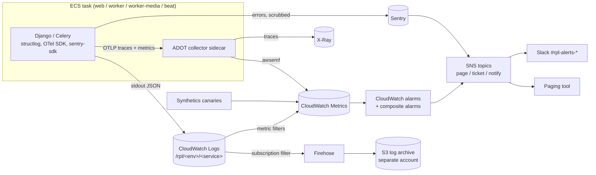
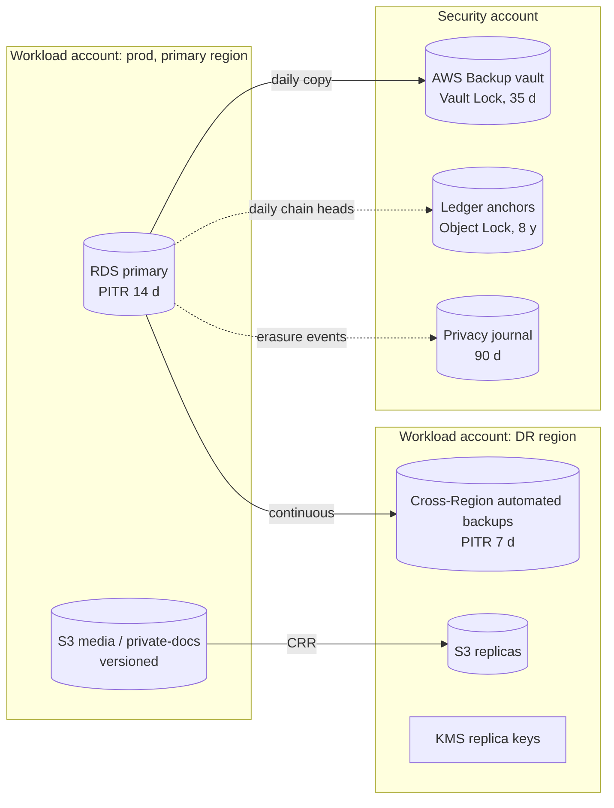
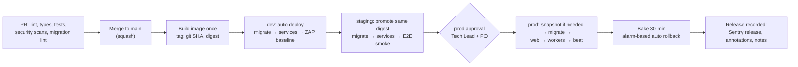
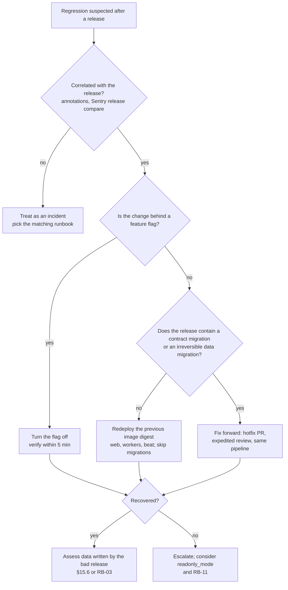

# Observability and Operations

Purpose: how the platform is observed, operated and recovered in production. It covers logging, metrics, tracing, dashboards, SLOs and error budgets, alerts, severity and on-call, health checks, backups, the restore testing the SRS requires, disaster recovery, release and rollback, feature flags and the data-migration policy.

Status: Draft v0.1 (2026-10-21)

> **Hosting change (2026-10-27):** AWS is no longer the target ([ADR-0014](../adr/0014-portable-hosting-paas-and-self-hosted.md)). AWS service names, CLI commands, sizing and alarms in this document are superseded; read them through the mapping table in ADR-0014 and [Hosting and deployment](../architecture/05-hosting-and-deployment.md). The provider-neutral intent (controls, targets, procedures) still applies.

| | |
|---|---|
| Owner | Platform lead (Tech Lead until a platform role exists) |
| Audience | Engineers, on-call staff, QA, DevOps, Product, Finance (integrity alerts) |
| SRS anchors | §6.4 Instant allocation, §8.1 Latency, §8.3 Availability (backup restoration testing, runbooks), §9.2 Credit integrity (automated discrepancy alerts), §10.1 Cloud native |
| Requirement IDs | NFR-AVAIL-01, NFR-OBS-01, NFR-SEC-02.5, NFR-PERF-01, NFR-SCAL-01.5 |
| Backlog | US-006, US-010, US-611, US-701, US-706, US-707, US-708, US-711 |
| Related | [01 Security](01-security-and-compliance.md) · [02 NFR performance](02-nfr-performance-and-scalability.md) · [04 Runbooks](04-runbooks.md) · [05 Privacy](05-privacy-and-data-protection.md) · [Architecture §15](../architecture/01-system-architecture.md#15-observability-summary) · [Engineering standards §10, §14, §18](../delivery/03-engineering-standards.md) |

> SRS section numbers follow the SRS table of contents (3.x–12.x). Command and task names in this document (`audit_wallets`, `ops-run`, `dbdiag`, and so on) are indicative. Final names are fixed in the owning app's story.

---

## 1. Scope, principles and tool map

### 1.1 Principles

| # | Principle | Consequence |
|---|---|---|
| OP-1 | **Shift left.** Logs, metrics, traces, Sentry and health checks exist from M0 (US-006). | Every story that adds a user-facing or money-path capability ships with its metric, its dashboard panel, its alert (if any) and a runbook link. That is part of the Definition of Done. M7 verifies the setup; it does not build it. |
| OP-2 | **Page on symptoms, ticket on causes.** | A page means users are affected now, or credit or data integrity is at risk. Causes (high CPU, a failing backup) become tickets unless they are about to become symptoms. |
| OP-3 | **Every alert has an owner and a runbook.** | Alert definitions in Terraform carry `runbook_url` and `owner` tags. An alert with no runbook fails review. |
| OP-4 | **Telemetry carries no PII.** | §2.6 and [05](05-privacy-and-data-protection.md). Public UUIDs only. |
| OP-5 | **Everything as code.** | Log groups, metric filters, alarms, dashboards, canaries, backup plans and SNS routing live in `infra/terraform/modules/observability` and `infra/terraform/modules/backup`. Console changes made during an incident are reconciled into Terraform within 24 h. |
| OP-6 | **One release identity.** | `vX.Y.Z+<git-sha>` is the Sentry `release`, the OTel `service.version`, the `release` log field, a ledger column (`app_release`) and the value shown by `/readyz` ([engineering standards §18](../delivery/03-engineering-standards.md#18-versioning-releases-and-changelog)). |
| OP-7 | **Integrity beats availability on the money path.** | When in doubt, the reveal and fulfilment paths fail closed ("you have not been charged"). A ledger mismatch is SEV1 even if no user has noticed. |

### 1.2 Tool map

The backend default is CloudWatch + X-Ray + Sentry (architecture open question A-7). Instrumentation is OpenTelemetry, so moving to another backend (Grafana Cloud, Datadog) is a collector configuration change, not a code change. We use the OTel SDK only, never the AWS X-Ray SDKs, which AWS is retiring in favour of OpenTelemetry.

| Signal | Producer | Transport | Store / UI | Retention (prod) |
|---|---|---|---|---|
| Application logs | structlog JSON on stdout | ECS `awslogs` driver | CloudWatch Logs + Logs Insights | 30 days hot; archived to S3 (log-archive account) for 1 year ([05 §8](05-privacy-and-data-protection.md#8-data-retention-schedule)) |
| Edge, ALB and WAF logs | CloudFront, ALB, WAF | S3 / Kinesis Data Firehose | Athena | 90 days (see OQ-OPS-06 for India) |
| Application metrics | OTel metrics SDK + beat gauge publisher | OTLP → ADOT collector sidecar → `awsemf` exporter; boto3 `PutMetricData` for gauges | CloudWatch Metrics | 15 months (CloudWatch native) |
| Infrastructure metrics | AWS services | Native | CloudWatch Metrics, RDS Performance Insights | 15 months; Performance Insights 7 days (free tier) |
| Traces | OTel SDK | OTLP → ADOT → X-Ray | X-Ray / CloudWatch trace views | 30 days |
| Errors | `sentry-sdk[django,celery]` | HTTPS | Sentry SaaS (region per T-3) | Per plan (typically 90 days) |
| Business audit trail | `core.AuditLog` | PostgreSQL | Ops console, SQL | 2 / 7 years ([domain model §15](../design/01-domain-model.md#15-data-retention-schedule)) |
| Security events | CloudTrail, GuardDuty, Security Hub, pgaudit, WAF | Organisation trail, EventBridge | Log-archive account, Security Hub | ≥ 1 year |
| Synthetic checks | CloudWatch Synthetics canaries | n/a | CloudWatch | Run artefacts 31 days |
| Real-user monitoring | `web-vitals` beacons → first-party `/rum/` | HTTPS | CloudWatch metrics (aggregates only) | 15 months |
| Alerts | CloudWatch alarms, Sentry alert rules, GuardDuty/EventBridge | SNS → paging tool; Slack | Paging tool (OQ-OPS-01) | Per tool |



**Paging tool:** PagerDuty or incident.io (OQ-OPS-01). Opsgenie is not recommended for a new setup, because Atlassian has announced its end of sale and end of life.

---

## 2. Logging standards

Event names, levels and the "never log PII" rule are defined in [engineering standards §14](../delivery/03-engineering-standards.md#14-logging-metrics-and-tracing-conventions). This section adds the operational contract: fields, correlation, sampling, retention and redaction.

### 2.1 Format and mandatory fields

One JSON object per line, UTF-8, written to stdout. Timestamps are RFC 3339 UTC with milliseconds.

| Field | Always | Example | Notes |
|---|---|---|---|
| `ts`, `level`, `event`, `logger` | yes | `"credits.debit.succeeded"` | Dotted event names (standards §14) |
| `env`, `service`, `release` | yes | `prod`, `web`, `v1.2.0+3f9c2a1` | `service` ∈ `web`, `worker`, `worker-critical`, `worker-media`, `beat`, `migrate`, `ops` |
| `request_id` | yes (HTTP and task) | `1-67a1…` | §2.2 |
| `trace_id`, `span_id` | yes when a span is active | | OTel context |
| `user_public_id` | when authenticated | UUID | Never email or name |
| `staff` | when authenticated | `true` | Staff actions are easier to filter |
| `method`, `route`, `route_class`, `status`, `duration_ms` | request line | `POST`, `leads:reveal`, `C1`, `200`, `87` | `route` is the URL pattern **name**, never the raw path. `route_class` follows [02 §3](02-nfr-performance-and-scalability.md#3-latency-budgets-per-endpoint-class) |
| `task_name`, `task_id`, `queue`, `retries` | Celery | `payments.reconcile_order`, `critical` | |
| `error_code`, `exc_type` | on failure | `credits.insufficient`, `OperationalError` | `DomainError.code` |
| Domain IDs | when relevant | `wallet_public_id`, `property_public_id`, `order_public_id`, `ledger_entry_public_id`, `reveal_public_id`, `outbox_message_id` | Public UUIDs only |

Examples:

```json
{"ts":"2026-10-21T09:14:03.512Z","level":"info","event":"http.request","service":"web","env":"prod","release":"v1.2.0+3f9c2a1","request_id":"1-6716b9fb-4c1d2e","trace_id":"6716b9fb4c1d2e9a","user_public_id":"0b6c…","method":"POST","route":"leads:reveal","route_class":"C1","status":200,"duration_ms":87}
{"ts":"2026-10-21T09:14:03.498Z","level":"info","event":"credits.debit.succeeded","service":"web","request_id":"1-6716b9fb-4c1d2e","wallet_public_id":"9e21…","property_public_id":"5d0a…","ledger_entry_public_id":"c7f4…","amount":-2,"balance_after":8,"lock_wait_ms":1}
{"ts":"2026-10-21T09:20:11.002Z","level":"warning","event":"payments.webhook.signature_invalid","service":"web","request_id":"1-6716bb7b-08aa","gateway":"STRIPE","event_type":"checkout.session.completed","body_bytes":3121}
```

### 2.2 Correlation

| Hop | Mechanism |
|---|---|
| Edge → app | `request_id` = the `Root=` part of ALB `X-Amzn-Trace-Id`, otherwise a new UUIDv4 (`RequestContextMiddleware`, architecture §8.1). Returned as `X-Request-ID` and printed on 4xx/5xx pages so users can quote it to support. |
| App → Celery | OTel Celery instrumentation propagates W3C `traceparent`. A `before_task_publish` hook adds a `request_id` task header. The worker binds it to the log context. |
| App → outbox → handler | The publisher stores `payload["_meta"] = {"request_id": …}`, which is an ID, not PII. The relay and handler log under the originating `request_id`. |
| App → ledger / audit | `CreditLedgerEntry.request_id`, `ContactReveal.request_id`, `AuditLog.request_id` (domain model). Support can go from a receipt email (transaction ID = ledger `public_id`) to the request's logs and trace. |
| App → Sentry | Tags `request_id`, `trace_id`, `release`, `service`. |
| App → DB | `application_name` = `service` in the connection options, so `pg_stat_activity` shows which tier holds a connection ([RB-04](04-runbooks.md#rb-04-database-performance-degradation)). |

### 2.3 Levels and canonical business events

The levels follow standards §14. Events that dashboards and alerts depend on:

| Event | Level | Used by |
|---|---|---|
| `http.request` (one per request, from middleware; Gunicorn access log off) | info | RED metrics backup, Logs Insights |
| `auth.login.succeeded` / `auth.login.failed` | info / info | AL-44 (counted as a metric; individual failures are not warnings) |
| `credits.debit.succeeded` / `credits.debit.insufficient` / `credits.debit.lock_timeout` | info / info / warning | DB-02, AL-08 |
| `leads.reveal.already_revealed` / `leads.reveal.rate_limited` | info / warning | DB-02, AL-46 |
| `payments.webhook.received` / `payments.webhook.signature_invalid` / `payments.webhook.failed` | info / warning / error | DB-04, AL-19, AL-20 |
| `payments.fulfillment.succeeded` (with `path` = `webhook`, `return` or `reconcile`) | info | AL-16 |
| `payments.reconcile.mismatch` | error | AL-23 |
| `outbox.message.dead` | error | AL-26 |
| `credits.audit.mismatch` / `credits.anchor.mismatch` | critical | AL-11, AL-13 |
| `security.rate_limit.exceeded` (with `scope`) | warning | DB-07 |

### 2.4 What is not logged, and sampling

- Request and response bodies, headers other than an allow-list (`user-agent` hashed, `hx-request`, `content-length`), and cookies are never logged.
- Query strings are logged only for allow-listed parameters (`page`, `sort`, `type`, `tag`, `min_price`, `max_price`, `bedrooms`). The free-text search term `q` is logged as its length only, because people type names, phone numbers and street addresses into search boxes.
- `/healthz` and `/readyz` are not logged. Static files are served by WhiteNoise behind CloudFront and are not logged by the app.
- `debug` is off in every AWS environment.
- **Volume budget:** about one request line plus at most 3 domain lines per use case. A PR that adds per-item logging inside a loop needs a reason.

### 2.5 Retention, archive and access

| Item | Decision |
|---|---|
| Log groups | `/rpl/<env>/<service>`, KMS-encrypted (`alias/rpl-<env>-logs`) |
| Hot retention | prod 30 days, staging 14 days, dev 7 days |
| Archive | prod only: subscription filter → Firehose → `s3://rpl-logarchive-app-logs/` in the log-archive account. S3 Glacier Instant Retrieval after 30 days, expiry after 365 days. **Why 1 year:** India's DPDP Rules 2025 expect processing logs to be kept for at least one year, and CERT-In requires 180 days. Both apply only if India is a launch market (OQ-OPS-06). The cost is small because logs carry no PII and compress well. |
| Access | Engineers get read-only access through an IAM Identity Center permission set. Production logs are never exported to laptops or shared outside the incident channel. Archive reads are logged by CloudTrail data events. |

### 2.6 Redaction and the telemetry allow-list

The primary control is the code rule: never log PII (standards §14). The layers below are the safety net.

| Layer | Control |
|---|---|
| structlog processor (`apps.core.logging`) | **Key deny-list** → `"[REDACTED]"`: `email`, `phone*`, `contact_*`, `name`, `full_name`, `address*`, `password`, `token`, `otp`, `code`, `authorization`, `cookie`, `session*`, `secret`, `card*`, `payload`, `body`. **Value patterns** → `"[REDACTED:<kind>]"`: email addresses; runs of 8 or more digits with optional `+`, spaces or dashes (phone-like); JWT and `Bearer` tokens; 13–19 digit numbers that pass the Luhn check (PAN-like); AWS access-key IDs (`AKIA…`, `ASIA…`); Stripe secret keys (`sk_live_`, `rk_live_`, `whsec_`). |
| Sentry | `send_default_pii=False`; `before_send` and `before_send_transaction` run the same scrubber; `max_request_body_size="never"`; local variables off for money-path apps; **Session Replay disabled** (it would record revealed contact details in the DOM); no Sentry browser SDK at MVP except the CSP report endpoint. |
| OTel span attributes | **Allow-list** exporter processor: `http.route`, `http.request.method`, `http.response.status_code`, `url.scheme`, `server.address`, `db.system`, `db.operation.name`, `db.collection.name`, `messaging.destination.name`, `messaging.operation`, `rpc.*`, and `app.*` attributes holding public UUIDs, codes and counts. `url.full` and `url.query` are dropped. `db.query.text` is kept only in parameterised form (psycopg instrumentation does not capture bound values; this is asserted in a test). |
| Metric labels | Allow-list in §3.1. A unit test fails if a metric is created with an unknown label key. |
| Tests | The seeded-PII test ([testing strategy §13](../delivery/04-testing-strategy.md)) runs a signup → verify → list → reveal → purchase journey with known fake PII. It then asserts that none of those strings appear in captured logs, Sentry events (test transport) or exported spans (in-memory exporter). |
| Verification | M7 log and Sentry sampling as part of US-705 ([05](05-privacy-and-data-protection.md)). |

---

## 3. Metrics

### 3.1 Naming and labels

Names follow standards §14 (`<domain>_<thing>_<unit>`). The canonical business list starts from architecture §15. Metrics marked ➕ below are additions this document proposes for that list.

**Label allow-list:** `env`, `service`, `route_class` (C1–C10), `route` (only the top 30 route names; others become `other`), `method`, `status_class`, `outcome`, `gateway`, `path`, `queue`, `task`, `entry_type`, `template`, `channel`, `market` (enabled markets only), `currency`, `rule_code`, `check_code`, `scope`. **Never** user, property, wallet or order IDs, emails, raw paths or IP addresses.

**Cost guard:** CloudWatch bills per metric and dimension combination. The initial budget is about 300 custom series per environment. A new label needs a reason in the PR.

### 3.2 RED metrics (requests)

| Metric | Type | Source | Use |
|---|---|---|---|
| `http_server_request_duration_seconds{route_class, route, method, status_class}` | Histogram | OTel Django instrumentation (`http.server.request.duration`, renamed in the collector) | p50/p95/p99 per class; SLO-02, SLO-03, SLO-08 |
| `http_server_requests_total{route_class, status_class}` | Counter | Same | Rates and error ratio |
| ALB `RequestCount`, `HTTPCode_Target_5XX_Count`, `HTTPCode_ELB_5XX_Count`, `TargetResponseTime` | Native | ALB | SLO-01 (availability), cross-check of latency |

### 3.3 USE metrics (resources)

| Resource | Utilisation | Saturation | Errors |
|---|---|---|---|
| ECS services | `CPUUtilization`, `MemoryUtilization` per service | Running vs desired task count; ALB `ALBRequestCountPerTarget` | Task stop reasons (`OutOfMemoryError`, `Essential container exited`), restarts |
| ALB | `ActiveConnectionCount` | `RejectedConnectionCount`, healthy host count | `HTTPCode_ELB_5XX_Count`, `TargetConnectionErrorCount` |
| RDS primary | `CPUUtilization`, `FreeableMemory` | `DatabaseConnections` vs `max_connections`, `DiskQueueDepth`, Performance Insights DB load vs vCPU, wait events (`Lock:*`, `IO:WALSync`) | Deadlocks (`pg_stat_database.deadlocks`), statement and lock timeouts (log metric filter) |
| RDS storage | `FreeStorageSpace` | `ReadIOPS`/`WriteIOPS` vs provisioned, `WriteLatency` | `MaximumUsedTransactionIDs` (wraparound risk) |
| Read replica | CPU | `ReplicaLag` | Replication errors (RDS events) |
| Valkey cache | `EngineCPUUtilization`, `DatabaseMemoryUsagePercentage` | `CurrConnections`, `Evictions` | App-side `cache_errors_total` |
| Valkey broker | `DatabaseMemoryUsagePercentage` (must stay well below 100 %: `noeviction`) | Queue depth (§3.4) | OOM rejects (log metric filter) |
| Celery | Worker concurrency in use | `celery_queue_depth{queue}`, `celery_oldest_message_age_seconds{queue}` | `celery_task_failures_total{task}`, retries |
| Outbox | n/a | `outbox_pending_count`, `outbox_oldest_pending_age_seconds` | `outbox_dead_count` |
| NAT / egress | `ActiveConnectionCount` | `PacketsDropCount` | `ErrorPortAllocation` |

### 3.4 Business and integrity metrics

| Metric | Type | Labels | Definition | Used by |
|---|---|---|---|---|
| `reveals_total` | Counter | `outcome` (`charged`, `already_revealed`, `insufficient`, `rate_limited`, `lock_timeout`, `error`) | Every Show Number POST by a logged-in non-owner | DB-02, SLO-04, AL-08 |
| `reveal_insufficient_credit_total` | Counter | — | Architecture §15 (kept for continuity; equals `reveals_total{outcome="insufficient"}`) | DB-02 |
| `credit_debit_latency` (seconds) | Histogram | — | Duration of the `debit_credits` transaction, lock wait included | DB-02, RB-04 |
| ➕ `credit_lock_wait_seconds` | Histogram | — | Time spent waiting for the wallet row lock | DB-02, PT-06 |
| ➕ `credits_granted_total` | Counter | `entry_type` | Credits added (`SIGNUP_PROMO`, `PURCHASE`, `ADMIN_ADJUSTMENT`, `REVERSAL` positive) | DB-03, AL-45 |
| ➕ `credits_debited_total` | Counter | `entry_type` | Credits removed | DB-03 |
| ➕ `credits_sold_total` | Counter | `gateway`, `currency` | Credits in fulfilled purchases | DB-03, DB-04 |
| ➕ `revenue_minor_total` | Counter | `gateway`, `currency` | Gross amount of fulfilled purchases in minor units | DB-03 (trend only; Finance reports come from the DB) |
| ➕ `payment_checkout_started_total` | Counter | `gateway`, `outcome` | Checkout session creation attempts | DB-04, AL-21 |
| `payment_fulfillment_latency_seconds` | Histogram | `gateway`, `path` (`webhook`, `return`, `reconcile`) | Gateway success event (`event.created`) or start of return verification → PURCHASE entry committed | SLO-05, AL-16 |
| ➕ `webhook_received_total` | Counter | `gateway`, `outcome` (`processed`, `duplicate`, `ignored`, `failed`, `signature_invalid`) | Each webhook request | DB-04, AL-18, AL-19 |
| `webhook_signature_failures_total` | Counter | `gateway` | Architecture §15 | AL-20 |
| ➕ `webhook_lag_seconds` | Histogram | `gateway` | `received_at − event.created` (gateway delivery delay) | DB-04, RB-02 |
| ➕ `payment_orders_pending` | Gauge | `gateway`, `age_bucket` (`<10m`, `10–60m`, `>60m`) | Orders in `CREATED`/`PENDING` | AL-17, DB-04 |
| ➕ `reconciliation_mismatches_total` | Counter | `gateway`, `kind` | Daily reconciliation findings | AL-23 |
| `outbox_pending_count`, `outbox_oldest_pending_age_seconds` | Gauge | — | Architecture §15 | SLO-06, AL-25 |
| ➕ `outbox_dead_count` | Gauge | `topic` | `DEAD` outbox rows | AL-26 |
| ➕ `outbox_dispatch_latency_seconds` | Histogram | `topic` | Commit → handler success | SLO-06 ([02 PERF-T05](02-nfr-performance-and-scalability.md#2-nfr-targets)) |
| `ledger_audit_mismatches_total` | Counter | `check_code` | Discrepancies found by the audit. **Any increase pages** | AL-11 |
| ➕ `ledger_audit_last_success_timestamp` | Gauge | `mode` | Unix time of the last run with status `PASSED` or `FAILED` (a run that completed) | AL-12 |
| ➕ `ledger_anchor_last_success_timestamp` | Gauge | — | Last successful anchor write | AL-13 |
| ➕ `wallets_frozen` | Gauge | `reason` | Wallets with `status = FROZEN` | DB-09 |
| `image_processing_failures_total`, ➕ `image_processing_seconds` | Counter / Histogram | `rejection_code` | Media pipeline | SLO-07, AL-29 |
| `search_cache_hit_ratio` | Gauge | `market` | Hits / (hits + misses), 5-minute window | DB-05 |
| ➕ `geocode_requests_total` | Counter | `provider`, `outcome` | Geocoding adapter calls | DB-05 |
| ➕ `signups_total`, `verifications_total` | Counter | `method` | Funnel and abuse signals | DB-07, AL-45 |
| ➕ `login_attempts_total` | Counter | `outcome` | allauth signals | AL-44 |
| ➕ `otp_sends_total`, `otp_verifications_total` | Counter | `country` (allow-listed), `outcome` | Twilio Verify | AL-42, AL-43 |
| ➕ `emails_total` | Counter | `template`, `outcome` (`sent`, `failed`, `suppressed`) | Email adapter | AL-39 |
| ➕ `email_feedback_total` | Counter | `kind` (`bounce_hard`, `bounce_soft`, `complaint`, `delivery`) | Provider event webhook / SNS | AL-40, AL-41 |
| ➕ `rate_limit_exceeded_total` | Counter | `scope` | App limiter (01 §6.5) | DB-07, AL-46 |
| ➕ `fraud_flags_opened_total` | Counter | `rule_code` | `moderation.FraudFlag` created | AL-45, AL-46 |
| ➕ `replica_lag_seconds` | Gauge | — | Beat probe (architecture §13.2) | AL-34 |
| ➕ `beat_heartbeat_timestamp` | Gauge | — | Written by a 60-second beat task | AL-30 |
| ➕ `staff_pii_reveals_total` | Counter | `group` | `pii.unmasked` AuditLog actions (per-staff counts come from SQL, not labels) | AL-49 |

### 3.5 Emission

- Counters and histograms are emitted through `apps.core.metrics` (an OTel meter wrapper, so call sites don't depend on the backend).
- Gauges that need a database or broker query (queue depth, outbox, pending orders, frozen wallets, replica lag) are computed by one `publish_ops_gauges` beat task every 30 s on the `critical` queue and sent with `PutMetricData` (architecture §13.1). Alarms on these gauges use `TreatMissingData = breaching`, so a dead publisher pages instead of going quiet.
- Runtime numbers are asserted in tests with an in-memory reader. Metric names are constants in `apps/core/metrics_catalog.py` so dashboards and code can't drift apart.

---

## 4. Tracing and error tracking

### 4.1 Instrumentation

- **Automatic:** Django, psycopg, Celery, Redis, botocore, httpx, logging (adds `trace_id`/`span_id` to log records).
- **Manual spans on the money path** (standards §14 naming): `leads.reveal_contact`, `credits.debit_credits`, `credits.grant_credits`, `payments.start_checkout`, `payments.handle_webhook`, `payments.confirm_return`, `payments.fulfill_order`, `payments.reconcile_order`, `credits.audit_wallets`, `notifications.send_contact_reveal_email`, `notifications.send_payment_receipt`. Attributes: public IDs, `outcome`, `gateway`, `lock_wait_ms`, `attempt`.
- **Adapters** add a span per external call with `peer.service` (`stripe`, `paypal`, `twilio`, `ses`, `maps`), a timeout attribute and the circuit-breaker state.

### 4.2 Sampling

| Traffic | Rate | Why |
|---|---|---|
| Money-path routes and tasks (reveal, checkout, return, webhooks, fulfilment, reconciliation, audit) | 100 % in normal operation; 10 % during load tests (`OTEL_TRACES_SAMPLER_ARG` override) | Low volume in production (02 §4.2: about 10/s at Tier G peak) and high diagnostic value |
| Other pages and partials | 10 % (Tier L), 5 % (Tier G) | Cost |
| `/healthz`, `/readyz`, `/rum/` | 0 % | Noise |
| Celery tasks | Parent-based; root tasks at the page rate | Keeps traces whole |

Implementation: a custom `ParentBased` sampler with a rule on `http.route` at span start. Errors are captured in full by Sentry regardless of trace sampling. Sentry's own tracing is disabled (`traces_sample_rate = 0`) so we don't pay twice; Sentry events link to traces by `trace_id`.

### 4.3 Sentry usage

| Item | Setting |
|---|---|
| Projects | One project, `environment` = `dev`/`staging`/`prod`, `release` per OP-6 |
| Ownership | Sentry ownership rules mirror CODEOWNERS (`apps/credits/*` → money-path team, and so on) |
| Alert rules | New issue in `credits`, `leads`, `payments` or `core.outbox` → Slack `#rpl-alerts-prod` + ticket. More than 50 events in 5 min for one issue → SEV3 page (business hours). A regression of a resolved issue → ticket |
| Noise control | `DisallowedHost`, `Http404` and client disconnects are ignored. Domain errors that are business outcomes (`InsufficientCreditsError`) are not reported |
| Data | §2.6 |

---

## 5. Dashboards

All dashboards are defined in Terraform (`aws_cloudwatch_dashboard`). Each panel links to the runbook for the alert it backs. Deploys are marked on time-series panels as annotations from the deploy workflow.

| ID | Dashboard | Key panels | Primary audience |
|---|---|---|---|
| DB-01 | Service overview | Availability SLI and budget remaining; p95/p99 per route class; 5xx by route class; requests/s; healthy targets; current release; open alarms | On-call, Tech Lead |
| DB-02 | Show Number (credit debit) | Reveals/min by outcome; debit latency p95/p99; lock-wait p99; insufficient-credit ratio; rate-limit hits; reveal error ratio | On-call, Product |
| DB-03 | Credits economy | Credits granted by type; credits debited; credits sold by currency and gateway; promo grants/hour; frozen wallets | Product, Finance |
| DB-04 | Payments | Checkout funnel (started → redirected → fulfilled / failed / cancelled) per gateway; fulfilment latency p99 by path; webhook received/failed/duplicate; webhook lag; pending orders by age; failure categories; reconciliation results | On-call, Finance |
| DB-05 | Search and discovery | Search p95/p99; cache hit ratio per market; replica lag; replica fallback count; geocoder outcomes; EXPLAIN-guard status | On-call, search owner |
| DB-06 | Async processing | Queue depth and oldest age per queue; task failures and retries; outbox pending/oldest/dead; beat heartbeat; media pipeline p95 and rejections | On-call |
| DB-07 | Edge, abuse and auth | WAF allowed/blocked/challenged by rule; login attempts by outcome; signups and verifications; OTP sends by country; rate-limit hits by scope; fraud flags by rule | On-call, Security, Moderator lead |
| DB-08 | Data tier | RDS CPU, connections by `application_name`, Performance Insights DB load, top wait events, IOPS, free storage, XID age; Valkey memory, evictions, CPU (both clusters) | On-call |
| DB-09 | Integrity | Last ledger audit (mode, status, wallets and entries checked, mismatches); last anchor; reconciliation mismatches; frozen wallets by reason; `NEEDS_REVIEW` orders | Finance, Tech Lead |
| DB-10 | Notifications | Emails by template and outcome; bounce and complaint rates (24 h rolling); OTP conversion by country; SMS spend proxy (sends × country price) | On-call, Support |
| DB-11 | Frontend (RUM) | LCP, INP, CLS at p75 per page template and device class; TTFB by market | Product, UX |
| DB-12 | SLO report | All SLOs (§6) with 28-day attainment, budget burned, top budget consumers | PO, client |

**Ops console views** (US-602, US-611) complement CloudWatch for staff who don't use the AWS console: `/ops/jobs/` (queue depths, oldest age, outbox pending and dead with a retry action, last run per beat schedule), `/ops/finance/ledger-audit/` (US-607) and `/ops/finance/payments/` (US-609). These views read the same sources as the gauges in §3.5.

### 5.1 Audit-log signals

`core.AuditLog` is evidence, not a metric store, but some actions are operational signals. A `maintenance` task runs every 15 min, counts recent actions and emits them as metrics or alerts:

| Action pattern | Signal |
|---|---|
| `pii.unmasked` | Per staff user per day; more than 20 → AL-49 ([05 §9](05-privacy-and-data-protection.md#9-audit-logging-of-staff-access-to-pii)) |
| `ops.export.*` | Any export over 1,000 rows → AL-49 |
| `credits.adjustment_approved` | Daily total and sum of absolute amounts; over 3× the 30-day median → ticket to Finance |
| `auth.group_changed` (for `superadmin` or `finance`), `auth.mfa_removed` (staff) | AL-50 |
| `listing.lister_tag_changed` | Weekly count for the moderation review |
| `flags.switch_changed` | Posted to `#rpl-ops` with actor and reason (§14.4) |

---

## 6. SLOs and error budgets

### 6.1 Service level objectives

**Window:** rolling 28 days for the internal SLO, and calendar month for client reporting (§6.4). The SRS states latency "under standard load" (§8.1). Production SLOs apply at **all** loads, which is stricter. The load tests in [02 §9](02-nfr-performance-and-scalability.md#9-performance-testing-plan) prove the SRS wording under controlled conditions.

| ID | SLO | SLI (good / valid) | Target | Source |
|---|---|---|---|---|
| SLO-01 | Availability | Requests answered without 5xx and in < 10 s / all requests except `/healthz` and `/readyz`, at the ALB | **99.9 %** (proposed, OQ-08 / A-5) | SRS §8.3 (no number) |
| SLO-02 | Search latency | `route_class = C2` requests ≤ 500 ms / C2 requests; **and** ≤ 1,000 ms | **95 %** ≤ 500 ms and **99 %** ≤ 1,000 ms | SRS §8.1 |
| SLO-03 | Credit transaction latency (reveal) | C1 requests ≤ 500 ms; and ≤ 1,000 ms | 95 % ≤ 500 ms and 99 % ≤ 1,000 ms | SRS §8.1 |
| SLO-04 | Reveal correctness | Reveal attempts ending in a business outcome (`charged`, `already_revealed`, `insufficient`, `rate_limited`) / all attempts. `lock_timeout` and `error` are bad | **99.95 %** | SRS §5.2–5.4 |
| SLO-05 | Purchase allocation | Fulfilled payments with `payment_fulfillment_latency_seconds` ≤ 5 s / fulfilled payments | **99 %** ≤ 5 s (02 PERF-T04) | SRS §6.4 |
| SLO-06 | Reveal receipt email | `contact.revealed` outbox messages dispatched ≤ 60 s / messages | 95 % ≤ 60 s; 99.9 % ≤ 1 h | SRS §5.5 |
| SLO-07 | Image readiness | Images `READY` or `REJECTED` ≤ 30 s after upload complete / images | 95 % | SRS §4.2 |
| SLO-08 | Detail page latency | C3 requests ≤ 300 ms | 95 % | Internal (02 PERF-T07) |

**Integrity invariants** are not budgeted. Any violation is an incident:

| ID | Invariant | On violation |
|---|---|---|
| INV-01 | Ledger audit reports 0 mismatches and the hash chain verifies | SEV1, [RB-03](04-runbooks.md#rb-03-ledger-audit-mismatch-or-hash-chain-break) |
| INV-02 | Incremental audit completes every day; full audit every week | SEV3 (AL-12) |
| INV-03 | Chain heads are anchored every day and every earlier anchor still verifies | SEV3 if missed; SEV1 on mismatch (AL-13) |
| INV-04 | Every payment the gateway reports as paid is fulfilled within 15 min | SEV2 (AL-17) |
| INV-05 | Daily reconciliation has 0 unexplained mismatches older than 24 h | SEV2 (AL-23) |

### 6.2 Error budget arithmetic

| Target | Budget (requests) | Time equivalent, 28 days | Time equivalent, 30-day month |
|---|---|---|---|
| 99.9 % | 0.1 % of valid requests | 40.3 min | 43.2 min |
| 99.95 % | 0.05 % | 20.2 min | 21.6 min |
| 99 % | 1 % | 6.7 h | 7.2 h |

### 6.3 Burn-rate alerting (SLO-01)

This uses multi-window, multi-burn-rate alerts (SRE workbook method). For a 99.9 % SLO the error-ratio thresholds are:

| Alert | Long window | Short window | Error ratio threshold | Budget consumed if sustained | Action |
|---|---|---|---|---|---|
| Fast burn (AL-01) | 1 h | 5 min | > 1.44 % (14.4 × 0.1 %) | 2 % of the 30-day budget in 1 h | Page |
| Slow burn (AL-02) | 6 h | 30 min | > 0.6 % (6 ×) | 5 % in 6 h | Page |
| Trend (AL-03) | 3 days | 6 h | > 0.1 % (1 ×) | 10 % in 3 days | Ticket |

Both windows must exceed the threshold. That gives fast detection (long window) without paging after the problem has stopped (short window). Implemented as CloudWatch metric math on ALB counts with composite alarms. CloudWatch Application Signals SLOs (with built-in burn-rate alarms) are an acceptable alternative if the team prefers a managed view. Latency SLOs use the same method on the "slow request" ratio from the duration histogram.

### 6.4 Error budget policy

| Budget remaining (28-day) | Policy |
|---|---|
| > 50 % | Normal delivery |
| 25–50 % | Release review: the Tech Lead checks each prod release for reliability risk; at least one reliability item enters the next iteration |
| 0–25 % | Only low-risk releases (flagged features, fixes); reliability work takes priority |
| Exhausted | **Feature freeze** for prod except fixes, security patches and reliability work until the budget recovers above 10 %. The PO and Tech Lead may override in writing for a contractual deadline |

- Any single incident that consumes more than 20 % of a budget gets a postmortem, whatever its severity.
- **Planned maintenance** counts against the internal SLO. For client SLA reporting it is excluded only if it was announced at least 72 h ahead and kept within the agreed window (OQ-OPS-02).
- **Monthly SLO report** (DB-12 export plus a short narrative) goes to the PO and the client on the first business day of the month.
- **SLA vs SLO:** if the client commits a 99.9 % SLA to its own customers, the internal SLO should be 99.95 % to leave a margin (OQ-OPS-02).

---

## 7. Alert catalogue

**Routes:** **P** = page 24/7 (from go-live), **P-BH** = page in business hours, otherwise ticket, **T** = ticket, **N** = Slack notification only. Severity definitions are in §8. Thresholds are initial values, to be tuned after 30 days of production data (§7.1). Every alarm requires a minimum sample size so that low traffic can't trigger it (for example "min 50 attempts").

| ID | Alert | Condition | Sev | Route | Runbook |
|---|---|---|---|---|---|
| **Availability and latency** | | | | | |
| AL-01 | Availability fast burn | §6.3 | SEV2 | P | [RB-10](04-runbooks.md#rb-10-bad-deploy-rollback), [RB-04](04-runbooks.md#rb-04-database-performance-degradation) |
| AL-02 | Availability slow burn | §6.3 | SEV2 | P | RB-10, RB-04 |
| AL-03 | Availability budget trend | §6.3 | SEV4 | T | — |
| AL-04 | Synthetic journey failing | SYN-01, SYN-02 or SYN-03 fails 2 consecutive runs from ≥ 2 locations | SEV2 | P | RB-10, RB-04, RB-05 |
| AL-05 | Search latency degraded | C2 p95 > 500 ms for 15 min | SEV3 | P-BH | RB-04 |
| AL-06 | Search latency breach | C2 p95 > 1,000 ms for 10 min | SEV2 | P | RB-04 |
| AL-07 | Reveal latency breach | C1 p95 > 500 ms for 10 min | SEV2 | P | RB-04 |
| AL-08 | Reveal failures | `reveals_total{outcome=~"lock_timeout\|error"}` / all > 1 % for 5 min (min 50 attempts) | SEV2 | P | RB-04, RB-10 |
| AL-09 | Too few healthy web targets | ALB healthy hosts < 2 for 3 min | SEV2 | P | RB-10 |
| AL-10 | Task crash loop | Running < desired for 10 min, or > 3 task stops in 10 min, for any service | SEV3 (SEV2 for `web`) | P-BH / P | RB-10, [RB-12](04-runbooks.md#rb-12-celery-or-outbox-backlog) |
| **Credit integrity** | | | | | |
| AL-11 | Ledger audit mismatch | Any increase of `ledger_audit_mismatches_total` | **SEV1** | P + Finance | [RB-03](04-runbooks.md#rb-03-ledger-audit-mismatch-or-hash-chain-break) |
| AL-12 | Ledger audit did not complete | No completed incremental run in 26 h, no full run in 8 days, or a run in status `ERROR` | SEV3 | P-BH | RB-03 |
| AL-13 | Anchor failure or mismatch | Anchor job failed or no anchor in 26 h (SEV3); `ANCHOR_MISMATCH` discrepancy (SEV1) | SEV3 / SEV1 | P-BH / P | RB-03, [RB-08](04-runbooks.md#rb-08-credential-leak-or-security-incident) |
| AL-14 | Integrity constraint rejected a write | Log metric filter: `IntegrityError` on `ck_wallet_*` / `ck_ledger_*`, or a ledger trigger exception, > 0 in 5 min | SEV2 | P | RB-03 |
| AL-15 | Ledger protection changed | pgaudit: `DISABLE TRIGGER`, `DROP TRIGGER`, `ALTER TABLE` or `GRANT` on `credits_*`/`core_auditlog` outside a deploy's `migrate` task | **SEV1** | P + Security | RB-08, RB-03 |
| **Payments** | | | | | |
| AL-16 | Allocation too slow | `payment_fulfillment_latency_seconds` p99 > 5 s for 15 min (min 10 payments) | SEV2 | P | [RB-02](04-runbooks.md#rb-02-webhook-backlog-or-delayed-fulfilment) |
| AL-17 | Paid but not fulfilled | ≥ 1 order verified as paid at the gateway (by reconciliation) and not `FULFILLED` after 15 min | SEV2 | P + Finance | RB-02 |
| AL-18 | Webhook silence | 0 webhooks from a gateway for 30 min while ≥ 10 checkouts were started on it | SEV2 | P | RB-02 |
| AL-19 | Webhook processing failing | `PaymentWebhookEvent` in `FAILED` > 0 for 10 min, or > 5 events in `RECEIVED` older than 2 min | SEV2 | P | RB-02 |
| AL-20 | Webhook signature failures | > 10 in 5 min for a gateway | SEV3 (SEV2 if AL-16 also fires) | P-BH | RB-02, RB-08 |
| AL-21 | Gateway API failing | Checkout creation or verification error ratio > 20 % for 5 min (min 10), or the adapter circuit breaker is open | SEV2 | P | [RB-01](04-runbooks.md#rb-01-payment-gateway-outage-or-api-failure) |
| AL-22 | Payment decline spike | Decline ratio > 3× the 7-day baseline over 30 min (min 30 attempts) | SEV3 | P-BH | [RB-09](04-runbooks.md#rb-09-suspicious-credit-farming-or-fraud-spike) |
| AL-23 | Reconciliation mismatch | Daily reconciliation reports an unmatched gateway transaction, `FULFILLED` order or `PURCHASE` entry | SEV2 | P-BH + Finance | RB-02, RB-03 |
| AL-24 | Orders awaiting review | `NEEDS_REVIEW` orders older than 4 h | SEV4 | T (Finance) | — |
| **Asynchronous processing** | | | | | |
| AL-25 | Outbox delayed | Oldest `PENDING` > 5 min (SEV3), > 30 min (SEV2) | SEV3 / SEV2 | P-BH / P | RB-12 |
| AL-26 | Outbox dead letters | `outbox_dead_count` increased | SEV3 | T + N | RB-12 |
| AL-27 | Critical queue delayed | Oldest `critical` message > 60 s for 5 min | SEV2 | P | RB-12 |
| AL-28 | Default queue delayed | Oldest `default` message > 5 min for 10 min | SEV3 | P-BH | RB-12 |
| AL-29 | Media pipeline slow | Oldest `media` message > 10 min, or image p95 > 30 s for 30 min | SEV3 | P-BH | RB-12 |
| AL-30 | Beat heartbeat missing | `beat_heartbeat_timestamp` older than 3 min (missing data = breaching) | SEV2 | P | RB-12 |
| **Data tier** | | | | | |
| AL-31 | Primary CPU high | > 80 % for 15 min (SEV3); > 90 % for 5 min (SEV2) | SEV3 / SEV2 | P-BH / P | RB-04 |
| AL-32 | Primary connections high | > 80 % of `max_connections` for 5 min | SEV2 | P | RB-04 |
| AL-33 | Long transactions or blocking | Any non-maintenance transaction older than 60 s, or > 20 blocked sessions for 2 min (gauge from `dbdiag`) | SEV2 | P | RB-04 |
| AL-34 | Replica lag | `ReplicaLag` > 30 s for 5 min, or replica flagged unhealthy for > 15 min | SEV3 | P-BH | RB-04 |
| AL-35 | Storage and XID | Free storage < 15 % (SEV3), < 10 % (SEV2); `MaximumUsedTransactionIDs` > 1 billion (SEV2) | SEV3 / SEV2 | P-BH / P | RB-04 |
| AL-36 | Cache cluster failing | App `cache_errors_total` > 1 % of operations for 5 min, or the primary node unavailable | SEV2 | P | [RB-05](04-runbooks.md#rb-05-redis-valkey-outage) |
| AL-37 | Cache memory pressure | Memory > 85 % or evictions > 100/s for 15 min | SEV3 | P-BH | RB-05 |
| AL-38 | Broker memory | > 70 % (SEV3), > 85 % (SEV2) | SEV3 / SEV2 | P-BH / P | RB-05, RB-12 |
| **Notifications** | | | | | |
| AL-39 | Email sending failing | Failure ratio > 5 % for 10 min (min 20) | SEV2 | P | [RB-06](04-runbooks.md#rb-06-email-provider-failure-or-bounce-spike) |
| AL-40 | Bounce rate | 24 h rolling > 2 % (SEV3), > 4 % (SEV2). Amazon SES reviews accounts at 5 % and may pause sending at 10 % | SEV3 / SEV2 | P-BH / P | RB-06 |
| AL-41 | Complaint rate | 24 h rolling > 0.08 % (SEV3), > 0.3 % (SEV2). SES thresholds are 0.1 % (review) and 0.5 % (pause) | SEV3 / SEV2 | P-BH / P | RB-06 |
| AL-42 | OTP delivery degraded | Verify conversion < 60 % for a country over 30 min (min 20 sends), or send errors > 10 % | SEV3 | P-BH | [RB-07](04-runbooks.md#rb-07-sms-otp-failure-or-sms-pumping) |
| AL-43 | SMS pumping signal | Hourly OTP sends > 3× the 7-day same-hour baseline, or any send attempt to a non-allow-listed country | SEV2 | P | RB-07 |
| **Security and abuse** | | | | | |
| AL-44 | Login attack | Failed logins > 5× baseline for 10 min, or WAF login rate rule blocks > 1,000 in 5 min | SEV2 | P | [RB-13](04-runbooks.md#rb-13-credential-stuffing-bot-or-l7-attack) |
| AL-45 | Promo farming signal | Promo grants/hour > 3× baseline (SEV3) or > 10× (SEV2); or > 10 `PROMO_FARMING`/`PROMO_IDENTITY_REUSE` flags/hour | SEV3 / SEV2 | P-BH / P | RB-09 |
| AL-46 | Reveal scraping signal | > 20 `REVEAL_VELOCITY` flags/hour, or reveal 429s > 5 % of reveals for 30 min | SEV3 | P-BH | RB-09 |
| AL-47 | GuardDuty finding | High severity (SEV2); Medium (SEV3 ticket) | SEV2 / SEV3 | P / T | RB-08 |
| AL-48 | Secret exposure | GitHub secret-scanning alert, push-protection bypass, or gitleaks hit on `main` | SEV2 | P | RB-08 |
| AL-49 | Staff PII access anomaly | > 20 `pii.unmasked` by one staff user in a day, or an export over 1,000 rows | SEV3 | T + Security | RB-08 |
| AL-50 | Privileged change | Membership change of `superadmin` or `finance`, or MFA removed from a staff account | SEV3 | N + Security | — |
| AL-51 | Edge flood | WAF blocked requests > 10× baseline for 10 min, or CloudFront 5xx > 2 % | SEV2 | P | RB-13 |
| **Release and platform** | | | | | |
| AL-52 | Deployment rolled back automatically | ECS deployment circuit breaker or alarm-based rollback fired | SEV3 | P-BH | RB-10 |
| AL-53 | Post-deploy regression | Within 60 min of a release: a new Sentry issue in money-path apps with ≥ 10 events, or error ratio > 2× the pre-deploy hour | SEV2 | P | RB-10 |
| AL-54 | Backup job failed | RDS automated backup failure event, AWS Backup copy job failed, cross-Region backup replication stopped, or a restore-testing job failed | SEV3 | P-BH | [RB-11](04-runbooks.md#rb-11-restore-from-backup-drill-and-real) |
| AL-55 | Restore drill overdue | More than 100 days since the last passed quarterly drill (§11) | SEV4 | T | RB-11 |
| AL-56 | Domain, certificate or email auth | Domain expiry < 30 days; ACM renewal failure event; DMARC aggregate failures > 5 % | SEV3 | T | RB-06 |
| AL-57 | Cost anomaly | AWS Cost Anomaly Detection alert above the agreed daily threshold | SEV4 | T | — |
| AL-58 | CSP violation spike | > 100 reports/hour for a new directive or source | SEV4 | T | — |

### 7.1 Alert hygiene

- **Non-production never pages.** Dev and staging alarms go to `#rpl-alerts-nonprod` and are reviewed in the daily stand-up.
- **Every alarm is tested** once in staging before it is enabled in prod (`aws cloudwatch set-alarm-state` for routing; a fault injection for logic where practical).
- **Monthly alert review:** pages per alert, false positives, time to acknowledge. An alert with more than 2 false pages in a month is fixed within 2 weeks or downgraded.
- **Tuning rule:** thresholds change through a PR that names the evidence (graph link or incident ID).

---

## 8. Severity levels and on-call

### 8.1 Severity levels

These definitions are shared with [01 §11](01-security-and-compliance.md#11-incident-response) and used by every runbook.

| Sev | Definition | Examples | Acknowledge | Updates | Client notified | Postmortem |
|---|---|---|---|---|---|---|
| **SEV1** Critical | Credit or data integrity compromised, confirmed security breach, or the platform unusable for most users | Ledger mismatch or anchor mismatch; personal-data breach; site down; money taken without credits at scale | 5 min, 24/7 | Every 30 min | Within 30 min | Mandatory, within 5 business days |
| **SEV2** Major | A core journey (search, Show Number, purchase, login, signup) significantly degraded, or an SLO burning fast | One gateway down; webhooks failing; search p95 > 1 s; email provider down; Valkey cache down | 15 min, 24/7 | Every 60 min | Within 1 h | Mandatory |
| **SEV3** Minor | Partial degradation with a workaround, or a risk that becomes SEV2 if ignored | Audit job did not run; replica lag; bounce rate rising; one country's OTP failing (email works) | Next business hour | Daily | In the weekly report | If recurring, or if > 20 % of an error budget was consumed |
| **SEV4** Low | No current user impact | Cost anomaly; CSP noise; drill overdue | Ticket, weekly triage | n/a | No | No |

**Rules:** when unsure, pick the higher severity and downgrade later. Any incident touching credits, payments or personal data starts at SEV2 at least. The Incident Commander (IC) owns the severity.

### 8.2 On-call model by phase

| Phase | Coverage | Notes |
|---|---|---|
| M0–M6 | No paging. Non-prod alerts in Slack, triaged daily | Alerts are still built and tested with each story (OP-1) |
| M7 (prod provisioned without public traffic, US-515) | Business-hours paging on prod alarms | Dry run of the rotation, paging app and escalation; game days ([04 Appendix D](04-runbooks.md#appendix-d-game-days-and-rehearsal-evidence)) |
| Go-live + 2 weeks hypercare (US-711) | 24/7 primary + secondary, plus a daily 15-minute review with the PO | Deploys limited to fixes |
| Steady state | 24/7 for SEV1/SEV2; SEV3 in business hours | **Needs at least 4 trained engineers for a weekly rotation.** With fewer, the client must accept business-hours coverage plus best effort out of hours (OQ-OPS-03) |

**Rotation mechanics:**

- Weekly rotation with handover on Monday at 10:00, primary-market time. The handover note covers open incidents, silenced alarms, risky changes due and expiring certificates or keys.
- Escalation: primary has 5 min (SEV1) or 15 min (SEV2) to acknowledge, then the secondary is paged. After 10 more minutes the Tech Lead is paged.
- On-call engineers never also run a production deploy during an active SEV1/SEV2.

### 8.3 Escalation matrix

| Area | Escalate to | When |
|---|---|---|
| Payments, refunds, reconciliation | Finance lead (client) | AL-16 to AL-24, or any credit correction |
| Credit integrity | Tech Lead + Finance lead | Any SEV1 on the ledger |
| Fraud and abuse | Moderator lead + PO | RB-09 mitigations beyond Turnstile and rate limits |
| Security | Security lead (01 §11.1) | AL-13 (mismatch), AL-15, AL-47 to AL-49, RB-08 |
| Personal data | DPO / legal (client, OQ-SEC-08) | Any suspected personal-data breach, within hours |
| AWS platform | AWS Support (Business tier recommended) | Service or regional events |
| Providers | Stripe, PayPal, Twilio, email provider support | Per runbook; contacts in the on-call handbook |

### 8.4 On-call prerequisites

Before joining the rotation an engineer must have: IAM Identity Center access with the `oncall` permission set (read-only, plus the specific actions runbooks need); the paging app with test page received; the right to approve `ops-run` production commands (§13 and [04 §1.3](04-runbooks.md#13-tools-and-access)); completed one shadow week; and walked through RB-03, RB-10 and RB-11.

---

## 9. Health checks and synthetic monitoring

### 9.1 Endpoints

| Endpoint | Purpose | Checks | Timeout | Exposed via CloudFront | Used by |
|---|---|---|---|---|---|
| `/healthz` | Liveness | None. The process can serve a request | 20 ms budget | Yes (returns only `ok`) | ALB target group, ECS container health check |
| `/readyz` | Readiness and dependency status | DB primary `SELECT 1` (500 ms), cache `PING` (200 ms), broker connection (500 ms), migrations applied (computed once at start-up), release | 1.5 s total | **No**: a WAF rule blocks it at the edge (**Proposed change**: it reveals dependency status and the exact release) | Deploy smoke tests, in-VPC canary SYN-05, on-call |

The ALB health check deliberately uses `/healthz`, so a database blip does not mark every task unhealthy at once (architecture §15).

```python
# apps/core/health.py (illustrative)
def readyz(request):
    checks = {
        "db": run_check(lambda: connections["default"].cursor().execute("SELECT 1"), timeout_s=0.5),
        "cache": run_check(lambda: caches["default"].get("readyz:probe"), timeout_s=0.2),
        "broker": run_check(lambda: celery_app.connection_for_write().ensure_connection(max_retries=1), timeout_s=0.5),
        "migrations": "ok" if MIGRATIONS_APPLIED_AT_STARTUP else "pending",
    }
    ok = all(v == "ok" for v in checks.values())
    body = {"status": "ok" if ok else "degraded", "release": settings.APP_RELEASE}
    if request_is_internal(request):          # VPC source or deploy-token header
        body["checks"] = checks
    return JsonResponse(body, status=200 if ok else 503, headers={"Cache-Control": "no-store"})
```

### 9.2 Container health

| Service | ECS health check | Notes |
|---|---|---|
| `web` | `curl -fsS localhost:8000/healthz` every 15 s, 3 retries | Plus ALB target health |
| `worker`, `worker-critical`, `worker-media` | `python -m apps.core.worker_health`: passes if `/tmp/worker_heartbeat` was touched < 60 s ago | A Celery bootstep touches the file every 15 s while the consumer is connected to the broker |
| `beat` | Same mechanism with `/tmp/beat_heartbeat` | Plus the `beat_heartbeat_timestamp` gauge (AL-30) |

### 9.3 Synthetic canaries (CloudWatch Synthetics)

| ID | Journey | Frequency | Locations | Assertions |
|---|---|---|---|---|
| SYN-01 | Home → search a fixed popular city (anonymous) | 5 min | Primary region + one distant region | 200; results container rendered; TTFB recorded |
| SYN-02 | Open the canary listing detail (anonymous) | 5 min | Same | 200; Show Number shows "Log in to view number"; **the canary listing's phone number does not appear anywhere in the HTML** (privacy regression guard for known issue #20) |
| SYN-03 | Log in as the canary renter → dropdown shows the balance → Show Number on the canary listing, **already revealed** → contact shown with `data-reveal-charged="false"` → log out | 10 min | Primary region | Each step 200; no charge; logout clears the session |
| SYN-04 | Purchase Credits page for the canary region | 15 min | Primary region | Packages and localised prices render; no checkout is started |
| SYN-05 | `/readyz` from inside the VPC | 1 min | Primary region (VPC canary) | 200 and `status = ok` |
| SYN-06 | A hashed static asset and a canary image through CloudFront | 15 min | Two regions | 200, `cache-control: immutable`, `x-content-type-options: nosniff` |
| SYN-07 *(optional)* | Password reset for the canary account → email lands in an SES-receiving test mailbox | Daily | Primary region | Arrives within 5 min |

**Canary data rules** (aligned with the [testing strategy](../delivery/04-testing-strategy.md) data rules):

- The canary renter and canary lister are flagged `is_synthetic = True`. **Proposed addition:** this flag is mentioned in the testing strategy but is not yet in the domain model. It must be added to `accounts.User`.
- Synthetic users and their listings are excluded from public search, sitemaps, analytics, fraud rules and SLO reporting. The canary renter is exempt from reveal rate limits only on the non-charging path.
- The canary listing's contact phone is a reserved fictional number.
- Real debits happen only in the M7 smoke test and are refunded immediately (testing strategy).

### 9.4 Dependency status

The on-call channel subscribes to the status feeds of AWS Health (account-specific events through EventBridge), Stripe, PayPal, Twilio, the email provider, the maps provider, Sentry and Cloudflare. A provider incident posts to `#rpl-ops`. It pages only through the symptom alerts in §7.

---

## 10. Backups

### 10.1 What is backed up

| Asset | Mechanism | Frequency | Retention | Location | Notes |
|---|---|---|---|---|---|
| RDS primary | Automated backups with point-in-time recovery. RDS uploads transaction logs to S3 every 5 minutes | Continuous; daily snapshot in the backup window | **14 days** prod (NFR-AVAIL-01.1), 7 days staging, 1 day dev | Primary region | The basis of **RPO ≤ 5 min** |
| RDS primary | Manual snapshot `rpl-prod-pre-<release>` | Before contract migrations, risky data migrations and major-version upgrades (§15) | 30 days | Primary region | Fast rollback point for schema changes |
| RDS primary | AWS Backup daily copy to a vault in the **security account** with **Vault Lock (compliance mode)** | Daily | 35 days | Security account | Protects against account compromise and ransomware. Nobody in the workload account can delete these copies |
| RDS primary | **Cross-Region automated backups replication** | Continuous | 7 days | DR region | Allows PITR in the DR region; typical lag is minutes. Basis of regional **RPO ≤ 1 h** (02 PERF-T12) |
| S3 `media` | Versioning + Cross-Region Replication | Continuous | Non-current versions 30 days | Primary + DR | **Variants are irreplaceable**: raw uploads expire after 24 h ([design 05 §8.6](../design/05-listings-and-media.md#86-cleanup)) |
| S3 `private-docs` | Versioning + CRR (DR-region KMS key) | Continuous | Non-current versions 90 days | Primary + DR | Tag-change evidence; KYC post-MVP |
| S3 `uploads` | None | — | 1-day lifecycle | — | Transient by design |
| S3 ledger anchors | S3 Object Lock, compliance mode | Daily | 8 years | Security account | [01 §4.3](01-security-and-compliance.md#43-ledger-anchoring-addition) |
| S3 privacy journal | Versioning, Object Lock (governance) | On each erasure | 90 days | Security account | Erasures to re-apply after a restore ([05 §6.6](05-privacy-and-data-protection.md#66-backups-and-the-erasure-journal)) |
| Valkey cache and broker | **None** | — | — | — | Disposable: sessions fall back to PostgreSQL (`cached_db`), the outbox rebuilds lost broker messages, counters lose at most 60 s |
| Secrets Manager | Multi-Region secret replication | Continuous | — | DR region | |
| KMS keys | **Multi-Region keys** for `app-field`, RDS and S3 keys used by DR | — | — | Primary + DR replica keys | See §10.2 |
| ECR images | Cross-Region replication; immutable tags | On push | Release tags 1 year; others last 50 | Primary + DR | |
| Terraform state | S3 backend with versioning, state locking and CRR | On apply | Non-current versions 90 days | Primary + DR | |
| Beat schedules, flags, price books | In PostgreSQL | With the DB | With the DB | — | No separate backup |



### 10.2 Decisions that must be made at M0

| Decision | Why it can't wait |
|---|---|
| **Create `alias/rpl-prod-app-field` as a KMS multi-Region key** (**Proposed change** to [01 §7.2](01-security-and-compliance.md#72-encryption-at-rest)) | Field-level data keys are wrapped by this key. A database restored in the DR region is unreadable unless a replica of the same key exists there. A single-Region key cannot be converted to a multi-Region key later |
| Choose the DR region (OQ-OPS-07) | Cross-Region backup replication, CRR, ECR replication and replica keys all name it. It must also satisfy data-residency rules ([05 §11](05-privacy-and-data-protection.md#11-processors-and-international-transfers)) |
| Multi-account layout (OQ-SEC-07) | The locked vault and anchors live in the security account |

### 10.3 Backup monitoring

AWS Backup job results, RDS backup events and replication status go to EventBridge and then AL-54. A weekly automated check lists every production RDS instance and S3 bucket with its backup coverage and flags any resource without a plan (tag-based selection: `backup = required`).

---

## 11. Restore testing procedure (mandatory)

SRS §8.3 requires "regular database restoration testing to ensure the backups are viable and not corrupted". NFR-AVAIL-01.2 and US-706 make that a quarterly drill with a report. This section defines the procedure.

### 11.1 Cadence

| Test | Frequency | Scope | Owner | Evidence |
|---|---|---|---|---|
| T-1 Automated restore test | Monthly (AWS Backup restore testing) | Latest vault copy of the RDS snapshot restored into an isolated subnet. Validation: the instance becomes available, `SELECT count(*)` on key tables, and a ledger audit task on a 1 % wallet sample | Platform | Restore-testing job result (AL-54 on failure) |
| T-2 **PITR restore drill** | **Quarterly**, plus before go-live (US-706) | Full point-in-time restore to a chosen timestamp, full verification (§11.4), RPO and RTO measured | Platform + witness (QA or Tech Lead) | Drill report (§11.6) |
| T-3 S3 object restore | Quarterly, with T-2 | Restore a deleted and an overwritten object from version history in `media` and `private-docs` | Platform | Included in the T-2 report |
| T-4 Regional DR drill | Yearly, plus M7 | Restore in the DR region from cross-Region backups; app stack from Terraform; smoke tests (§12.2) | Platform + Tech Lead | DR drill report; measured against RPO ≤ 1 h / RTO ≤ 8 h |
| T-5 Pre-change restore point | Before every contract migration or risky data migration | Manual snapshot exists and is `available` before `migrate` runs | Release owner | Release checklist tick |

### 11.2 Safety rules

1. **Production data stays in the production account.** Restores run in an isolated `restore` subnet group and security group inside the prod VPC, with no route to the internet. Restored data is **never** copied to staging or dev (testing strategy: "production data is never copied to lower environments").
2. **Nothing may act on the restored database.** It contains `PENDING` outbox rows, pending orders and beat schedules. No `worker` and no `beat` ever connects to it. The verification task runs with `EMAIL_BACKEND` and SMS set to sinks, gateway adapters disabled (`PAYMENTS_ENABLED=false`) and Celery disabled.
3. Restored instances are tagged `purpose=restore-drill`, `ttl=24h` and deleted within 24 h of the drill ending. Deletion is verified and noted in the report.
4. Access to the restored instance uses the same IAM and DB roles as production, and is logged.

### 11.3 Quarterly PITR drill steps

| Step | Action | Notes |
|---|---|---|
| 1 | Schedule a 2-hour window; announce in `#rpl-ops`; name the operator and witness | Drills run in business hours |
| 2 | Pick a restore target time `T` at least 2 h in the past, and record live reference values at `T` from the primary (row counts of key tables `WHERE created_at <= T`, max ledger `id` at `T`, the latest anchor) | These values are compared after the restore |
| 3 | **Start the RTO clock.** Restore: `aws rds restore-db-instance-to-point-in-time --source-db-instance-identifier rpl-prod-db --target-db-instance-identifier rpl-prod-db-drill-<yyyymmdd> --restore-time <T> --db-subnet-group-name rpl-prod-restore --vpc-security-group-ids <sg-restore> --db-parameter-group-name rpl-prod-pg17 --no-publicly-accessible --tags Key=purpose,Value=restore-drill Key=ttl,Value=24h` | Same instance class as prod, so RTO is realistic |
| 4 | Wait for `available`; record the time | |
| 5 | Run the verification task: `ops-run prod --db-host <restored-endpoint> --sandbox -- manage.py restore_verify --target-time <T>` (runs checks V-01 to V-12) | `--sandbox` enforces rule 2 |
| 6 | Start one isolated `web` task (sandbox settings) against the restored DB and run the smoke subset of the E2E suite through the internal ALB listener of the restore subnet | Proves the app works on the restored data |
| 7 | **Stop the RTO clock** when smoke tests pass | §11.5 |
| 8 | Quarterly S3 test (T-3) | |
| 9 | Delete the restored instance (`--skip-final-snapshot`) and the sandbox task; confirm deletion | Rule 3 |
| 10 | Write the report (§11.6); file defects | |

### 11.4 Verification checklist

| ID | Check | Pass criterion |
|---|---|---|
| V-01 | Instance reaches `available` and accepts TLS connections with the `rpl_app` role | Yes |
| V-02 | `django_migrations` matches the release deployed at `T` | No missing or extra migrations |
| V-03 | `manage.py check --deploy` against the restored DB | No errors |
| V-04 | Row counts of key tables (`accounts_user`, `listings_property`, `credits_creditwallet`, `credits_creditledgerentry`, `leads_contactreveal`, `payments_paymentorder`) | Equal to the reference values from step 2 (the restored copy may be **ahead** by at most the writes made in the seconds between the reference query and `T`) |
| V-05 | **Full ledger audit** (`audit_wallets --mode FULL`) | 0 discrepancies |
| V-06 | **Full hash-chain verification** (`verify_ledger_chain --all`) | Valid for every wallet |
| V-07 | **Anchor verification** (`verify_anchors --up-to <T>`): every chain contains the anchored `(head_seq, head_hash)` of all anchors before `T` | Yes. This also proves the backup was not tampered with |
| V-08 | Field decryption: decrypt a random sample of 100 encrypted values (`contact_phone`, `phone_e164`) through KMS | 100 % decrypt; no plaintext printed (counts only) |
| V-09 | Database invariants (the SQL in [02 §9.5](02-nfr-performance-and-scalability.md#95-post-run-invariants-all-must-hold)) | All hold |
| V-10 | Extensions present (`postgis`, `pg_trgm`, `btree_gist`) and ledger and audit-log triggers enabled | Yes |
| V-11 | Representative queries (six canonical searches, a history page) run with index plans | No sequential scan on `listings_property` |
| V-12 | Smoke subset (login, search, detail, history, already-revealed reveal) on the isolated web task | Passes |

### 11.5 Measuring RPO and RTO

- **RPO (drill):** `T − max(commit time present in the restored DB)`. Use the newest `created_at` across `core_outboxmessage`, `credits_creditledgerentry` and `core_auditlog` as the proxy, because those tables are written all the time. The target is **≤ 5 min**. Also record RDS `LatestRestorableTime` at the start of the drill; its lag behind "now" is the RPO a real incident would get.
- **RTO (drill):** time from step 3 (restore requested) to step 7 (smoke tests pass), **plus** the measured cutover time from the last real or rehearsed cutover in [RB-11](04-runbooks.md#rb-11-restore-from-backup-drill-and-real) (secret update and redeploy, about 10 min). The target is **≤ 1 h**.
- If RTO grows with database size, act on the trend before it breaches: restore from a fresher snapshot by taking a manual snapshot more often, use a larger instance class for the restore, or move to a warm standby (§12).

### 11.6 Drill report

Stored in `docs/operations/drills/<yyyy>-Q<n>-restore.md` (no PII, no data values).

| Field | Content |
|---|---|
| Date, operator, witness | |
| Backup source | PITR / vault copy / DR region; `T`; `LatestRestorableTime` |
| Timings | Restore requested, available, verification done, smoke passed, deleted |
| RPO / RTO | Measured vs target |
| Checks V-01 to V-12 | Pass/fail with notes |
| Issues found | With ticket links |
| Decision | Pass / pass with actions / fail |
| Sign-off | Tech Lead |

### 11.7 When a drill fails

A failed drill is a **SEV3 incident** (backups may not be viable). The cause is fixed within 2 weeks and the drill is repeated. Two consecutive failures escalate to SEV2 and a change freeze on schema migrations until a drill passes.

---

## 12. Disaster recovery

### 12.1 Scenarios

| Scenario | Detection | Strategy | RPO | RTO | Runbook |
|---|---|---|---|---|---|
| AZ failure | AWS Health, RDS failover event | RDS Multi-AZ automatic failover (60–120 s); ECS replaces tasks in the remaining AZs; ElastiCache replica promotion | 0 | ≤ 5 min | Automatic; verify with DB-01 |
| Logical corruption (bad migration, bad data fix, operator error, application bug) | Alerts, integrity checks, user reports | PITR to a new instance, then a surgical repair or a full cutover | ≤ 5 min (full cutover) | ≤ 1 h | [RB-11](04-runbooks.md#rb-11-restore-from-backup-drill-and-real) |
| Ledger tampering | AL-11, AL-13, AL-15 | Forensic restore and repair under break-glass | n/a | Case by case | [RB-03](04-runbooks.md#rb-03-ledger-audit-mismatch-or-hash-chain-break) |
| Account compromise / ransomware | GuardDuty, CloudTrail | Restore from the locked vault in the security account into a clean account or VPC | ≤ 24 h (daily copy) | ≤ 8 h | RB-08, RB-11 |
| Regional outage | AWS Health, all synthetics failing | **Backup and restore** into the DR region | ≤ 1 h | ≤ 8 h | [RB-14](04-runbooks.md#rb-14-regional-outage-and-dr-failover) |
| Valkey cluster loss | AL-36, AL-38 | Recreate (data is disposable) | n/a | ≤ 30 min | RB-05 |
| S3 object deletion or overwrite | User reports, CloudTrail | Restore from object versions (or the DR replica) | 0 | ≤ 1 h | RB-11 (S3 section) |
| Third-party outage | §7 | Degrade per runbook (switches in §14) | n/a | n/a | RB-01, RB-06, RB-07 |

### 12.2 Regional DR (backup and restore)

**Why backup and restore rather than a warm standby:** the proposed regional targets (RPO ≤ 1 h, RTO ≤ 8 h, architecture A-5) can be met without paying for an idle second stack. A cross-Region read replica plus a scaled-down standby stack ("pilot light") would cut RTO to about 1 h at roughly 30–40 % more infrastructure cost. Revisit after launch if the client wants a lower regional RTO (OQ-OPS-07).

**Prerequisites, built during M0–M7 and checked in the yearly drill:**

| Prerequisite | Status owner |
|---|---|
| Terraform parameterised by region; a `prod-dr` workspace plans cleanly with no resources applied | Platform |
| Cross-Region automated backups, S3 CRR, ECR replication, Secrets Manager replication, KMS replica keys (§10) | Platform |
| SES identity verified and out of the sandbox in the DR region (or a provider that is region-independent) | Platform |
| CloudFront origin group with a static maintenance page origin on S3 | Platform |
| WAF web ACL is global (CloudFront), so it needs no change | Platform |
| Gateway webhook URLs use the public domain, so they need no change | Payments owner |
| Runbook RB-14 rehearsed yearly | Tech Lead |

### 12.3 Reconciliation after a restore that loses data

A full cutover to a PITR or DR copy loses the writes made after the restore point. Handle each kind explicitly:

| Data written after the restore point | Effect | Handling |
|---|---|---|
| Payments | The gateway holds money for orders we may no longer have | `reconcile_orders --from-gateway --since <T>` lists gateway payments since `T` by our `order_public_id` metadata. Missing orders are recreated from the gateway record (user, package, amount, currency) and fulfilled. Anything ambiguous goes to `NEEDS_REVIEW` for Finance. **Required capability for US-512.** |
| Reveals | The debit and the `ContactReveal` row are both gone, so the user was not charged in the restored ledger, but they received the receipt email with the contact | Accepted loss (at most RPO minutes of reveals, each worth 2 credits). Support honours receipts. No ledger rows are reconstructed by hand |
| Signups, listing edits, profile changes | Lost | Identify affected users from application logs (`user_public_id` on write requests after `T`) and send a short "we restored from backup, please redo changes made after HH:MM UTC" email |
| Erasures | Erased users reappear | Re-apply from the privacy journal ([05 §6.6](05-privacy-and-data-protection.md#66-backups-and-the-erasure-journal)) **before** reopening traffic |
| Ledger anchors | Anchors made after `T` refer to entries that no longer exist | `verify_anchors` is run with `--up-to <T>`. The anchoring job records a "restore epoch" manifest so that later verification knows anchors after `T` were superseded. This is documented in the incident report |

---

## 13. Release and rollback procedure

This complements [engineering standards §15 and §18](../delivery/03-engineering-standards.md#18-versioning-releases-and-changelog), which cover Git flow, versioning and promotion by digest.

### 13.1 Pipeline



### 13.2 Pre-deploy checklist (prod)

1. Same image digest has passed staging, including the E2E smoke suite.
2. Release notes list every migration with its class (§15.1). A contract migration is **alone** in its release, or with code that doesn't depend on it.
3. Manual snapshot taken if the release contains class S2, D2 or L migrations (§10.1, T-5).
4. No open SEV1/SEV2. Error budget policy (§6.4) allows the release.
5. Inside the deploy window (§13.6). On-call engineer is aware and is not the deployer.
6. Feature flags for new features default to off in prod. The flag owner knows the plan to switch them on.

### 13.3 Deployment mechanics

| Step | Mechanism | Setting |
|---|---|---|
| Migrations | One-off ECS task `migrate` (same image, `rpl_migrator` role) | Must succeed before services update. `lock_timeout = 5s` per MG-8, retried up to 3 times by the workflow |
| `web` | ECS rolling update | `minimumHealthyPercent = 100`, `maximumPercent = 200`, deployment circuit breaker with rollback, **CloudWatch alarm rollback** on AL-01, AL-08 and AL-09. Gunicorn `--graceful-timeout 25` under ECS `stopTimeout 30` |
| `worker`, `worker-critical`, `worker-media` | Rolling | `stopTimeout = 120` (the Fargate maximum). SIGTERM lets the warm shutdown finish current tasks; `acks_late` tasks interrupted after 120 s are redelivered (they are idempotent) |
| `beat` | Replace | `desiredCount = 1`, `minimumHealthyPercent = 0`, `maximumPercent = 100`, so two beats never run at once (architecture §13.1) |
| Verification | Deploy workflow polls `/readyz` (internal) until `release` matches, then runs the smoke subset | Fails the deploy if smoke fails |

**Blue/green:** ECS now supports native blue/green deployments. It is the upgrade path once traffic justifies a fully separate green fleet for prod releases. The rolling update plus alarm-based rollback is enough for the MVP.

### 13.4 Bake and verification

For 30 minutes after a prod deploy, the deployer watches DB-01, DB-02 and DB-04 and the Sentry release page. The CloudWatch alarms named in §13.3 trigger automatic rollback during this period. AL-53 compares the hour after the release with the hour before it.

### 13.5 Rollback



| Rule | Detail |
|---|---|
| Targets | Decision within 10 min of detection; rollback complete within 15 min |
| Application rollback is always safe | Expand/contract (MG-2) guarantees the previous release runs on the new schema |
| Schema is not rolled back in prod | Reverse migrations are for dev and staging. In prod a bad schema change is fixed forward. The exception is a **just-added** object that nothing uses yet, removed by a new forward migration |
| Mechanism | `deploy.yml` with `image_digest=<previous>`, `skip_migrations=true` (approval required). Manual fallback commands are in [RB-10](04-runbooks.md#rb-10-bad-deploy-rollback) |
| Afterwards | Revert the offending PR on `main` so the next deploy doesn't bring it back |

### 13.6 Deploy windows and freezes

| Rule | Detail |
|---|---|
| Standard window | Monday–Thursday, 09:00–16:00 in the primary market's time zone (OQ-OPS-05) |
| Friday | Until 12:00, low-risk changes only |
| Outside the window | Hotfixes for SEV1/SEV2 and security patches, with IC approval |
| Freeze periods | Agreed with the client (peak rental seasons, marketing launches). Error-budget freeze per §6.4 |
| Hypercare (2 weeks after go-live) | Fixes only |

### 13.7 Hotfix

Fix forward on `main` with an expedited review (money-path rules still apply: two approvals). If `main` contains unreleased changes that must not ship, branch `hotfix/vX.Y.Z` from the release tag (standards §15). The hotfix follows the same pipeline. Staging may be shortened to the smoke suite with IC approval.

---

## 14. Feature flags

### 14.1 Library and flag types

**django-waffle** (architecture tech-stack T-4; M0 ADR).

| Type | Waffle primitive | Lifetime | Example |
|---|---|---|---|
| Release flag | `Flag` (by group, user or percentage) | Removed within 2 iterations of 100 % rollout ([development approach](../delivery/01-development-approach.md)) | `payments_paypal_enabled` during M5 |
| Operational kill switch | `Switch` (global on/off) | Permanent; listed in §14.3 | `reveal_enabled` |
| Experiment | Not used in the MVP | — | — |

`Sample` is not used. Thresholds and business values (reveal cost, rate limits, pre-moderation mode) are validated settings or DB configuration, not flags (standards §6.4).

### 14.2 Rules

1. Flag names are `snake_case`, `<app>_<feature>_<state>` (codebase naming).
2. A flag is checked at the **entry point** (view or service), never deep in logic.
3. Every flag has an owner, a description stating what "off" does, and a removal issue (release flags).
4. Both states are tested. CI runs the money-path suite with every kill switch in both positions.
5. **Fail-safe defaults:** if the flag store can't be read, kill switches evaluate to their **default** listed below. Waffle caches flags in the Valkey `default` cache and falls back to the database if the cache is down.

### 14.3 Operational kill switches

| Switch | Default | Effect when changed from the default | Who may flip | Runbook |
|---|---|---|---|---|
| `payments_stripe_enabled` | on | Off: Stripe hidden on Purchase Credits and checkout start refused. Webhooks, return verification and reconciliation keep running | On-call, Finance lead | RB-01 |
| `payments_paypal_enabled` | on | Same for PayPal | On-call, Finance lead | RB-01 |
| `payments_razorpay_enabled` | off | On only in markets where Razorpay is enabled | Finance lead | — |
| `purchases_enabled` | on | Off: Purchase Credits shows "Purchases are temporarily unavailable. Your credits are safe." | IC | RB-01 |
| `reveal_enabled` | on | Off: Show Number shows "Temporarily unavailable. You have not been charged." Already-revealed contacts are still shown free (read path) | IC | RB-03, RB-04 |
| `signup_enabled` | on | Off: signup shows a maintenance notice; login is unaffected | IC | RB-09, RB-13 |
| `signup_promo_enabled` | on | Off: the 10-credit grant is **deferred**, not skipped. Verified users see "Your 10 free credits will be added shortly". When switched on, a catch-up task grants every verified user without a `SIGNUP_PROMO` entry (idempotent through the existing unique constraint), so SRS §3.3 is still met | IC + PO | RB-09 |
| `phone_otp_enabled` | on | Off: phone verification hidden; email verification only (still meets SRS §3.2) | On-call | RB-07 |
| `turnstile_step_up_all` | off | On: Turnstile is required on every reveal and every checkout start | On-call | RB-09, RB-13 |
| `listing_publish_enabled` | on | Off: publishing paused; drafts still save | Moderator lead, IC | RB-09 |
| `search_cache_enabled` | on | Off: bypasses the search result cache | On-call | RB-05 |
| `search_primary_fallback_enabled` | on | Off: search keeps using a lagging replica instead of falling back to the primary (protects an overloaded primary; results may be up to a few minutes stale; hydration still re-checks `PUBLISHED`) | IC | RB-04 |
| `maintenance_jobs_paused` | off | On: batch tasks (backfills, retention purges, re-encryption) stop at the next batch boundary. Ledger audit and anchoring are **not** paused | On-call | RB-04 |
| `ratelimit_db_fallback` | off | On: reveal and checkout limits are counted from PostgreSQL (`ContactReveal`, `PaymentOrder` by user in the window, both indexed) instead of Valkey. **Proposed change** to the fail-closed rule in [01 §6.4](01-security-and-compliance.md#64-csrf-request-integrity-and-fail-closed-behaviour): it keeps Show Number available during a long cache outage. OTP send stays fail-closed | IC | RB-05 |
| `email_provider_secondary` | off | On: Anymail sends through the secondary provider (requires OQ-OPS-09) | On-call | RB-06 |
| `readonly_mode` | off | On: all user-initiated non-GET requests get a 503 maintenance response with a banner. **Webhooks still process** when the DB is writable. During a DB cutover, webhooks also return 503 and gateways retry (Stripe retries for up to 3 days, PayPal up to 25 times over 3 days) | IC | RB-11, RB-14 |

### 14.4 Changing a switch in production

| Path | Who | Audit |
|---|---|---|
| Ops console `/ops/flags/` | `superadmin` group; Finance for payment switches | `AuditLog` action `flags.switch_changed` with a mandatory reason; posted to `#rpl-ops` |
| `ops-run prod -- manage.py waffle_switch <name> on\|off` (GitHub Actions workflow, second-engineer approval) | On-call engineers | Workflow log + `AuditLog` (the command records the actor from the workflow identity) |

Changes take effect within the waffle cache TTL (≤ 30 s). After any switch change during an incident, the IC records it in the incident timeline, and switching back is an explicit step in the runbook's recovery section.

### 14.5 Hygiene

A weekly CI job lists release flags older than their removal date and opens issues. The flag catalogue (this section plus the code registry `apps/core/flags.py`) is checked by a test: every flag used in code must be registered with an owner and a description.

---

## 15. Data migration policy

The rules for writing migrations are MG-1 to MG-12 in [engineering standards §10](../delivery/03-engineering-standards.md#10-migrations). This section covers classification and running them safely in production.

### 15.1 Migration classes

| Class | Examples | Rules | Release |
|---|---|---|---|
| **S1** Expand schema | New table, nullable column, column with `db_default`, `AddIndexConcurrently`, `AddConstraintNotValid` | Online; `lock_timeout 5s`; no table rewrite | Any release |
| **S2** Contract schema | Drop a column or table, `ValidateConstraint`, enforce `NOT NULL`, the final step of a rename | Only after the previous release no longer reads or writes the object (MG-7). Manual snapshot first (T-5) | **Own release** |
| **D1** Backfill | Populate a new column, derive normalised fields | Management command or `maintenance` task, never a migration on large tables (MG-3). Contract in §15.3 | After the S1 release is deployed |
| **D2** Data correction | Repair rows written wrongly by a bug | Reviewed command with `--dry-run` that prints a count diff; ticket; two-person approval; `AuditLog` action `data.fix_applied` | Ad hoc, via `ops-run` |
| **L** Ledger-affecting | Anything touching `credits_*` tables or their triggers | §15.4 | Money-path review (MG-12) |
| **E** Encryption operations | Field-key re-encryption, blind-index v2 | `maintenance` queue, batches of 1,000, progress by `key_version` ([01 §7.3](01-security-and-compliance.md#73-key-rotation)) | Scheduled; off-peak |

### 15.2 Production procedure

1. **Review** `sqlmigrate` output in the PR for any statement taking an `ACCESS EXCLUSIVE` lock on a large table (`ALTER TABLE … ADD COLUMN` with a volatile default, `ALTER COLUMN TYPE`, non-concurrent index). django-migration-linter flags most of these (standards §10).
2. **Estimate** duration on the `seed_perf` dataset in staging. If the migration takes longer than 5 s, it belongs in class D1 or must be redesigned.
3. **Snapshot** for S2, D2 and L (T-5).
4. **Run** through the `migrate` task only. Nobody runs `manage.py migrate` by hand in prod.
5. **Verify** with post-migration checks named in the PR (row counts, constraint validity, no `INVALID` indexes).

### 15.3 Backfill job contract

```python
# apps/<app>/management/commands/backfill_<thing>.py (illustrative contract)
class Command(BaseCommand):
    """Idempotent, resumable, throttled backfill. Safe to stop and restart at any time."""

    def handle(self, *args, batch_size=1000, sleep_ms=100, dry_run=False, **opts):
        progress = BackfillProgress.objects.get_or_create(name="backfill_<thing>")[0]  # keyset cursor
        while not waffle.switch_is_active("maintenance_jobs_paused"):
            with transaction.atomic():
                rows = list(Model.objects.select_for_update(skip_locked=True)
                            .filter(id__gt=progress.last_id, new_field__isnull=True)
                            .order_by("id")[:batch_size])
                if not rows:
                    break
                for row in rows:
                    row.new_field = derive(row)                  # pure function, unit-tested
                if not dry_run:
                    Model.objects.bulk_update(rows, ["new_field"])
                    progress.last_id = rows[-1].id
                    progress.save(update_fields=["last_id", "updated_at"])
            metrics.backfill_rows_total.add(len(rows), {"task": "backfill_<thing>"})
            time.sleep(sleep_ms / 1000)
```

Requirements: keyset pagination (never `OFFSET`); short transactions; `SKIP LOCKED` so live traffic wins; a pause switch; a progress metric; runs off-peak; a row count to verify against at the end.

### 15.4 Ledger rules

- Ledger rows are **never** updated or deleted, by a migration or any other means. Corrections are new entries (`ADMIN_ADJUSTMENT` through maker-checker, or `REVERSAL`).
- New ledger columns must be nullable or have a constant default, and are excluded from the hash payload of the current `hash_version` ([domain model §16](../design/01-domain-model.md#16-database-conventions-and-raw-sql-migrations)). Including a new field in the hash requires a new `hash_version` and an ADR.
- Migrations that touch ledger triggers or grants run only through the `migrate` task. pgaudit records them, and AL-15 excludes only the `migrate` task's session.
- Every L-class release runs `audit_wallets --mode FULL` and `verify_ledger_chain --all` in staging before prod, and an on-demand incremental audit in prod right after deploy.

### 15.5 Failure handling

| Failure | Action |
|---|---|
| `migrate` task fails (lock timeout, error) | The deploy stops; old tasks keep serving (expand-only means they are compatible). Investigate locks ([RB-04](04-runbooks.md#rb-04-database-performance-degradation)), then re-run or fix forward |
| A concurrent index build fails | It leaves an `INVALID` index. Find it with `SELECT indexrelid::regclass FROM pg_index WHERE NOT indisvalid;`, drop it with `DROP INDEX CONCURRENTLY`, retry |
| A backfill misbehaves | `maintenance_jobs_paused` on; fix; resume from the stored cursor |
| A data correction was wrong | Corrections are themselves reversible: D2 commands write the before-values of non-PII fields to the `AuditLog` diff so they can be reversed. Never "fix the fix" with ad-hoc SQL |

### 15.6 Production data fixes

No ad-hoc SQL against production. A data fix is a D2 command reviewed like code, run through `ops-run` with approval, and recorded in `AuditLog`. During an active SEV1 the break-glass DB role ([01 §6.9](01-security-and-compliance.md#69-ops-console-and-admin-hardening)) may be used with a second engineer watching. Every statement is captured in the incident timeline, and the fix is turned into a reviewed command afterwards.

---

## 16. Scheduled operations calendar

All times are UTC. **Assumption:** the nightly window 00:30–05:30 UTC is off-peak for the first market. It moves with the market choice (OQ-OPS-05).

| Job / activity | Schedule | Queue / owner | Missed-run signal |
|---|---|---|---|
| Outbox sweeper | Every 30 s | `default` | AL-25 |
| `publish_ops_gauges` | Every 30 s | `critical` | Gauges go missing → breaching alarms |
| Replica lag probe | Every 15 s | `critical` | AL-34 |
| Beat heartbeat | Every 60 s | `critical` | AL-30 |
| Analytics counter flush | Every 60 s | `maintenance` | DB-06 lag panel |
| Reconcile pending orders (PENDING > 10 min) | Every 5 min (US-512; **harmonised** from architecture §9's 10 min) | `critical` | AL-17 |
| Expire stale orders (24 h) | Hourly | `critical` | DB-04 |
| Listing expiry | Hourly | `default` | DB-06 |
| AuditLog signal scan (§5.1) | Every 15 min | `maintenance` | — |
| RDS backup window | 00:30–01:00 | AWS | AL-54 |
| Ledger audit, incremental | Daily 01:00 | `maintenance` | AL-12 |
| Ledger audit, full | Sunday 01:00 | `maintenance` | AL-12 |
| AWS Backup copy to the vault | Daily 01:30 | AWS | AL-54 |
| Daily payment reconciliation | Daily 02:00 | `maintenance` | AL-23 |
| Ledger anchoring | Daily 03:00 (after the audit) | `maintenance` | AL-13 |
| EXPLAIN guard | Daily 03:30 | `maintenance` | Ticket |
| Retention purges ([05 §8](05-privacy-and-data-protection.md#8-data-retention-schedule)) | Daily 04:00 | `maintenance` | Ticket |
| `clearsessions`, unverified-user purge, draft archival | Daily 04:30–05:30 | `maintenance` | Ticket |
| RDS maintenance window | Sunday 03:00–03:30 (per market) | AWS | — |
| AWS Backup restore test (T-1) | Monthly, first Tuesday | Platform | AL-54 |
| SLO report and alert review | Monthly, first business day | Tech Lead | — |
| Patch day (dependencies, base image) | Monthly, second Tuesday | Platform | — |
| PITR restore drill (T-2, T-3) | Quarterly | Platform | AL-55 |
| Game day ([04 Appendix D](04-runbooks.md#appendix-d-game-days-and-rehearsal-evidence)) | Quarterly | Tech Lead | — |
| Staff access review | Quarterly | PO + Security | — |
| Regional DR drill (T-4) | Yearly | Platform + Tech Lead | — |
| Secrets rotation | Per [01 §7.3](01-security-and-compliance.md#73-key-rotation) | Platform | — |

---

## 17. Operational readiness by milestone

| Milestone | Operations deliverables |
|---|---|
| M0 | structlog, Sentry, OTel and ADOT; `/healthz` and `/readyz`; log groups and retention; DB-01 skeleton; Terraform `observability` and `backup` modules; RDS PITR on dev; **KMS multi-Region key decision**; `ops-run` workflow; waffle with the switch registry; migration linter |
| M1 | Auth metrics and AuditLog events; DB-07 (auth part); login, signup and OTP alerts (non-prod) |
| M2 | Media pipeline metrics and SLO-07; geocoder metrics; S3 versioning and CRR configuration in the module |
| M3 | Search RED metrics, cache hit ratio, replica lag probe; DB-05; AL-05, AL-06, AL-34 |
| M4 | Reveal and credit metrics, DB-02, DB-03, DB-09; ledger audit and anchor alerts (AL-11 to AL-15); outbox metrics; SYN-02 and SYN-03 against staging |
| M5 | Payment metrics, DB-04, AL-16 to AL-24; reconciliation alerts; `payments_*` switches |
| M6 | Ops console job views (US-611); AuditLog signals (§5.1); DB-10; fraud alerts |
| M7 | Prod alarms enabled and tested; SLO dashboards (DB-12); synthetics in prod; first PITR drill (US-706) and DR drill; runbooks rehearsed (US-707); on-call rotation dry run; operational readiness review in the Go/No-Go pack |

---

## 18. Deviations and proposed changes

| # | Item | Type | Summary |
|---|---|---|---|
| P-OPS-01 | KMS keys | **Proposed change** to 01 §7.2 | Create the app-field key (and DR-relevant keys) as multi-Region keys at M0, or the regional DR restore can't decrypt PII (§10.2) |
| P-OPS-02 | PITR retention | Harmonisation | 14 days in prod (NFR-AVAIL-01.1) instead of US-701's "≥ 7 days" |
| P-OPS-03 | Health endpoint exposure | **Proposed change** | `/readyz` blocked at the edge; dependency detail only from inside the VPC (§9.1) |
| P-OPS-04 | Synthetic accounts | **Proposed addition** to the domain model | `accounts.User.is_synthetic` (already assumed by the testing strategy), with exclusion from search, analytics, fraud rules and SLOs |
| P-OPS-05 | Reconciliation cadence | Harmonisation | Every 5 min (US-512) instead of 10 min (architecture §9) |
| P-OPS-06 | Log archive | **Proposed change** | 1-year S3 archive of application logs, driven by the DPDP Rules and CERT-In if India is a market (§2.5) |
| P-OPS-07 | Rate limits during a cache outage | **Proposed change** to 01 §6.4 | `ratelimit_db_fallback` switch counts reveal and checkout limits from PostgreSQL, so Show Number stays available (§14.3) |
| P-OPS-08 | Promo grants during an attack | **Proposed addition** | `signup_promo_enabled` defers grants and a catch-up task pays them later, so SRS §3.3 still holds |
| P-OPS-09 | Prod access for diagnostics | **Proposed addition** | `rpl_dba_oncall` DB role (`pg_monitor` + `pg_signal_backend`, no table access) and allow-listed `dbdiag` reports through `ops-run`, because ECS Exec is disabled in prod ([04 §1.3](04-runbooks.md#13-tools-and-access)) |
| P-OPS-10 | Recovery from a full restore | **Required capability** for US-512 | `reconcile_orders --from-gateway` must recreate orders unknown locally from gateway metadata (§12.3) |
| P-OPS-11 | Erasure after restore | **Proposed addition** | Privacy journal outside the database ([05 §6.6](05-privacy-and-data-protection.md#66-backups-and-the-erasure-journal)) |

---

## 19. Open questions

| ID | Question | Default until answered | Needed by |
|---|---|---|---|
| OQ-OPS-01 | Paging and incident tool (PagerDuty, incident.io, other)? | PagerDuty | M7 |
| OQ-OPS-02 | Will the client contract an SLA with its customers? If so, which number and which maintenance exclusions? | No external SLA; internal SLO 99.9 % (OQ-08 / A-5) | M7 |
| OQ-OPS-03 | Who staffs 24/7 on-call after hypercare, and is business-hours-only coverage acceptable if fewer than 4 engineers are available? | 24/7 for SEV1/SEV2 with ≥ 4 engineers | M7 |
| OQ-OPS-04 | Public status page (hosted service or a static S3 page)? | Hosted status page with manual updates | M7 |
| OQ-OPS-05 | Primary market time zone for deploy windows and nightly jobs | Times in §16 as UTC placeholders | M0 |
| OQ-OPS-06 | If India is a launch market: are logs required to be kept **within India** for 180 days (CERT-In), and does that force an Indian region or a log copy there? | 1-year archive in the primary region; revisit with counsel | M0 (region choice) |
| OQ-OPS-07 | DR region, and is the proposed regional RPO ≤ 1 h / RTO ≤ 8 h acceptable, or is a warm standby wanted? | Backup and restore; region chosen with A-1 | M0 |
| OQ-OPS-08 | AWS Support plan for production | Business | M7 |
| OQ-OPS-09 | Keep a warm secondary email provider (domain verified, DKIM configured) for failover? | Yes if Finance accepts the cost; otherwise rely on outbox retries | M4 |
| OQ-OPS-10 | Observability backend beyond CloudWatch/X-Ray (A-7) | CloudWatch + X-Ray + Sentry | M0 |
