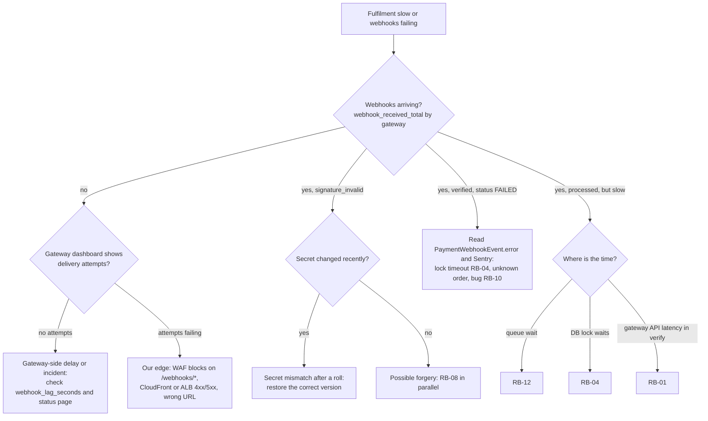
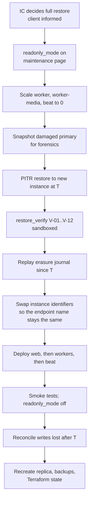

# Runbooks

Purpose: step-by-step procedures for the incidents this platform is most likely to face. SRS §8.3 requires "detailed runbooks ... for common incident response scenarios (e.g., payment API failure, database performance degradation)". Every paging alert in [03 §7](03-observability-and-operations.md#7-alert-catalogue) links to one of these runbooks.

Status: Draft v0.1 (2026-10-21)

> **Hosting change (2026-10-27):** AWS is no longer the target ([ADR-0014](../adr/0014-portable-hosting-paas-and-self-hosted.md)). AWS service names, CLI commands, sizing and alarms in this document are superseded; read them through the mapping table in ADR-0014 and [Hosting and deployment](../architecture/05-hosting-and-deployment.md). The provider-neutral intent (controls, targets, procedures) still applies.

| | |
|---|---|
| Owner | Platform lead (Tech Lead until a platform role exists). Each runbook also names a domain owner |
| Audience | On-call engineers, Incident Commanders, Support lead, Finance lead, Moderator lead, Security lead |
| SRS anchors | §6.4 Instant allocation, §8.1 Latency, §8.2 Concurrency, §8.3 Availability (runbooks, restore testing), §9.1 Data encryption, §9.2 Credit integrity, §9.3 Payment compliance |
| Requirement IDs | NFR-AVAIL-01.2, NFR-AVAIL-01.3, NFR-AVAIL-01.8, NFR-SEC-02.5, NFR-OBS-01.4 |
| Backlog | US-706 (restore drill), US-707 (runbooks, game day), US-708 (alerts), US-711 (hypercare) |
| Related | [01 Security](01-security-and-compliance.md) · [02 NFR performance](02-nfr-performance-and-scalability.md) · [03 Observability and operations](03-observability-and-operations.md) · [05 Privacy](05-privacy-and-data-protection.md) · [Credit wallet and ledger](../design/02-credit-wallet-and-ledger.md) · [Payments](../design/07-payments-and-credit-purchase.md) · [Notifications](../design/08-notifications.md) · [Infrastructure](../architecture/04-infrastructure-and-deployment.md) |

> Command, task and switch names follow the indicative names in [03](03-observability-and-operations.md) (`audit_wallets`, `ops-run`, `dbdiag`, `reveal_enabled`, and so on). They are fixed in the owning app's story. When a name changes, this document changes in the same PR (Definition of Done). SRS section numbers follow the SRS table of contents (3.x–12.x).

---

## 1. How to use these runbooks

### 1.1 Runbook index

| ID | Runbook | Paged by | Default severity | Domain owner | Required by |
|---|---|---|---|---|---|
| RB-01 | [Payment gateway outage or API failure](#rb-01-payment-gateway-outage-or-api-failure) | AL-21 | SEV2 | Payments owner + Finance lead | SRS §8.3 ("payment API failure"), US-707 |
| RB-02 | [Webhook backlog or delayed fulfilment](#rb-02-webhook-backlog-or-delayed-fulfilment) | AL-16 to AL-20, AL-23 | SEV2 | Payments owner | SRS §6.4, US-707 |
| RB-03 | [Ledger audit mismatch or hash-chain break](#rb-03-ledger-audit-mismatch-or-hash-chain-break) | AL-11 to AL-15 | **SEV1** | Tech Lead + Finance lead | SRS §9.2, NFR-SEC-02.5, US-707 |
| RB-04 | [Database performance degradation](#rb-04-database-performance-degradation) | AL-05 to AL-08, AL-31 to AL-35 | SEV2 | Platform | SRS §8.3 ("database performance degradation"), US-707 |
| RB-05 | [Redis (Valkey) outage](#rb-05-redis-valkey-outage) | AL-36 to AL-38 | SEV2 | Platform | US-707 |
| RB-06 | [Email provider failure or bounce spike](#rb-06-email-provider-failure-or-bounce-spike) | AL-39 to AL-41, AL-56 | SEV2 / SEV3 | Platform + Support lead | SRS §5.5, US-707 |
| RB-07 | [SMS OTP failure or SMS pumping](#rb-07-sms-otp-failure-or-sms-pumping) | AL-42, AL-43 | SEV3 / SEV2 | Platform | SRS §3.2, US-707 |
| RB-08 | [Credential leak or security incident](#rb-08-credential-leak-or-security-incident) | AL-13 (mismatch), AL-15, AL-47 to AL-49, external report | SEV1 / SEV2 | Security lead | [01 §11](01-security-and-compliance.md#11-incident-response) |
| RB-09 | [Suspicious credit farming or fraud spike](#rb-09-suspicious-credit-farming-or-fraud-spike) | AL-22, AL-45, AL-46 | SEV3 / SEV2 | Moderator lead + PO | Known issue #6, US-606 |
| RB-10 | [Bad deploy rollback](#rb-10-bad-deploy-rollback) | AL-01, AL-02, AL-09, AL-52, AL-53 | SEV2 | Release owner | US-707 |
| RB-11 | [Restore from backup (drill and real)](#rb-11-restore-from-backup-drill-and-real) | AL-54, AL-55, or an IC decision | SEV1 (real) / planned (drill) | Platform | SRS §8.3, US-706, US-707 |
| RB-12 | [Celery or outbox backlog](#rb-12-celery-or-outbox-backlog) | AL-10, AL-25 to AL-30, AL-38 | SEV2 / SEV3 | Platform | US-707 |
| RB-13 | [Credential stuffing, bot or L7 attack](#rb-13-credential-stuffing-bot-or-l7-attack) | AL-44, AL-51 | SEV2 | Security lead | US-707 |
| RB-14 | [Regional outage and DR failover](#rb-14-regional-outage-and-dr-failover) | AWS Health event, AL-04 from every location | SEV1 | Tech Lead + client | [03 §12](03-observability-and-operations.md#12-disaster-recovery) |

**Symptom finder** (for reports from users, Support or the client):

| What people report | Start with | Then consider |
|---|---|---|
| "I can't buy credits" / payment page error | RB-01 | RB-05 (checkout rate limiter fails closed), RB-10 |
| "I paid but have no credits" | RB-02 | RB-12, RB-04 |
| "Show Number fails" / "you have not been charged" errors | RB-04 | RB-05, RB-03, RB-10 |
| Balance looks wrong, credits missing | RB-03 (if the audit agrees) | RB-02 (purchases), RB-09 (frozen wallet) |
| Site slow or timing out | RB-04 | RB-13, RB-10, RB-05 |
| Everyone logged out, or random 500s on every page | RB-05 | RB-10 |
| Emails (receipts, verification) not arriving | RB-06 | RB-12 |
| SMS codes not arriving | RB-07 | RB-13 |
| Many new accounts revealing the same listings | RB-09 | RB-13 |
| Whole site down from everywhere | RB-10 (if right after a deploy) | RB-14, RB-04 |

### 1.2 Runbook format

Every runbook follows the same layout, so the on-call engineer always knows where to look:

| Part | Content |
|---|---|
| Header table | Default severity, alerts, dashboards, kill switches, escalation, rehearsal |
| **Symptoms** | What alerts, dashboards and users show |
| **Impact** | Who is affected and what is at risk (money, data, SLOs) |
| **Triage** | Numbered diagnostic steps. Read-only unless marked **[CHANGE]** |
| **Mitigation** | Decision table: cause → action → who may do it |
| **Recovery and verification** | How to return to normal, and the evidence that you have |
| **Communications** | Who to tell, using the templates in [Appendix A](#appendix-a-communication-templates) |
| **Postmortem focus** | Questions the review must answer, in addition to the template in [Appendix C](#appendix-c-post-incident-review-template) |

**[CHANGE]** marks a step that changes production. Each one names who may run it. Every switch flip and `ops-run` command is recorded automatically in `core.AuditLog` and the workflow log; the IC also notes it in the incident timeline.

### 1.3 Tools and access

| Tool | Used for | Who | Control |
|---|---|---|---|
| Dashboards DB-01 to DB-12 ([03 §5](03-observability-and-operations.md#5-dashboards)) | First look in every runbook | On-call | Read-only |
| CloudWatch Logs Insights, X-Ray, Sentry | Correlating by `request_id`, `trace_id`, `release` | On-call | Read-only `oncall` permission set (IAM Identity Center, MFA) |
| RDS Performance Insights | DB load and wait events | On-call | Read-only |
| Ops console `/ops/jobs/` | Queue depths, outbox pending/dead, retry dead outbox rows, last run per beat schedule | On-call (staff account with MFA) | AuditLog |
| Ops console `/ops/flags/` | Kill switches ([03 §14.3](03-observability-and-operations.md#143-operational-kill-switches)) | `superadmin`; Finance for payment switches | Mandatory reason, AuditLog, posted to `#rpl-ops` |
| Ops console `/ops/finance/ledger-audit/`, `/ops/finance/payments/` | Audit runs and discrepancies; stuck orders; reconciliation runs | Finance, Tech Lead | AuditLog |
| `ops-run <env> -- manage.py <command> <args>` | Allow-listed management commands as a one-off ECS task from the current prod digest. `ops-run` is the CLI name used here for the `ops-task.yml` workflow ([infrastructure §16](../architecture/04-infrastructure-and-deployment.md#16-operational-access)) | On-call engineers | **Second-engineer approval** in GitHub; actor recorded in AuditLog |
| `dbdiag <report>` (an `ops-run` command) | Read-only DB diagnostics: `activity`, `blocking`, `long-tx`, `top-statements`, `waits`, `vacuum`, `xid-age`, `replication`, `connections`. Prints query **IDs and normalised text** from `pg_stat_statements`, never raw `pg_stat_activity.query` (raw text can contain bound literal values, that is, PII) | On-call | Runs as `rpl_dba_oncall` (`pg_monitor` + `pg_signal_backend`, no table access; [03 P-OPS-09](03-observability-and-operations.md#18-deviations-and-proposed-changes)) |
| `dbdiag cancel --pid <pid>` / `dbdiag terminate --pid <pid>` | Cancel or terminate one backend **[CHANGE]** | On-call | Approval; refuses `rpl_migrator` sessions unless `--force-migration` is given with IC approval |
| AWS console / CLI via the `oncall` permission set | ECS desired count, force new deployment, task-definition rollback; RDS describe, snapshot; ElastiCache describe; WAF IP sets and rule actions | On-call | CloudTrail. Console changes are reconciled into Terraform within 24 h ([03 OP-5](03-observability-and-operations.md#11-principles)) |
| Gateway dashboards (Stripe, PayPal) | Status, webhook deliveries and resends, refunds, key rolls | Finance lead; Payments owner (read) | Gateway MFA |
| Twilio console, SES console or Mailgun dashboard | Verify geo permissions and Fraud Guard; sending status, suppression | Platform | Provider MFA |
| Break-glass | Sealed Superadmin credential; DB break-glass IAM role; ECS Exec in prod | IC-approved, SEV1/SEV2 only | Incident ticket required; pages the Tech Lead; reviewed afterwards ([01 §6.9](01-security-and-compliance.md#69-ops-console-and-admin-hardening)) |

There is **no** SSH, no bastion host, no ECS Exec in prod outside break-glass, and no ad-hoc SQL against production ([03 §15.6](03-observability-and-operations.md#156-production-data-fixes)).

**Allow-listed `ops-run` commands used by these runbooks**

| Command | Purpose | Mutates? | Runbooks |
|---|---|---|---|
| `waffle_switch <name> on\|off --reason "<text>"` | Flip a kill switch | Yes | All |
| `audit_wallets --wallet <public_id>` / `--mode INCREMENTAL\|FULL` | On-demand ledger audit (single wallet runs on the primary) | Writes audit rows only | RB-03, RB-10, RB-11 |
| `verify_ledger_chain --wallet <public_id>` / `--all` | Hash-chain verification | No | RB-03, RB-11 |
| `verify_anchors --up-to <ts>` | Compare chains against WORM anchors | No | RB-03, RB-08, RB-11 |
| `anchor_ledger` | Re-run the daily anchor | Writes an anchor | RB-03 |
| `reconcile_order <order_public_id>` | Verify one order at the gateway and fulfil, fail or leave it | Yes (idempotent) | RB-01, RB-02 |
| `reconcile_pending_orders --gateway <G> --since <ts>` | Sweep on demand | Yes (idempotent) | RB-01, RB-02 |
| `reconcile_daily --date <d> --mode ON_DEMAND` | Three-way reconciliation | Writes run rows | RB-02, RB-03, RB-11 |
| `reconcile_orders --from-gateway --since <ts>` | Recreate orders known to the gateway but missing locally (after a restore) | Yes | RB-11, RB-14 |
| `retry_webhook_events --status FAILED --since <ts>` | Reprocess stored webhook events | Yes (idempotent) | RB-02 |
| `outbox_retry --status DEAD --topic <t> --since <ts>` | DEAD → PENDING | Yes (idempotent consumers) | RB-06, RB-12 |
| `cache_flush --cluster cache [--prefix s:]` | Flush the cache cluster or one key prefix. **Refuses the broker cluster** | Yes | RB-05 |
| `reprocess_stuck_images --since <ts>` | Re-enqueue images stuck in `PROCESSING` | Yes (idempotent) | RB-05, RB-12 |
| `revoke_user_sessions --user <public_id>` / `--all-users` | End sessions | Yes | RB-08, RB-13 |
| `grant_deferred_promos --dry-run` | Catch-up for `signup_promo_enabled` deferrals | Yes (idempotent via unique constraint) | RB-09 |
| `restore_verify --target-time <ts>` (`--sandbox` enforced) | Restore checks V-01 to V-12 ([03 §11.4](03-observability-and-operations.md#114-verification-checklist)) | No | RB-11, RB-14 |
| `privacy_journal_replay --since <ts>` | Re-apply erasures after a restore ([05 §6.6](05-privacy-and-data-protection.md#66-backups-and-the-erasure-journal)) | Yes | RB-11, RB-14 |
| `ledger_diff --wallet <public_id> --against <host>` (**proposed**) | Compare a wallet's ledger with a forensic restore | No | RB-03 |
| `credits_repair_wallet_head --wallet <public_id> --dry-run` (**proposed**, D2 class) | Recompute a wallet's head from an intact ledger | Yes (maker-checker) | RB-03 |
| `notifications_unsuppress --since <ts> --reason HARD_BOUNCE --provider-incident <id> --dry-run` | Remove suppressions created by a provider fault | Yes | RB-06 |

### 1.4 The first 15 minutes of any incident

1. **Acknowledge** the page within the target (SEV1 5 min, SEV2 15 min; [03 §8.1](03-observability-and-operations.md#81-severity-levels)).
2. **Open the incident:** create `#inc-<yyyymmdd>-<slug>` in Slack (a **private** channel for anything that may be a security or personal-data incident). Post the alert link. You are the Incident Commander until you hand over.
3. **Set the severity** using 03 §8.1. When unsure, pick the higher one. Anything touching credits, payments or personal data starts at SEV2 or higher.
4. **Check for a recent change:** deploy annotations on DB-01, the Sentry release page, `#rpl-ops` (switch flips, Terraform applies), AWS Health, and the provider status feeds ([03 §9.4](03-observability-and-operations.md#94-dependency-status)). If a release went out in the last 60 minutes, run RB-10's correlation check in parallel.
5. **Open the runbook** linked from the alert and follow it. If no runbook fits, follow the closest one and say so in the channel.
6. **Assign roles** for SEV1/SEV2: IC, operator (types the commands), scribe, communications. One person can hold two roles in a small team, but the IC never also runs a production deploy.
7. **First update** within 15 minutes (SEV1) or 30 minutes (SEV2), using the Appendix A template. Then keep the cadence in §1.5.

### 1.5 Communications

| Severity | Internal update cadence | Client | Status page | Users |
|---|---|---|---|---|
| SEV1 | Every 30 min in the incident channel + `#rpl-ops` summary | Within 30 min, then every 30 min | Yes, within 30 min | In-app banner if the product shows wrong information or a core journey fails |
| SEV2 | Every 60 min | Within 1 h | If users can see the problem | Banner or toast copy from Appendix A |
| SEV3 | Daily | Weekly report | No | Support macro only |
| SEV4 | Ticket | No | No | No |

Rules:

- **No PII in Slack, tickets, the status page or the postmortem.** Use public UUIDs (`user_public_id`, `order_public_id`), request IDs and counts. If you need to look at personal data, do it in the ops console (masked by default, audited; [05 §9](05-privacy-and-data-protection.md#9-audit-logging-of-staff-access-to-pii)).
- Security incidents: details stay in the private channel. Public wording is approved by the client's legal contact (OQ-SEC-08).
- Messages to users never blame a named provider and never promise a time we don't control.
- The status page tool is OQ-OPS-04 (default: a hosted page with manual updates).

### 1.6 Global safety rules

1. **Integrity beats availability on the money path** ([03 OP-7](03-observability-and-operations.md#11-principles)). If in doubt, stop the operation (switch off) rather than let it run with uncertain correctness. Users must always see "you have not been charged" when a debit fails.
2. **Never edit ledger history.** No `UPDATE` or `DELETE` on `credits_*` or `core_auditlog`, by anyone, for any reason. Corrections are new entries (`REVERSAL`, or an `ADMIN_ADJUSTMENT` through maker-checker).
3. **Never grant purchased credits by hand.** A missing purchase is fixed by fulfilling the **order** (`reconcile_order`), so that every `PURCHASE` entry maps to a paid order. A manual `ADMIN_ADJUSTMENT` for a purchase would be double-counted when the order is later fulfilled, and reconciliation would flag it (`PURCHASE_WITHOUT_ORDER`).
4. **No ad-hoc SQL** against production. Read-only diagnostics go through `dbdiag`; data fixes are reviewed D2 commands ([03 §15.6](03-observability-and-operations.md#156-production-data-fixes)).
5. **Never purge the `critical` or `default` Celery queues.** Outbox-backed work is recovered from PostgreSQL; purging only loses non-outbox tasks.
6. **Preserve evidence before you eradicate** when tampering or a breach is possible (manual RDS snapshot, log export; [01 §11.2](01-security-and-compliance.md#112-notification-obligations-depends-on-launch-markets-oq-a-1)).
7. **Switch flips are temporary.** Every switch changed during an incident is listed in the timeline, and switching it back is an explicit recovery step.
8. **Don't restart the database as a first response.** A reboot of a Multi-AZ primary costs 60–120 s of errors and destroys the evidence in `pg_stat_activity`.

---

## RB-01 Payment gateway outage or API failure

| | |
|---|---|
| Default severity | SEV2 (one gateway down, the other working). SEV1 if both are down for more than 60 min at a time the client designates as peak |
| Alerts | AL-21 (checkout or verification error ratio > 20 %, or breaker open). Related: AL-16, AL-22, SYN-04 |
| Dashboards | DB-04 Payments, DB-01 |
| Kill switches | `payments_stripe_enabled`, `payments_paypal_enabled`, `purchases_enabled` |
| Escalation | Finance lead (always); gateway support if the status page shows nothing after 30 min |
| Rehearsal | M5 game day with adapter fault injection on staging (Appendix D) |

**Symptoms**

- `payment_gateway_errors_total{gateway, op, kind}` rising; adapter circuit breaker `open` (span attribute `breaker_state`).
- Purchase Credits shows "The payment provider is temporarily unavailable" for one gateway; orders end `FAILED (GATEWAY_ERROR)` or stay `CREATED`.
- Return pages stay on "Confirming your payment…" because `confirm_return` cannot reach the gateway.
- Support tickets: "Payment page won't open".

**Impact**

- New purchases on that gateway fail. Users can still pay with the other gateway (NFR-AVAIL-01.8).
- Payments already made may not be verified on the return path, so fulfilment relies on webhooks and the 5-minute sweep. SLO-05 (≤ 5 s allocation) is at risk.
- Show Number keeps working for users with a balance. Revenue is lost for the duration.

**Triage**

1. Identify the gateway and operation on DB-04 (`op` = `create_checkout`, `verify_payment`, `capture`). Is it one gateway or both?
2. Read the error kind in Sentry and logs (`payments.gateway.*` events):

   | `kind` | Most likely cause | Next step |
   |---|---|---|
   | `timeout`, `5xx`, `connection` on one gateway only | Gateway incident | Step 3 |
   | `auth` (401/403) | API key revoked, expired, rolled without updating Secrets Manager, or the wrong environment key | Step 4 |
   | `connection` on **all** external adapters (Stripe, PayPal, Twilio, SES, maps) | Our egress: NAT gateway, route table, security group, DNS | Step 5 |
   | `validation` / `4xx` after a release | Our request changed (bad deploy) | RB-10 |
   | `rate_limited` (429) | Our request volume (a retry loop, card-testing traffic) | RB-09 (card testing), fix the loop |

3. Check the gateway status page (Stripe: status.stripe.com; PayPal: its developer status page) and the `#rpl-ops` provider feed. Note the provider's incident reference in the timeline.
4. For `auth` errors: compare the Secrets Manager version date for `rpl/prod/stripe-secret-key` (or the PayPal client secret) with recent changes. Was a key rolled in the gateway dashboard without updating the secret? If nobody on the team rolled it, treat the key as possibly compromised and **also start RB-08**.
5. For egress failures: check NAT gateway `ErrorPortAllocation` and `PacketsDropCount` per AZ (DB-08 / VPC metrics), recent Terraform applies to the network module, and AWS Health. One AZ's NAT failing affects only tasks in that AZ; the pattern is "errors from some tasks only".
6. Check whether `confirm_return` is also failing (payments may be completing at the gateway without us seeing them). Count orders in `PENDING` for more than 10 minutes on DB-04 (`payment_orders_pending{age_bucket}`).

**Mitigation**

| Situation | Action | Who |
|---|---|---|
| One gateway down; breaker already open and stable | Nothing extra: the breaker hides that gateway and the other is offered. Post the status update | On-call |
| One gateway down; breaker flapping (users alternate between working and failing) | **[CHANGE]** `waffle_switch payments_<gateway>_enabled off --reason "INC-…"` for a stable experience. Webhooks, return verification and reconciliation keep running for orders already started | On-call or Finance lead |
| Both gateways down | **[CHANGE]** `purchases_enabled off`. Purchase Credits shows "Purchases are temporarily unavailable. Your credits are safe." Reveal stays available | IC |
| API key revoked or rolled | **[CHANGE]** Roll a new key in the gateway dashboard (Finance), store it as a new Secrets Manager version, then `aws ecs update-service --cluster rpl-prod --service web --force-new-deployment` and the same for `worker` (tasks read secrets at start). If compromise is possible, follow RB-08 for the key | Finance lead + on-call |
| Egress failure | AWS issue: follow AWS Health and open an AWS Support case. Our change: revert the Terraform change (RB-10 logic applies to infrastructure too) | On-call |
| Our request is malformed after a release | RB-10 (roll back or flag off) | Release owner |

**Do not** grant credits by hand to users who say they paid (§1.6 rule 3). Use `reconcile_order <order_public_id>` once the gateway API answers again.

**Recovery and verification**

1. When the gateway reports recovery and the breaker has closed (or test calls succeed from staging), **[CHANGE]** switch the gateway or `purchases_enabled` back on.
2. **[CHANGE]** `ops-run prod -- manage.py reconcile_pending_orders --gateway <G> --since <incident start>` to fulfil anything paid during the outage without waiting for the regular sweep.
3. Verify on DB-04: checkout success ratio back to the 7-day baseline for 30 minutes; `payment_orders_pending{age_bucket=">60m"}` back to its normal level; AL-17 not firing.
4. Finance reviews `NEEDS_REVIEW` orders created during the window (`/ops/finance/payments/`).
5. The next daily reconciliation (or `reconcile_daily --mode ON_DEMAND` for today) shows no `PAID_NOT_FULFILLED` for the window.

**Communications**

- Status page: "Card payments via <method> are temporarily unavailable. Other payment methods work. Your existing credits are not affected."
- Support macro: users who paid and were not credited will be credited automatically once the provider confirms; they must not pay again. Users who paid twice (retried on the other gateway) are refunded by Finance on request.

**Postmortem focus**

Did the breaker open fast enough, and did users see a stable choice? How long did paid orders wait for fulfilment, and did SLO-05 burn? Was the key roll (if any) part of a documented procedure?

---

## RB-02 Webhook backlog or delayed fulfilment

| | |
|---|---|
| Default severity | SEV2. AL-17 (paid but not fulfilled after 15 min) always involves Finance |
| Alerts | AL-16 (allocation p99 > 5 s), AL-17, AL-18 (webhook silence), AL-19 (processing failing), AL-20 (signature failures), AL-23 (reconciliation mismatch) |
| Dashboards | DB-04 (fulfilment latency by path, webhook received/failed/duplicate, webhook lag, pending orders by age), DB-06 |
| Kill switches | None specific. `purchases_enabled` only if fulfilment is broken for every path |
| Escalation | Finance lead; Security lead if signatures fail without a known secret change |
| Rehearsal | M5 game day: wrong webhook secret on staging (Appendix D) |

**Symptoms**

- Users stay on "Confirming your payment…" longer than 5 s; tickets "I paid but have no credits".
- `payment_fulfillment_latency_seconds` p99 > 5 s; `path` mix shifts from `webhook`/`return` to `reconcile`.
- Gateway dashboards show failed webhook deliveries to our endpoint.

**Impact**

SRS §6.4 (allocation within 5 s) is breached for affected payments. Money has been taken but credits are not yet visible. Because the return-URL check also fulfils orders ([payments §11](../design/07-payments-and-credit-purchase.md#11-fulfilment-and-instant-allocation--5-s-srs-64-critical)), a webhook-only problem mainly affects users who closed the tab before returning.

**Triage**



1. On DB-04, read `webhook_received_total{gateway, outcome}` for the last hour.
2. **Not arriving:** in the gateway dashboard, open our webhook endpoint and read the recent delivery attempts and their HTTP status. Then check WAF sampled requests for `/webhooks/` (a new managed-rule version can block a gateway payload) and ALB/CloudFront 4xx/5xx on that path.
3. **Signature failures:** compare the time of the first failure with Secrets Manager version changes for the webhook secret and with gateway-side secret rolls. Stripe endpoint secrets support an overlap period when rolled; a roll with immediate expiry and no secret update causes exactly this pattern. For PayPal, check that the webhook ID in our configuration matches the registered webhook.
4. **Processing failures:** list failed events in `/ops/finance/payments/` (event type, error, attempts). Group by error. Typical errors: lock timeout (RB-04), `unknown_order` (an event for an order we never created, for example from a different environment sharing the gateway account), `amount_mismatch` (order goes to `NEEDS_REVIEW` by design).
5. **Slow processing:** compare `webhook_lag_seconds` (gateway delay, outside our control) with the time between `received_at` and fulfilment (ours).

**Mitigation**

| Cause | Action | Who |
|---|---|---|
| Gateway delivering late | Nothing to fix on our side. **[CHANGE]** `reconcile_pending_orders --gateway <G> --since <ts>` every 15 min during the incident if the regular 5-minute sweep is not enough | On-call |
| WAF blocking webhooks | **[CHANGE]** Add a scoped exception for the webhook path and the specific rule (never disable the whole managed rule group). Reconcile into Terraform within 24 h | On-call |
| Wrong secret after a roll | **[CHANGE]** Put the correct secret version back (Secrets Manager `AWSCURRENT` stage) and force a new deployment of `web`. Then ask the gateway to resend failed events, or rely on its automatic retries (Stripe retries live-mode events for up to 3 days; PayPal up to 25 times over 3 days) | On-call + Finance lead |
| Processing error from a bug | RB-10 (roll back or fix forward), then **[CHANGE]** `retry_webhook_events --status FAILED --since <ts>` | Release owner |
| Lock timeouts in fulfilment | RB-04 | On-call |
| Critical queue backlog | RB-12 | On-call |

Replaying events is always safe: `PaymentWebhookEvent(gateway, event_id)` is unique and fulfilment is idempotent on `(gateway, gateway_payment_id)`. A gateway pull (`reconcile_order`) is preferred over a push replay, because it reads the current state instead of an old event.

**Recovery and verification**

1. `payment_orders_pending` back to its baseline; no order verified as paid is older than 15 minutes (AL-17 clear).
2. **[CHANGE]** `reconcile_daily --date <today> --mode ON_DEMAND`: 0 `PAID_NOT_FULFILLED` for the window.
3. Receipt emails for orders fulfilled late were sent (outbox `payment.succeeded` rows `DISPATCHED`).
4. Finance closes the `NEEDS_REVIEW` items created by the incident.

**Communications**

Support macro: "Your payment was received. Credits can take a little longer than usual to appear today; they will be added automatically. Please don't pay again." If a user paid twice, Finance refunds the duplicate at the gateway (the refund webhook reverses the credits).

**Postmortem focus**

Which path fulfilled the delayed orders (webhook, return or reconcile)? Was the 5 s SLO breach caused by us or by the gateway's delivery lag? If a secret roll caused it, why did the rotation procedure ([01 §7.3](01-security-and-compliance.md#73-key-rotation)) not prevent the gap?

---

## RB-03 Ledger audit mismatch or hash-chain break

| | |
|---|---|
| Default severity | **SEV1** for AL-11, AL-13 (mismatch), AL-15. SEV2 for AL-14. SEV3 for AL-12 and AL-13 (anchor job failure) |
| Alerts | AL-11 (any audit mismatch), AL-12 (audit did not complete), AL-13 (anchor failure or `ANCHOR_MISMATCH`), AL-14 (integrity constraint or ledger trigger rejected a write), AL-15 (ledger protection changed) |
| Dashboards | DB-09 Integrity, DB-02, DB-03; ops `/ops/finance/ledger-audit/` |
| Kill switches | `reveal_enabled`, `purchases_enabled`, `readonly_mode` |
| Escalation | Tech Lead + Finance lead immediately. Security lead for `ANCHOR_MISMATCH`, `PREV_HASH`/`ENTRY_HASH`/`SEQ_GAP`, `PURCHASE`/`ADMIN_ADJUSTMENT` orphans, and every AL-15 |
| Rehearsal | M4 tamper drill on staging; M7 game day (Appendix D). Mandatory walk-through before joining on-call ([03 §8.4](03-observability-and-operations.md#84-on-call-prerequisites)) |

**Symptoms**

- `ledger_audit_mismatches_total` increased; a `LedgerAuditRun` in status `FAILED` with `LedgerAuditDiscrepancy` rows; DB-09 is red.
- Affected wallets are already `FROZEN` with `frozen_reason = AUDIT_MISMATCH` (automatic, [credit design §11.3](../design/02-credit-wallet-and-ledger.md#113-alerting-and-discrepancy-handling)); those users see "Your credits are on hold".
- A moderation case for Finance was opened by the `credits.audit_mismatch` outbox message.

**Impact**

The SRS §9.2 integrity guarantee is in doubt for at least the affected wallets. Possible causes range from a code defect to deliberate tampering by someone with database privileges. Until the cause is known, assume the problem may be wider than the wallets found so far.

**Triage**

1. **Declare SEV1** (or confirm the severity from the table above). Page the Tech Lead and Finance lead. For the codes marked "security" below, page the Security lead and **open RB-08 in parallel** in a private channel.
2. **Read the run** in `/ops/finance/ledger-audit/`: run ID, mode, `check_code` per discrepancy, number of wallets, first and last affected entry IDs, `app_release` of the affected entries.
3. **Classify** using this table:

   | `check_code` | What it means | Likely causes, in order | Security? |
   |---|---|---|---|
   | `BALANCE_SUM`, `HEAD_SEQ`, `HEAD_HASH` with a valid chain | The wallet row disagrees with an intact ledger | Deferred consistency trigger disabled or bypassed; direct `UPDATE` on the wallet with triggers off | Yes, until proven otherwise (the trigger should make this impossible) |
   | `ARITHMETIC` | `balance_before`/`balance_after` sequence broken | Tampering with triggers disabled; trigger defect | Yes |
   | `SEQ_GAP` | Missing or duplicated `seq` | Row deleted (append-only trigger bypassed) | **Yes** |
   | `PREV_HASH`, `ENTRY_HASH` | Hash chain does not verify | (a) A release changed canonical serialisation (FM-09), seen as **many wallets, all entries after one release**; (b) tampering, seen as **few wallets, specific rows** | (a) no, (b) **yes** |
   | `ANCHOR_MISMATCH` | History differs from the WORM anchor | Rewritten history with recomputed hashes; or a restore from backup without a recorded restore epoch ([03 §12.3](03-observability-and-operations.md#123-reconciliation-after-a-restore-that-loses-data)) | **Yes**, unless a restore explains it |
   | `ORPHAN_REFERENCE` on `PURCHASE`, `ADMIN_ADJUSTMENT` or `LOADTEST` | Credits created without a paid order, an approved request, or in prod | Forged append by compromised code or credentials (Security T-05) | **Yes** |
   | `ORPHAN_REFERENCE` on `CONTACT_REVEAL` or `SIGNUP_PROMO` | Debit without a `ContactReveal`, promo without a claim | Code defect in a service transaction | No (SEV2) |

4. **Confirm on the primary** for one affected wallet: `ops-run prod -- manage.py audit_wallets --wallet <public_id>` and `verify_ledger_chain --wallet <public_id>`. (The nightly job already re-checks replica findings on the primary; this confirms the finding is current.)
5. **Look for privileged activity** in the window between the last `PASSED` run (or the last valid anchor) and now:
   - pgAudit DDL and role events (Logs Insights query in [Appendix B.6](#b6-pgaudit-ledger-protection-events)): `DISABLE TRIGGER`, `DROP TRIGGER`, `ALTER TABLE credits_*`, `GRANT`, `SET ROLE`.
   - CloudTrail: `ModifyDBInstance` (master password reset), `ModifyDBParameterGroup`, `RestoreDBInstance*`, break-glass role assumptions, Secrets Manager `GetSecretValue` on DB secrets by humans.
   - `core.AuditLog` for `credits.adjustment_approved` and `flags.switch_changed` in the window.
6. **Look for a code cause:** releases deployed in the window (`app_release` on the affected entries points to the release that wrote them); golden-vector test history; any `hash_version` change.
7. **Estimate the blast radius:** if the cause could affect other wallets (code defect, privileged access), **[CHANGE]** start `audit_wallets --mode FULL` (replica, about 3 h at 40 M entries) and `verify_anchors --up-to <now>`. Continue with containment while it runs.

**Containment**

| Situation | Action | Who |
|---|---|---|
| A few wallets, cause understood, not security | Keep the automatic freezes. No global action | IC |
| Cause unknown, or more than about 20 wallets, or still growing | **[CHANGE]** `reveal_enabled off` and `purchases_enabled off`: no new user-initiated ledger writes. Webhooks for payments already made still fulfil, so customers who paid are not left without credits; reconsider if the suspected cause is the fulfilment path itself | IC with Tech Lead |
| Suspected forged appends through compromised code or credentials | **[CHANGE]** `readonly_mode on` (stops all user writes) and follow RB-08 containment: rotate DB credentials, revoke break-glass, redeploy from a known-good digest | IC + Security lead |
| Any security code | **Preserve evidence first**: manual snapshot `aws rds create-db-snapshot --db-instance-identifier rpl-prod-db --db-snapshot-identifier rpl-prod-inc-<id>-<yyyymmddhhmm>`; export pgAudit, application and CloudTrail logs for the window to the incident S3 prefix (Object Lock) | Security lead |

**Diagnosis tools**

- **Forensic restore:** restore a PITR copy to a time before the first bad entry (RB-11, "forensic restore" variant; never connected to workers or beat). Compare the affected wallets with `ledger_diff --wallet <public_id> --against <restored-host>` (**proposed** read-only command). The anchors in the security account show which version of each chain existed at each anchor time.
- **Release replay:** check out the release in `app_release`, run the golden vectors ([credit design §5.6](../design/02-credit-wallet-and-ledger.md#56-versioning-and-golden-vectors)) and the affected entries' canonical serialisation locally with fixture data (no production data leaves the account).

**Repair** (never `UPDATE` or `DELETE` ledger rows)

| Finding | Repair | Approval |
|---|---|---|
| Ledger intact, wallet head wrong (`BALANCE_SUM`/`HEAD_*` with a valid chain), cause found and closed | **Proposed addition:** `credits_repair_wallet_head --wallet <id> --dry-run`, then apply. It recomputes `balance`, `head_seq`, `head_hash` from the ledger in one transaction under the wallet lock; the deferred trigger checks the result at commit; `AuditLog credits.wallet_head_repaired` with before/after values (not PII) | D2 class: Tech Lead + Finance lead |
| Unauthorised credit entries (forged `PURCHASE`/`ADMIN_ADJUSTMENT`) | Leave the forged entry as evidence. Append a `REVERSAL` (`reason_code = CORRECTION` or `FRAUD_CLAWBACK`) through `reverse_entry` with maker-checker. Credits already spent from forged entries are a loss: record the shortfall as for chargebacks | Finance maker + different Finance checker |
| Valid entries whose hash was computed by a defective release | Fix forward in code. The stored rows stay as they are. **Proposed:** register the affected entry-ID range in a versioned verifier exception list in code (with an ADR), so the verifier applies the defective serialisation to exactly those rows. Chain continuity is unaffected, because later entries link to the stored `entry_hash` | ADR + Tech Lead |
| History rewritten (anchor mismatch confirmed) | Security incident (RB-08). The correct history is reconstructed from the forensic restore and anchors. Whether to cut over to a restored copy (RB-11) or append compensating entries is decided by the IC, Security lead and Finance lead together | IC + Security + Finance |
| `ORPHAN_REFERENCE` from a code defect (debit without `ContactReveal`) | Fix the defect (RB-10 or hotfix). Refund the affected users with `REVERSAL` (reason `CORRECTION`) if they were charged without receiving the contact | Support maker + Finance checker |

**AL-12 (audit did not complete) and AL-13 (anchor job failed)**

1. Read the `LedgerAuditRun` row in status `ERROR` (summary holds the exception and cursor) or the missing run.
2. Usual causes: the `maintenance` worker process down (RB-12), beat missing (AL-30), the replica unavailable or lagging, a statement timeout on a large wallet, the cross-account anchor role or bucket policy changed.
3. **[CHANGE]** Re-run: `audit_wallets --mode INCREMENTAL` (resumes from the stored cursor) or `anchor_ledger`. The audit must complete before the anchor runs.
4. A missed run is SEV3. Two consecutive missed nights become SEV2: integrity is unverified.

**Recovery and verification**

1. On-demand audit of every affected wallet returns `PASSED`; `verify_ledger_chain` valid; `verify_anchors --up-to <now>` valid.
2. Each `LedgerAuditDiscrepancy` is closed with `resolved_by` and a resolution note linking the incident.
3. Finance unfreezes the affected wallets with a note (`credits.unfreeze_wallet` permission). A wallet frozen for a security cause stays frozen until the Security lead agrees.
4. **[CHANGE]** Switches back on (`reveal_enabled`, `purchases_enabled`, `readonly_mode off`) in that order, watching DB-02 for 15 minutes after each.
5. The next scheduled full audit passes.

**Communications**

- Client within 30 minutes (SEV1). Finance lead owns the financial narrative.
- Affected users already received the neutral "your credits are on hold" email at freeze time. When resolved: "Your credits are available again. Your balance is X." If their balance changed, Support explains the correction and references the transaction ID.
- If reveals or purchases were switched off: status page "Contact reveals and credit purchases are paused while we run a routine integrity check. Your credits are safe."

**Postmortem focus**

How did a write bypass the database controls (trigger, grants, CHECK)? Was the time from first bad entry to detection within one nightly cycle? Did the anchor detect what the chain alone could not? Was the freeze scope right?

---

## RB-04 Database performance degradation

| | |
|---|---|
| Default severity | SEV2 when a latency SLO is breached (AL-06, AL-07, AL-08) or connections are near the limit (AL-32, AL-33). SEV3 for early signals (AL-05, AL-31 first level, AL-34, AL-35 first level) |
| Alerts | AL-05 to AL-08, AL-31 to AL-35. Often together with AL-01/AL-02 |
| Dashboards | DB-08 Data tier, DB-02, DB-05, DB-01; RDS Performance Insights |
| Kill switches | `maintenance_jobs_paused`, `search_primary_fallback_enabled`, `search_cache_enabled` (keep on), `reveal_enabled` (last resort) |
| Escalation | Tech Lead after 30 min without a clear cause; AWS Support for instance or storage faults |
| Rehearsal | M7 game day: blocking transaction and a heavy query on staging (Appendix D) |

**Symptoms**

- Search (C2) or reveal (C1) p95 above 500 ms or 1,000 ms; `reveals_total{outcome="lock_timeout"}` rising.
- RDS CPU > 80 %, DB load above the vCPU line in Performance Insights, connections near `max_connections`, replica lag.
- Users: slow pages, "Something went wrong, you have not been charged" on Show Number.

**Impact**

SRS §8.1 latency targets breached. If lock timeouts rise, reveals fail closed (no charge, but no contact). Integrity is not at risk: the debit is protected by row locks and constraints, and timeouts roll back.

**Triage**

1. **Open Performance Insights** for `rpl-prod-db` (last 1 h). Read DB load by wait event and by SQL (the "Top SQL" view shows normalised statements):

   | Dominant wait | Typical meaning | Go to |
   |---|---|---|
   | `CPU` | Expensive queries, plan regression, or more traffic | Steps 3, 4 |
   | `IO:DataFileRead` | Working set no longer fits in memory, or a sequential scan | Step 3 |
   | `Lock:transactionid`, `Lock:tuple`, `Lock:relation` | Blocking: a long transaction, a migration, or a hot row | Step 2 |
   | `LWLock:*` (for example `LWLock:BufferMapping`, `LWLock:LockManager`) | Contention from very high concurrency or too many connections | Step 5 |
   | `IO:WALSync`, `IO:WALWrite` | Commit-heavy load (reveals, outbox) reaching storage limits | Step 6 |
   | `Client:ClientRead` with open transactions | Application holds transactions open (idle in transaction) | Step 2 |

2. **Blocking and long transactions:** `ops-run prod -- manage.py dbdiag blocking` and `dbdiag long-tx` (queries in [Appendix B](#appendix-b-diagnostic-queries)). Note the `application_name` (`web`, `worker`, `migrate`, `ops`) and transaction age of the blockers.
3. **Top statements:** `dbdiag top-statements --since 15m` (delta of `pg_stat_statements`). A new entry at the top after a deploy points to RB-10. A known statement that became slower points to a plan change (stale statistics, parameter-sensitive plan).
4. **Correlate:** deploy annotations; a `maintenance` job running (backfill, retention purge, re-encryption); a traffic spike on DB-01 (an attack: RB-13); the search replica lagging and search falling back to the primary (DB-05 "replica fallback count").
5. **Connections:** `dbdiag connections` (by `application_name` and state). A burst usually follows a `web` scale-out (each new task opens connections per thread, [02 §4.5](02-nfr-performance-and-scalability.md#45-db-connection-budget)).
6. **Storage and commit latency:** `WriteLatency`, `DiskQueueDepth`, IOPS against the gp3 provisioned values (DB-08).
7. **Hot wallet:** if lock waits are on `credits_creditwallet`, find the wallet from `credits.debit.lock_timeout` log events (`wallet_public_id`). One wallet receiving many concurrent reveals means a script (RB-09); check that the per-user reveal limiter is working (RB-05 if Valkey is down).
8. **Vacuum and XID age** (AL-35): `dbdiag xid-age` and `dbdiag vacuum`.

**Mitigation**

| Cause | Action | Who |
|---|---|---|
| A long transaction or stuck session blocks others | **[CHANGE]** `dbdiag cancel --pid <pid>`; if it doesn't end within 30 s, `dbdiag terminate --pid <pid>`. Then find out why it was open (code path from `application_name` and query ID) | On-call (approval) |
| The `migrate` task is waiting on a lock and queuing everything behind it | Should not happen (`lock_timeout 5s`, [03 §13.3](03-observability-and-operations.md#133-deployment-mechanics)). **[CHANGE]** Stop the migrate ECS task; the deploy fails safely (expand-only, old tasks keep serving) | Release owner |
| A batch or maintenance job is heavy | **[CHANGE]** `maintenance_jobs_paused on` (stops backfills, purges, re-encryption at the next batch; ledger audit and anchoring are not paused) | On-call |
| New slow query from a release | RB-10 (flag off or roll back) | Release owner |
| Plan regression from stale statistics | **[CHANGE]** `dbdiag analyze --table <name>` (allow-listed tables only) | On-call |
| Replica lagging, so search load moved to the primary | **[CHANGE]** `search_primary_fallback_enabled off`: search keeps reading the lagging replica (results a few minutes stale; hydration still re-checks `PUBLISHED`) | IC |
| Traffic spike from an attack | RB-13 | On-call |
| Connection exhaustion after scale-out | **[CHANGE]** Temporarily cap `web` max tasks in the autoscaling target; terminate idle connections of `idle` state older than 10 min (`dbdiag terminate --idle-older-than 10m --app web`). Follow-up: connection ladder step 2 or 3 ([02 §6.3](02-nfr-performance-and-scalability.md#63-connection-management-ladder)) | On-call |
| Legitimate load beyond capacity (CPU saturated, no single culprit) | **[CHANGE]** Scale the instance class up one size with `--apply-immediately` (Multi-AZ: the standby is modified first, then a failover of 60–120 s). IC approval; post a status update first. Add or enlarge a read replica for search | IC + Platform |
| Storage nearly full and autoscaling at its maximum | **[CHANGE]** Raise the maximum allocated storage (online). Then find the growth (table sizes, WAL from a stuck replication slot) | Platform |
| XID age above 1 billion | Find what blocks vacuum (long transactions, old replication slots, abandoned prepared transactions). **[CHANGE]** Remove the blocker, then run `VACUUM (FREEZE, VERBOSE)` on the oldest tables off-peak through a reviewed D2 command | Platform + Tech Lead |
| Reveal failures continue and nothing else works | **[CHANGE]** `reveal_enabled off` ("Temporarily unavailable. You have not been charged.") while the database recovers | IC |

**Do not** reboot the primary to "clear" a problem (§1.6 rule 8), and don't add indexes by hand in production. A missing index is an `AddIndexConcurrently` migration through the normal pipeline (it can be expedited).

**Recovery and verification**

1. C1 and C2 p95 under 500 ms for 30 minutes; `lock_timeout` outcome back to 0; no transaction older than 60 s; connections below 70 % of `max_connections`.
2. Switches restored: `maintenance_jobs_paused off` (backfills resume from their cursors), `search_primary_fallback_enabled on`.
3. If the incident involved lock timeouts on reveals, confirm with `audit_wallets --mode INCREMENTAL` on demand that no wallet shows a discrepancy (expected: none, because timeouts roll back).

**Communications**

Status page for SEV2: "Some pages are slower than usual. Contact reveals may ask you to try again; you are never charged for a failed attempt."

**Postmortem focus**

Which query or job caused the load, and why was it not caught by the EXPLAIN guard (US-312) or the staging performance tests? Is a scaling trigger from [02 §13](02-nfr-performance-and-scalability.md#13-scaling-triggers-when-to-act) now due?

---

## RB-05 Redis (Valkey) outage

| | |
|---|---|
| Default severity | SEV2 (cache cluster down, or broker down). SEV3 for memory pressure (AL-37, AL-38 first level) |
| Alerts | AL-36 (cache errors > 1 % or primary unavailable), AL-37 (cache memory/evictions), AL-38 (broker memory). Broker loss also shows as AL-25, AL-27, AL-30 |
| Dashboards | DB-08 (Valkey panels for both clusters), DB-06, DB-02 |
| Kill switches | `ratelimit_db_fallback`, `search_cache_enabled`, `phone_otp_enabled` |
| Escalation | AWS Support for ElastiCache faults |
| Rehearsal | M4 broker failover on staging ([infrastructure §13.6](../architecture/04-infrastructure-and-deployment.md#136-drills)); M7 game day: cache unreachable |

There are **two** clusters with different jobs. Identify which one is failing before doing anything.

| Cluster | Holds | Data loss tolerated? |
|---|---|---|
| **cache** (`default` and `sessions` aliases) | Session cache, search result cache, card fragments, rate-limit counters, waffle flag cache, analytics counters (flushed every 60 s) | Yes, all of it (sessions are also in PostgreSQL) |
| **broker** (Celery, `noeviction`) | Celery queues (`critical`, `default`, `media`, `maintenance`) | In-flight messages only; outbox-backed work is recovered from PostgreSQL |

**What users experience**

| Function | Cache cluster down | Broker cluster down |
|---|---|---|
| Login, sessions | Sessions read from PostgreSQL (slower). **Requires** the fail-soft setting on the `sessions` alias ([Appendix E](#appendix-e-proposed-changes-and-consistency-notes), C-01); without it, every request carrying a session cookie returns 500 | Unaffected |
| Search | Computed on every request; more DB load (watch RB-04) | Unaffected |
| Show Number | Reveal rate limiter **fails closed** ([01 §6.4](01-security-and-compliance.md#64-csrf-request-integrity-and-fail-closed-behaviour)): "Try again shortly", no charge. Needs C-02 to be detectable | Works; the receipt email waits in the outbox |
| Purchases | Checkout rate limiter fails closed: purchases refused with a retry message | Checkout works; fulfilment on the return path works; receipt emails wait |
| OTP send | Fails closed (SMS pumping risk) | Unaffected (synchronous call to Twilio) |
| Login and signup throttles (allauth) | Fail open; WAF rate rules are the backstop | Unaffected |
| Feature flags | Read from PostgreSQL | Unaffected |
| Emails, image processing, scheduled jobs | Unaffected | Delayed: queued work cannot be published; beat cannot schedule; gauges stop (alarms with missing data = breaching will fire) |

**Triage**

1. DB-08: which cluster shows errors? `aws elasticache describe-replication-groups --replication-group-id rpl-prod-cache` (or `rpl-prod-broker`) and `aws elasticache describe-events --source-type replication-group --duration 120`.
2. Classify the failure:
   - **Failover in progress** (event "Failover from primary node … to replica node … completed"): usually resolves within a minute or two. Watch.
   - **Authentication errors** in logs (`WRONGPASS`, `NOAUTH`) right after an AUTH token rotation: secret and server out of step.
   - **Unreachable** (timeouts) with healthy nodes: security group, NACL or route change (check recent Terraform applies).
   - **Memory full**: cache evictions (cache, harmless but slow) or OOM errors on the broker (`noeviction`: publishing fails). For the broker, look at queue depths: a growing queue means consumers are down (RB-12).
   - **Node failure or AZ event**: AWS Health.
3. Confirm user impact on DB-01 (5xx ratio) and DB-02 (`reveals_total{outcome="rate_limited"}` spike, which indicates the limiter failing closed).

**Mitigation**

| Situation | Action | Who |
|---|---|---|
| Cache down, Show Number and purchases refused for more than 10 min | **[CHANGE]** `ratelimit_db_fallback on`: reveal and checkout limits are counted from PostgreSQL (indexed `ContactReveal` and `PaymentOrder` rows per user in the window). OTP send stays fail-closed | IC |
| Cache down, OTP send refused | Email verification still activates accounts (SRS §3.2 allows either). If the outage is long, **[CHANGE]** `phone_otp_enabled off` so users are not shown a failing option | On-call |
| Cache down, DB load rising from uncached search | RB-04 measures; `search_cache_enabled` makes no difference while the cache is down | On-call |
| AUTH token mismatch after rotation | **[CHANGE]** Move the Secrets Manager `AWSCURRENT` stage back to the previous version, force a new deployment of all services, then redo the rotation with the documented `ROTATE` strategy ([01 §7.3](01-security-and-compliance.md#73-key-rotation)) | On-call |
| Network change broke access | **[CHANGE]** Revert the Terraform change | On-call |
| Broker memory full because consumers are down | RB-12 (bring consumers back). Do not flush the broker | On-call |
| Cluster lost and not recovering | **[CHANGE]** Recreate it from Terraform (same endpoint names through the module; data is disposable). Target 30 min ([03 §12.1](03-observability-and-operations.md#121-scenarios)) | Platform |

**Do not** run `FLUSHALL` on the broker, and do not restart all workers at once to "reconnect" (Celery reconnects by itself; mass restarts redeliver `acks_late` tasks in bulk).

**Recovery and verification**

1. Errors stop; `cache_errors_total` back to 0; queue publishing resumes.
2. **[CHANGE] If the cache cluster stayed up but was unreachable** (network, AUTH), writes during the outage were dropped silently. A session deleted in PostgreSQL during the outage (a logout) can still be in the cache and would be accepted again. Run `cache_flush --cluster cache` before declaring recovery. The cost is a short burst of DB reads and cold search caches. After a failover or a recreated cluster this is unnecessary (the data is already gone).
3. Broker recovered: the outbox sweeper (every 30 s) re-dispatches every `PENDING` outbox row. Check `outbox_oldest_pending_age_seconds` falling (RB-12).
4. **[CHANGE]** Work that is not outbox-backed: `reprocess_stuck_images --since <outage start>`. Daily jobs whose schedule passed during the outage (audit, reconciliation, anchoring, retention) are run on demand; django-celery-beat does not run missed intervals.
5. **[CHANGE]** Switches back: `ratelimit_db_fallback off`, `phone_otp_enabled on`.
6. Analytics counters lost increments for the outage window. Add a note to the lister analytics dashboard legend if the gap is visible (more than about 15 minutes).

**Communications**

Cache outage visible to users: "Contact reveals and purchases are temporarily unavailable. You have not been charged." Broker outage: usually internal only, unless emails are delayed for more than 1 hour (then use the RB-06 banner).

**Postmortem focus**

Did sessions really fall back to PostgreSQL? Did the reveal limiter fail closed, as designed, and was `ratelimit_db_fallback` needed? How long were receipts delayed?

---

## RB-06 Email provider failure or bounce spike

| | |
|---|---|
| Default severity | SEV2 for sending failures (AL-39) or bounce/complaint at the second threshold. SEV3 at the first threshold and for AL-56 |
| Alerts | AL-39 (failure ratio > 5 %), AL-40 (bounce rate), AL-41 (complaint rate), AL-56 (domain, certificate, DMARC) |
| Dashboards | DB-10 Notifications, DB-06 (outbox) |
| Kill switches | `email_provider_secondary` (needs OQ-OPS-09), `signup_enabled` (bounce spike from bot signups only) |
| Escalation | Support lead (user messaging); AWS Support or Mailgun support |
| Rehearsal | M7 game day on staging: invalid sending identity (Appendix D) |

**Symptoms**

- `emails_total{outcome="failed"}` rising, errors from the provider in `notification.failed` logs (`provider`, error class).
- `email_feedback_total{kind="bounce_hard"}` or `{kind="complaint"}` rising; SES reputation metrics on DB-10.
- Users: no verification email, no reveal receipt ("Details emailed to you" but nothing arrives), no password reset.

**Impact**

- SRS §5.5 (reveal receipt email) and §3.2 (email verification) delayed. The outbox keeps every message and retries (10 attempts over about 24 h), so nothing is lost unless the outage lasts longer.
- Revealed contacts remain available in Transaction History (SRS §5.4), so renters are not harmed by a delayed receipt.
- A high bounce or complaint rate can get the sending account reviewed or paused by the provider. Amazon SES reviews accounts at 5 % bounce or 0.1 % complaint and may pause sending at 10 % or 0.5 %. A pause affects **all** mail, including password resets.

**Triage**

1. **Sending failures or feedback?** AL-39 is about sending; AL-40/AL-41 are about recipients' reactions. They need different fixes.
2. **Sending failures, Amazon SES:** `aws sesv2 get-account` shows `SendingEnabled`, `EnforcementStatus` (`HEALTHY`, `PROBATION` or `SHUTDOWN`) and the send quota. Error classes: throttling (`Maximum sending rate exceeded`) means we hit the per-second quota; `AccessDenied` means the IAM role or identity policy changed; `MessageRejected` with "Email address is not verified" means the account or identity is back in the sandbox or the identity changed.
3. **Sending failures, Mailgun:** HTTP 401 (key), 5xx (provider), the Mailgun status page.
4. **Bounce spike:** on DB-10, which template? Verification emails bouncing points to bot signups with invented addresses (RB-09 / RB-13). Receipts bouncing points to a mailbox provider rejecting us: check DMARC aggregate reports and DKIM/SPF alignment (AL-56), and recent DNS changes.
5. **Complaint spike:** which stream (`txn`, `txn-pii`, `reminder`)? Reminder mail is the usual source. Promotional mail is off by default (opt-in).
6. **AL-56:** domain expiry date, ACM renewal event, DMARC failure sources. A DMARC failure spike from a source we don't own is spoofing, not our sending; it matters only if our own mail fails alignment.

**Mitigation**

| Situation | Action | Who |
|---|---|---|
| Provider outage, expected to recover | Let the outbox retry. Post the in-app banner if receipts are delayed more than 30 min | On-call |
| Provider outage longer than 1 h, secondary configured | **[CHANGE]** `email_provider_secondary on` (Anymail sends through the warm standby) | On-call |
| SES throttling | **[CHANGE]** Lower the send task's Celery rate limit (setting) so retries spread out; request a quota increase through the SES console or AWS Support | Platform |
| SES sending paused (`SHUTDOWN`) or under review (`PROBATION`) | Switch to the secondary provider if configured. Open the AWS case with a remediation plan (cause, fix, list-hygiene evidence). Never move bulk mail to the secondary to "work around" a reputation pause | Platform + Tech Lead |
| Bounce spike from bot signups | Treat as abuse: RB-09 (disposable domains, Turnstile) or RB-13 (attack). **[CHANGE]** `signup_enabled off` only if the bounce rate approaches the provider's pause threshold | IC |
| Complaint spike from reminder mail | **[CHANGE]** Disable the reminder beat schedule in `/ops/jobs/` (django-celery-beat entry) until the content or frequency is fixed | On-call + PO |
| Authentication failures (SPF/DKIM/DMARC) | Fix the DNS records (Terraform). Verify with the provider's identity status before re-enabling anything paused | Platform |

**Recovery and verification**

1. Failure ratio back below 1 %; outbox pending age normal; no `DEAD` rows for `contact.revealed`, `payment.*` or `account.password_*`. If there are, **[CHANGE]** `outbox_retry --status DEAD --topic contact.revealed --since <ts>` (idempotent: `NotificationLog` is unique per outbox message and channel).
2. **False suppressions:** during a provider fault, valid addresses can be reported as hard bounces. **[CHANGE]** `notifications_unsuppress --since <ts> --reason HARD_BOUNCE --provider-incident <id> --dry-run`, review the count, then apply. Also remove the same addresses from the SES account-level suppression list through the API.
3. Bounce and complaint rates trend back down over 24 h (they are rolling).
4. **[CHANGE]** `email_provider_secondary off` once the primary has been healthy for 24 h (avoids flapping between providers).

**Communications**

In-app banner during a long outage: "Emails are delayed. Your revealed contacts are always in Transaction History." Support macro for password resets: suggest trying again later; never reset passwords by hand.

**Postmortem focus**

Was the 60-second receipt SLO (SLO-06) breached, and for how many messages? Did the outbox retry window cover the outage? Is a warm secondary provider (OQ-OPS-09) now justified?

---

## RB-07 SMS OTP failure or SMS pumping

| | |
|---|---|
| Default severity | SEV3 for delivery problems in one country (email verification still works). **SEV2 for suspected SMS pumping** (cost runs up by the minute) |
| Alerts | AL-42 (Verify conversion < 60 % for a country, or send errors > 10 %), AL-43 (hourly sends > 3× baseline, or any send attempt to a non-allow-listed country) |
| Dashboards | DB-10 (OTP conversion by country, SMS spend proxy), DB-07 |
| Kill switches | `phone_otp_enabled` |
| Escalation | Twilio support; Finance lead if spend is abnormal |
| Rehearsal | M7 game day with Twilio test credentials (Appendix D) |

**Symptoms**

- Users report codes not arriving; conversion (approved / started) falls in one country.
- Or: sends spike, conversion collapses, numbers are in sequential or premium ranges, requests come from few IPs or data-centre networks. This is **SMS pumping** (artificially inflated traffic): attackers trigger OTPs to numbers they share revenue on.

**Impact**

- Delivery failure: users in that country verify by email instead (either method activates an account, SRS §3.2). Listers whose listing contact phone must be OTP-verified are blocked from publishing ([listings design](../design/05-listings-and-media.md)).
- Pumping: direct cost, potentially large, plus provider-side throttling that can hit real users.

**Triage**

1. DB-10: which countries, since when, sends vs approvals.
2. Distinguish:

   | Signal | Delivery failure | Pumping |
   |---|---|---|
   | Send volume | Normal | Spike (often several times the baseline) |
   | Conversion | Low in one country | Near zero for the spike traffic |
   | Numbers | Real users, varied | Sequential ranges, same prefixes |
   | Sources | Varied | Few IPs, ASNs, user agents; often no completed signup afterwards |
   | Twilio | Carrier errors in Verify logs | Verify Fraud Guard blocks; unusual destinations |

3. Check the Twilio console: Verify service logs, Fraud Guard activity, geo permissions, usage for the last 24 h.
4. Check our own limits fired: `rate_limit_exceeded_total{scope="otp_send"}`, Turnstile failures on the OTP send endpoint.

**Mitigation**

| Situation | Action | Who |
|---|---|---|
| Pumping from specific countries | **[CHANGE]** Remove those countries from our OTP country allow-list (setting) **and** from Twilio Verify geo permissions. Raise Fraud Guard protection to its strictest level | On-call |
| Pumping you can't contain quickly | **[CHANGE]** `phone_otp_enabled off`. Email verification remains (SRS §3.2 still met) | On-call |
| Pumping from identifiable sources | **[CHANGE]** WAF IP set block for the source ranges; tighten the WAF rate rule on the OTP send path | On-call |
| Carrier delivery failure in one country | Offer "Call me instead" (Verify voice channel); open a Twilio ticket with sample verification SIDs (not phone numbers) | On-call |
| Sender registration issue (for example a country requiring registered templates) | Twilio support case; keep email verification as the alternative | Platform |

**Recovery and verification**

1. Conversion back to the baseline; sends back to normal; no non-allow-listed destinations.
2. **[CHANGE]** `phone_otp_enabled on` and countries re-added only when the cause is understood.
3. Record the spend for the window; Finance decides whether to claim a credit with Twilio.
4. **Recommendation:** Twilio usage triggers (spend alerts) configured as a second, provider-side alarm.

**Communications**

Users in the affected country: "Text messages may be delayed in your country. You can verify with your email instead." No public status update for pumping.

**Postmortem focus**

How much was spent before detection? Did Turnstile and the per-IP limit fire? Should the allow-list shrink to launch markets only?

---

## RB-08 Credential leak or security incident

| | |
|---|---|
| Default severity | SEV2 for a detected live secret (01 §7.4). **SEV1** for a confirmed breach, an `ANCHOR_MISMATCH`, an AL-15 event outside a deploy, or any personal-data exposure |
| Alerts | AL-48 (secret exposure), AL-47 (GuardDuty), AL-15 (ledger protection changed), AL-13 (anchor mismatch), AL-49 (staff PII access anomaly), AL-20 (signature failures without a known cause), reconciliation `FULFILLED_NOT_PAID`/`PURCHASE_WITHOUT_ORDER`; also external reports (`security.txt`), vendor notifications |
| Dashboards | DB-07, DB-09; GuardDuty, Security Hub, CloudTrail |
| Kill switches | `readonly_mode`, `reveal_enabled`, `purchases_enabled`, `signup_enabled` |
| Escalation | Security lead (owner), Tech Lead, **DPO/legal within hours** for any possible personal-data involvement ([03 §8.3](03-observability-and-operations.md#83-escalation-matrix)) |
| Rehearsal | M7 tabletop with RB-09 ([01 §11.3](01-security-and-compliance.md#113-readiness)); M7 secrets-rotation drill |

This runbook implements the NIST SP 800-61 phases in [01 §11](01-security-and-compliance.md#11-incident-response). Work in a **private** incident channel.

**Triage**

1. **What leaked or happened, where, since when?** Secret type, the exposure path (public repo, CI log, image layer, Slack, third party), the earliest exposure time.
2. **Was it used?** CloudTrail for the credential's activity; gateway dashboards for API calls you didn't make; Twilio and email provider usage; DB connection logs by user; WAF and application logs for the attacker's requests.
3. **Is personal data involved?** If yes, or unknown, notify the DPO/legal contact now. The regulatory clocks start at awareness ([05 §10](05-privacy-and-data-protection.md#10-personal-data-breach-handling)).
4. **Set the severity** and name the Security lead as owner of containment decisions.

**Preserve evidence** (before rotating or deleting anything that would destroy it)

- Manual RDS snapshot `rpl-prod-inc-<id>-<timestamp>`.
- Export CloudWatch application logs, WAF logs, pgAudit logs and the relevant CloudTrail events for the window to the incident S3 prefix (Object Lock).
- Record the deployed image digests and task-definition revisions.
- Keep the compromised artefact (for example the leaked commit) referenced, not deleted, until the Security lead agrees.

**Containment and eradication by credential type**

| Credential | Contain and rotate | User impact | Notes |
|---|---|---|---|
| Django `SECRET_KEY` | **[CHANGE]** New key, **no** fallback ([01 §7.3](01-security-and-compliance.md#73-key-rotation)); force new deployment of every service | All sessions, password-reset links and signed unsubscribe links become invalid; everyone logs in again | Expected and acceptable |
| DB passwords (`rpl_app`, `rpl_migrator`, `rpl_readonly`, `rpl_maintenance`) | **[CHANGE]** Rotate in Secrets Manager. With the alternating-users strategy the **previous** user's password remains valid until the next rotation, so **rotate twice** (or reset the leaked user's password explicitly), then force new deployments | Brief connection recycling | Review `pg_stat_activity` and pgAudit for sessions from unexpected sources |
| RDS master credentials | **[CHANGE]** Rotate the Secrets Manager-managed master password | None | Master is never used by the app |
| Stripe secret or restricted key | **[CHANGE]** Roll the key in the Stripe dashboard with immediate expiry; store the new key; force new deployment of `web` and `worker` | Checkout errors for a few minutes; announce via RB-01 copy if needed | Review Stripe logs for API calls not made by us (refunds, payouts) |
| Stripe webhook signing secret | **[CHANGE]** Roll the endpoint secret with immediate expiry; update Secrets Manager; redeploy | Webhooks fail until updated (gateways retry) | Then RB-02 recovery |
| PayPal client secret | **[CHANGE]** Generate a new secret for the REST app, update, redeploy, then delete the old one | As Stripe | |
| Twilio auth token or API key | **[CHANGE]** Revoke the API key (or promote the secondary auth token), update, redeploy | OTP briefly unavailable (`phone_otp_enabled off` during the swap) | Check for SMS sent outside our flows |
| Email provider key (Mailgun) | **[CHANGE]** Rotate the key | Brief delay (outbox retries) | SES uses the task IAM role (no static key) |
| Maps API key | **[CHANGE]** Rotate and keep referrer/IP restrictions | Geocoding retries | Check billing for abuse |
| AWS credentials | No IAM users exist except break-glass. **[CHANGE]** Revoke active sessions for the affected role (IAM "revoke active sessions" adds a deny for sessions issued before now); disable and rotate the break-glass credential if it was involved | None | GuardDuty findings guide scope |
| GitHub token or Actions compromise | Revoke tokens; review workflow runs and environment approvals; re-run the deploy from a verified commit | None | OIDC trust is scoped to repo, branch and environment ([01 §3](01-security-and-compliance.md#3-system-and-trust-boundaries) TB-8) |
| Field-encryption data key or app-field KMS misuse | **[CHANGE]** New `FieldKey` version; run `rotate_field_keys` (re-encrypts in batches); review KMS `Decrypt` calls in CloudTrail | None | Treat as possible PII exposure: DPO |
| Blind-index HMAC key | Planned re-index (`*_hmac_v2` columns, [01 §7.3](01-security-and-compliance.md#73-key-rotation)) | None | Phone HMACs are brute-forceable once the key is known; treat as possible PII exposure |
| Valkey AUTH token | **[CHANGE]** Rotate (`ROTATE` strategy), redeploy | None | |
| Staff account | **[CHANGE]** Set `is_active=False`, `revoke_user_sessions --user <public_id>`, reset MFA, then review every `AuditLog` row with that actor since the compromise time; reverse unauthorised changes (credit adjustments by `REVERSAL` through maker-checker; flag changes; group changes) | None | Check exports (`ops.export.*`) for data taken |
| Member accounts (account takeover) | See RB-13 | Affected users reset passwords | |

**Wider containment options** (IC + Security lead): WAF block of attacker sources; `readonly_mode on`; scale a compromised service to zero and redeploy from a known-good digest; restrict `/ops/*` to the Security lead's IP only; disable a compromised integration with its switch.

**Recovery and verification**

1. Every credential in the blast radius rotated; old credentials confirmed rejected (a failed call with the old key is logged).
2. Services redeployed from a known-good digest; Trivy and secret scans clean.
3. Integrity checked: `audit_wallets --mode FULL`, `verify_anchors --up-to <now>`, `reconcile_daily --mode ON_DEMAND` for the exposure window.
4. Heightened monitoring for 14 days: GuardDuty, failed authentication with old credentials, unusual staff activity (AL-49 threshold halved temporarily).

**Communications**

- Internal: private channel only. Client and DPO from the first hour if personal data or money may be involved.
- Regulators and affected people: decided and sent by the client as controller, with evidence from us ([05 §10](05-privacy-and-data-protection.md#10-personal-data-breach-handling)). Deadlines: GDPR 72 hours; India's DPDP Rules (intimation without delay, detailed report within 72 hours); CERT-In 6 hours if India is a market ([01 §11.2](01-security-and-compliance.md#112-notification-obligations-depends-on-launch-markets-oq-a-1)).
- Users: only text approved by the client's legal contact.

**Postmortem focus**

How did the secret leave its store? Did detection come from our tooling or from outside? How long from exposure to rotation? Which controls (push protection, least-privilege roles, field encryption) limited the impact?

---

## RB-09 Suspicious credit farming or fraud spike

| | |
|---|---|
| Default severity | SEV3; SEV2 at the higher AL-45 threshold or when farmed credits are being spent on mass reveals |
| Alerts | AL-45 (promo grants/hour > 3× or 10× baseline; > 10 promo farming flags/hour), AL-46 (reveal velocity flags, reveal 429s > 5 %), AL-22 (payment decline spike: card testing) |
| Dashboards | DB-07, DB-03 (promo grants/hour), DB-02; ops fraud queue (US-606) |
| Kill switches | `turnstile_step_up_all`, `signup_promo_enabled`, `signup_enabled`, `listing_publish_enabled`, `payments_<gateway>_enabled` |
| Escalation | Moderator lead + PO for anything beyond Turnstile and rate limits ([03 §8.3](03-observability-and-operations.md#83-escalation-matrix)); Finance lead for clawbacks and card testing; DPO if contacts are harvested at scale |
| Rehearsal | M6 fraud scenario script; M7 tabletop with RB-08 |

**Patterns**

| Pattern | Signals | Business risk |
|---|---|---|
| **Promo farming** (known issue #6) | Many new verified accounts in a short window; shared IP ranges, user agents or device signals; disposable or aliased emails; sequential phone numbers; accounts that reveal immediately after the promo grant and never buy | Free credits used to harvest contacts; promo cost |
| **Contact scraping** | High reveal velocity per account across many listings; reveals across many cities; accounts at the reveal rate limits; `REVEAL_VELOCITY` flags | Listers' personal data harvested and resold; lister trust |
| **Card testing** | Many small checkout attempts with high decline ratios, often from few IPs | Gateway penalties, fees, chargebacks |
| **Chargeback abuse** | Disputes after credits were spent; `CLAWBACK_SHORTFALL` | Revenue loss |
| **Scam listings** | Listings with duplicate contact phones across accounts, price outliers, user reports | Renters pay to reveal scammers |

**Triage**

1. DB-07 and DB-03: when did it start; which signals moved together.
2. Fraud queue: open `FraudFlag` rows by `rule_code` (`PROMO_FARMING`, `PROMO_IDENTITY_REUSE`, `SHARED_DEVICE_OR_IP`, `REVEAL_VELOCITY`, `CHARGEBACK`, `DUPLICATE_CONTACT`).
3. Cluster the suspect accounts using the masked reporting views on the replica (`rpl_readonly`): signup time window, IP /24, user-agent hash, email domain, phone prefix (from the masked display), listings revealed. No raw PII leaves the ops console ([05 §9](05-privacy-and-data-protection.md#9-audit-logging-of-staff-access-to-pii)).
4. Card testing: Stripe Radar and PayPal risk dashboards; checkout rate-limit hits by IP.
5. Estimate the damage: promo credits granted to suspect accounts, credits spent, number of distinct listers whose contacts were revealed by suspect accounts.

**Mitigation ladder** (least disruptive first; each step is reversible)

| Step | Action | Who |
|---|---|---|
| 1 | Action individual flags: **[CHANGE]** freeze wallets (`FRAUD_REVIEW`), suspend accounts, add `AccountRestriction` | Moderator / Support |
| 2 | **[CHANGE]** Add the abusing email domains to `BlockedEmailDomain` (ops console) | Moderator lead |
| 3 | **[CHANGE]** `turnstile_step_up_all on`: Turnstile on every reveal and every checkout start | On-call |
| 4 | Tighten thresholds: reveal limits, signup per-IP limits, fraud-rule thresholds. These are validated settings or DB configuration, not flags ([03 §14.1](03-observability-and-operations.md#141-library-and-flag-types)) | Tech Lead |
| 5 | **[CHANGE]** `signup_promo_enabled off`: new verified users see "Your 10 free credits will be added shortly". The grant is deferred, not cancelled, so SRS §3.3 still holds | IC + PO |
| 6 | **[CHANGE]** WAF: tighten the signup rate rule, block IP sets, enable Bot Control temporarily (paid; [01 §6.5](01-security-and-compliance.md#65-rate-limiting-brute-force-and-bot-protection)) | On-call |
| 7 | **[CHANGE]** `signup_enabled off` (maintenance notice; login unaffected) | IC |
| Card testing | Stripe Radar rules (block or review by velocity), lower checkout limits, **[CHANGE]** `payments_<gateway>_enabled off` for the targeted gateway if declines continue | Finance lead + on-call |
| Scam listings | **[CHANGE]** Suspend listings (moderation); `listing_publish_enabled off` only for a mass-posting attack; refund renters who revealed a scam listing with `REVERSAL` per the reveal refund policy ([credit design §9.4](../design/02-credit-wallet-and-ledger.md#94-reveal-refunds)) | Moderator lead |

**Clawback**

- Credits already spent cannot be recovered (the reveal happened).
- Unspent promo credits on confirmed farm accounts: `ADMIN_ADJUSTMENT` with `reason_code = FRAUD_CLAWBACK` through maker-checker (Finance). Wallets stay frozen.
- Don't delete farm accounts: they are evidence, and `SignupPromoClaim` HMACs must survive to block reuse ([05 §6.4](05-privacy-and-data-protection.md#64-anti-abuse-retention-after-erasure)).

**Recovery and verification**

1. Signals back to baseline for 24 h with the tightened settings.
2. **[CHANGE]** `signup_promo_enabled on`, then `grant_deferred_promos --dry-run`, review the count against verified users in the window minus confirmed farm accounts, then run it. The unique constraint makes it idempotent.
3. Review false positives (legitimate users frozen) within 1 business day and unfreeze with a note.
4. **[CHANGE]** `turnstile_step_up_all off` only after a week without recurrence.

**Communications**

Support macro for false positives: "Your credits are on hold while we review recent activity." If contacts were harvested at scale, the DPO decides whether listers must be informed (their contact details were disclosed in breach of our terms).

**Postmortem focus**

Which signal fired first, and how many promo credits were spent before it did? Which rule thresholds change? Is a stronger signup identity check (for example phone verification required for the promo) worth the conversion cost? (Product decision, OQ.)

---

## RB-10 Bad deploy rollback

| | |
|---|---|
| Default severity | SEV2 |
| Alerts | AL-52 (automatic rollback fired), AL-53 (post-deploy regression), AL-01, AL-02, AL-09; SYN failures within 60 min of a release |
| Dashboards | DB-01 with deploy annotations, DB-02, DB-04; the Sentry release page |
| Kill switches | Release flags of the change; `readonly_mode` (last resort) |
| Escalation | Tech Lead; the PR author |
| Rehearsal | M7 game day: deliberately broken build on staging. Mandatory walk-through before joining on-call |

The decision flow is in [03 §13.5](03-observability-and-operations.md#135-rollback). Targets: decision within 10 minutes of detection, rollback complete within 15 minutes.

**Triage**

1. **Correlate.** Did the regression start within minutes of a release? Compare the Sentry release page (new issues, error counts) with the previous release, and DB-01 annotations. If not correlated, this is not a rollback case: pick the matching runbook.
2. **Is the change behind a feature flag?** Release notes and the PR list the flags.
3. **Does the release contain a contract migration (class S2) or an irreversible data migration?** Release notes list every migration with its class ([03 §15.1](03-observability-and-operations.md#151-migration-classes)).
4. **Did the automatic rollback already happen?** (AL-52.) If so, verify (step 4 under Recovery) and continue with the data assessment.

**Mitigation**

| Situation | Action | Who |
|---|---|---|
| Change is behind a flag | **[CHANGE]** Flag off; verify within 5 minutes | Release owner |
| No flag, no contract migration | **[CHANGE]** Run `deploy.yml` with `image_digest=<previous>` and `skip_migrations=true` (approval required). Order: `web`, then workers, then `beat` | Release owner |
| `deploy.yml` unavailable (GitHub outage) | **[CHANGE]** Manual fallback, per service: find the previous revision with `aws ecs list-task-definitions --family-prefix rpl-prod-web --sort DESC --max-items 5`, check that it references the previous image digest, then `aws ecs update-service --cluster rpl-prod --service web --task-definition rpl-prod-web:<rev>`. Repeat for `worker`, `worker-media`, `beat`. `beat` keeps `minimumHealthyPercent = 0` and `maximumPercent = 100`, so two beats never run | Release owner + on-call |
| Contract or irreversible migration in the release | Fix forward: hotfix PR with expedited review (money-path rules still need two approvals), same pipeline ([03 §13.7](03-observability-and-operations.md#137-hotfix)) | Release owner |
| `migrate` task failed during the deploy | Nothing to roll back: the deploy stopped before services changed, and the old tasks keep serving (expand-only). Investigate locks (RB-04), then re-run or fix forward | Release owner |
| Nothing recovers | Escalate; consider `readonly_mode` and RB-11 | IC |

**Assess what the bad release wrote**

| Data | How to find it | Action |
|---|---|---|
| Ledger entries | `CreditLedgerEntry.app_release = <bad release>` | **[CHANGE]** `audit_wallets --wallet <id>` for every affected wallet (or an incremental run); any finding goes to RB-03 |
| Payments | Orders `fulfilled_at` within the release window | `reconcile_daily --mode ON_DEMAND` for the window |
| Outbox and tasks | Messages or tasks published by new code with a signature old workers don't understand | They fail and retry, then go `DEAD`. After the fix, `outbox_retry --status DEAD --since <ts>`. Task signature changes follow expand/contract like schema changes |
| Other domain data | `AuditLog` and request logs filtered by `release` | Repair with a reviewed D2 command ([03 §15.6](03-observability-and-operations.md#156-production-data-fixes)) |

**Recovery and verification**

1. `/readyz` reports the previous release on all tasks; error ratio and latency back to the pre-deploy hour (AL-53 logic).
2. Synthetic journeys SYN-01 to SYN-03 green.
3. **Revert the offending PR on `main`** so the next deploy doesn't bring it back.
4. If the automatic rollback fired, confirm the deployment circuit breaker state is reset and the service is stable.

**Communications**

Usually internal. Status page only if users saw errors for more than 5 minutes.

**Postmortem focus**

Why did staging not catch it (test gap, data difference, configuration difference)? Was the flag or rollback decision made within 10 minutes? Should the alarm-based rollback have fired earlier?

---

## RB-11 Restore from backup (drill and real)

| | |
|---|---|
| Default severity | Drill: planned work, not an incident. Real restore: **SEV1** |
| Alerts | AL-54 (backup job failed), AL-55 (drill overdue); a real restore is an IC decision from RB-03, RB-08, RB-10 or a data-corruption report |
| Dashboards | DB-09, DB-01; AWS Backup console |
| Kill switches | `readonly_mode`, `maintenance_jobs_paused` |
| Escalation | Tech Lead and client for any real restore (data written after the restore point is lost) |
| Rehearsal | Quarterly PITR drill (T-2), monthly automated restore test (T-1), yearly DR drill (T-4) ([03 §11.1](03-observability-and-operations.md#111-cadence)) |

SRS §8.3 requires "regular database restoration testing". The drill procedure is defined in [03 §11](03-observability-and-operations.md#11-restore-testing-procedure-mandatory); this runbook adds the real-restore procedures and the S3 recovery steps.

### Part A: the quarterly drill (summary)

Follow [03 §11.3](03-observability-and-operations.md#113-quarterly-pitr-drill-steps) step by step. Checklist for the operator:

- [ ] Window announced; operator and witness named.
- [ ] Reference values recorded at target time `T`.
- [ ] RTO clock started; `restore-db-instance-to-point-in-time` into the `rpl-prod-restore` subnet group with the restore security group, tags `purpose=restore-drill`, `ttl=24h`.
- [ ] `restore_verify --target-time <T>` with `--sandbox` (no workers, no beat, email and SMS to sinks, `PAYMENTS_ENABLED=false`): V-01 to V-12 pass.
- [ ] Isolated `web` task smoke tests pass; RTO clock stopped.
- [ ] S3 object restore test (T-3) done.
- [ ] Restored instance and sandbox task deleted; deletion confirmed.
- [ ] Drill report written ([03 §11.6](03-observability-and-operations.md#116-drill-report)); a failed drill is a SEV3 incident ([03 §11.7](03-observability-and-operations.md#117-when-a-drill-fails)).

**AL-54 (backup job failed):** read the AWS Backup job or RDS event message. Common causes: KMS key policy changed (the vault copy needs the security account's key grants), a vault-lock or retention conflict, the cross-Region replication stopped after an instance modification. Fix and run the copy job on demand. Two failed daily copies in a row are SEV2 (the locked copy is the ransomware defence).

### Part B: real restores

Choose the smallest restore that solves the problem:

| Scenario | Strategy | Data loss | Target |
|---|---|---|---|
| A few rows wrong (bad data fix, application bug), cause known | **Forensic restore + surgical repair:** PITR to a new instance at a time before the damage; read the correct values; repair live data with a reviewed D2 command | None | Hours, no downtime |
| Ledger investigation (RB-03) | **Forensic restore** for comparison only | None | — |
| Widespread logical corruption; repair not feasible | **Full cutover** to a PITR copy (below) | Writes after `T` (RPO ≤ 5 min if `T` is just before the damage; more if the damage started earlier) | RTO ≤ 1 h |
| Production account compromised | Restore from the **locked vault copy in the security account** into a clean account or VPC (with RB-08) | Up to 24 h (daily copy) | ≤ 8 h |
| Region lost | RB-14 | ≤ 1 h | ≤ 8 h |
| S3 objects deleted or overwritten | Object version restore (below) | None | ≤ 1 h |

**Forensic restore (no cutover)**

1. **[CHANGE]** `aws rds restore-db-instance-to-point-in-time --source-db-instance-identifier rpl-prod-db --target-db-instance-identifier rpl-prod-db-forensic-<inc> --restore-time <T> --db-subnet-group-name rpl-prod-restore --vpc-security-group-ids <sg-restore> --db-parameter-group-name rpl-prod-pg17 --no-publicly-accessible --tags Key=purpose,Value=forensic Key=incident,Value=<inc>`
2. Same safety rules as the drill ([03 §11.2](03-observability-and-operations.md#112-safety-rules)): nothing connects to it except sandboxed `ops-run` commands.
3. Compare with read-only commands (`ledger_diff`, purpose-built D2 `--dry-run` commands that read both hosts). Write the repair as a reviewed D2 command.
4. Delete the instance when the incident closes (snapshot first if the Security lead wants it kept as evidence).

**Full cutover procedure**



| Step | Action | Notes |
|---|---|---|
| 1 | IC decides, with the Tech Lead and client, and chooses `T` from the evidence (first bad `AuditLog`/log entry, CloudTrail, release time). Record `LatestRestorableTime` (`aws rds describe-db-instances --db-instance-identifier rpl-prod-db --query 'DBInstances[0].LatestRestorableTime'`) | Writes after `T` are lost (step 12 recovers what it can) |
| 2 | **[CHANGE]** `readonly_mode on`; enable the CloudFront maintenance origin if reads must stop too | During cutover, webhooks get 503 and gateways retry |
| 3 | **[CHANGE]** Scale `worker`, `worker-media` and `beat` to 0 (`aws ecs update-service --desired-count 0`) | Nothing may act on either database during the swap |
| 4 | **[CHANGE]** Manual snapshot of the damaged primary: `rpl-prod-pre-restore-<inc>` | Evidence and a way back |
| 5 | **[CHANGE]** PITR to `rpl-prod-db-r<yyyymmdd>` with the **production** subnet group, security group, parameter group, instance class, `--multi-az`, the same KMS key, deletion protection on | Start the RTO clock at the IC decision |
| 6 | `ops-run prod --db-host <new-endpoint> --sandbox -- manage.py restore_verify --target-time <T>` | V-01 to V-12 must pass. V-07 (anchors) is checked with `--up-to <T>` |
| 7 | **[CHANGE]** `ops-run prod --db-host <new-endpoint> --sandbox -- manage.py privacy_journal_replay --since <T>` | Erasures after `T` must not be undone ([05 §6.6](05-privacy-and-data-protection.md#66-backups-and-the-erasure-journal)) |
| 8 | **Check credentials:** if Secrets Manager rotated a DB user's password after `T`, the restored instance has the old password. Set the current password on the restored instance for each rotated role before cutover | Otherwise the app cannot connect |
| 9 | **[CHANGE]** Swap identifiers so the endpoint hostname and secrets don't change: `aws rds modify-db-instance --db-instance-identifier rpl-prod-db --new-db-instance-identifier rpl-prod-db-old-<inc> --apply-immediately`, wait for `available`, then rename `rpl-prod-db-r<yyyymmdd>` to `rpl-prod-db` the same way | The endpoint follows the identifier. The site is down between the two renames (counted in RTO, typically minutes). **Alternative:** update the database URL secrets to the new endpoint instead of renaming |
| 10 | **Replica alias:** point `DATABASE_REPLICA_URL` at the new primary (or unset it) until a new replica exists | Otherwise search would read the **old** replica of the damaged database |
| 11 | **[CHANGE]** Force new deployment of `web`; `/readyz` must show `migrations: ok`. Then scale `worker`, `worker-media`, `beat` back up. Smoke tests; then `readonly_mode off` and the maintenance origin off | Stop the RTO clock when smoke tests pass |
| 12 | Reconcile what was written after `T` ([03 §12.3](03-observability-and-operations.md#123-reconciliation-after-a-restore-that-loses-data)): **[CHANGE]** `reconcile_orders --from-gateway --since <T>` (recreates and fulfils paid orders we no longer have; ambiguous ones go to `NEEDS_REVIEW`); identify users with lost writes from `user_public_id` on write requests after `T` and send the "please redo changes" email; record the restore epoch so `verify_anchors` treats anchors after `T` as superseded | Support honours reveal receipts sent after `T` (the debit and reveal rows are gone) |
| 13 | **[CHANGE]** Create a new read replica; confirm the new instance is covered by the RDS automated backups, cross-Region automated backups replication and the AWS Backup plan (tag `backup=required`); reconcile Terraform state (the renamed instance has a new resource identity: import it, or adjust state) | Run the backup coverage check ([03 §10.3](03-observability-and-operations.md#103-backup-monitoring)) the same day |
| 14 | Keep `rpl-prod-db-old-<inc>` with deletion protection until the postmortem closes; then final snapshot and delete | Forensics |

**S3 object recovery**

| Case | Steps |
|---|---|
| Object deleted (versioned bucket) | `aws s3api list-object-versions --bucket <bucket> --prefix <key>` shows a delete marker as the latest version. **[CHANGE]** Remove it: `aws s3api delete-object --bucket <bucket> --key <key> --version-id <delete-marker-version-id>` |
| Object overwritten | **[CHANGE]** Copy the previous version over the current one: `aws s3api copy-object --bucket <bucket> --key <key> --copy-source "<bucket>/<key>?versionId=<id>"` |
| Many objects (bulk deletion) | Generate the list from `list-object-versions` output for the time window; restore with S3 Batch Operations; or read from the DR-region replica |
| Listing photo variants lost | If sanitised masters exist ([infrastructure §13.3](../architecture/04-infrastructure-and-deployment.md#133-backups)), regenerate variants from masters; otherwise restore variant versions (see Appendix E, C-05) |
| Version expired (beyond the non-current retention) | Cross-Region replica in the DR region if it still has it; otherwise the object is lost: listers re-upload (for listing photos) |

**Communications**

Real restore: client before step 2; status page "We're restoring service from a backup. Changes made after HH:MM UTC may need to be redone." Afterwards, an email to users identified in step 12.

**Postmortem focus**

Measured RPO and RTO against the targets; what made `T` hard to choose; whether a surgical repair would have been possible; whether any data written after `T` could not be reconciled.

---

## RB-12 Celery or outbox backlog

| | |
|---|---|
| Default severity | SEV2 for the `critical` queue (AL-27), outbox older than 30 min (AL-25 second level) or beat missing (AL-30). SEV3 otherwise |
| Alerts | AL-10 (task crash loop), AL-25 (outbox delayed), AL-26 (outbox dead letters), AL-27 (critical queue), AL-28 (default queue), AL-29 (media pipeline), AL-30 (beat heartbeat), AL-38 (broker memory) |
| Dashboards | DB-06 Async processing; ops `/ops/jobs/` |
| Kill switches | `maintenance_jobs_paused` |
| Escalation | Tech Lead if money-path tasks are delayed for more than 30 min |
| Rehearsal | M4: workers scaled to zero on staging for 10 min, then recovery (Appendix D) |

**Queues and consumers** (baseline per [infrastructure §6.1](../architecture/04-infrastructure-and-deployment.md#61-cluster-and-services); the `critical` queue and `worker-critical` service are a proposed change, CS-2 / [02 §8.1](02-nfr-performance-and-scalability.md#81-queue-model)):

| Queue | Consumer | What waits if it backs up |
|---|---|---|
| `critical` (if adopted) | `worker-critical`, or the `worker` service | Order reconciliation, refund/dispute reversals, security notices, gauges |
| `default` | `worker` (`celery-default`) | Outbox relay, reveal and purchase receipts, verification emails |
| `media` | `worker-media` | Listing photo processing (SLO-07) |
| `maintenance` | `worker` (`celery-maintenance`) | Ledger audit, anchoring, reconciliation, retention, backfills |

**Triage**

1. DB-06 and `/ops/jobs/`: which queue, depth, oldest message age; outbox pending, oldest pending, dead.
2. **Are consumers running?** ECS running vs desired count per service; task stop reasons (`OutOfMemoryError`, essential container exited); AL-10.
3. **Are they consuming?** `celery_task_failures_total{task}` and retries. A crash loop that starts on one task name points to a **poison message** (a task that kills the worker, for example an image that exhausts memory).
4. **Is the broker healthy?** AL-38, RB-05.
5. **Is the work slow rather than stuck?** Task duration by task name; DB lock waits (RB-04); external latency (email provider, RB-06).
6. **Beat:** `beat_heartbeat_timestamp` age; the `beat` service running count must be exactly 1.

**Mitigation**

| Cause | Action | Who |
|---|---|---|
| Not enough consumers for a legitimate burst | **[CHANGE]** Raise desired count: `aws ecs update-service --cluster rpl-prod --service worker --desired-count <n>` (stay within the DB connection budget, [02 §4.5](02-nfr-performance-and-scalability.md#45-db-connection-budget)) | On-call |
| Workers killed by OOM | **[CHANGE]** Lower concurrency or raise task memory through a Terraform hotfix; for `worker-media`, find the image that causes it (`--max-tasks-per-child` limits leaks, not single huge decodes) | On-call |
| Poison message | Identify the task ID from the logs before the crash; fix the code (RB-10/hotfix). Celery `revoke` by task ID if the workers stay up long enough; otherwise let the message reach its retry limit. Never purge the queue | On-call + task owner |
| Bulk work starving user-facing tasks | **[CHANGE]** `maintenance_jobs_paused on` (backfills, purges and re-encryption stop at the next batch; audit and anchoring continue) | On-call |
| Slow because of the DB | RB-04 | On-call |
| Beat missing or not scheduling | **[CHANGE]** `aws ecs update-service --cluster rpl-prod --service beat --force-new-deployment`. Confirm one task only | On-call |
| Outbox rows going `DEAD` | Read `last_error` (scrubbed) in `/ops/jobs/`; fix the cause; then **[CHANGE]** retry from `/ops/jobs/` or `outbox_retry --status DEAD --topic <t> --since <ts>`. Consumers are idempotent (`NotificationLog` unique per outbox message and channel), so retries don't duplicate emails | On-call |
| Outbox relay not dispatching though queues are fine | The `on_commit` fast path failed and the sweeper (every 30 s, `default` queue) is not running: check beat and the `default` consumer | On-call |

**Recovery and verification**

1. Oldest message age per queue back within objectives (`critical` < 10 s, `default` < 30 s, `media` within SLO-07); outbox pending age < 60 s.
2. Daily jobs whose schedule passed during the backlog run on demand (ledger audit, reconciliation, anchoring, retention). django-celery-beat does not catch up missed runs by itself.
3. `maintenance_jobs_paused off`.
4. Reveal receipt delay (SLO-06) recorded for the postmortem.

**Communications**

Internal unless emails are delayed more than 1 hour (then the RB-06 banner).

**Postmortem focus**

Did autoscaling on queue age react? Is the proposed `critical` queue (CS-2) now justified by evidence?

---

## RB-13 Credential stuffing, bot or L7 attack

| | |
|---|---|
| Default severity | SEV2. SEV1 if account takeovers are confirmed at scale (personal data and wallets) |
| Alerts | AL-44 (failed logins > 5× baseline, or WAF login rule blocks > 1,000 in 5 min), AL-51 (WAF blocks > 10× baseline, or CloudFront 5xx > 2 %). Related: AL-46, AL-45 |
| Dashboards | DB-07 Edge, abuse and auth; DB-01; WAF metrics and sampled requests |
| Kill switches | `turnstile_step_up_all`, `signup_enabled`; proposed `turnstile_login_always` (Appendix E, C-06) |
| Escalation | Security lead; AWS Support for large volumetric attacks |
| Rehearsal | M7: credential-stuffing simulation with k6 against staging behind WAF (Appendix D) |

**Symptoms**

- Login failures rising sharply; Argon2 hashing pushing `web` CPU up; latency rising everywhere.
- WAF rate rules firing; traffic concentrated on `/accounts/login/`, `/accounts/signup/`, search or listing pages.
- Users: slow site, possibly "suspicious login" notices.

**Triage**

1. WAF sampled requests and logs (Athena, [Appendix B.7](#b7-waf-top-sources-athena)): top client IPs, countries, user agents, paths, over the last hour.
2. **Account takeover check:** successful logins (`auth.login.succeeded`) from the attacking sources or with the attack's user-agent pattern, followed by sensitive actions (email or phone change, reveals, purchases).
3. **Which path is targeted?** Login (credential stuffing), signup (bot accounts: RB-09), search (scraping or flood), reveal (scraping: RB-09).
4. Is our capacity keeping up? `web` CPU and task count at max; DB load (RB-04).

**Mitigation**

| Situation | Action | Who |
|---|---|---|
| Credential stuffing on login | **[CHANGE]** Lower the WAF rate-based rule limit on the login path; add a WAF Challenge or CAPTCHA action for that path; if the proposed switch exists, `turnstile_login_always on` | On-call |
| Concentrated sources | **[CHANGE]** WAF IP set block; geo match rule for countries outside the launch markets if the attack comes from there (temporary) | On-call |
| Sophisticated bots spreading across many IPs | **[CHANGE]** Enable AWS WAF Bot Control (paid) for the targeted paths for the duration | Security lead |
| Signup bots | RB-09 steps 2, 3, 6, 7 | On-call |
| L7 flood on search or pages | WAF rate rules (anonymous search 120/min per IP); confirm the search cache is on; let `web` autoscale; cap scale-out if the DB is the bottleneck (RB-04) | On-call |
| Confirmed account takeovers | **[CHANGE]** For each affected account: `revoke_user_sessions --user <public_id>`, force a password reset (unusable password + reset email), freeze the wallet if credits were spent by the attacker; refund through `REVERSAL` (maker-checker) after review; notify the user | Support lead + Security lead |

Shield Standard protects against network and transport-layer floods automatically; application-layer floods are handled by WAF rules.

**Recovery and verification**

1. Failure ratio and WAF block counts back to baseline for 2 h; CPU normal.
2. Temporary WAF rules and geo blocks removed or converted to permanent rules through Terraform, with a reason.
3. Takeover list closed: every affected account reset, notified and, where needed, refunded.

**Communications**

Users whose accounts were accessed: notice approved by the client's legal contact (it is a personal-data incident: DPO assessment, [05 §10](05-privacy-and-data-protection.md#10-personal-data-breach-handling)). Status page only if the site was degraded.

**Postmortem focus**

How many attempts succeeded? Did the breached-password check at signup and reset reduce exposure? Should Turnstile be required on every login permanently?

---

## RB-14 Regional outage and DR failover

| | |
|---|---|
| Default severity | SEV1 |
| Alerts | AWS Health events for the region; AL-04 synthetic failures from every location; many alarms at once |
| Dashboards | DB-01 (from outside the region: synthetics in a second region), AWS Health Dashboard |
| Kill switches | `readonly_mode` (after failover, until reconciliation completes) |
| Escalation | Tech Lead and client (the decision to fail over is a business decision) |
| Rehearsal | Yearly regional DR drill (T-4), the first one in M7 ([03 §11.1](03-observability-and-operations.md#111-cadence)) |

Strategy: **backup and restore** into the DR region ([03 §12.2](03-observability-and-operations.md#122-regional-dr-backup-and-restore)). Infrastructure §13.5 describes the same procedure under the name "pilot light" (RB-DR there). Targets: RPO ≤ 1 h, RTO ≤ 8 h (proposed, OQ-OPS-07).

**Decision: wait or fail over?**

| Condition | Decision |
|---|---|
| AWS reports a partial or single-service issue with an ETA under 2 h | Wait. Post status updates. Mitigate with switches (for example `readonly_mode` if writes fail) |
| No ETA after 60 minutes, or the ETA exceeds 2 h, and core journeys are down | IC proposes failover; Tech Lead and client decide. Up to 1 h of data may be lost and failing back later is a planned migration |
| Our own region-wide misconfiguration | Not a DR case: fix in place (RB-10) |

**Failover steps**

| Step | Action | Notes |
|---|---|---|
| 1 | Declare the disaster; record the time and the decision makers | Start the RTO clock |
| 2 | **[CHANGE]** Switch CloudFront to the static maintenance origin (S3 in another region) | CloudFront and WAF are global and keep working |
| 3 | **[CHANGE]** `terraform apply` the `prod-dr` workspace: network, ECS cluster and services (desired 0), ElastiCache clusters, ALB | Prerequisites in [03 §12.2](03-observability-and-operations.md#122-regional-dr-backup-and-restore) |
| 4 | **[CHANGE]** Restore RDS from the replicated automated backups: `aws rds restore-db-instance-to-point-in-time --source-db-instance-automated-backups-arn <arn> --target-db-instance-identifier rpl-prod-db --use-latest-restorable-time --multi-az --region <dr-region>` (plus subnet group, security group, parameter group, KMS replica key) | Record the restore time `T` |
| 5 | Update DR configuration: database and cache endpoints, S3 bucket names of the DR replicas (media, private-docs), SES region, KMS replica key ARNs (secrets are already replicated) | The `prod-dr` workspace should output these; verify each |
| 6 | `restore_verify --target-time <T>` (sandboxed) including field decryption with the **replica** KMS key (V-08) | If V-08 fails, the app-field key is not multi-Region: stop and escalate ([03 §10.2](03-observability-and-operations.md#102-decisions-that-must-be-made-at-m0)) |
| 7 | **[CHANGE]** `privacy_journal_replay --since <T>` | The journal bucket must be readable from the DR region |
| 8 | **[CHANGE]** Deploy the last prod digest from the replicated ECR: `web`, then workers, then `beat`. `readonly_mode on` at first | |
| 9 | **[CHANGE]** Point the CloudFront origins (app and media) at the DR ALB and the DR media bucket; maintenance origin off | Gateway webhooks keep their URLs (public domain) |
| 10 | Smoke tests; ledger audit for a sample (or full if time allows) and `verify_anchors --up-to <T>` | |
| 11 | **[CHANGE]** `reconcile_orders --from-gateway --since <T>`; then `readonly_mode off` | Payments made in the lost window are recreated and fulfilled before users act on their balances |
| 12 | Communicate the lost-data window to users (RB-11 step 12 approach) | |
| 13 | Re-establish backups in the DR region (automated backups, AWS Backup plan, cross-Region replication back to the original region once it recovers) | |

**Failback:** a planned migration in a maintenance window after the original region is healthy: restore or replicate into the original region, cut over with the RB-11 steps, then re-establish the normal DR posture.

**Communications**

Client hourly; status page every 30 minutes; after recovery, an email about the lost-data window.

**Postmortem focus**

Measured RTO and RPO against 8 h and 1 h; which prerequisites were missing or stale; whether a warm standby (OQ-OPS-07) is now justified.

---

## Appendix A. Communication templates

**A.1 Internal update (incident channel and `#rpl-ops`)**

```text
[SEV2][INC-2026-11-03-01] Stripe checkout failing
Status: Investigating | Identified | Mitigating | Monitoring | Resolved
Impact: card purchases via Stripe failing since 14:05 UTC; PayPal works; reveals unaffected; credits safe
Current actions: Stripe switched off at 14:18 (payments_stripe_enabled), watching Stripe status
Next update: 15:00 UTC
IC: @name   Ops: @name   Comms: @name
```

**A.2 Status page states**

| State | Template |
|---|---|
| Investigating | "We're investigating reports that <journey> is not working for some users. Your credits and payments are safe." |
| Identified | "We've identified the cause of <journey> problems and are working on a fix. <Workaround if any>." |
| Monitoring | "A fix is in place and we're monitoring. <What users may still notice>." |
| Resolved | "This incident is resolved. <What happened in one sentence>. <Action for users, if any>." |

**A.3 Approved in-app copy** (all strings go through translation; [UX](../ux/01-ux-and-page-inventory.md))

| Situation | Copy |
|---|---|
| Reveal paused (`reveal_enabled off`) | "Temporarily unavailable. You have not been charged." |
| Reveal failed (lock timeout, error) | "Something went wrong. You have not been charged. Please try again." |
| Purchases paused | "Purchases are temporarily unavailable. Your credits are safe." |
| Payment confirming slowly | "We've received your payment and are adding your credits. This can take a few minutes. Please don't pay again." |
| Emails delayed | "Emails are delayed. Your revealed contacts are always in Transaction History." |
| SMS delayed in a country | "Text messages may be delayed. You can verify with your email instead." |
| Wallet on hold | "Your credits are on hold while we review recent activity. Contact support." |
| Read-only mode | "We're doing maintenance. You can browse, but changes are paused for a few minutes." |

**A.4 Client notification (SEV1/SEV2)**

```text
Subject: [SEV1] <short title> - <start time UTC>
What happened: <one paragraph, no personal data>
Customer impact: <journeys, number of users or orders if known, money impact>
Data impact: <none known | under assessment | personal data possibly involved (DPO informed at hh:mm)>
What we've done: <containment steps and switches>
Next update: <time>
Incident Commander: <name, contact>
```

---

## Appendix B. Diagnostic queries

These are the queries behind the `dbdiag` reports, shown so reviewers can see exactly what runs. On-call engineers run them through `ops-run`, not by hand.

### B.1 Activity and blocking (no raw query text)

```sql
SELECT a.pid,
       a.application_name,
       a.usename,
       a.state,
       now() - a.xact_start  AS xact_age,
       now() - a.query_start AS query_age,
       a.wait_event_type,
       a.wait_event,
       pg_blocking_pids(a.pid) AS blocked_by,
       a.query_id                       -- join to pg_stat_statements for normalised text
FROM pg_stat_activity a
WHERE a.datname = current_database()
  AND a.pid <> pg_backend_pid()
  AND (a.state <> 'idle' OR a.xact_start IS NOT NULL)
ORDER BY xact_age DESC NULLS LAST
LIMIT 50;
```

`query_id` needs `compute_query_id` (on automatically when `pg_stat_statements` is loaded). Raw `query` text is not printed because client-side parameter binding puts literal values (emails, phone numbers) into it.

### B.2 Long transactions

```sql
SELECT pid, application_name, state, now() - xact_start AS xact_age, query_id
FROM pg_stat_activity
WHERE xact_start < now() - interval '60 seconds'
  AND backend_type = 'client backend'
ORDER BY xact_start;
```

### B.3 Top statements (delta since the last snapshot)

```sql
SELECT queryid,
       calls,
       round(total_exec_time)        AS total_ms,
       round(mean_exec_time::numeric, 1) AS mean_ms,
       rows,
       shared_blks_read,
       left(query, 160)              AS normalised_query   -- constants replaced by $n
FROM pg_stat_statements
ORDER BY total_exec_time DESC
LIMIT 20;
```

`dbdiag top-statements --since 15m` stores a snapshot and prints the difference, so the output reflects the incident window, not the time since the last reset.

### B.4 Transaction ID age

```sql
SELECT datname, age(datfrozenxid) AS xid_age FROM pg_database ORDER BY xid_age DESC;

SELECT c.oid::regclass AS table_name, age(c.relfrozenxid) AS xid_age
FROM pg_class c
WHERE c.relkind IN ('r', 'm', 't')
ORDER BY age(c.relfrozenxid) DESC
LIMIT 20;
```

### B.5 Replication and slots

```sql
SELECT slot_name, active, pg_size_pretty(pg_wal_lsn_diff(pg_current_wal_lsn(), restart_lsn)) AS retained_wal
FROM pg_replication_slots;
```

### B.6 pgAudit: ledger protection events

CloudWatch Logs Insights on the RDS PostgreSQL log group:

```text
fields @timestamp, @message
| filter @message like /AUDIT:/
| filter @message like /(DISABLE TRIGGER|DROP TRIGGER|ALTER TABLE credits_|ALTER TABLE core_auditlog|GRANT|REVOKE|SET ROLE)/
| sort @timestamp desc
| limit 200
```

### B.7 WAF top sources (Athena)

```sql
SELECT httprequest.clientip AS client_ip,
       httprequest.country  AS country,
       count(*)             AS requests,
       count_if(action = 'BLOCK') AS blocked
FROM waf_logs
WHERE from_unixtime(timestamp / 1000) > now() - interval '1' hour
  AND httprequest.uri LIKE '/accounts/login%'
GROUP BY 1, 2
ORDER BY requests DESC
LIMIT 50;
```

Client IPs are personal data: query results stay in the incident workspace and are not pasted into Slack (counts and ranges only).

### B.8 Application logs: reveal failures by minute

```text
fields @timestamp, event, error_code
| filter service = "web" and route = "leads:reveal" and status >= 500
| stats count() as errors by bin(1m)
```

---

## Appendix C. Post-incident review template

Stored in `docs/operations/postmortems/<yyyy-mm-dd>-<slug>.md`. No personal data. Blameless: describe systems and decisions, not people's failings. Required for every SEV1 and SEV2, and for any incident that consumed more than 20 % of an error budget ([03 §6.4](03-observability-and-operations.md#64-error-budget-policy)). Due within 5 business days.

| Section | Content |
|---|---|
| Summary | Two or three sentences |
| Impact | Duration; users and journeys affected; orders and credits affected (counts, money); data impact; SLO budget consumed |
| Timeline (UTC) | Detection, acknowledgement, each decision, each switch flip and command, mitigation, recovery |
| Detection | Which alert fired, or how we found out; time to detect; time to acknowledge |
| Root cause and contributing factors | The causal chain; why existing controls did not prevent it |
| What went well / what was hard | Including the runbook: was it right, was anything missing? |
| Action items | Each with owner, due date, ticket; at least one that prevents recurrence and one that improves detection |
| Runbook and alert changes | Links to the PRs that update this document or 03 |
| Sign-off | IC and Tech Lead; Finance lead for money incidents; Security lead and DPO for security or privacy incidents |

---

## Appendix D. Game days and rehearsal evidence

NFR-AVAIL-01.3 requires each runbook to be rehearsed at least once, and US-707 requires a game day before launch. Rehearsals run on **staging** (production-like configuration, synthetic data only) unless stated.

| Runbook | Fault injection | First rehearsal | Then |
|---|---|---|---|
| RB-01 | Adapter fault injection in staging (proposed setting `PAYMENTS_FAULT_INJECTION="stripe:timeout"`, refused by `production.py`; Appendix E, C-07) | M5 game day | Yearly |
| RB-02 | Wrong Stripe webhook secret version on staging; WAF rule blocking `/webhooks/stripe/` | M5 game day | Yearly |
| RB-03 | Tamper fixture: test superuser disables the ledger trigger and changes one `amount` → audit reports `ENTRY_HASH`, `ARITHMETIC`, `BALANCE_SUM`; anchor check reports `ANCHOR_MISMATCH` | M4 (with US-404) | Quarterly game day |
| RB-04 | A held lock (`BEGIN; SELECT … FOR UPDATE` on a hot table, left open) and a heavy unindexed query on staging; AWS FIS `reboot-db-instances` with failover | M7 game day | Yearly |
| RB-05 | `aws elasticache test-failover` on both staging clusters; security-group block of the cache cluster for 10 min | M4 (broker), M7 (cache) | Yearly |
| RB-06 | Staging SES configuration pointed at an unverified identity | M7 game day | Yearly |
| RB-07 | Twilio test credentials and magic numbers; simulated pumping with a script against the OTP endpoint (allow-list and limits fire) | M7 | Yearly |
| RB-08 | Tabletop (leaked Stripe key, compromised staff account) plus the secrets-rotation drill ([01 §10.3](01-security-and-compliance.md#103-other-security-verification)) | M7 | Yearly |
| RB-09 | Fraud scenario script (farm accounts, reveal velocity) | M6 demo | Yearly |
| RB-10 | Deliberately broken build (health endpoint returns 500 behind a test flag) deployed to staging; alarm-based rollback observed | M7 game day | Each quarter's game day |
| RB-11 | Quarterly PITR drill (prod, isolated) | M7 (US-706) | Quarterly |
| RB-12 | Workers scaled to zero for 10 min; beat stopped | M4 | Yearly |
| RB-13 | k6 credential-stuffing simulation against staging behind WAF | M7 | Yearly |
| RB-14 | Regional DR drill | M7 or soon after go-live | Yearly |

**Evidence record** (`docs/operations/drills/<yyyy-mm-dd>-<runbook>.md`, no PII):

| Field | Content |
|---|---|
| Scenario and runbook | ID and version (commit) of the runbook used |
| Fault injected | How, when, by whom |
| Detection | Alert that fired, time to page, or "not detected" |
| Execution | Steps followed; deviations; time per phase |
| Outcome | Recovered? Measured RTO/RPO where relevant |
| Gaps found | With tickets; runbook PRs |
| Participants | Operator, observer |

The M7 operational readiness review (Go/No-Go pack) lists the last rehearsal date of every runbook. A runbook never rehearsed blocks go-live for its scenario unless the PO accepts the risk in writing.

---

## Appendix E. Proposed changes and consistency notes

| # | Item | Type | Detail | Owner document |
|---|---|---|---|---|
| C-01 | `sessions` cache alias | **Consistency (blocking for RB-05)** | [Codebase §6.4](../architecture/03-codebase-structure.md#64-key-basepy-fragments-illustrative) sets `IGNORE_EXCEPTIONS` only on the `default` alias. With django-redis, a `sessions` alias without it raises on connection errors, so `cached_db` sessions would return 500 for every request carrying a session cookie instead of falling back to PostgreSQL (the behaviour 03 §10 and architecture §12 assume). Set `IGNORE_EXCEPTIONS: True` on `sessions` too, and add the cache flush in RB-05 recovery step 2 (dropped deletes can otherwise revive logged-out sessions). Prove it in the M7 cache game day | Codebase structure, architecture |
| C-02 | Rate-limit counters on the `default` alias | **Consistency** | Architecture §12 stores `rl:*` keys in the `default` alias, which swallows exceptions. The limiter then cannot tell "no counter" from "cache down", so reveal, checkout and OTP limits would silently fail **open**, contradicting [01 §6.4](01-security-and-compliance.md#64-csrf-request-integrity-and-fail-closed-behaviour). Use a separate alias (for example `ratelimit`) without `IGNORE_EXCEPTIONS`, or the raw client, so `apps.core.ratelimit` can fail closed | Codebase structure, security |
| C-03 | `on_commit` enqueue during a broker outage | **Proposed change** | Outbox kicks and other `on_commit` callbacks use `transaction.on_commit(fn, robust=True)` and a short publish retry policy, so a broker outage never turns a committed reveal into a 500 page or a multi-second hang. The sweeper delivers the message later | Architecture §9, ADR-0006 |
| C-04 | Wallet head repair and verifier exceptions | **Proposed addition** | `credits_repair_wallet_head` (D2, maker-checker) and a versioned verifier exception list for entries hashed by a defective release (RB-03). Neither rewrites ledger rows | Credit wallet design §11 |
| C-05 | Media variants: replaceable or not | **Consistency** | 03 §10.1 says variants are irreplaceable (raw uploads expire after 24 h); infrastructure §13.3 keeps sanitised masters (`masters/*`, versioned, replicated) and calls variants regenerable. RB-11 handles both. Align 03, infrastructure and listings design §8.6 on one answer | 03, infrastructure, listings design |
| C-06 | `turnstile_login_always` switch | **Proposed addition** to [03 §14.3](03-observability-and-operations.md#143-operational-kill-switches) | Turnstile on every login during credential stuffing, without a deploy. Default off | 03, security §6.5 |
| C-07 | Staging fault injection for gateway adapters | **Proposed addition** | `PAYMENTS_FAULT_INJECTION` setting honoured only outside production (production settings refuse it), so RB-01/RB-02 can be rehearsed without touching real gateways | Payments design §20 |
| C-08 | Proposed read-only and repair commands | **Proposed addition** | `ledger_diff`, `cache_flush`, `reprocess_stuck_images`, `notifications_unsuppress`, `dbdiag cancel/terminate/analyze` join the `ops-run` allow-list ([infrastructure §16](../architecture/04-infrastructure-and-deployment.md#16-operational-access)) | Infrastructure, 03 |
| C-09 | Alert thresholds in design documents | **Consistency** | Payments design §19 and notifications design §15 list alert thresholds that differ from the catalogue in [03 §7](03-observability-and-operations.md#7-alert-catalogue) (for example fulfilment p99 "for 10 min" vs AL-16 "for 15 min"; complaint 0.05 % vs AL-41 0.08 %). 03 §7 is the single source for alert definitions; the design tables should link to it | Payments, notifications designs |
| C-10 | `ops-run` vs `ops-task.yml` | Naming | Same workflow; this document and 03 use `ops-run` as the CLI name | Infrastructure §16 |

---

## Appendix F. Open questions

| ID | Question | Default until answered | Needed by |
|---|---|---|---|
| OQ-RB-01 | Who acts as Incident Commander out of hours before a 24/7 rotation exists (= OQ-OPS-03)? | The on-call engineer; Tech Lead as escalation | M7 |
| OQ-RB-02 | Client-side contacts for Finance, DPO/legal and communications, with out-of-hours numbers | To be supplied for the on-call handbook | M7 |
| OQ-RB-03 | May the IC switch off purchases or reveals without reaching the client first (revenue impact)? | Yes for SEV1/SEV2; client informed within the SLA in §1.5 | M7 |
| OQ-RB-04 | Who decides a regional failover that loses up to 1 h of data? | Tech Lead and a named client executive together | M7 |
| OQ-RB-05 | Status page tool and who may post (= OQ-OPS-04) | Hosted page; IC posts | M7 |
| OQ-RB-06 | Refund policy for users who paid twice during a gateway incident: automatic or on request? | On request through Support | M5 |
