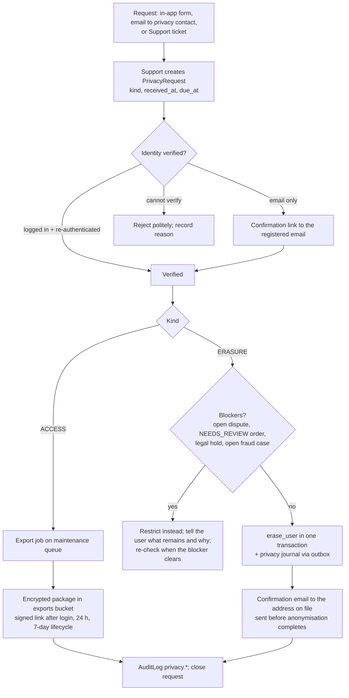

# Privacy and Data Protection

Purpose: how the platform handles personal data. It covers the PII inventory, pseudonymisation, the regulatory baseline (EU/UK GDPR and India's DPDP Act 2023), data-subject rights and how erasure works alongside an immutable ledger, cookies and consent, the retention schedule, staff access auditing, breach handling and processors.

Status: Draft v0.1 (2026-10-21)

> **Hosting change (2026-10-27):** AWS is no longer the target ([ADR-0014](../adr/0014-portable-hosting-paas-and-self-hosted.md)). AWS service names, CLI commands, sizing and alarms in this document are superseded; read them through the mapping table in ADR-0014 and [Hosting and deployment](../architecture/05-hosting-and-deployment.md). The provider-neutral intent (controls, targets, procedures) still applies.

| | |
|---|---|
| Owner | Client DPO (to be named, OQ-PRIV-01) for policy decisions; Tech Lead for the implementation |
| Audience | Engineers, QA, PO, Support lead, Moderator lead, Finance lead, client DPO and legal counsel |
| SRS anchors | §1 (multinational traffic), §3.1–3.2 (sign-up, verification), §4.2 (listing contact, images), §5.4–5.5 (contact display, reveal email), §6.5 (transaction history), §7.2 (profile, communication preferences), §9.1 (encryption; PII "tokenized or pseudonymized whenever possible") |
| Requirement IDs | NFR-SEC-01.4, NFR-SEC-01.5, NFR-SEC-01.7, NFR-SEC-05.1 to NFR-SEC-05.4, FR-PROF-02.7 |
| Backlog | US-112 (preferences), US-610 (safe user lookup), US-705 (PII verification), US-709 (legal pages), US-911 (post-MVP self-service closure and export) |
| Related | [01 Security §2, §7](01-security-and-compliance.md) · [03 Observability §2.6, §10](03-observability-and-operations.md) · [04 Runbooks](04-runbooks.md) · [Domain model §13–15](../design/01-domain-model.md#13-field-level-encryption-and-blind-index-register) · [Listings §13](../design/05-listings-and-media.md#13-security-and-privacy-of-listing-contact-data-known-issue-20) · [Notifications §14](../design/08-notifications.md#14-privacy-and-security) · [Gap GAP-51, GAP-60](../requirements/03-gap-analysis-and-decisions.md#gap-51) · [OQ-28](../requirements/04-open-questions.md#oq-28) |

> **This is an engineering design, not legal advice.** Launch markets are not decided (OQ-33), so the baseline is "GDPR-grade everywhere" (OQ-28 default) plus the India-specific items that apply if India is a market. Every legal interpretation below is for the client's DPO and counsel to confirm. Statements about laws are summaries; the statutes, regulations and regulator guidance are authoritative.

---

## 1. Scope, roles and principles

### 1.1 Roles

| Role | Who | Notes |
|---|---|---|
| Controller (GDPR) / Data Fiduciary (DPDP) | The client entity that operates the platform | Not named in the SRS (OQ-PRIV-01). It decides purposes, signs processor agreements and notifies regulators |
| Delivery and operations team | Us, while we build and run production | Processor under contract with the controller. We implement, operate and supply evidence; we do not decide purposes |
| Processors | AWS, Twilio, the email provider, Sentry, Cloudflare (Turnstile), the maps provider, the paging and chat tools | §11 |
| Payment gateways | Stripe, PayPal (Razorpay optional) | Largely **independent controllers** for the payer data they collect on their hosted pages (they have their own regulatory duties); their terms define the split |
| Data subjects / Data Principals | Renters, listers (owners and agents), people whose contact details a lister enters, staff | A single account can rent and list (known issue #4) |
| DPO, grievance officer, representative | Client side | A DPO if required; a published contact and grievance-redressal mechanism for India (DPDP s.8(9)–(10)); an Art. 27 representative if the controller has no EU/UK establishment but serves people there |

### 1.2 Principles

| # | Principle | Consequence in this product |
|---|---|---|
| PP-1 | **Minimise** | No avatars (initials only, domain model §3.2); no date of birth; no ID documents in the MVP; Stripe gets no customer email from us ([payments §8.2](../design/07-payments-and-credit-purchase.md#82-session-parameters)) |
| PP-2 | **Purpose-bound** | The listing contact is used only to show it to the owner and to renters who paid to reveal it, and for fraud matching through its blind index. It is never used for marketing |
| PP-3 | **Private by default** | Marketing opt-in is off (US-112); essential cookies only (§7); address shown as approximate by default (OQ-22) |
| PP-4 | **Protect by layers** | Storage encryption everywhere; field-level encryption for C3 data; masking for staff; no PII in telemetry ([01 §2](01-security-and-compliance.md#2-data-classification), [03 §2.6](03-observability-and-operations.md#26-redaction-and-the-telemetry-allow-list)) |
| PP-5 | **Keep only as long as needed** | Every item in §3 has a retention rule in §8, enforced by jobs |
| PP-6 | **Financial integrity and privacy coexist** | The ledger holds no PII, so erasure anonymises the person without touching the ledger (§6.5) |
| PP-7 | **Every access to PII by staff leaves a trace** | Masked by default; reason-gated unmask; AuditLog; monthly report (§9) |
| PP-8 | **Privacy is tested** | Seeded-PII test, data-map test, cookie inventory test, DSAR dry run (§12) |

### 1.3 The product's core disclosure

The business model discloses one person's personal data to another: a lister's phone number or email is shown to a renter who pays 2 credits (SRS §5.1–5.4). That is lawful and expected only if:

1. The lister is told clearly, at the moment they enter the contact, that it will be shown to renters who reveal it and emailed to them (§5.3).
2. The contact really belongs to the lister or they are authorised to publish it. The listing contact can differ from the account holder (for example an agency office line or a co-owner). Controls: the contact phone is OTP-verified before publish ([domain model §4.1](../design/01-domain-model.md#41-listingsproperty) `contact_phone_verified_at`), and the publish step includes a declaration. **Proposed addition** to the step-6 declarations ([listings §4.1](../design/05-listings-and-media.md#41-steps-and-fields)): "The contact details are mine, or I have permission to publish them."
3. The contact never leaks to anyone who did not pay (known issue #20; [listings §13](../design/05-listings-and-media.md#13-security-and-privacy-of-listing-contact-data-known-issue-20)).
4. The lister can withdraw: unlisting stops new reveals; erasure removes the contact (§6.5).

---

## 2. Processing activities and lawful basis

Summary record of processing (GDPR Art. 30 style). The DPO owns the formal record; this table is the engineering input. Retention references point to §8.

| ID | Activity | Data subjects | Data | Purpose | GDPR basis (Art. 6(1)) | DPDP ground | Retention |
|---|---|---|---|---|---|---|---|
| PA-01 | Registration, login, sessions | Members | Email, name, password hash, IP, user agent, session data | Provide the account | (b) contract | Consent with itemised notice at sign-up (s.5, s.6) | R-01, R-05, R-06 |
| PA-02 | Email and phone verification | Members | Email, phone number | Activate accounts; stop spam and promo abuse (SRS §3.2) | (b) contract; (f) anti-abuse | Consent (notice at the phone step) | R-01, R-02 |
| PA-03 | Listing publication | Listers; contact persons | Listing text, address, location, photos, contact name/phone/email | Publish the listing; show contact to paying renters | (b) contract with the lister | Consent at publish (notice that the contact will be disclosed) | R-10 to R-15 |
| PA-04 | Contact reveal and receipt email | Renters; listers | Renter account; lister contact snapshot | Deliver the paid service (SRS §5.3–5.5) | (b) contract (renter); (b) contract (lister: the listing's purpose) | Consent (lister, PA-03); s.7(a) voluntary provision for a specified purpose (renter), counsel to confirm | R-20, R-21 |
| PA-05 | Credits, purchases, refunds | Members | Wallet, ledger, orders, brand and last 4, gateway payloads | Sell and account for credits | (b) contract; (c) accounting and tax law | Consent; retention required by law (s.8(7)) | R-22 to R-26 |
| PA-06 | Fraud prevention and security | Members, visitors | IP, device and request signals, promo-claim HMACs, fraud flags, Turnstile results, WAF logs, AuditLog | Protect users, money and the service (known issue #6) | (f) legitimate interests (balancing test documented by the DPO) | Counsel to confirm. DPDP's "legitimate uses" (s.7) are narrower than GDPR legitimate interests; the notice lists fraud prevention as a purpose, and s.8(5) requires security safeguards | R-30 to R-34 |
| PA-07 | Transactional notifications | Members | Email address, message content | Receipts, verification, security notices | (b) contract | Consent (part of PA-01) | R-40 |
| PA-08 | Promotional email | Opted-in members | Email address, preferences | Marketing (SRS §7.2 "promotional alerts") | (a) consent (plus ePrivacy/PECR rules for e-marketing) | Consent | Until withdrawn |
| PA-09 | Moderation and user reports | Listers, reporters | Report reasons and details, moderation notes | Enforce terms; marketplace integrity | (f) legitimate interests; (b) contract (terms) | Consent (terms) | R-35, R-36 |
| PA-10 | Support and data-subject requests | Members | Ticket content, request records | Answer users; meet legal duties | (b) contract; (c) legal obligation | Legal obligation (s.11–s.13) | R-41 |
| PA-11 | Lister analytics | Visitors (deduplicated views), members | Short-lived dedup keys; daily aggregates | Show listers views, saves and reveals (SRS §4.4, §7.2) | (f) legitimate interests | Consent (notice) | R-16 |
| PA-12 | Operations telemetry | Visitors, members | Logs (pseudonymous IDs), traces, error events, edge logs (IP), field performance beacons | Run, secure and debug the service | (f) legitimate interests; RUM consent-gated in the EU/UK (§7) | Consent (notice); DPDP Rules log retention duty | R-50 to R-56 |
| PA-13 | Staff accounts and audit trail | Staff | Staff identity, MFA, actions | Least privilege and accountability | (b) employment contract; (f) | As per employment | R-60 |
| PA-14 | Tag-change evidence (MVP); KYC (post-MVP) | Listers | Documents in the private bucket, notes | Marketplace integrity (known issue #22); identity checks (post-MVP) | (f) legitimate interests; post-MVP KYC needs its own DPIA | Consent (at upload) | R-15 |

---

## 3. PII inventory

Classes follow [01 §2](01-security-and-compliance.md#2-data-classification): **C0** public, **C1** internal, **C2** confidential personal data, **C3** restricted, **C4** secret. Protection codes: **SE** storage encryption only (KMS, AES-256), **FLE** application field-level encryption (AES-256-GCM, [01 §7.2](01-security-and-compliance.md#72-encryption-at-rest)), **BI** HMAC blind index, **M** masked by default in the ops console. The data-map test (§12.2) fails CI if a model field is missing from this inventory.

### 3.1 Accounts and identity

| # | Item | Where | Subjects | Class | Protection | Retention | Visible to | Leaves our systems |
|---|---|---|---|---|---|---|---|---|
| P-01 | Login email | `accounts.User.email`, allauth `EmailAddress.email` | Members, staff | C2 | SE (plaintext under storage encryption, ADR-0010 / OQ-29), M | R-01 | User; Support (M, unmask with reason) | Email provider (sending) |
| P-02 | Full name | `User.full_name` | Members | C2 | SE, redacted from logs | R-01 | User; header dropdown; staff (M) | Email provider (greeting); renters see the **listing** contact name, not the account name |
| P-03 | Password hash | `User.password` | Members, staff | C3 | Argon2id hash; never displayed or exported | R-01 | Nobody | Never |
| P-04 | Phone number | `User.phone_e164` + `phone_hmac` | Members | C3 | FLE + BI, M | R-01 | User; Support (unmask) | Twilio (verification) |
| P-05 | Account status and timestamps | `User.status`, `verified_at`, `last_login`, `created_at` | Members | C2 | SE | R-01 | User (partly); staff | No |
| P-06 | Profile settings | `UserProfile` (country, currency, locale, time zone, terms version and acceptance time) | Members | C2 | SE | R-01 | User; staff | No |
| P-07 | Notification preferences | `NotificationPreference` | Members | C2 | SE | R-01 | User; Support | No |
| P-08 | MFA secrets, recovery codes | allauth MFA authenticators | Staff (members if user MFA ships) | C4 | FLE via the MFA adapter hooks | R-01 / R-60 | Nobody | No |
| P-09 | Session records | `django_session`, Valkey sessions, allauth `usersessions` (IP, user agent, last seen) | Members, staff | C2 | SE; Valkey TLS + KMS | R-05, R-06 | User ("signed-in devices"); Support (M) | No |
| P-10 | Social login link (only if US-119 ships) | allauth `SocialAccount` (provider UID, minimal `extra_data`) | Members | C2 | SE; `SOCIALACCOUNT_STORE_TOKENS=False` | R-01 | User | Google, Apple at login |
| P-11 | Account restrictions | `AccountRestriction` (reason, staff note) | Members | C2 | SE | R-34 | Staff | No |
| P-12 | Staff accounts | `User` with `is_staff`, group membership | Staff | C2 | SE, MFA | R-60 | Superadmin | No |

### 3.2 Listings

| # | Item | Where | Subjects | Class | Protection | Retention | Visible to | Leaves our systems |
|---|---|---|---|---|---|---|---|---|
| P-20 | Listing contact name | `Property.contact_name` | Lister or contact person | C2 | SE | R-11 | Owner; renters after a paid reveal | Email provider (reveal receipt) |
| P-21 | Listing contact phone | `Property.contact_phone` + `contact_phone_hmac` | Lister or contact person | C3 | FLE + BI (same domain as P-04 for fraud matching), M | R-11 | Owner; renters after a paid reveal; staff by unmask | Email provider (reveal receipt), Twilio (contact OTP) |
| P-22 | Listing contact email | `Property.contact_email` | Lister or contact person | C3 | FLE, M | R-11 | As P-21 | Email provider (reveal receipt) |
| P-23 | Street address | `address_line1`, `address_line2`, `postal_code` | Listers (often their home) | C2 | SE. `address_line1` is public only for `EXACT` listings (OQ-PRIV-03); `address_line2` is never public | R-12 | Owner; public per `address_display` | Maps provider (geocoding text) |
| P-24 | True location | `Property.location` | Listers | C2 | SE; never rendered for `APPROXIMATE` listings (public pin is `display_location`) | R-12 | Owner; staff | No |
| P-25 | Listing text | `title`, `description` | Listers (may contain PII by mistake) | C0 | Automated contact-in-text check (`CONTACT_IN_TEXT_FUZZY`) | R-10 | Public | Search engines (public pages) |
| P-26 | Photos | S3 `uploads/` (raw, 1 day), masters, `media/` variants | Listers; anyone pictured | C0 after processing; C2 raw | EXIF/XMP (including GPS) stripped; originals never served | R-13, R-14 | Public (variants) | CDN |
| P-27 | Tag-change request and evidence | `PropertyTagChangeRequest.reason`, `evidence_keys` → private bucket | Listers | C3 | Free-text notes FLE ([01 §7.2](01-security-and-compliance.md#72-encryption-at-rest)); documents SSE-KMS, malware-scanned, 5-minute signed URLs | R-15 | Owner; Moderators | No |
| P-28 | Saved properties | `SavedProperty` | Renters | C2 | SE | R-17 | User | No |
| P-29 | Listing metrics | `PropertyDailyStat` | — (aggregates) | C1 | No personal data once aggregated | R-16 | Owner | No |

### 3.3 Reveals, credits and payments

| # | Item | Where | Subjects | Class | Protection | Retention | Visible to | Leaves our systems |
|---|---|---|---|---|---|---|---|---|
| P-30 | Reveal record | `ContactReveal` (user, property, credits spent, request ID) | Renters | C2 | SE | R-20 | Renter (history); lister sees counts only | No |
| P-31 | Revealed contact snapshot | `ContactReveal.contact_*_snapshot` | Listers / contact persons | C3 | FLE | R-21 | The renter who paid (history); Support by unmask | Email provider (receipt) |
| P-32 | Wallet and ledger | `CreditWallet`, `CreditLedgerEntry` | Members | C1/C2 (pseudonymous: internal IDs, no PII by schema rule) | SE; append-only; hash chain | R-22 | User (history); Finance | Ledger anchors (wallet public IDs and hashes only) |
| P-33 | Promo claim registry | `SignupPromoClaim` (email and phone HMACs) | Members, erased members | C2 (pseudonymised) | BI only, no ciphertext | R-32 | Nobody directly (lookups only) | No |
| P-34 | Payment orders | `PaymentOrder` (amount, currency, pricing country, brand and last 4, gateway IDs) | Payers | C2 | SE; no card data ([01 §9](01-security-and-compliance.md#9-pci-dss-scope-saq-a)) | R-23 | User (history); Finance | Gateways (order UUIDs as metadata) |
| P-35 | Gateway webhook payloads | `PaymentWebhookEvent.payload_encrypted` (payer name, email, country) | Payers | C3 | FLE; redacted `payload_summary` for everyday use | R-24 | Finance by unmask (disputes) | No (received from gateways) |
| P-36 | Credit adjustment requests | `CreditAdjustmentRequest` (justification, ticket ref) | Members | C2 | SE | R-25 | Finance, Support | No |

### 3.4 Notifications, moderation and audit

| # | Item | Where | Subjects | Class | Protection | Retention | Visible to | Leaves our systems |
|---|---|---|---|---|---|---|---|---|
| P-40 | Delivery log | `NotificationLog` (`to_hmac`, `to_masked`, template, status) | Members | C2 | BI + masked copy; no bodies stored | R-40 | Support | Email provider IDs |
| P-41 | Email suppression list | `EmailSuppression.address_hmac` | Members | C2 (pseudonymised) | BI only | R-42 | Support | Provider suppression list (address) |
| P-42 | Fraud flags | `FraudFlag.evidence` (IDs, scores, rule data; no raw PII by rule) | Members | C2 | SE | R-31 | Moderators, Support | No |
| P-43 | Moderation cases and reports | `ModerationCase` notes, `ListingReport.details` (free text) | Listers, reporters | C2 | SE | R-35, R-36 | Moderators | No |
| P-44 | Audit trail | `core.AuditLog` (actor, action, target IDs, IP, user agent; no PII values in `data`) | Members, staff | C2 | SE; append-only; IP truncated after 180 days | R-33 | Superadmin, Security lead | No |
| P-45 | Ledger audit and reconciliation records | `LedgerAuditRun`, `LedgerAuditDiscrepancy`, reconciliation runs | — (IDs) | C1 | SE | R-26 | Finance | No |
| P-46 | Privacy requests | `accounts.PrivacyRequest` (**proposed**, §6.2) | Members | C2 | SE; no PII in notes | R-41 | Support lead, DPO | No |
| P-47 | Consent events | `accounts.ConsentEvent` (**proposed**, §5.4) | Members | C2 | SE; append-only | R-43 | DPO, Support | No |

### 3.5 Telemetry, caches, files and backups

| # | Item | Where | Subjects | Class | Protection | Retention | Visible to |
|---|---|---|---|---|---|---|---|
| P-50 | Application logs | CloudWatch `/rpl/<env>/<service>`; S3 log archive | Members (pseudonymous `user_public_id`) | C1 | No PII by rule + redaction processor ([03 §2.6](03-observability-and-operations.md#26-redaction-and-the-telemetry-allow-list)); KMS | R-50 | Engineers (read-only) |
| P-51 | Edge, ALB and WAF logs | S3 / Athena | Visitors (IP addresses, user agents, paths) | C2 | KMS; Athena access restricted to on-call and Security | R-51 | On-call, Security |
| P-52 | Traces and metrics | X-Ray, CloudWatch Metrics | — (allow-listed attributes, no user labels) | C1 | Attribute allow-list | R-52 | Engineers |
| P-53 | Error events | Sentry | Members (pseudonymous) | C1 | `send_default_pii=False`, scrubber, no request bodies, no Session Replay | R-53 | Engineers |
| P-54 | Field performance (RUM) | First-party `/rum/` → CloudWatch aggregates | Visitors | C1 | No cookies, no identifiers, 10 % sample; consent-gated in the EU/UK (§7) | R-54 | Product, UX |
| P-55 | Valkey keys | Sessions, rate-limit counters (`rl:{scope}:{subject}:{window}`, subject = user ID or IP), view-dedup keys | Members, visitors | C2 | TLS, AUTH, KMS; TTL-bound | R-55 | Nobody (systems only) |
| P-56 | Staff exports | S3 exports bucket (CSV) | Members | C2/C3 | SSE-KMS; reauth to create; signed URL; AuditLog | R-56 | The exporting staff member |
| P-57 | DSAR export packages | S3 exports bucket (`dsar/` prefix) | The requesting member | C3 | SSE-KMS; signed URL after login; AuditLog | R-57 | The member |
| P-58 | Database backups and snapshots | RDS PITR, AWS Backup vault (security account), DR region copies | Everyone in the DB | Same as source | KMS; vault lock; no snapshot sharing (SCP) | R-58 | Platform (restore only) |
| P-59 | Privacy journal | S3 Object Lock bucket, security account | Erased members (public UUIDs only) | C1 | Object Lock (governance) | R-59 | Platform (replay only) |

### 3.6 Copies held by third parties

| Item | Third party | What they hold | Control |
|---|---|---|---|
| Phone numbers being verified | Twilio Verify | Number, country, delivery status | Twilio retention settings; DPA (§11) |
| Email addresses and message bodies (reveal receipts contain the lister's contact) | SES or Mailgun | Address, delivery events; Mailgun may keep message content for a short period depending on plan | `txn-pii` stream with TLS required ([notifications §13](../design/08-notifications.md#13-deliverability)); no PII in provider tags or metadata |
| Payer details and card data | Stripe, PayPal | Everything they collect on hosted pages | Their own controller obligations; we send only order and user UUIDs |
| Property address text | Maps provider | Address strings sent for geocoding; static map requests (coordinates, viewer IP) | No user identity sent; provider terms on storage (OQ-INT-01) |
| Bot-check signals | Cloudflare Turnstile | IP and browser signals at sign-up, reset, OTP send and step-up | Disclosed in the privacy notice (§7) |
| Error events and CSP reports | Sentry | Scrubbed events with public UUIDs; CSP reports with page URL and visitor IP | Scrubbing tests (03 §2.6); project-level IP storage off where available |
| Map views | Maps provider | Visitor IP and viewed map area when a map loads in the browser | Static image by default; interactive map only on user action (§7.1) |

---

## 4. Pseudonymisation and tokenisation

### 4.1 What the SRS asks for and how we meet it

SRS §9.1: "PII must be tokenized or pseudonymized whenever possible within the application's storage layer to minimize exposure in case of a data breach."

**Deviation from SRS (wording), recorded as DEV-SEC-4 in [01 §13](01-security-and-compliance.md#13-deviations-from-the-srs-security):** we pseudonymise with keyed HMAC blind indexes, public UUIDs and field-level encryption with keys held outside the database, and we do **not** run a separate tokenisation vault. The SRS's own words ("whenever possible") allow this, and the reasons are in §4.3.

### 4.2 Techniques used

| # | Technique | Applied to | What it protects against |
|---|---|---|---|
| T1 | **Public UUIDs** instead of sequential IDs or natural keys | Every externally visible object; `user_public_id` in logs, traces, Sentry, outbox payloads, gateway metadata, ledger anchors | Enumeration; linking telemetry to a person without a database lookup |
| T2 | **Keyed HMAC blind indexes** (`HMAC-SHA256(k_bi, "<domain>:v1:" + normalised value)`) | Verified phone uniqueness, listing contact phone (fraud matching), promo claims, notification recipients, suppression list | Lookups without storing or decrypting the value; promo-claim memory survives account erasure (§6.4) |
| T3 | **Field-level encryption** (AES-256-GCM, envelope keys wrapped by KMS, AAD bound to the column) | C3 fields: phones, listing contact phone and email, reveal snapshots, webhook payloads, tag-change notes, MFA secrets | A database dump, snapshot or replica leak exposes ciphertext only, unless the KMS key and the task role are also compromised |
| T4 | **Masking** (`j•••@gmail.com`, `+44 •••• ••• 123`) | Ops console and admin by default; `NotificationLog.to_masked` | Casual insider exposure; screen sharing |
| T5 | **Truncation** | `AuditLog.ip` to /24 (IPv4) or /48 (IPv6) after 180 days | Long-term identifiability of security records |
| T6 | **Aggregation** | `PropertyDailyStat`, RUM metrics, business metrics | Listers and dashboards never see who viewed or saved |
| T7 | **Short-lived hashed keys** | View deduplication and rate-limit keys in Valkey, with TTLs | Analytics and throttling without a persistent visitor profile |
| T8 | **Anonymisation on erasure** | The user row, owned listings and snapshots (§6.5) | Financial records stay intact but no longer point to an identifiable person |

### 4.3 Why not a tokenisation vault

A vault replaces each value with a token and keeps the real values in a separate service. We rejected it for the MVP:

1. **Same trust root.** The vault's own keys would sit in the same KMS and be reachable by the same task roles. Against the realistic threat (a database dump or snapshot), field encryption with keys outside the database gives the same protection.
2. **Availability on the money path.** Every reveal decrypts a contact. A vault adds a network hop and a new failure mode to the SRS §8.1 latency budget and the 1,000 debits/s target ([02 §2](02-nfr-performance-and-scalability.md#2-nfr-targets)).
3. **No regulatory requirement.** Tokenisation is mandatory for card data under PCI DSS, and card data never reaches us (SAQ A). Nothing comparable applies to phone numbers and emails.
4. **The upgrade path stays open.** The field-encryption module is a single seam (`apps.core.crypto`). A vault could be placed behind it later without changing call sites.

### 4.4 Limits we accept and document

| Limit | Why it matters | Mitigation |
|---|---|---|
| Pseudonymised data is still personal data (GDPR Recital 26; the "additional information" here is the HMAC key and KMS keys) | Pseudonymisation lowers risk; it doesn't take data out of scope | Keys are C4 and separate from the database; rights requests and retention still apply to pseudonymised data |
| Blind indexes over low-entropy values (phone numbers) can be brute-forced if `k_bi` leaks | Every possible number in a country can be hashed and compared | `k_bi` in Secrets Manager only, readable only by `web` and `worker` roles; leak = re-index ([01 §7.3](01-security-and-compliance.md#73-key-rotation)) and a breach assessment (§10) |
| Login email is plaintext under storage encryption (ADR-0010, OQ-29) | A full database compromise exposes emails | Compensating controls in [01 §7.2](01-security-and-compliance.md#72-encryption-at-rest); the blind-index option remains documented |
| Quasi-identifiers: an exact address plus interior photos identify a lister's home | Re-identification without any direct identifier | `APPROXIMATE` default for address display; fuzzed public pin; erasure removes address and photos (§6.5) |
| The ledger links to a wallet, the wallet to a user | Before erasure, financial history is linkable to the person by design | After erasure the user row is anonymised, so the link ends at an anonymous record |

### 4.5 Rules for engineers

1. No PII in URLs or query strings (password reset and unsubscribe use signed tokens), S3 object keys (server-generated UUIDs), cache keys (user IDs or IP hashes only), metric labels, outbox payloads, gateway metadata, provider tags, log fields or Sentry tags.
2. Never put a C3 value into a shared cache, a template fragment cache or a search document.
3. No PII in `localStorage` or `sessionStorage` (§7.3).
4. Production data is never copied to dev, staging or laptops. Restores run in an isolated subnet inside the production account ([03 §11.2](03-observability-and-operations.md#112-safety-rules)).
5. A new field holding personal data is added to the data map (§12.2) in the same PR, with its class, protection, retention rule and erasure behaviour.

---

## 5. Regulatory baseline, notices and consent

### 5.1 Comparison: GDPR and India's DPDP Act

| Topic | EU GDPR / UK GDPR | India: DPDP Act 2023 and DPDP Rules 2025 | Our baseline |
|---|---|---|---|
| When it applies | Establishment in the EU/UK, or offering services to (or monitoring) people there (Art. 3) | Digital personal data processed in India; also processing outside India when offering goods or services to people in India (s.3) | Built to meet both; launch markets decide which apply (OQ-33) |
| Grounds for processing | Six lawful bases including contract and legitimate interests (Art. 6) | Consent (s.6) or a listed "legitimate use" (s.7). The legitimate uses are narrower than GDPR legitimate interests | Basis per activity in §2. Under DPDP, rely mainly on an itemised notice and consent at sign-up and at publish |
| Consent standard | Freely given, specific, informed, unambiguous, withdrawable (Art. 4(11), Art. 7) | Free, specific, informed, unconditional, unambiguous, with a clear affirmative action; as easy to withdraw as to give; registered consent managers possible (s.6) | Unticked boxes; marketing separate from terms; withdrawal in Profile (§5.4) |
| Notice | Arts. 13–14 | Itemised notice: data, purpose, how to exercise rights, how to complain to the Data Protection Board; in English or a language of the Eighth Schedule (s.5) | Privacy notice plus just-in-time notices (§5.3); translation-ready (all strings use gettext) |
| Children | Parental consent below 13–16 (member-state choice) for consent-based online services (Art. 8) | Child = under 18. Verifiable parental consent; no tracking, behavioural monitoring or targeted advertising directed at children (s.9) | Adults only (18+), §5.5 |
| Rights | Access, rectification, erasure, restriction, portability, objection, automated decisions (Arts. 15–22). Answer within one month, extendable by two (Art. 12(3)) | Information about processing (s.11), correction and erasure (s.12), grievance redressal (s.13), nomination (s.14). Response periods are set by the Rules (counsel to confirm) | Support-led, internal target 30 days (§6) |
| Retention | Storage limitation (Art. 5(1)(e)) | Erase when the purpose is served or consent is withdrawn, unless a law requires retention (s.8(7)). The Rules add time-bound erasure for some large platform classes above user-count thresholds, and a minimum one-year retention of logs | Schedule in §8. The large-platform rule is unlikely to apply at launch (counsel to confirm) |
| Security | Appropriate measures (Art. 32) | Reasonable security safeguards (s.8(5)); the Rules list minimum measures such as encryption or masking, access control, logging and monitoring, and backups | [01](01-security-and-compliance.md) |
| Breach notification | Supervisory authority within 72 hours if there is a risk; affected people if high risk (Arts. 33–34) | The Board **and each affected person** for any personal-data breach (s.8(6)); the Rules require an intimation without delay and a detailed report within 72 hours | §10 |
| International transfers | Chapter V: adequacy, standard contractual clauses, EU-US Data Privacy Framework for certified US recipients, UK IDTA or Addendum | Permitted except to countries the government restricts by notification (s.16) | §11 |
| Accountability | Records of processing (Art. 30), DPIA (Art. 35), DPO where required (Art. 37), representative (Art. 27) | Significant Data Fiduciaries have extra duties: DPO based in India, DPIA, periodic audit (s.10); every fiduciary publishes a grievance contact | §1.1, §5.7 |
| Penalties | Up to EUR 20 million or 4 % of worldwide annual turnover | Up to INR 250 crore for the most serious categories (Schedule) | — |
| Commencement | In force | Act passed in 2023; Rules notified in November 2025 with phased commencement, most Data Fiduciary duties applying about 18 months after notification | Build to it now; counsel confirms the dates |

Other regimes, if the client adds markets: UK PECR for cookies and e-marketing; US state privacy laws (for example California's CCPA/CPRA: rights to know, delete and correct; opt-out of sale or sharing, honouring Global Privacy Control). The platform does not sell or share personal data for cross-context advertising, which keeps the US footprint small.

### 5.2 Applying the baseline

- One code base and one behaviour everywhere (simpler, and the strictest rule usually wins). Market-specific differences are configuration: consent banner on or off (§7.4), legal footer per market ([notifications §12](../design/08-notifications.md#12-localisation-and-time)), notice language.
- `UserProfile.country` and the listing `country` exist from day one, so market-specific rules can be applied later without migrations ([02 §12](02-nfr-performance-and-scalability.md#12-multinational-scaling)).

### 5.3 Notices

The full privacy notice and terms are client content (US-709, OQ-45). Engineering provides these touchpoints:

| Where | Notice (gist) | Requirement |
|---|---|---|
| Sign-up | Links to the current Terms and Privacy Notice; acceptance checkbox (unticked); version stored | NFR-SEC-05.1 (`UserProfile.terms_version`, `terms_accepted_at`) |
| Phone entry (profile or verification) | "We use your number to verify your account and to prevent fraud. We won't use it for marketing." | Just-in-time |
| Listing contact step | "These details will be shown to renters who pay to view them, and emailed to them. Only add details you're allowed to share." | §1.3; DPDP itemised notice |
| Show Number | "The lister's contact details will be shown and emailed to you. 2 credits." | SRS §5.1 transparency |
| Turnstile pages | Short line under the widget linking to the privacy notice | §7.2 |
| Footer | Privacy Notice, Cookie Notice, Terms, grievance contact (India), "Your privacy choices" (if a banner is active) | US-709 |

**Versioning:** a material change to the privacy notice or terms bumps the version. Users accept the new terms at their next login; the privacy notice change is announced by email (transactional, a legal notice).

### 5.4 Consent records

GDPR Art. 7(1) requires the controller to **demonstrate** consent. `NotificationPreference` stores only the current state. **Proposed addition:** `accounts.ConsentEvent`, append-only:

| Field | Type | Notes |
|---|---|---|
| `id`, `public_id` | | |
| `user` | FK User | PROTECT; survives as a link to the anonymised row after erasure |
| `purpose` | varchar(30) | `TERMS`, `PRIVACY_NOTICE`, `PROMOTIONAL_EMAIL`, `PRODUCT_UPDATES_EMAIL`, `RUM_ANALYTICS` (if a banner is used) |
| `granted` | bool | |
| `document_version` | varchar(20) | Version of the notice or terms shown |
| `source` | varchar(20) | `SIGNUP`, `PROFILE`, `BANNER`, `UNSUBSCRIBE_LINK`, `SUPPORT` |
| `created_at` | timestamptz | |

Rules: written in the same transaction as the preference change; never updated; withdrawal is one click (profile toggle or unsubscribe link), as easy as giving consent (GDPR Art. 7(3); DPDP s.6(4)).

### 5.5 Children

**Assumption:** the platform is for adults (18+). Renting usually requires legal capacity to contract, and DPDP treats everyone under 18 as a child. Sign-up includes "I am 18 or older" in the terms acceptance. There is no age verification. An account found to belong to a minor is closed and its data erased (§6.5). Marketing is never targeted by age. (OQ-PRIV-12)

### 5.6 Automated decisions and profiling

| Automated action | Effect | Human involvement | Assessment |
|---|---|---|---|
| Fraud rules raise a `FraudFlag` (US-606) | None by itself | Moderator or Support reviews; a person decides on freezes and suspensions | Not a solely automated decision (GDPR Art. 22) |
| Reveal and checkout rate limits | Temporary refusal ("try again later") | None needed | Security measure; short, reversible, no lasting effect |
| Wallet auto-freeze on a ledger audit mismatch | User-initiated debits blocked until review | Finance reviews; target resolution within 1 business day | Protects the user's own balance; temporary; explained in the notice |
| Wallet freeze on a chargeback shortfall | As above | Finance decides | As above |
| Risk-based pre-moderation of listings | Listing waits for review instead of publishing instantly | Moderator decides | Not a refusal; delay only |

The privacy notice explains these checks in plain terms. Users can contest a freeze or suspension through Support, and a person reviews it.

### 5.7 Data protection impact assessment

**Recommendation:** the DPO runs a DPIA before go-live (M7). Reasons: systematic disclosure of contact details to paying third parties; fraud profiling across accounts; possible scale across several countries. This document, [01](01-security-and-compliance.md) and the [domain model](../design/01-domain-model.md) are the engineering inputs. Post-MVP KYC (identity documents, ownership proofs) needs its own DPIA before any design is frozen, and in India must respect specific restrictions on handling national ID numbers (counsel). (OQ-PRIV-09)

---

## 6. Data-subject rights and erasure

### 6.1 Rights matrix

| Right | GDPR | DPDP | MVP handling | Self-service |
|---|---|---|---|---|
| Information / access | Art. 15 | s.11 | Support-led export (§6.3) | Post-MVP (US-911) |
| Portability | Art. 20 | — | Same export, machine-readable (JSON + CSV) | Post-MVP |
| Rectification / correction | Art. 16 | s.12 | **Self-service** in Profile (name, email and phone with the two-step re-verification of SRS §7.2) and My Properties | Yes (MVP) |
| Erasure | Art. 17 | s.12 | Support-led (§6.5) | Post-MVP (US-911) |
| Restriction | Art. 18 | — | Account `SUSPENDED` with reason `USER_REQUEST`, or a legal hold flag on the privacy request | No |
| Objection | Art. 21 | — | Marketing: absolute, one click. Other legitimate-interest processing: Support assesses with the DPO | Marketing yes |
| Withdraw consent | Art. 7(3) | s.6(4) | Preferences page, unsubscribe link | Yes |
| Not to be subject to solely automated decisions | Art. 22 | — | Not applicable by design (§5.6); human review on request | — |
| Grievance redressal | (complaint to a supervisory authority, Art. 77) | s.13, published grievance contact | Support ticket, escalated to the DPO | — |
| Nomination (on death or incapacity) | — | s.14 | Support-led; nominee proves identity and authority | No |

Internal target: **acknowledge within 3 business days, complete within 30 calendar days.** This meets GDPR's one-month limit and stays inside DPDP limits. Complex cases are extended only with the DPO's approval and a message to the user.

### 6.2 Request workflow



**Proposed addition:** `accounts.PrivacyRequest(public_id, user FK PROTECT, kind [ACCESS, ERASURE, RECTIFICATION, RESTRICTION, OBJECTION, NOMINATION], status [RECEIVED, VERIFYING, IN_PROGRESS, BLOCKED, COMPLETED, REJECTED], received_at, due_at, verified_at, completed_at, handled_by FK User, blocker_codes jsonb, notes text (no PII))`, retained per R-41. It lives in `accounts` because there is no `privacy` app in the canonical app list; erasure handlers in other apps register with it (§6.5).

**Identity verification rules:** never ask for ID documents for an account-holder request; a logged-in, recently re-authenticated session or a confirmation link to the registered email is enough. Requests from third parties (lawyers, family) need written authority and DPO approval. A contact person whose number appears on someone else's listing (§1.3) can ask for its removal: Support verifies control of the number by OTP and unlists the contact (the lister is told to supply a different contact).

**Permissions:** a new `accounts.handle_privacy_request` permission for the Support lead; erasure execution needs a second staff member's approval (maker-checker), like credit adjustments.

### 6.3 Access and portability export

| Included | Format | Notes |
|---|---|---|
| Account profile, preferences, consent events | JSON | |
| Listings owned (all statuses), including their own contact details (decrypted) | JSON + CSV | Photos as links valid for 24 h |
| Saved properties | CSV | |
| Reveals made, with the contact snapshot the user paid for | CSV | Includes the lister's contact. **Decision:** included, because the user already received it legitimately and can see it in history (SRS §5.4). GDPR Art. 15(4) (rights of others) was considered; DPO to confirm (OQ-PRIV-11) |
| Credit history (ledger entries: type, amount, balance after, date, transaction ID, property ID) | CSV | The SRS §6.5 history, complete |
| Purchases (package, amount, currency, date, method brand and last 4, status) | CSV | |
| Sessions and sign-in history (time, device, IP) | CSV | |
| Security events where the user is the actor (`AuditLog`: logins, password changes) | CSV | |
| Notification history (template, date, status, masked address) | CSV | |
| **Excluded** | | Fraud-rule internals (scores, thresholds, linked accounts) where disclosure would defeat fraud prevention; staff moderation notes pending a DPO decision (OQ-PRIV-11); other users' personal data except the revealed contacts above |

The export job runs on the `maintenance` queue, writes `dsar/<request_public_id>.zip` (SSE-KMS) to the exports bucket, and emails a link that works only after login and re-authentication. The object expires after 7 days (R-57). AuditLog: `privacy.dsar_exported`.

### 6.4 Anti-abuse retention after erasure

Some data must outlive an erased account, or erasure becomes a tool for abuse:

| Data kept | Why | Form | Retention | Basis |
|---|---|---|---|---|
| `SignupPromoClaim` (email and phone HMACs) | Otherwise a user could erase their account and re-register to farm another 10 free credits (known issue #6) | HMACs only; no ciphertext; not reversible without `k_bi` and a brute-force over candidates | R-32: 5 years after the claim (**Assumption**; the domain model currently keeps claims with no limit, OQ-PRIV-04) | GDPR Art. 6(1)(f) and Art. 17(3)(e) (defence of legal claims); DPDP: counsel |
| Identity blocks for banned users | A user banned for fraud must not return with the same email or phone | **Proposed addition:** `accounts.IdentityBlock(email_hmac, phone_hmac, reason_code, created_at, expires_at)`, because anonymisation clears the user row's identifiers | R-34: 3 years after the ban (**Assumption**) | Same |
| `FraudFlag`, `AccountRestriction`, moderation cases about the user | Evidence for disputes, chargebacks and repeat abuse | IDs and codes; free text reviewed for PII | R-31, R-34, R-35 | Same |
| `AuditLog` rows where the user is actor or target | Security and financial evidence | Pseudonymous IDs; IP truncated after 180 days | R-33 | Art. 6(1)(c)/(f); DPDP log retention duty |
| `EmailSuppression` | Never send to an address that hard-bounced or complained | HMAC only | R-42 | Art. 6(1)(f) |

The user is told in the erasure confirmation that these limited records remain, why, and for how long.

### 6.5 Erasure versus the immutable ledger

**The conflict:** the SRS requires an immutable ledger with full details (§5.3, §9.2), and privacy law grants erasure. **The resolution** ([architecture §11](../architecture/01-system-architecture.md#11-data-ownership-and-transaction-boundaries), domain model §14): the ledger contains **no PII by schema rule** (internal IDs, public UUIDs, amounts, codes; `metadata` validated for scalars and no PII). Erasure anonymises the person around the ledger; it never touches a ledger row, so the hash chain stays valid. Financial records that law requires (orders, reveals, ledger) are retained under GDPR Art. 17(3)(b) and DPDP s.8(7), pointing to an anonymous user.

**What erasure does, per data item:**

| Data | Action | Notes |
|---|---|---|
| `User` | `status = DELETED`; `email = 'deleted-<public_id>@deleted.invalid'`; `full_name = ''`; `phone_e164`, `phone_hmac` NULL; unusable password; `deleted_at` set | Domain model §14. The row stays so foreign keys from financial records remain valid |
| allauth rows (`EmailAddress`, `SocialAccount`, MFA authenticators, `UserSession`) and Django sessions | Deleted | Logs the user out everywhere |
| `UserProfile`, `NotificationPreference` | Locale and time zone reset; all marketing flags false; `terms_version` kept (evidence of the contract) | |
| `SavedProperty` | Deleted | |
| Owned listings | `ARCHIVED`; `contact_*` NULL; `anonymized_at` set (domain model §14). **Proposed addition:** also NULL `address_line1`, `address_line2`, `postal_code` and the true `location`, and delete photo variants and masters from S3 (asynchronously) | A home's address and interior photos identify the person. `ck_property_submitted_complete` exempts `ARCHIVED`, so this is schema-compatible. City, country and aggregates stay for statistics |
| Reveals the user made (`ContactReveal` as renter) | Rows kept (financial evidence, R-20); **contact snapshots NULLed now** | No one can view them any more, so keeping the lister's contact has no purpose |
| Reveals of the user's own listings by other renters | Rows kept; **contact snapshots NULLed** (**Assumption**, OQ-PRIV-06). Those renters' history shows "Contact removed at the lister's request" | The lister's erasure right outweighs the convenience copy; the renters already received the contact by email |
| `CreditWallet`, `CreditLedgerEntry` | **Unchanged** | No PII. The remaining balance is forfeited (GAP-60 default; consumer-law question OQ-16 / OQ-PRIV-10). No ledger entry is written for the forfeiture, so the chain is untouched |
| `PaymentOrder` | Kept 7 years (R-23) including brand and last 4 | Tax and accounting; disputes |
| `PaymentWebhookEvent.payload_encrypted` | Kept until the 18-month purge (R-24) | Chargeback evidence can be needed for many months after payment (Art. 17(3)(e)) |
| `NotificationLog` | `to_masked` cleared; `to_hmac` kept until R-40 | |
| `ListingReport.details` written by the user | NULLed; reason code kept | Free text may contain personal data |
| `PropertyTagChangeRequest` | Reason NULLed; evidence documents deleted from the private bucket unless under legal hold | |
| `AuditLog`, `FraudFlag`, `AccountRestriction`, `SignupPromoClaim`, `EmailSuppression` | Kept (§6.4) | |
| Logs, traces, Sentry | No action | They hold only `user_public_id`, which now points to an anonymous row |
| Backups | Expire on schedule; erasure re-applied after any restore (§6.6) | |
| Processors | Twilio and the email provider keep delivery logs per their retention (configured to the shortest practical setting); gateways keep payment records as independent controllers | Explained in the confirmation |

**Erasure blockers** (erasure is deferred and processing restricted, the user is told why): an open dispute or `NEEDS_REVIEW` order; an open fraud or moderation case about the user; a legal hold set by the DPO; an active listing under a pending `PropertyTagChangeRequest` (it is cancelled first).

**Implementation sketch.** `accounts` is a low layer and must not import higher-layer apps (architecture rule R1). Each app registers an erasure handler in its `AppConfig.ready()`, the same dependency-inversion pattern the credits audit uses for reference checks:

```python
# apps/accounts/privacy.py (illustrative)
from dataclasses import dataclass
from django.db import transaction

@dataclass(frozen=True)
class ErasureBlocker:
    code: str            # e.g. "OPEN_DISPUTE", "LEGAL_HOLD"

class ErasureHandler:  # implemented by listings, leads, notifications, moderation, payments
    name: str
    def blockers(self, user_id: int) -> list[ErasureBlocker]: ...
    def erase(self, *, user_id: int, ctx: "RequestContext") -> None: ...

_HANDLERS: list[ErasureHandler] = []

def register_erasure_handler(handler: ErasureHandler) -> None:
    _HANDLERS.append(handler)

@transaction.atomic
def erase_user(*, user_id: int, request: "PrivacyRequest", actor: "User", ctx: "RequestContext") -> None:
    user = User.objects.select_for_update().get(pk=user_id)
    if user.status == User.Status.DELETED:
        return                                               # idempotent: also used by journal replay
    blockers = [b for h in _HANDLERS for b in h.blockers(user_id)]
    if blockers:
        raise ErasureBlocked(codes=sorted({b.code for b in blockers}))
    for handler in _HANDLERS:
        handler.erase(user_id=user_id, ctx=ctx)              # NULL snapshots, archive listings, queue S3 deletes...
    _delete_auth_artifacts(user)                             # allauth emails, social, MFA, usersessions, sessions
    _anonymise_user_row(user)                                # email placeholder, name '', phone NULL, unusable password
    audit.record("privacy.user_erased", actor=actor, target=user,
                 data={"request": str(request.public_id)}, ctx=ctx)   # IDs only
    outbox.publish("privacy.user_erased",                   # handler writes the privacy journal object (§6.6)
                   {"user": str(user.public_id), "request": str(request.public_id)},
                   dedupe_key=f"privacy.user_erased:{user.public_id}")
```

The confirmation email is sent **before** the email address is replaced: the service enqueues it with the address resolved at enqueue time, as the single documented exception to "IDs only in outbox payloads" ([notifications §6.3](../design/08-notifications.md#63-the-one-pii-exception-old-address-notice) already has the same pattern for the old-address notice). Delivery of that one message is the only processing after erasure.

### 6.6 Backups and the erasure journal

Backups are not edited. Erased data persists in them until they expire, and that is acceptable if the backups are "beyond use": access-restricted, used only for restoration, and expiring on a schedule. The real risk is a **restore**, which would bring erased people back.

| Backup | Longest retention ([03 §10.1](03-observability-and-operations.md#101-what-is-backed-up)) |
|---|---|
| RDS PITR | 14 days |
| AWS Backup vault copy (security account) | 35 days |
| Cross-Region automated backups (DR) | 7 days |
| Monthly long-term snapshots, if adopted ([infrastructure §13.3](../architecture/04-infrastructure-and-deployment.md#133-backups)) | 12 months |

**The journal:** each erasure writes one object to `s3://rpl-<env>-privacy-journal/<yyyy>/<mm>/<dd>/<request_public_id>.json` in the security account:

```json
{"v": 1, "user_public_id": "0b6c…", "request_public_id": "7f1e…", "erased_at": "2026-11-03T10:15:02Z", "handlers": ["listings", "leads", "notifications", "moderation", "payments"]}
```

- Written by an outbox handler (at-least-once, retried), so a committed erasure is always journaled.
- Contains public UUIDs and timestamps only (C1).
- S3 Object Lock in governance mode. **Retention must be at least the longest backup retention plus 30 days:** 65 days without monthly snapshots, **13 months if the infrastructure's monthly 12-month snapshots are adopted**. **Proposed change** to [03 §10.1](03-observability-and-operations.md#101-what-is-backed-up), which sets 90 days (enough only without the monthly snapshots).
- After any restore that reopens traffic, `privacy_journal_replay --since <restore point>` re-runs `erase_user` (idempotent) for every journaled user **before** users are let back in ([RB-11](04-runbooks.md#rb-11-restore-from-backup-drill-and-real) step 7, [RB-14](04-runbooks.md#rb-14-regional-outage-and-dr-failover) step 7).
- Scheduled purges (unverified users, snapshot expiry, retention rules) are simply re-run on demand after a restore; they need no journal.
- The erasure confirmation tells the user that backups expire within the stated period.

### 6.7 Rectification, restriction and objection

- **Rectification** is self-service for profile fields (SRS §7.2; email and phone changes re-verify, US-110/US-111) and for listings (My Properties). Ledger entries and past receipts are never rectified: they record what happened. A wrong charge is corrected by a `REVERSAL`.
- **Restriction:** Support suspends the account with `status_reason = USER_REQUEST`. Listings are unlisted, the wallet is frozen (`STAFF`) and nothing is processed except storage, until the request is resolved.
- **Objection** to marketing is honoured immediately (unsubscribe link or preferences). Objection to fraud-prevention processing is assessed by the DPO; in practice, security processing continues while the account exists (compelling legitimate grounds), and the user can choose erasure.

---

## 7. Cookies and consent

### 7.1 Cookie inventory

| Name | Set by | Purpose | Category | Lifetime | Consent needed |
|---|---|---|---|---|---|
| `__Host-sessionid` | Our domain | Login session; also anonymous sessions when the user sets a preference (for example a region or currency choice) | Strictly necessary | Browser session, or 14 days with "remember me" | No |
| `__Host-csrftoken` | Our domain | CSRF protection | Strictly necessary | Django default (about 1 year). **Proposed:** session lifetime is enough with HttpOnly tokens passed through `hx-headers` | No |
| `django_language` | Our domain | Only when a user explicitly switches language (post-MVP: English only at launch) | Functional, user-requested | Browser session (Django default) | No |
| `rpl_consent` | Our domain | Stores the visitor's cookie choice; only exists where a banner is active | Strictly necessary | 6 months | No |
| `messages` | Our domain (Django `CookieStorage`, the default first stage of `FallbackStorage`) | Toast text between redirects | — | — | **Proposed change:** `MESSAGE_STORAGE = "django.contrib.messages.storage.session.SessionStorage"`, so toast text (for example "Contact revealed. 2 credits deducted.") stays server-side and this cookie never exists |
| Turnstile | `challenges.cloudflare.com` (iframe) | Bot protection on sign-up, password reset, OTP send and step-up | Security | Per Cloudflare | Treated as strictly necessary for a service the user requested and for its security; disclosed in the notice (OQ-PRIV-07) |
| Stripe, PayPal | Their own domains, during hosted checkout | Payment and fraud checks | Their policies | — | Not set on our domain; no gateway scripts run on our pages (SAQ A) |
| Maps provider | Provider origin: a static map image on the listing detail page; the interactive map only after the user opens the Map toggle in search or places a pin in the listing wizard ([integrations §7.3](../design/09-external-integrations.md#73-third-parties-in-the-browser)) | Show the map the user asked for | Functional, user-invoked | Per provider (interactive SDKs may use browser storage and send telemetry) | Treated as strictly necessary for a function the user explicitly invoked, loaded only on that action, never on purchase or account pages, disclosed in the notice (OQ-PRIV-07) |

No advertising, social or third-party analytics cookies at MVP. No Sentry browser SDK and no Session Replay ([03 §2.6](03-observability-and-operations.md#26-redaction-and-the-telemetry-allow-list)); browsers do send CSP violation reports to Sentry, which carry the page URL and the visitor's IP.

### 7.2 Other device access

ePrivacy Art. 5(3) (and UK PECR) covers any storing of, or access to, information on the user's device, not only cookies (EDPB Guidelines 2/2023 on the technical scope of Art. 5(3)).

| Mechanism | Use | Decision |
|---|---|---|
| Turnstile signals | Browser signals read for bot detection | Security exemption, disclosed (counsel to confirm, OQ-PRIV-07) |
| RUM (`web-vitals` → `/rum/`) | Reads browser performance APIs; no cookies, no identifiers, 10 % sample | **Consent-gated in the EU/UK; on elsewhere** (consistent with [02 OQ-PERF-06](02-nfr-performance-and-scalability.md#15-open-questions)). When consent is off, the script is not loaded |
| HTMX history cache | HTMX stores snapshots of visited pages in `localStorage` for back navigation. A snapshot of a listing page after a reveal, or of Transaction History, would put **revealed contact details on disk** in the browser, outside our `no-store` headers | **Proposed change:** set `historyCacheSize: 0` in the HTMX config (history misses reload from the server, which is cheap for server-rendered pages). Logout's `Clear-Site-Data: "storage"` is a second layer |
| Application `localStorage` / `sessionStorage` | None at MVP | Rule: never store PII or contact details in browser storage (§4.5) |

### 7.3 Consent model

| Market situation | Behaviour |
|---|---|
| Only strictly necessary cookies and storage (MVP default) | **No banner.** Cookie notice page explains each item (UX-OQ-06 default) |
| EU/UK visitors with RUM enabled | Banner shown to visitors from the EU/UK (country from `CloudFront-Viewer-Country`, account region overrides). Accept and Reject with equal weight, non-modal, never blocks content ([UX](../ux/01-ux-and-page-inventory.md)). RUM loads only after Accept |
| Any future non-essential cookie (marketing pixels, interactive maps, third-party analytics) | Requires a consent review and the banner in every market where the law requires it |

- The choice is stored in `rpl_consent`, and in `ConsentEvent` (`purpose = RUM_ANALYTICS`, `source = BANNER`) when the visitor is logged in.
- "Cookie settings" in the footer reopens the choice at any time.
- **Global Privacy Control** (`Sec-GPC: 1`) is treated as a refusal of optional analytics.

### 7.4 Keeping the inventory honest

A Playwright test (part of the E2E suite, [testing strategy](../delivery/04-testing-strategy.md)) visits the home page anonymously, searches, opens a listing, logs in, reveals a contact on a fixture listing and logs out. After each step it asserts that the set of cookies and `localStorage` keys equals the allow-list in this section. A new cookie or storage key fails the build until this section is updated.

---

## 8. Data retention schedule

Periods are **Assumptions** pending legal input per market (OQ-DM-01, OQ-28), except where noted. This schedule consolidates [domain model §15](../design/01-domain-model.md#15-data-retention-schedule) and adds logs, files, backups and new items. Where they differ, the difference is listed in §13.

| Rule | Data | Retention | Starts | Mechanism | Driver |
|---|---|---|---|---|---|
| R-01 | Verified account (profile, preferences, phone) | Life of the account; anonymised on erasure (§6.5) | — | Erasure service | Contract |
| R-02 | Unverified account | 7 days | Sign-up | Daily purge (hard delete) | Minimisation, anti-spam (GAP-60) |
| R-03 | Dormant verified account (no login) | No automatic action at MVP; **proposed** review at 36 months of inactivity (warning email, then anonymisation) | Last login | Not built at MVP (OQ-PRIV-05) | Storage limitation; interacts with unused credits (OQ-12) |
| R-05 | Django and Valkey sessions | Session expiry; daily `clearsessions` | — | Beat job | Necessity |
| R-06 | `usersessions` records (IP, user agent) | 90 days after the session ends (**Assumption**) | Session end | Daily purge | Security; "signed-in devices" view |
| R-10 | Published listing content | Life of the listing; archived listings keep text for 2 years, then text and photos are deleted (**Assumption**) | Archival | Monthly job | Lister history; disputes |
| R-11 | Listing contact (name, phone, email) | While the listing exists; NULLed on archival after erasure; for archived listings without erasure, NULLed 2 years after archival (**Assumption**) | Archival | Monthly job | Minimisation |
| R-12 | Street address and true location | As R-10; NULLed on erasure | | | |
| R-13 | Raw uploads | 1 day | Upload | S3 lifecycle | Minimisation |
| R-14 | Photo variants and masters | Life of the listing; deleted with R-10 or on erasure | | Async S3 deletion | |
| R-15 | Tag-change evidence documents | 2 years after the decision (**Assumption**) | Decision | Monthly job + S3 lifecycle tag | Disputes about the tag |
| R-16 | `PropertyDailyStat` | 25 months | Date | Monthly job | Year-on-year comparison |
| R-17 | Saved properties | Until unsaved or account erasure | | | |
| R-20 | `ContactReveal` rows | 7 years | Reveal | Retained | Financial evidence |
| R-21 | Reveal contact snapshots | 24 months, then NULLed (domain model §15); NULLed immediately on renter or lister erasure | Reveal | Monthly job | SRS §5.4 access "without further cost"; minimisation |
| R-22 | Wallets, ledger entries | Life of the platform, minimum 7 years; never purged | — | — | SRS §9.2; accounting law |
| R-23 | `PaymentOrder` | 7 years | Order | Retained | Tax and accounting (confirm per market) |
| R-24 | Webhook raw payloads | 18 months, then NULLed (summary kept) | Receipt | Monthly job | Chargeback evidence |
| R-25 | Credit adjustment requests | 7 years | Decision | Retained | Financial control |
| R-26 | Ledger audit runs, discrepancies, reconciliation runs, ledger anchors | 7 years; anchors 8 years (Object Lock) | — | Retained | SRS §9.2 |
| R-30 | WAF, ALB, CloudFront logs (IP addresses) | 90 days | Event | S3 lifecycle | Security (OQ-OPS-06 for India) |
| R-31 | Fraud flags | 2 years after closure (**Assumption**) | Closure | Monthly job | Repeat abuse |
| R-32 | Promo claim HMACs | 5 years after the claim (**Assumption**; domain model has no limit) | Claim | Monthly job | §6.4 |
| R-33 | `AuditLog` | Security events 2 years; financial and staff actions 7 years; IPs truncated after 180 days | Event | Daily purge (`rpl_maintenance`) | Accountability |
| R-34 | Account restrictions, identity blocks | 3 years after lifting or the ban (**Assumption**) | | Monthly job | §6.4 |
| R-35 | Moderation cases | 2 years after resolution; 7 years when financial (`CLAWBACK_SHORTFALL`, `AUDIT_MISMATCH`) (**Assumption**) | Resolution | Monthly job | Disputes |
| R-36 | Listing reports | 2 years (**Assumption**) | Report | Monthly job | |
| R-40 | `NotificationLog` | 13 months | Send | Monthly job | Delivery disputes |
| R-41 | Privacy requests | 3 years after completion (**Assumption**) | Completion | Monthly job | Evidence of compliance |
| R-42 | Email suppression HMACs | Until the address is re-verified | | | Deliverability |
| R-43 | Consent events | Life of the account + 3 years (**Assumption**) | | | Demonstrate consent |
| R-44 | Outbox messages (dispatched) | 14 days | Dispatch | Daily job | Operations |
| R-50 | Application logs | 30 days hot; 1-year archive (prod) | Event | CloudWatch retention; S3 lifecycle | Operations; DPDP Rules log duty if India ([03 §2.5](03-observability-and-operations.md#25-retention-archive-and-access)) |
| R-51 | Edge logs | See R-30 | | | |
| R-52 | Traces 30 days; metrics 15 months | | | Native | |
| R-53 | Sentry events | Plan default (typically 90 days) | | Sentry | |
| R-54 | RUM aggregates | 15 months | | CloudWatch | |
| R-55 | Valkey keys | TTL (rate limits ≤ 24 h; dedup ≤ 24 h; search cache ≤ 60 s) | | TTL | |
| R-56 | Staff exports | 7 days | Creation | S3 lifecycle | |
| R-57 | DSAR export packages | 7 days | Creation | S3 lifecycle | |
| R-58 | Database backups | PITR 14 days; vault 35 days; DR 7 days; monthly snapshots 12 months if adopted | | AWS Backup / RDS | Recovery (§6.6) |
| R-59 | Privacy journal | Longest backup retention + 30 days (§6.6) | Erasure | Object Lock | |
| R-60 | Staff accounts | Deactivated at offboarding; name and email anonymised 7 years later (actor IDs in the audit trail stay meaningful until then) | Offboarding | Manual (quarterly access review) | Accountability |

**Mechanism.** One `retention_purge` task family on the `maintenance` queue (daily at 04:00 UTC, [03 §16](03-observability-and-operations.md#16-scheduled-operations-calendar)), running as the `rpl_maintenance` role. Rules are registered in code so the schedule and the implementation cannot drift:

```python
# apps/core/retention.py (illustrative)
@dataclass(frozen=True)
class RetentionRule:
    rule_id: str                   # "R-21"
    model: str                     # "leads.ContactReveal"
    action: Literal["DELETE", "NULL_FIELDS", "TRUNCATE_IP"]
    fields: tuple[str, ...] = ()   # for NULL_FIELDS / TRUNCATE_IP
    age_field: str = "created_at"
    max_age: timedelta = timedelta(days=730)
    extra_filter: Q = Q()

RULES = [
    RetentionRule("R-21", "leads.ContactReveal", "NULL_FIELDS",
                  ("contact_name_snapshot", "contact_phone_snapshot", "contact_email_snapshot"),
                  max_age=timedelta(days=730)),
    RetentionRule("R-24", "payments.PaymentWebhookEvent", "NULL_FIELDS", ("payload_encrypted",),
                  age_field="received_at", max_age=timedelta(days=548)),
    RetentionRule("R-33a", "core.AuditLog", "TRUNCATE_IP", ("ip",),
                  age_field="occurred_at", max_age=timedelta(days=180)),
    # ...
]
```

Each rule runs in keyset-paginated batches of 1,000 with short transactions, honours `maintenance_jobs_paused`, emits `retention_rows_processed_total{rule}` and supports `--dry-run` (counts only), following the backfill contract in [03 §15.3](03-observability-and-operations.md#153-backfill-job-contract). The ledger is never in scope: the `rpl_maintenance` role has no rights on `credits_*` tables.

---

## 9. Audit logging of staff access to PII

### 9.1 Masked by default

Every ops console and admin view shows personal data masked: emails as `j•••@gmail.com`, phones as `+44 •••• ••• 123`, IPs as /24 or /48 prefixes. List views and search results never show unmasked values. Contact details on listings are not even decrypted for display unless unmasked.

### 9.2 Unmasking

1. The staff member clicks **Reveal** next to a masked field.
2. A dialog requires a **reason code** (`SUPPORT_TICKET`, `DISPUTE`, `FRAUD_INVESTIGATION`, `PRIVACY_REQUEST`, `LEGAL_REQUEST`, `OTHER`) and, except for `OTHER`, a ticket or case reference. `OTHER` requires free text (20–500 characters, no PII by policy).
3. Re-authentication if the last one was more than 10 minutes ago ([01 §6.9](01-security-and-compliance.md#69-ops-console-and-admin-hardening)).
4. The value is shown for 60 seconds, in a response with `Cache-Control: no-store`, then hidden again.
5. `AuditLog` row: action `pii.unmasked`, actor, target type and public ID, **field name** (never the value), reason code, ticket reference, request ID, IP.

```python
# apps/core/pii.py (illustrative)
UNMASK_REASONS = {"SUPPORT_TICKET", "DISPUTE", "FRAUD_INVESTIGATION", "PRIVACY_REQUEST", "LEGAL_REQUEST", "OTHER"}

def unmask_field(*, actor, obj, field: str, reason_code: str, reference: str, ctx) -> str:
    perm = f"{obj._meta.app_label}.unmask_{obj._meta.model_name}_{field}"
    if not actor.has_perm(perm):
        raise PermissionDenied
    require_recent_reauth(ctx, minutes=10)
    if reason_code not in UNMASK_REASONS or (reason_code != "OTHER" and not reference):
        raise ValidationError("reason")
    value = crypto.read_plaintext(obj, field)        # decrypts FLE fields; plain read for SE fields
    audit.record("pii.unmasked", actor=actor, target=obj,
                 data={"field": field, "reason": reason_code, "reference": reference}, ctx=ctx)
    return value                                      # never cached, never logged
```

### 9.3 Who may unmask what

| Data | Support | Moderator | Finance | Superadmin |
|---|---|---|---|---|
| Member email, phone | Unmask (reason) | Masked | Email only, unmask (reason) | Unmask |
| Listing contact phone, email | Unmask (invalid-contact refunds) | Unmask (scam investigation) | Masked | Unmask |
| Reveal contact snapshot | Unmask (disputes) | Masked | Unmask (disputes) | Unmask |
| Webhook raw payload (payer details) | No | No | Unmask (chargeback evidence) | Unmask |
| Tag-change evidence documents | No | Download (signed URL, audited) | No | Download |
| Full IP addresses | Masked | Masked | Masked | Unmask (security investigations) |
| CSV exports containing personal data | No | No | Orders and payments (no contact data), with re-authentication | All, with re-authentication |

Permissions are Django permissions attached to groups only ([01 §6.8](01-security-and-compliance.md#68-authorisation-model)). The role × view matrix test covers unmask endpoints.

### 9.4 Audited actions

| Action | Data recorded (no PII values) |
|---|---|
| `pii.unmasked` | Field, target, reason, reference |
| `pii.lookup` | A staff search by email or phone (US-610): the **blind index** of the search term, never the term; result count |
| `ops.export.<name>` | Export name, filters (codes), row count |
| `listing.evidence_downloaded` | Request and document IDs |
| `privacy.request_status_changed`, `privacy.dsar_exported`, `privacy.user_erased` | Request ID, status, approver |
| `auth.session_revoked` | Target user, scope (one or all sessions) |
| `credits.adjustment_*`, `credits.wallet_frozen`, `credits.unfreeze_wallet` | Already defined by the credits design |

### 9.5 Monitoring and review

- **Alert AL-49** ([03 §7](03-observability-and-operations.md#7-alert-catalogue)): more than 20 `pii.unmasked` by one staff member in a day, or an export over 1,000 rows → Security ticket.
- **Monthly access report** to the DPO: per staff member, counts of unmasks by reason and field, lookups, exports and downloads; any `OTHER` reasons listed in full. Generated by a `maintenance` task from `AuditLog`; contains staff identities and counts only.
- **Quarterly access review** of group membership ([01 §6.9](01-security-and-compliance.md#69-ops-console-and-admin-hardening)) includes a sample of unmask reasons checked against tickets.
- `AuditLog` is append-only ([domain model §16](../design/01-domain-model.md#16-database-conventions-and-raw-sql-migrations)); reading it is limited to Superadmin and the Security lead.

### 9.6 Engineers' access

Engineers have **no** read access to production tables in normal operation. Diagnostics use `dbdiag` (no table access, no raw query text; [04 §1.3](04-runbooks.md#13-tools-and-access)). The replica's `rpl_readonly` role sees masked reporting views only, with pgAudit session logging. Break-glass access is ticketed, pages the Tech Lead and is reviewed afterwards. Data fixes are reviewed commands, never ad-hoc SQL ([03 §15.6](03-observability-and-operations.md#156-production-data-fixes)).

---

## 10. Personal-data breach handling

Operational steps are in [RB-08](04-runbooks.md#rb-08-credential-leak-or-security-incident); the process and severity model are in [01 §11](01-security-and-compliance.md#11-incident-response) and [03 §8](03-observability-and-operations.md#8-severity-levels-and-on-call). This section covers the privacy-specific duties.

| Step | Owner | Timing |
|---|---|---|
| Suspected breach reported to the DPO/legal contact | IC | **Within hours** of awareness, not after the investigation |
| Initial assessment: what data, whose, how many, encrypted or not, keys exposed or not, ongoing or contained | Security lead + DPO, with our evidence | First 24 h |
| Evidence pack from us (timeline, affected record counts by data class, controls in place, containment) | Tech Lead | Within 24 h of the request |
| Notification decision and filing | Controller (client) | GDPR: supervisory authority within **72 h** of awareness if there is a risk; people without undue delay if high risk. DPDP: the Board and **each affected person**, intimation without delay and a detailed report within **72 h**. CERT-In: **6 h** for specified incidents if India is a market |
| Notices to affected people | Controller, using text approved by legal | As decided |
| Breach register entry | DPO | Every breach, including those not notified (GDPR Art. 33(5)) |

**Risk factors the assessment uses:**

| Factor | Lowers risk | Raises risk |
|---|---|---|
| Field-level encryption | C3 data leaked as ciphertext while KMS and task roles were not compromised | The attacker ran inside the application (it decrypts by design) |
| Data class | Pseudonymous IDs, aggregates, HMACs with the key safe | Contact phones, emails, addresses, payment metadata |
| Password hashes | Argon2id with tuned parameters | Weak passwords; force resets regardless |
| Scope | Few records, contained quickly | Bulk export, long exposure |
| Contacts harvested through legitimate reveals at scale (RB-09) | Revealed under the terms to paying users | Systematic scraping and resale: the DPO decides whether it is a breach to notify |

The breach register (`docs/compliance/privacy/breach-register.md`, owned by the DPO) records date, nature, categories and approximate counts of people and records, consequences, measures, and the notification decision with its reasoning. It contains no personal data.

---

## 11. Processors and international transfers

### 11.1 Processor inventory

The per-provider data-sharing matrix and minimisation rules are maintained in [integrations §7](../design/09-external-integrations.md#7-data-sharing-and-privacy); this table is the privacy view of the same list, and both change in the same PR.

| Service | Role | Personal data shared | Location | Transfer mechanism (if outside the user's jurisdiction) | Minimisation |
|---|---|---|---|---|---|
| AWS (hosting, RDS, S3, ElastiCache, SES, CloudWatch, KMS; GuardDuty Malware Protection and Rekognition for uploaded files, in-account) | Processor | All data we hold | Primary region and DR region (OQ-33, OQ-OPS-07) | AWS DPA with SCCs; region choice controls location | Region pinned by SCP; KMS keys per environment |
| Google, Apple sign-in (only if US-119 ships) | Independent controllers | OAuth request; they return identity claims | Global | Their terms | `SOCIALACCOUNT_STORE_TOKENS=False`; minimal `extra_data` |
| Stripe | Independent controller for payment data; processor for some services (per Stripe's terms) | Order and user **UUIDs** as metadata; Stripe collects payer data itself | Global | Stripe's data transfer terms (SCCs; DPF certification) | No customer email sent ([payments §8.2](../design/07-payments-and-credit-purchase.md#82-session-parameters)) |
| PayPal | As Stripe | Order UUID as `custom_id`; PayPal collects payer data | Global | PayPal's terms | As Stripe |
| Razorpay (optional, India) | As Stripe | As Stripe | India | Domestic for Indian users | As Stripe |
| Twilio Verify | Processor | Phone number, country, delivery status | US and global carriers | DPA with SCCs; DPF | Phone only; no names |
| Amazon SES, or Mailgun | Processor | Recipient address, message content (receipts include lister contact details) | SES: our AWS region. Mailgun: US or EU region by account choice | AWS DPA, or Mailgun DPA with SCCs | No PII in tags or metadata; TLS-required stream for receipts with contact data |
| Sentry | Processor | Scrubbed error events (public UUIDs, request IDs); CSP violation reports sent by browsers (page URL, visitor IP) | US or EU data region (T-3) | DPA with SCCs | `send_default_pii=False`; scrubbing; no request bodies; IP storage disabled in the Sentry project settings where available |
| Cloudflare Turnstile | Processor (per Cloudflare's terms) | IP address, browser signals at challenge time | Global | Cloudflare DPA | Only on sign-up, reset, OTP send and step-up |
| Maps provider (Google Maps Platform or Mapbox) | Processor or independent, per the chosen terms | Address text for geocoding; static map requests from the visitor's browser (coordinates and the visitor's IP) | US | Provider DPA / SCCs | No user identity sent with geocoding; approximate pin by default |
| MaxMind GeoLite2 | Not a processor | None (local database in the image) | — | — | — |
| Have I Been Pwned (Pwned Passwords range API) | Not a processor | The first 5 hex characters of a SHA-1 hash (k-anonymity); no personal data in practice | — | — | — |
| Paging tool (PagerDuty or incident.io), Slack | Processor (staff data) | Alert payloads with IDs only; staff names and contact details | US/EU | DPAs | No user PII in alerts or channels ([04 §1.5](04-runbooks.md#15-communications)) |
| GitHub | Processor (staff data) | No production personal data (rule) | US | DPA | Secret scanning; no data in fixtures except synthetic |
| Pen-test vendor | Processor for the engagement | Staging only, synthetic data | — | Contract | No production access |

**Vendor management:** the controller signs a DPA with each processor before production data flows (US-710 launch checklist). Sub-processor change notices are routed to the DPO. Each new external service follows the dependency review in [01 §8.1](01-security-and-compliance.md#81-controls) plus this table.

### 11.2 International transfers

- **GDPR / UK GDPR:** transfers out of the EU/UK need an adequacy decision, SCCs (with a transfer impact assessment) or another Chapter V tool; certified US recipients can rely on the EU-US Data Privacy Framework (UK: the UK Extension). The DPO keeps a transfer assessment for each US processor (Twilio, Sentry if US-hosted, the maps provider, Cloudflare).
- **DPDP:** transfers are allowed except to countries the Indian government restricts by notification (s.16). Sector rules can be stricter. Counsel checks the current notification list before launch.

### 11.3 Data residency

| Decision | Impact |
|---|---|
| Primary AWS region (OQ-33 / A-1 / INF-1) | Where all production personal data lives. Choose it with the launch markets: an EU region for EU-first, an Indian region (for example Mumbai) for India-first |
| DR region ([03 §10.2](03-observability-and-operations.md#102-decisions-that-must-be-made-at-m0)) | Backups, replicas and KMS replica keys are copied there. **It must satisfy the same residency constraints as the primary** (for example both in the EU) |
| Log archive and security account buckets | Same region rules as production (they hold IPs and pseudonymous IDs) |
| Processors' locations | §11.1; some offer regional hosting (Mailgun EU, Sentry EU) to reduce transfers |
| A market that requires in-country storage | Regional "pod" (separate stack and database per jurisdiction), option C in [02 §12](02-nfr-performance-and-scalability.md#12-multinational-scaling). Feasible because users and listings carry a market from day one and search is market-scoped |

---

## 12. Privacy by design in the delivery process

### 12.1 Pull-request checklist (privacy items)

Added to the PR template ([engineering standards](../delivery/03-engineering-standards.md)):

- [ ] New or changed personal-data field: classified, added to the data map (§12.2), protection chosen (SE / FLE / BI / masking).
- [ ] Retention rule added or confirmed (§8) and erasure behaviour defined (§6.5 handler).
- [ ] Included in or excluded from the DSAR export, with the reason (§6.3).
- [ ] No PII in logs, metric labels, outbox payloads, cache keys, URLs, S3 keys or provider metadata (§4.5).
- [ ] New third party: processor table updated (§11.1) and DPO informed.
- [ ] New cookie or browser storage: §7 updated; cookie inventory test updated.
- [ ] Staff view showing personal data: masked by default; unmask permission and audit (§9).

### 12.2 Data-map test

```python
# tests/privacy/test_data_map.py (illustrative)
from django.apps import apps
from apps.core.data_map import DATA_MAP   # {"accounts.User.phone_e164": FieldPolicy(cls="C3", protection="FLE+BI",
                                         #   retention="R-01", erasure="NULL"), ...}

IGNORED_APPS = {"contenttypes", "migrations"}

def test_every_concrete_field_is_in_the_data_map():
    missing = []
    for model in apps.get_models():
        if model._meta.app_label in IGNORED_APPS:
            continue
        for field in model._meta.concrete_fields:
            key = f"{model._meta.label}.{field.name}"
            if key not in DATA_MAP:
                missing.append(key)
    assert not missing, f"Classify these fields in apps/core/data_map.py and 05 §3: {missing}"

def test_c3_fields_are_encrypted_or_hmac_only():
    for key, policy in DATA_MAP.items():
        if policy.cls == "C3" and policy.protection not in {"FLE", "FLE+BI", "HASH", "BI", "S3-PRIVATE"}:
            raise AssertionError(f"{key} is C3 but stored as {policy.protection}")
```

Third-party models (allauth, `django_celery_beat`, waffle, sessions) are classified too, so a library upgrade that adds a column is noticed.

### 12.3 Other automated checks

| Check | What it proves | Source |
|---|---|---|
| Seeded-PII test | Known fake PII never appears in logs, Sentry events or spans | [03 §2.6](03-observability-and-operations.md#26-redaction-and-the-telemetry-allow-list) |
| Contact-leak regression test | Listing contact absent from HTML, JSON, caches, sitemaps for non-payers | Known issue #20; AC-LST-07 |
| Synthetic SYN-02 | The canary listing's number is not in the public HTML in production | [03 §9.3](03-observability-and-operations.md#93-synthetic-canaries-cloudwatch-synthetics) |
| Cookie and storage inventory | §7.4 | E2E suite |
| Erasure test | After `erase_user`, no plaintext or ciphertext personal data remains for that user in any table, the ledger chain still verifies, and the journal message exists | Integration test |
| Export test | The DSAR package contains every category in §6.3 and nothing in the excluded list | Integration test |
| Retention dry run | Each rule selects the expected rows on a fixture dataset | Unit tests per rule |

### 12.4 M7 verification (US-705)

| ID | Check | Evidence |
|---|---|---|
| V-PRIV-01 | Snapshot inspection: in a sandboxed restore, every FLE column holds ciphertext (count of plaintext values = 0) | Script output (counts only) |
| V-PRIV-02 | Blind-index lookups work (verified-phone uniqueness, Support email/phone lookup) | Test run |
| V-PRIV-03 | Logs and Sentry sampled over 7 days on staging plus the seeded-PII test on production configuration: no PII | Sampling report |
| V-PRIV-04 | Field-key rotation rehearsed on staging (`rotate_field_keys`) | Timings and row counts |
| V-PRIV-05 | Private bucket blocks public access; IAM Access Analyzer shows no external access | Analyzer report |
| V-PRIV-06 | DSAR dry run on staging: export and erasure for a fixture user, including journal replay after a sandbox restore | Run record |
| V-PRIV-07 | Cookie and storage inventory test green on production configuration | CI run |
| V-PRIV-08 | Retention jobs dry-run counts reviewed | Report |
| V-PRIV-09 | Data map, retention schedule and processor list signed off by the DPO | Sign-off |
| V-PRIV-10 | Legal pages published (privacy notice, cookie notice, terms, grievance contact) | US-709 |

### 12.5 Deliverables by milestone

| Milestone | Privacy deliverables |
|---|---|
| M0 | Redaction processor and Sentry scrubbing; data-map registry and test skeleton; KMS keys (app-field multi-Region, [03 §10.2](03-observability-and-operations.md#102-decisions-that-must-be-made-at-m0)); HTMX history cache off; `MESSAGE_STORAGE` setting; lower-environment synthetic data rule |
| M1 | Terms/privacy acceptance and `ConsentEvent`; preferences with opt-in marketing; phone FLE + BI; masked staff views for users; `pii.unmasked` and `pii.lookup` audit; unverified-account purge; 18+ declaration |
| M2 | Listing contact FLE + BI; contact notice and declaration; EXIF stripping; address display rules; private bucket for evidence |
| M3 | Search logs `q` length only; no contact in search payloads; view-dedup keys with TTL |
| M4 | Reveal snapshots FLE; ledger PII rule enforced in the metadata validator; promo-claim registry |
| M5 | Webhook payload FLE and redacted summary; gateway metadata limited to UUIDs; R-24 job |
| M6 | Ops console masking everywhere; monthly staff access report; `PrivacyRequest` workflow; erasure handlers and journal; DSAR export; retention jobs complete |
| M7 | US-705 checks (§12.4); DPIA support; DPAs signed; consent banner if a market needs it; breach-response tabletop with RB-08 |

---

## 13. Deviations and proposed changes

| # | Item | Type | Summary |
|---|---|---|---|
| P-PRIV-01 | SRS §9.1 "tokenized or pseudonymized" | **Deviation from SRS** (wording; DEV-SEC-4) | Pseudonymisation by HMAC blind indexes, UUIDs and field encryption; no tokenisation vault (§4.3) |
| P-PRIV-02 | Consent evidence | **Proposed addition** to the domain model | `accounts.ConsentEvent`, append-only (§5.4) |
| P-PRIV-03 | Privacy request tracking | **Proposed addition** to the domain model | `accounts.PrivacyRequest` and `handle_privacy_request` permission with maker-checker for erasure (§6.2) |
| P-PRIV-04 | Banned identities after anonymisation | **Proposed addition** | `accounts.IdentityBlock` (HMACs only), because anonymisation clears identifiers needed to stop a banned user returning (§6.4) |
| P-PRIV-05 | Promo-claim retention | **Proposed change** to domain model §6.3 / §15 | Bounded at 5 years after the claim instead of unlimited (§6.4, R-32) |
| P-PRIV-06 | Erasure scope for listings | **Proposed change** to domain model §14 | Also NULL street address, postal code and true location, and delete photos, for an erased owner's listings (§6.5) |
| P-PRIV-07 | Reveal snapshots on lister erasure | **Assumption** | Snapshots in other renters' history are NULLed when the lister is erased (§6.5, OQ-PRIV-06) |
| P-PRIV-08 | Privacy journal retention | **Proposed change** to [03 §10.1](03-observability-and-operations.md#101-what-is-backed-up) | At least the longest backup retention + 30 days; 13 months if infrastructure §13.3's monthly 12-month snapshots are adopted (03 says 90 days) |
| P-PRIV-09 | HTMX history cache | **Proposed change** (frontend config, ADR-0002 area) | `historyCacheSize: 0` so revealed contacts are never written to `localStorage` (§7.2) |
| P-PRIV-10 | Django messages storage | **Proposed change** (settings) | `SessionStorage` instead of the default cookie-first storage (§7.1) |
| P-PRIV-11 | Listing declaration | **Proposed addition** to listings §4.1 step 6 | "The contact details are mine, or I have permission to publish them" (§1.3) |
| P-PRIV-12 | Adults only | **Assumption** | 18+ declaration at sign-up (§5.5) |
| P-PRIV-13 | Retention rules not in domain model §15 | **Proposed addition** | R-06, R-10 to R-12, R-15, R-31, R-34 to R-36, R-41, R-43, R-60 (§8) |
| P-PRIV-14 | Erasure orchestration | **Proposed design** | Handler registry in `accounts`, so the low layer never imports higher layers (architecture R1, §6.5) |

---

## 14. Open questions

| ID | Question | Default until answered | Needed by |
|---|---|---|---|
| OQ-PRIV-01 | Which legal entity is the controller? Who is the DPO, the India grievance officer and (if needed) the EU/UK representative? (part of OQ-28, OQ-SEC-08) | Client to name | M1 (notices), M7 (go-live) |
| OQ-PRIV-02 | Launch markets and therefore applicable regimes (= OQ-33, OQ-28) | GDPR-grade baseline everywhere plus DPDP items | M0 |
| OQ-PRIV-03 | Is the street address (`address_line1`) public for `EXACT` listings, shown only after a reveal, or never? (= OQ-22) | Lister's choice, default `APPROXIMATE` | M2 |
| OQ-PRIV-04 | Retention of promo-claim HMACs and identity blocks after erasure | 5 years / 3 years | M4 |
| OQ-PRIV-05 | Dormant accounts: act after a period of inactivity? How does that interact with unused paid credits (OQ-12)? | No automatic action at MVP | M7 |
| OQ-PRIV-06 | On lister erasure, remove the contact from renters' reveal history? | Yes (§6.5) | M6 |
| OQ-PRIV-07 | Are Turnstile (a security measure) and the interactive map (loaded only when the user opens it) acceptable without consent in the EU/UK? | Yes for both, disclosed in the notice | M1 (Turnstile), M2 (maps) |
| OQ-PRIV-08 | RUM without consent outside the EU/UK (= OQ-PERF-06) | Consent-gated in the EU/UK; on elsewhere | M7 |
| OQ-PRIV-09 | Is a DPIA required before go-live, and who signs it? | Recommended; DPO signs | M6 |
| OQ-PRIV-10 | Unused credits on erasure: forfeited or refunded (consumer law per market)? (= OQ-16) | Forfeited unless legal says otherwise | M7 |
| OQ-PRIV-11 | DSAR export: include lister contacts the user paid for, and staff moderation notes about the user? | Contacts yes; moderation notes withheld pending DPO decision | M6 |
| OQ-PRIV-12 | Minimum age 18 everywhere? | Yes | M1 |
| OQ-PRIV-13 | Must self-service export and deletion exist at launch in any market (US-911 is post-MVP)? | Support-led in MVP | M1 |
