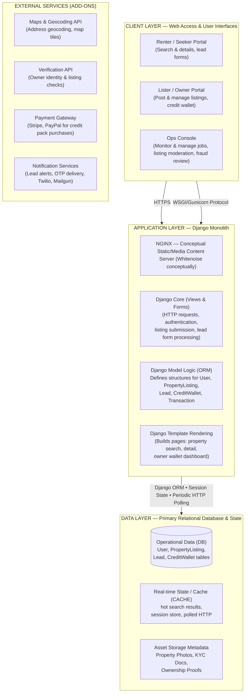
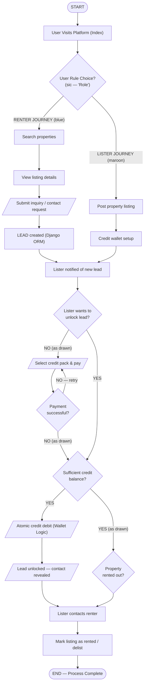

# Source Documents Inventory

Purpose: list every source artefact the client supplied, say which one wins when they disagree, and transcribe the two AI-generated diagrams exactly so later documents can cite them without reopening the images.

Status: Draft v0.1 (2026-10-21)

Related: [02 Requirements Catalog](02-requirements-catalog.md) · [03 Gap Analysis & Decisions](03-gap-analysis-and-decisions.md) · [04 Open Questions](04-open-questions.md) · [05 Glossary](05-glossary.md)

---

## 1. Inventory

All files are in `rentPropertyListing/ProjectDocuments/`, which is **kept out of the public repository** (confidential client material, git-ignored). Ask the Product Owner for copies. The SHA-256 values identify the exact revision analysed. If a file changes, re-run the analysis.

| ID | File | Title (as in document) | Version / date | Author / metadata | Size & shape | Role |
|---|---|---|---|---|---|---|
| SRC-01 | `Rent_Property_Listing_ Requirements Document.docx` | "Rent Property Listing Web Application: Requirements Document" | v1.0, dated 25 Oct 2025. File created 2025-10-23, last modified 2025-11-05 (revision 83) | Creator "A. Centauri Software's" (footer "ACS Requirement Document"), last modified by the ACS account | 10 pages, ~2,836 words, no embedded images (the 5.2 MB file size comes from embedded fonts). SHA-256 `eb3a98c4…0e21d` | **Authoritative.** The full SRS and the single source of truth for MVP scope |
| SRC-02 | `Rent_Property_Listing_ High Level Requirements Document.docx` | "Rent Property Listing Web Application: High Level Requirements Document" | v1.0, dated 25 Oct 2025. Created 2025-10-23, last modified 2025-11-05 (revision 112) | Same author | 8 pages, ~1,447 words, no images. SHA-256 `25898385…e695` | **Secondary.** A condensed copy of SRC-01 with the same section structure. Used only where it adds information (the RBAC sentence) |
| SRC-03 | `Gemini_Generated_Image_uilk7uilk7uilk7u.png` | "Rent Property Listing Web Application — System Architecture" (top half) plus an untitled flow chart (bottom half) | No version. File date 2025-08-01 | AI-generated (Google Gemini, per the file name). Subtitle: "Derived from Rental Project Content • Standard Django Monolith Layout" | 1728×2420 PNG. SHA-256 `a413f47e…e4a3` | **Informative.** It is the architectural intent: a Django monolith. Its text and flow logic are not authoritative |
| SRC-04 | `Gemini_Generated_Image_uilk7uilk7uilk7u (1).png` | "Rent Property Listing Web Application — Application Flow Chart" ("Renter & Lister journeys • Django Monolith Interaction") | Footer "v1.0 - Django Monolith Adaption". File date 2025-08-01 | AI-generated | 1728×2420 PNG. SHA-256 `ac5caf8f…6b3d` | **Informative, low fidelity.** A partly garbled duplicate of the SRC-03 flow chart |

### 1.1 Precedence rule

When sources conflict, this order applies:

1. Decisions recorded in [03-gap-analysis-and-decisions.md](03-gap-analysis-and-decisions.md) once stakeholders confirm them.
2. **SRC-01 (SRS).**
3. SRC-02 (HLRD). It is used only to fill gaps in SRC-01, never to override it.
4. SRC-03, then SRC-04. These diagrams decide architecture style (Django monolith) and suggest extra capabilities. Any capability that appears only in a diagram enters the catalog as **Derived** with an explicit priority.

**Assumption:** the diagrams pre-date the SRS (file dates are Aug 2025; the SRS is dated Oct 2025) and were generated from earlier "rental project content". Where a diagram disagrees with the SRS, it reflects an earlier product idea. This is why the SRS wins the monetization conflict (GAP-01).

### 1.2 Working transcriptions

To make analysis easier, both `.docx` files were also extracted to plain text in the session scratchpad. Those copies are temporary and not part of the repository. Cite SRC-01 and SRC-02 by the section numbers below.

---

## 2. SRS structure and section numbering

In SRC-01 and SRC-02, the body headings are unnumbered bullets. Only the Table of Contents has numbers (1.0–12.0). **All documents in `docs/` cite the TOC numbers** (for example "SRS §5.3").

| TOC § | Title | Notes |
|---|---|---|
| 1.0 | Introduction | Scope is the MVP. Mentions "multinational traffic and high transaction volumes from launch" (SRS only, not in the HLRD) |
| 2.0 | Table of Contents | Page numbers are wrong (§8.0 is on p.7, but §8.1 and §8.2 are listed as p.6) |
| 3.0 | Functional Requirements (authentication) | Preamble: SRS says "rigid authorization for users". HLRD says "rigid RBAC … for three core user types" |
| 3.1–3.4 | Sign-up, Account Verification, Initial Credit Allocation (CRITICAL), Login | |
| 4.0–4.5 | Property Management & Listing: Submission, Required Fields, Lister Tag (CRITICAL), Listing Management, Search & Filter | |
| 5.0–5.6 | Credit Consumption & Lead Generation: Button Visibility, Credit Check, Credit Deduction (all CRITICAL), Contact Display, Email Trigger, Insufficient Credit | |
| 6.0–6.5 | Credit Management & Purchase: Purchase Access, Packages, Payment Integration, Instant Allocation (CRITICAL), Transaction History | §6.1 contains copy-paste debris (Users/Menu_Items table text), see GAP-02 |
| 7.0–7.3 | Profile & Account Management: Dropdown Access (CRITICAL), Dropdown Tabs (CRITICAL), Logout | |
| 8.0–8.3 | Non-Functional: Latency, Concurrency, Availability | §8.3 has no availability target, see GAP-16 |
| 9.0–9.3 | Security: Data Encryption, Credit Integrity, Payment Compliance | |
| 10.0–10.2 | Scalability & Maintainability: Cloud Native, Code Standards | |
| 11.0–11.2 | UI/UX "Recommendations": Transparency & Trust, Interaction & Flow | Titled "Recommendations" but contains MUST statements, see GAP-25 |
| 12.0 | Accessibility | WCAG 2.1 AA |

### 2.1 Broken internal cross-references

The body cites an older numbering scheme (2.1 Auth, 2.2 Property, 2.3 Consumption, 2.4 Purchase, 2.5 Profile). The rule is: old `2.N.M` = TOC `(N+2).M`.

| Cited in body | Context | Intended target (TOC) |
|---|---|---|
| 2.5.2.2 | §4.4 "accessible via the My Properties tab" | §7.2, second tab (My Properties) |
| 2.2.4 | §7.2 My Properties "(view 2.2.4)" | §4.4 Listing Management |
| 2.4.1 | §5.6 and §7.2 "Purchase Credits tab" | §6.1 Purchase Access |
| 2.3.3 | §5.5 and §8.2 "credit deduction" | §5.3 Credit Deduction |
| 2.2.1 | §11.2 "Property Submission form" | §4.1 Property Submission |
| 2.5 | §11.2 "Profile Icon Dropdown" | §7.0 / §7.1 Profile & dropdown |

### 2.2 SRC-01 vs SRC-02 differences

| Topic | SRC-01 (SRS) | SRC-02 (HLRD) | Resolution |
|---|---|---|---|
| Cover subject line | "Project: Restaurant Online Web Application" (also in the `.docx` subject property) | Correct project name | Copy-paste error in the SRS. Ignore it (GAP-02) |
| Authorization preamble | "rigid authorization for users" | "rigid RBAC … three core user types" (types never defined) | Use the HLRD wording. Roles defined in GAP-04 |
| Introduction | "…capable of handling multinational traffic and high transaction volumes" | "…robust, scalable marketplace and high transaction volumes" (words missing) | SRS wins: multinational is in scope |
| Credit check (§5.2) | "greater than or equal to 2 credits" | "verify balance 2 credits": the comparison operator is missing in the source XML itself, not lost in extraction | SRS wins (≥ 2) |
| Insufficient credit (§5.6) | "fewer than 2 credits" | "If balance 2 credits" (operator missing) | SRS wins (< 2) |
| Latency (§8.1) | 500 ms standard / 1000 ms peak; indexing, read replicas, CDN for static assets | No numbers. Text garbled: "read-replicas for static assets" | SRS wins |
| §6.1 Purchase Access | Contains stray Users / Menu_Items schema text | Clean | Drop Menu_Items. Keep the Users fields (GAP-02) |
| All other sections | Full text | Abbreviated, same meaning | SRS wins |

---

## 3. Transcription: SRC-03 System Architecture (top half)

Faithful transcription. Text is reproduced as drawn, including the diagram's own wording.

Notes on the drawing:

- Two separate arrows go from the client layer to the application layer, labelled "HTTPS" (left) and "↓ WSGI/Gunicorn Protocol" (right).
- **No connector is drawn** from the application layer to the External Services band. The band sits below the Data Layer and is not connected to anything.
- The data layer's Operational Data box lists `User, PropertyListing, Lead, CreditWallet`. `Transaction` appears only in the ORM box.

## 4. Transcription: SRC-03 flow chart (bottom half)

This is transcribed **as drawn**, including edges that look wrong. Labels marked "(as drawn)" are probably errors. They are analysed in §6 and in GAP-01.

## 5. Transcription: SRC-04 Application Flow Chart

The upper part repeats §4 with the following differences. The lower 55 % of the image is a blurred, ghosted second copy of the §4 chart, starting from a second "START".

| Element in SRC-04 | Difference from SRC-03 |
|---|---|
| Legend (top right) | Start/End = rounded green, Process = blue rectangle, Decision = yellow diamond, Input/Output = purple parallelogram |
| "User Role Choice?" | Spelled correctly here and drawn as a diamond. SRC-03 has "User Rule Choice?" in a rectangle |
| Renter path | "Submit inquiry / contact request" appears **twice**: once as a process box, then as an I/O parallelogram |
| "Lister notified of new lead" | Has garbled sub-text: "(hinp, staorts, KYC credis, selecting checks)". This is not recoverable. It may be a corruption of "KYC credentials / checks" |
| Extra box under "Lister notified…" | Illegible: "Hot search results, session, polled HTTP" (cache text leaked from the architecture diagram), with an arrow back up to "Lister notified…" |
| "LEAD created" | Also has a faint line into the illegible cache box |
| Lister path | "Credit wallet setup" connects **down into the second, ghosted START**, not into "Lister notified of new lead" |
| Ghosted lower copy | Same nodes and edges as SRC-03 §4. Labels are partly illegible, and the "NO", "YES" and "NO -- retry" labels are the same as SRC-03 |
| Footer | "Rent Property Listing Web Application v1.0 - Django Monolith Adaption" (sic) |

## 6. Fidelity assessment of the diagrams

Both images are AI-generated. Treat them as **sketches of intent, not specifications**.

| # | Observation | Consequence |
|---|---|---|
| F-01 | The flow chart's monetization (renter sends a free inquiry, lister pays to unlock the lead) contradicts the SRS (renter pays 2 credits for "Show Number") | GAP-01: the SRS model is used for MVP. Lister-pays is post-MVP |
| F-02 | Decision labels are inconsistent. "Lister wants to unlock lead? → NO → Select credit pack & pay" is illogical. "Payment successful?" has two outgoing NO edges. "Sufficient credit balance?" has two outgoing YES edges | The probable intent is: *wants to unlock → YES → sufficient balance? → NO → buy credits → payment OK? → YES → back to balance check; NO → retry*. Not used as a spec |
| F-03 | "Property rented out?" has no NO branch and feeds "Lister contacts renter", which is out of order | Listing lifecycle is defined from SRS §4.4 instead (FR-LIST-19/20) |
| F-04 | No sign-up, verification, login or promo-credit steps appear | SRS §3 governs |
| F-05 | "User Role Choice?" implies separate renter and lister accounts | GAP-04: one account can both rent and list |
| F-06 | "Credit wallet setup" is shown as a lister step | GAP-53: every user gets a wallet automatically. There is no setup step |
| F-07 | The "NGINX … (Whitenoise conceptually)" box mixes two different static-file strategies | GAP-54: WhiteNoise behind CloudFront in AWS; Nginx only in local docker compose |
| F-08 | "Periodic HTTP Polling" is placed between the app and data layers | Polling is browser → app (HTMX), see GAP-54 |
| F-09 | External services are not connected to any layer | Integrations are invoked from the app and worker tiers (Celery) |
| F-10 | SRC-04 has garbled text, duplicated boxes, a leaked cache box and a ghosted duplicate chart | SRC-04 adds nothing beyond SRC-03 except the legend. It is cited for completeness only |

## 7. Mapping diagram elements to canonical design names

| Diagram element | Canonical name in this project | MVP? | Notes |
|---|---|---|---|
| Renter / Seeker Portal | Public site plus logged-in renter pages (search, detail, saved, credit history) | Yes | "Lead forms" are post-MVP (GAP-01) |
| Lister / Owner Portal | "My Properties" dashboard, multi-step listing form | Yes | Covers both Owner and Agent listers (per-listing tag) |
| Ops Console | Hardened Django admin plus custom staff views (`apps.moderation`) | Yes (M6) | Derived requirement FR-OPS-* |
| NGINX / WhiteNoise | WhiteNoise + CloudFront (AWS). Nginx in local compose | Yes | GAP-54 |
| Django Core (Views & Forms) | Thin views and forms in each `apps.<name>` | Yes | |
| Django Model Logic (ORM) | Models plus `services.py` / `selectors.py` | Yes | |
| `User` | `accounts.User` (+ `UserProfile`) | Yes | |
| `PropertyListing` | `listings.Property` | Yes | |
| `Lead` | `leads.ContactReveal` (a lead = a paid contact reveal in MVP) | Yes | Inquiry-style leads are post-MVP |
| `CreditWallet` | `credits.CreditWallet` | Yes | |
| `Transaction` | `credits.CreditLedgerEntry` (credit movements) + `payments.PaymentOrder` (money movements) | Yes | The diagram's single "Transaction" is split in two |
| Template Rendering (search, detail, owner wallet dashboard) | Django templates + HTMX/Alpine | Yes | "Owner wallet dashboard" = credit balance + history pages |
| Operational Data (DB) | PostgreSQL 17 + PostGIS | Yes | |
| Real-time State / Cache | Redis/Valkey (cache, sessions, Celery broker) | Yes | |
| Asset Storage (Photos, KYC Docs, Ownership Proofs) | S3: public prefix for photo variants, private bucket for KYC/ownership docs | Photos yes, KYC post-MVP | |
| Maps & Geocoding API | `geo.GeocodingService` (Google Maps Platform or Mapbox) | Geocoding yes. Map tiles optional (OQ-27) | |
| Verification API | `apps.verification` | Post-MVP | Storage and hooks designed now |
| Payment Gateway (Stripe, PayPal) | `payments.gateways` adapters | Yes (M5) | |
| Notification Services (Twilio, Mailgun) | `apps.notifications` via django-anymail (SES or Mailgun) + Twilio Verify | Yes | "Lead alerts" to listers: OQ-17 |
