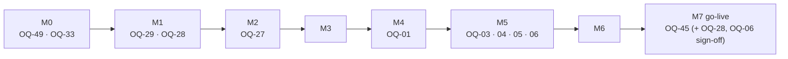

# Open Questions

Purpose: the prioritised list of questions only the client's stakeholders can answer, with the milestone each one blocks and the default we build on until it is answered. It also consolidates the questions raised in the architecture, design, quality and delivery documents into one register.

Status: Draft v0.1 (2026-10-21)

Related: [03 Gap Analysis & Decisions](03-gap-analysis-and-decisions.md) · [02 Requirements Catalog](02-requirements-catalog.md) · [05 Glossary](05-glossary.md) · [Development Approach §7.3–7.4](../delivery/01-development-approach.md) · [Milestones & Backlog](../delivery/02-milestones-and-backlog.md)

---

## 0. How to use this register

| Field | Meaning |
|---|---|
| **ID** | `OQ-nn`, stable, never reused. IDs cited elsewhere (for example OQ-27 in the security design) keep their meaning. |
| **Priority** | **P1** a wrong default causes legal exposure or expensive rework · **P2** a sensible default exists; an answer changes configuration or a few stories · **P3** low impact, or Post-MVP |
| **Blocking** | **Yes**: the milestone in "Needed by" cannot exit (or go-live cannot happen) without an answer. We still start on the default, but the delivery lead escalates the question as a risk when that milestone starts. **No**: the default is safe to ship; a later answer is absorbed at an iteration boundary. |
| **Needed by** | The latest milestone start at which the answer avoids rework ("last responsible moment"). |
| **Default** | What we build if no answer arrives. Every default is also written as an **Assumption** in the affected documents. |
| **Owner** (client side) | **PO** Product Owner · **FIN** Finance · **LEGAL** Legal / DPO · **SEC** IT and security · **OPS** Operations / support lead. **TL** (our Tech Lead) owns engineering-only questions. |

**Lifecycle:** Open → Answered (recorded in the [decision log](#5-decision-log)) → applied to the catalog, gap entries and ADRs in one PR → Closed. An answer that contradicts a default creates new requirement IDs; old ones are marked *Withdrawn*.

**Counts:** 49 questions. 11 P1 (all blocking), 26 P2, 12 P3.

---

## 1. Blocking questions at a glance

Sorted by the milestone they block. These eleven need answers first; OQ-49 comes before all others because it names the people who answer the rest.

| Needed by | OQ | Question (short) | Default until answered | Owner |
|---|---|---|---|---|
| **M0** | [OQ-49](#oq-49) | Who is the Product Owner with decision authority, and who is the sponsor? | Named at kick-off; acceptance blocked without one | Client sponsor |
| **M0** | [OQ-33](#oq-33) | Launch markets, AWS region, data residency | One market, one region, parameterised | PO, LEGAL |
| **M1** | [OQ-29](#oq-29) | How is the login email protected at rest? | Proposed change: plaintext under storage encryption (ADR-0010) | SEC, LEGAL |
| **M1** | [OQ-28](#oq-28) | Which privacy laws apply; who is the controller/DPO? | GDPR-grade baseline everywhere | LEGAL |
| **M2** | [OQ-27](#oq-27) | Maps/geocoding provider; interactive maps at launch? | Adapter; static map on detail page; provider chosen on cost and storage terms | PO, FIN |
| **M4** | [OQ-01](#oq-01) | Monetisation model: renter pays (SRS) or lister pays (flow chart)? | Renter pays 2 credits to "Show Number" | PO |
| **M5** | [OQ-03](#oq-03) | Package sizes and prices per currency | 20 / 50 / 120 credits; production prices required | FIN |
| **M5** | [OQ-04](#oq-04) | Currencies and currency-selection rules | Market currency; region → GeoIP → default | FIN |
| **M5** | [OQ-05](#oq-05) | Refund policy and consumer-law obligations | No self-service refunds; Finance refunds | FIN, LEGAL |
| **M5** | [OQ-06](#oq-06) | Tax on credit purchases | Tax-inclusive prices; no tax engine | FIN, LEGAL |
| **M7** (placeholders M1) | [OQ-45](#oq-45) | Terms, Privacy, Credits & Refund policy, Listing rules | Versioned placeholders until M7 | LEGAL, PO |

### 1.1 Questions needed per milestone (all priorities)

| Milestone | Questions |
|---|---|
| M0 | OQ-49 (P1), OQ-33 (P1), OQ-30, OQ-31, OQ-46, OQ-47 (infrastructure budget) |
| M1 | OQ-29 (P1), OQ-28 (P1), OQ-02, OQ-10, OQ-14, OQ-15, OQ-32, OQ-45 (placeholders) |
| M2 | OQ-27 (P1), OQ-19, OQ-22, OQ-23, OQ-24, OQ-25, OQ-26, OQ-36, OQ-37, OQ-38, OQ-39 |
| M3 | OQ-09, OQ-42 |
| M4 | OQ-01 (P1), OQ-11, OQ-12, OQ-13, OQ-17, OQ-34, OQ-35, OQ-43, OQ-44 |
| M5 | OQ-03, OQ-04, OQ-05, OQ-06 (all P1), OQ-07, OQ-47 (pen-test booking) |
| M6 | OQ-08, OQ-18, OQ-40, OQ-41 |
| M7 | OQ-45 (P1, final texts), OQ-16 |
| Post-MVP | OQ-20, OQ-21, OQ-48 |

This matches the decision deadlines in [Development Approach §7.4](../delivery/01-development-approach.md).

---

## 2. P1 questions in detail

### OQ-01 — Which monetisation model?

- **Question:** Do renters pay credits to see a lister's number ("Show Number", SRS §5), do listers pay credits to unlock renter inquiries (flow chart, SRC-03), or both?
- **Why it matters:** decides the M4 flows, the privacy notices, the pricing and the analytics. See [GAP-01](03-gap-analysis-and-decisions.md#gap-01).
- **Options:**

  | Option | For | Against |
  |---|---|---|
  | **A. Renter pays** (SRS) | Matches every CRITICAL SRS item; no renter data shared with listers; simplest | Listers gain nothing from the paywall and may leak their number in text or photos (GAP-65); some renters may avoid paid listings |
  | B. Lister pays to unlock leads (flow chart) | Renters search and inquire free, which helps demand; monetises the supply side | Needs inquiry forms, renter consent to share contact, lister notifications, lead-quality disputes; contradicts SRS §5 |
  | C. Both | Flexible pricing per market | Two pricing models, more UX and support complexity |

- **Default:** A for MVP. The wallet and ledger are model-agnostic (FR-CRED-07.4), so B or C can be added Post-MVP without schema changes.
- **If late:** M4 ships A. Switching later reworks the reveal UI, emails and pricing, not the wallet or ledger.
- **Related:** OQ-21 (free inquiry form), OQ-17 (lister notifications), OQ-44 (Show Number presentation).

### OQ-33 — Launch markets, hosting region and data residency

- **Question:** Which countries launch first, and in what order? Which AWS region should host production? Are there data-residency obligations (for example under GDPR or India's DPDP Act)?
- **Why it matters:** drives the Terraform region, currencies, address and phone formats, SMS sender registration, gateways, privacy law and geocoding terms ([GAP-58](03-gap-analysis-and-decisions.md#gap-58)).
- **Default:** one launch market and one AWS region, chosen with the client at M0 start; everything parameterised. Searches are scoped to one market (search design OQ-SRCH-01).
- **If late:** moving a region after real data exists means a database and storage migration.
- **Consolidates:** architecture A-1, performance OQ-PERF-03, listings OQ-LST-08, search OQ-SRCH-01.

### OQ-29 — How is the login email protected at rest?

- **Question:** Must the login email be field-level encrypted with an HMAC blind index (team baseline), or is plaintext under full storage encryption acceptable (proposed change)?
- **Why it matters:** the `accounts` schema is created at the start of M1. django-allauth looks emails up case-insensitively in several places, so encrypting them needs invasive overrides that each allauth upgrade can break ([GAP-12](03-gap-analysis-and-decisions.md#gap-12)).
- **Options:** (A) baseline: encrypted + blind index; about 3–5 extra days in M1 and upgrade risk. (B) proposed: plaintext under KMS storage encryption, DB role separation, access control and log redaction; blind-index hardening kept as a later option.
- **Default / recommendation:** **B**, as already drafted in the domain model (OQ-DM-04) and ADR-0010. SRS §9.1 says PII is pseudonymised "whenever possible", which leaves room for this. The baseline (A) remains documented as the fallback.
- **If late:** switching after go-live needs a data migration and the allauth overrides.
- **Consolidates:** domain model OQ-DM-04, architecture AR-4, security DEV-SEC-5.

### OQ-28 — Privacy regime, controller and DPO

- **Question:** Which privacy laws apply in the launch markets? Who is the data controller and DPO? Is consent needed for analytics and real-user monitoring? Must data export and deletion be self-service at launch? What are the legal retention periods for financial records, audit logs and PII?
- **Why it matters:** sign-up (M1) records Terms/Privacy acceptance and consent; retention jobs and erasure rules are designed in M1–M2 ([GAP-51](03-gap-analysis-and-decisions.md#gap-51)).
- **Default:** a GDPR-grade baseline everywhere: essential cookies only by default (consent banner if more is added), marketing opt-in off, data-subject requests handled by Support, retention per domain model §15.
- **If late:** go-live in a regulated market is blocked; consent and retention changes are retrofitted.
- **Consolidates:** domain model OQ-DM-01, performance OQ-PERF-06, security OQ-SEC-08 (DPO part).

### OQ-27 — Maps and geocoding provider; interactive maps at launch

- **Question:** Google Maps Platform or Mapbox? Do we need an interactive map on the listing page and in search at launch, or is a static map image enough?
- **Why it matters:** M2 geocodes every listing and stores the coordinates permanently. Provider terms differ on storing and caching results, and map loads are billed per view ([GAP-41](03-gap-analysis-and-decisions.md#gap-41)).
- **Default:** a provider-agnostic `geo.GeocodingService`; provider chosen on cost and on terms that **allow permanent storage** of coordinates (otherwise a lister-placed pin is used). Static map image on the detail page; a map toggle for the current results page; map-viewport search Post-MVP.
- **If late:** coordinates stored under the wrong terms may need re-geocoding.
- **Consolidates:** architecture A-3, search OQ-SRCH-06, listings OQ-INT-01.

### OQ-03 — Credit package sizes and prices

- **Question:** Which packages (the SRS example is 20, 50 and 120 credits) and what price per currency?
- **Default:** packages of 20, 50 and 120 credits with decreasing price per credit. Non-production uses placeholder prices; **production cannot sell credits without real prices**.
- **Related:** [GAP-13](03-gap-analysis-and-decisions.md#gap-13), FR-PAY-02.

### OQ-04 — Currencies and currency selection

- **Question:** Which currencies at launch? Is the order "account region → IP country → market default" right? May users choose a different currency?
- **Default:** one currency per market (from OQ-33); resolution account region → GeoIP (MaxMind GeoLite2) → market default; only price-book currencies offered; region locked after the first purchase to prevent cross-market price arbitrage.
- **Consolidates:** security OQ-SEC-04. Related: [GAP-13](03-gap-analysis-and-decisions.md#gap-13).

### OQ-05 — Refund policy and consumer-law obligations

- **Question:** Can users get refunds for unused credits? Are credits refunded when a revealed contact turns out to be wrong? If EU/UK consumers are in scope, should checkout collect the consent that removes the withdrawal right for immediately supplied digital content? When a refund or chargeback arrives after the credits were spent, is the shortfall recovered (for example from later purchases)?
- **Default:** no self-service refunds; Finance refunds through the gateway; staff can refund a bad reveal through a four-eyes `ADMIN_ADJUSTMENT`; the EU/UK consent checkbox is added only if those markets are in scope; shortfalls are recorded and handled by Finance case by case, with no automatic recovery.
- **Related:** [GAP-31](03-gap-analysis-and-decisions.md#gap-31), FR-PAY-06.

### OQ-06 — Tax on credit purchases

- **Question:** Are credit purchases subject to VAT/GST/sales tax in the launch markets? Are prices shown tax-inclusive? Who calculates and remits tax (for example via Stripe Tax)?
- **Default:** price-book amounts are tax-inclusive; no tax engine in MVP; receipts show tax lines only once Finance supplies the rules.
- **Consolidates:** architecture A-8. Related: [GAP-57](03-gap-analysis-and-decisions.md#gap-57).

### OQ-45 — Legal texts

- **Question:** Who drafts and approves the Terms of Use, Privacy Policy, Cookie notice, Credits & Refund Policy and Listing Rules (acceptable content, tag definitions, contact rules), and by when? What merchant identity (legal entity, address, tax ID, statement descriptor, support contact) appears on receipts and gateway statements?
- **Default:** versioned placeholder texts from M1 so acceptance can be recorded (NFR-SEC-05.1); merchant details as settings placeholders; final texts and details are a go-live gate in M7 (live payments need the merchant details at M5).
- **Related:** [GAP-31](03-gap-analysis-and-decisions.md#gap-31), [GAP-51](03-gap-analysis-and-decisions.md#gap-51), OQ-36. Consolidates payments OQ-PAY-08.

### OQ-49 — Project governance and decision authority

- **Question:** Who is the client's Product Owner with authority to answer this register and accept stories and milestones? Who is the sponsor for escalation? Is a 5-working-day acceptance window acceptable? Will client testers be available for a one-week UAT in M7? What are the launch-market deployment windows? In solo-developer mode, who is the external human reviewer for money-path changes?
- **Why it matters:** every other question in this register needs an accountable answerer. The delivery process cannot accept a milestone without a named Product Owner ([Definition of Done §12](../delivery/05-definition-of-done-and-workflow.md)).
- **Default:** named at kick-off; acceptance is blocked without one. 5-working-day acceptance window; two client testers for UAT; deployment windows per delivery defaults; the solo-mode reviewer must be named before M4.
- **Consolidates:** delivery DQ-2, DQ-4, DQ-5, DQ-6, DQ-7.

---

## 3. Full register by area

Linked IDs point to §2. "Gap" refers to [03](03-gap-analysis-and-decisions.md).

### 3.1 Product and monetisation

| ID | Question | Default until answered | Pri | Blocking | Needed by | Owner | Links |
|---|---|---|---|---|---|---|---|
| [OQ-01](#oq-01) | Renter pays (SRS), lister pays (flow chart) or both? | Renter pays 2 credits; generic ledger | P1 | Yes | M4 | PO | GAP-01; FR-CRED, FR-LEAD-01 |
| OQ-12 | Do credits expire (promo or purchased)? | Never expire | P2 | No | M4 | PO, FIN, LEGAL | GAP-32; OQ-DM-02 |
| OQ-13 | After a reveal, if the lister changes the contact, does the renter see the snapshot, the current contact or both? Is 24-month retention of the encrypted snapshot acceptable? | Both, free; 24 months | P2 | No | M4 | PO, LEGAL | GAP-34; FR-CRED-04.4; OQ-DM-05 |
| OQ-17 | Should listers be told when their number is revealed (count, digest, or with renter identity)? | No per-reveal notification; dashboard counts only | P2 | No | M4 | PO, LEGAL | GAP-59; FR-LEAD-01.2; A-9; OQ-LST-10 |
| OQ-21 | Is a free inquiry / contact-request form wanted, and when? | Post-MVP | P3 | No | Post-MVP | PO | GAP-01, GAP-18; FR-LEAD-01.1 |
| OQ-34 | May the reveal email contain the revealed phone/email? | Yes (held until the email is verified) | P2 | No | M4 | PO, LEGAL | GAP-36; FR-CRED-05.2 |
| OQ-43 | Must business users change the reveal cost (2) and promo amount (10) without a deploy? How are price changes announced? | Configuration change by the team; applies to new transactions only | P3 | No | M4 | PO | GAP-64; FR-CRED-01.3 |
| OQ-44 | Keep Show Number hidden at balance 0 (literal SRS, with "Get credits to view number"), and offer reveals only on the detail page? | Yes to both | P3 | No | M4 | PO | GAP-05, GAP-35 |
| OQ-48 | Ranking boosts or paid promotion slots as a further revenue line? | None in MVP | P3 | No | Post-MVP | PO | OQ-SRCH-05 |

### 3.2 Identity and accounts

| ID | Question | Default until answered | Pri | Blocking | Needed by | Owner | Links |
|---|---|---|---|---|---|---|---|
| OQ-02 | Confirm the three user types (Renter, Lister, Staff) and staff sub-roles (Moderator, Support, Finance, Superadmin). Are staff accounts dedicated (no renting or listing from them)? | As in GAP-04; dedicated staff accounts | P2 | No | M1 (groups), M6 (permissions) | PO, OPS | GAP-04; FR-AUTH-06 |
| OQ-10 | Verification by email only, phone only, or either? Is a phone mandatory at sign-up? | Either activates; phone optional at sign-up | P2 | No | M1 | PO | GAP-26, 29, 30; FR-AUTH-03.3 |
| OQ-11 | Is "one promo per verified email or phone" enough, or must the promo require a verified phone? | One per verified identity + disposable-email block + rate limits | P2 | No | M4 | PO, FIN | GAP-06; FR-AUTH-04.4 |
| OQ-14 | Are Google and Apple sign-in needed at launch? | M1 stretch, else Post-MVP | P3 | No | M1 | PO | GAP-23, 24; FR-AUTH-02 |
| OQ-15 | Authentication policy: (a) password rules by length and blocklist, or composition rules too? (b) keep the real-time "email already registered" check, or switch to enumeration-safe sign-up? | (a) min 12 chars, blocklist, no composition rules; (b) keep, with 10/min/IP limit and Turnstile | P2 | No | M1 | PO, SEC | GAP-27, 28; FR-AUTH-01.3/01.4; OQ-SEC-02 |
| OQ-16 | Account closure: self-service or via Support? What happens to unused credits? How long may unverified accounts live? | Via Support; credits forfeited; unverified deleted after 7 days | P2 | No | M7 | PO, LEGAL, FIN | GAP-60; OQ-DM-03 |
| [OQ-29](#oq-29) | Login email: field-level encrypted (baseline) or plaintext under storage encryption (proposed)? | Proposed change (ADR-0010); baseline as fallback | P1 | Yes | M1 | SEC, LEGAL | GAP-12; NFR-SEC-01.5 |

### 3.3 Listings

| ID | Question | Default until answered | Pri | Blocking | Needed by | Owner | Links |
|---|---|---|---|---|---|---|---|
| OQ-19 | Pre-moderation: flagged listings only, a lister's first listing, or every listing? | `flagged_only` | P2 | No | M2 | PO, OPS | GAP-46; FR-LIST-01.6; OQ-LST-07 |
| OQ-22 | Is the exact street address public, shown only after a reveal, or never? | Lister's choice, default `APPROXIMATE` | P2 | No | M2 | PO, LEGAL | GAP-61; OQ-LST-02; OQ-PRIV-03 |
| OQ-23 | Accepted image formats (HEIC?) and the aspect-ratio policy | JPEG/PNG/WebP; policy in listings design §8.3 | P2 | No | M2 | PO | GAP-21; FR-LIST-02.10/02.12 |
| OQ-24 | Property types, optional attributes and rent periods; are commercial or short-term rentals in scope? | 7 residential types; monthly or weekly; residential long-term only | P2 | No | M2 | PO | GAP-43; FR-LIST-02.2/02.3; OQ-LST-05 |
| OQ-25 | Must a listing contact phone that differs from the account phone be OTP-verified? | Yes | P3 | No | M2 | PO | GAP-63; OQ-LST-03 |
| OQ-26 | Listing expiry period and draft retention | 60 days with renewal; drafts archived after 90 idle days, deleted 30 days later | P2 | No | M2 | PO | GAP-45; FR-LIST-04.11/04.12; OQ-LST-01; OQ-DM-06 |
| OQ-36 | Lister tag meaning: is an "Agent" only a licensed broker, or anyone listing for the owner (for example a property manager)? What evidence does a tag change need? Should renters see the tag-change history? | Agent = anyone listing on the owner's behalf; evidence optional; history visible to staff only | P2 | No | M2 | PO, LEGAL | GAP-22; FR-LIST-03; OQ-LST-06 |
| OQ-37 | Contact fields: phone mandatory and email optional? Does Show Number reveal both? | Phone required, email optional; both revealed when present | P2 | No | M2 | PO | GAP-20; FR-LIST-02.7 |
| OQ-38 | Is "within 60 s" acceptable for "instantly" updated listing metrics? | Yes | P3 | No | M2 | PO | GAP-39; FR-LIST-04.10 |
| OQ-39 | Is hard-blocking contact details in titles and descriptions acceptable? | Yes; obfuscated matches raise a moderation flag | P2 | No | M2 | PO | GAP-65; FR-LIST-02.9; OQ-LST-04 |

### 3.4 Search and maps

| ID | Question | Default until answered | Pri | Blocking | Needed by | Owner | Links |
|---|---|---|---|---|---|---|---|
| [OQ-27](#oq-27) | Maps/geocoding provider; interactive maps at launch? | Adapter; static detail map; results-page map toggle | P1 | Yes | M2 | PO, FIN | GAP-18, 41; A-3; OQ-SRCH-06; OQ-INT-01 |
| OQ-42 | Does saving a property need a verified account, or is login enough? | Verified | P3 | No | M3 | PO | GAP-19; FR-SAVE-01.1; OQ-SRCH-07 |

### 3.5 Payments and finance

| ID | Question | Default until answered | Pri | Blocking | Needed by | Owner | Links |
|---|---|---|---|---|---|---|---|
| [OQ-03](#oq-03) | Package sizes and prices per currency | 20/50/120 with volume discount; real prices required for production | P1 | Yes | M5 | FIN | GAP-13; FR-PAY-02.1 |
| [OQ-04](#oq-04) | Launch currencies and selection rules | Market currency; region → GeoIP → default; locked after first purchase | P1 | Yes | M5 | FIN | GAP-13; FR-PAY-02.4; OQ-SEC-04 |
| [OQ-05](#oq-05) | Refund policy; EU/UK withdrawal consent; recovering a shortfall after refunds or chargebacks | No self-service; Finance refunds; four-eyes reveal refunds; shortfalls handled case by case | P1 | Yes | M5 | FIN, LEGAL | GAP-31; FR-PAY-06.2; OQ-PAY-03, OQ-PAY-07 |
| [OQ-06](#oq-06) | Tax on credit purchases | Tax-inclusive; no tax engine | P1 | Yes | M5 | FIN, LEGAL | GAP-57; A-8 |
| OQ-07 | Gateways and payment methods per market: is a local gateway (for example Razorpay) or method (UPI, Apple Pay, Google Pay) required? Any delayed-notification methods (SEPA debit, bank transfer) that cannot be "instant"? | Stripe + PayPal; Razorpay adapter only on request; no delayed-notification methods | P2 | No | M5 | FIN, PO | GAP-14; FR-PAY-03.5; OQ-PAY-04, OQ-PAY-09 |

### 3.6 Operations, moderation and trust

| ID | Question | Default until answered | Pri | Blocking | Needed by | Owner | Links |
|---|---|---|---|---|---|---|---|
| OQ-18 | Tag-change review SLA and Moderator staffing | 2 business days | P3 | No | M6 | OPS | GAP-22; FR-OPS-03.1; OQ-LST-09 |
| OQ-20 | Owner/KYC verification: wanted, which provider, when? | Post-MVP; storage hooks only | P3 | No | Post-MVP | PO, LEGAL | GAP-18; FR-KYC-01 |
| OQ-35 | Reveal rate limits per user | 10/min, 30/hour, 100/day; Turnstile step-up on risk | P2 | No | M4 | PO, OPS | GAP-66; FR-CRED-08.1; security §6 |
| OQ-40 | Moderation policies: reason codes, takedown rules, automatic bans, staff headcount and hours | Reason codes per moderation design; no automatic bans; business-hours coverage | P2 | No | M6 | OPS, PO | GAP-46; FR-OPS-02, 04 |
| OQ-41 | How do staff reach the ops console (VPN, zero-trust access, IP allow-list)? Is TOTP enough or is WebAuthn required? | WAF IP allow-list + mandatory TOTP; WebAuthn for Superadmin/Finance in M6 if supported | P2 | No | M6 | SEC | GAP-62; FR-OPS-01.1; A-6; OQ-SEC-03 |

### 3.7 Platform and non-functional

| ID | Question | Default until answered | Pri | Blocking | Needed by | Owner | Links |
|---|---|---|---|---|---|---|---|
| OQ-08 | Confirm 99.9 % monthly availability, RPO ≤ 5 min, RTO ≤ 1 h and regional DR (RPO ≤ 1 h, RTO ≤ 8 h). Pilot-light or warm-standby DR? Support hours and on-call model after launch (business hours or 24/7), and on-call tooling? | Proposed values; pilot-light DR; business hours + S1 on-call during hypercare; SNS email + chat alerts | P2 | No | M6 (sizing from M0) | PO, OPS | GAP-16; NFR-AVAIL-01.4–01.6; A-5; INF-7, INF-10; DQ-3 |
| OQ-09 | Traffic forecast per market; definitions of "standard" and "peak" load; is 1,000 debits/s a launch load or a ceiling; expected receipt-email volume and who funds the provider quota? | Search 50 req/s standard, 5× peak; 1,000 debits/s is a design ceiling; email quota sized to forecast × 3 | P2 | No | M3 | PO, FIN | GAP-17, 56; NFR-PERF-01, 02; A-4; OQ-PERF-01/02/04; OQ-SRCH-04; TQ-3 |
| OQ-30 | Accept the coverage-gate interpretation | ≥ 90 % domain code; ≥ 85 % repo, ratcheting | P3 | No | M0 | PO | GAP-15; NFR-CODE-01.3 |
| OQ-31 | Launch languages | English only; i18n-ready code | P2 | No | M0 | PO | GAP-52; NFR-UX-07.1; OQ-SRCH-08 |
| OQ-32 | Email provider: Amazon SES or Mailgun (named in the diagram)? | SES through django-anymail | P3 | No | M1 | PO, SEC | FR-CRED-05.4; A-2 |
| [OQ-33](#oq-33) | Launch markets, AWS region, data residency | One market, one region, parameterised | P1 | Yes | M0 | PO, LEGAL | GAP-58; A-1; OQ-PERF-03; OQ-LST-08 |

### 3.8 Legal, security and commercial

| ID | Question | Default until answered | Pri | Blocking | Needed by | Owner | Links |
|---|---|---|---|---|---|---|---|
| [OQ-28](#oq-28) | Privacy laws, controller/DPO, consent, data-subject rights, retention | GDPR-grade baseline | P1 | Yes | M1 (go-live M7) | LEGAL | GAP-51; NFR-SEC-05; OQ-DM-01; OQ-PERF-06 |
| [OQ-45](#oq-45) | Terms, Privacy, Cookie notice, Credits & Refund Policy, Listing Rules; merchant identity on receipts | Versioned placeholders until M7 | P1 | Yes | M7 (placeholders M1) | LEGAL, PO | GAP-31, 51; OQ-PAY-08 |
| OQ-46 | Client IT, security and tooling policies: Terraform (BSL licence) or OpenTofu; Valkey or Redis OSS; multi-account AWS organisation; egress allow-list; TLS inside the VPC; SaaS vendors and data regions (Sentry, observability); Node.js in CI; issue tracker; GitHub plan (arm64 runners); production domains and who controls DNS and the email-sending domain; how stakeholders reach staging | Defaults in tech stack §7 (T-1 … T-5), architecture A-7, security OQ-SEC-05 … 07 and infrastructure §19 | P2 | No | M0 | SEC | T-1 … T-5; A-7; OQ-SEC-05/06/07; INF-2, 3, 6, 9; DQ-1 |
| OQ-47 | Budgets and security contacts: monthly infrastructure ceiling per environment; AWS Support plan; pen-test vendor and budget; non-functional testing budgets (staging scale-up windows, device lab, JAWS audit); paid fraud tooling; security contact for incidents and regulator notices | Indicative infrastructure ranges (infrastructure §12.2); Business support from go-live; external pen test of about 8–10 tester-days; staging scale-up for M3, M4, M5, M7; two-phone device lab; JAWS optional; default Stripe Radar only | P2 | No | M0 (infra budget), M5 (pen-test booking) | FIN, SEC, PO | OQ-SEC-08/09; OQ-PERF-05; TQ-4/5; INF-4, INF-8; OQ-PAY-10 |

### 3.9 Governance

| ID | Question | Default until answered | Pri | Blocking | Needed by | Owner | Links |
|---|---|---|---|---|---|---|---|
| [OQ-49](#oq-49) | Named Product Owner and sponsor; acceptance window; UAT testers; deployment windows; solo-mode money-path reviewer | Named at kick-off; 5-day acceptance; 2 UAT testers | P1 | Yes | M0 | Client sponsor | DQ-2, 4, 5, 6, 7 |

---

## 4. Consolidated register of questions raised in other documents

Other documents keep their local IDs. This table maps each one to the master question above, or marks it **Engineering** when our team answers it without the client.

| Local ID | Source | Topic | Master |
|---|---|---|---|
| A-1 | [Architecture §18](../architecture/01-system-architecture.md) | Launch markets, region, residency | OQ-33 |
| A-2 | Architecture §18 | Email provider | OQ-32 |
| A-3 | Architecture §18 | Maps/geocoding provider | OQ-27 |
| A-4 | Architecture §18 | Traffic forecast; 1,000 TPS launch or ceiling | OQ-09 |
| A-5 | Architecture §18 | SLA, RPO, RTO, regional DR | OQ-08 |
| A-6 | Architecture §18 | Ops console access | OQ-41 |
| A-7 | Architecture §18 | Observability backend, Sentry region | OQ-46 |
| A-8 | Architecture §18 | VAT/GST on purchases | OQ-06 |
| A-9 | Architecture §18 | Lister notified of reveals | OQ-17 |
| T-1 … T-3, T-5 | [Tech stack §7](../architecture/02-tech-stack.md) | Valkey, Terraform/OpenTofu, Sentry hosting, Node.js in CI | OQ-46 |
| T-4 | Tech stack §7 | Feature-flag library | Engineering |
| CS-1 … CS-5 | [Codebase structure §16](../architecture/03-codebase-structure.md) | Naming, queues, CSP, polling syntax, verification app skeleton | Engineering (see [03 §4](03-gap-analysis-and-decisions.md#4-cross-document-consistency-items) CI-08) |
| OQ-DM-01 | [Domain model §17](../design/01-domain-model.md) | Legal retention periods | OQ-28 |
| OQ-DM-02 | Domain model §17 | Credit expiry | OQ-12 |
| OQ-DM-03 | Domain model §17 | Unverified-account purge | OQ-16 |
| OQ-DM-04 | Domain model §17 | Login email encryption | OQ-29 |
| OQ-DM-05 | Domain model §17 | Reveal contact snapshot retention | OQ-13 |
| OQ-DM-06 | Domain model §17 | Hard-delete of never-published drafts | OQ-26 |
| OQ-LST-01 | [Listings design §15](../design/05-listings-and-media.md) | Listing expiry | OQ-26 |
| OQ-LST-02 | Listings design §15 | Exact address public? | OQ-22 |
| OQ-LST-03 | Listings design §15 | Contact phone OTP | OQ-25 |
| OQ-LST-04 | Listings design §15 | Blocking contact details in text | OQ-39 |
| OQ-LST-05 | Listings design §15 | Commercial/short-term scope, rent periods | OQ-24 |
| OQ-LST-06 | Listings design §15 | Tag-change history visible to renters | OQ-36 |
| OQ-LST-07 | Listings design §15 | Pre-moderation policy | OQ-19 |
| OQ-LST-08 | Listings design §15 | Launch countries | OQ-33 |
| OQ-LST-09 | Listings design §15 | Tag-change review SLA | OQ-18 |
| OQ-LST-10 | Listings design §15 | Lister told about reveals | OQ-17 |
| OQ-INT-01 | Listings design §5.1 (integrations design) | Provider terms for storing geocodes | OQ-27 |
| OQ-SRCH-01 | [Search design §17](../design/06-search-and-discovery.md) | One market per search | OQ-33 |
| OQ-SRCH-02 | Search design §17 | City search: whole city or radius | Engineering (product review in M3) |
| OQ-SRCH-03 | Search design §17 | Seed a gazetteer | Engineering |
| OQ-SRCH-04 | Search design §17 | Standard/peak search load | OQ-09 |
| OQ-SRCH-05 | Search design §17 | Ranking boosts, paid promotion | OQ-48 |
| OQ-SRCH-06 | Search design §17 | Map-based search at launch | OQ-27 |
| OQ-SRCH-07 | Search design §17 | Saving requires verification | OQ-42 |
| OQ-SRCH-08 | Search design §17 | Stemming languages | OQ-31 |
| OQ-PERF-01, 02, 04 | [Performance §15](../quality/02-nfr-performance-and-scalability.md) | Traffic forecast, load definitions, email volume | OQ-09 |
| OQ-PERF-03 | Performance §15 | Launch markets, region | OQ-33 |
| OQ-PERF-05 | Performance §15 | Staging scale-up budget | OQ-47 |
| OQ-PERF-06 | Performance §15 | RUM without consent | OQ-28 |
| OQ-SEC-01 | [Security §14](../quality/01-security-and-compliance.md) | Argon2 parameters | Engineering (M1 benchmark) |
| OQ-SEC-02 | Security §14 | Real-time email-uniqueness check | OQ-15 |
| OQ-SEC-03 | Security §14 | WebAuthn for staff | OQ-41 |
| OQ-SEC-04 | Security §14 | Currency choice rules | OQ-04 |
| OQ-SEC-05, 06, 07 | Security §14 | Egress allow-list, internal TLS, multi-account AWS | OQ-46 |
| OQ-SEC-08 | Security §14 | Security contact, DPO | OQ-47 (contact), OQ-28 (DPO) |
| OQ-SEC-09 | Security §14 | Pen-test budget and vendor | OQ-47 |
| OQ-PRIV-03 | Security §7 (privacy design ID) | Address lines public for `EXACT` listings | OQ-22 |
| TQ-1, TQ-2 | [Testing strategy §19](../delivery/04-testing-strategy.md) | Staging email inbox; Twilio test number | Engineering (TQ-2 depends on OQ-33) |
| TQ-3 | Testing strategy §19 | Traffic forecast | OQ-09 |
| TQ-4, TQ-5 | Testing strategy §19 | JAWS audit; device testing budget | OQ-47 |
| OQ-PAY-01 | [Payments design §24](../design/07-payments-and-credit-purchase.md) | Packages and prices | OQ-03 |
| OQ-PAY-02 | Payments design §24 | VAT/GST, tax invoices | OQ-06 |
| OQ-PAY-03 | Payments design §24 | Refunds, EU/UK withdrawal consent | OQ-05 |
| OQ-PAY-04 | Payments design §24 | India as a launch market (Razorpay) | OQ-07 (and OQ-33) |
| OQ-PAY-05 | Payments design §24 | Currency choice, region lock | OQ-04 |
| OQ-PAY-06 | Payments design §24 | Credit expiry | OQ-12 |
| OQ-PAY-07 | Payments design §24 | Recovering a refund/chargeback shortfall | OQ-05 |
| OQ-PAY-08 | Payments design §24 | Merchant legal entity and receipt details | OQ-45 |
| OQ-PAY-09 | Payments design §24 | Delayed-notification payment methods (SEPA, bank transfer, UPI collect) | OQ-07 |
| OQ-PAY-10 | Payments design §24 | Paid fraud tooling budget | OQ-47 |
| OQ-PAY-11 | Payments design §24 | Reconciliation schema additions | Engineering |
| INF-1 | [Infrastructure §19](../architecture/04-infrastructure-and-deployment.md) | Primary and DR region | OQ-33 (DR posture: OQ-08) |
| INF-2, INF-3, INF-6, INF-9 | Infrastructure §19 | Domains and DNS control; multi-account AWS; GitHub runners; staging access | OQ-46 |
| INF-4, INF-8 | Infrastructure §19 | Infrastructure budget ceiling; AWS Support plan | OQ-47 |
| INF-5, INF-11 | Infrastructure §19 | Blue/green for prod web; Fargate Spot | Engineering |
| INF-7, INF-10 | Infrastructure §19 | On-call tooling; warm-standby DR | OQ-08 |
| DQ-1 | [Definition of Done §12](../delivery/05-definition-of-done-and-workflow.md) | Issue tracker | OQ-46 |
| DQ-2, DQ-4 … DQ-7 | Definition of Done §12 | Product Owner, deployment windows, UAT testers, acceptance window, solo-mode reviewer | OQ-49 |
| DQ-3 | Definition of Done §12 | Support model after launch | OQ-08 |

Deviation and proposed-change registers in other documents (security DEV-SEC-1 … 5, performance P-01 … P-06) are mapped in [03 §3](03-gap-analysis-and-decisions.md#3-deviation-register) and [03 §4](03-gap-analysis-and-decisions.md#4-cross-document-consistency-items).

---

## 5. Decision log

Answers are recorded here before they are applied anywhere else.

| Date | OQ / GAP | Answer | Decided by | Applied in (PR / docs) |
|---|---|---|---|---|
| — | — | *No decisions recorded yet.* | — | — |

## 4. Hosting questions added 2026-10-27 (ADR-0014)

AWS is no longer the target. These replace the AWS-specific parts of OQ-33 and the infrastructure questions (INF-*, T-2).

| ID | Question | Default until answered | Needed by |
|---|---|---|---|
| OQ-50 | Which hosting target at launch: PaaS (Render, Railway, Heroku, Fly.io) or self-hosted (Compose, Kamal, Coolify)? | A PaaS (Render) for the pilot; Kamal on ≥ 2 hosts + managed Postgres for cost-optimised production | Before M7 |
| OQ-51 | Which managed Postgres? It must support PostGIS, pg_trgm and PITR, in a region that meets OQ-33 | The chosen PaaS's own if it supports PostGIS; otherwise an external managed Postgres | Before M7 |
| OQ-52 | Which S3-compatible object storage for photos and private documents? | Cloudflare R2 | M2 |
| OQ-53 | Which transactional email provider? | Postmark or Mailgun via Anymail | M1 |
| OQ-54 | Put Cloudflare (CDN, WAF, DDoS) in front of every environment? | Yes | Before M7 |
