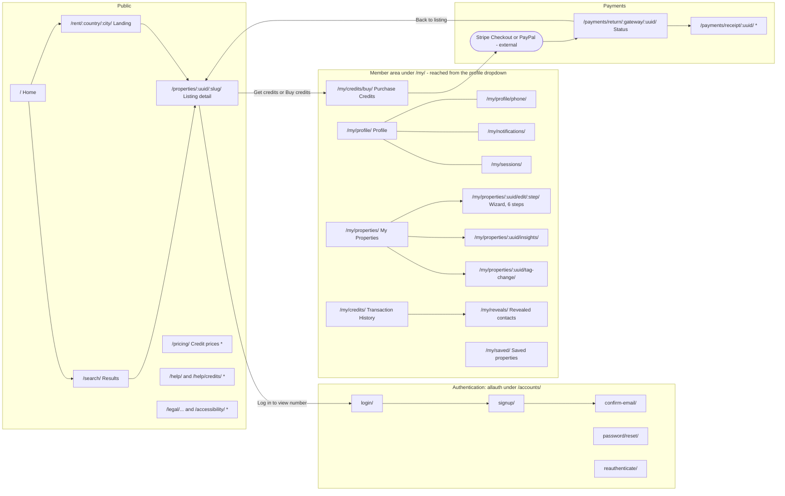
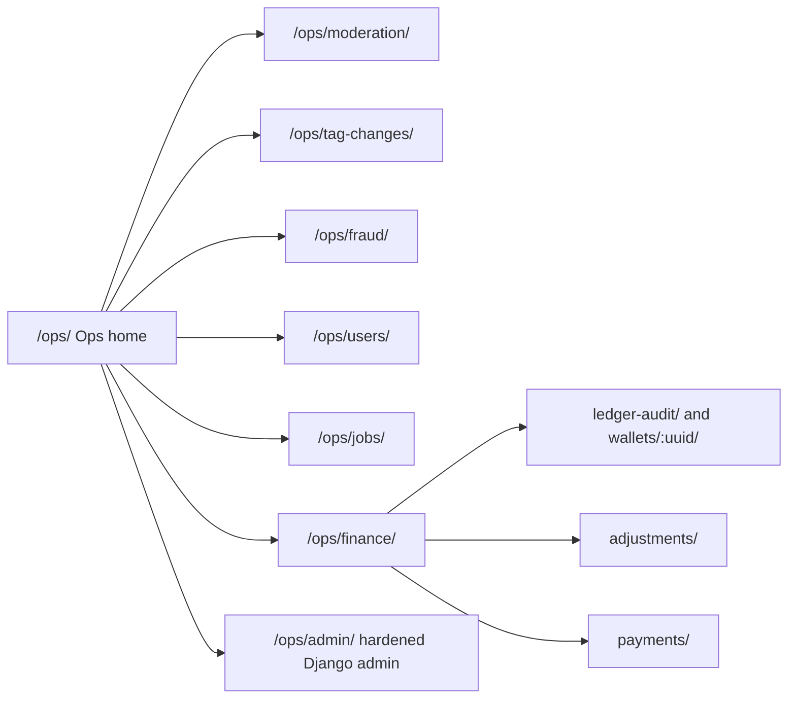
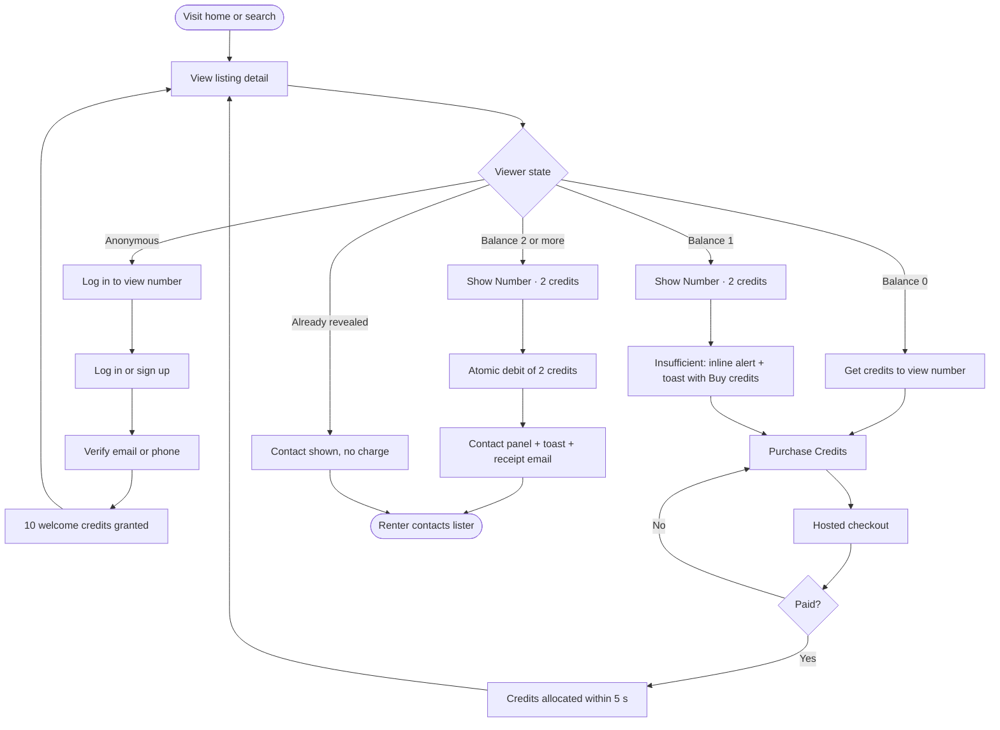
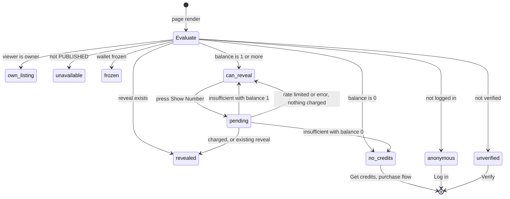
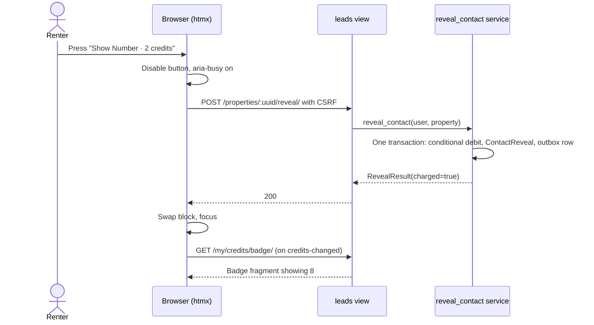

# UX and Page Inventory

The user-experience specification for the Rent Property Listing MVP: sitemap, every page with its URL, template, audience, components and HTMX interactions, the global components (header, credit badge, profile dropdown, property card, Show Number, toasts, dialogs), design tokens that meet WCAG 2.1 AA, keyboard and focus rules, page states, breakpoints, i18n/RTL readiness and Core Web Vitals.

Status: Draft v0.1 (2026-10-21)

Related: [02 Milestones & Backlog](../delivery/02-milestones-and-backlog.md) · [03 Engineering Standards §12–§13](../delivery/03-engineering-standards.md#12-templates-htmx-alpine-and-tailwind-conventions) · [04 Testing Strategy §10–§11](../delivery/04-testing-strategy.md#11-accessibility-tests) · [05 DoD & Workflow](../delivery/05-definition-of-done-and-workflow.md) · [Codebase Structure §7–§9](../architecture/03-codebase-structure.md#7-url-namespace-map) · [Listings & Media design](../design/05-listings-and-media.md) · [Search & Discovery design](../design/06-search-and-discovery.md) · [Requirements Catalog](../requirements/02-requirements-catalog.md)

---

## 1. Scope, principles and precedence

### 1.1 Scope

This document covers every user-facing surface of the MVP: public pages, authentication, the member account area, the lister area, credits and payments, the ops console, system pages and transactional emails. Post-MVP surfaces (lead inquiry forms, KYC, map search, mobile API) are listed only where the MVP must leave room for them.

### 1.2 UX principles

| # | Principle | What it means in practice |
|---|---|---|
| UX-P1 | **Never surprise anyone with a charge** | The 2-credit cost is shown next to every paid action. The balance is visible on every page. A user is never charged twice for the same property, and every failure message says whether they were charged. |
| UX-P2 | **Mobile first** | Every component is designed at 360 px first and must work at 320 px (SRS §11.2). Desktop adds columns; it never adds features that mobile lacks. |
| UX-P3 | **Server-rendered and fast** | Pages are complete HTML from the server. HTMX swaps small fragments; Alpine.js only holds local UI state ([03 §12](../delivery/03-engineering-standards.md#12-templates-htmx-alpine-and-tailwind-conventions)). Nothing needs a network round trip to open (dropdown, dialogs). |
| UX-P4 | **Progressive enhancement** | Forms, search and the Show Number action work without JavaScript (POST/redirect/GET). Photo upload and cropping are the only JS-dependent features ([Listings §4.2](../design/05-listings-and-media.md#42-request-model)). |
| UX-P5 | **Accessible by default (WCAG 2.1 AA)** | Native elements first, ARIA only where needed. Every state is reachable by keyboard and announced to screen readers. Colour never carries meaning alone. |
| UX-P6 | **Stable layout** | Reserved space for images, badges and async content. Overlays (dropdown, toasts, dialogs) never push content (CLS ≤ 0.1). |
| UX-P7 | **Trust through clarity** | AgentListed and OwnerListed are unmistakable (icon + text + colour). Copy is plain and specific. No dark patterns in the purchase flow. |
| UX-P8 | **Privacy in the markup** | Listing contact details are never in HTML, JSON, caches or history snapshots until revealed (known issue #20; [03 SEC-5](../delivery/03-engineering-standards.md#17-security-coding-rules)). |
| UX-P9 | **Translatable from day one** | Every string goes through gettext; layouts tolerate 40 % text expansion and right-to-left scripts ([§14](#14-internationalisation-and-rtl-readiness)). |
| UX-P10 | **One component, one behaviour** | The tag badge, card, Show Number block, toast and dialog are single shared components. Pages compose them; they do not restyle them. |

### 1.3 Precedence

| Topic | Authoritative source | This document |
|---|---|---|
| URL paths and namespaces | [Codebase Structure §7](../architecture/03-codebase-structure.md#7-url-namespace-map) | Uses those paths. Paths marked **(proposed)** are additions that must be added to that table in the PR that creates them ([§17](#17-consistency-notes-and-deviations)) |
| Template locations and naming | [Codebase Structure §8.1](../architecture/03-codebase-structure.md#81-template-locations-and-naming) | Follows it: pages at `apps/<app>/templates/<app>/<noun>_<view>.html`, written here as `<app>/<noun>_<view>.html`; partials at `<app>/partials/_<noun>.html`; shared components at `templates/components/_<name>.html` |
| Listing wizard fields, validation rules, image policy, lifecycle | [Listings & Media design §4–§10](../design/05-listings-and-media.md#4-multi-step-listing-wizard-srs-41-112) | Specifies presentation and interaction only |
| Search parameters, ranking, card data rules | [Search & Discovery design §2](../design/06-search-and-discovery.md#2-search-experience-and-url-contract) | Specifies presentation and interaction only |
| Requirement wording and IDs | [Requirements Catalog](../requirements/02-requirements-catalog.md) | References atomic IDs (`FR-CRED-01.4`) |
| Backlog URLs and labels | [02](../delivery/02-milestones-and-backlog.md) marks them **indicative** | Where 02 differs, this document and the architecture win ([§17](#17-consistency-notes-and-deviations)) |

---

## 2. Audiences and access levels

### 2.1 Audiences

| Audience | Who | Main goals |
|---|---|---|
| **Visitor** | Anonymous | Search, browse listings, understand how credits work, sign up |
| **Member, unverified** | Registered, email/phone not yet verified | Verify; meanwhile browse, search and edit their profile. Cannot list, save, reveal or buy (FR-AUTH-03.4) |
| **Renter** | Any verified member | Find homes, save them, reveal contacts with credits, buy credits, review history |
| **Lister** | The same verified member, once they create a listing (Owner or Agent is a per-listing tag) | Publish and manage listings, track metrics, request tag changes |
| **Staff** | `is_staff` + MFA + group: **Moderator**, **Support**, **Finance**, **Superadmin** | Moderate listings, review tag changes and fraud, audit the ledger, resolve payment issues, look up users, monitor jobs |

The same person can be a renter and a lister with one account (RBAC baseline, [Architecture §3](../architecture/01-system-architecture.md#3-roles-rbac-baseline)). The header, dropdown and pages never ask "are you a renter or a lister?". The client flow chart's "User Role Choice" is implemented as two entry points on the home page: **Search homes** and **List your property**.

### 2.2 Access codes used in the inventory

| Code | Meaning | Enforced by | Response when not met |
|---|---|---|---|
| `PUB` | Anyone | — | — |
| `ANON` | Anonymous only | allauth | Logged-in users are redirected to `/` |
| `AUTH` | Logged in (verified or not) | `login_required` | Redirect to `/accounts/login/?next=…` (HTMX: `HX-Redirect`) |
| `VER` | Logged in **and** verified (`can_transact`) | `verified_required` + service check | 403 "Verify your account" page (A-08) or fragment |
| `OWN` | `VER` + owns the object | Owner-scoped selector | **404** (never 403, so existence is not leaked) |
| `STAFF:<group>` | Staff with MFA, in the group, from an allowed network | `permission_required` + MFA middleware + WAF IP allow-list | 403 (staff) / 404 (non-staff) |
| `TOKEN` | Signed token in the URL | View | 400 "This link is invalid or has expired" |

### 2.3 How unverified members experience restrictions

- A persistent **verification banner** under the header ([§5.1](#51-header-layout)) on every page.
- Transactional actions (List your property, Save, Show Number, Purchase Credits) stay **visible** but lead to the verification page or show "Verify to view number" ([§7](#7-show-number-button-states)). Hiding them would make the product's value invisible before verification.
- The balance badge shows **0** until verification grants the 10 welcome credits (FR-AUTH-04.1).

---

## 3. Sitemap

Notation: `:uuid` / `:slug` / `:step` are path parameters. Items marked `*` are **(proposed)** paths not yet in the architecture URL map.

### 3.1 Public, account and lister areas



### 3.2 Ops console



The `/ops/` sub-paths are **(proposed)**: the architecture map lists `/ops/` and its features but not the individual paths.

### 3.3 Primary renter journey (MVP, renter-pays)

This replaces the client flow chart's "submit inquiry → lister unlocks lead" branch with the SRS model (Open Question #1, baseline renter-pays). The lister-pays unlock and free inquiry form are Post-MVP (US-904, US-905).



**Proposed (small addition):** the purchase flow remembers where the user came from (`next`, validated as a same-site path and stored in the session), so the payment success page offers **Back to listing**. That returns the renter to the Show Number button they were trying to use. See UX-OQ-09.

---

## 4. Page inventory

### 4.0 Column legend

- **ID:** stable page ID used in stories, tests and the a11y sweep (`tests/a11y/` visits every ID, [04 §11.1](../delivery/04-testing-strategy.md#111-automated)).
- **Template:** page template, plus the partial used for HTMX responses (`template.html#partial` = django-template-partials fragment).
- **Access:** codes from [§2.2](#22-access-codes-used-in-the-inventory).
- **MS:** milestone the page first ships in ([02](../delivery/02-milestones-and-backlog.md)).
- All pages extend `layouts/app.html` (header + footer), except the ops console (`layouts/ops.html`) and minimal flows marked *minimal* (`layouts/minimal.html`: logo, no navigation; used for auth and payment-return pages to reduce distraction). **Assumption:** `layouts/minimal.html` is a new layout alongside the two in codebase §8.1.

### 4.1 Public pages

| ID | Page | URL | Template | Access | Key components | HTMX / Alpine interactions | MS | Req |
|---|---|---|---|---|---|---|---|---|
| P-01 | Home | `/` | `search/home.html` | PUB | Search hero (location combobox, type select, max price, **Search homes** button); "List your property" entry point; "Recent homes" row (compact cards); "How credits work" strip (welcome credits and reveal cost read from settings) | Location suggestions `hx-get /search/suggest/` (ARIA combobox, 250 ms debounce, ≥ 2 chars) | M3 | FR-LIST-05.1, NFR-UX-01 |
| P-02 | Search results | `/search/?loc=&place=&r=&q=&min=&max=&type=&tag=&beds=&baths=&furn=&avail=&sort=&page=` ([Search §2.2](../design/06-search-and-discovery.md#22-query-parameters)) | `search/search_results.html` (`#results`) | PUB | Filter form (sidebar ≥ `lg`; **Filters (n)** dialog sheet < `lg`), active-filter chips (one-click remove), result count (polite live region), sort select, results `<ol>` of cards, pagination (desktop) or **Load more** (mobile), optional **Map** toggle (lazy), empty state | `hx-get` on filter change → `#results` (`hx-push-url`, `hx-sync="this:replace"`), skeleton cards during requests; save toggles on cards | M3 | FR-LIST-05.2–05.14, FR-SAVE-01.1 |
| P-03 | City / type landing | `/rent/<country>/<city>/`, `/rent/<country>/<city>/<type>/` | `search/search_results.html` | PUB | As P-02 with the city preselected; H1 "Apartments for rent in Springfield"; breadcrumb | As P-02 | M3 (US-314, stretch) | FR-LIST-05 |
| P-04 | Listing detail | `/properties/<uuid>/<slug>/` (301 to the canonical slug) | `listings/property_detail.html`; contact block `leads/property_contact.html#contact_block` | PUB; contact block varies by viewer ([§7](#7-show-number-button-states)) | Gallery (cover + thumbnails, lightbox `<dialog>`), title, price and period, tag badge, key facts, **contact block**, description, location (static map image + "Open interactive map", text locality), lister display name and type, listed date, save toggle, **Report listing** (dialog) | Reveal `hx-post /properties/<uuid>/reveal/` → `#contact-block`; save `hx-post /properties/<uuid>/save/`; report `hx-post /properties/<uuid>/report/` inside a dialog | M2 (shell), M4 (reveal), M6 (report) | FR-LIST-04, FR-CRED-01…06, NFR-UX-02, NFR-UX-03 |
| P-05 | Listing no longer available | Same URL, **HTTP 410** ([Listings §9.2](../design/05-listings-and-media.md#92-visibility-matrix)) | `listings/property_unavailable.html` | PUB; earlier revealers see their contact | Banner "This home is no longer available", basic facts (no gallery beyond the cover), similar homes nearby; for earlier revealers: contact panel "You revealed this contact on {date}" | — | M2 | FR-LIST-04.4, FR-CRED-01.7, FR-CRED-04.2 |
| P-06 | Credit prices | `/pricing/` **(proposed)** | `payments/pricing.html` | PUB (logged-in members are redirected to `/my/credits/buy/`) | Read-only package cards, "How credits work", **Sign up and get 10 free credits** | — | M5 | FR-PAY-02 |
| P-07 | Help and How credits work | `/help/`, `/help/credits/` **(proposed)** | `core/help_index.html`, `core/help_credits.html` | PUB | Explainer (welcome credits, cost per number, no double charges, refunds policy per OQ-05), FAQ, contact support | FAQ uses `<details>` (native, no JS) | M4 | NFR-UX-01, FR-CRED-01.3 |
| P-08 | Legal pages | `/legal/terms/`, `/legal/privacy/`, `/legal/cookies/`, `/legal/credits-and-refunds/` **(proposed)** | `core/legal_page.html` | PUB | Client-supplied content, version and last-updated date | — | M7 (US-709) | NFR-SEC-05.1 |
| P-09 | Accessibility statement | `/accessibility/` **(proposed)** | `core/accessibility_statement.html` | PUB | Conformance status, known limitations, feedback contact | — | M7 (US-704) | NFR-A11Y-01.1 |

### 4.2 Authentication (django-allauth)

allauth paths below are its defaults under `/accounts/`. **Verify every path and template name against the allauth version pinned at M0**; templates are overridden in `templates/account/` and `templates/mfa/`.

| ID | Page | URL | Template | Access | Key components | HTMX / Alpine interactions | MS | Req |
|---|---|---|---|---|---|---|---|---|
| A-01 | Sign up | `/accounts/signup/` | `account/signup.html` *(minimal)* | ANON | Full name, email, password with strength meter and rule checklist, Terms + Privacy acceptance (versioned), Turnstile widget ([Security §6.5](../quality/01-security-and-compliance.md#65-rate-limiting-brute-force-and-bot-protection)), Google/Apple buttons if US-119 ships, link to Log in | Email validated on blur (400 ms debounce) by `hx-post /accounts/signup/validate/` **(proposed)**, which accepts the email only (never the password), returns the field fragment (422 on error) and is rate-limited 10/min/IP. Password rules are checked locally by an Alpine component; the server re-validates on submit | M1 | FR-AUTH-01.1–01.5 |
| A-02 | Verify email | `/accounts/confirm-email/` (code entry) and `/accounts/confirm-email/<key>/` (link) | `account/confirm_email*.html` *(minimal)* | AUTH or link holder | Code field (`autocomplete="one-time-code"`, `inputmode="numeric"`), **Resend** with a visible 60 s countdown, **Verify by phone instead** | Countdown (Alpine). Success redirects to `next` or `/`, with the welcome-credits toast ([§10.3](#103-message-catalogue)) | M1 | FR-AUTH-03.2 |
| A-03 | Log in | `/accounts/login/` | `account/login.html` *(minimal)* | ANON | Email, password, **Keep me signed in**, Forgot password, Sign up link; one generic error message; Turnstile after repeated failures | — | M1 | FR-AUTH-05.1, FR-AUTH-05.7 |
| A-04 | Password reset | `/accounts/password/reset/`, `…/reset/done/`, `…/reset/key/<key>/`, `…/reset/key/done/` | `account/password_reset*.html` *(minimal)* | PUB | Email field with a uniform response; new password + confirm with strength meter; expired-link message | — | M1 | FR-AUTH-05.5 |
| A-05 | Re-authenticate | `/accounts/reauthenticate/` | `account/reauthenticate.html` *(minimal)* | AUTH | Password field and a reason ("Confirm your password to change your email address") | — | M1 | FR-PROF-02.4 |
| A-06 | Log out | `/accounts/logout/` (GET shows a confirmation, POST logs out) | `account/logout.html` *(minimal)* | AUTH | **Log out** button (POST); link to "Sign out of all devices" | — | M1 | FR-PROF-03.1–03.5 |
| A-07 | Staff MFA | `/accounts/2fa/…` (setup, authenticate, recovery codes) | `mfa/*.html` *(minimal)* | STAFF (forced before any `/ops/` access) | TOTP QR code plus the manual key as text, code entry, recovery codes with download and print | — | M1 | FR-AUTH-06.4 |
| A-08 | Verification required | Any `VER` URL when unverified (HTTP 403) | `accounts/verification_required.html` | AUTH, unverified | What is restricted and why ("so promotional credits can't be misused"), **Resend verification email**, **Verify by phone** | — | M1 | FR-AUTH-03.4 |

### 4.3 Member account

| ID | Page | URL | Template | Access | Key components | HTMX / Alpine interactions | MS | Req |
|---|---|---|---|---|---|---|---|---|
| M-01 | Profile | `/my/profile/` | `accounts/profile_detail.html` | AUTH | Account side navigation (same items as the dropdown), name (inline edit), email with verification status and **Change** (reauth → allauth email page), phone masked except the last 2 digits with **Change**, **Change password**, time zone, display currency/region (from M5), verification status chip | Name edit `hx-post` returns the field fragment (422 on error) and a "Profile updated" toast | M1 | FR-PROF-02.2–02.6, NFR-UX-07.2 |
| M-02 | Phone verification | `/my/profile/phone/` | `accounts/profile_phone.html` | AUTH | Step 1: country selector + national number (stored E.164). Step 2: 6-digit code, attempts left, resend countdown. The old number stays active until the new one is verified | OTP send and verify POSTs; countdown (Alpine) | M1 | FR-AUTH-03.3, FR-PROF-02.6 |
| M-03 | Email addresses | `/accounts/email/` | `account/email.html` | AUTH + reauth | Current address; pending new address with "Verification sent"; resend | — | M1 | FR-PROF-02.4 |
| M-04 | Change password | `/accounts/password/change/` | `account/password_change.html` | AUTH + reauth | Current, new, confirm; notice that other devices will be signed out | — | M1 | FR-PROF-02.5, FR-AUTH-05.6 |
| M-05 | Notification preferences | `/my/notifications/` | `accounts/notification_preferences.html` | AUTH | Fieldset "Optional emails" (promotional alerts, default **off**; product updates); list "Always sent" (verification, receipts, reveal confirmations, security notices), explained and not editable | Form submits via HTMX with a "Preferences saved" toast; plain POST without JS | M1 | FR-PROF-02.7 |
| M-06 | Active sessions | `/my/sessions/` | `usersessions/usersession_list.html` | AUTH | Table: device/browser, approximate location (country), last active, "This device" marker; **Sign out of other devices** | — | M1 | FR-PROF-03.3 |
| M-07 | Saved properties | `/my/saved/` | `listings/saved_list.html` | VER (see [§17](#17-consistency-notes-and-deviations) UX-C14) | Card grid (saved variant), 24 per page, newest first; unavailable homes greyed with status text, **Remove** and, if revealed, **View contact** | Unsave `hx-post /properties/<uuid>/save/` removes the card and shows "Removed from saved" with **Undo** | M3 | FR-SAVE-01.1–01.3 |
| M-08 | Unsubscribe | `/n/unsubscribe/<token>/` | `notifications/unsubscribe.html` *(minimal)* | TOKEN | Confirmation (POST, also one-click via `List-Unsubscribe-Post`), result, link to preferences | — | M1 | FR-PROF-02.7 |

### 4.4 Credits and payments

| ID | Page | URL | Template | Access | Key components | HTMX / Alpine interactions | MS | Req |
|---|---|---|---|---|---|---|---|---|
| C-01 | Credits & Transaction History | `/my/credits/?type=&from=&to=&page=` | `credits/history.html` (`#history`) | AUTH | Balance summary ("You have 8 credits", **Buy credits**); filters (type checkboxes: Purchases, Contact reveals, Welcome credits, Adjustments and reversals; date range); rows: date and time (user's time zone), label ([§10.3](#103-message-catalogue)), amount with sign **and** word ("+50 credits", "−2 credits"), balance after, reference (property title link + **View contact**; purchases show "Visa •••• 4242" or "PayPal" + **Receipt**); 25 per page; empty state. Table ≥ `md`, stacked list < `md` | Filter change `hx-get` → `#history` with `hx-push-url`; result count announced politely | M4 (promo, reveals), M5 (purchases) | FR-PAY-05.1–05.7, FR-CRED-04.2 |
| C-02 | Revealed contacts | `/my/reveals/` (rows anchored `#r-<reveal_uuid>` for links from history) | `leads/reveal_list.html` | VER | List: property title (link, or "No longer available"), revealed date, contact snapshot (`tel:` / `mailto:` links), current contact if it changed (FR-CRED-04.4), **Copy** buttons | Copy to clipboard (Alpine) with a polite "Copied". Page sends `Cache-Control: no-store`, `hx-history="false"` | M4 | FR-CRED-04.2, FR-CRED-04.4, FR-CRED-04.5 |
| C-03 | Purchase Credits | `/my/credits/buy/?package=<uuid>&next=<path>` | `payments/purchase.html` | VER | Current balance; packages as a radio group of cards (credits, price, price per credit, "Save 20 %", **Best value** as text, not colour alone); payment method radio (Card, Apple Pay or Google Pay via Stripe; PayPal); "Prices in EUR · Change" (currency/region selector); **Pay €9.99** submit; trust copy "Payments are processed by Stripe or PayPal. We never see your card details."; refund policy link | Plain `POST /payments/checkout/` → 303 to hosted checkout. **Never** HTMX or `hx-boost` (third-party redirect). Package preselected from `?package=` after a cancel | M5 | FR-PAY-01.1–01.3, FR-PAY-02.1–02.4, FR-PROF-02.10–02.11 |
| C-04 | Payment status | `/payments/return/<gateway>/<uuid>/` (gateway return URL) renders the status page; fragment `/payments/status/<uuid>/` | `payments/payment_status.html` (`#payment-status`) *(minimal)* | OWN | States: **Confirming** ("Confirming your payment… This usually takes a few seconds."), **Success** ("50 credits added. Your balance is 58." + **Back to listing** if a return path exists + **View receipt**), **Failed** (reason category, **Try again**, **Pay with PayPal instead**), **Cancelled**, **Needs review** ("We're checking this payment. We'll email you within 1 business day. You have not been charged twice."), **Still confirming after 60 s** ("We'll email you as soon as it's confirmed. Credits are added automatically.") | Polls `/payments/status/<uuid>/` every **1 s for 10 s, then every 2 s up to 60 s** (server-driven; [§17](#17-consistency-notes-and-deviations) UX-C6). Terminal states answer **HTTP 286** to stop polling. Success fires `credits-changed`; status text is in a polite live region | M5 | FR-PAY-04.1–04.4, FR-PAY-03.6 |
| C-05 | Payment cancelled | `/payments/cancel/<uuid>/` | Redirect to C-03 with the package preselected and the "Payment cancelled" toast | OWN | — | — | M5 | FR-PAY-03.6 |
| C-06 | Receipt | `/payments/receipt/<uuid>/` **(proposed)** | `payments/receipt.html` | OWN | Order ID, package, credits, amount, currency, payment method, date, merchant details; print stylesheet | — | M5 | FR-PAY-05.7 |

### 4.5 Lister area

| ID | Page | URL | Template | Access | Key components | HTMX / Alpine interactions | MS | Req |
|---|---|---|---|---|---|---|---|---|
| L-01 | My Properties | `/my/properties/?tab=` with `live`, `review`, `drafts`, `rented`, `inactive` ([Listings §10.1](../design/05-listings-and-media.md#101-layout)) | `listings/owner_dashboard.html` (`#owner-metrics`) | VER | **List your property** button; 30-day summary strip (views, saves, Show Number clicks, contact reveals, live listings); status tabs as links with counts (`aria-current="page"`, not ARIA tabs); rows (cards < `md`): cover thumb, title, status badge, tag badge, price, expiry countdown for live listings, metrics, **Actions** disclosure (Edit, Mark rented, Unlist, Relist / Renew, View public page, Request tag change, Delete); drafts show completion % and **Continue**; empty states | Metrics fragment `hx-get /my/properties/metrics/` on load and every 30 s **only while the tab is visible**; status transitions through a confirm dialog → `hx-post /my/properties/<uuid>/transition/<action>/` swaps the row and shows a toast; `hx-boost` on tab links | M2 (M3 saves, M4 reveals, M6 analytics) | FR-LIST-04.1–04.10, FR-PROF-02.8–02.9 |
| L-02 | Create listing | `POST /my/properties/new/` (from any **List your property** button) | — (redirect to step 1) | VER | Draft created server-side; at the draft cap, an inline message "You have {n} drafts. Finish or delete one to start another." | — | M2 | FR-LIST-01.1, FR-LIST-01.3 |
| L-03 | Listing wizard step / edit section | `/my/properties/<uuid>/edit/<step>/` with `basics`, `location`, `details`, `photos`, `contact`, `review` | `listings/property_edit.html` + `listings/partials/_step_<step>.html` | OWN | Progress indicator ([§8.2](#82-progress-indicator)), step form, error summary, sticky action bar (**Back** · **Save draft** · **Save and continue**), autosave status | `hx-boost` between steps (focus moves to the new `<h1>`); autosave `hx-post …/autosave/` (`change delay:800ms, keyup changed delay:2s`); photos: presign, complete, tile polling, order, delete; location: geocode and pin; contact: OTP ([§8](#8-multi-step-listing-form)) | M2 | FR-LIST-01.1–01.7, FR-LIST-02, FR-LIST-03.1, NFR-UX-05 |
| L-04 | Publish | `POST /my/properties/<uuid>/submit/` | Redirect to L-01 (`?tab=live` or `?tab=review`) with a success panel | OWN | PUBLISHED: "Your listing is live." + **View listing**. PENDING_REVIEW: "Thanks. We're checking your listing and will email you when it's live." | — | M2 | FR-LIST-01.6 |
| L-05 | Listing insights | `/my/properties/<uuid>/insights/?range=` with `7`, `30` or `90` | `listings/property_insights.html` | OWN | KPI tiles (views, saves, Show Number clicks, reveals, reveals per 100 views), daily chart (server-rendered SVG) **with an equivalent data table**, range links, "Updated 12 s ago" | Polling every 60 s while visible (US-612); range links `hx-get` with `hx-push-url` | M6 | FR-LIST-04.7–04.10, FR-PROF-02.9 |
| L-06 | Request tag change | `/my/properties/<uuid>/tag-change/` | `listings/tag_change_form.html` | OWN (published at least once) | Current tag badge; requested tag (radio cards, no default); reason (required); optional evidence upload (PDF, JPEG, PNG ≤ 10 MB, private bucket); status panel for a pending or rejected request, with the cooldown date | Evidence upload progress (same uploader module as photos) | M2 | FR-LIST-03.3–03.4 |
| L-07 | Status transition dialogs | Dialog on L-01 → `POST /my/properties/<uuid>/transition/<action>/` (`rent`, `unlist`, `relist`, `renew`, `archive`) | `listings/partials/_transition_dialog.html` | OWN | Consequence text per action ("Renters won't see this listing any more. People who already revealed the contact keep it."); Mark rented asks optionally "Rented through this site?" (yes / no / prefer not to say) | `<dialog>`; on confirm the HTMX POST swaps the row. Without JS, a GET of the same path renders the confirmation as a page | M2 | FR-LIST-04.3–04.6 |

### 4.6 Ops console

Layout `layouts/ops.html`, outside `i18n_patterns` (strings are still translatable). Same design system and **the same WCAG 2.1 AA bar** as the public site. Optimised for ≥ 1024 px but must reflow at 320 px (data tables may scroll horizontally, which WCAG 1.4.10 allows for two-dimensional content).

| ID | Page | URL | Template | Access | Key components | HTMX / Alpine interactions | MS | Req |
|---|---|---|---|---|---|---|---|---|
| O-01 | Ops home | `/ops/` | `moderation/ops_home.html` | STAFF: any | Queue tiles shown per group: moderation cases, pending tag changes (oldest age vs SLA), open fraud flags, ledger-audit mismatches (danger style **plus** the word "Mismatch"), stuck payments, outbox backlog, failed tasks | Tile counts refresh every 60 s while visible | M6 | FR-OPS-01…07 |
| O-02 | Moderation queue / case | `/ops/moderation/`, `/ops/moderation/<uuid>/` | `moderation/case_list.html`, `moderation/case_detail.html` | STAFF: moderator | Filters (reason, age, status); table with sortable headers; case detail: listing snapshot, reports, history timeline, action form (dismiss, request changes, suspend, restore; ban for Superadmin) with a required reason code | Filters `hx-get` swap the table; actions POST after a confirm dialog | M6 | FR-OPS-02.1–02.2 |
| O-03 | Tag-change queue / review | `/ops/tag-changes/`, `/ops/tag-changes/<uuid>/` | `moderation/tag_change_list.html`, `moderation/tag_change_detail.html` | STAFF: moderator | Queue sorted by age with SLA as text and icon ("Due in 6 h", "Overdue by 2 h"); detail: current vs requested tag badges, reason, evidence (5-minute signed URL, downloaded as an attachment), lister history; approve or reject with a note | — | M6 (M2: admin action) | FR-OPS-03.1, FR-LIST-03.4 |
| O-04 | Fraud flags | `/ops/fraud/`, `/ops/fraud/<uuid>/` | `moderation/fraud_list.html`, `moderation/fraud_detail.html` | STAFF: moderator, support | Rule, subject, evidence; actions: dismiss, freeze wallet, escalate to a case | — | M6 | FR-OPS-04.1 |
| O-05 | Ledger audit | `/ops/finance/ledger-audit/`, `/ops/finance/wallets/<uuid>/` | `moderation/ledger_audit.html`, `moderation/wallet_detail.html` | STAFF: finance | Recent runs, wallets checked, mismatches, chain status, **Re-run for wallet**; wallet ledger (read-only, paginated) with hash status per entry; CSV export (reauth, audited) | Re-run POST, then status polling until done | M6 | FR-OPS-06.1, NFR-SEC-02.4–02.5 |
| O-06 | Credit adjustments | `/ops/finance/adjustments/`, `…/new/`, `…/<uuid>/` | `moderation/adjustment_list.html`, `…_form.html`, `…_detail.html` | STAFF: finance (makers: finance or support; checker: a **different** finance user) | Request form (user public ID, ± amount, mandatory reason, ticket reference); pending list; approve/reject. For the maker, the approve button is disabled with the visible reason "You created this request. Another Finance user must approve it." | — | M6 | FR-OPS-06.2 |
| O-07 | Payments operations | `/ops/finance/payments/`, `/ops/finance/payments/<uuid>/` | `moderation/payment_list.html`, `moderation/payment_detail.html` | STAFF: finance, support | Search (order ID, user public ID, gateway ID); order timeline (status changes, webhooks, ledger entries); **Re-verify with gateway** | Re-verify POST swaps the timeline | M6 | FR-OPS-06.3 |
| O-08 | User lookup | `/ops/users/`, `/ops/users/<uuid>/` | `moderation/user_search.html`, `moderation/user_detail.html` | STAFF: support | Search by exact email (blind index) or public ID; masked PII; **Reveal** (reason required, reauth, audited; re-masks after 60 s); resend verification, revoke sessions; read-only wallet summary | Reveal POST swaps the masked field | M6 | FR-OPS-07.1 |
| O-09 | Jobs and outbox | `/ops/jobs/` | `moderation/jobs.html` | STAFF: superadmin (read-only for other staff groups) | Queue depth per Celery queue, oldest message age, outbox pending / failed / dead with **Retry** (Superadmin), last beat run per schedule, failed tasks in the last 24 h | Refresh every 30 s while visible | M6 | FR-OPS-05.1 |
| O-10 | Django admin (hardened) | `/ops/admin/` (from `ADMIN_URL_PREFIX`) | Django admin, lightly themed | STAFF per model permission + MFA | Packages and price books (Finance), groups (Superadmin), read-only financial models | — | M1 (path, MFA), M5 (price books), M6 (hardening) | FR-OPS-01.1–01.2 |

### 4.7 System pages

| ID | Page | URL | Template | Access | Key components | MS | Req |
|---|---|---|---|---|---|---|---|
| S-01 | Error pages: 400, 403, 404, 429, 500, CSRF failure | Any | `400.html`, `403.html`, `404.html`, `429.html`, `500.html`, `403_csrf.html` | PUB | Plain explanation, next step, links to Home and Search. 500 shows "Reference: {request_id}". 429 says when to retry. For HTMX requests the global error toast is shown instead of swapping the page ([§10](#10-toasts-and-in-page-notifications)) | M0 | NFR-SEC-04.2 |
| S-02 | Maintenance | CloudFront custom error page (static file in S3) | `static/maintenance.html` | PUB | "We'll be back shortly", status/contact link; no dynamic content, no scripts | M7 | NFR-AVAIL-01 |
| S-03 | Health and readiness | `/healthz`, `/readyz` | — | Infrastructure | Not user-facing | M0 | NFR-OBS-01.3 |

### 4.8 HTMX fragment endpoints

Every endpoint also works without HTMX ([03 HX-5](../delivery/03-engineering-standards.md#122-htmx-rules)): GETs return the full page, POSTs redirect.

| Endpoint | Method | Trigger | Target / swap | Responses | Notes |
|---|---|---|---|---|---|
| `/search/suggest/?loc=` | GET | `keyup changed delay:250ms`, ≥ 2 chars | `#loc-listbox` (innerHTML) | 200 | Combobox options ([§11.2](#112-component-keyboard-map)) |
| `/search/?…` | GET | Filter `change`; text `keyup changed delay:300ms` | `#results` (outerHTML), `hx-push-url` | 200 | `hx-sync="this:replace"`; updates `#result-count` |
| `/properties/<uuid>/reveal/` | POST | Show Number | `#contact-block` (outerHTML); toast OOB; `HX-Trigger: credits-changed` | 200 (revealed, existing reveal, or insufficient state); 404 unavailable; 429; `HX-Redirect` for anonymous/unverified | `hx-disabled-elt="find button"`; `Cache-Control: no-store` ([§7](#7-show-number-button-states)) |
| `/properties/<uuid>/save/` | POST | Save toggle | The toggle (outerHTML) | 200; `HX-Redirect` to login for anonymous | `aria-pressed`; `saved-changed` event; polite announcement |
| `/properties/<uuid>/report/` | POST | Report dialog submit | Dialog body | 200, 422, 429 | Toast "Thanks. Our team will review this listing." |
| `/my/credits/badge/` | GET | `credits-changed from:body`; tab becomes visible; optional periodic poll ([§5.2](#52-credit-balance-badge)) | `#credit-badge` (outerHTML) | 200 | `Cache-Control: no-store` |
| `/my/credits/?…` | GET | History filter change | `#history` | 200 | `hx-push-url` |
| `/my/properties/metrics/` | GET | Load; every 30 s while visible | `#owner-metrics` | 200 | Per-owner 10 s cache ([Listings §10.3](../design/05-listings-and-media.md#103-real-time-refresh)) |
| `/my/properties/<uuid>/edit/<step>/autosave/` | POST | `change delay:800ms, keyup changed delay:2s` | `#autosave-status` | 200; 409 version conflict; 422 | Never re-renders the form, so focus stays put |
| `/my/properties/<uuid>/images/presign/` | POST | Files chosen | — (JSON for the uploader module) | 200, 422, 429 | Static JS module, not inline script |
| `/my/properties/<uuid>/images//complete/` | POST | Upload finished | The tile | 200 | Starts processing |
| `/my/properties/<uuid>/images//` | GET | Every 2 s while PROCESSING | The tile (outerHTML) | 200; **286** once READY or REJECTED | Stops polling by itself |
| `/my/properties/<uuid>/images/order/` | POST | Move earlier/later, Make cover, drag end | Photo list | 200 | Polite "Photo moved to position 2 of 6" |
| `/my/properties/<uuid>/images//delete/` | POST | Remove (confirm) | Tile removed | 200; 409 if a live listing would drop below 3 | — |
| `/my/properties/<uuid>/transition/<action>/` | POST | Dialog confirm | Row (outerHTML) | 200; 409 invalid transition | Toast |
| `/payments/status/<uuid>/` | GET | 1 s, then 2 s, up to 60 s | `#payment-status` | 200; **286** on a terminal state | `credits-changed` on success |
| `/accounts/signup/validate/` **(proposed)** | POST | Email blur, 400 ms | Field wrapper | 200, 422, 429 | Email only, never the password |

### 4.9 Transactional emails (UX-relevant)

Templates: `apps/notifications/templates/notifications/email/<topic>.subject.txt`, `.txt`, `.html` ([Codebase §8.1](../architecture/03-codebase-structure.md#81-template-locations-and-naming)).

| Topic | Trigger | Must contain | MS |
|---|---|---|---|
| `email_verification` | Signup, resend | Code and link, expiry (24 h) | M1 |
| `password_reset`, `password_changed`, `email_changed_old_address` | Security flows | Expiry; "If this wasn't you" action | M1 |
| `welcome_credits` | Promo grant | "10 credits added", how to use them | M4 |
| `contact_revealed` | Reveal commit (outbox) | Property link, lister name, listing title, full description, **contact details**, transaction ID, credits deducted, balance after, date and time (SRS §5.5; FR-CRED-05.2) | M4 |
| `purchase_receipt` | Fulfilment | Order ID, package, credits, amount, currency, method, date, merchant details | M5 |
| `listing_published`, `listing_pending_review`, `listing_moderation_decision`, `listing_expiring`, `draft_expiring` | Listing lifecycle | Listing link, required action | M2/M6 |
| `tag_change_decision` | Moderator decision | Outcome, note, next possible request date | M2 |

Email UX rules: a plain-text part always; HTML that is accessible (`lang`, `role="presentation"` layout tables, alt text, ≥ 14 px text, contrast ≥ 4.5:1); no tracking pixels in transactional mail; rendered in the **recipient's** language ([03 I18N-9](../delivery/03-engineering-standards.md#13-internationalisation-and-localisation)); contact details appear only in `contact_revealed`.

---

## 5. Global header and profile dropdown

### 5.1 Header layout

**Page skeleton (`base.html` via `layouts/app.html`):**

```html
<body hx-headers='{"X-CSRFToken": "{{ csrf_token }}"}'>
  <a class="skip-link" href="#main"></a>
  <header class="site-header">                       <!-- banner landmark -->
    <a href="/" class="logo">…<span class="sr-only">{{ BRAND_NAME }} home</span></a>
    <nav aria-label="">…</nav>
    <nav aria-label="">…badge + profile button + panel…</nav>
  </header>
      <!-- verification / frozen wallet -->
  <main id="main" tabindex="-1">…</main>
  <footer>…</footer>
  <div id="toasts" role="status" aria-live="polite" class="toast-region"></div>
  <div id="toasts-alert" role="alert" class="toast-region"></div>
</body>
```

**Desktop (≥ `lg`), logged-in member:**

```text
┌──────────────────────────────────────────────────────────────────────────────────┐
│ [Logo]   Search homes   List your property                 [◎ 8 credits]  (PS) ▾ │
└──────────────────────────────────────────────────────────────────────────────────┘
           └─ Main nav ─────────────────────┘                 └─ badge ─┘ └ profile ┘
```

**Desktop, anonymous:** `[Logo]  Search homes  List your property  ·········  Log in  [Sign up]`. "List your property" sends anonymous visitors to log in with `next=/my/properties/`.

**Mobile (< `sm`), logged-in member:**

```text
┌────────────────────────────────────┐
│ [Logo]                 [◎ 8] (PS)▾ │   56 px high
├────────────────────────────────────┤
│ ⚠ Verify your account to list      │   verification banner (unverified only)
│   properties and view numbers.     │
│   [Verify now]                     │
└────────────────────────────────────┘
```

**Mobile, anonymous:** `[Logo]  ·····  Log in  [☰ Menu]`. The **Menu** button (visible text, not icon only) opens a panel with Search homes, List your property, Sign up and Log in, using the same disclosure behaviour as the profile dropdown.

| Rule | Value |
|---|---|
| Height | 56 px (< `md`), 64 px (≥ `md`). Fixed, so nothing in the header can cause layout shift |
| Position | `position: sticky; top: 0` at all widths, **except** when the viewport height is < 480 px (landscape phones, high zoom), where it is static so it never covers content. `scroll-padding-top` equals the header height so focused elements are never hidden under it |
| Order (DOM = visual, mirrored in RTL) | Skip link → logo → main nav → account area (badge, then profile button) |
| Balance visibility | The badge is visible at **every** width including 320 px (NFR-UX-01.1). On narrow screens the main nav collapses into the dropdown; the badge never does |
| Staff | Same header; the dropdown has an extra **Ops console** item. The ops console has its own header in `layouts/ops.html` |
| Banners under the header | Verification banner (unverified members; not dismissible; warning tokens). Frozen-wallet banner from M6 ("Your credits are on hold while we review recent activity. [Contact support]"). Cookie banner only if the launch market requires one (UX-OQ-06) |

### 5.2 Credit balance badge

The SRS requires the balance "prominently and persistently in the application header … alongside the profile icon" (§11.1) and "prominently at the top" of the dropdown (§7.1). The badge is the header half of that requirement.

**Markup (indicative):**

```html
<a id="credit-badge" href="" class="credit-badge {{ badge_state }}"
   hx-get="" hx-trigger="credits-changed from:body"
   hx-swap="outerHTML" data-poll-seconds="{{ badge_poll_seconds }}">
  
  <span class="tabular-nums" aria-hidden="true">{{ balance_display }}</span>
  <span class="badge-unit" aria-hidden="true">creditcredits</span>
  <span class="sr-only">Credit balance: {{ n }} creditCredit balance: {{ n }} credits</span>
</a>
```

| Aspect | Rule |
|---|---|
| Element | A link to Transaction History (`/my/credits/`), or to Purchase Credits when the balance is 0. Touch target ≥ 44 × 44 px |
| Visible content | Coin icon + number; the word "credits" from `sm` up ("8 credits"); number only below `sm` ("8") |
| Accessible name | "Credit balance: 8 credits" (NFR-UX-01.1). It contains the visible text, so WCAG 2.5.3 (label in name) holds |
| Formatting | Locale grouping ("1,240"), `tabular-nums`. Reserved width (`min-inline-size: 4.5rem` from `sm`) so a change of value never shifts the layout |
| Freshness | Rendered server-side on every page from the primary database (never from a shared cache, [Architecture §12](../architecture/01-system-architecture.md#12-caching-strategy)) |

**States:**

| State | Condition | Visual | Visible text | Non-colour cue |
|---|---|---|---|---|
| Normal | balance ≥ reveal cost (2) | Neutral chip (`surface-muted`, `text`) | "8 credits" | — |
| Low | 0 < balance < reveal cost | Low-balance tokens (`balance-low-bg` / `balance-low-fg`) | "1 credit" | Icon changes to coin-with-exclamation; sr-only suffix "Low balance" |
| Empty | balance = 0 | Low-balance tokens | "0 credits · Buy" (≥ `sm`), "0 +" (< `sm`) | "Buy" text / plus sign; link goes to Purchase Credits |
| On hold | Wallet frozen (M6) | Muted chip | "On hold" | Lock icon; links to Help |
| Unverified | Not verified (balance 0) | Muted chip | "0 credits" | The verification banner explains how to get 10 free credits |

**Update mechanisms:**

| Situation | Mechanism |
|---|---|
| Any page load | Server-rendered with the current balance |
| After a reveal or purchase in the same tab | The response sends `HX-Trigger: credits-changed`; the badge re-fetches `/my/credits/badge/` ([Codebase §8.3](../architecture/03-codebase-structure.md#83-alpinejs-conventions-csp-build)). An out-of-band swap in the same response is an allowed optimisation |
| Another tab becomes visible | One refresh on `visibilitychange` to visible |
| Periodic | **Baseline (US-411):** poll every `CREDITS_BADGE_POLL_SECONDS` (default 30 s) **only while the tab is visible**, through the shared visible-only polling helper |
| Asynchronous changes (refund reversal, admin adjustment, late webhook) | Seen at the next poll, tab focus or navigation; the user is also emailed |

> **Proposed change** (from [NFR Performance §7.3](../quality/02-nfr-performance-and-scalability.md#73-polling-cost-balance-badge)): drop periodic polling (or raise it to ≥ 120 s with `ETag`/304), because the balance only changes through the user's own actions, which are already pushed. The UX is acceptable either way, so the interval is a setting and the M4 ADR decides the default.

**Announcements:** the badge is **not** a live region. Changes caused by the user are announced by the action's own toast ("2 credits deducted", "50 credits added. Your balance is 58."), so screen-reader users hear each change once. When the value changes, the badge highlights for 600 ms (no animation under `prefers-reduced-motion`).

### 5.3 Profile dropdown

**Anatomy** (order is mandated by SRS §7.1–§7.3 and FR-PROF-02.1):

```text
                           ┌───────────────────────────────────┐
                           │ Priya Sharma                      │  name (bold); email if no name
                           │ priya@example.com                 │  email (muted)
                           │ ───────────────────────────────── │
                           │ Credit balance                    │
                           │ 8 credits                         │  large, bold, immediately below
                           │ ───────────────────────────────── │
                           │ Profile                           │
                           │ My Properties                     │
                           │ Purchase Credits                  │
                           │ Transaction History               │
                           │ Saved properties                  │  derived (FR-SAVE-01)
                           │ Ops console                       │  staff only
                           │ ─── (mobile only) ─────────────── │
                           │ Search homes                      │  main nav, < md only
                           │ List your property                │
                           │ ───────────────────────────────── │
                           │ ⎋ Log out                         │  last, separated, POST
                           └───────────────────────────────────┘
```

| Aspect | Rule |
|---|---|
| Pattern | **Disclosure** (a button that shows and hides a list of links), not an ARIA `menu`. The items are navigation links, and `role="menu"` would impose application-style keyboard rules that confuse screen-reader users for navigation (FR-PROF-01.2) |
| Trigger | `<button type="button" aria-expanded="false" aria-controls="account-panel">` showing the user's initials (or a silhouette icon) with the sr-only name "Account menu". The name does not change when opened; `aria-expanded` carries the state |
| Opening | Click, tap, Enter or Space. The panel markup is already in the page (`x-show` / `x-cloak`), so it opens with **no network request** in < 100 ms (NFR-UX-04.1) |
| Focus | Focus stays on the trigger when opening (disclosure pattern). The panel follows the trigger in DOM order, so Tab moves into it. ↓/↑ move between items, Home/End jump to the first and last items (enhancement; Tab still works) |
| Closing | Esc (focus returns to the trigger), click or tap outside, activating an item, focus leaving the account area, or pressing the trigger again. **Never on hover-out** (FR-PROF-01.5) |
| Position | Absolutely positioned below the trigger at `inset-inline-end: 0`, 18 rem wide from `sm`. Below `sm` it is a full-width panel under the header with `max-height: calc(100dvh - header)` and internal scrolling. It overlays content: layout-shift contribution 0 (NFR-UX-04.2) |
| Current page | The item for the current page has `aria-current="page"` plus a visible indicator (inline-start bar and bold text) |
| Logout | The last item, separated by a border. It is a `<form method="post" action="/accounts/logout/">` with a `<button>`, so it is CSRF-protected (FR-PROF-03.5) |
| Without JavaScript | The panel cannot open. The same links are always present in the `/my/` side navigation and in the footer's **Account** column, so nothing is unreachable |
| Labels | "Profile", "My Properties", "Purchase Credits" and "Transaction History" as named in the SRS. **Deviation from SRS (copy only):** the SRS calls the last item "Logout"; the visible label is the verb **"Log out"** to match "Log in". PO to confirm ([§17](#17-consistency-notes-and-deviations) UX-C13) |

**Markup sketch (Alpine CSP build: property and method references only, no inline expressions):**

```html
<nav aria-label="" class="account" x-data="disclosure"
     @keydown.escape="closeAndFocusTrigger" @focusout="closeIfFocusLeft" @click.outside="close">
  
  <button type="button" class="avatar-button" x-ref="trigger" @click="toggle"
          aria-expanded="false" :aria-expanded="expandedAttr" aria-controls="account-panel">
    <span aria-hidden="true">{{ user_initials }}</span>
    <span class="sr-only"></span>
  </button>
  <div id="account-panel" class="account-panel" x-show="open" x-cloak @keydown="onArrowKey">
    <div class="account-identity">
      <p class="font-semibold">{{ user_display_name }}</p>
      <p class="text-muted"><bdi>{{ user_email }}</bdi></p>
    </div>
    <div class="account-balance">
      <p class="text-sm text-muted"></p>
      <p class="text-2xl font-bold tabular-nums">{{ n }} credit{{ n }} credits</p>
    </div>
    <ul>
      <li><a href=""></a></li>
      <li><a href=""></a></li>
      <li><a href=""></a></li>
      <li><a href=""></a></li>
      <li><a href=""></a></li>
      <li><a href="/ops/"></a></li>
    </ul>
    <form method="post" action="" class="account-logout">
      <button type="submit"> </button>
    </form>
  </div>
</nav>
```

URL names here are indicative; the codebase URL map defines the namespaces.

### 5.4 Mobile navigation summary

| Width | Anonymous | Logged in |
|---|---|---|
| < `md` | Logo · Log in · **Menu** (Search homes, List your property, Sign up, Log in) | Logo · badge · profile button. Main nav items move into the dropdown after the account items |
| ≥ `md` | Logo · Search homes · List your property · Log in · **Sign up** | Logo · Search homes · List your property · badge · profile button |

### 5.5 Footer

Columns: **Explore** (Search homes, List your property, How credits work, Pricing), **Account** (logged-in only: Profile, My Properties, Purchase Credits, Transaction History, Saved properties), **Legal** (Terms, Privacy, Cookies, Credits & refunds, Accessibility), **Help** (Help centre, Contact). Non-production environments show `ENV · vX.Y.Z (SHA)` in the footer ([03 §18](../delivery/03-engineering-standards.md#18-versioning-releases-and-changelog)). The language switcher joins the footer when a second language ships (post-MVP US-910).

---

## 6. Property card

One component, `listings/partials/_property_card.html`, rendered through the inclusion tag `` ([Search §2.4](../design/06-search-and-discovery.md#24-property-card-search-result)). It is rendered from `PublicPropertyDTO`, which has **no contact fields**.

### 6.1 Anatomy

```text
┌───────────────────────────────┐
│ ┌───────────────────────────┐ │
│ │                           │ │
│ │        photo (4:3)        │ │
│ │                       (♡) │ │  save toggle, 44 × 44, top-end
│ └───────────────────────────┘ │
│ [🏠 Owner]                     │  tag badge
│ Bright 2-bed flat near the    │  title (h3 link, stretched over the card), 2 lines max
│ park                          │
│ £1,450 / month                │  price, largest text on the card
│ Old Town, Springfield · 1.5 km│  locality · distance (only when a location is set)
│ 2 beds · 1 bath · 68 m²       │  key facts
│ Listed 3 days ago             │  <time datetime="2026-10-18">
└───────────────────────────────┘
```

### 6.2 Content rules

| Element | Rule |
|---|---|
| Image | `card` variant 640×480 WebP; `srcset` thumb 320w + card 640w; `sizes="(min-width: 1280px) 300px, (min-width: 1024px) 30vw, (min-width: 640px) 45vw, 100vw"`; `width="640" height="480"` always set; the first row `loading="eager"` and the first card `fetchpriority="high"`; the rest `loading="lazy"`. `alt=""` on cards (the title link conveys the content; the gallery on the detail page carries descriptive alt text) |
| Title | `<h3>` containing the only link; stretched-link pattern so the whole card is clickable with **one** tab stop; visually clamped to 2 lines (screen readers read the full title); `dir="auto"` for user content |
| Price | Formatted with Babel for the listing currency and locale, plus the period ("/ month"); weekly listings show "£350 / week · ≈ £1,517 / month". `tabular-nums`. A sr-only "Rent:" prefix |
| Locality and distance | One line, truncated visually. Distance rounded to 0.5 km, only when the search has a point |
| Key facts | `<ul aria-label="Key facts">`: beds, baths, area (m² or ft² per locale). Studio shows "Studio" instead of "0 beds" |
| Listed date | Relative and localised ("Listed 3 days ago"), with `<time datetime>` |
| Never | Contact details, exact address for approximate-location listings, or lister names |
| Save toggle | Rendered **outside** the cached card fragment because it is per-user ([Search §13.3](../design/06-search-and-discovery.md#133-rendering-saved-state-on-result-pages)). Not rendered on the viewer's own listings |

### 6.3 Lister tag badge

One component, ``, used on cards, the detail page, My Properties and the ops console ([Listings §7.5](../design/05-listings-and-media.md#75-presentation-srs-111)). The SRS asks for distinct background colours and icons (briefcase for agent, house for owner); the badge adds text and shape so colour is never the only cue (WCAG 1.4.1).

| Tag | Visible text (card) | Visible text (detail) | Accessible text | Icon | Background | Text | Border | Shape |
|---|---|---|---|---|---|---|---|---|
| `AGENT_LISTED` | "Agent" | "Listed by agent" | "Listed by agent" (sr-only "Listed by" prefix on cards) | Briefcase | `tag-agent-bg` #E0E7FF | `tag-agent-fg` #3730A3 (8.06:1) | 1 px `tag-agent-border` #4F46E5 (6.29:1 on white) | Rectangle, 4 px radius |
| `OWNER_LISTED` | "Owner" | "Listed by owner" | "Listed by owner" | House | `tag-owner-bg` #D1FAE5 | `tag-owner-fg` #065F46 (6.78:1) | 1 px `tag-owner-border` #059669 (3.77:1 on white) | Pill (fully rounded) |

The icons are inline SVG from the sprite (`aria-hidden="true" focusable="false"`) and use `currentColor`. The border keeps the badge visible in Windows forced-colours mode, where background colours are removed. Badge text is `text-sm` semibold, never smaller.

### 6.4 States and variants

| State / variant | Appearance | Behaviour |
|---|---|---|
| Default | `surface` background, `border` 1 px, `radius-lg`, `shadow-sm` | Whole card clickable via the title link |
| Hover (pointer devices only) | `shadow-md`, title underlined | `@media (hover: hover)` only |
| Keyboard focus | 2 px focus ring around the **whole card** (`:focus-within` on the article, triggered by the title link) | The save toggle has its own ring |
| Saved | Heart filled with `danger` (#B91C1C, 6.47:1 on the white button background) instead of outlined | `aria-pressed="true"`; the accessible name stays "Save {title}" ([§17](#17-consistency-notes-and-deviations) UX-C10) |
| Own listing | "Your listing" chip in place of the save toggle | No save toggle |
| Unavailable (saved page only) | Image at 50 % opacity with the overlay text "No longer available"; status chip ("Rented"); text keeps full contrast | **Remove**; **View contact** if revealed |
| Loading skeleton | Same box sizes, `surface-muted` blocks, `aria-hidden="true"` | The results container has `aria-busy="true"` |
| Image missing | Neutral placeholder with a house outline | Never a broken image |
| Compact (home "Recent homes", similar homes) | Horizontal scroll row on mobile with a 280 px card; no facts line | Row is a `<ul>`; scroll container keyboard-focusable with a label |

### 6.5 Grid

| Width | Columns | Gap |
|---|---|---|
| < 640 px | 1 | 16 px |
| ≥ 640 px (`sm`) | 2 | 16 px |
| ≥ 1024 px (`lg`) | 3 (filters sidebar visible) | 24 px |
| ≥ 1280 px (`xl`) | 4 | 24 px |

Results are an `<ol>` of `<article>` cards under a heading (sr-only "Results" `<h2>` when the count line is the visible heading).

### 6.6 Markup sketch

```html
<li>
  <article class="card" aria-labelledby="card-{{ p.public_id }}-title">
    <div class="card-media">
      
    </div>
    <div class="card-body">
      
      <h3 id="card-{{ p.public_id }}-title" class="card-title" dir="auto">
        <a href="{{ p.url }}" class="stretched-link">{{ p.title }}</a>
      </h3>
      <p class="card-price"><span class="sr-only"> </span>{{ p.price_display }}</p>
      <p class="card-meta">{{ p.locality }} · {{ p.distance_display }}</p>
      <ul class="card-facts" aria-label="">…</ul>
      <p class="card-date"><time datetime="{{ p.listed_at|date:'c' }}">{{ p.listed_relative }}</time></p>
    </div>
  </article>
  {# per-user, outside the cached fragment #}
  
</li>
```

---

## 7. Show Number button states

This is the CRITICAL monetisation control (SRS §5.1–§5.6, §11.1; FR-CRED-01…06; known issue #5). The server decides the state; the client never decides whether a user may be charged ([03 §6.1](../delivery/03-engineering-standards.md#61-services)).

### 7.1 States

States are evaluated on the server **in this order; the first match wins**. State names extend those in the [codebase worked example §12.6](../architecture/03-codebase-structure.md#126-template-partial).

| # | State | Condition | Renders | Contact in DOM? |
|---|---|---|---|---|
| 1 | `own_listing` | Viewer owns the listing | Contact panel with the owner's own details + "This is your listing. Renters see these details after spending 2 credits." **No button** (FR-CRED-01.5) | Yes (owner) |
| 2 | `revealed` | A `ContactReveal` exists for (viewer, property), whatever the listing's status | Contact panel + "Revealed on {date}. No additional charge." **No button** (FR-CRED-01.6) | Yes |
| 3 | `unavailable` | Listing is not `PUBLISHED` | "This home is no longer available." No button (FR-CRED-01.7) | No |
| 4 | `anonymous` | Not logged in | Primary link styled as a button: **Log in to view number** → `/accounts/login/?next=<detail URL>`; helper: "Viewing a number costs 2 credits. New accounts get 10 free credits." | No |
| 5 | `unverified` | Logged in, not verified | **Verify to view number** → verification page; helper: "Verify your account to get 10 free credits." | No |
| 6 | `frozen` | Wallet frozen by Fraud/Finance (M6) | "Your credits are on hold while we review recent activity." + **Contact support** | No |
| 7 | `no_credits` | Balance = 0 | **Get credits to view number** → `/my/credits/buy/?next=<detail URL>`; helper: "Viewing a number costs 2 credits. Your balance is 0." The Show Number button is **not in the DOM** (FR-CRED-01.2) | No |
| 8 | `can_reveal` | Balance ≥ 1 | `<button>` **Show Number · 2 credits**; helper: "Your balance: {n} credits." (balance 1 still shows the button, per SRS "Credit Count > 0") | No |

**Outcomes after pressing Show Number** (the response re-renders `#contact-block`):

| Outcome | When | Result |
|---|---|---|
| `charged` | Balance ≥ 2; first reveal | 2 credits debited atomically; contact panel replaces the button; focus moves to the panel heading; success toast; badge refreshes; receipt email after commit |
| `existing` | A reveal already existed (double click, second tab) | No charge; contact panel; toast "Contact shown. No credits used." |
| `insufficient` | Balance < 2 at the moment of the debit (balance 1, or the balance fell after the page loaded) | No debit. Block re-rendered as `can_reveal` (balance 1) or `no_credits` (balance 0) with an **inline alert** under the action; warning toast with **Buy credits**. Focus stays on the button (or moves to the CTA if the button is gone). Counted as a Show Number click (FR-LIST-04.9) |
| `rate_limited` | Per-user reveal limit hit (10/min, 30/h, 100/day, [Security §6.5](../quality/01-security-and-compliance.md#65-rate-limiting-brute-force-and-bot-protection)) | HTTP 429, no debit, toast |
| `error` | 5xx (the service failed closed and rolled back) | Error toast "Something went wrong. You have not been charged. Please try again." |
| `uncertain` | Network failure or timeout (the client cannot know the result) | Error toast "We couldn't confirm the result. Reload the page to check. You're never charged twice for the same property." |

### 7.2 State diagram



### 7.3 Copy (translatable; values come from settings)

| Key | English copy | Notes |
|---|---|---|
| Button | **Show Number · {cost} credits** | Exact SRS label "Show Number"; plural via `blocktranslate count`. Cost from `CREDITS_REVEAL_COST` |
| Anonymous CTA | **Log in to view number** | Known issue #5 baseline |
| Unverified CTA | **Verify to view number** | |
| Zero-balance CTA | **Get credits to view number** | |
| Helper (anonymous) | Viewing a number costs {cost} credits. New accounts get {promo} free credits. | Promo from `CREDITS_SIGNUP_PROMO` |
| Helper (can reveal) | Your balance: {n} credits. | Linked to the button with `aria-describedby` |
| Success toast | **Contact revealed. {cost} credits deducted. Details emailed to you.** | **Exact SRS §11.1 copy** for cost 2 (NFR-UX-02.1) |
| Success toast, email not verified | Contact revealed. {cost} credits deducted. Verify your email to receive the details. | NFR-UX-02.2 (phone-only verified users) |
| Existing reveal | Contact shown. No credits used. | |
| Revealed note | Revealed on {date}. No additional charge. | |
| Insufficient (inline + toast) | You need {cost} credits to view this number. Your balance is {n}. **Buy credits** | FR-CRED-06.2–06.3; link → `/my/credits/buy/?next=…` |
| Own listing | This is your listing. Renters see these details after spending {cost} credits. | |
| Unavailable | This home is no longer available. | |
| On hold | Your credits are on hold while we review recent activity. **Contact support** | M6 |
| Rate limited | You've viewed a lot of numbers in a short time. Please try again in a few minutes. | No debit |
| Error | Something went wrong. You have not been charged. Please try again. | Fail-closed ([03 §7](../delivery/03-engineering-standards.md#7-error-handling)) |
| Uncertain | We couldn't confirm the result. Reload the page to check. You're never charged twice for the same property. | Network failure |

### 7.4 Contact panel

```text
┌ Contact details ─────────────────────────────────────┐   <h2 id="contact-heading" tabindex="-1">
│ Anil Mehta · Owner                                   │
│ ☎  +44 20 7946 0958          [Call]   [Copy]          │   tel: link (E.164 href, locale display)
│ ✉  anil@example.com          [Email]  [Copy]          │   mailto: link (only if the lister shows email)
│ Revealed on 21 Oct 2026. No additional charge.       │
│ A copy was sent to p•••@example.com.                 │
│ View in Transaction History                          │
└──────────────────────────────────────────────────────┘
```

| Rule | Detail |
|---|---|
| Source | Rendered only from `leads.selectors.get_contact_block_context`, which decrypts only when a reveal exists or the viewer is the owner ([Codebase §12.6](../architecture/03-codebase-structure.md#126-template-partial)) |
| Caching and history | `Cache-Control: no-store`; the page and fragment carry `hx-history="false"` so htmx never stores the contact in `localStorage` ([03 HX-4](../delivery/03-engineering-standards.md#122-htmx-rules)) |
| Phone and email | Wrapped in `dir="ltr"` with `unicode-bidi: isolate` so they render correctly in RTL locales |
| Copy buttons | `navigator.clipboard`; announce "Copied" in the polite region; accessible names "Copy phone number", "Copy email address" |
| Focus | After a charged or existing reveal, focus moves to `#contact-heading` (not to the toast) |

### 7.5 Placement on the detail page

| Width | Placement |
|---|---|
| < `lg` | One column: gallery → title, price, tag → key facts → **contact block** → description → location → lister → Report listing. The CTA sits within the first 1.5 screens on a 360 × 740 viewport |
| ≥ `lg` | Two columns: content on the left; on the right a card with price, tag badge and the **contact block**, sticky inside its column (`top` = header height + 16 px) |

There is exactly **one** contact block in the DOM (no duplicate IDs and no duplicate POST controls). A sticky mobile action bar is a post-launch experiment (UX-OQ-04).

### 7.6 Interaction sequence



### 7.7 Accessibility rules

- The action is a real `<button type="submit">` inside `<form method="post">`. Without JavaScript, the POST redirects back to the listing, which shows the contact and a flash message.
- Accessible name = visible text. The middle dot is `aria-hidden` and replaced by a sr-only comma, so the name reads "Show Number, 2 credits" ([§17](#17-consistency-notes-and-deviations) UX-C11 for E2E locators).
- While pending: `hx-disabled-elt="find button"` plus `aria-busy="true"` on `#contact-block`; the label does not change (a spinner is added) so the accessible name stays stable.
- The inline insufficient-credit alert is **not** a live region (the toast already announces); it is linked from the button with `aria-describedby`, so it is read when the button is focused.
- Insufficient-credit and rate-limit toasts contain actions and **never auto-dismiss** (FR-CRED-06.4).

---

## 8. Multi-step listing form

Fields, validation rules (V-01…V-15), autosave semantics, image policy and publish rules are defined in [Listings & Media §4 and §8](../design/05-listings-and-media.md#4-multi-step-listing-wizard-srs-41-112). This section defines presentation and interaction (SRS §4.1, §11.2 "Guided Listing"; NFR-UX-05).

### 8.1 Steps

| # | Slug | Step label | Page `<h1>` | Primary fields |
|---|---|---|---|---|
| 1 | `basics` | Basics | Who is listing, and what kind of property? | Lister tag (radio cards), property type, title, agency name (agents only) |
| 2 | `location` | Location | Where is the property? | Country, address, pin confirmation |
| 3 | `details` | Details & price | Details and price | Rent and period, deposit, bedrooms, bathrooms, area, furnishing, available from, description |
| 4 | `photos` | Photos | Add photos | 3–20 photos, order, cover, descriptions |
| 5 | `contact` | Contact | How renters reach you | Contact name, phone (verified), optional email |
| 6 | `review` | Review & publish | Review and publish | Summary, declarations, Publish |

### 8.2 Progress indicator

```html
<nav aria-label="" class="stepper">
  <ol>
    <li class="complete"><a href="…/basics/"> <span>1</span> Basics <span class="sr-only">(Complete)</span></a></li>
    <li class="current" aria-current="step"><span>2</span> Location <span class="sr-only">(In progress)</span></li>
    <li class="attention"><a href="…/photos/"> <span>4</span> Photos <span class="state">Needs attention</span></a></li>
    <li class="todo"><span>5</span> Contact <span class="sr-only">(Not started)</span></li>
  </ol>
</nav>
```

| Aspect | Desktop (≥ `md`) | Mobile (< `md`) |
|---|---|---|
| Layout | Horizontal `<ol>` of 6 steps: number or icon, label, visible state text from `lg` | Compact line "Step 2 of 6 · Location" + a 6-segment bar (`aria-hidden`) + **All steps** disclosure that expands the same `<ol>` |
| States | **Complete** (check icon, link) · **In progress** (`aria-current="step"`, bold, ring) · **Not started** (number; a link only if every earlier step is complete) · **Needs attention** (warning icon + text, link) | Same, inside the disclosure |
| Colour | State is always given by icon **and** text, never by colour alone ([Listings §4.6](../design/05-listings-and-media.md#46-ux-and-accessibility)) | Same |
| Heading | `<h1><span class="eyebrow">Step 2 of 6</span> Where is the property?</h1>`, so screen readers announce "Step 2 of 6" when focus moves to it ([04 §11.3](../delivery/04-testing-strategy.md#113-screen-reader-matrix)) | Same |
| Document title | "Location – Step 2 of 6 – List your property – {Brand}"; prefixed "Error: " when the step has errors | Same |

**Continue** from My Properties opens the first incomplete step (computed on the server).

### 8.3 Step page structure

```text
┌─────────────────────────────────────┐
│ ← My Properties                     │  back link
│ Step 2 of 6 · Location  [All steps ▾]│  progress (mobile)
│ ▰▰▱▱▱▱                              │
│ Step 2 of 6                          │
│ # Where is the property?             │  h1 (focus target after step change)
│ [Error summary, if any]              │
│ Country                [▼ ]          │  label above field
│ Address line 1         [     ]       │
│   Hint: Street and number            │
│ City                   [     ]       │
│ Postcode (optional)    [     ]       │  mark optional fields, not required ones
│ Saved 12:03                          │  autosave status, polite live region
├─────────────────────────────────────┤
│ [Back]   [Save draft]  [Save and continue] │  sticky bottom action bar
└─────────────────────────────────────┘
```

- One column at every width; form max width 40 rem.
- **≤ 6 primary fields per step** (photos excepted), NFR-UX-05.3.
- The sticky action bar is `position: sticky; bottom: 0` with `padding-bottom: env(safe-area-inset-bottom)`, and is static when the viewport height is < 480 px. Toasts sit above it.
- **Save and continue** is the primary button. **Save draft** is secondary. **Back** is a link-styled button that never validates.

### 8.4 Field and validation pattern

| Rule | Detail |
|---|---|
| Field anatomy (`components/_form_field.html`) | `<label>` above the control; hint below the label; error message below the control, with an icon and a sr-only "Error:" prefix; `aria-describedby="<id>-hint <id>-error"`; `aria-invalid="true"` when invalid |
| Required vs optional | Most fields are required, so **optional** fields are labelled "(optional)" and required fields carry the `required` attribute |
| When to validate on the client | On blur the first time; after that, live on input while the field is invalid. Never on the first keystroke |
| Error summary (`components/_error_summary.html`) | On a failed **Save and continue** or **Publish** (client or server): a box at the top titled "There is a problem" with links to each invalid field, `role="alert"`, `tabindex="-1"`, and **focus moves to it** |
| Server authority | The server re-validates everything. A 422 response re-renders the step with the same summary and field errors |
| Inputs | `inputmode="decimal"` for money, `"numeric"` for counts, `"tel"` for phone; `autocomplete` tokens on address fields; money entered in major units with a currency prefix |
| Preserve input | Errors never clear what the user typed |

### 8.5 Autosave and leaving

| Situation | What the user sees |
|---|---|
| Saving | "Saving…" (polite status) |
| Saved | "Saved 12:03" |
| Save failed (network) | "Couldn't save. Retrying…", then "Couldn't save your changes. [Try again]" after 3 attempts |
| 409 conflict (another tab) | Inline alert "This listing was changed in another tab. Reload to continue." with **Reload**. The form is read-only until reloaded |
| Leaving with unsaved changes | Browser `beforeunload` prompt **only** while an autosave is pending or has failed |

### 8.6 Photos step

| Element | Specification |
|---|---|
| Counter | "4 of 20 photos · at least 3 needed" (polite live region, updated on every change) |
| Add | A dropzone with the text "Drag photos here or" + **Choose photos** button (opens `<input type="file" multiple accept="image/jpeg,image/png,image/webp">`). On phones the native picker offers camera or library |
| Client pre-checks | Type and **5 MB** size before any upload: an oversize file gets a tile error "Max 5 MB per photo" and is never uploaded; more than 20 is refused with "You can add up to 20 photos" |
| Tile | Thumbnail; status line: **Uploading 45 %** (`<progress>` with a label) → **Processing…** → **Ready**, or **Rejected** + reason ([Listings §8.9](../design/05-listings-and-media.md#89-failure-cases)) with **Crop and retry** / **Remove**; "Cover" chip on the first READY photo; "Describe this photo (optional)" field (≤ 150 chars) |
| Reorder | Drag and drop (SortableJS) for pointers, and **Move earlier**, **Move later**, **Make cover** buttons for keyboard and switch users. After a move, focus stays on the same button in the moved tile and a polite message says "Photo moved to position 2 of 6" |
| Remove | Confirmation; blocked on a live listing that would drop below 3 READY photos ("A live listing needs at least 3 photos. Add another before removing this one.") |
| Crop dialog (Cropper.js) | Modal `<dialog>`: preset ratio buttons (4:3, 16:9), arrow keys move the crop box, + / − zoom, **Auto-crop to centre** (one-click keyboard-friendly alternative), **Apply** / **Cancel** |
| Processing updates | Each PROCESSING tile polls every 2 s and stops by itself (HTTP 286) |

### 8.7 Location step

- Address fields in country-specific order, with `autocomplete` tokens (`country`, `address-line1`, `address-line2`, `address-level2`, `address-level1`, `postal-code`).
- **Find on map** geocodes the address and shows a text result first: "We found: 12 High Street, Springfield. Is this right?" with **Yes, continue** / **Adjust pin**.
- **Adjust pin** loads the map provider (only on this step) with a **fixed centre pin**: the user pans the map (mouse, touch or the provider's keyboard panning), and the pin is always the centre. This makes pin placement keyboard-operable without dragging. A text readout shows the nearest address.
- Geocoder unavailable: "We couldn't locate this address yet. Check the address, or place the pin on the map." The draft is saved; publishing waits for a location.

### 8.8 Basics and Contact steps

- **Lister tag** (step 1): `<fieldset>` with legend "Who is listing this property?" and two radio cards with no default: briefcase "I'm an agent" ("You represent the owner as an agent or agency.") and house "I'm the owner". A permanent info note: "This can't be changed after publishing without admin review." (FR-LIST-03.1, US-206).
- **Contact** (step 5): contact name; phone prefilled from the verified account phone with a "Verified" chip; changing it shows **Verify number** with inline OTP entry; "Show my email to renters who reveal your contact" toggle + email field. An info box explains: "Renters see these details only after spending 2 credits. Don't put phone numbers or emails in the title or description." (V-12).

### 8.9 Review and publish

- Summary per section as `<dl>`, each with **Edit {section}** (the accessible name includes the section, for example "Edit location").
- Photo strip with alt-text nudge: "Photos with descriptions help renters using screen readers."
- Required declarations (checkboxes): "I am the owner or authorised to list this property", "The Owner/Agent label is accurate", "I accept the listing terms" (versioned link).
- **Publish listing**. Outcomes per L-04.

### 8.10 Edit mode

After the first publish, the same step forms are used for editing ([Listings §9.5](../design/05-listings-and-media.md#95-editing-a-published-listing)). The stepper becomes a section navigation ("Edit sections"); the tag shows read-only with **Request tag change**; the sticky bar shows **Save changes**; saved edits show the toast "Changes saved. Your listing is updated."

---

## 9. Design tokens

**Assumption:** the client has not supplied branding (UX-OQ-01). The palette below is a neutral placeholder that meets WCAG 2.1 AA. A rebrand changes token values only, and every value must still pass the CI contrast test ([04 §11.1](../delivery/04-testing-strategy.md#111-automated)).

### 9.1 Colour

Contrast ratios are computed with the WCAG 2.1 relative-luminance formula.

| Token | Value | Use | Contrast (pair) | Requirement |
|---|---|---|---|---|
| `bg` | #FFFFFF | Page background | — | — |
| `surface` | #FFFFFF | Cards, panels, dropdown | — | — |
| `surface-muted` | #F3F4F6 | Chips, skeletons, table stripes, badge (normal) | — | — |
| `text` | #111827 | Body and headings | 17.74:1 on `bg`; 16.12:1 on `surface-muted` | 4.5:1 |
| `text-muted` | #4B5563 | Secondary text, hints | 7.56:1 on `bg`; 6.87:1 on `surface-muted` | 4.5:1 |
| `text-subtle` | #6B7280 | Placeholders, meta (never essential info alone) | 4.83:1 on `bg` | 4.5:1 |
| `border` | #D1D5DB | Decorative dividers and card outlines only | 1.47:1 | Decorative, no requirement |
| `border-strong` | #6B7280 | Input, checkbox and radio boundaries | 4.83:1 on `bg` | 3:1 (UI component) |
| `primary` | #0F766E | Primary buttons, links | Link 5.47:1 on `bg`, 4.97:1 on `surface-muted`; button boundary 5.47:1 vs `bg` | 4.5:1 text / 3:1 UI |
| `primary-hover` | #115E59 | Hover/pressed primary | `on-primary` 7.58:1 | 4.5:1 |
| `on-primary` | #FFFFFF | Text on primary | 5.47:1 on `primary` | 4.5:1 |
| `focus-ring` | #1D4ED8 | Focus indicator | 6.70:1 on `bg`; 6.09:1 on `surface-muted` | 3:1 |
| `focus-ring-inverse` | #93C5FD | Focus indicator on dark surfaces (toasts) | 8.14:1 on `inverse-bg` | 3:1 |
| `danger` | #B91C1C | Destructive buttons, error icons, saved heart | 6.47:1 on `bg`; `on-danger` (#FFFFFF) 6.47:1 | 4.5:1 |
| `danger-text` / `danger-bg` | #991B1B / #FEF2F2 | Error messages and summaries | 7.60:1 | 4.5:1 |
| `warning-text` / `warning-bg` | #92400E / #FFFBEB | Warning alerts, verification banner | 6.84:1 | 4.5:1 |
| `warning-border` | #B45309 | Alert borders | 5.02:1 on `bg` | 3:1 |
| `success-text` / `success-bg` | #166534 / #F0FDF4 | Success alerts | 6.81:1 | 4.5:1 |
| `info-text` / `info-bg` | #1E40AF / #EFF6FF | Info alerts, tag permanence note | 8.01:1 | 4.5:1 |
| `tag-agent-fg` / `tag-agent-bg` | #3730A3 / #E0E7FF | AgentListed badge | 8.06:1 | 4.5:1 |
| `tag-agent-border` | #4F46E5 | AgentListed badge border | 6.29:1 on `bg` | 3:1 |
| `tag-owner-fg` / `tag-owner-bg` | #065F46 / #D1FAE5 | OwnerListed badge | 6.78:1 | 4.5:1 |
| `tag-owner-border` | #059669 | OwnerListed badge border | 3.77:1 on `bg` | 3:1 |
| `balance-low-fg` / `balance-low-bg` | #92400E / #FEF3C7 | Low/empty balance badge | 6.37:1 | 4.5:1 |
| `inverse-text` / `inverse-bg` | #F9FAFB / #1F2937 | Toasts | 14.05:1 | 4.5:1 |
| `inverse-link` | #99F6E4 | Links inside toasts | 11.64:1 on `inverse-bg` | 4.5:1 |
| `disabled-text` / `disabled-bg` | #6B7280 / #F3F4F6 | Disabled controls | 4.39:1 | Exempt (WCAG 1.4.3), kept near 4.5 |
| `scrim` | rgb(17 24 39 / 0.6) | Dialog backdrop | — | — |

**Focus ring and the primary button:** the ring colour against `primary` is only 1.22:1, so the ring is **always drawn with a 2 px offset**. That puts it on the page background (6.70:1) instead of directly against the button. Removing the offset fails WCAG 1.4.11.

### 9.2 Pairs checked in CI

The token-contrast test reads `tokens.css` and asserts these pairs: `text`, `text-muted` and `text-subtle` on `bg` and `surface-muted` (4.5); `primary` on `bg` and `surface-muted` (4.5); `on-primary` on `primary` and `primary-hover` (4.5); `on-danger` on `danger` (4.5); each `*-text` on its `*-bg` (4.5); both tag fg/bg pairs (4.5); both tag borders, `border-strong`, `warning-border` and `focus-ring` on `bg` (3.0); `inverse-text` and `inverse-link` on `inverse-bg` (4.5); `focus-ring-inverse` on `inverse-bg` (3.0). Adding a token pair used for text or UI boundaries means adding it to this list.

### 9.3 Typography

| Token | Size / line height | Use |
|---|---|---|
| Font family `--font-sans` | `ui-sans-serif, system-ui, -apple-system, "Segoe UI", Roboto, "Noto Sans", "Helvetica Neue", Arial, sans-serif` | System stack: 0 KB of web fonts ([03 §12.5](../delivery/03-engineering-standards.md#125-front-end-budgets)); Noto Sans covers many scripts |
| `text-sm` | 0.875 rem / 1.25 rem | Meta, hints, badges, table cells on mobile. **Smallest size for meaningful text** |
| `text-xs` | 0.75 rem / 1 rem | Non-essential only (version string, legal footnotes) |
| `text-base` | 1 rem / 1.5 rem | Body text; **all form inputs** (≥ 16 px stops iOS zoom-on-focus) |
| `text-lg` | 1.125 rem / 1.75 rem | Card price, lead paragraphs |
| `text-xl` | 1.25 rem / 1.75 rem | `h3`, panel titles |
| `text-2xl` | 1.5 rem / 2 rem | `h2`; `h1` on mobile; dropdown balance |
| `text-3xl` | 1.875 rem / 2.25 rem | `h1` from `md`; price on the detail page |
| Weights | 400 body · 600 headings, buttons, labels · 700 price and balance | |
| Numerals | `font-variant-numeric: tabular-nums` for prices, balances, tables and counters | |
| Measure | Body text max 70ch | |

### 9.4 Spacing and sizing

| Token | Value | Use |
|---|---|---|
| Base unit | 4 px (Tailwind `--spacing: 0.25rem`) | All spacing is a multiple |
| Common steps | 4, 8, 12, 16, 24, 32, 48, 64 px | Component padding 12–16; section spacing 32–48 |
| Page gutter | 16 px (< `md`) · 24 px (`md`) · 32 px (≥ `lg`) | |
| Container | max 80 rem (1280 px), centred | |
| Control height | 44 px (inputs, buttons, toggles) | Touch target ≥ 44 × 44 px (NFR-UX-06.2). Ops tables may use 36 px controls, never below 24 × 24 px |
| Target spacing | ≥ 8 px between adjacent touch targets | |

### 9.5 Radius, elevation, layering and motion

| Token | Value |
|---|---|
| Radius | `sm` 4 px (inputs, agent badge) · `md` 8 px (buttons) · `lg` 12 px (cards, dialogs) · `full` (pills, owner badge, avatar) |
| Elevation | `shadow-sm` cards · `shadow-md` hover, dropdown · `shadow-lg` dialogs and toasts |
| z-index | sticky header 40 · dropdown 50 · sheet/dialog 60 (native `<dialog>` uses the top layer anyway) · toasts 70 |
| Motion | `duration-fast` 150 ms · `duration-base` 200 ms · standard ease-out. Under `prefers-reduced-motion: reduce`, transitions and smooth scrolling are off |

### 9.6 Focus indicator

```css
:where(a, button, input, select, textarea, summary, [tabindex]):focus-visible {
  outline: 2px solid var(--color-focus-ring);
  outline-offset: 2px;
}
.on-inverse :focus-visible { outline-color: var(--color-focus-ring-inverse); }
@media (forced-colors: active) {
  .badge, .card, .credit-badge { border: 1px solid CanvasText; }
}
```

`outline: none` without an equal replacement fails review.

### 9.7 Tailwind v4 `@theme` excerpt

Tokens live in `static/src/css/tokens.css`, imported by `static/src/css/app.css` ([§17](#17-consistency-notes-and-deviations) UX-C9). Tailwind v4 generates colour utilities only for `--color-*` variables, so `--color-tag-agent-bg` produces `bg-tag-agent-bg`.

```css
@theme {
  --font-sans: ui-sans-serif, system-ui, -apple-system, "Segoe UI", Roboto, "Noto Sans", "Helvetica Neue", Arial, sans-serif;

  --color-bg: #FFFFFF;
  --color-surface: #FFFFFF;
  --color-surface-muted: #F3F4F6;
  --color-text: #111827;
  --color-text-muted: #4B5563;
  --color-text-subtle: #6B7280;
  --color-border: #D1D5DB;
  --color-border-strong: #6B7280;

  --color-primary: #0F766E;
  --color-primary-hover: #115E59;
  --color-on-primary: #FFFFFF;
  --color-focus-ring: #1D4ED8;
  --color-focus-ring-inverse: #93C5FD;

  --color-danger: #B91C1C;
  --color-on-danger: #FFFFFF;
  --color-danger-text: #991B1B;
  --color-danger-bg: #FEF2F2;
  --color-warning-text: #92400E;
  --color-warning-bg: #FFFBEB;
  --color-warning-border: #B45309;
  --color-success-text: #166534;
  --color-success-bg: #F0FDF4;
  --color-info-text: #1E40AF;
  --color-info-bg: #EFF6FF;

  --color-tag-agent-fg: #3730A3;
  --color-tag-agent-bg: #E0E7FF;
  --color-tag-agent-border: #4F46E5;
  --color-tag-owner-fg: #065F46;
  --color-tag-owner-bg: #D1FAE5;
  --color-tag-owner-border: #059669;
  --color-balance-low-fg: #92400E;
  --color-balance-low-bg: #FEF3C7;

  --color-inverse-text: #F9FAFB;
  --color-inverse-bg: #1F2937;
  --color-inverse-link: #99F6E4;
}
```

Breakpoints keep the Tailwind defaults ([§13.1](#131-breakpoints)). Dark mode is post-MVP (US-914); because templates use semantic tokens only ([03 §12.4](../delivery/03-engineering-standards.md#124-tailwind-css-rules)), it needs a second set of values, not template changes.

---

## 10. Toasts and in-page notifications

### 10.1 Live regions

Both regions exist, empty, in `base.html` **from page load**. Live regions must exist before content is inserted, or screen readers do not announce it ([03 HX-7](../delivery/03-engineering-standards.md#122-htmx-rules)).

| Region | Markup | Used for |
|---|---|---|
| `#toasts` | `role="status" aria-live="polite"` | Success, info and **warning** toasts, including insufficient credit (the SRS asks for a "non-disruptive" notification, so polite, not assertive) |
| `#toasts-alert` | `role="alert"` | Errors only: request failed, network offline, payment failed |
| Page-level status (`#result-count`, `#autosave-status`, `#payment-status`) | `role="status"` | Counts and progress that belong to a page area rather than a toast |

The server adds toasts with `apps.core.htmx.with_toast(response, level=…, message=…, link=…, link_text=…)`, which appends an out-of-band fragment (`hx-swap-oob="beforeend:#toasts"`, or `#toasts-alert` for errors) ([Codebase §8.2](../architecture/03-codebase-structure.md#82-htmx-conventions)). A static JS module listens to `htmx:responseError` and `htmx:sendError` and shows the generic error toast for unexpected failures.

### 10.2 Toast anatomy and behaviour

```text
┌───────────────────────────────────────────────────────┐
│ ✓  Contact revealed. 2 credits deducted.              │
│    Details emailed to you.                        [×] │
└───────────────────────────────────────────────────────┘
┌───────────────────────────────────────────────────────┐
│ ⚠  You need 2 credits to view this number.            │
│    Your balance is 1.   Buy credits               [×] │
└───────────────────────────────────────────────────────┘
```

| Aspect | Rule |
|---|---|
| Anatomy | Type icon (`aria-hidden`), message `<p>` (sr-only prefix "Warning:" or "Error:" for those types), optional action link (`inverse-link`), dismiss button (accessible name "Dismiss notification", 44 × 44 px) |
| Surface | `inverse-bg` with `inverse-text`; a 4 px inline-start bar and icon per type. The type is given by icon and text, not colour alone |
| Placement | Mobile: bottom, full width minus the 16 px gutters, above `env(safe-area-inset-bottom)` and above any sticky action bar. ≥ `md`: bottom-end, 24 rem wide. Never covers the header or the balance badge |
| Stacking | Newest at the bottom; at most 3 visible; a toast with the same message key replaces the existing one instead of stacking |
| Timing | Success and info toasts **without** an action auto-dismiss after **10 s**, paused while hovered or focused. Warning and error toasts, and any toast with an action, stay until dismissed or until navigation (FR-CRED-06.4; WCAG 2.2.1) |
| Focus | Toasts never take focus. Every action in a toast is also available in the page (for example the inline **Buy credits** link under the Show Number button), so keyboard users never need to reach a toast |
| Motion | Fades in and out over 150 ms; no movement under `prefers-reduced-motion` |

### 10.3 Message catalogue

| Event | Type | Copy | Persistence | MS |
|---|---|---|---|---|
| Reveal charged | Success | **Contact revealed. 2 credits deducted. Details emailed to you.** (exact SRS copy) | 10 s | M4 |
| Reveal charged, email unverified | Success | Contact revealed. 2 credits deducted. Verify your email to receive the details. | 10 s | M4 |
| Reveal existing | Info | Contact shown. No credits used. | 10 s | M4 |
| Insufficient credit | Warning | You need 2 credits to view this number. Your balance is {n}. **Buy credits** | Until dismissed | M4 |
| Reveal rate-limited | Warning | You've viewed a lot of numbers in a short time. Please try again in a few minutes. | Until dismissed | M4 |
| Welcome credits granted | Success | Your account is verified. 10 free credits added. | 10 s | M4 |
| Purchase success | Success | {credits} credits added. Your balance is {balance}. | 10 s | M5 |
| Payment cancelled | Info | Payment cancelled. You have not been charged. | 10 s | M5 |
| Payment failed | Error | Your payment didn't go through. You have not been charged. **Try again** | Until dismissed | M5 |
| Saved / unsaved | Success | Saved to your list. / Removed from saved. **Undo** (Undo only on the Saved page) | 10 s / until dismissed with Undo | M3 |
| Listing published | Success | Your listing is live. **View listing** | Until dismissed | M2 |
| Listing status changed | Success | Marked as rented. / Listing unlisted. / Listing relisted. | 10 s | M2 |
| Changes saved | Success | Changes saved. Your listing is updated. | 10 s | M2 |
| Tag change requested | Success | Request sent. We'll email you when it's reviewed. | 10 s | M2 |
| Report submitted | Success | Thanks. Our team will review this listing. | 10 s | M6 |
| Preferences / profile saved | Success | Preferences saved. / Profile updated. | 10 s | M1 |
| Session expired (HTMX) | — | Full redirect to login (`HX-Redirect`) with the flash message "Please log in again to continue." | — | M1 |
| Request failed (5xx) | Error | Something went wrong. Please try again. (money endpoints: "… You have not been charged.") | Until dismissed | M0 |
| Offline / network error | Error | You appear to be offline. Check your connection and try again. | Until dismissed | M0 |

**Transaction History labels** (FR-PAY-05.2): "Welcome credits", "Purchased {n} credits", "Contact revealed: {listing title}", "Adjustment", "Reversal".

### 10.4 Persistent alert bars and inline alerts

| Component | Where | Behaviour |
|---|---|---|
| Verification banner | Under the header for unverified members | `role="region"` labelled "Account verification"; not dismissible; **Verify now** |
| Frozen-wallet banner | Under the header (M6) | Not dismissible; **Contact support** |
| Service notice | Under the header, staff-controlled (M7) | Planned maintenance or incident text; dismissible per session |
| Cookie banner | Bottom, non-modal (only if required, UX-OQ-06) | Accept and Reject with equal weight; never blocks content |
| Inline alert (`components/_alert.html`) | In page | Static (not a live region) unless inserted as the result of a user action that has no toast |

### 10.5 Fallback without HTMX

For POST/redirect/GET flows (JavaScript disabled, or full-page form posts), Django `messages` render as a **flash banner at the top of `<main>`** with `role="status"`, not in the toast region. Content already present when a page loads is not reliably announced by live regions, but a banner at the top of the main content is read in normal reading order.

---

## 11. Keyboard and focus management

### 11.1 Global rules

| # | Rule |
|---|---|
| K-1 | "Skip to main content" is the first focusable element, visible on focus, and targets `<main id="main" tabindex="-1">` |
| K-2 | Tab order follows DOM order, which matches visual order (mirrored in RTL). No positive `tabindex` |
| K-3 | Every interactive element shows the focus indicator ([§9.6](#96-focus-indicator)) on `:focus-visible` |
| K-4 | No keyboard traps. Modal dialogs contain focus by design and always close with Esc |
| K-5 | No single-character keyboard shortcuts (WCAG 2.1.4) |
| K-6 | Every pointer-only interaction has a keyboard alternative: photo drag (Move buttons), crop drag (presets, arrow keys, auto-crop), map pin (fixed centre pin with keyboard panning), map results (the list is the accessible equivalent) |
| K-7 | The sticky header and sticky action bars never hide the focused element (`scroll-padding-top` / `scroll-padding-bottom`) |
| K-8 | Focus is moved by the application only after a user action that replaces the focused content or changes the page (below). Live updates never move focus |

### 11.2 Component keyboard map

| Component | Keys |
|---|---|
| Profile dropdown and anonymous Menu | Enter/Space toggle · Tab/Shift+Tab move through items · ↓/↑ next/previous item · Home/End first/last · Esc closes and returns focus to the trigger |
| Location combobox ([Search §2.5](../design/06-search-and-discovery.md#25-accessibility-specifics)) | Type to search · ↓/↑ move the active option (`aria-activedescendant`) · Enter selects · Esc closes the list (a second Esc clears the field) |
| Filters sheet (`<dialog>`, < `lg`) | Tab cycles inside · Esc closes without applying · **Apply** submits and closes · focus returns to **Filters (n)** |
| Gallery lightbox (`<dialog>`) | ←/→ previous/next photo · Home/End first/last · Esc closes · counter "Photo 3 of 12" announced politely · focus returns to the thumbnail that opened it |
| Confirm dialogs (mark rented, delete, report) | Initial focus on the **least destructive** button (Cancel) · Esc cancels · Enter activates the focused button |
| Wizard stepper | Links in tab order; the current step is not a link |
| Photo tiles | Tab through each tile's controls; Move earlier/later and Make cover keep focus in the moved tile |
| Crop dialog | Arrow keys move the crop box (Shift = 10× step) · + / − zoom · preset buttons · Esc cancels |
| Save toggle | Enter/Space toggles; focus stays |
| Tabs on My Properties | Ordinary links (each tab is a URL); no arrow-key tab pattern |
| Ops tables | Sortable headers are `<button>` inside `<th aria-sort>`; rows have one link to the detail page |

### 11.3 Focus after HTMX swaps

| Interaction | Focus afterwards | Announcement |
|---|---|---|
| Reveal charged or existing | `#contact-heading` | Toast (polite) |
| Reveal insufficient | Stays on the button (or moves to the CTA if the button was removed) | Toast (polite); inline alert via `aria-describedby` |
| Save toggle | Stays on the toggle | "Saved to your list" (polite) |
| Search filter change | Stays on the changed control | Result count (polite) |
| Filters sheet Apply | Back to **Filters (n)** | Result count |
| Load more | The first new card's title link | "20 more homes loaded" (polite) |
| Wizard step navigation (`hx-boost`) | New page `<h1>`; `document.title` updated ([03 HX-10](../delivery/03-engineering-standards.md#122-htmx-rules)) | Heading text includes "Step n of 6" |
| Form with errors (422) | Error summary | `role="alert"` |
| Autosave | Unchanged | "Saved 12:03" (polite) |
| Status transition confirmed | The updated row's title link; if the row moved to another tab, the tab list's current tab | Toast |
| Photo removed | The next tile's first control, or **Choose photos** if none are left | "Photo removed. 3 of 20 photos." (polite) |
| Payment status reaches a terminal state | The status heading ("Payment successful") | Polite status |
| History filter | Stays | "25 transactions" (polite) |
| `HX-Redirect` | Full page load (browser default) | — |

### 11.4 Dialogs

- Native `<dialog>` opened with `showModal()`: the browser makes the rest of the page inert and handles Esc. A small Alpine component (`dialog`) stores the trigger and **returns focus to it on close** (the browser does not do this reliably by itself).
- `aria-labelledby` points to the dialog heading; `aria-describedby` to the consequence text for confirm dialogs.
- Initial focus: the first field for form dialogs; the heading (`tabindex="-1"`) for content dialogs; **Cancel** for destructive confirmations.
- Backdrop click closes only non-destructive dialogs. Esc is ignored while a submission is in flight.
- Below `sm`, dialogs and sheets are full-screen with a visible close button; above, max 90vh with internal scrolling. Body scrolling is locked while a dialog is open.

---

## 12. Empty, loading and error states

### 12.1 Copy principles

1. Say **what happened**, then **what to do next**. Explain why only when it helps.
2. Plain words, no blame, no jargon, no raw error text, no stack traces ([03 §7](../delivery/03-engineering-standards.md#7-error-handling)).
3. On anything involving credits or money, **always say whether the user was charged**.
4. Keep what the user typed. Offer the next action as a button or link.
5. Include the reference ID on unexpected errors so Support can find the logs.

### 12.2 Empty states

| Page | When | Heading | Body | Primary action |
|---|---|---|---|---|
| P-02 Search | No results | No homes match these filters | One-click chips to remove each filter; "Did you mean Springfield?" | **Widen to 25 km** |
| P-01 Home | No recent listings in the market | New homes are added every day | — | **List your property** |
| M-07 Saved | None saved | No saved homes yet | Tap the heart on any home to save it here. | **Search homes** |
| L-01 My Properties | No listings at all | You haven't listed a property yet | Listing is free. Renters pay to see your number. | **List your property** |
| L-01 tab (Drafts, Rented, …) | Tab empty | No drafts / No rented listings / … | — | — |
| C-01 History, unverified | No entries | No transactions yet | Verify your account to get 10 free credits. | **Verify now** |
| C-01 History, verified | No entries (rare: the promo is the first entry) | No transactions yet | Purchases and contact reveals will appear here. | **Search homes** |
| C-02 Revealed contacts | None | You haven't viewed any contact numbers yet | — | **Search homes** |
| L-05 Insights | No activity yet | No activity yet | Views appear here within a minute of happening. | — |
| O-xx Ops queues | Queue empty | Nothing to review | Last checked {time}. | — |

### 12.3 Loading states

| Situation | Pattern |
|---|---|
| Search results updating | Skeleton cards of the same size; `aria-busy="true"` on `#results`; the indicator appears within 100 ms; the count is announced afterwards |
| Button actions (reveal, save, publish, transitions) | Spinner added inside the button, button disabled (`hx-disabled-elt`), label unchanged |
| Boosted page navigation | A thin top progress bar (`aria-hidden`) after 300 ms |
| Photo upload / processing | `<progress>` with a label ("Uploading 45 %"), then "Processing…" |
| Payment confirmation | Spinner + "Confirming your payment…" in a polite status region |
| Metrics and dashboards | Keep the last values with "Updated 12 s ago"; if a refresh fails, keep them and add "Couldn't refresh" |
| Long staff tasks (CSV export, audit re-run) | "Preparing export…" status, then a download link (polling) |

### 12.4 Error states

| Case | What the user sees | Where |
|---|---|---|
| Field validation | Message under the field, linked with `aria-describedby` | Inline |
| Form submission with errors | Error summary with links, focus moved to it | Top of the form |
| 404 | "We can't find that page." + Search and Home links | S-01 |
| 410 listing | "This home is no longer available." + similar homes (+ contact for earlier revealers) | P-05 |
| 403 unverified | "Verify your account to do this." + **Resend email**, **Verify by phone** | A-08 |
| 403 staff permission | "You don't have access to this area. Ask a Superadmin if you need it." | S-01 (ops layout) |
| 429 | "Too many attempts. Please wait {n} minutes and try again." | Page or toast |
| 500 | "Something went wrong on our side. Reference: {request_id}." + **Try again** | S-01 or error toast |
| CSRF failure | "Your session timed out. Reload the page and try again." | S-01 |
| Offline / network | Error toast ([§10.3](#103-message-catalogue)) | Toast |
| Geocoder unavailable | "We couldn't locate this address yet. Check the address, or place the pin on the map." Draft saved | Location step |
| Image rejected | Reason-specific: "Max 5 MB per photo", "This file isn't a supported image (JPEG, PNG or WebP)", "Photo is too small: at least 1024 px wide", "Portrait photos aren't accepted. Crop to landscape." + **Crop and retry** | Photo tile |
| Contact details in title/description | "Please remove phone numbers, emails and links. Renters see your contact details through Show Number." | Field |
| Draft conflict (409) | "This listing was changed in another tab. Reload to continue." | Inline alert |
| Tag change cooldown | "You can request another change from {date}." | L-06 |
| Gateway unavailable at checkout | "Card payments are temporarily unavailable. You can pay with PayPal." (the other gateway is offered, NFR-AVAIL-01.8) | C-03 |
| Payment failed / cancelled / needs review | Per C-04 states | C-04 |
| Reveal email delayed | Reveal still succeeds. History shows "Email pending" until the provider accepts it | C-01 |

---

## 13. Responsive layout and breakpoints

### 13.1 Breakpoints

Tailwind defaults, min-width, mobile first. The design width is **360 px**; the minimum supported width is **320 px** (WCAG 1.4.10 reflow).

| Name | Min width | Typical device |
|---|---|---|
| (base) | 0 | Phones 320–639 px |
| `sm` | 640 px (40 rem) | Large phones in landscape, small tablets |
| `md` | 768 px (48 rem) | Tablets in portrait |
| `lg` | 1024 px (64 rem) | Tablets in landscape, small laptops |
| `xl` | 1280 px (80 rem) | Desktops |
| `2xl` | 1536 px (96 rem) | Large desktops (content stays at the 1280 px container) |

### 13.2 Layout per page

| Page | Base (< 640) | `sm` / `md` | `lg` and up |
|---|---|---|---|
| Header | Logo, badge (number only), avatar | Badge shows "credits"; main nav from `md` | Full nav |
| Home | Stacked hero form; recent homes as a horizontal row | Hero form in 2 columns | Hero form inline in one row |
| Search | Filters in a full-screen `<dialog>` sheet; 1-column cards; **Load more** | 2-column cards | Filters sidebar (18 rem) + 3 columns (`lg`), 4 columns (`xl`); pagination |
| Listing detail | One column; contact block after key facts | Gallery with 2 thumbnails per row | Two columns, contact card sticky on the right |
| Wizard | One column, sticky bottom action bar | Same, 40 rem max form width | Same; full stepper visible |
| My Properties | Listing cards stacked; actions in a disclosure | Same | Table-like rows with inline metrics |
| Transaction History | Stacked list items | Table from `md` | Table |
| Purchase Credits | Packages stacked as full-width radio cards | 3 packages in a row from `md` | Same + order summary column |
| Payment status | Centred single column | Same | Same |
| Dialogs and sheets | Full-screen | Centred, max 32 rem | Same |
| Ops console | Usable; tables scroll horizontally inside a labelled, focusable region | Same | Primary target: sidebar navigation + content |

### 13.3 Touch, input and zoom

- Touch targets ≥ 44 × 44 px, ≥ 8 px apart. Hover styles only under `@media (hover: hover)`; nothing is available on hover alone.
- `<meta name="viewport" content="width=device-width, initial-scale=1">`. Never `maximum-scale` or `user-scalable=no`.
- Inputs use the right `type`, `inputmode`, `autocomplete` and `enterkeyhint` (`name`, `email`, `tel`, `one-time-code`, `new-password`, `current-password`, address tokens).
- Works in portrait and landscape; respects safe-area insets on notched phones.
- Test viewports: 320, 360, 390, 768, 1024, 1280 and 1440 px, plus 200 % and 400 % zoom at 1280 px ([04 §10.3](../delivery/04-testing-strategy.md#103-browser-and-device-matrix)).

---

## 14. Internationalisation and RTL readiness

Launch is English-only, but the product targets multinational traffic (SRS §1), so every surface is built to be translated and mirrored without template changes ([03 §13](../delivery/03-engineering-standards.md#13-internationalisation-and-localisation); NFR-UX-07).

| # | Rule | UX consequence |
|---|---|---|
| I-1 | All strings via gettext, with named placeholders and plural forms | "1 credit" / "2 credits"; the Show Number cost and toast copy are pluralised |
| I-2 | Layouts tolerate **40 % text expansion** | Buttons wrap rather than truncate; no fixed-width buttons; the header collapses nav items before anything overflows |
| I-3 | `<html lang dir>` set from the active language; **logical CSS properties only** (`ms-*`, `pe-*`, `start-*`, `text-start`) | Dropdown anchors to `inset-inline-end`; toasts appear bottom-end; the stepper runs right to left in RTL |
| I-4 | Mirror directional icons; do not mirror the rest | Mirror: back/forward arrows, chevrons in breadcrumbs and pagination, progress direction, "Move earlier/later" arrows. Do not mirror: logo, house and briefcase icons, phone, checkmark, play, numbers |
| I-5 | Isolate user and mixed-direction content | User titles and descriptions use `dir="auto"`; names and emails inside sentences use `<bdi>`; phone numbers and emails are always `dir="ltr"` with `unicode-bidi: isolate` |
| I-6 | Locale-aware formatting through Babel | Currency, numbers, dates, relative times ("3 days ago"), area units (m² / ft²), all shown in the user's time zone |
| I-7 | Names | A single "Full name" field; no first/last split; no assumptions about name order |
| I-8 | Addresses | Field set and order per country; postcode optional where the country has none |
| I-9 | Phone numbers | Country selector + national number; stored as E.164; shown in national format to same-country viewers, international otherwise |
| I-10 | No text in images; alt text and email templates translatable | — |
| I-11 | Fonts | The system stack covers Latin, Cyrillic and Greek. Arabic or Devanagari locales add a self-hosted Noto subset when they ship (font budget in [NFR Performance §10](../quality/02-nfr-performance-and-scalability.md#10-frontend-performance-budgets)) |
| I-12 | Language switcher (post-MVP, US-910) | Footer control posting to `/i18n/setlang/`; languages listed in their own language ("Español", "العربية") |
| I-13 | Pseudo-locale QA | An expanded, accented pseudo-locale and an RTL pseudo-locale build run in the visual and a11y checks ([03 I18N-10](../delivery/03-engineering-standards.md#13-internationalisation-and-localisation)) |

---

## 15. Core Web Vitals and front-end performance

### 15.1 Targets

| Metric | Target | Measured |
|---|---|---|
| LCP | ≤ 2.5 s | p75 mobile, field (RUM) and lab (Lighthouse CI) |
| INP | ≤ 200 ms | p75 mobile, field |
| CLS | ≤ 0.1 | p75 mobile, field and lab |
| Lighthouse performance | ≥ 90 (mobile profile) on home, search, detail, Purchase Credits and wizard step 4 | CI ([04 §12.3](../delivery/04-testing-strategy.md#123-front-end-performance)) |
| TBT (lab) | ≤ 200 ms | CI |
| Budgets | JS ≤ 50 KB gzip, CSS ≤ 35 KB gzip, 0 web fonts, search HTML ≤ 60 KB, detail HTML ≤ 40 KB, card image ≤ 70 KB, detail hero ≤ 150 KB | CI ([03 §12.5](../delivery/03-engineering-standards.md#125-front-end-budgets); [NFR Performance §10](../quality/02-nfr-performance-and-scalability.md#10-frontend-performance-budgets)) |
| Profile dropdown | Opens with no network request | Playwright |

### 15.2 LCP element and tactics per key page

| Page | Expected LCP element | Tactics |
|---|---|---|
| Home | Hero heading or first recent-home image | Server-rendered hero text; first image `fetchpriority="high"`; no hero background image |
| Search | First card image | First row `loading="eager"`, first card `fetchpriority="high"`, `srcset`/`sizes`, CloudFront media host |
| Listing detail | Cover photo | `md` variant (1024 w) with `fetchpriority="high"` and `<link rel="preload" as="image" imagesrcset>`; map is a static image or click-to-load |
| Purchase Credits | Package cards (text) | No third-party scripts on this page (gateway scripts load only on the gateway's own pages) |
| Wizard step 4 | Step heading | Thumbnails are small; SortableJS and Cropper.js load only on this step |

### 15.3 CLS rules

- Every image has `width` and `height` (or `aspect-ratio`).
- Reserved space for the balance badge, the contact block (min-height per state), result counts and skeletons.
- Banners under the header render server-side (never injected after load).
- Toasts, dropdowns and dialogs are overlays; they never push content.
- No web fonts, so no font-swap shift.

### 15.4 INP rules

- Tiny JavaScript: htmx + Alpine CSP build + small modules; no long tasks on interaction.
- Debounced input handlers (300 ms search text, 250 ms suggestions, 400 ms email check); immediate visual feedback (`htmx-request` class) within 100 ms.
- Small HTMX fragments (results, contact block, tile) rather than whole-page swaps; `hx-sync="this:replace"` cancels stale requests.
- Heavy libraries (map, SortableJS, Cropper.js) load only on the pages and steps that need them.

### 15.5 Field measurement

`web-vitals` beacons to the first-party `/rum/` endpoint (10 % sample, no cookies; consent per market), aggregated per page template and device class in CloudWatch ([NFR Performance §10](../quality/02-nfr-performance-and-scalability.md#10-frontend-performance-budgets)). US-712 verifies field values within 2 weeks of launch.

---

## 16. UX acceptance checklist (per UI story)

Used with the Definition of Done ([05 §3.4](../delivery/05-definition-of-done-and-workflow.md#34-accessibility-ux-and-i18n-ui-stories)). Copy it into the PR for UI stories.

- [ ] The page or component matches its entry in §4 (URL, template, access, components, HTMX interactions); the inventory is updated in the same PR if anything changed.
- [ ] Designed and checked at 360 px first; reflows at 320 px and 400 % zoom; desktop layouts per §13.2.
- [ ] All states implemented: default, loading, empty, error, success, disabled, and role variants (anonymous, unverified, owner, staff) per §12.
- [ ] Copy matches §7.3 / §10.3 (exact SRS copy where mandated) and is translatable with plurals.
- [ ] Keyboard: everything operable; focus order logical; Esc closes overlays; focus returns to triggers; focus after swaps per §11.3.
- [ ] Screen reader: names, roles and states correct; live regions announce once; no duplicate announcements.
- [ ] Colour: semantic tokens only; no colour-only meaning; focus ring with offset.
- [ ] Touch targets ≥ 44 × 44 px; no hover-only behaviour.
- [ ] No layout shift from the change (images sized, space reserved).
- [ ] Logical CSS properties; user content `dir="auto"`; phone/email isolated LTR.
- [ ] No contact data or PII in markup, `data-*` attributes, JSON or cached fragments unless the viewer is entitled to it.
- [ ] Works without JavaScript where §1.2 UX-P4 requires.

---

## 17. Consistency notes and deviations

### 17.1 Deviations from the SRS in this document

| Item | SRS | This document | Reason |
|---|---|---|---|
| Logout label | "Logout" option (§7.3) | Visible label "Log out" | **Deviation from SRS (copy only):** verb form, consistent with "Log in". PO to confirm; reverting is a one-string change |
| Show Number at balance 0 | Button "only visible … Credit Count > 0" (§5.1) | Button absent; "Get credits to view number" CTA shown instead | Not a deviation: satisfies the literal rule and adds a path to purchase (known issue #5 baseline) |
| Dropdown items | "At minimum" Profile, My Properties, Purchase Credits, Logout (§7.2) | Adds Transaction History, Saved properties and (staff) Ops console | Compliant ("at minimum"); derived requirements FR-PROF-02.1, FR-SAVE-01 |
| "Instant" listing metrics | "Instantly" (§4.4) | ≤ 60 s freshness via visible-only polling | Already recorded: FR-LIST-04.10 (GAP-39) |
| Reveal email timing | "Concurrently with the deduction" (§5.5) | After commit; toast says "Details emailed to you" | Already recorded: FR-CRED-05.3 (GAP-10) |

### 17.2 Cross-document consistency items

| ID | Topic | Other documents say | This document | Action |
|---|---|---|---|---|
| UX-C1 | URL paths | 02 (indicative): `/my-properties/…`, `/my-properties/<id>/analytics/`, `/account/saved/`, `/account/transactions/`, `/credits/buy/`, `/payments/<id>/status/`, `/payments/<id>/receipt/`. Catalog FR-CRED-06.3 / FR-PAY-01.1 and the security doc: `/credits/buy/`. Search design §13.2: `/account/saved/` | Codebase §7 paths: `/my/properties/…`, `/my/properties/<uuid>/insights/`, `/my/saved/`, `/my/credits/`, `/my/credits/buy/`, `/payments/status/<uuid>/`, `/payments/receipt/<uuid>/` (proposed) | Owners of 02, the catalog, the search design and the security doc align at their next edit |
| UX-C2 | Paths not yet in Codebase §7 | — | Proposed: `/pricing/`, `/help/`, `/help/credits/`, `/legal/…`, `/accessibility/`, `/payments/receipt/<uuid>/`, `/accounts/signup/validate/`, and the `/ops/…` sub-paths in §4.6 | Add to Codebase §7 in the PR that creates each route |
| UX-C3 | Unavailable listing response | 02 US-217: HTTP 200 with a banner | HTTP **410** page per Listings §9.2 | Listings design is authoritative (02 §0); update US-217 wording |
| UX-C4 | Badge polling | US-411: poll every 30 s while visible. NFR Performance §7.3: event-driven, refresh on tab focus, ≥ 120 s if periodic | Event-driven + refresh on visibility + configurable periodic interval (`CREDITS_BADGE_POLL_SECONDS`, default 30 s per baseline) | M4 ADR decides the default |
| UX-C5 | Visible-only polling helper | 03 HX-3: `visible-tick` custom event. Codebase §8.2: `every 30s` + `data-poll` + request cancelled while hidden | Behaviour only ("poll only while visible") | Pick one helper in the M0 front-end ADR; update the other document |
| UX-C6 | Payment status poll interval | Catalog FR-PAY-04.4: 1 s. 02 US-509 and NFR Performance §7.3: 2 s | 1 s for the first 10 s, then 2 s up to 60 s (server-driven) | Satisfies both; update the two documents to reference this |
| UX-C7 | Promo label in history | 02 M4 demo and 04 J-01: "Signup bonus +10" | "Welcome credits" (catalog FR-PAY-05.2) | Update J-01 assertions and the M4 demo script |
| UX-C8 | Reveal-cost setting name | Catalog FR-CRED-01.3: `REVEAL_COST_CREDITS` | `CREDITS_REVEAL_COST` (03 §6.4, codebase §12.5) | Catalog to align |
| UX-C9 | Token names and file | Listings §7.5 and codebase §9: `--tag-agent-bg`, `@theme` in `app.css`. 03 §12.4: `tokens.css` | `--color-tag-agent-bg` (Tailwind v4 needs the `--color-` prefix to generate utilities) in `tokens.css`, imported by `app.css` | Listings design to use the prefixed names |
| UX-C10 | Save toggle labelling | Search §13.1: label "Save"/"Saved" **and** `aria-pressed` | Constant accessible name "Save {title}" + `aria-pressed` (changing both the name and the state is announced inconsistently by screen readers); visible "Saved" text only on the detail-page button | Search design to align |
| UX-C11 | E2E locator for Show Number | 04 §10.1 example: `get_by_role("button", name="Show Number · 2 credits")` | The middle dot is `aria-hidden` with a sr-only comma, so the accessible name is "Show Number, 2 credits" | E2E uses a regex: `name=re.compile(r"Show Number\W+2 credits")` |
| UX-C12 | Template names | 03 §12.1: `templates/components/_property_card.html`, `listings/detail.html` | Codebase §8.1: `listings/partials/_property_card.html`, `listings/property_detail.html`; generic components stay in `templates/components/` | 03 §12.1 to align (codebase wins on locations) |
| UX-C13 | Logout copy | SRS "Logout" | "Log out" | PO confirmation (§17.1) |
| UX-C14 | Saved properties access | Codebase §7: login | `VER` (catalog FR-SAVE-01.1, FR-AUTH-03.4); the service enforces it | OQ-SRCH-07 may relax it to login-only |
| UX-C15 | Help and pricing pages | 02 US-503 mentions `/pricing/`; no help pages in the backlog | P-06 and P-07 added | PO to add small stories (M4 help, M5 pricing) |

---

## 18. Open questions

| ID | Question | Default until answered | Needed by |
|---|---|---|---|
| UX-OQ-01 | Product name, logo, brand colours and tone of voice | Placeholder palette (§9.1) and "[Logo]"; tokens make a rebrand a values-only change | M0 (shell), M3 (public pages) |
| UX-OQ-02 | Avatars: initials only, or uploaded photos? | Initials or silhouette; no uploads in MVP (avoids moderation and storage of faces) | M1 |
| UX-OQ-03 | Is the lister's display name shown before a reveal? | First name + type ("Anil · Owner"); agency name for agents. Risk: renters could look the lister up elsewhere and skip the reveal | M2 |
| UX-OQ-04 | Sticky mobile action bar with Show Number on the detail page? | No; in-flow contact block (§7.5). Revisit with post-launch analytics | Post-launch |
| UX-OQ-05 | Launch languages; any RTL market at launch? (OQ-31) | English only, RTL-ready (§14) | M0 |
| UX-OQ-06 | Is a cookie consent banner required in the launch markets? (OQ-28) | Essential cookies only, no banner; the component is ready | M1 |
| UX-OQ-07 | Interactive map on the detail page, or static image + click-to-load? (OQ-27, cost) | Static image + "Open interactive map" | M2 |
| UX-OQ-08 | Public `/pricing/` page for visitors? | Yes (P-06) | M5 |
| UX-OQ-09 | Return to the listing after a purchase (validated `next` kept in the session)? | Yes (proposed, §3.3) | M5 |
| UX-OQ-10 | Should unverified members see the balance badge? | Yes, showing 0, with the verification banner | M1 |
| UX-OQ-11 | Is a 10 s auto-dismiss acceptable for success toasts? | Yes (§10.2) | M4 |
| UX-OQ-12 | Turnstile accessibility in the launch markets; fallback when the widget fails? | Turnstile with its accessible challenge; on failure, signup falls back to email verification only (no phone OTP) | M1 |
| UX-OQ-13 | Should "Revealed contacts" get its own dropdown item? | No; reached from Transaction History and the listing page | M4 |
